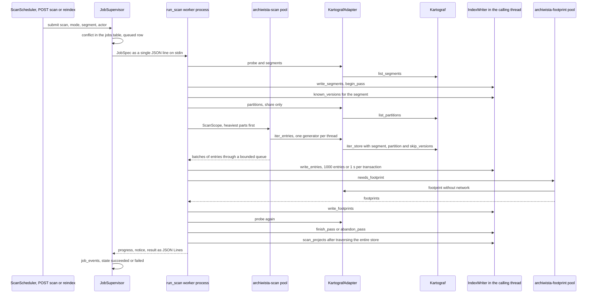

# Archiwista Architecture

**Version described:** release code 0.2.0 "Podglądy" (Previews) (`pyproject.toml`).
History: [`CHANGELOG.md`](CHANGELOG.md), state:
[`PROGRESS.md`](PROGRESS.md), instructions:
[`USAGE.md`](USAGE.md), [`AGENT_API.md`](AGENT_API.md).
Measurements and acceptance: [`reports/v0.2-measurements.md`](reports/v0.2-measurements.md);
standards: [`CLAUDE.md`](../CLAUDE.md) and the Nogat standard 2.1.

Every claim about the behaviour of the system describes the **code** in this repository
(`src/`, `tests/`), not a plan or a spec. Requirements and scope are in
[`PRD.md`](PRD.md), [`SCOPE.md`](SCOPE.md) and [`SPEC.md`](SPEC.md), decisions
(A-ADR-0xx) in [`DECISIONS.md`](DECISIONS.md), contracts between steps of v0.1
in [`plans/2026-10-18-plan-v0.1.md`](plans/2026-10-18-plan-v0.1.md). Where the code departs from the spec or the plan,
the document describes the code and says so explicitly. References point to a module and symbol
(to be found with `grep`), never to a line number.

Not to be confused with Kartograf's `docs/ARCHITECTURE.md`: it holds the contract of the store
format (`data/`, sidecar `kartograf-meta/1`, manifest
`kartograf-project/1`), to which the spec refers with the shorthand "ARCH".

---

## 1. Purpose and boundaries

Archiwista 0.2 runs locally: FastAPI on `127.0.0.1`, a browser
interface, an API and a CLI. The store catalog comes from Kartograf's public API
and a rebuildable local SQLite index; own data comes
from separately scanned project folders. `state.sqlite` holds
accounts and permissions that are not rebuildable (A-ADR-029).

**The producer's store is read-only.** Scan, card, preview, footprints,
link confirmation and project status write nothing to it.
`tests/integration/test_read_only_store.py` and the preview security tests
guard this boundary. The exception concerning projects:
`owndata/snapshots.py:make_snapshot` writes, on the command of a person
with `project.write`, a full snapshot of a file in `<data folder>/.wersje/`
(`archiwista-snapshot/1` in `migawka.json`); it does not change the manifest.
The index, preview cache, areas and jobs remain strictly local.

**Producers through the public API, in adapters.** Knowledge of the store
layout belongs to the producer (A-ADR-014). Archiwista does not walk the `data/` tree
itself, but calls the names from `kartograf.__all__` — `list_segments`,
`list_partitions`, `iter_store`, `read_sidecar`, `describe_segment`,
`file_footprint`, `link_target`, `pinned_transform`, `open_project`,
`get_project_status`, `countries_for_bbox`, `find_sheets_for_bbox`,
`SheetParser` — and only in `src/archiwista/adapter/kartograf/`
(section 2.2). The rest of the application knows only the source interface
`src/archiwista/sources/`. A missing Kartograf function is a requirement on
Kartograf (SPEC 12), not a workaround in Archiwista. The adapter reads Kartograf
`>=0.8.0.dev0,<0.9` with KA-1..KA-6 (`SUPPORTED_VERSIONS`: while a commit is pinned the
range starts at the development version, REL-5.6; the release narrows it to `>=0.8.0`).

**Release boundaries:** Archiwista does not download data or run
producer commands (v0.3), does not write or delete store files,
does not delete snapshots. `JOB_KINDS` now includes `scan`, `footprints`,
`link_check`, `preview`, `own_scan`, `snapshot`, `availability` (v0.3:
what the source has for an area, ADR-035) and `check` (v0.3: what a run of a
producer's command would do in a store, ADR-036). The `footprints`, `availability`
and `check` jobs use the network only after offline mode is turned off. Data without a footprint
stays in the catalog with a reason, and the interface does not load libraries from a CDN.

---

## 2. Module map

### 2.1 Modules

The tables list the main modules of the `src/archiwista/` package and their symbols;
they are no longer an exhaustive list of helper files. The methods of `IndexWriter`,
`IndexQueries` and `JobSupervisor` are described in sections 4–5.

**Entry points: CLI, server, application**

| Module | Role | Key symbols |
|---|---|---|
| `cli.py` | the `archiwista` command (`[project.scripts]`); `umask 077` on POSIX; dispatches subcommands | `main` |
| `server.py` | `archiwista serve` (`127.0.0.1` only: socket, startup token, Uvicorn, job supervisor and scheduler) and `archiwista token` | `serve_main`, `token_main`, `LocalServer`, `LaunchFile`, `bind_loopback`, `open_in_browser`, `uvicorn_log_config`, `LIMIT_CONCURRENCY` |
| `app.py` | FastAPI application factory: shared objects in `app.state`, routers under `/api/v1`, API documentation, interface files, `SecurityMiddleware` | `create_app`, `WEB_DIR` |
| `reader.py` | read commands `status`, `sources`, `search`, `entry`, `version`, `projects`, `project` built on API functions and models | `add_read_commands`, `read_main`, `search_filters`, `READ_COMMANDS` |
| `admin.py` | commands `users`, `groups`, `share`, `state export` and `state import`, run as `LOCAL_OWNER` | `add_admin_commands`, `admin_main`, `ADMIN_COMMANDS` |
| `doctor.py` | `archiwista doctor`: diagnostics without writing — settings, plugins, stores and project directories, data directory, port | `run_doctor`, `doctor_main`, `DoctorCheck`, `DoctorReport`, `source_check`, `is_port_available`, `REQUIRED_PRODUCERS` |
| `commands/previews.py`, `commands/layers.py`, `commands/compare.py`, `commands/owndata.py` | v0.2 CLI shared with the API services: `preview`, `layers`, `compare`, `files`, `file`, `snapshot`, `own-scan` | `add_commands`, `main` in each module |
| `commands/producer_commands.py` | v0.3 CLI of the producers' commands over `services/commands.py` (ADR-034): `commands list`, `parse`, `validate`, `format` | `add_commands`, `main` |
| `commands/availability.py` | v0.3 CLI of the availability at the source over `services/availability.py` (ADR-035): `availability show` (the kept report) and `availability check` (the `availability` job in the foreground unless a fresh report answers) | `add_commands`, `main` |
| `commands/jobs.py` | v0.3 CLI of the jobs of producers' commands over `services/actions.py` (ADR-036): `jobs start` (the job in the foreground, printed as it ended) and `jobs plan` (the plan a `check` job kept) | `add_commands`, `main` |

**HTTP and security**

| Module | Role | Key symbols |
|---|---|---|
| `security.py` | local-mode rules for every request, one-time tokens, in-memory sessions, CSP, token redaction in logs | `SecurityMiddleware`, `SessionStore`, `Session`, `issue_one_time_token`, `redeem_one_time_token`, `revoke_agent_sessions`, `session_principals`, `require_session`, `current_principal`, `csp_header`, `fragment_url`, `TokenRedactionFilter` |
| `api/__init__.py` | path constants | `API_PREFIX` (`/api/v1`), `DOCS_PATH` (`/api/docs`) |
| `api/dependencies.py` | route dependencies taken from `app.state` | `authorizer`, `index_queries`, `settings_service`, `plugin_registry`, `visible_projects` |
| `api/errors.py` | RFC 9457 problems with the codes of the Nogat registry; the same `Problem` serves the CLI | `ApiError`, `problem_body`, `problem_response`, `problem_responses`, `install_error_handlers` |
| `api/language.py` | the outermost middleware: the language of a request from `Accept-Language`, `Content-Language` and `Vary` | `LanguageMiddleware` |
| `api/models.py` | Pydantic models of requests and responses (except the session and administration models, which live next to their routers) — also the OpenAPI schema | `CatalogFilters`, `MapFilters`, `IndexAnswer`, `CatalogPage`, `SlotCard`, `VersionCard`, `MapView`, `Health`, `StoreDetail`, `ProjectCard`, `JobDetail`, `Area`, `AreaCoverage`, `Settings`, `ProblemDetails` |
| `api/docs.py` | OpenAPI (`operationId` = route function name) and local Swagger UI from `api/swagger/` | `install_docs`, `operation_id`, `openapi_document` |
| `api/session.py` | `/session`: token exchange, session state, logout, agent tokens | `exchange_token`, `read_session`, `end_session`, `issue_token`, models `SessionExchange`, `NewSession`, `SessionState`, `OneTimeToken` |
| `api/health.py` | `/health`, `/sources` | `read_health`, `source_infos`, `source_list` |
| `api/stores.py` | `/stores`, `/stores/{store}` | `read_stores`, `read_store` |
| `api/slots.py` | catalog and cards: `/slots`, `/products`, `/stores/{store}/slots/{slot}`, `/stores/{store}/versions/{version}` (with `/sidecar`), `/requests/{parent_request}` | `search_slots`, `read_products`, `slot_card`, `version_card`, `copy_path`, `geo_adapter`, `checked_store` |
| `api/map.py` | `/map/footprints`, `/map/sheets` | `map_view`, `sheet_list` |
| `api/projects.py` | `/projects`, `/projects/{project}`, `/projects/{project}/status` | `read_projects`, `project_card`, `check_project` |
| `api/settings.py` | `GET` and `PUT /settings` | `save_settings`, `settings_writer` |
| `api/areas.py` | `POST /areas`, `/areas/{area_id}`, `/local-coverage` | `save_area`, `save_area_file`, `read_area`, `read_local_coverage`, `REFRESH_TIMEOUT_S` |
| `api/jobs.py` | background jobs over HTTP and the SSE stream | `start_scan`, `start_footprints`, `start_link_check`, `list_jobs`, `get_job`, `get_job_events`, `job_event_stream`, `sse_message`, `JobStreams`, `EventStreamResponse` |
| `api/admin.py` | `/users`, `/groups`, `/projects/{project}/access` | models `User`, `Group`, `ProjectAccess`, `AccessChange` and routes named after the functions of `services/access.py` |
| `api/previews.py`, `api/models_previews.py` | description, building, PNG, tiles, objects and ZIP members of a store version | `get_preview`, `build_preview`, `PreviewInfo` |
| `api/owndata.py`, `api/models_owndata.py` | project files, folder, snapshots, scan, previews of own files | `read_own_files`, `snapshot_plan`, `start_snapshot`, `start_own_scan`, `OwnFilesQuery` |
| `api/layers.py`, `api/models_layers.py` | local years and campaigns, thumbnails and tiles of layers | `get_local_layers`, `get_layer_thumbnail`, `get_layer_tile`, `LayersQuery` |
| `api/compare.py`, `api/models_compare.py` | comparison of two `ref`s | `get_comparison`, `CompareQuery` |
| `api/commands.py`, `api/models_commands.py` | the producers' commands (ADR-034): their catalog, a pasted line read into a call, a call checked without the network, the line of a call; a `422 unsupported` of a producer without commands | `list_commands`, `parse_command`, `validate_command`, `format_command`, `CommandList`, `CommandCallItem`, `CommandLine`, `ValidateRequest` |
| `api/availability.py`, `api/models_availability.py` | the availability at the source (ADR-035): `POST /availability` answers a kept report younger than seven days (`200`) or starts the `availability` job (`202`; `job_router`, served with the supervisor), `GET /availability` returns the kept report without the network | `check_availability`, `get_availability`, `AvailabilityInfo`, `AvailabilityRequest`, `AvailabilityQuery` |
| `api/actions.py`, `api/models_actions.py` | the jobs of producers' commands (ADR-036; `router`, served with the supervisor): `POST /jobs` starts a job of a command of the catalog on a configured store (`202`), `GET /jobs/{job}/plan` returns the plan a `check` job kept | `start_job`, `get_job_plan`, `JobRequest`, `ActionPlanInfo`, `PlanEntryItem` |

**Services, permissions, state**

| Module | Role | Key symbols |
|---|---|---|
| `services/problems.py` | a problem with a Polish description and a repair instruction | `Problem`, `explain`, `KNOWN_PROBLEMS` |
| `services/stores.py` | store state for the "Magazyn" (Store) view | `store_summary`, `StoreSummary`, `issue_problem` |
| `services/projects.py` | project card and live producer status | `project_detail`, `ProjectDetail`, `project_problems`, `project_status` |
| `services/access.py` | accounts, groups and project access — for HTTP and the CLI | `list_users`, `add_user`, `update_user`, `remove_user`, `list_groups`, `add_group`, `set_group_members`, `remove_group`, `project_access`, `share_project` |
| `services/owndata.py` | folder checking and project file problems | `set_data_dir`, `folder_check`, `folder_problems`, `file_problems` |
| `services/layers.py` | local layers of a product and layers of an own file | `read_local_layers`, `read_own_file_layers`, `LayerMemo` |
| `services/compare.py` | comparison of metadata and schema, not of object data | `compare` |
| `services/commands.py` | producers' commands for HTTP and the CLI (ADR-034): the catalogs of the producers that offer them, `parse`, `validate` (a command of the catalog, the configured store's root, no file path of a request) and `format` | `list_commands`, `parse_command`, `validate_command`, `checked_call`, `command_info`, `format_command`, `actions`, `store_root` |
| `services/actions.py` | the jobs of producers' commands for HTTP and the CLI (ADR-036): `start` refuses before a job exists what the worker would refuse (a store that is not configured, a command outside the catalog, on no store or without a check, a file path, the producer's refusal of the options, offline mode) and submits the job with the options as the producer read them; `kept_plan` returns the plan a `check` job kept, for a job the principal sees | `start`, `kept_plan`, `ActionKind`, `ACTION_KINDS` |
| `services/availability.py` | the availability at the source for HTTP and the CLI (ADR-035): the area, the products the producer checks, a kept report younger than `REPORT_TTL` (seven days, Kartograf's metadata cache TTL) unless `force`, else the `availability` job; the kept report without the network. Without I/O, a report's rows (SPEC 6.3, 6.4): one per country and year, its variants (the formats of one set grouped, ADR-017; the default format the first of `DEFAULT_FORMATS`, ASC then TIFF, else none and an explicit choice; the size of the default format) ranked complete, full share (equal to a millionth of a percent), fewer campaigns, finer resolution, report order; a year without a variant of the `VariantFilter` is `no_data`; the label as structure (`CoverageLabel`: `full`, `full_campaigns`, `partial`, `no_data`; the campaigns of the sheet records, the percent rounded down and at most 99 when partial, `below_one`). `summary` adds each variant's `StoreBadge` from `IndexQueries.held_units` (present versions of the combination's dataset, sheets, year and campaigns; height systems are not told apart until Kartograf names a combination's segment); `known_store` refuses a store that is not configured (`404`). `api/models_availability.py` renders the labels and badges in the request's language (`coverage_text`, `plural_form` of `messages`) | `check`, `stored`, `rows`, `summary`, `variants`, `coverage_label`, `known_store`, `AreaAvailability`, `AvailabilityRow`, `AvailabilityVariant`, `CoverageLabel`, `StoreBadge`, `VariantFilter`, `NO_DATA`, `DEFAULT_FORMATS`, `REPORT_TTL` |
| `auth/principal.py` | who acts | `Principal`, `PrincipalKind`, `LOCAL_OWNER`, `SCHEDULER`, `LOCAL_PRINCIPAL_ID`, `LOCAL_ROLES` |
| `auth/authorize.py` | the only place where permission decisions are made | `Authorizer`, `ACTIONS`, `principal_for`, `session_principal` |
| `auth/visibility.py` | which projects are visible | `ProjectVisibility`, `ALL_PROJECTS`, `access_key` |
| `state/schema.py` | schema and migrations of `state.sqlite` | `initialize`, `MIGRATIONS`, `STATE_SCHEMA_VERSION` |
| `state/store.py` | reading and changing the state database together with the permissions log | `StateStore`, `UserRecord`, `GroupRecord`, `ProjectAccessRecord`, `PermissionChange`, `StateSnapshot` |
| `state/export.py` | the `archiwista-state/1` copy of the state database | `export_state`, `import_state`, `dump_state`, `parse_state`, `StateDocument`, `STATE_DOCUMENT_SCHEMA` |

**Index**

| Module | Role | Key symbols |
|---|---|---|
| `index/schema.py` | SQLite schema, connection settings, rebuild on version change | `SCHEMA_VERSION`, `initialize`, `connect`, `IndexUnsupportedError`, `MIN_SQLITE_VERSION` |
| `index/writer.py` | writing the index from source interface types (never from Kartograf objects) | `IndexWriter` |
| `index/queries.py` | catalog, map, products, own data and snapshots, projects, state | `IndexQueries` |
| `index/scanner.py` | store scan and view refresh | `scan_store`, `refresh_view`, `ScanProgress`, `ScanNotice`, `ScanSummary`, `SegmentScan`, `BATCH_ENTRIES`, `BATCH_SECONDS`, `FOOTPRINT_THREADS`, `REFRESH_VIEW_MAX_UNITS` |
| `index/projects.py` | discovering and indexing project manifests | `scan_projects`, `ProjectScanSummary`, `PROJECT_MANIFESTS`, `MAX_PROJECT_DEPTH` |
| `index/coverage.py` | local coverage in a planar coordinate system | `measure_coverage`, `planar_crs`, `PLANAR_CRS`, `CoverageShape`, `CoverageMeasure` |
| `index/geometry.py` | helper GeoJSON functions in WGS84 | `polygon_bounds`, `is_box`, `box_geometry`, `require_wgs84_area`, `require_wgs84_bbox` |
| `index/types.py` | index query and response types, limits | `SlotQuery`, `MapQuery`, `SlotPage`, `SlotDetail`, `VersionDetail`, `FootprintPage`, `IndexStatus`, `StoreIndexState`, `StoreFreshness`, `AreaRecord`, `SlotUnit`, `ScanPass`, `BatchResult`, `PassSummary`, `DEFAULT_PAGE_LIMIT`, `MAX_PAGE_LIMIT`, `MAP_FOOTPRINT_LIMIT`, `MAX_GRID_COLUMNS` |

**Background jobs**

| Module | Role | Key symbols |
|---|---|---|
| `jobs/supervisor.py` | job supervisor: queue, worker processes, events, crash recovery, history pruning | `JobSupervisor`, `JobRecord`, `JobEvent`, `JobError`, `JobPage`, `ScanHistory`, `INDEX_JOB_KINDS`, `NETWORK_JOB_KINDS`, `MAX_NETWORK_JOBS`, `STOP_TIMEOUT_S`, `WORKER_COMMAND`, `default_max_jobs` |
| `jobs/worker.py` | job worker process: scan, footprints, link, preview, own scan, snapshot, availability at the source, the plan of a run (`check`; a plan with positions not checked ends `partial` through `PartialResult`) | `main`, `RUNNERS`, `run_scan`, `run_footprints`, `run_link_check`, `run_own_scan`, `run_snapshot`, `run_availability`, `run_check`, `PartialResult`, `Emitter` |
| `jobs/protocol.py` | JSON Lines protocol supervisor ↔ worker process | `JobSpec`, `WorkerMessage`, `encode_spec`, `decode_spec`, `encode_message`, `decode_message`, `PROTOCOL_VERSION`, `JOB_KINDS`, `INTERRUPTED_EXIT`, `CODE_WORKER_CRASHED` |
| `jobs/scheduler.py` | periodic scans of the store and own data | `ScanScheduler`, `plan_scans`, `plan_own_scan`, `PlannedScan` |
| `jobs/reindex.py` | `archiwista reindex`: full foreground scan | `reindex_main` |
| `jobs/availability.py` | whether the store can be read now (an empty mount point of a known store = unavailable), as the error a job raises: `store_unavailable` with the reason and the hint of the probe | `store_unreachable` |
| `jobs/foreground.py` | tracking foreground CLI jobs | `run_foreground` |

**Areas**

| Module | Role | Key symbols |
|---|---|---|
| `areas.py` | areas: validation, measurement, file copies, launching the reader | `AreaFiles`, `area_from_geometry`, `read_area_file`, `area_from_file`, `keep_copy`, `discard_copy`, `prune_area_copies`, `area_id`, `area_crs`, `check_body_size`, `AREA_BODY_LIMIT_BYTES`, `AREA_READ_TIMEOUT_S`, `AREA_COPY_MAX_AGE`, `AREA_READER_COMMAND` |
| `area_reader.py` | process reading an untrusted area file (GDAL via `pyogrio`) | `main`, `read_area`, `AreaFileError`, `MAX_VERTICES`, `MAX_MEMBERS`, `UNPACKED_LIMIT_BYTES` |

**Previews and own data**

| Module | Role | Key symbols |
|---|---|---|
| `refs.py` | `version:`, `file:`, `snapshot:` references and a visibility check before reading | `ObjectResolver`, `parse_ref`, `format_ref` |
| `sandbox.py`, `formats.py` | process isolation and explicit file-reading drivers | `untrusted_env`, `file_format`, `open_raster` |
| `previews/service.py`, `previews/cache.py` | preview by `ref`, content-addressed cache and LRU with a local `cache.sqlite` | `PreviewService`, `PreviewCache`, `cache_key`, `RENDERER_VERSIONS` |
| `previews/pool.py`, `previews/worker.py` | queue and rendering processes (time, memory, answers without paths) | `RenderPool`, `default_render_workers`, `answer_line` |
| `previews/build.py`, `previews/compose.py`, `previews/tiles.py` | building the local COG, layer thumbnails/tiles, forced cartographic operation | `run_preview`, `layer_tile`, `layer_thumbnail`, `warp` |
| `owndata/scan.py`, `owndata/reader.py` | folder scan, restricted file-reading process | `scan_own_data`, `OwnReader`, `check_own_folder` |
| `owndata/content.py`, `owndata/snapshots.py`, `owndata/document.py` | logical GeoPackage content, consistent copy, atomic snapshot and open manifest | `consistent_sqlite_read`, `check_snapshot`, `make_snapshot`, `SnapshotDocument` |

**Sources and adapters**

| Module | Role | Key symbols |
|---|---|---|
| `sources/protocol.py` | adapter protocols (`runtime_checkable`): required and optional capabilities, the producer's commands as data, the availability at the source, the plan of a run and the run with the scope that reads its files again among them (`ActionAdapter`, ADR-034, ADR-035, ADR-036, ADR-037) | `SourceAdapter`, `SourceFactory`, `SegmentDescriptionAdapter`, `SegmentedAdapter`, `CurrentVersionAdapter`, `PartitionedAdapter`, `GeoAdapter`, `LinkCheckAdapter`, `SheetGridAdapter`, `DefaultRootAdapter`, `ActionAdapter`, `CoordinateTransformer` |
| `sources/types.py` | shared producer-independent types | `SourceContext`, `ScanScope`, `SourcePartition`, `SourceState`, `DefaultRoot`, `DefaultRootSource`, `SourceSegment`, `SourceEntry`, `SourceObservation`, `EntryMeta`, `Footprint`, `ProjectInfo`, `ProjectTask`, `ProjectPin`, `SheetGrid`, `SourceStatus`, `CommandInfo`, `CommandOption`, `CommandChoice`, `CommandCall`, `OptionType`, `PathRole`, `CommandWrites`, `AvailabilityReport` (with `to_json`, `from_json`), `AvailabilityArea`, `AvailabilityCombination`, `AvailabilitySheet`, `AvailabilityCampaign`, `AvailabilityFailure`, `AvailabilityNotice`, `ActionPlan` (with `to_json`, `from_json`, `counts`, `todo`, `size_bytes`, `size_complete`), `PlanEntry`, `PlanStatus`, `PLAN_STATUSES`, `PLAN_TODO`, `ActionResult` (with `failed`), `ActionFile`, `ActionItem`, `ActionProgress`, `FileStatus`, `ItemStatus`, `RunStatus`, `FILE_STATUSES` |
| `sources/registry.py` | plugins from entry points of the `archiwista.sources` group, their states and adapters; the default root of a producer that has one (ADR-033) | `SourceRegistry`, `PluginRegistry`, `load_registry`, `check_package`, `install_requirement`, `source_fix`, `source_error`, `read_default_root`, `ENTRY_POINT_GROUP`, `APP_DISTRIBUTION` |
| `adapter/kartograf/__init__.py` | plugin factory: compares the installed Kartograf with Archiwista's pin before import | `load`, `PRODUCER`, `PACKAGE`, `SCHEMAS` |
| `adapter/kartograf/adapter.py` | Kartograf adapter with all optional capabilities | `KartografAdapter`, `UNIT_CACHE_FILE` |
| `adapter/kartograf/actions.py` | Kartograf's commands as producer-neutral ones (ADR-034): the catalog of `list_commands` and `command_schema` (the options of a call without the store root and the flags of a run), `parse_command`, `validate_command` (`root=` for a command on a store, never the default root) and `format_command`; a refusal as Kartograf's `error_report` in the call's language; `check_availability` with Archiwista's own `MetadataCache` (`metadata.db` in the adapter's cache directory, never `cache=True`) and the area as the envelope of its polygon in EPSG:2180 (EPSG:5514 for CZ alone) with `country` `pl`, `cz` or `auto` (ADR-035), its report converted to `AvailabilityReport`; `check_command` with `root=` and the same cache, its `kartograf-plan/1` converted to `ActionPlan` (no size: KC-3; a refused root is the plan's one `conflict`; ADR-036); `run_command` with `root=`, the same cache and a kept plan as `update="upgrade", plan=…`, its `kartograf-download/1` read as `ActionResult` (`files[]` below the root; a plain or outside file is a `BrokenContractError`), `DownloadProgress` counting units, and the scan scope of a standard path, `<segment>` and `<slot directory>/<stem>` (ADR-037) | `catalog`, `parse`, `validate`, `format_line`, `call_error`, `availability`, `availability_products`, `area_request`, `check`, `run`, `scope`, `BESIDE_OPTIONS`, `METADATA_CACHE_FILE`, `AVAILABILITY_COMMAND` |
| `adapter/kartograf/marker.py` | judges the store marker by file name and schema, no import of Kartograf (ADR-031): a marker of `kartograf-store/1`, a marker of another schema, the marker of another tool, no marker with or without a layout | `refusal`, `Refusal`, `MARKER`, `MARKER_SCHEMA`, `OTHER_MARKERS` |
| `adapter/kartograf/unit_cache.py` | local cache of unit footprints (TERYT, KU, SM5) for `file_footprint` | `UnitBBoxCache` |
| `sources/markers.py` | file names of the producers' store markers (DEV-19.12): an adapter refuses a foreign store by the file name alone, importing no other producer | `STORE_MARKERS`, `foreign_markers` |
| `adapter/imgw/__init__.py` | IMGW plugin factory: compares the installed IMGWTools with the range `SUPPORTED_VERSIONS` before the import (ADR 0032) | `load`, `PRODUCER`, `PACKAGE`, `SUPPORTED_VERSIONS`, `SCHEMAS` |
| `adapter/imgw/adapter.py` | IMGWTools adapter for IMGW-PIB and ČHMÚ: the entries of `iter_store` (versions of `ScanScope.known_versions` come back as `skipped`, with no sidecar read: `skip_versions`) with the producer's slot key, a slot name for people and an observation record; the description of a dataset from the IMGWTools registry (a Polish name, the country of its provider and the family of the dataset as a product; `SegmentDescriptionAdapter`); the current version of a slot from IMGWTools (`current_version`: `CurrentVersionAdapter`; a slot with a damaged version has none); the default store root from `store_root()` (`DefaultRootAdapter`, ADR-033); the verdicts of `probe` by the marker and the codes of `StoreInfo.problem_codes`; metadata, the country of a file, projects; it never imports `pyarrow` | `ImgwAdapter` |

**Shared**

| Module | Role | Key symbols |
|---|---|---|
| `config.py` | local paths, TOML settings, validation, atomic write, change notification | `AppPaths`, `AppSettings`, `StoreConfig`, `BasemapConfig`, `ConfigStore`, `SettingsService`, `parse_settings`, `validate_settings`, `detect_store_kind`, `write_text_atomic`, `DEFAULT_BASEMAPS` |
| `config.py` (`AppSettings`) | v0.2 options | `preview_cache_limit_gb`, `own_data_dirs`, `DEFAULT_BASEMAPS` (OpenFreeMap vector, GUGiK OSM raster) |
| `paths.py` | private directories and index paths within the root | `private_directory`, `indexed_path`, `resolve_indexed_path`, `PRIVATE_DIRECTORY_MODE` |
| `wal.py` | the switch of the index, the state database, the preview cache and the Kartograf adapter's unit cache to WAL, tried again while another process switches a new file | `use_wal` |
| `errors.py` | application exceptions | `ArchiwistaError`, `SourceUnavailableError`, `SourceIncompatibleError`, `ProducerError`, `BrokenContractError`, `CommandRequestError`, `PathOutsideRootError`, `IndexQueryError`, `PermissionDeniedError`, `NotFoundError`, `ConflictError`, `JobConflictError`, `OfflineModeError`, `AreaTooLargeError`, `AreaUnreadableError`, `AreaTooComplexError`, `StateError`, `SnapshotError` |
| `error_document.py` | one description of an error for every interface: `Problem`, the `archiwista-error/1` document and the refusal of a command | `Problem`, `describe`, `refuse`, `error_document`, `validation_problem`, `language_of` |
| `messages/` | the message catalog: every text for a person in English and Polish, one module per area; rendered in the language of the request or of the command | `Text`, `Message`, `message`, `localize`, `localize_json`, `dump`, `load`, `language`, `STORED_LANG` |

### 2.2 Direction of dependencies


The diagram describes the flow of data, not every import edge. `api/`
uses `services/`, `refs.py:ObjectResolver` and `index/`, and checks
visibility before a preview (`PreviewService`). `previews/pool.py` routes
requests to `previews.worker` processes; `jobs/worker.py` runs the scan,
the preview build, the own-data folder scan and the snapshot across separate
process boundaries. Reading untrusted files uses `sandbox.py:untrusted_env`
and `formats.py:open_raster` / `vector_source`. `owndata.reader` reads the
folder without changing it, and `owndata.snapshots:make_snapshot` is the only
write path in the project directory. The producer is reachable only through
an adapter with a public API.

**Rules enforced by tests** (`tests/contract/`):

- `kartograf` (and `imgwtools`) is imported only by its adapter
  (`src/archiwista/adapter/kartograf/`, `src/archiwista/adapter/imgw/`) —
  `test_imports.py::test_producers_are_imported_only_in_their_adapters`;
- the Kartograf adapter imports only `from kartograf import …` with names
  from `kartograf.__all__` —
  `test_imports.py::test_kartograf_adapter_uses_only_public_api`;
- every module outside `archiwista.adapter` imports without IMGWTools and
  without loading Kartograf, the Kartograf plugin has the state `available` and the
  IMGW plugin `not_installed` —
  `test_imports.py::test_archiwista_starts_without_imgwtools`;
- a producer without optional capabilities satisfies `SourceAdapter`
  (`test_source_protocol.py`); plugin states (`not_installed`,
  `incompatible`, `error`) and a second plugin alongside Kartograf —
  `test_plugins.py`; the Kartograf API contract and the test store —
  `test_kartograf.py`, `test_store_fixture.py`.

**Rules adopted in the code (without a separate test):**

- nobody imports `archiwista.adapter`: the adapter is obtained from the plugin
  registry through the entry point `kartograf = "archiwista.adapter.kartograf:load"`;
- FastAPI and Starlette are imported only by `api/`, `app.py` and `security.py`
  (`server.py`: Uvicorn and `starlette.types`); in `jobs/` indirectly only
  `reindex.py` (through `api.errors.problem_of`); `index/`, `services/`,
  `auth/`, `state/` and `sources/` do not know them;
- `index/` does not import `api`, `jobs`, `services`, `security`, `app` or
  `server`; `services/` does not import `api`;
- routes do not filter projects themselves: they take `visible_projects` and pass
  them to queries and services (`api/dependencies.py`, section 7);
- the CLI does not create a second read implementation: `reader.py` uses
  the shared index queries, services and API models, and it routes the preview, comparison,
  layers and project files through the same services and
  `RenderPool`; the `--json` output keeps the contract of the HTTP models.

---

## 3. Processes and threads

| Process | Started by | What it does | Communication |
|---|---|---|---|
| server `archiwista serve` | user | Uvicorn with the `create_app` application, `JobSupervisor`, `ScanScheduler`; index reads and short, bounded store reads | HTTP on `127.0.0.1:<port>` |
| job worker process | `JobSupervisor`, one per job, in its own process group (`python -P -m archiwista.jobs.worker`) | `RUNNERS`: `run_scan`, `run_footprints`, `run_link_check`, `run_own_scan`, `run_snapshot`, `run_preview`, `run_availability` (the producer's `check_availability` with its metadata cache under `cache/<producer>/`, ADR-035), `run_check` (the producer's `check_command` with `root=` the store's directory and the same cache, ADR-036) | stdin: `JobSpec`; stdout: JSON Lines `WorkerMessage`; stderr: `jobs/<id>.log` |
| rendering pool | `RenderPool`, by default `min(4, cpu)` long-lived processes `python -P -m archiwista.previews.worker` | GDAL, OGR, laspy and ZIP: open attempt, thumbnail, tile, objects, ZIP and layer composition; time and memory limit, process restart after an error | queue ≤ 64, a shared request counted once, files in `previews/` |
| own-data reader | `OwnReader` (`owndata/reader.py`) | one file from the folder at a time, GDAL in an isolated process; GeoPackage read consistently without writing at the source | response with metadata for the scan |
| area reader | `read_area_file` (`AREA_READER_COMMAND`: `python -P -m archiwista.area_reader`) | GDAL reads an untrusted area file, 30 s limit | one JSON line on stdout |
| CLI commands | human, script, agent | `reader.py`, `commands/`, `admin.py`, `reindex`, `token`, `doctor`; for the build and the snapshot its own supervisor | stdout, stderr; no server needed |
| browser | `open_in_browser` or a human | the `web/` interface | `fetch` to `/api/v1`, SSE through `fetch` |

The `-P` flag keeps the current directory (the `jobs/` directory) out of `sys.path`.
Running GDAL, the scan and the footprint download outside the server process
(A-ADR-007) means that a crash of a native library or the interruption of a
job does not bring down the interface.

**Server threads.** The Uvicorn event loop serves `async` routes
and SSE streams (index reads through `asyncio.to_thread`); ordinary (`def`)
routes and `run_in_threadpool` run in the Starlette thread pool. Uvicorn
accepts at most `LIMIT_CONCURRENCY` (100) connections at a time, the following ones get
`503`. The server's own threads: `archiwista-scheduler` (the `ScanScheduler` loop,
every `TICK_S` = 60 s), `archiwista-probe-<store>` (a probe of an unavailable
store, at most `PROBE_TIMEOUT_S` = 10 s), `archiwista-job-<id>` (the reader of
stdout of one worker process in `JobSupervisor`), a `threading.Timer`
killing an interrupted process after `STOP_TIMEOUT_S` (30 s), a timer removing the
startup file after the token validity ends, and the `webbrowser.open` thread. Listeners of
`JobSupervisor.subscribe` run in the supervisor thread under its lock, so the
SSE stream only wakes up through `loop.call_soon_threadsafe`.

**Threads of the scan worker process.** The thread calling `scan_store` is
the only user of `IndexWriter`. The `archiwista-scan` pool (`_Readers`)
executes the `iter_entries` calls, one generator per thread from the first
to the last entry, and passes entries in chunks (`_READ_CHUNK` = 256) through a
bounded queue (`_QUEUE_CHUNKS_PER_THREAD` = 2 chunks per thread), which
keeps in memory only entries that have been read but not yet written. The
`archiwista-split` pool splits segments into parts in parallel, and the
`archiwista-footprint` pool (`_Footprints`) computes footprints without the network. The thread
`archiwista-supervisor` waits for the end of stdin: when the supervisor disappears, the process
terminates itself. The thread counts are chosen by `_target`: a store on a share
(`StoreConfig.kind` = `share`) is read by `AppSettings.scan_threads`
threads (8 by default), and footprints are computed by `FOOTPRINT_THREADS` (4) threads;
a local store is read by one thread in whole segments and one thread computes
footprints, because there the scan is limited by the CPU under the GIL.

**One writer.** Within a run the index is written only by the calling thread,
in batches: `BATCH_ENTRIES` (1000) entries or whatever arrived within
`BATCH_SECONDS` (1 s) of the first entry of the batch — one transaction per
batch. Between processes writes are serialised by SQLite (WAL, `BEGIN IMMEDIATE`,
`busy_timeout` 10 s; readers do not wait), and the supervisor allows at most
one job writing a store's index (`INDEX_JOB_KINDS`: `scan`,
`footprints`): it checks this in the `jobs` table, so also against jobs of another
process, e.g. `archiwista reindex` (`JobConflictError` → `409 conflict`).
Besides the scan write thread, the index is written by: the supervisor (`jobs`, `job_events`,
`IndexWriter.sync_stores`), the server (`refresh_view` and `write_area`
in the area routes, `session_tokens`) and the other jobs in worker
processes — `footprints` (`write_footprints`) and `link_check`
(`record_issue`, `clear_issue`).

**The server process does not render data.** Short store reads are
`refresh_view` in `GET /local-coverage`, the access probe and the project status
without hashing; rendering is handed by `RenderPool` to `previews.worker`.
`own_scan` uses `OwnReader`, and the snapshot (`make_snapshot`) and the COG build
(`run_preview`) take place in job processes with additional restrictions
on child processes. `sandbox.untrusted_env` disables GDAL and PROJ
network connections, credentials and `.aux.xml` writing; explicit drivers
and `GDAL_DISABLE_READDIR_ON_OPEN=EMPTY_DIR` block foreign files next to
the source. `consistent_sqlite_read` handles three WAL/journal states.

---

## 4. Local data

The local location is determined by `AppPaths.default()` through `platformdirs` (Linux:
`~/.config/archiwista/` and `~/.local/share/archiwista/`). Apart from these,
Archiwista writes **only** snapshots in the project directory, on the command
of a person with `project.write`; the store remains unchanged.

| Path (`AppPaths`) | Contents | Rebuildable | Who writes |
|---|---|---|---|
| `config_file` = `config.toml` | `AppSettings`: port, offline mode, store and project directories, `own_data_dirs` (an exception to `<project directory>/dane/`), `preview_cache_limit_gb` (20), `basemaps` (OpenFreeMap vector and OSM GUGiK by default) and permissions | no (wizard or Settings) | `SettingsService.update` → `ConfigStore.save` |
| `index_file` = `index.sqlite` (+ `-wal`, `-shm`) | index of stores, projects, own files, snapshots and areas, job history, token hashes | yes, schema 6 rebuilt with a full scan | `IndexWriter`, `JobSupervisor`, `security.py` |
| `state_file` = `state.sqlite` | accounts, groups, roles, project access, permissions log | **no** — backup with `archiwista state export` | `StateStore` |
| `cache_dir` = `cache/<producer>/` | plugin cache (`SourceContext.cache_dir`); Kartograf: `unit_bboxes.sqlite` (`UnitBBoxCache`) | yes, from the network | adapter |
| `jobs_dir` = `jobs/` | `<id>.log` (stderr of the worker process), `owner-<pid>.lock` (job supervisor lock) | logs not needed for operation | `JobSupervisor`, worker processes |
| `areas_dir` = `areas/` | `<id>/area.*` (copy of the area file), `.incoming/<random>/` (file being read) | load the file again | `AreaFiles` |
| `open-<random>.html` in the data directory | start page with the token address for the browser (`LaunchFile`, `0600` file) | — | `serve_main`; disappears after the token is used, after 10 min and on shutdown |
| `previews_dir` = `previews/` | `cache.sqlite`, `objects/<key>/<renderer>-r<version>/`: detection, thumbnails, tiles, COG, copies for consistent SQLite reads; local LRU | yes | `PreviewCache`, `RenderPool`, `preview` job |
| `work_dir` = `work/` | private working directories of processes; cleaned up after shutdown or a crash | yes | `sandbox.process_work_dir`, readers and renderers |
| `<data folder>/.wersje/` (outside `AppPaths`) | full snapshots of files, `migawka.json` with `archiwista-snapshot/1` | **no** — moves with the project | `make_snapshot`, only on the command of an authorized person |

**Access permissions.** `private_directory` creates or restricts a directory to
`0700` (`PRIVATE_DIRECTORY_MODE`) — the data directory each time the index
and the state database are opened, `jobs/` and `areas/`; `cli.main`, the worker process
and the area reader set `umask 077`. `archiwista doctor` warns when the
data directory is open to other accounts.

**Settings.** `ConfigStore.load` reads TOML or returns default
values; `SettingsService.update` validates the whole (`validate_settings`:
existence and readability of directories, plugin `probe` for a new or moved
directory, `check_nesting` — no producer directory inside another one or
inside a store of any producer: the marker `kartograf-store.json` or
`imgw-store.json` in a parent directory or up to two levels below, no
links, `sources/markers.py`, DEV-19.14), writes
atomically (`write_text_atomic`: temporary file, `fsync`, `os.replace`)
and notifies listeners (`SettingsService.subscribe`): the job supervisor synchronizes
the index stores, the scheduler plans a full scan of the new store.
A store (`StoreConfig`) has a `kartograf` directory, an `imgw` directory or
both (at least one; the missing one is `None`, which `dump_settings` does not
write), and `roots()` gives the present directories by producer. The search
for markers covers only new or moved directories: an unchanged one is not
read, so an unplugged share does not block other changes. A scan and the
scheduler skip the directory of a source that is not available (`not_installed`,
`incompatible`, `error`; SPEC 5.8) and leave its entry in the settings:
`run_scan` reports the notice `source_skipped`, and `ScanScheduler` does not
order a scan of a store with no available source.
`StoreConfig.kind` without a value is detected by `detect_store_kind` from
`/proc/self/mountinfo` (`SHARE_FILESYSTEMS`: `cifs`, `smb3`, `smbfs`, `nfs`,
`nfs4`). `StoreConfig.local_path` and `foreign_paths` translate paths between
computers through `path_aliases` (SPEC 4.6).

### 4.1 The `index.sqlite` index

A cache rebuilt from the producers' files (A-ADR-002),
`index/schema.py`:

- **Schema version** `SCHEMA_VERSION` (6 in release 0.2.0, 7 since the index of
  IMGW slots, 8 since the availability reports, 9 since the plans of `check` jobs
  and the job state `partial`) in `PRAGMA user_version`. Every open (`IndexWriter`, `IndexQueries`,
  `serve`, `reindex`, `token`) calls `initialize`: a different version (older
  or newer) means a rebuild instead of a migration — all objects are dropped
  and created anew in a single transaction (`BEGIN IMMEDIATE`), which
  readers in other processes see either before or after; then `VACUUM`.
  A rebuilt index is empty and is filled by the next full scan;
  job history and unused one-time tokens disappear along with it.
  `IndexUnsupportedError` is raised when SQLite is older than `MIN_SQLITE_VERSION`
  (3.35.0) or lacks FTS5, R*Tree or JSON functions.
- **Tables:** `index_info` (creation date, previous version, agent
  session generation), `stores` (key = `StoreConfig.id`, state `unknown` /
  `available` / `unavailable`, `indexed_at`), `segments`, `slots`,
  `versions` with 1:1 `version_sidecars` (raw sidecar) and `version_shapes`
  (footprints that are not rectangles, native footprint), `observations` (the
  publication history of an IMGW slot: not a version and not a count), `footprints`
  (R*Tree of WGS84 rectangles, only versions with a footprint), `search` (FTS5, one row per
  slot, `unicode61 remove_diacritics 2`), `issues` (origin `scan`
  or `check`), `projects` (with `access_key`), `project_tasks`, `pins`,
  `areas`, `availability` (the last `AvailabilityReport` of each area, producer
  and product as JSON, with `checked_at` and the id of the job that asked; an
  older report never replaces a newer one), `jobs`, `job_events`, `plans` (the
  `ActionPlan` of a `check` job as JSON with its store and the producer's command
  line of the run; deleted with its job), `session_tokens`. Triggers delete
  `footprints` and `search` rows together with the version and the slot.
- **Public keys** are the store identifier from the settings and the relative
  paths of slots and versions; numeric `id`s do not leave the index.
- **Connections** (`connect`): WAL, `synchronous = NORMAL`,
  `foreign_keys = ON`, `busy_timeout` 10 s, autocommit mode with explicit
  transactions. Writer: 32 MiB of page cache and `mmap` 256 MB, and
  `IndexWriter` adds `analysis_limit = 1000`
  and `wal_autocheckpoint = 8192`. Reader (`readonly=True`):
  `query_only`, 4 MiB of page cache, no `mmap` — the server keeps one
  connection per thread (`IndexQueries`, `threading.local`), and each
  mapping would count the same pages in process memory.
- **Manual rebuild:** `archiwista reindex [--store ID]` — a full scan in the
  foreground as a regular job (section 5.1); deleting the index file
  yields an empty index filled by the scheduler.

### 4.2 The `state.sqlite` state database

A separate file next to the index (`state/schema.py`) that no
file on disk can rebuild (A-ADR-029): rebuilding the index does not touch it.

- **Schema version** `STATE_SCHEMA_VERSION` = number of `MIGRATIONS` (2
  in release 0.1.0). `initialize` runs the missing migrations in a single
  transaction and checks foreign keys; a database from a newer Archiwista (higher
  `user_version`) raises `StateError`, with no changes to the file. WAL,
  `synchronous = FULL`.
- **Tables:** `users`, `groups`, `memberships`, `roles` (`admin`,
  `store_writer`), `project_acl` (key = project directory after `realpath`,
  `owner`, `visibility`), `project_acl_entries` (person or group),
  `permission_log` (who, when, what, state before and after in JSON; since version 2
  also `actor_kind` and the session label). Accounts have no passwords (login since
  v0.4).
- **Backup:** `archiwista state export [--output PLIK]` writes a JSON
  document `archiwista-state/1` (`export_state`: one consistent snapshot,
  `dump_state`); `archiwista state import PLIK` (`parse_state`,
  `import_state`, `StateStore.restore`) accepts only an empty database —
  restoring from a backup, not merging.

---

## 5. Flows

### 5.1 Full and incremental scan



**Who requests it.** `ScanScheduler` (executor `SCHEDULER`),
`POST /api/v1/stores/{store}/scan` (`ScanRequest`: `mode`, `segment`;
executor = session principal) or `archiwista reindex` (`LOCAL_OWNER`) —
always through `JobSupervisor.submit("scan", …)` and a worker process.
`run_scan` loads the plugin registry in the worker process
(`load_registry(cache_dir=spec.cache_dir)`) and for each available producer
directory of the store (`StoreConfig.roots`) calls `scan_store` with the mode,
segment and `on_event=emit.scan_event`. A job with a `segment` scans only the
owners of the segment: the producers whose description of the segment the
index holds (`IndexQueries.segment_producers`, the column `segments.producer`)
and, for a name the index does not know, the producers that scan by segments
(`SegmentedAdapter`, Kartograf), so a store of Kartograf alone works as
before. A producer that reads only a whole directory (IMGWTools: `iter_store`
has no scope below the directory, and a pass per dataset would read the whole
store as many times as there are datasets) refuses: the job ends with the
error `unsupported` (`job.segment_scan_unsupported`) before anything is
scanned, and the segment is only a label for it.

**Course of `scan_store`:**

1. `_reachable_segments`: `probe` of the root (a state other than `available` →
   store unavailable, with the probe's `reason` and `hint`: `no_marker`,
   `unsupported_marker`, `foreign_store` or `not_a_store`, ADR-031 for Kartograf,
   ADR 0032 for IMGWTools) and
   the list of segments (`SegmentedAdapter.segments` → `list_segments`, including
   unrecognised ones); segment descriptions go to the `segments` table
   (`describe_segment`). A producer without a list of segments but with a
   description (`SegmentDescriptionAdapter`, IMGWTools: the segment is a
   dataset) is read as a whole (`scan_store` rejects `segment` for it as a
   `ValueError`, and `run_scan` refuses earlier), and the descriptions of the
   segments that its entries named (`_Totals.segments_seen`) are written at the
   end of the pass, before `finish_pass`.
2. `IndexWriter.begin_pass(store, producer, segment=…, full=…)` loads once the
   known versions, slots and problems of the scope. No segments while the index
   has entries means an empty mount point, that is, an unavailable store.
3. `IndexWriter.known_versions(segment)` returns a mapping of **version
   directory → file names** for "settled" directories: every known version in them
   is present with its metadata read and no problem lies in them.
   An incremental scan passes them in `ScanScope.known_versions`, and the
   Kartograf adapter hands them to `iter_store` as the `skip_versions` mapping:
   the listed files come back as `skipped` without metadata, and their directory is
   not listed again (cost 0 instead of a listing). Link sidecars
   (standard path, `full_sheet/`) are always read, because the current version
   follows from them (`SourceEntry.version_path`); the scan never calls
   `link_target`. A full scan passes no mapping and reads everything.
4. `_scopes` arranges the `iter_entries` calls: on a share each segment of a
   `PartitionedAdapter` is split into parts (`partitions` →
   `list_partitions`), in order from the heaviest (weight: known versions of the part,
   also for a full scan); a local disk reads whole segments in a single
   thread.
5. `_stream` in the calling thread writes batches (`write_entries`: entries,
   links, problems, `search` rows; an unchanged entry costs no
   write) and passes versions without a location (`BatchResult.needs_footprint`;
   in a full scan also those still without a footprint) to the footprint pool, whose results
   are written by `write_footprints` — it does not overwrite an existing footprint. A footprint
   without the network uses the adapter's local unit cache
   (`UnitBBoxCache`); a failed one stays pending until the next scan
   (`ScanNotice` `footprints_failed`). After the last part of a segment,
   `ScanProgress` is emitted with the segment time (sum of the parts).
6. After the pass, `probe` again (a share unmounted midway yields empty
   listings without an error), then `finish_pass`: a complete pass (without
   units) marks unseen versions in its scope as "brak pliku" (file missing)
   with a date, a `full` pass removes versions already marked so earlier and still
   absent; both clear unseen links, resolve problems
   and remove empty slots, and a pass over the whole store also removes empty
   segments and sets `indexed_at` and the `available` state. A producer
   without links whose slots have their own key (`CurrentVersionAdapter`,
   IMGWTools) is asked for the current version — `current_version(root,
   slot_key)` before the transaction, once per slot — of the slots the pass
   touched (a version written, back or gone, a problem found or resolved) and
   of those without a current version although the pass saw a version of them
   (an interrupted pass leaves such slots, and nothing else will touch them);
   a scan with no changes asks for nothing. The answer is written as
   `slots.current_path` only for a version the pass saw — one published after
   the listing is seen by the next scan — and no answer (a damaged version in
   the slot) clears the current version: an older one does not take its
   place. An unavailable store
   (`SourceUnavailableError`) or a producer error
   (`ProducerError`) ends the pass with `abandon_pass` — nothing is
   marked — and an unavailable store gets the state `unavailable` with a description.
7. After a pass over the whole store (without `segment`), `scan_projects` discovers
   `PROJECT_MANIFESTS` manifests (`kartograf-project.json`) down to depth
   `MAX_PROJECT_DEPTH` (4) in `project_dirs`, reads the changed ones
   (`project_stamps`: manifest time and size) through `project_status`, and when that
   fails — `read_project`, matches the store by path or
   `StoreConfig.local_path` and writes the project (`write_project`); a directory
   that cannot be read keeps its projects.

**Full daily scan.** An incremental scan trusts known version directories, so
a file removed or added inside such a directory is seen only by a full
scan. `plan_scans` chooses the `full` mode when the store has had no successful
full scan or `full_scan_interval_h` (24 h by default) has passed since the last one;
the time of the last one (`StoreIndexState.full_scan_at`) is shown by
`/health`, the "Magazyn" (Store) view and `archiwista status`.

**Scheduler (`ScanScheduler`, `plan_scans`).** Every `TICK_S` (60 s):
a store whose last scan ended more than `STARTUP_STALE` (15 min)
before the server started, or never, gets a scan immediately; then the next
interval after the end of the last scan, for any store that would not otherwise be requested —
`scan_interval_s`: 5 min on a local disk, 15 min on a share. A store
with a job writing the index is skipped. An `unavailable` store is only
probed, and scanned when the probe finds it and its directory is not
an empty mount point (`store_unreachable`). A store added or
moved in settings gets a full scan immediately. Once an hour
(`PRUNE_INTERVAL`) the tick prunes the job history (`JobSupervisor.prune`).

**Related jobs.** `footprints` (`POST …/footprints`, refused in offline
mode): `entries_without_footprint` → `footprint(entry, network=True)`
in batches, written by `write_footprints`, the unit cache topped up from the network.
`link_check` (`POST …/link-check` with `slot`): `confirm_link` →
`link_target` (KA-5; on a share it may read the whole file and compute
SHA-256); a mismatch records a `link_mismatch` problem of origin `check`
(`record_issue`), which a scan does not remove, and only a matching result of
a later check removes it (`clear_issue`).

### 5.2 View refresh

An on-demand refresh is performed by `GET /api/v1/local-coverage?area_id&product&store[&segment]`
(`read_local_coverage`) in the server process:

1. The area from the index, the units from slots whose footprint intersects the rectangle
   of the area (`IndexQueries.slots_in_bbox`). Above
   `REFRESH_VIEW_MAX_UNITS` (500) — the answer comes from the index
   with `stale_reason` = `too_many_slots`.
2. One `IndexWriter`, for each segment `refresh_view` with the units
   and `known_slots` of the view's slots, within a total budget of `REFRESH_TIMEOUT_S`
   (10 s, passed as `timeout_s`):
   units in disjoint, contiguous batches (`_unit_batches`, one per
   thread); known version directories of the view's slots and of their neighbours from the same
   directory (`IndexWriter.slots_beside`) are neither read nor listed.
   The pass covers only the slots for which the producer returned entries:
   it adds their new versions and links and marks their unseen versions
   "brak pliku" (file missing); a slot without entries is left for the next scan.
   A timeout (`TimeoutError`, nothing written) yields
   `refresh_timeout`, an unavailable store — `store_unavailable`.
3. `IndexQueries.local_coverage` → `measure_coverage`: the area of the union of footprints
   of current versions intersected with the area, computed with shapely in the country's
   planar system (`PLANAR_CRS`: PL → EPSG:2180, CZ → EPSG:5514) after
   densifying edges and transforming with the producer's pinned operation
   (`GeoAdapter.transformer` → `pinned_transform`); a native footprint in the
   target system is not transformed. Result: `AreaCoverage` with `CountryCoverage`
   (`ratio`, `percent`, the label "lokalnie N% obszaru").

### 5.3 HTTP request lifecycle

The outermost layer is `LanguageMiddleware` (`api/language.py`): from the
`Accept-Language` header (`language_of`: Polish when it has the highest weight,
otherwise English, also when there is no header) it sets the language of the message catalog
(`messages.language`) for the duration of the whole request, so the refusals of
`SecurityMiddleware` and the texts of the response models are also produced in this language, and
JSON responses, problems and event streams under `/api/v1` (except
`openapi.json`) get `Content-Language` and `Vary: Accept-Language`.

The order of checks in `SecurityMiddleware` (described in its docstring; this is the state
of the code):

1. **Response headers** computed at the start of the request: CSP from the current
   settings (`csp_header`), `Referrer-Policy: no-referrer`,
   `X-Content-Type-Options: nosniff`, and for `/api/v1/session*`
   `Cache-Control: no-store`; every response gets them, including a refusal.
2. **`Host`** must be one of `allowed_hosts(port)`
   (`127.0.0.1:<port>`, `localhost:<port>`) → otherwise `400 invalid_host`
   (protection against DNS rebinding).
3. **`Origin` and `Sec-Fetch-Site`** (`origin_rejection`): a present `Origin`
   must be `http://<host>`; with `Sec-Fetch-Site` a read passes only
   from `same-origin` or `none`, a state change only from `same-origin`
   and with `Origin` → otherwise `403 csrf_rejected`. A client without these headers
   (curl, an agent script) passes on.
4. Paths outside `/api` (`/`, `/static/…`) and public requests
   (`POST /api/v1/session`, the `/api/docs` files) end the session check here.
5. **Session:** the `archiwista_session` cookie in `SessionStore` → otherwise
   `401 session_required`.
6. **CSRF token:** `X-Archiwista-CSRF` equal to the session token in **every**
   `/api` request, including a read (`csrf_rejection`, comparison with
   `hmac.compare_digest`) → otherwise `403 csrf_rejected`.
7. **Principal:** `session_principals` reads the roles
   and groups from the state database on every request (`session_principal`); a disabled or deleted account
   and an agent session from before `revoke_agent_sessions` (a different generation
   in `index_info`) end the session → `401 session_required`. A request that
   has passed these checks moves the end of the session forward (`SessionStore.extend`).
8. **Body limit** (`body_limit`, only after the header checks, so the body
   of a request without a session is not read): 4 KiB for `/api/v1/session`,
   1 MiB for the others, `POST /api/v1/areas` reads the body itself with its own
   limit; a declared `Content-Length` over the limit is refused before
   reading → `413 request_too_large`.
9. The session and principal go into `request.state`; the route takes them through
   `require_session` / `current_principal`, and the projects visible to the
   principal through `visible_projects` (`Authorizer.visible_projects`,
   section 7), which it passes to queries and services.
10. Service errors are converted into RFC 9457 problems by `install_error_handlers`
    (`describe`: exception → `Problem` with a stable `code` from the registry;
    `problem_body` renders `title`, `detail`, `hint`, the texts in `details`
    and `errors[]` in the language of the request, `Problem.localized`).

A session starts with a one-time token: `archiwista serve` issues a
startup token (`issue_one_time_token(…, "startup", minted_by=LOCAL_OWNER)`,
128 bits, valid for 10 min), and only its SHA-256 hash stays in the index
(`session_tokens`). The address `http://127.0.0.1:<port>/#token=…`
(`fragment_url`) carries the token in the fragment, which does not reach the server,
the log or `Referer`; the browser opened by `archiwista serve`
gets it through the private `LaunchFile` file (`open_in_browser`), not through the
command line. `startSession` from `api.js` (called by `main.js`) removes the
token from the address (`history.replaceState`) and exchanges it
(`POST /api/v1/session` → `redeem_one_time_token`, once only, before
expiry). The response sets the session cookie (`HttpOnly`,
`SameSite=Strict`, `Path=/`) and returns `csrf_token`, which the interface keeps
in `sessionStorage`. Sessions live in server memory: they end after 24 h without requests
(`SESSION_IDLE_TIMEOUT`), an agent session lasts at most 12 h
(`AGENT_SESSION_MAX_AGE`), and a server restart ends all of them.

### 5.4 Job lifecycle and SSE

1. **Submission** — `JobSupervisor.submit(kind, *, store, params, actor)`:
   unknown store → `NotFoundError` (`404`), bad parameters → `ValueError`,
   network job in offline mode → `OfflineModeError`
   (`409 offline_mode`, nothing stored), a running job writing the index
   of the store (including one from another process) → `JobConflictError` (`409 conflict`
   with `job`). Otherwise a `jobs` row (`id`, `kind`, `actor`, `actor_kind`,
   `session`, `params`, `pid` of the supervisor) and a `state` event = `queued`.
   The route answers `202` with `JobDetail` and `Location: /api/v1/jobs/{id}`.
2. **Start**, when there is room: at most `default_max_jobs()` processes
   (half of the processors, at least 2) and `MAX_NETWORK_JOBS` (2) network
   jobs; the rest wait in the queue. Before the start the supervisor reconciles
   the index stores with the settings (`sync_stores`), launches the
   worker process in its own process group, writes `encode_spec(JobSpec)` (with
   `PROTOCOL_VERSION`, the settings from the moment of the start, the path of the index
   and of the cache) and sets `running`.
3. **Progress** — the reader thread decodes lines (`decode_message`):
   `progress` (`current`, `total`; a scan also `segment`, `entries`; footprints
   `written`, `failed`) and `notice` (`level`, `code`, `message` in Polish:
   text stored at the moment of the event, `STORED_LANG`)
   are stored as numbered `job_events` (`seq` from 1) and passed to listeners;
   `result` or `error` is remembered.
4. **End** — the outcome of the process (`_outcome`): `result` → `succeeded`;
   cancellation → `cancelled`; server stop → `interrupted`; an `error`
   message → `failed` with its code; exit code 130 (`INTERRUPTED_EXIT`) or
   SIGINT → `interrupted`; any other termination → `failed` with the code
   `internal_error` and the reason `worker_crashed` (the signal or exit code
   and the log path). The job `error` (`JobError`) is described like a
   request problem: `code` from the Nogat error registry, `detail`, `hint`
   and `details` with the cause in `reason` (`worker_crashed`, `interrupted`,
   `offline_mode`, `snapshot_blocked`...); the worker reports an `ArchiwistaError`
   through `describe`, so the request problem and the job error agree on
   the cause. `detail` and `hint` keep the key and values of the message (`key`,
   `values`, `hint_key`, `hint_values` next to the Polish text), because the job
   ends in another process and may be read in another language:
   `JobError.localized` renders them in the language of the request on read
   (`JobDetail.of`, the final `state` event of the stream); texts in `details`
   and `result` stay Polish. The final `state` event carries `result`
   or `error`.
   A job row from 0.2.x (an old job code, without `details`) is read
   with the code from the registry at every read (`JobError.from_json`) and is not
   rewritten.
5. **Interruption** — cancellation (`cancel`: Ctrl+C in foreground
   commands, removing the store from the settings; the API has no cancel route)
   and server stop (`close`) send SIGINT (Windows:
   `CTRL_BREAK_EVENT`) and kill the process after 30 s; a scan then abandons
   the run. A worker process whose supervisor has disappeared (end of stdin)
   interrupts itself. The first interruption starts a `faulthandler`
   timer in the worker process (`_handle_interrupts`, `STOP_TIMEOUT_S` from
   `jobs/protocol.py`): after 30 s the process writes the thread stacks to the job
   log and exits with status 1, also when it waits in the exit procedure
   or nobody can kill it any more (the timer runs in C, so a
   lock held by Python code does not stop it; after an interruption at a bad moment
   `coverage` tracing leaves such a lock). The timer does not cover an interruption
   that arrives before the worker process imports the modules and sets up the handling:
   the supervisor kills such a process. A job without a live supervisor (the lock
   `owner-<pid>.lock` released by the system) gets `interrupted` at the
   nearest encounter: `recover` at supervisor start or `submit`
   of a job writing the index of the same store.
6. **History** — `prune` at start and from the scheduler: finished jobs
   and logs of 90 days (`LOG_MAX_AGE`; the last job of each store
   and kind stays), logs together at most 1 GB, routine scans
   (incremental from the scheduler, successful, without changes) after 48 h
   (`ROUTINE_SCAN_MAX_AGE`).

**SSE through `fetch`.** `GET /api/v1/jobs/{job}/events` (`job_event_stream`)
sends messages `id: <seq>`, `event: progress|notice|state`, `data:`
(JSON in one line, `sse_message`). The source is the index: the supervisor's
listener only wakes the stream, and after every second of silence
(`POLL_INTERVAL_S`) the stream reads the index itself, so jobs of another
process (`archiwista reindex`) are visible too. Resumption after `Last-Event-ID`; the stream
ends with the final `state`; a job finished without new events → `204`;
a `: keepalive` comment after 15 s of silence. `JobStreams` ends the open
streams before Uvicorn starts waiting for connections on stop
(`LocalServer(…, on_stop=…)`). The interface does not use `EventSource`, because it
cannot send the `X-Archiwista-CSRF` header: `watchJob` in `web/src/api.js`
reads the stream through `fetch`, parses it with the `eventMessages` generator
and after a break resumes with `Last-Event-ID`.

### 5.5 Loading an area

`POST /api/v1/areas` (`create_area`; with CSRF, response `201`
with `Location`):

- **GeoJSON in WGS84** (`application/json`, `AreaInput`: `geometry`, `name`,
  `source` = `drawn` / `view` / `sheet`) → `save_area` →
  `area_from_geometry`: validation `require_wgs84_area`, repair
  `make_valid` (never simplification), countries from `GeoAdapter.countries`, area
  in km² in the planar system of the first country in the order of `PLANAR_CRS`
  (`area_crs`), total edge length limited by `AREA_MAX_LENGTH_DEG` →
  `IndexWriter.write_area`.
- **File** (any other content type, raw bytes; parameters `name`, `layer`)
  → `save_area_file`:
  1. content over `AREA_BODY_LIMIT_BYTES` (50 MB) → `413 area_too_large`
     (`check_body_size`);
  2. `read_area_file` writes the content under a random name in
     `areas/.incoming/<random>/upload` (the client's path is never
     opened) and runs `AREA_READER_COMMAND` in the environment
     `sandbox.untrusted_env`: without GDAL/PROJ network, without proxy and credentials,
     with `GDAL_PAM_ENABLED=NO` and `GDAL_DISABLE_READDIR_ON_OPEN=EMPTY_DIR`;
     after 30 s the process is killed (`422 area_unreadable`);
  3. `area_reader.read_area` recognises the format by content (GeoJSON,
     GeoPackage, ZIP with one Shapefile), checks the archive before
     unpacking (`MAX_MEMBERS` members, together ≤ `UNPACKED_LIMIT_BYTES`
     = 200 MB according to the headers, nothing outside the directory, no links or encryption),
     in GeoJSON accepts only `crs` of type `name` (GDAL would fetch `link`/`url`
     over HTTP), merges polygons (≤ `MAX_VERTICES` = 100,000, otherwise
     `422 area_too_complex`) and returns one JSON line: `geometry`, `crs`,
     `format`, `layer`, `features`, `vertices` or a refusal with `layers` to
     choose from;
  4. `area_from_file` converts the geometry to WGS84 with the pinned operation
     of the producer after densifying the edges (`SEGMENT_DEGREES`,
     `SEGMENT_METRES`), then as for GeoJSON;
  5. `keep_copy` moves the copy to `areas/<id>/` (`area.geojson`,
     `area.gpkg` or the Shapefile parts `area.*`); on error
     `discard_copy`.
- **Identifier** `area_id`: 16 characters of the SHA-256 of the canonical GeoJSON —
  the same geometry always has the same id. Copies older than
  `AREA_COPY_MAX_AGE` (7 days) are removed by `prune_area_copies` at application
  start; the area stays in the index.

### 5.6 Preview and local layers

`refs.py:ObjectResolver` turns `version:`, `file:` or `snapshot:`
into a source after checking the root, the current file identity and the visibility
of the project (`404` when not visible). `PreviewService` asks
`PreviewCache` for the object by content identity, rendering metadata
and renderer version. On a miss `RenderPool` hands the request over to the
`previews.worker` process, with limits on queue, time and memory.
Renderers recognise the file kind; without a preview `PreviewInfo.reason`
gives a code, a Polish description and a recommendation. Build (`POST …/preview`) creates a `preview`
job and a local COG when the source needs one. `GET /local-layers`
(`read_local_layers`) collects versions for a year or a campaign, and
`layer_thumbnail` and `layer_tile` compose their images in the rendering
process. Images from `/api/v1` require CSRF also on read.
`version:` uses a private long HTTP cache; own files
and snapshots with `ETag` check visibility at every reuse.

### 5.7 Own scan, snapshot, comparison

`run_own_scan` → `scan_own_data` checks the project folder: by default
`<project directory>/dane/`, and the administrator sets an exceptional folder from `AppSettings.own_data_dirs`.
`OwnReader` reads files in-process with limits,
indexes extents, content and the change state since the last snapshot; it does not modify
source files. For GeoPackage, `consistent_sqlite_read` takes a consistent
view of the data even when an editor is open and with WAL files. A scan that ends
at the limit does not mark unvisited files as missing.
`check_snapshot` gives the plan and the reason for a block without writing;
`start_snapshot` requires `project.write`, and `run_snapshot` → `make_snapshot` copies a consistent
set (SQLite backup or the files of a set) to a private
temporary directory, verifies checksums and publishes atomically by renaming
into `.wersje/`. The same content hash does not create a second version.
`services.compare:compare` reads two visible `ref`s and compares the metadata
and the layer schema, not object differences.

---

## 6. Security

Threat model and decisions: SPEC 10 ([`SPEC.md`](SPEC.md)), A-ADR-012
with errata. State of the code in brief:

- **Loopback only.** `serve_main` refuses any address other than
  `127.0.0.1` before any other step (exit code 2), the socket is created by
  `bind_loopback`; Uvicorn runs without `proxy_headers` and without the `Server` header.
- **Check of every request** — `SecurityMiddleware` (section 5.3):
  `Host`, `Origin`/`Sec-Fetch-Site`, session, CSRF token in every `/api`
  request (the browser sends the cookie to every port of the host, so it never
  works alone), principal from the state database, content limit. No
  CORS headers.
- **One-time tokens** of 128 bits, only the SHA-256 hash in the index:
  startup 10 min, agent 5 min (`TOKEN_TTL`); issued by
  `archiwista token` or `POST /api/v1/session/tokens` — not by an agent session
  (`403 permission_denied`). `archiwista token --revoke-all`
  (`revoke_agent_sessions`) ends all agent sessions, including those of a
  running server, and invalidates unused agent tokens.
- **Response headers** — CSP from the current settings (`csp_header`):

    ```
  default-src 'self'; script-src 'self'; style-src 'self'; worker-src 'self';
  img-src 'self' data: blob: <P>; connect-src 'self' <P>; font-src 'self';
  object-src 'none'; base-uri 'none'; form-action 'self'; frame-ancestors 'none'
  ```

  where `<P>` is the origins of the configured basemaps, only with
  `offline = false`; plus `Referrer-Policy: no-referrer`
  and `X-Content-Type-Options: nosniff`.
- **Paths.** Files are designated by an identifier from the index, never by a path
  from the client: `resolve_indexed_path` resolves a relative path in the root
  of the store or project and rejects leaving it, including via a
  symbolic link (`PathOutsideRootError` →
  `403 path_outside_root`); `indexed_path` builds a "copyable" path without
  touching the disk.
- **Untrusted files:** `sandbox.untrusted_env`, explicit drivers
  (`formats.py`), `GDAL_DISABLE_READDIR_ON_OPEN=EMPTY_DIR` and
  `GDAL_PAM_ENABLED=NO` protect against the network, implicitly attached files
  and writing next to the source. Area files, previews and own data are read by
  processes with time and memory limits; `ObjectResolver` checks the root
  and the project visibility before reaching into the shared cache for content.
- **Logs.** The Uvicorn access log is disabled by default;
  `archiwista serve --access-log` enables it with redaction of `token=` values
  (`TokenRedactionFilter`, `redact_tokens`).
- **Local data** is private (`0700`, `umask 077`, section 4); UI libraries
  and Swagger UI are bundled with SHA-256 checksums (section 9).

---

## 7. Permissions

Model from A-ADR-029 (SPEC 10.2): Archiwista enforces permissions only on its
own surface — the interface, API, CLI, agent sessions and previews.
Locally one person works, but the model and the state database are tested with several
identities (`tests/unit/test_authorize.py`,
`tests/integration/test_permissions_api.py`,
`tests/unit/test_project_visibility.py`).

- **`Principal`** (`auth/principal.py`): `id` (stored as the `actor`
  of jobs), `kind` (`local_owner`, `user`, `agent`, `scheduler`), `roles`,
  `groups`, `session` (session label). Local mode: `LOCAL_OWNER`
  and `SCHEDULER` — both with `id` = `local` and the roles `admin` and
  `store_writer`. The session holds only the `id` and kind; roles and groups are read
  anew on every request (`session_principal`), so an agent can do
  exactly as much as the principal that issued its token can now.
- **`Authorizer(state, settings)`** (`auth/authorize.py`) — the only place
  of decisions: `can(principal, action, resource)`, `require(…)`
  (`PermissionDeniedError` → `403 permission_denied`) and
  `visible_projects(principal)`. Actions (`ACTIONS`): `project.view`,
  `project.share`, `project.write` (since v0.2: snapshots of project files),
  `users.manage`, `groups.manage`, `settings.write`, `store.write`.
  `admin` manages accounts, groups and settings, sees every project,
  manages access to it and changes it; the owner does so for their own (a project without
  an access entry is changed only by the administrator);
  visibility `public` (everyone), `users` (people from the entry), `group` (members of
  the groups from the entry), `private` (owner only); a project without an entry follows
  `default_project_visibility` (`public` or `private` = administrators
  only). `store.write` = the role `store_writer` or the setting
  `store_write_for_all`; in 0.2.0 no route requires it (v0.3).
- **Visibility — a single checkpoint.** `visible_projects` builds
  `ProjectVisibility` (`everything`, `granted`, `denied`, `unlisted`;
  `sees(key)`; the administrator gets `ALL_PROJECTS`). Routes take it as the dependency
  `api/dependencies.visible_projects` and pass it on: `IndexQueries` queries
  accept it as the required argument `visible`
  (`slots`, `slot`, `version`, `footprints`, `projects`, `project`,
  `pin_problems`), and services (`store_summary`, `project_detail`) pass
  it on. Routers and the CLI do not filter themselves. The store report counts
  unused versions against the pins of all projects, but lists
  only visible projects and their pin problems. Jobs (since v0.2):
  the scope of a job follows from `store` and `params` — a store or version job
  (`version:`) and a job without a project are visible to everyone, a job on project data only
  (`own_scan` of a project, `snapshot`, `preview` of `file:`
  and `snapshot:` files) is visible to whoever sees any of them; `JobSupervisor.list`,
  `get` and `events` accept `visible`, and a `preview` job shows only
  `refs` and `failed[]` of visible projects (counters in full).
- **Project key** is the directory after `realpath` (`access_key`): the same
  in `project_acl` of the state database and in the `projects.access_key` column of the index,
  so rebuilding the index does not change access, and symbolic links to
  the project directory share the entry.
- **Responses:** an invisible project → `404 not_found`, a visible one without
  the right to act → `403 permission_denied` (`services/access.py`).
  Every change of accounts, groups and access goes to `permission_log` with
  the actor, kind and session.
- **CLI** (`reader.py`, `commands/`, `admin.py`) runs as `LOCAL_OWNER`
  through the same `Authorizer` and the same services.

---

## 8. HTTP API and CLI for people and agents

Full guide for scripts and agents: [`AGENT_API.md`](AGENT_API.md)
(agent session, filters, pagination, jobs and SSE, errors). The web interface
fetches data from the server exclusively through this API (`web/src/api.js`);
apart from it, it reads only its own static files from the server.

**HTTP** — prefix `API_PREFIX` (`/api/v1`), JSON in UTF-8:

| Router (tag) | Routes |
|---|---|
| `api/session.py` (`session`) | `POST /session` (without a session), `GET`/`DELETE /session`, `POST /session/tokens` |
| `api/health.py` (`health`) | `GET /health`, `GET /sources` |
| `api/stores.py` (`stores`) | `GET /stores`, `GET /stores/{store}` |
| `api/slots.py` (`catalog`) | `GET /slots` (also the `project` filter), `/products`, slot and version cards, `…/sidecar`, `/requests/{parent_request}` |
| `api/map.py` (`map`) | `GET /map/footprints`, `GET /map/sheets` |
| `api/projects.py` (`projects`) | `GET /projects`, `GET /projects/{project}`, `GET /projects/{project}/status` |
| `api/settings.py` (`settings`) | `GET /settings`, `PUT /settings` (`settings.write`) |
| `api/areas.py` (`areas`) | `POST /areas`, `GET /areas/{area_id}`, `GET /local-coverage` |
| `api/jobs.py` (`jobs`; only when `create_app` receives `jobs`) | `POST /stores/{store}/scan`, `…/footprints`, `…/link-check`, `GET /jobs`, `GET /jobs/{job}`, `GET /jobs/{job}/events` |
| `api/admin.py` (`permissions`) | `GET`/`POST /users`, `PATCH`/`DELETE /users/{user_id}`, `GET`/`POST /groups`, `PUT /groups/{group_id}/members`, `DELETE /groups/{group_id}`, `GET`/`PUT /projects/{project}/access` |
| `api/previews.py` (`previews`) | `GET`/`POST /stores/{store}/versions/{version}/preview`, `GET …/preview.png`, `…/tiles/{z}/{x}/{y}.png`, `…/features`, `…/members` |
| `api/layers.py` (`layers`) | `GET /local-layers`, `/local-layers/thumbnail.png`, `/local-layers/tiles/{z}/{x}/{y}.png` |
| `api/compare.py` (`compare`) | `GET /compare?a=<ref>&b=<ref>` |
| `api/commands.py` (`commands`) | `GET /commands`, `POST /commands/parse`, `/commands/validate`, `/commands/format` (a session; no network, no writes) |
| `api/availability.py` (`availability`) | `GET /availability` (the kept report, no network); with `jobs`: `POST /availability` (`200` with a fresh report or `202` with the `availability` job; offline `409`) |
| `api/actions.py` (`jobs`; only with `jobs`) | `POST /jobs` (a job of a command of a producer's catalog on a configured store: kind `check`; `202`, refused before a job exists), `GET /jobs/{job}/plan` (the plan a `check` job kept, no network) |
| `api/owndata.py` (`own_data`) | `GET /projects/{project}/files`, `PUT …/data-dir`, `GET …/files/{file_id}`, `…/layers`, `…/snapshot-plan`; `POST /projects/{project}/scan`, `POST …/snapshots`; previews, tiles, features and ZIP of a file and of a snapshot |

Rules in the code: Pydantic models (`api/models.py`, `models_previews.py`,
`models_layers.py`, `models_compare.py`, `models_owndata.py`, `models_commands.py`, `models_availability.py`, `models_actions.py`; session
and administration next to the routers) also produce the OpenAPI schema
with examples; `operationId` = the name of the route function
(`operation_id`); `/api/v1/openapi.json` requires a session, and `/api/docs` is
a local Swagger UI from `api/swagger/` (no CDN and no inline scripts). List
filters are models with `extra="forbid"` (unknown parameter → `422`); `limit`
1–200 (`MAX_PAGE_LIMIT`, default 50); the cursor is opaque and bound
to the query (pagination by sort key); dates are ISO. Responses
from the index (`IndexAnswer`) have `stale` and `stale_stores` when a store is
unavailable — the rows are then the state as of `indexed_at`, not proof that the
files are missing. Errors are `application/problem+json` (RFC 9457) with a stable
`code` independent of the Polish `detail`; plugin problems have a `source`
member with the pip requirement, a producer error has a `kartograf` member
with the unchanged message (`<producer>_error`).

**CLI** (`archiwista`, `cli.main`):

| Commands | Module | Notes |
|---|---|---|
| `serve [--host] [--port] [--no-browser] [--access-log]`, `token [--port] [--json \| --revoke-all]` | `server.py` | `--port 0` picks a free port |
| `status`, `sources`, `search [ZAPYTANIE]`, `entry MAGAZYN SLOT`, `version MAGAZYN WERSJA`, `projects`, `project PROJEKT` | `reader.py` | without the server, on the local index; `--json` prints the API response model, an error as an RFC 9457 problem with exit code 1; the `search` options have the parameter names of `/slots` (`search_filters` → `CatalogFilters`) |
| `users list\|add\|roles\|remove`, `groups list\|add\|members\|remove`, `share`, `state export\|import` | `admin.py` | `users`, `groups` and `share` with `--json` use the API model; `state export [--output PLIK]`; `state import PLIK` accepts only an empty state database |
| `reindex [--store ID]` | `jobs/reindex.py` | full scan as a `local` job in the foreground; progress on stderr, summary on stdout; exit 0, 1 (error, interruption, `conflict`), 2 (unknown store); Ctrl+C cancels |
| `doctor` | `doctor.py` | diagnostics in Polish with a repair command for every problem |
| `preview REF [--build] [--output PLIK.png]`, `layers --store ID --product NAZWA [--area-id ID] [--thumbnail KLUCZ]`, `compare REF REF` | `commands/previews.py`, `commands/layers.py`, `commands/compare.py` | the same services as the API, images saved on request |
| `files PROJEKT`, `file PROJEKT PLIK`, `snapshot PROJEKT PLIK [--plan \| --note TEKST]`, `own-scan [--project PROJEKT]` | `commands/owndata.py` | list and card from the index; snapshot and scan are jobs with progress |
| `commands list [--producer ID]`, `commands parse PRODUCENT LINIA`, `commands validate PRODUCENT POLECENIE [--options JSON] [--store ID]`, `commands format PRODUCENT POLECENIE [--options JSON] [--run JSON]` | `commands/producer_commands.py` | the producers' catalogs and calls through `services/commands.py`, as `/commands`; no network, no writes; `--options` and `--run` take a JSON object |
| `availability show OBSZAR --product PRODUKT [--producer ID]`, `availability check OBSZAR --product PRODUKT [--producer ID] [--force]` | `commands/availability.py` | the kept report and a check at the source through `services/availability.py`, as `/availability`; `check` runs the `availability` job in the foreground and prints the report it kept |
| `jobs start RODZAJ PRODUCENT POLECENIE --store ID [--options JSON]`, `jobs plan ZADANIE` | `commands/jobs.py` | a job of a producer's command through `services/actions.py`, as `POST /jobs`, run in the foreground and printed as it ended (exit 0, 10 `partial`, 11, 130); the plan a `check` job kept, as `GET /jobs/{job}/plan` |

---

## 9. Web interface

Preact + htm with no build step (A-ADR-028): the browser loads ES modules
directly from the Python package, without Node.js or a CDN. `app.py` serves
`web/index.html` at `/` and every `web/` file under `/static/…` — without a session,
but behind a `Host` and `Origin` check.

**Files.** `index.html` (no inline scripts: a `<link>` to
`/static/styles.css` and `<script type="module" src="/static/src/main.js">`),
`styles.css` (tokens, shell, shared components), `favicon.svg`,
`vendor/` with pinned libraries: Preact 10.29.8 (MIT), htm 3.1.1
(Apache-2.0), MapLibre GL JS 6.14.0 (BSD-3-Clause, ESM release), glyphs of Noto
Sans Regular from openmaptiles/fonts 2.0 (OFL-1.1; ranges U+0000–U+02FF,
U+0400–U+04FF and U+2000–U+20FF). `vendor/vendor.json` lists every file
with its SHA-256 sum, source and license; `tests/unit/test_vendor_integrity.py`
rejects a file that is changed, missing or not listed (the same for
`api/swagger/`).
The only change in the files from npm: in `vendor/preact/hooks.mjs` the import
`"preact"` is replaced with `"./preact.mjs"` (the `modified` field in the manifest).

**Modules of `web/src/`:**

| Module | Role |
|---|---|
| `main.js` | starts the session from `#token=…` or from the cookie, then `Shell`; without a session `SessionScreen` |
| `api.js` | `/api/v1` client: one function per route named after the `operationId` in camelCase (`listSlots`, `getSlot`, `startScan`…), `request`, `startSession`, `ApiError`, `onSessionLost`, `watchJob` (SSE via `fetch`), `uploadArea`; CSRF token in `sessionStorage` (`TOKEN_KEY`), passed to other tabs through `BroadcastChannel` |
| `types.js` | JSDoc types of the API models (no code) |
| `router.js` | state in the address `/?view=<view>&…`: `readRoute`, `href`, `navigate`, `setParams`, `useRoute`, `Link` |
| `routes.js` | registry of views `VIEWS` and overlays `OVERLAYS`, `startView`, `findView` |
| `shell.js` | shell: bar, navigation, banner, `ViewHost` (lazy loading of a view), `OverlayHost`; with no store in the settings it opens the wizard |
| `context.js` | `AppContext`, `useApp`, `useAppState`: session, settings, `/health` every 2 s during a scan or with a waiting store, otherwise every 15 s |
| `banner.js` | `IndexBanner`: state of the index and the stores |
| `setup.js` | first-run wizard and the "Ustawienia" (Settings) view (`PUT /settings`) |
| `ui.js` | Preact and htm in one import (`html`), `Icon`, `Seg`, `CopyButton`, `Tech`, `ProblemView`, `Spinner`, `loadStylesheet` |
| `panels.js`, `hooks.js`, `format.js` | panel layout (`ViewLayout`, `Resizer`, `usePanelWidths`), `useResource`, `useMedia`, Polish formats (`day`, `stamp`, `int`, `size`, `plural`, `count`) |
| `search.js` | `SearchButton`, shortcuts `Ctrl+K` and `/`, `SLOT_PARAMS` (the `/slots` parameters in the address) |
| `maplibre.js` | `loadMapLibre`, `GLYPHS`, `GLYPH_FONT` |
| `views/` | `map.js` (start), `catalog.js` with `catalog-grid.js` (draws only rows near the viewport) and `catalog-filters.js`, `file.js` (file card — overlay), `projects.js`, `store.js`, shared `cards.js` (`IssueList`, `useJob` and `JobStatus` for SSE, `FileLink`, `CopyAction`) |
| `map/` | `canvas.js` (`MapCanvas`), `draw.js`, `panel.js` (`SelectionPanel`), `coverage.js` (`LocalState`), `legend.js`, `style.js` (basemap: raster or vector in its own gray style), `sheets.js` (sheet grids), `geo.js`, `products.js` |
| `labels/` | text dictionary (below) |
| `previews.js`, `fan/fan.js`, `fan/layout.js`, `views/catalog-timeline.js` | previews via `fetch` with CSRF and a `blob:` address, the Fan of years/snapshots, the Timeline of layers |
| `views/own.js`, `views/compare.js`, `views/set-details.js` | own file and snapshot plan, metadata comparison and the curtain, details of the selected layer |
| `map/previews.js`, `map/own.js` | tiles and features of local layers, project data and snapshots on the map |

**View registration.** A view is one line in `VIEWS` (`id` = the `view`
parameter and the name key in `labels/shell.js` `nav`, `icon`, `load` = dynamic
import of the module, optionally `start`, `bottom`), an overlay is a line in
`OVERLAYS` (`param`, `load`). The module exports by default a component
receiving `route` (an overlay also `value` and `onClose`); it keeps its texts
in `labels/<view>.js` and loads its style through `loadStylesheet`. Nothing else
in the shell changes. Views of 0.2.0: `map` (start), `catalog`,
`projects`, `store`, `setup`; overlays `file`, `own`, `compare`.

**Dictionary.** The interface does not put texts into components
(`CLAUDE.md`, DEV-2.3): `labels/index.js` assembles the shared part
`T` (`common`, `shell`, `setup`), and each view imports its own file
`labels/<view>.js`, so views do not edit the shared file. Texts have
`{nazwa}` slots filled by `t(text, values)`, and plural forms
are arrays `[one, few, many]` for `count`. Server and CLI texts
live separately in the catalog `messages/` (`message`, keys `<area>.<name>`, English and Polish).

**CSP restrictions:**

- `script-src 'self'` without `'unsafe-inline'` and `'unsafe-eval'`: no
  inline scripts and no inline import maps, so modules import relative
  paths; htm turns tagged templates into `h` calls at run time,
  without `eval`;
- `style-src 'self'`: style sheets are files attached with `<link>`
  (`loadStylesheet`);
- `worker-src 'self'` without `blob:`: MapLibre 6 runs
  `maplibre-gl-worker.mjs` as a module worker from the same origin;
- `font-src 'self'`: map labels from glyphs in the package (`GLYPHS`);
- basemaps in `img-src` and `connect-src` (MapLibre fetches tiles and TileJSON
  through `fetch`) only outside offline mode; tiles of a vector basemap must
  lie in the origin of its TileJSON; CSP belongs to the document, so changing
  offline mode or the list of basemaps reloads the page (`setup.js`).

Browser tests (`tests/e2e/`, Playwright on a real
`archiwista serve`) record CSP violations (`securitypolicyviolation`,
`Tab.csp_violations` in `tests/fixtures/browser.py`) and require that there be none
— also with a basemap from another origin.

---

## 10. Extension points (v0.3+)

Release scope: [`SCOPE.md`](SCOPE.md) and SPEC 13. Previews and own data
with snapshots are already implemented (sections 2–9); below are the boundaries of the next stages.
- **Actions (v0.3).** Downloads and project actions through the Kartograf API
  (requirements KB, KC, KD and KH in SPEC 12) will arrive as new kinds of jobs
  in worker processes; the protocol already has the `cancelled` state and SIGINT
  interruption. The permission exists: `Authorizer.can(principal, "store.write")`
  (`store_writer` or `store_write_for_all`), today with no calls. The source
  interface does not yet have the operations `commands`, `validate`, `format_command`,
  `plan` and `run` from the SPEC 5.3 table.
- **Team mode (v0.4, A-ADR-013).** The model is ready: `PrincipalKind`
  `user`, `principal_for`, accounts and groups in `state.sqlite`, roles read on
  every request, `permission_log` with the kind of actor and the session. Missing are
  login and passwords, and `serve_main` refuses any address other than `127.0.0.1`;
  sessions live in the memory of a single server (`SessionStore`).
- **Second producer: IMGWTools and ČHMÚ (v0.5–v0.6, A-ADR-019, A-ADR-024,
  ADR 0032).** The `imgw` plugin is registered in the `archiwista.sources`
  entry points group (extra `archiwista[imgw]`, `install_requirement`):
  `src/archiwista/adapter/imgw/` reads the IMGWTools store of both providers
  through `iter_store`, judges a directory by the marker `imgw-store.json` and
  never imports `pyarrow`; without the package the source has the state
  `not_installed`, and the producer's errors have the code `imgwtools_error`
  (`PRODUCER_CODES`). The test plugin `tests/fixtures/second_source/` (a flat
  store without segments, sheets and links) passes through the scanner, index
  and API with no changes in the core
  (`tests/integration/test_second_adapter.py`). A store accepts an `imgw`
  directory beside the `kartograf` directory or instead of it
  (`StoreConfig.roots` gives both, section 4), and a scan indexes IMGW files
  as versions of slots (`slot_key`, `provider`, observations as the history of
  a slot, datasets as segments described by the adapter) and asks the
  producer for the current version of the slots it touched
  (`CurrentVersionAdapter`: IMGWTools has no links, so its `current_version`
  chooses the current version). To do: `PROJECT_MANIFESTS` knows only
  `kartograf-project.json`, and the capabilities of stations and series
  (`stations`, `series_index`, `read_series` from SPEC 5.3) are not yet in
  `sources/protocol.py`.

---

## 11. Performance

Reference store: 50,000 slots, 80,000 versions, 30 projects.
Method and all v0.2 results (SSD and SMB 3):
[`reports/v0.2-measurements.md`](reports/v0.2-measurements.md);
v0.1 baseline: [`reports/v0.1-measurements.md`](reports/v0.1-measurements.md).

| Operation | SSD target | v0.2 SSD result |
|---|---|---|
| full scan / incremental scan with no changes | ≤ 120 s / ≤ 20 s | 64.8 s / 13.2–13.6 s |
| view refresh, p95 / list, p95 | ≤ 1 s / ≤ 200 ms | 441–447 ms / ≤ 162 ms |
| map footprints, about 5000, p95 | ≤ 300 ms | 229 ms (285.6 ms under load) |
| first tile of an orthophoto map 22,528 × 24,326 px, p95 | ≤ 1 s | 222 ms |
| layer thumbnail 35 sheets / 50 SM5 | ≤ 2 s | 1306 / 1234 ms |
| year preview: pan to the last tile | ≤ 2 s | p95,528 ms |
| `own_scan` 1000 files, p95 / GeoPackage snapshot 123 MB | ≤ 2 s / ≤ 15 s | 0.89–1.07 s / 5.8–6.3 s |
| index / server peak RSS | ≤ 500 MB | 263 MB / 188–202 MiB |

Map smoothness of ≥ 30 frames/s with a GPU is **unverified**:
the test account has no access to hardware WebGL; SwiftShader reached
8.4 frames/s with 4532 polygon footprints.

**What in the code accounts for these numbers:**

- the incremental scan neither reads nor lists known version directories
  (the `skip_versions` mapping, section 5.1); it always reads the link sidecars and `full_sheet`
  sidecars (the current version follows from them), without hashing content;
- parallelism only where it hides share latency: parts of
  segments, heaviest first, in `scan_threads` threads; on a local
  disk a single thread (under the GIL more threads only compete — measurement
  in the docstring of `_target`);
- writes in batches within one transaction, a bounded entry queue, a less frequent
  cyclic garbage collector during the scan (`_rare_collections`), relative paths
  by cutting the prefix instead of `Path.relative_to` (`_relative`
  in the adapter);
- SQLite connections: a writer with a large page cache and `mmap`, server readers
  without `mmap` and with small memory (RSS), `wal_autocheckpoint = 8192`;
- queries: keyset pagination instead of `OFFSET`, R*Tree for the map,
  above `MAP_FOOTPRINT_LIMIT` (5000) footprints a grid with counters
  (`grid_columns` ≤ `MAX_GRID_COLUMNS`), FTS5 with one row per slot,
  SHA-256 prefix (8–64 hexadecimal characters) through the `versions_sha256` index;
- server: an `IPPROTO_TCP` socket in `bind_loopback` (without the Nagle delay
  of about 40 ms per request), the interface draws only the catalog rows close to the
  view.

Performance tests (skipped by default, markers `perf` and `smb`):
`tests/perf/test_store_50k.py`, `test_previews_perf.py` and
`test_own_data_perf.py`; commands and conditions — the v0.2 report.
