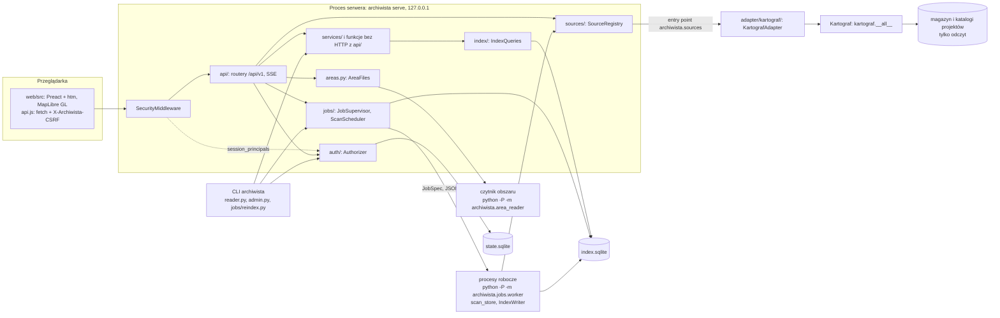
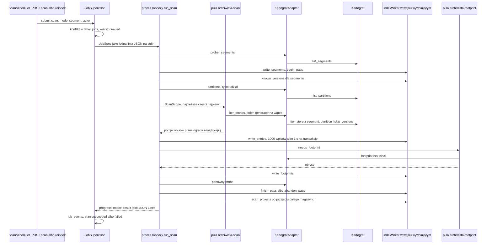

# Architektura Archiwisty

**Wersja opisywana:** kod gałęzi, w której leży ten plik — wydanie 0.1.0
„Przeglądarka” (`pyproject.toml`, pole `version`). Zmiany w wydaniach:
[`CHANGELOG.md`](CHANGELOG.md); stan prac i sprawy otwarte:
[`PROGRESS.md`](PROGRESS.md); przewodnik użytkownika: [`USAGE.md`](USAGE.md);
API HTTP i CLI dla skryptów i agentów: [`AGENT_API.md`](AGENT_API.md);
standardy kodu: [`DEVELOPMENT_STANDARDS.md`](DEVELOPMENT_STANDARDS.md);
pomiary i bramka wydania:
[`reports/v0.1-measurements.md`](reports/v0.1-measurements.md).

Każde twierdzenie o zachowaniu systemu opisuje **kod** w tym repozytorium
(`archiwista/`, `tests/`), nie plan ani spec. Wymagania i zakres leżą
w [`PRD.md`](PRD.md), [`SCOPE.md`](SCOPE.md) i [`SPEC.md`](SPEC.md), decyzje
(A-ADR-0xx) w [`DECISIONS.md`](DECISIONS.md), umowy między krokami v0.1
w [`PLAN_v0.1.md`](PLAN_v0.1.md). Gdzie kod odbiega od specu albo planu,
dokument opisuje kod i mówi o tym wprost. Odwołania wskazują moduł i symbol
(do odszukania `grep`), nigdy numer linii.

Nie mylić z `docs/ARCHITECTURE.md` Kartografa: tam leży kontrakt formatu
magazynu (`data/`, sidecar `kartograf-meta/1`, manifest
`kartograf-project/1`), do którego spec odsyła skrótem „ARCH”.

---

## 1. Cel i granice

Archiwista 0.1 to lokalna przeglądarka magazynu Kartografa: serwer HTTP na
`127.0.0.1` z interfejsem w przeglądarce, wiersz poleceń i API dla skryptów
oraz agentów. Wszystko, co pokazuje, wynika z plików producenta — sidecarów,
dowiązań i manifestów projektów — przeczytanych przez publiczne API
Kartografa i zapisanych w lokalnym indeksie, który można w każdej chwili
odbudować (A-ADR-002). Jedyne dane nieodtwarzalne to baza stanu z kontami
i dostępem do projektów (A-ADR-029, sekcja 4).

**Magazyn tylko do odczytu.** Kod 0.1.0 nie ma ścieżki zapisu do magazynu
ani do katalogów projektów: skan, odświeżenie widoku, obrysy, potwierdzenie
dowiązania i status projektu wyłącznie czytają. Pliki Archiwisty leżą tylko
w lokalnym katalogu danych konta (sekcja 4). Pilnuje tego
`tests/integration/test_read_only_store.py`: drzewo magazynu i projektów
bez prawa zapisu przechodzi skany i wszystkie trasy odczytu API, a nazwy,
rozmiary, czasy modyfikacji i i-węzły zostają takie same.

**Producenci przez publiczne API, w adapterach.** Wiedzę o układzie
magazynu ma producent (A-ADR-014). Archiwista nie przechodzi drzewa `data/`
sam, tylko woła nazwy z `kartograf.__all__` — `list_segments`,
`list_partitions`, `iter_store`, `read_sidecar`, `describe_segment`,
`file_footprint`, `link_target`, `pinned_transform`, `open_project`,
`get_project_status`, `countries_for_bbox`, `find_sheets_for_bbox`,
`SheetParser` — i to wyłącznie w `archiwista/adapter/kartograf/`
(sekcja 2.2). Reszta aplikacji zna tylko interfejs źródła
`archiwista/sources/`. Brakująca funkcja Kartografa to wymaganie wobec
Kartografa (SPEC 12), nie obejście w Archiwiście. Wersja 0.1.0 wymaga
`kartograf>=0.8.0,<0.9` (`pyproject.toml`) z API odczytu magazynu KA-1..KA-6.

**Czego Archiwista 0.1.0 nie robi:**

- nie pobiera danych i nie wykonuje poleceń producenta — rodzaje zadań
  w tle to tylko `scan`, `footprints` i `link_check` (`JOB_KINDS`
  w `jobs/protocol.py`);
- nie zapisuje, nie przenosi i nie usuwa plików magazynu ani projektów;
  problemy i raport nieużywanych wersji niosą instrukcję dla człowieka,
  nigdy działanie usuwające (`services/problems.py`);
- nie zostawia żadnego pliku na udziale ani w magazynie (SQLite, blokady,
  pamięć podręczna);
- nie używa sieci w skanie; jedyne zadanie sieciowe to obrysy jednostek
  (`footprints`: `file_footprint(..., network=True)` Kartografa),
  odrzucane w trybie offline;
- nie upraszcza geometrii obszaru i nie umieszcza na mapie pliku bez
  obrysu: taki wpis ma położenie `country` albo `none` z powodem
  (`Footprint.reason`) i jest widoczny w „Katalogu” (grupy położenia,
  filtr `location`; A-ADR-022);
- nie pobiera bibliotek z CDN — pliki interfejsu są w pakiecie (sekcja 9).

---

## 2. Mapa modułów

### 2.1 Moduły

Tabele wymieniają każdy moduł `.py` pakietu `archiwista/` (pliki
`__init__.py` tylko wtedy, gdy niosą treść). „Kluczowe symbole” to nazwy
zdefiniowane w danym module; metody `IndexWriter`, `IndexQueries`
i `JobSupervisor` opisują sekcje 4 i 5. Interfejs WWW (`archiwista/web/`):
sekcja 9.

**Wejścia: CLI, serwer, aplikacja**

| Moduł | Rola | Kluczowe symbole |
|---|---|---|
| `cli.py` | komenda `archiwista` (`[project.scripts]`); na POSIX `umask 077`; rozdziela podpolecenia | `main` |
| `server.py` | `archiwista serve` (tylko `127.0.0.1`: gniazdo, token startowy, Uvicorn, nadzorca i harmonogram zadań) oraz `archiwista token` | `serve_main`, `token_main`, `LocalServer`, `LaunchFile`, `bind_loopback`, `open_in_browser`, `uvicorn_log_config`, `LIMIT_CONCURRENCY` |
| `app.py` | fabryka aplikacji FastAPI: obiekty współdzielone w `app.state`, routery pod `/api/v1`, dokumentacja API, pliki interfejsu, `SecurityMiddleware` | `create_app`, `WEB_DIR` |
| `reader.py` | polecenia odczytu `status`, `sources`, `search`, `entry`, `version`, `projects`, `project` na funkcjach i modelach API | `add_read_commands`, `read_main`, `search_filters`, `READ_COMMANDS` |
| `admin.py` | polecenia `users`, `groups`, `share`, `state export` i `state import`, wykonywane jako `LOCAL_OWNER` | `add_admin_commands`, `admin_main`, `ADMIN_COMMANDS` |
| `doctor.py` | `archiwista doctor`: diagnostyka bez zapisu — ustawienia, wtyczki, magazyny i katalogi projektów, katalog danych, port | `run_doctor`, `doctor_main`, `DoctorCheck`, `DoctorReport`, `source_check`, `is_port_available`, `REQUIRED_PRODUCERS` |

**HTTP i bezpieczeństwo**

| Moduł | Rola | Kluczowe symbole |
|---|---|---|
| `security.py` | reguły trybu lokalnego dla każdego żądania, tokeny jednorazowe, sesje w pamięci, CSP, redakcja tokenów w dziennikach | `SecurityMiddleware`, `SessionStore`, `Session`, `issue_one_time_token`, `redeem_one_time_token`, `revoke_agent_sessions`, `session_principals`, `require_session`, `current_principal`, `csp_header`, `fragment_url`, `TokenRedactionFilter` |
| `api/__init__.py` | stałe ścieżek | `API_PREFIX` (`/api/v1`), `DOCS_PATH` (`/api/docs`) |
| `api/dependencies.py` | zależności tras z `app.state` | `authorizer`, `index_queries`, `settings_service`, `plugin_registry`, `visible_projects` |
| `api/errors.py` | problemy RFC 9457; jedna tabela: błąd usługi → status i kod, wspólna z CLI | `ApiError`, `PROBLEMS`, `problem_response`, `problem_of`, `service_problem`, `validation_problem`, `install_error_handlers` |
| `api/models.py` | modele Pydantic żądań i odpowiedzi (poza modelami sesji i administracji, które leżą przy swoich routerach) — zarazem schemat OpenAPI | `CatalogFilters`, `MapFilters`, `IndexAnswer`, `CatalogPage`, `SlotCard`, `VersionCard`, `MapView`, `Health`, `StoreDetail`, `ProjectCard`, `JobDetail`, `Area`, `AreaCoverage`, `Settings`, `ProblemDetails` |
| `api/docs.py` | OpenAPI (`operationId` = nazwa funkcji trasy) i lokalny Swagger UI z `api/swagger/` | `install_docs`, `operation_id`, `openapi_document` |
| `api/session.py` | `/session`: wymiana tokenu, stan sesji, wylogowanie, tokeny agentów | `exchange_token`, `read_session`, `end_session`, `issue_token`, modele `SessionExchange`, `NewSession`, `SessionState`, `OneTimeToken` |
| `api/health.py` | `/health`, `/sources` | `read_health`, `source_infos` |
| `api/stores.py` | `/stores`, `/stores/{store}` | `read_stores`, `read_store` |
| `api/slots.py` | katalog i karty: `/slots`, `/products`, `/stores/{store}/slots/{slot}`, `/stores/{store}/versions/{version}` (z `/sidecar`), `/requests/{parent_request}` | `search_slots`, `read_products`, `slot_card`, `version_card`, `copy_path`, `geo_adapter`, `checked_store` |
| `api/map.py` | `/map/footprints`, `/map/sheets` | `map_view`, `sheet_list` |
| `api/projects.py` | `/projects`, `/projects/{project}`, `/projects/{project}/status` | `read_projects`, `project_card`, `check_project` |
| `api/settings.py` | `GET` i `PUT /settings` | `save_settings`, `settings_writer` |
| `api/areas.py` | `POST /areas`, `/areas/{area_id}`, `/local-coverage` | `save_area`, `save_area_file`, `read_area`, `read_local_coverage`, `REFRESH_TIMEOUT_S` |
| `api/jobs.py` | zadania w tle przez HTTP i strumień SSE | `start_scan`, `start_footprints`, `start_link_check`, `list_jobs`, `get_job`, `get_job_events`, `job_event_stream`, `sse_message`, `JobStreams`, `EventStreamResponse` |
| `api/admin.py` | `/users`, `/groups`, `/projects/{project}/access` | modele `User`, `Group`, `ProjectAccess`, `AccessChange` i trasy o nazwach funkcji `services/access.py` |

**Usługi, uprawnienia, stan**

| Moduł | Rola | Kluczowe symbole |
|---|---|---|
| `services/problems.py` | problem z polskim opisem i instrukcją naprawy | `Problem`, `explain`, `KNOWN_PROBLEMS` |
| `services/stores.py` | stan magazynu dla widoku „Magazyn” | `store_summary`, `StoreSummary`, `issue_problem` |
| `services/projects.py` | karta projektu i żywy status producenta | `project_detail`, `ProjectDetail`, `project_problems`, `project_status` |
| `services/access.py` | konta, grupy i dostęp do projektów — dla HTTP i CLI | `list_users`, `add_user`, `update_user`, `remove_user`, `list_groups`, `add_group`, `set_group_members`, `remove_group`, `project_access`, `share_project` |
| `auth/principal.py` | kto działa | `Principal`, `PrincipalKind`, `LOCAL_OWNER`, `SCHEDULER`, `LOCAL_PRINCIPAL_ID`, `LOCAL_ROLES` |
| `auth/authorize.py` | jedyne miejsce decyzji o uprawnieniach | `Authorizer`, `ACTIONS`, `principal_for`, `session_principal` |
| `auth/visibility.py` | które projekty widać | `ProjectVisibility`, `ALL_PROJECTS`, `access_key` |
| `state/schema.py` | schemat i migracje `state.sqlite` | `initialize`, `MIGRATIONS`, `STATE_SCHEMA_VERSION` |
| `state/store.py` | odczyt i zmiany bazy stanu razem z dziennikiem uprawnień | `StateStore`, `UserRecord`, `GroupRecord`, `ProjectAccessRecord`, `PermissionChange`, `StateSnapshot` |
| `state/export.py` | kopia bazy stanu `archiwista-state/1` | `export_state`, `import_state`, `dump_state`, `parse_state`, `StateDocument`, `STATE_DOCUMENT_SCHEMA` |

**Indeks**

| Moduł | Rola | Kluczowe symbole |
|---|---|---|
| `index/schema.py` | schemat SQLite, ustawienia połączeń, przebudowa przy zmianie wersji | `SCHEMA_VERSION`, `initialize`, `connect`, `IndexUnsupportedError`, `MIN_SQLITE_VERSION` |
| `index/writer.py` | zapis indeksu z typów interfejsu źródła (nigdy z obiektów Kartografa) | `IndexWriter` |
| `index/queries.py` | odczyt: katalog, karty, mapa, produkty, zajętość, problemy, projekty, stan | `IndexQueries` |
| `index/scanner.py` | skan magazynu i odświeżenie widoku | `scan_store`, `refresh_view`, `ScanProgress`, `ScanNotice`, `ScanSummary`, `SegmentScan`, `BATCH_ENTRIES`, `BATCH_SECONDS`, `FOOTPRINT_THREADS`, `REFRESH_VIEW_MAX_UNITS` |
| `index/projects.py` | odkrywanie i indeksowanie manifestów projektów | `scan_projects`, `ProjectScanSummary`, `PROJECT_MANIFESTS`, `MAX_PROJECT_DEPTH` |
| `index/coverage.py` | pokrycie lokalne w układzie płaskim | `measure_coverage`, `planar_crs`, `PLANAR_CRS`, `CoverageShape`, `CoverageMeasure` |
| `index/geometry.py` | pomocnicze funkcje GeoJSON w WGS84 | `polygon_bounds`, `is_box`, `box_geometry`, `require_wgs84_area`, `require_wgs84_bbox` |
| `index/types.py` | typy zapytań i odpowiedzi indeksu, limity | `SlotQuery`, `MapQuery`, `SlotPage`, `SlotDetail`, `VersionDetail`, `FootprintPage`, `IndexStatus`, `StoreIndexState`, `StoreFreshness`, `AreaRecord`, `SlotUnit`, `ScanPass`, `BatchResult`, `PassSummary`, `DEFAULT_PAGE_LIMIT`, `MAX_PAGE_LIMIT`, `MAP_FOOTPRINT_LIMIT`, `MAX_GRID_COLUMNS` |

**Zadania w tle**

| Moduł | Rola | Kluczowe symbole |
|---|---|---|
| `jobs/supervisor.py` | nadzorca: kolejka, procesy robocze, zdarzenia, odzyskiwanie po awarii, przycinanie historii | `JobSupervisor`, `JobRecord`, `JobEvent`, `JobError`, `JobPage`, `ScanHistory`, `INDEX_JOB_KINDS`, `NETWORK_JOB_KINDS`, `MAX_NETWORK_JOBS`, `STOP_TIMEOUT_S`, `WORKER_COMMAND`, `default_max_jobs` |
| `jobs/worker.py` | proces roboczy jednego zadania | `main`, `RUNNERS`, `run_scan`, `run_footprints`, `run_link_check`, `Emitter` |
| `jobs/protocol.py` | protokół JSON Lines nadzorca ↔ proces roboczy | `JobSpec`, `WorkerMessage`, `encode_spec`, `decode_spec`, `encode_message`, `decode_message`, `PROTOCOL_VERSION`, `JOB_KINDS`, `INTERRUPTED_EXIT`, `CODE_WORKER_CRASHED` |
| `jobs/scheduler.py` | skany okresowe i kontrolne | `ScanScheduler`, `plan_scans`, `PlannedScan`, `TICK_S`, `STARTUP_STALE`, `PROBE_TIMEOUT_S`, `PRUNE_INTERVAL` |
| `jobs/reindex.py` | `archiwista reindex`: pełny skan na pierwszym planie | `reindex_main` |
| `jobs/availability.py` | czy magazyn da się czytać teraz (pusty punkt montowania znanego magazynu = niedostępny) | `unreachable_detail` |

**Obszary**

| Moduł | Rola | Kluczowe symbole |
|---|---|---|
| `areas.py` | obszary: walidacja, pomiar, kopie plików, uruchamianie czytnika | `AreaFiles`, `area_from_geometry`, `read_area_file`, `area_from_file`, `keep_copy`, `discard_copy`, `prune_area_copies`, `area_id`, `area_crs`, `check_body_size`, `AREA_BODY_LIMIT_BYTES`, `AREA_READ_TIMEOUT_S`, `AREA_COPY_MAX_AGE`, `AREA_READER_COMMAND` |
| `area_reader.py` | proces czytający niezaufany plik obszaru (GDAL przez `pyogrio`) | `main`, `read_area`, `AreaFileError`, `MAX_VERTICES`, `MAX_MEMBERS`, `UNPACKED_LIMIT_BYTES` |

**Źródła i adaptery**

| Moduł | Rola | Kluczowe symbole |
|---|---|---|
| `sources/protocol.py` | protokoły adaptera (`runtime_checkable`): wymagany i zdolności opcjonalne | `SourceAdapter`, `SourceFactory`, `SegmentedAdapter`, `PartitionedAdapter`, `GeoAdapter`, `LinkCheckAdapter`, `SheetGridAdapter`, `CoordinateTransformer` |
| `sources/types.py` | wspólne typy niezależne od producenta | `SourceContext`, `ScanScope`, `SourcePartition`, `SourceState`, `SourceSegment`, `SourceEntry`, `EntryMeta`, `Footprint`, `ProjectInfo`, `ProjectTask`, `ProjectPin`, `SheetGrid`, `SourceStatus` |
| `sources/registry.py` | wtyczki z entry points grupy `archiwista.sources`, ich stany i adaptery | `SourceRegistry`, `PluginRegistry`, `load_registry`, `check_package`, `install_requirement`, `source_fix`, `source_error`, `ENTRY_POINT_GROUP`, `APP_DISTRIBUTION` |
| `adapter/kartograf/__init__.py` | fabryka wtyczki: porównuje zainstalowanego Kartografa z przypięciem Archiwisty przed importem | `load`, `PRODUCER`, `PACKAGE`, `SCHEMAS` |
| `adapter/kartograf/adapter.py` | adapter Kartografa ze wszystkimi zdolnościami opcjonalnymi | `KartografAdapter`, `UNIT_CACHE_FILE` |
| `adapter/kartograf/unit_cache.py` | lokalna pamięć obrysów jednostek (TERYT, KU, SM5) dla `file_footprint` | `UnitBBoxCache` |

**Wspólne**

| Moduł | Rola | Kluczowe symbole |
|---|---|---|
| `config.py` | ścieżki lokalne, ustawienia TOML, walidacja, zapis atomowy, powiadamianie o zmianach | `AppPaths`, `AppSettings`, `StoreConfig`, `BasemapConfig`, `ConfigStore`, `SettingsService`, `parse_settings`, `validate_settings`, `detect_store_kind`, `write_text_atomic`, `DEFAULT_BASEMAPS` |
| `paths.py` | prywatne katalogi i ścieżki z indeksu wewnątrz korzenia | `private_directory`, `indexed_path`, `resolve_indexed_path`, `PRIVATE_DIRECTORY_MODE` |
| `errors.py` | wyjątki aplikacji | `ArchiwistaError`, `SourceUnavailableError`, `SourceIncompatibleError`, `ProducerError`, `PathOutsideRootError`, `IndexQueryError`, `PermissionDeniedError`, `NotFoundError`, `ConflictError`, `JobConflictError`, `OfflineModeError`, `AreaTooLargeError`, `AreaUnreadableError`, `AreaTooComplexError`, `StateError`, `SnapshotError` |
| `messages.py` | wszystkie polskie teksty serwera i CLI | `MESSAGES`, `with_detail` |

### 2.2 Kierunek zależności



Graf krawędzi importu między pakietami i modułami najwyższego poziomu
`archiwista/` (importy między nimi są wyłącznie na poziomie modułu; jedyny
import leniwy, `KartografAdapter` w fabryce `load`, zostaje w adapterze;
w nawiasie — gdy krawędź dotyczy tylko wskazanych modułów albo nazw):

```
cli ───────> admin, config, doctor, jobs, messages, reader, security, server, sources
server ────> api, app, auth, config, errors, index, jobs, messages, paths, security, sources, state
app ───────> api, areas, auth, config, index, jobs, messages, security, sources, state
reader ────> api, auth, config, errors, index, messages, sources, state
admin ─────> api, auth, config, errors, index, messages, services, state
doctor ────> config, messages, security (LOOPBACK_HOST), sources
api ───────> areas, auth, config, doctor, errors, index, jobs, messages, paths,
             security, services, sources, state
security ──> api (API_PREFIX, DOCS_PATH, api.errors), auth, config,
             index (schema.connect), messages, state
jobs ──────> api (tylko reindex: api.errors.problem_of), auth, config, errors, index,
             messages, paths, services (tylko worker: services.problems.explain), sources
services ──> auth, config, errors, index, messages, paths, sources, state
areas ─────> area_reader, errors, index, messages, paths, sources
area_reader ─> messages
index ─────> auth (ProjectVisibility, access_key), config, errors, messages, paths, sources
auth ──────> config, errors, messages, state (tylko auth.authorize)
state ─────> auth (tylko principal), errors, messages, paths
adapter.kartograf ─> errors, messages, sources  (+ kartograf)
sources ───> config, errors, messages (tylko sources.registry)
config ────> errors, messages, sources (typy)
paths ─────> errors, messages
errors ────> sources (sources.types.SourceState)
messages ──> (nic)
```

Na poziomie modułów graf nie ma cykli: liście to `sources.types`,
`sources.protocol`, `messages`, `auth.principal` i `auth.visibility`;
krawędzie „w obie strony” między pakietami (`api` ↔ `security`, `api` ↔
`jobs`, `auth` ↔ `state`, `config` ↔ `sources`) łączą różne moduły tych
pakietów. Komplet krawędzi daje

```bash
grep -rnE '^\s*(from|import) archiwista' archiwista/ --include=*.py
```

— graf trzeba poprawić przy każdej nowej krawędzi.

**Reguły pilnowane testami** (`tests/contract/`):

- `kartograf` (i `imgwtools`) importuje wyłącznie jego adapter
  (`archiwista/adapter/kartograf/`, `archiwista/adapter/imgw/`) —
  `test_imports.py::test_producers_are_imported_only_in_their_adapters`;
- adapter Kartografa importuje tylko `from kartograf import …` z nazwami
  z `kartograf.__all__` —
  `test_imports.py::test_kartograf_adapter_uses_only_public_api`;
- każdy moduł poza `archiwista.adapter` importuje się bez IMGWTools i bez
  ładowania Kartografa, a wtyczka Kartografa ma stan `available` —
  `test_imports.py::test_archiwista_starts_without_imgwtools`;
- producent bez zdolności opcjonalnych spełnia `SourceAdapter`
  (`test_source_protocol.py`); stany wtyczek (`not_installed`,
  `incompatible`, `error`) i druga wtyczka obok Kartografa —
  `test_plugins.py`; kontrakt API Kartografa i magazynu testowego —
  `test_kartograf.py`, `test_store_fixture.py`.

**Reguły przyjęte w kodzie (bez osobnego testu):**

- nikt nie importuje `archiwista.adapter`: adapter dostaje się z rejestru
  wtyczek przez entry point `kartograf = "archiwista.adapter.kartograf:load"`;
- FastAPI i Starlette importują tylko `api/`, `app.py` i `security.py`
  (`server.py`: Uvicorn i `starlette.types`); w `jobs/` pośrednio tylko
  `reindex.py` (przez `api.errors.problem_of`); `index/`, `services/`,
  `auth/`, `state/` i `sources/` ich nie znają;
- `index/` nie importuje `api`, `jobs`, `services`, `security`, `app` ani
  `server`; `services/` nie importuje `api`;
- trasy nie filtrują projektów same: biorą `visible_projects` i przekazują
  je zapytaniom i usługom (`api/dependencies.py`, sekcja 7);
- CLI nie ma drugiej implementacji odczytu: `reader.py` woła te same
  funkcje bez HTTP z `api/` (`read_health`, `search_slots`, `slot_card`,
  `version_card`, `read_projects`, `project_card`) i wypisuje te same modele.

---

## 3. Procesy i wątki

| Proces | Kto uruchamia | Co robi | Komunikacja |
|---|---|---|---|
| serwer `archiwista serve` | użytkownik | Uvicorn z aplikacją `create_app`, `JobSupervisor`, `ScanScheduler`; odczyt indeksu i krótkie, ograniczone odczyty magazynu | HTTP na `127.0.0.1:<port>` |
| proces roboczy zadania | `JobSupervisor`, po jednym na zadanie, we własnej grupie procesów (`WORKER_COMMAND`: `python -P -m archiwista.jobs.worker`) | `run_scan`, `run_footprints`, `run_link_check` (`RUNNERS`) | stdin: jedna linia `JobSpec`, potem otwarty do końca; stdout: JSON Lines `WorkerMessage`; stderr: dziennik `<jobs>/<id>.log` |
| czytnik obszaru | `read_area_file` (`AREA_READER_COMMAND`: `python -P -m archiwista.area_reader <katalog> [--layer NAZWA]`) | GDAL czyta niezaufany plik obszaru; zabijany po `AREA_READ_TIMEOUT_S` (30 s) | jedna linia JSON na stdout |
| polecenia CLI | człowiek, skrypt, agent | odczyt indeksu (`reader.py`), baza stanu (`admin.py`), `reindex` z własnym `JobSupervisor` i procesami roboczymi, `token`, `doctor` | stdout, stderr; serwer niepotrzebny |
| przeglądarka | `open_in_browser` (strona `LaunchFile`) albo człowiek | interfejs `web/` | `fetch` do `/api/v1`, SSE przez `fetch` |

Flaga `-P` trzyma bieżący katalog (katalog `jobs/`) poza `sys.path`.
Uruchamianie GDAL-a, skanu i pobierania obrysów poza procesem serwera
(A-ADR-007) sprawia, że awaria biblioteki natywnej albo przerwanie
zadania nie kładzie interfejsu.

**Wątki serwera.** Pętla zdarzeń Uvicorna obsługuje trasy `async`
i strumienie SSE (odczyty indeksu przez `asyncio.to_thread`); trasy zwykłe
(`def`) i `run_in_threadpool` działają w puli wątków Starlette. Uvicorn
przyjmuje najwyżej `LIMIT_CONCURRENCY` (100) połączeń naraz, kolejne dostają
`503`. Własne wątki serwera: `archiwista-scheduler` (pętla `ScanScheduler`,
co `TICK_S` = 60 s), `archiwista-probe-<magazyn>` (sonda niedostępnego
magazynu, najwyżej `PROBE_TIMEOUT_S` = 10 s), `archiwista-job-<id>` (czytnik
stdout jednego procesu roboczego w `JobSupervisor`), `threading.Timer`
zabijający przerwany proces po `STOP_TIMEOUT_S` (30 s), zegar usuwający
plik startowy po ważności tokenu i wątek `webbrowser.open`. Słuchacze
`JobSupervisor.subscribe` działają w wątku nadzorcy pod jego blokadą, więc
strumień SSE tylko budzi się przez `loop.call_soon_threadsafe`.

**Wątki procesu roboczego skanu.** Wątek wywołujący `scan_store` jest
jedynym użytkownikiem `IndexWriter`. Pula `archiwista-scan` (`_Readers`)
wykonuje wywołania `iter_entries`, jeden generator na wątek od pierwszego
do ostatniego wpisu, i podaje wpisy porcjami (`_READ_CHUNK` = 256) przez
ograniczoną kolejkę (`_QUEUE_CHUNKS_PER_THREAD` = 2 porcje na wątek), która
trzyma w pamięci tylko wpisy przeczytane, a jeszcze niezapisane. Pula
`archiwista-split` dzieli segmenty na części równolegle, a pula
`archiwista-footprint` (`_Footprints`) liczy obrysy bez sieci. Wątek
`archiwista-supervisor` czeka na koniec stdin: gdy nadzorca znika, proces
przerywa sam siebie. Liczby wątków wybiera `_target`: magazyn na udziale
(`StoreConfig.kind` = `share`) jest czytany w `AppSettings.scan_threads`
wątkach (domyślnie 8), a obrysy liczy `FOOTPRINT_THREADS` (4) wątków;
magazyn lokalny czyta jeden wątek całymi segmentami i jeden wątek liczy
obrysy, bo tam skan ogranicza CPU pod GIL.

**Jeden pisarz.** W obrębie przebiegu indeks pisze tylko wątek wywołujący,
paczkami: `BATCH_ENTRIES` (1000) wpisów albo to, co przyszło w ciągu
`BATCH_SECONDS` (1 s) od pierwszego wpisu paczki — jedna transakcja na
paczkę. Między procesami zapisy szereguje SQLite (WAL, `BEGIN IMMEDIATE`,
`busy_timeout` 10 s; czytelnicy nie czekają), a nadzorca dopuszcza najwyżej
jedno zadanie piszące indeks magazynu (`INDEX_JOB_KINDS`: `scan`,
`footprints`): sprawdza to w tabeli `jobs`, więc także wobec zadań innego
procesu, np. `archiwista reindex` (`JobConflictError` → `409 conflict`).
Oprócz wątku zapisu skanu indeks piszą: nadzorca (`jobs`, `job_events`,
`IndexWriter.sync_stores`), serwer (`refresh_view` i `write_area`
w trasach obszarów, `session_tokens`) oraz pozostałe zadania w procesach
roboczych — `footprints` (`write_footprints`) i `link_check`
(`record_issue`, `clear_issue`).

**Odczyty magazynu w procesie serwera** są krótkie i ograniczone:
`refresh_view` w `GET /local-coverage` (≤ `REFRESH_VIEW_MAX_UNITS` = 500
jednostek, budżet `REFRESH_TIMEOUT_S` = 10 s), `probe` (wątek harmonogramu
z limitem 10 s; walidacja nowych katalogów w `PUT /settings`) i status
projektu (`project_status` producenta, bez haszowania). Skan i obrysy
działają wyłącznie w procesach roboczych.

---

## 4. Dane lokalne

Położenie wyznacza `AppPaths.default()` przez `platformdirs` (Linux:
ustawienia `~/.config/archiwista/`, dane `~/.local/share/archiwista/`;
dokładne ścieżki wypisuje `archiwista doctor`). Wszystkie pliki Archiwisty
leżą w tych dwóch katalogach — żaden w magazynie ani w katalogu projektu.

| Ścieżka (`AppPaths`) | Zawartość | Odtwarzalne | Kto pisze |
|---|---|---|---|
| `config_file` = `config.toml` | `AppSettings`: `port` (8090), `offline`, `scan_threads` (8), `scan_interval_local_min` (5), `scan_interval_share_min` (15), `full_scan_interval_h` (24), `project_dirs`, `stores` (`StoreConfig`: `id`, `name`, `kartograf`, `kind`, `path_aliases`), `basemaps`, `store_write_for_all`, `default_project_visibility` | nie (kreator albo „Ustawienia”) | `SettingsService.update` → `ConfigStore.save` |
| `index_file` = `index.sqlite` (+ `-wal`, `-shm`) | indeks magazynów, projektów i obszarów, historia zadań, skróty tokenów jednorazowych | tak | `IndexWriter`, `JobSupervisor`, `security.py` |
| `state_file` = `state.sqlite` | konta, grupy, role, dostęp do projektów, dziennik uprawnień | **nie** — kopia `archiwista state export` | `StateStore` |
| `cache_dir` = `cache/<producent>/` | pamięć wtyczki (`SourceContext.cache_dir`); Kartograf: `unit_bboxes.sqlite` (`UnitBBoxCache`) | tak, z sieci | adapter |
| `jobs_dir` = `jobs/` | `<id>.log` (stderr procesu roboczego), `owner-<pid>.lock` (blokada nadzorcy) | dzienniki niepotrzebne do pracy | `JobSupervisor`, procesy robocze |
| `areas_dir` = `areas/` | `<id>/area.*` (kopia pliku obszaru), `.incoming/<losowa>/` (plik w trakcie czytania) | wczytanie pliku od nowa | `AreaFiles` |
| `open-<losowa>.html` w katalogu danych | strona startowa z adresem tokenu dla przeglądarki (`LaunchFile`, plik `0600`) | — | `serve_main`; znika po użyciu tokenu, po 10 min i przy zatrzymaniu |

**Prawa dostępu.** `private_directory` zakłada albo zamyka katalog do
`0700` (`PRIVATE_DIRECTORY_MODE`) — katalog danych przy każdym otwarciu
indeksu i bazy stanu, `jobs/` i `areas/`; `cli.main`, proces roboczy
i czytnik obszaru ustawiają `umask 077`. `archiwista doctor` ostrzega, gdy
katalog danych jest otwarty dla innych kont.

**Ustawienia.** `ConfigStore.load` czyta TOML albo zwraca wartości
domyślne; `SettingsService.update` waliduje całość (`validate_settings`:
istnienie i odczyt katalogów, `probe` wtyczki dla nowego albo przeniesionego
katalogu, `check_nesting` — żaden katalog producenta w drugim), zapisuje
atomowo (`write_text_atomic`: plik tymczasowy, `fsync`, `os.replace`)
i powiadamia słuchaczy (`SettingsService.subscribe`): nadzorca synchronizuje
magazyny indeksu, harmonogram planuje pełny skan nowego magazynu.
`StoreConfig.kind` bez wartości wykrywa `detect_store_kind` z
`/proc/self/mountinfo` (`SHARE_FILESYSTEMS`: `cifs`, `smb3`, `smbfs`, `nfs`,
`nfs4`). `StoreConfig.local_path` i `foreign_paths` tłumaczą ścieżki między
komputerami przez `path_aliases` (SPEC 4.6).

### 4.1 Indeks `index.sqlite`

Pamięć podręczna odbudowywana z plików producentów (A-ADR-002),
`index/schema.py`:

- **Wersja schematu** `SCHEMA_VERSION` (4 w wydaniu 0.1.0)
  w `PRAGMA user_version`. Każde otwarcie (`IndexWriter`, `IndexQueries`,
  `serve`, `reindex`, `token`) woła `initialize`: inna wersja (starsza
  albo nowsza) to przebudowa zamiast migracji — wszystkie obiekty usuwane
  i zakładane od nowa w jednej transakcji (`BEGIN IMMEDIATE`), którą
  czytelnicy innych procesów widzą przed albo po; potem `VACUUM`.
  Przebudowany indeks jest pusty, a wypełnia go najbliższy pełny skan;
  razem z nim znikają historia zadań i niewykorzystane tokeny jednorazowe.
  `IndexUnsupportedError`, gdy SQLite jest starszy niż `MIN_SQLITE_VERSION`
  (3.35.0) albo nie ma FTS5, R*Tree lub funkcji JSON.
- **Tabele:** `index_info` (data założenia, poprzednia wersja, generacja
  sesji agentów), `stores` (klucz = `StoreConfig.id`, stan `unknown` /
  `available` / `unavailable`, `indexed_at`), `segments`, `slots`,
  `versions` z 1:1 `version_sidecars` (surowy sidecar) i `version_shapes`
  (obrysy niebędące prostokątem, obrys natywny), `footprints` (R*Tree
  prostokątów WGS84, tylko wersje z obrysem), `search` (FTS5, wiersz na
  slot, `unicode61 remove_diacritics 2`), `issues` (pochodzenie `scan`
  albo `check`), `projects` (z `access_key`), `project_tasks`, `pins`,
  `areas`, `jobs`, `job_events`, `session_tokens`. Wyzwalacze usuwają
  wiersze `footprints` i `search` razem z wersją i slotem.
- **Klucze publiczne** to identyfikator magazynu z ustawień i ścieżki
  względne slotów i wersji; liczbowe `id` nie wychodzą z indeksu.
- **Połączenia** (`connect`): WAL, `synchronous = NORMAL`,
  `foreign_keys = ON`, `busy_timeout` 10 s, tryb autocommit z jawnymi
  transakcjami. Pisarz: 32 MiB pamięci stron i `mmap` 256 MB, a
  `IndexWriter` dodaje `analysis_limit = 1000`
  i `wal_autocheckpoint = 8192`. Czytelnik (`readonly=True`):
  `query_only`, 4 MiB pamięci stron, bez `mmap` — serwer trzyma jedno
  połączenie na wątek (`IndexQueries`, `threading.local`), a każde
  odwzorowanie liczyłoby te same strony w pamięci procesu.
- **Odbudowa ręczna:** `archiwista reindex [--store ID]` — pełny skan na
  pierwszym planie jako zwykłe zadanie (sekcja 5.1); usunięcie pliku
  indeksu daje pusty indeks wypełniany przez harmonogram.

### 4.2 Baza stanu `state.sqlite`

Osobny plik obok indeksu (`state/schema.py`), którego nie odtworzy żaden
plik na dysku (A-ADR-029): przebudowa indeksu go nie dotyka.

- **Wersja schematu** `STATE_SCHEMA_VERSION` = liczba `MIGRATIONS` (2
  w wydaniu 0.1.0). `initialize` wykonuje brakujące migracje w jednej
  transakcji i sprawdza klucze obce; baza z nowszej Archiwisty (wyższe
  `user_version`) to `StateError`, bez zmian w pliku. WAL,
  `synchronous = FULL`.
- **Tabele:** `users`, `groups`, `memberships`, `roles` (`admin`,
  `store_writer`), `project_acl` (klucz = katalog projektu po `realpath`,
  `owner`, `visibility`), `project_acl_entries` (osoba albo grupa),
  `permission_log` (kto, kiedy, co, stan przed i po w JSON; od wersji 2
  także `actor_kind` i etykieta sesji). Konta nie mają haseł (logowanie od
  v0.4).
- **Kopia:** `archiwista state export [--output PLIK]` zapisuje dokument
  JSON `archiwista-state/1` (`export_state`: jedna spójna migawka,
  `dump_state`); `archiwista state import PLIK` (`parse_state`,
  `import_state`, `StateStore.restore`) przyjmuje tylko pustą bazę —
  odtworzenie z kopii, nie scalanie.

---

## 5. Przepływy

### 5.1 Skan pełny i przyrostowy



**Kto zleca.** `ScanScheduler` (wykonawca `SCHEDULER`),
`POST /api/v1/stores/{store}/scan` (`ScanRequest`: `mode`, `segment`;
wykonawca = principal sesji) albo `archiwista reindex` (`LOCAL_OWNER`) —
zawsze przez `JobSupervisor.submit("scan", …)` i proces roboczy.
`run_scan` ładuje rejestr wtyczek w procesie roboczym
(`load_registry(cache_dir=spec.cache_dir)`) i dla każdego katalogu
producenta magazynu (`StoreConfig.roots`) woła `scan_store` z trybem,
segmentem i `on_event=emit.scan_event`.

**Przebieg `scan_store`:**

1. `_reachable_segments`: `probe` korzenia (stan inny niż `available` →
   magazyn niedostępny) i lista segmentów (`SegmentedAdapter.segments` →
   `list_segments`, także nierozpoznanych); opisy segmentów trafiają do
   tabeli `segments` (`describe_segment`).
2. `IndexWriter.begin_pass(store, producer, segment=…, full=…)` wczytuje raz
   znane wersje, sloty i problemy zakresu. Brak segmentów przy wpisach
   w indeksie to pusty punkt montowania, czyli magazyn niedostępny.
3. `IndexWriter.known_versions(segment)` zwraca mapowanie **katalog wersji
   → nazwy plików** dla katalogów „ustalonych”: każda znana w nich wersja
   jest obecna z przeczytanymi metadanymi i nie leży w nich żaden problem.
   Skan przyrostowy podaje je w `ScanScope.known_versions`, a adapter
   Kartografa przekazuje je `iter_store` jako mapowanie `skip_versions`:
   wymienione pliki wracają jako `skipped` bez metadanych, a ich katalog nie
   jest ponownie listowany (koszt 0 zamiast listingu). Sidecary dowiązań
   (ścieżka standardowa, `full_sheet/`) są czytane zawsze, bo z nich wynika
   bieżąca wersja (`SourceEntry.version_path`); skan nigdy nie woła
   `link_target`. Skan pełny nie podaje mapowania i czyta wszystko.
4. `_scopes` układa wywołania `iter_entries`: na udziale każdy segment
   `PartitionedAdapter` dzieli się na części (`partitions` →
   `list_partitions`), kolejność od najcięższej (waga: znane wersje części,
   także dla skanu pełnego); dysk lokalny czyta całe segmenty jednym
   wątkiem.
5. `_stream` w wątku wywołującym zapisuje paczki (`write_entries`: wpisy,
   dowiązania, problemy, wiersze `search`; niezmieniony wpis nie kosztuje
   zapisu) i przekazuje wersje bez położenia (`BatchResult.needs_footprint`;
   w skanie pełnym także te wciąż bez obrysu) puli obrysów, której wyniki
   zapisuje `write_footprints` — istniejącego obrysu nie nadpisuje. Obrys
   bez sieci korzysta z lokalnej pamięci jednostek adaptera
   (`UnitBBoxCache`); nieudany zostaje w oczekiwaniu na następny skan
   (`ScanNotice` `footprints_failed`). Po ostatniej części segmentu
   wychodzi `ScanProgress` z czasem segmentu (suma części).
6. Po przejściu ponowny `probe` (odmontowany w trakcie udział daje puste
   listingi bez błędu), potem `finish_pass`: przebieg kompletny (bez
   jednostek) oznacza w swoim zakresie niewidziane wersje „brak pliku”
   z datą, przebieg `full` usuwa wersje oznaczone tak już wcześniej i nadal
   nieobecne; oba czyszczą niewidziane dowiązania, rozwiązują problemy
   i usuwają puste sloty, a przebieg całego magazynu usuwa też puste
   segmenty i ustawia `indexed_at` oraz stan `available`. Niedostępny
   magazyn (`SourceUnavailableError`) albo błąd producenta
   (`ProducerError`) kończy przebieg `abandon_pass` — nic nie zostaje
   oznaczone — a niedostępny magazyn dostaje stan `unavailable` z opisem.
7. Po przejściu całego magazynu (bez `segment`) `scan_projects` odkrywa
   manifesty `PROJECT_MANIFESTS` (`kartograf-project.json`) do głębokości
   `MAX_PROJECT_DEPTH` (4) w `project_dirs`, czyta zmienione
   (`project_stamps`: czas i rozmiar manifestu) przez `project_status`, a gdy
   zawiedzie — `read_project`, dopasowuje magazyn po ścieżce albo
   `StoreConfig.local_path` i zapisuje projekt (`write_project`); katalog,
   którego nie da się odczytać, zachowuje swoje projekty.

**Pełny skan dobowy.** Skan przyrostowy ufa znanym katalogom wersji, więc
plik usunięty albo dopisany wewnątrz takiego katalogu widzi dopiero skan
pełny. `plan_scans` wybiera tryb `full`, gdy magazyn nie miał udanego
pełnego skanu albo od ostatniego minęło `full_scan_interval_h` (domyślnie
24 h); czas ostatniego (`StoreIndexState.full_scan_at`) pokazują
`/health`, widok „Magazyn” i `archiwista status`.

**Harmonogram (`ScanScheduler`, `plan_scans`).** Co `TICK_S` (60 s):
magazyn, którego ostatni skan skończył się ponad `STARTUP_STALE` (15 min)
przed startem serwera albo nigdy, dostaje skan od razu; potem kolejny
interwał po końcu ostatniego skanu, kto by go nie zlecił —
`scan_interval_s`: 5 min na dysku lokalnym, 15 min na udziale. Magazyn
z zadaniem piszącym indeks jest pomijany. Magazyn `unavailable` jest tylko
sondowany i skanowany, gdy sonda go znajdzie, a jego katalog nie jest
pustym punktem montowania (`unreachable_detail`). Magazyn dodany albo
przeniesiony w ustawieniach dostaje pełny skan od razu. Raz na godzinę
(`PRUNE_INTERVAL`) tik przycina historię zadań (`JobSupervisor.prune`).

**Zadania pokrewne.** `footprints` (`POST …/footprints`, odmowa w trybie
offline): `entries_without_footprint` → `footprint(entry, network=True)`
paczkami, zapis `write_footprints`, pamięć jednostek uzupełniana z sieci.
`link_check` (`POST …/link-check` z `slot`): `confirm_link` →
`link_target` (KA-5; na udziale może przeczytać cały plik i policzyć
SHA-256); niezgodność zapisuje problem `link_mismatch` pochodzenia `check`
(`record_issue`), którego skan nie usuwa, a usuwa dopiero zgodny wynik
kolejnego sprawdzenia (`clear_issue`).

### 5.2 Odświeżenie widoku

W 0.1.0 odświeża widok tylko `GET /api/v1/local-coverage?area_id&product&store[&segment]`
(`read_local_coverage`), w procesie serwera:

1. Obszar z indeksu, jednostki ze slotów, których obrys przecina prostokąt
   obszaru (`IndexQueries.slots_in_bbox`). Ponad
   `REFRESH_VIEW_MAX_UNITS` (500) — odpowiedź z indeksu
   z `stale_reason` = `too_many_slots`.
2. Jeden `IndexWriter`, dla każdego segmentu `refresh_view` z jednostkami
   i `known_slots` slotów widoku, w łącznym budżecie `REFRESH_TIMEOUT_S`
   (10 s, przekazywanym jako `timeout_s`):
   jednostki w rozłącznych, ciągłych paczkach (`_unit_batches`, jedna na
   wątek); znane katalogi wersji slotów widoku i ich sąsiadów z tego samego
   katalogu (`IndexWriter.slots_beside`) nie są ani czytane, ani listowane.
   Przebieg obejmuje tylko sloty, dla których producent zwrócił wpisy:
   dopisuje ich nowe wersje i dowiązania i oznacza ich niewidziane wersje
   „brak pliku”; slot bez wpisów zostaje dla najbliższego skanu.
   Przekroczenie czasu (`TimeoutError`, nic nie zapisane) daje
   `refresh_timeout`, niedostępny magazyn — `store_unavailable`.
3. `IndexQueries.local_coverage` → `measure_coverage`: pole unii obrysów
   bieżących wersji przeciętej z obszarem, liczone shapely w układzie
   płaskim kraju (`PLANAR_CRS`: PL → EPSG:2180, CZ → EPSG:5514) po
   zagęszczeniu krawędzi i przeliczeniu przypiętą operacją producenta
   (`GeoAdapter.transformer` → `pinned_transform`); obrys natywny w układzie
   docelowym nie jest przeliczany. Wynik: `AreaCoverage` z `CountryCoverage`
   (`ratio`, `percent`, etykieta „lokalnie N% obszaru”).

### 5.3 Cykl życia żądania HTTP

Kolejność kontroli w `SecurityMiddleware` (opis w jej docstringu; to stan
kodu):

1. **Nagłówki odpowiedzi** liczone na starcie żądania: CSP z bieżących
   ustawień (`csp_header`), `Referrer-Policy: no-referrer`,
   `X-Content-Type-Options: nosniff`, a dla `/api/v1/session*`
   `Cache-Control: no-store`; dostaje je każda odpowiedź, także odmowa.
2. **`Host`** musi być jednym z `allowed_hosts(port)`
   (`127.0.0.1:<port>`, `localhost:<port>`) → inaczej `400 invalid_host`
   (ochrona przed DNS rebinding).
3. **`Origin` i `Sec-Fetch-Site`** (`origin_rejection`): obecny `Origin`
   musi być `http://<host>`; przy `Sec-Fetch-Site` odczyt przechodzi tylko
   z `same-origin` albo `none`, zmiana stanu tylko z `same-origin`
   i z `Origin` → inaczej `403 csrf_rejected`. Klient bez tych nagłówków
   (curl, skrypt agenta) przechodzi dalej.
4. Ścieżki poza `/api` (`/`, `/static/…`) i żądania publiczne
   (`POST /api/v1/session`, pliki `/api/docs`) kończą tu kontrolę sesji.
5. **Sesja:** ciasteczko `archiwista_session` w `SessionStore` → inaczej
   `401 session_required`.
6. **Token CSRF:** `X-Archiwista-CSRF` równy tokenowi sesji w **każdym**
   żądaniu `/api`, także odczycie (`csrf_rejection`, porównanie
   `hmac.compare_digest`) → inaczej `403 csrf_rejected`.
7. **Principal:** `session_principals` czyta przy każdym żądaniu role
   i grupy z bazy stanu (`session_principal`); konto wyłączone albo usunięte
   oraz sesja agenta sprzed `revoke_agent_sessions` (inna generacja
   w `index_info`) kończą sesję → `401 session_required`. Żądanie, które
   przeszło te kontrole, przesuwa koniec sesji (`SessionStore.extend`).
8. **Limit treści** (`body_limit`, dopiero po kontrolach nagłówków, więc
   treść żądania bez sesji nie jest czytana): 4 KiB dla `/api/v1/session`,
   1 MiB dla pozostałych, `POST /api/v1/areas` czyta treść sam z własnym
   limitem; zadeklarowany `Content-Length` ponad limit odmawia przed
   odczytem → `413 request_too_large`.
9. Sesja i principal trafiają do `request.state`; trasa bierze je przez
   `require_session` / `current_principal`, a projekty widoczne dla
   principala przez `visible_projects` (`Authorizer.visible_projects`,
   sekcja 7), które przekazuje zapytaniom i usługom.
10. Błędy usług zamienia na problemy RFC 9457 `install_error_handlers`
    (`PROBLEMS`: wyjątek → status i stabilny `code`; `title` z
    `MESSAGES["api_title_<code>"]`, `detail` po polsku).

Sesja zaczyna się od tokenu jednorazowego: `archiwista serve` wystawia
token startowy (`issue_one_time_token(…, "startup", minted_by=LOCAL_OWNER)`,
128 bitów, ważny 10 min), a w indeksie zostaje tylko jego skrót SHA-256
(`session_tokens`). Adres `http://127.0.0.1:<port>/#token=…`
(`fragment_url`) niesie token we fragmencie, który nie trafia do serwera,
dziennika ani `Referer`; przeglądarka otwierana przez `archiwista serve`
dostaje go przez prywatny plik `LaunchFile` (`open_in_browser`), nie przez
wiersz poleceń. `startSession` z `api.js` (wołane przez `main.js`) usuwa
token z adresu (`history.replaceState`) i wymienia go
(`POST /api/v1/session` → `redeem_one_time_token`, jednokrotnie, przed
terminem). Odpowiedź ustawia ciasteczko sesji (`HttpOnly`,
`SameSite=Strict`, `Path=/`) i zwraca `csrf_token`, który interfejs trzyma
w `sessionStorage`. Sesje żyją w pamięci serwera: koniec po 24 h bez żądań
(`SESSION_IDLE_TIMEOUT`), sesja agenta najwyżej 12 h
(`AGENT_SESSION_MAX_AGE`), restart serwera kończy wszystkie.

### 5.4 Cykl życia zadania i SSE

1. **Zlecenie** — `JobSupervisor.submit(kind, *, store, params, actor)`:
   nieznany magazyn → `NotFoundError` (`404`), złe parametry → `ValueError`,
   zadanie sieciowe w trybie offline → `OfflineModeError`
   (`409 offline_mode`, nic nie zapisane), trwające zadanie piszące indeks
   magazynu (także innego procesu) → `JobConflictError` (`409 conflict`
   z `job`). Inaczej wiersz `jobs` (`id`, `kind`, `actor`, `actor_kind`,
   `session`, `params`, `pid` nadzorcy) i zdarzenie `state` = `queued`.
   Trasa odpowiada `202` z `JobDetail` i `Location: /api/v1/jobs/{id}`.
2. **Start**, gdy jest miejsce: najwyżej `default_max_jobs()` procesów
   (połowa procesorów, co najmniej 2) i `MAX_NETWORK_JOBS` (2) zadań
   sieciowych; reszta czeka w kolejce. Przed startem nadzorca uzgadnia
   magazyny indeksu z ustawieniami (`sync_stores`), uruchamia proces
   roboczy we własnej grupie procesów, pisze `encode_spec(JobSpec)` (z
   `PROTOCOL_VERSION`, ustawieniami z chwili startu, ścieżką indeksu
   i pamięci) i ustawia `running`.
3. **Przebieg** — wątek czytający dekoduje linie (`decode_message`):
   `progress` (`current`, `total`; skan także `segment`, `entries`; obrysy
   `written`, `failed`) i `notice` (`level`, `code`, polski `message`)
   zapisuje jako numerowane `job_events` (`seq` od 1) i podaje słuchaczom;
   `result` albo `error` zapamiętuje.
4. **Koniec** — wynik procesu (`_outcome`): `result` → `succeeded`;
   anulowanie → `cancelled`; zatrzymanie serwera → `interrupted`; komunikat
   `error` → `failed` z jego `code`; kod 130 (`INTERRUPTED_EXIT`) albo SIGINT
   → `interrupted`; każde inne zakończenie → `failed` z kodem
   `worker_crashed` (sygnał albo kod wyjścia i ścieżka dziennika).
   Końcowe zdarzenie `state` niesie `result` albo `error` (`code`,
   `detail`).
5. **Przerwanie** — anulowanie (`cancel`: Ctrl+C w `archiwista reindex`,
   usunięcie magazynu z ustawień; API 0.1.0 nie ma trasy anulowania)
   i zatrzymanie serwera (`close`) wysyłają SIGINT (Windows:
   `CTRL_BREAK_EVENT`) i zabijają proces po 30 s; skan porzuca wtedy
   przebieg. Proces roboczy, któremu zniknął nadzorca (koniec stdin),
   przerywa się sam. Zadanie bez żywego nadzorcy (blokada
   `owner-<pid>.lock` zwolniona przez system) dostaje `interrupted` przy
   najbliższym spotkaniu: `recover` przy starcie nadzorcy albo `submit`
   zadania piszącego indeks tego samego magazynu.
6. **Historia** — `prune` przy starcie i z harmonogramu: zakończone zadania
   i dzienniki 90 dni (`LOG_MAX_AGE`; ostatnie zadanie każdego magazynu
   i rodzaju zostaje), dzienniki razem najwyżej 1 GB, rutynowe skany
   (przyrostowe z harmonogramu, udane, bez zmian) po 48 h
   (`ROUTINE_SCAN_MAX_AGE`).

**SSE przez `fetch`.** `GET /api/v1/jobs/{job}/events` (`job_event_stream`)
wysyła komunikaty `id: <seq>`, `event: progress|notice|state`, `data:`
(JSON w jednej linii, `sse_message`). Źródłem jest indeks: słuchacz
nadzorcy tylko budzi strumień, a po każdej sekundzie ciszy
(`POLL_INTERVAL_S`) strumień czyta indeks sam, więc widać też zadania innego
procesu (`archiwista reindex`). Wznowienie po `Last-Event-ID`; strumień
kończy końcowy `state`; zadanie zakończone bez nowych zdarzeń → `204`;
komentarz `: keepalive` po 15 s ciszy. `JobStreams` kończy otwarte
strumienie, zanim Uvicorn zacznie czekać na połączenia przy zatrzymaniu
(`LocalServer(…, on_stop=…)`). Interfejs nie używa `EventSource`, bo ten
nie wyśle nagłówka `X-Archiwista-CSRF`: `watchJob` w `web/src/api.js`
czyta strumień przez `fetch`, rozbiera go generatorem `eventMessages`
i po zerwaniu wznawia z `Last-Event-ID`.

### 5.5 Wczytanie obszaru

`POST /api/v1/areas` (`create_area`; z CSRF, odpowiedź `201`
z `Location`):

- **GeoJSON w WGS84** (`application/json`, `AreaInput`: `geometry`, `name`,
  `source` = `drawn` / `view` / `sheet`) → `save_area` →
  `area_from_geometry`: walidacja `require_wgs84_area`, naprawa
  `make_valid` (nigdy uproszczenie), kraje z `GeoAdapter.countries`, pole
  w km² w układzie płaskim pierwszego kraju w kolejności `PLANAR_CRS`
  (`area_crs`), suma krawędzi ograniczona `AREA_MAX_LENGTH_DEG` →
  `IndexWriter.write_area`.
- **Plik** (każdy inny typ treści, surowe bajty; parametry `name`, `layer`)
  → `save_area_file`:
  1. treść ponad `AREA_BODY_LIMIT_BYTES` (50 MB) → `413 area_too_large`
     (`check_body_size`);
  2. `read_area_file` zapisuje treść pod losową nazwą w
     `areas/.incoming/<losowa>/upload` (ścieżka klienta nigdy nie jest
     otwierana) i uruchamia `AREA_READER_COMMAND` z okrojonym środowiskiem
     (`_READER_INHERITED`) i wymuszonym brakiem sieci GDAL i PROJ
     (`PROJ_NETWORK=OFF`, proxy `127.0.0.1:9`); po 30 s proces jest zabijany
     (`422 area_unreadable`);
  3. `area_reader.read_area` rozpoznaje format po treści (GeoJSON,
     GeoPackage, ZIP z jednym Shapefile), archiwum sprawdza przed
     rozpakowaniem (`MAX_MEMBERS` członków, razem ≤ `UNPACKED_LIMIT_BYTES`
     = 200 MB wg nagłówków, nic poza katalogiem, bez dowiązań i szyfrowania),
     w GeoJSON przyjmuje tylko `crs` typu `name` (GDAL pobrałby `link`/`url`
     przez HTTP), łączy wielokąty (≤ `MAX_VERTICES` = 100 000, inaczej
     `422 area_too_complex`) i oddaje jedną linię JSON: `geometry`, `crs`,
     `format`, `layer`, `features`, `vertices` albo odmowę z `layers` do
     wyboru;
  4. `area_from_file` przelicza geometrię do WGS84 przypiętą operacją
     producenta po zagęszczeniu krawędzi (`SEGMENT_DEGREES`,
     `SEGMENT_METRES`), dalej jak dla GeoJSON;
  5. `keep_copy` przenosi kopię do `areas/<id>/` (`area.geojson`,
     `area.gpkg` albo części Shapefile `area.*`); przy błędzie
     `discard_copy`.
- **Identyfikator** `area_id`: 16 znaków SHA-256 kanonicznego GeoJSON —
  ta sama geometria zawsze ma ten sam id. Kopie starsze niż
  `AREA_COPY_MAX_AGE` (7 dni) usuwa `prune_area_copies` przy starcie
  aplikacji; obszar zostaje w indeksie.

---

## 6. Bezpieczeństwo

Model zagrożeń i decyzje: SPEC 10 ([`SPEC.md`](SPEC.md)), A-ADR-012
z erratami. Stan kodu w skrócie:

- **Tylko pętla zwrotna.** `serve_main` odmawia adresu innego niż
  `127.0.0.1` przed każdym innym krokiem (kod wyjścia 2), gniazdo zakłada
  `bind_loopback`; Uvicorn bez `proxy_headers` i nagłówka `Server`.
- **Kontrola każdego żądania** — `SecurityMiddleware` (sekcja 5.3):
  `Host`, `Origin`/`Sec-Fetch-Site`, sesja, token CSRF w każdym żądaniu
  `/api` (ciasteczko przeglądarka wysyła na każdy port hosta, więc nigdy
  nie działa samo), principal z bazy stanu, limit treści. Bez nagłówków
  CORS.
- **Tokeny jednorazowe** 128-bitowe, w indeksie tylko skrót SHA-256:
  startowy 10 min, agenta 5 min (`TOKEN_TTL`); wystawia je
  `archiwista token` albo `POST /api/v1/session/tokens` — nie sesja agenta
  (`403 permission_denied`). `archiwista token --revoke-all`
  (`revoke_agent_sessions`) kończy wszystkie sesje agentów, także
  działającego serwera, i unieważnia niewykorzystane tokeny agentów.
- **Nagłówki odpowiedzi** — CSP z bieżących ustawień (`csp_header`):

  ```
  default-src 'self'; script-src 'self'; style-src 'self'; worker-src 'self';
  img-src 'self' data: blob: <P>; connect-src 'self' <P>; font-src 'self';
  object-src 'none'; base-uri 'none'; form-action 'self'; frame-ancestors 'none'
  ```

  gdzie `<P>` to pochodzenia skonfigurowanych podkładów, tylko przy
  `offline = false`; do tego `Referrer-Policy: no-referrer`
  i `X-Content-Type-Options: nosniff`.
- **Ścieżki.** Pliki wskazuje identyfikator z indeksu, nigdy ścieżka
  klienta: `resolve_indexed_path` rozwiązuje ścieżkę względną w korzeniu
  magazynu albo projektu i odrzuca wyjście poza niego, także przez
  dowiązanie symboliczne (`PathOutsideRootError` →
  `403 path_outside_root`); `indexed_path` składa ścieżkę „do skopiowania” bez
  dotykania dysku.
- **Niezaufane pliki** czyta osobny proces z limitem czasu, bez sieci
  i z kontrolą archiwum przed rozpakowaniem (sekcja 5.5).
- **Dzienniki.** Dziennik dostępu Uvicorna jest domyślnie wyłączony;
  `archiwista serve --access-log` włącza go z redakcją wartości `token=`
  (`TokenRedactionFilter`, `redact_tokens`).
- **Dane lokalne** prywatne (`0700`, `umask 077`, sekcja 4); biblioteki
  interfejsu i Swagger UI w pakiecie z sumami SHA-256 (sekcja 9).

---

## 7. Uprawnienia

Model z A-ADR-029 (SPEC 10.2): Archiwista egzekwuje uprawnienia tylko we
własnej powierzchni — interfejsie, API, CLI i sesjach agentów. W 0.1.0
działa jedna osoba, ale model, egzekwowanie i baza stanu są pełne
i sprawdzone testami z wieloma tożsamościami
(`tests/unit/test_authorize.py`, `tests/integration/test_permissions_api.py`,
`tests/unit/test_project_visibility.py`).

- **`Principal`** (`auth/principal.py`): `id` (zapisywany jako `actor`
  zadań), `kind` (`local_owner`, `user`, `agent`, `scheduler`), `roles`,
  `groups`, `session` (etykieta sesji). Tryb lokalny: `LOCAL_OWNER`
  i `SCHEDULER` — oba o `id` = `local` i rolach `admin` oraz
  `store_writer`. Sesja trzyma tylko `id` i rodzaj; role i grupy czyta się
  na nowo przy każdym żądaniu (`session_principal`), więc agent może
  dokładnie tyle, ile teraz principal, który wystawił jego token.
- **`Authorizer(state, settings)`** (`auth/authorize.py`) — jedyne miejsce
  decyzji: `can(principal, action, resource)`, `require(…)`
  (`PermissionDeniedError` → `403 permission_denied`) i
  `visible_projects(principal)`. Akcje (`ACTIONS`): `project.view`,
  `project.share`, `project.write` (od v0.2: migawki plików projektu),
  `users.manage`, `groups.manage`, `settings.write`, `store.write`.
  `admin` zarządza kontami, grupami i ustawieniami, widzi każdy projekt,
  zarządza dostępem do niego i go zmienia; właściciel — swój (projekt bez
  wpisu dostępu zmienia tylko administrator);
  widoczność `public` (wszyscy), `users` (osoby z wpisu), `group` (członkowie
  grup z wpisu), `private` (tylko właściciel); projekt bez wpisu wg
  `default_project_visibility` (`public` albo `private` = tylko
  administratorzy). `store.write` = rola `store_writer` albo ustawienie
  `store_write_for_all`; w 0.1.0 żadna trasa jej nie wymaga (sekcja 10).
- **Widoczność — jeden punkt przejścia.** `visible_projects` buduje
  `ProjectVisibility` (`everything`, `granted`, `denied`, `unlisted`;
  `sees(key)`; administrator dostaje `ALL_PROJECTS`). Trasy biorą ją
  zależnością `api/dependencies.visible_projects` i podają dalej: zapytania
  `IndexQueries` przyjmują ją jako wymagany argument `visible`
  (`slots`, `slot`, `version`, `footprints`, `projects`, `project`,
  `pin_problems`), a usługi (`store_summary`, `project_detail`) przekazują
  ją dalej. Routery i CLI nie filtrują same. Raport magazynu liczy
  nieużywane wersje względem przypięć wszystkich projektów, ale wymienia
  tylko projekty widoczne i ich problemy przypięć. Zadania (od v0.2):
  zakres zadania wynika z `store` i `params` — zadanie magazynu albo wersji
  (`version:`) i zadanie bez projektu widzą wszyscy, zadanie tylko danych
  projektów (`own_scan` projektu, `snapshot`, `preview` plików `file:`
  i `snapshot:`) — ten, kto widzi któryś z nich; `JobSupervisor.list`,
  `get` i `events` przyjmują `visible`, a zadanie `preview` pokazuje tylko
  `refs` i `failed[]` widocznych projektów (liczniki w całości).
- **Klucz projektu** to katalog po `realpath` (`access_key`): ten sam
  w `project_acl` bazy stanu i w kolumnie `projects.access_key` indeksu,
  więc przebudowa indeksu nie zmienia dostępu, a dowiązania symboliczne do
  katalogu projektu dzielą wpis.
- **Odpowiedzi:** projekt niewidoczny → `404 not_found`, widoczny bez
  prawa do działania → `403 permission_denied` (`services/access.py`).
  Każda zmiana kont, grup i dostępu trafia do `permission_log` z
  wykonawcą, rodzajem i sesją.
- **CLI** (`reader.py`, `admin.py`) działa jako `LOCAL_OWNER` przez ten sam
  `Authorizer` i te same usługi.

---

## 8. API HTTP i CLI dla ludzi i agentów

Pełny przewodnik dla skryptów i agentów: [`AGENT_API.md`](AGENT_API.md)
(sesja agenta, filtry, stronicowanie, zadania i SSE, błędy). Interfejs WWW
pobiera dane z serwera wyłącznie przez to API (`web/src/api.js`); poza nim
czyta z serwera tylko własne pliki statyczne.

**HTTP** — prefiks `API_PREFIX` (`/api/v1`), JSON w UTF-8:

| Router (tag) | Trasy |
|---|---|
| `api/session.py` (`session`) | `POST /session` (bez sesji), `GET`/`DELETE /session`, `POST /session/tokens` |
| `api/health.py` (`health`) | `GET /health`, `GET /sources` |
| `api/stores.py` (`stores`) | `GET /stores`, `GET /stores/{store}` |
| `api/slots.py` (`catalog`) | `GET /slots`, `GET /products`, `GET /stores/{store}/slots/{slot}`, `GET /stores/{store}/versions/{version}`, `…/sidecar`, `GET /requests/{parent_request}` |
| `api/map.py` (`map`) | `GET /map/footprints`, `GET /map/sheets` |
| `api/projects.py` (`projects`) | `GET /projects`, `GET /projects/{project}`, `GET /projects/{project}/status` |
| `api/settings.py` (`settings`) | `GET /settings`, `PUT /settings` (`settings.write`) |
| `api/areas.py` (`areas`) | `POST /areas`, `GET /areas/{area_id}`, `GET /local-coverage` |
| `api/jobs.py` (`jobs`; tylko gdy `create_app` dostaje `jobs`) | `POST /stores/{store}/scan`, `…/footprints`, `…/link-check`, `GET /jobs`, `GET /jobs/{job}`, `GET /jobs/{job}/events` |
| `api/admin.py` (`permissions`) | `GET`/`POST /users`, `PATCH`/`DELETE /users/{user_id}`, `GET`/`POST /groups`, `PUT /groups/{group_id}/members`, `DELETE /groups/{group_id}`, `GET`/`PUT /projects/{project}/access` |

Zasady w kodzie: modele Pydantic (`api/models.py`; sesja i administracja
— `api/session.py`, `api/admin.py`) są jednocześnie schematem OpenAPI
z przykładami; `operationId` = nazwa funkcji trasy
(`operation_id`); `/api/v1/openapi.json` wymaga sesji, a `/api/docs` to
lokalny Swagger UI z `api/swagger/` (bez CDN i skryptów inline). Filtry
listy to modele z `extra="forbid"` (nieznany parametr → `422`); `limit`
1–200 (`MAX_PAGE_LIMIT`, domyślnie 50); kursor nieprzezroczysty, związany
z zapytaniem (stronicowanie po kluczu sortowania); daty ISO. Odpowiedzi
z indeksu (`IndexAnswer`) mają `stale` i `stale_stores`, gdy magazyn jest
niedostępny — wiersze są wtedy stanem z `indexed_at`, nie dowodem, że
plików nie ma. Błędy to `application/problem+json` (RFC 9457) ze stabilnym
`code` niezależnym od polskiego `detail`; problemy wtyczek mają człon
`source` z wymaganiem pip, błąd producenta człon `kartograf`
z niezmienionym komunikatem (`<producent>_error`).

**CLI** (`archiwista`, `cli.main`):

| Polecenia | Moduł | Uwagi |
|---|---|---|
| `serve [--host] [--port] [--no-browser] [--access-log]`, `token [--port] [--json \| --revoke-all]` | `server.py` | `--port 0` wybiera wolny port |
| `status`, `sources`, `search [ZAPYTANIE]`, `entry MAGAZYN SLOT`, `version MAGAZYN WERSJA`, `projects`, `project PROJEKT` | `reader.py` | bez serwera, na lokalnym indeksie; `--json` wypisuje model odpowiedzi API, błąd jako problem RFC 9457 z kodem wyjścia 1; opcje `search` mają nazwy parametrów `/slots` (`search_filters` → `CatalogFilters`) |
| `users list\|add\|roles\|remove`, `groups list\|add\|members\|remove`, `share`, `state export\|import` | `admin.py` | `users`, `groups` i `share` z `--json` o modelu API; `state export [--output PLIK]`; `state import PLIK` przyjmuje tylko pustą bazę stanu |
| `reindex [--store ID]` | `jobs/reindex.py` | pełny skan jako zadanie `local` na pierwszym planie; postęp na stderr, podsumowanie na stdout; wyjście 0, 1 (błąd, przerwanie, `conflict`), 2 (nieznany magazyn); Ctrl+C anuluje |
| `doctor` | `doctor.py` | diagnostyka po polsku z poleceniem naprawy przy każdym problemie |

---

## 9. Interfejs WWW

Preact + htm bez kroku budowania (A-ADR-028): przeglądarka ładuje moduły ES
wprost z pakietu Pythona, bez Node.js i CDN. `app.py` serwuje
`web/index.html` pod `/` i każdy plik `web/` pod `/static/…` — bez sesji,
ale za kontrolą `Host` i `Origin`.

**Pliki.** `index.html` (bez skryptów inline: `<link>` do
`/static/styles.css` i `<script type="module" src="/static/src/main.js">`),
`styles.css` (tokeny, powłoka, wspólne komponenty), `favicon.svg`,
`vendor/` z przypiętymi bibliotekami: Preact 10.29.8 (MIT), htm 3.1.1
(Apache-2.0), MapLibre GL JS 6.14.0 (BSD-3-Clause, wydanie ESM), glify Noto
Sans Regular z openmaptiles/fonts 2.0 (OFL-1.1; zakresy U+0000–U+02FF,
U+0400–U+04FF i U+2000–U+20FF). `vendor/vendor.json` wymienia każdy plik
z sumą SHA-256, źródłem i licencją; `tests/unit/test_vendor_integrity.py`
odrzuca plik zmieniony, brakujący albo niewymieniony (to samo dla
`api/swagger/`).
Jedyna zmiana w plikach z npm: w `vendor/preact/hooks.mjs` import
`"preact"` zamieniony na `"./preact.mjs"` (pole `modified` w manifeście).

**Moduły `web/src/`:**

| Moduł | Rola |
|---|---|
| `main.js` | start sesji z `#token=…` albo z ciasteczka, potem `Shell`; bez sesji `SessionScreen` |
| `api.js` | klient `/api/v1`: funkcja na trasę o nazwie `operationId` w camelCase (`listSlots`, `getSlot`, `startScan`…), `request`, `startSession`, `ApiError`, `onSessionLost`, `watchJob` (SSE przez `fetch`), `uploadArea`; token CSRF w `sessionStorage` (`TOKEN_KEY`), przekazywany innym kartom przez `BroadcastChannel` |
| `types.js` | typy JSDoc modeli API (bez kodu) |
| `router.js` | stan w adresie `/?view=<widok>&…`: `readRoute`, `href`, `navigate`, `setParams`, `useRoute`, `Link` |
| `routes.js` | rejestr widoków `VIEWS` i nakładek `OVERLAYS`, `startView`, `findView` |
| `shell.js` | powłoka: pasek, nawigacja, baner, `ViewHost` (leniwe ładowanie widoku), `OverlayHost`; bez magazynu w ustawieniach otwiera kreator |
| `context.js` | `AppContext`, `useApp`, `useAppState`: sesja, ustawienia, `/health` co 2 s przy skanie albo czekającym magazynie, inaczej co 15 s |
| `banner.js` | `IndexBanner`: stan indeksu i magazynów |
| `setup.js` | kreator pierwszego uruchomienia i widok „Ustawienia” (`PUT /settings`) |
| `ui.js` | Preact i htm w jednym imporcie (`html`), `Icon`, `Seg`, `CopyButton`, `Tech`, `ProblemView`, `Spinner`, `loadStylesheet` |
| `panels.js`, `hooks.js`, `format.js` | układ paneli (`ViewLayout`, `Resizer`, `usePanelWidths`), `useResource`, `useMedia`, formaty polskie (`day`, `stamp`, `int`, `size`, `plural`, `count`) |
| `search.js` | `SearchButton`, skróty `Ctrl+K` i `/`, `SLOT_PARAMS` (parametry `/slots` w adresie) |
| `maplibre.js` | `loadMapLibre`, `GLYPHS`, `GLYPH_FONT` |
| `views/` | `map.js` (start), `catalog.js` z `catalog-grid.js` (rysuje tylko wiersze blisko widoku) i `catalog-filters.js`, `file.js` (karta pliku — nakładka), `projects.js`, `store.js`, wspólne `cards.js` (`IssueList`, `useJob` i `JobStatus` dla SSE, `FileLink`, `CopyAction`) |
| `map/` | `canvas.js` (`MapCanvas`), `draw.js`, `panel.js` (`SelectionPanel`), `coverage.js` (`LocalState`), `legend.js`, `style.js` (podkład: rastrowy albo wektorowy we własnym szarym stylu), `sheets.js` (siatki godeł), `geo.js`, `products.js` |
| `labels/` | słownik tekstów (niżej) |

**Rejestracja widoku.** Widok to jedna linia w `VIEWS` (`id` = parametr
`view` i klucz nazwy w `labels/shell.js` `nav`, `icon`, `load` = dynamiczny
import modułu, opcjonalnie `start`, `bottom`), nakładka — linia w
`OVERLAYS` (`param`, `load`). Moduł eksportuje domyślnie komponent
dostający `route` (nakładka także `value` i `onClose`); teksty trzyma
w `labels/<widok>.js`, styl ładuje przez `loadStylesheet`. Nic innego
w powłoce się nie zmienia. Widoki 0.1.0: `map` (start), `catalog`,
`projects`, `store`, `setup` (na dole nawigacji); nakładka `file`.

**Słownik.** Interfejs nie wpisuje tekstów w komponenty
(`DEVELOPMENT_STANDARDS.md`): `labels/index.js` składa część wspólną
`T` (`common`, `shell`, `setup`), a każdy widok importuje własny plik
`labels/<widok>.js`, więc widoki nie edytują wspólnego pliku. Teksty mają
miejsca `{nazwa}` wypełniane przez `t(text, values)`, a formy liczby
mnogiej to tablice `[one, few, many]` dla `count`. Teksty serwera i CLI
leżą osobno w `messages.py` (`MESSAGES`).

**Ograniczenia z CSP:**

- `script-src 'self'` bez `'unsafe-inline'` i `'unsafe-eval'`: brak
  skryptów inline i map importów inline, więc moduły importują ścieżki
  względne; htm zamienia szablony znakowane na wywołania `h` w czasie
  działania, bez `eval`;
- `style-src 'self'`: arkusze stylów to pliki dołączane `<link>`
  (`loadStylesheet`);
- `worker-src 'self'` bez `blob:`: MapLibre 6 uruchamia
  `maplibre-gl-worker.mjs` jako moduł roboczy z tego samego pochodzenia;
- `font-src 'self'`: etykiety mapy z glifów w pakiecie (`GLYPHS`);
- podkłady w `img-src` i `connect-src` (MapLibre pobiera kafle i TileJSON
  przez `fetch`) tylko poza trybem offline; kafle podkładu wektorowego muszą
  leżeć w pochodzeniu jego TileJSON; CSP należy do dokumentu, więc zmiana
  trybu offline albo listy podkładów przeładowuje stronę (`setup.js`).

Testy przeglądarkowe (`tests/e2e/`, Playwright na prawdziwym
`archiwista serve`) zapisują naruszenia CSP (`securitypolicyviolation`,
`Tab.csp_violations` w `tests/fixtures/browser.py`) i wymagają, by ich nie
było — także z podkładem z innego pochodzenia.

---

## 10. Punkty rozszerzeń (v0.2+)

Zakres wydań: [`SCOPE.md`](SCOPE.md) i SPEC 13. Poniżej szwy, które kod
0.1.0 już ma, i to, czego jeszcze nie ma.

- **Podglądy (v0.2, A-ADR-008).** Pakietu podglądów jeszcze nie ma
  (`archiwista/previews/` to propozycja SPEC 5.3). Szwy: nowy rodzaj
  zadania to wpis w `JOB_KINDS` i `RUNNERS` (ciężkie budowanie poza
  serwerem, limity `INDEX_JOB_KINDS` / `NETWORK_JOB_KINDS`), nowy router to
  jedna linia `include_router` w `create_app`, a pamięć podglądów — nowy
  katalog w `AppPaths` obok `cache_dir`, z kluczem `sha256` wersji, który
  indeks już ma; kafle z tego samego pochodzenia mieszczą się w obecnym
  `img-src 'self'`. Interfejs: nakładka albo widok to linia w `routes.js`.
- **Dane własne i migawki (v0.2, A-ADR-027)** — jedyny planowany wyjątek od
  zasady „Archiwista nie zapisuje”: migawki w folderze danych projektu.
  W kodzie 0.1.0 jest tylko wyjątek `SnapshotError`, a
  `tests/integration/test_read_only_store.py` pilnuje, że drzewo magazynu
  i projektów zostaje nietknięte.
- **Działania (v0.3).** Pobieranie i akcje projektów przez API Kartografa
  (wymagania KB, KC, KD i KH w SPEC 12) wejdą jako nowe rodzaje zadań
  w procesach roboczych; protokół ma już stan `cancelled` i przerwanie
  SIGINT. Uprawnienie istnieje: `Authorizer.can(principal, "store.write")`
  (`store_writer` albo `store_write_for_all`), dziś bez wywołań. Interfejs
  źródła nie ma jeszcze operacji `commands`, `validate`, `format_command`,
  `plan` i `run` z tabeli SPEC 5.3.
- **Tryb zespołu (v0.4, A-ADR-013).** Model jest gotowy: `PrincipalKind`
  `user`, `principal_for`, konta i grupy w `state.sqlite`, role czytane przy
  każdym żądaniu, `permission_log` z rodzajem wykonawcy i sesją. Brakuje
  logowania i haseł, a `serve_main` odmawia adresu innego niż `127.0.0.1`;
  sesje żyją w pamięci jednego serwera (`SessionStore`).
- **Drugi producent: IMGWTools i ČHMÚ (v0.5–v0.6, A-ADR-019, A-ADR-024).**
  Wtyczka rejestruje się w grupie entry points `archiwista.sources`
  (extra `archiwista[imgw]`, `install_requirement`); test importów już
  rezerwuje dla niej `archiwista/adapter/imgw/`, a błędy mają kod
  `imgwtools_error` (`PRODUCER_CODES`). Testowa wtyczka
  `tests/fixtures/second_source/` (płaski magazyn bez segmentów, arkuszy
  i dowiązań) przechodzi przez skaner, indeks i API bez zmian w rdzeniu
  (`tests/integration/test_second_adapter.py`). Do zrobienia:
  `StoreConfig.roots` zwraca dziś tylko katalog `kartograf`,
  `PROJECT_MANIFESTS` zna tylko `kartograf-project.json`, a zdolności
  stacji i szeregów (`stations`, `series_index`, `read_series` z SPEC 5.3)
  nie ma jeszcze w `sources/protocol.py`.

---

## 11. Wydajność

Cele SPEC 4.5 dotyczą magazynu odniesienia: 50 000 slotów, 80 000 wersji
(ok. 260 000 plików), 30 projektów. Metoda, sprzęt i pełne wyniki:
[`reports/v0.1-measurements.md`](reports/v0.1-measurements.md) (bramka
wydania 0.1.0 — sekcja 10, udział SMB 3 — sekcje 3 i 9).

| Operacja | Cel SSD / SMB | SSD, kod wydania (2026-10-19) | SMB 3, przebieg 3 (2026-10-19) |
|---|---|---|---|
| pierwszy pełny skan | ≤ 2 min / ≤ 10 min | 48,3 s | 225,6 s |
| skan przyrostowy bez zmian | ≤ 20 s / ≤ 3 min | 12,4 s | 74,7 s |
| odświeżenie widoku (492 sloty), p95 | ≤ 1 s / ≤ 5 s | 408 ms | 1833 ms |
| lista (strona 50 wierszy), p95 | ≤ 200 ms | najwyżej 142,4 ms | w progach (indeks lokalny, sekcja 3 raportu) |
| wyszukiwanie tekstowe, p95 | ≤ 200 ms | 41,0 ms | jw. |
| karta pliku, p95 | ≤ 200 ms | 3,2 ms | jw. |
| obrysy mapy (4963 w widoku), p95 | ≤ 300 ms | 197,5 ms | jw. |
| indeks / szczyt RSS serwera | ≤ 500 MB | 256 MB / 179 MiB | 255 MB / 168 MiB |

Otwarte: płynność mapy z 5000 obrysów (≥ 30 klatek/s, kryterium v0.2)
wymaga pomiaru z GPU — przy WebGL programowym 9,1 klatek/s.

**Co w kodzie odpowiada za te liczby:**

- skan przyrostowy nie czyta ani nie listuje znanych katalogów wersji
  (mapowanie `skip_versions`, sekcja 5.1); sidecary dowiązań i `full_sheet`
  czyta zawsze (z nich wynika bieżąca wersja), bez haszowania treści;
- równoległość tylko tam, gdzie ukrywa opóźnienie udziału: części
  segmentów, najcięższe najpierw, w `scan_threads` wątkach; na dysku
  lokalnym jeden wątek (pod GIL więcej wątków tylko konkuruje — pomiar
  w docstringu `_target`);
- zapis paczkami w jednej transakcji, ograniczona kolejka wpisów, rzadszy
  odśmiecacz cykliczny w czasie skanu (`_rare_collections`), ścieżki
  względne cięciem prefiksu zamiast `Path.relative_to` (`_relative`
  w adapterze);
- połączenia SQLite: pisarz z dużą pamięcią stron i `mmap`, czytelnicy
  serwera bez `mmap` i z małą pamięcią (RSS), `wal_autocheckpoint = 8192`;
- zapytania: stronicowanie po kluczu zamiast `OFFSET`, R*Tree dla mapy,
  powyżej `MAP_FOOTPRINT_LIMIT` (5000) obrysów siatka z licznikami
  (`grid_columns` ≤ `MAX_GRID_COLUMNS`), FTS5 jeden wiersz na slot,
  prefiks SHA-256 (8–64 znaki szesnastkowe) przez indeks `versions_sha256`;
- serwer: gniazdo `IPPROTO_TCP` w `bind_loopback` (bez opóźnienia Nagle'a
  ok. 40 ms na żądanie), interfejs rysuje tylko wiersze katalogu blisko
  widoku.

Testy wydajności (domyślnie pominięte, znaczniki `perf` i `smb`):
`tests/perf/test_scan_perf.py`, `test_index_perf.py`, `test_api_perf.py`
i `test_store_50k.py` (przez prawdziwe `archiwista serve`); polecenia —
sekcja 8 raportu.
