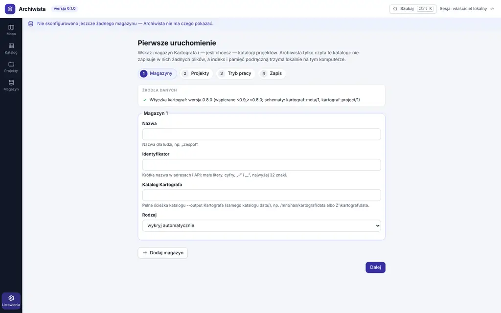
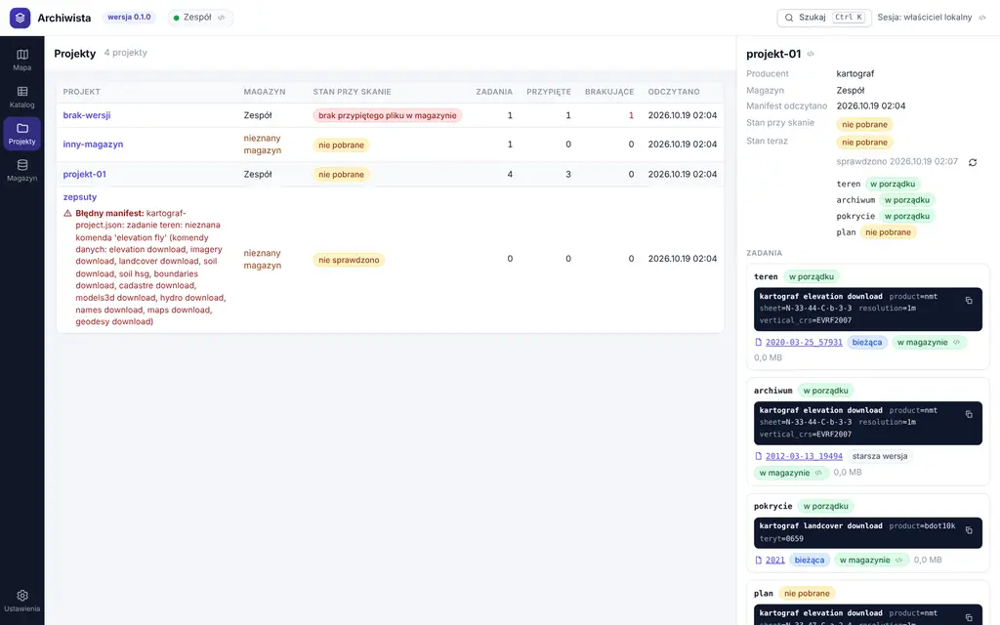
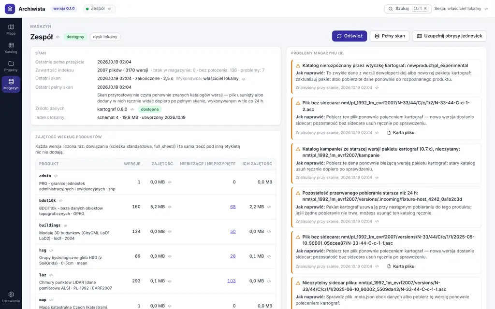

# Przewodnik użytkownika — Archiwista 0.1

Archiwista 0.1 „Przeglądarka” pokazuje, co jest w magazynie Kartografa: na
mapie, w katalogu i na karcie pliku, a obok — projekty i stan magazynu.
Niczego nie pobiera ani nie zmienia: magazyn i katalogi projektów tylko
czyta, a własny indeks trzyma lokalnie. Instalacja i wiersz poleceń:
[`README.md`](../README.md); skrypty i agenci AI:
[`API_dla_agentow.md`](API_dla_agentow.md).

## Start

1. `archiwista serve` otwiera przeglądarkę pod jednorazowym adresem
   z tokenem (ważny 10 minut). Gdy przeglądarka się nie otworzy, skopiuj
   adres z terminala.
2. Kreator „Pierwsze uruchomienie” ma cztery kroki:
   - **Magazyny** — nazwa dla ludzi, krótki identyfikator (w adresach
     i API), pełna ścieżka katalogu Kartografa (jego `--output`, czyli
     katalog `data/`) i rodzaj: dysk lokalny albo udział sieciowy
     (domyślnie wykrywany). Magazynów może być kilka.
   - **Projekty** — katalogi z projektami Kartografa
     (`kartograf-project.json`); można je dodać później.
   - **Tryb pracy** — tryb offline: przeglądarka nie wysyła żadnych zapytań
     poza Archiwistę, więc mapa jest bez podkładu.
   - **Zapis** — podsumowanie i „Zapisz i zindeksuj”.
3. Pierwszy pełny skan trwa w tle, a pasek stanu nad widokami pokazuje
   postęp. Dalej skanuje harmonogram: przyrostowo co 5 minut (dysk
   lokalny) albo co 15 minut (udział) i w całości raz na dobę.

## Okno

- **Widoki** po lewej: Mapa (start), Katalog, Projekty, Magazyn, a na dole
  Ustawienia — ten sam formularz co kreator. Zapis ustawień zastępuje je
  wszystkie naraz; nowy albo przeniesiony magazyn jest skanowany od nowa.
- **Górna belka:** magazyny z kropką stanu, „Szukaj” (`Ctrl+K` albo `/`
  w każdym widoku) i bieżąca sesja.
- **Pasek stanu indeksu** pod belką mówi o skanie w toku, nieudanym skanie
  i magazynie niedostępnym (np. odłączony udział): wtedy widoki pokazują
  stan z indeksu z podaną godziną, co nie dowodzi, że plików nie ma.
- **Ikona `</>`** obok nazwy dla ludzi pokazuje wartość techniczną: segment,
  klucz zbioru, układ EPSG, identyfikator.
- **Panele** poszerza się, przeciągając brzeg (albo strzałkami;
  dwuklik przywraca szerokość domyślną), i zwija.
- **Adres strony** zapisuje widok, filtry i otwartą kartę pliku — można go
  dodać do zakładek albo przesłać.

## Mapa

Panel „Wybór” prowadzi przez trzy kroki:

1. **Obszar:** „Prostokąt” (przeciągnij po mapie), „Wielokąt” (wierzchołki
   kliknięciami; koniec kliknięciem w pierwszy punkt, dwuklikiem albo
   `Enter`, `Backspace` cofa, `Esc` anuluje), „Widok mapy” (to, co teraz
   widać), godło arkusza wpisane albo kliknięte w „Siatce godeł” (PL-1992,
   PL-2000, wybrana skala) i „Plik…” — GeoJSON, GeoPackage albo ZIP
   z jednym Shapefile; z pliku o kilku warstwach wybiera się jedną.
2. **Produkt i filtry:** produkt z listy (z liczbą slotów i wersji),
   warianty (segmenty) i filtry: magazyn, kraj, lata danych, kod jednostki,
   wersje, stan plików, tekst. Aktywne filtry widać nad mapą.
3. **Stan lokalny:** ile obszaru pokrywają bieżące wersje produktu
   w magazynie, np. „lokalnie 30% obszaru”, z km² i liczbą wersji, osobno
   dla każdego kraju. „Odśwież” czyta sloty obszaru z magazynu jeszcze raz;
   „Pokaż pliki obszaru w Katalogu” przechodzi do listy.

Obrysy plików są widoczne od razu; przy ponad 5000 obrysach w widoku mapa
pokazuje siatkę zagęszczenia, a kliknięcie komórki przybliża. Kliknięcie
obrysu otwiera kartę pliku (gdy w jednym miejscu jest kilka plików —
najpierw ich listę). Pliki bez obrysu nie trafiają na mapę: licznik
„… bez obrysu” prowadzi do nich w Katalogu. W legendzie zmienia się
podkład (domyślnie szary BKG TopPlusOpen). Bez myszy: strzałki przesuwają
mapę, plus i minus przybliżają.

## Katalog

- **Wyszukiwanie** (`Ctrl+K` albo `/`): każde słowo musi pasować do
  początku godła, TERYT, KU, nazwy pliku, produktu, etykiety wersji, numeru
  zgłoszenia prac albo kampanii; bez polskich znaków. 8–64 znaki
  szesnastkowe to początek sumy SHA-256.
- **Filtry:** magazyn, produkt z wariantami, kraj, rok danych (od–do; rok
  nalotu albo wydania, nigdy rok pobrania), jednostka (dokładny kod),
  wersje (bieżące, wszystkie, pełne arkusze `full_sheet/`, przypięte
  w projektach, niebieżące i nieprzypięte), stan oraz obszar albo
  prostokąt w wybranym układzie. Ctrl+K z mapy przenosi jej filtry i obszar.
- **Położenie:** „Wszystkie”, „Z położeniem”, „Bez obrysu” — liczniki
  obejmują cały wynik. Pliki bez obrysu są tylko tutaj; powód braku jest
  w kolumnie „Położenie”.
- Lista doczytuje kolejne strony przy przewijaniu. Klawiatura: `↑` `↓`
  wybór, `Enter` karta pliku, `M` pokaż na mapie.
- „Pokaż wynik na mapie” otwiera mapę z tymi samymi filtrami, a „Zapytanie
  API” — to samo zapytanie jako adres API.

## Karta pliku

- **Oś wersji:** najnowsza na górze; „bieżąca” — wskazuje ją ścieżka
  standardowa, „pełny arkusz” — dowiązanie `full_sheet/`, „brak
  w magazynie od …” — wersja, której pliku już nie ma.
- **Wersja:** rok i data danych, etykieta (kampania, wydanie albo data
  pobrania), zgłoszenie prac, arkusz pełny, rozdzielczość, układy poziomy
  i wysokości, nodata, rozmiar, SHA-256, data pobrania i położenie ze
  źródłem obrysu.
- **Licencja** z przyciskiem „Kopiuj atrybucję”.
- **Ścieżki:** ścieżka wersji wskazuje zawsze tę samą treść — tej używa się
  w projektach i analizach; ścieżka standardowa to dowiązanie do bieżącej
  wersji, które po pobraniu nowszej wskaże inną treść. „Na innym
  komputerze” podaje tę samą ścieżkę pod inną literą dysku albo
  montowaniem (ustawienie `path_aliases` magazynu).
- **„Przypięta w:”** — projekty, które przypięły daną wersję.
- **„Pliki tego samego zapytania”** — pliki pobrane jednym zapytaniem
  producenta, np. obie strony granicy PL/CZ.
- **Sidecar** — surowe metadane producenta bez zmian, do skopiowania.
- **„Potwierdź bieżącą wersję”** sprawdza treścią (SHA-256 całego pliku),
  którą wersję trzyma ścieżka standardowa; na udziale może to potrwać.

`Esc` albo „×” zamyka kartę.

## Projekty

- **Lista** projektów z katalogów projektów: magazyn, stan przy skanie,
  liczba zadań, przypiętych i brakujących wersji, czas odczytu manifestu;
  błędny manifest z opisem od producenta. Lista filtruje się po magazynie.
- **Karta projektu:** „Stan teraz” od producenta („Sprawdź stan ponownie”
  — producent sprawdza przypięte pliki bez sieci i bez liczenia sum),
  zadania z poleceniem Kartografa (do skopiowania) i opcjami, przypięte
  wersje — bieżąca albo starsza, z odnośnikiem do karty pliku — oraz
  brakujące przypięcia.
- Archiwista tylko pokazuje projekt: pobieranie, przepinanie i zmiany robi
  się poleceniami Kartografa.

## Magazyn

- **Stan:** dostępny, niedostępny (od kiedy) albo jeszcze nie zeskanowany;
  dysk lokalny albo udział; ostatnie pełne przejście, zawartość indeksu,
  ostatni skan z wykonawcą, ostatni pełny skan, wersja Kartografa i indeks
  lokalny.
- **Przyciski:** „Odśwież” — skan przyrostowy (tylko zmiany); „Pełny skan”
  — cały magazyn, także pliki usunięte albo dodane ręcznie w znanych
  katalogach wersji; „Uzupełnij obrysy jednostek” — granice TERYT i KU
  pobierane z sieci (niedostępne w trybie offline). Postęp zadania widać
  w tym widoku i w pasku stanu.
- **Zajętość według produktów** — każda wersja liczona raz, bez dowiązań
  i powtórzonej treści.
- **Niebieżące i nieprzypięte** — wersje ani bieżące, ani w `full_sheet/`,
  ani przypięte w projektach, i ile miejsca zwolniłoby ich usunięcie.
  Archiwista niczego nie usuwa — raport służy decyzji.
- **Problemy magazynu** z opisem naprawy (i kartą pliku, gdy dotyczą
  pliku) oraz **projekty** korzystające z magazynu.

## Sesja

Archiwista działa tylko na tym komputerze (`127.0.0.1`) i bez sesji nic nie
pokazuje. Sesja wygasa po 24 godzinach bez użycia i kończy się wraz
z zatrzymaniem serwera; wtedy pojawia się ekran „Wymagana sesja”. Nową
sesję otwiera adres wypisany przez `archiwista serve` albo nowy adres
z polecenia `archiwista token`. Kolejna karta przeglądarki dostaje sesję od
otwartej karty Archiwisty.

## Gdy coś nie działa

- `archiwista doctor` sprawdza instalację, wtyczkę Kartografa, magazyny
  i port, a przy każdym problemie podaje naprawę.
- **Magazyn niedostępny** (np. odłączony udział): widoki pokazują stan
  z indeksu, pasek stanu podaje jego czas; po ponownym podłączeniu kolejny
  skan uzupełnia zmiany bez przebudowy indeksu.
- **Źródło danych niedostępne** (brak Kartografa albo niewspierana wersja):
  pasek stanu podaje polecenie naprawy, to samo wypisuje `archiwista doctor`.

## Czego wersja 0.1 nie robi

- Nie pobiera danych, nie pokazuje podglądów plików, nie porównuje wersji,
  nie sprawdza dostępności u źródła i nie zmienia projektów — to wersje
  v0.2 „Podglądy” i v0.3 „Działania”.
- Nie ma logowania ani pracy w zespole — v0.4 „Zespół”.
