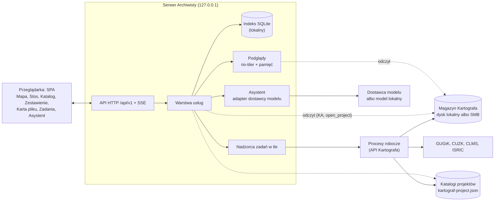
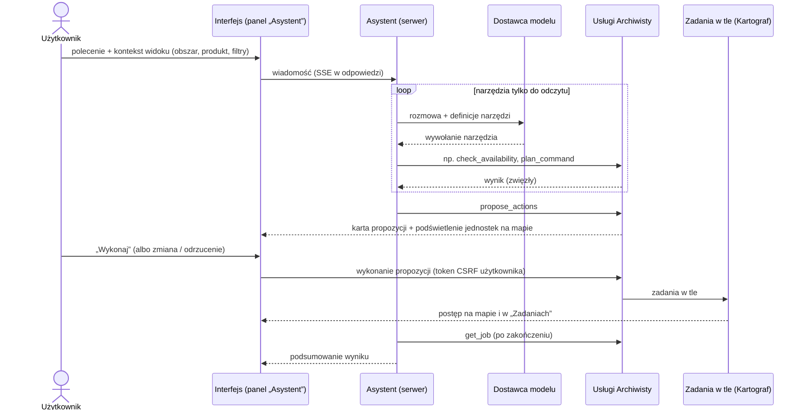

# Archiwista — specyfikacja

**Data:** 2026-10-17
**Status:** specyfikacja do przeglądu (bez kodu aplikacji); decyzje:
[`docs/DECISIONS.md`](DECISIONS.md); mockup interfejsu: `mockup/` na gałęzi
`feat/mockup` (sekcja 16)
**Zależność:** Kartograf 0.8.0 (`develop`) — publiczne API
(`kartograf/__init__.py`, `__all__`) i formaty na dysku: sidecar
`kartograf-meta/1`, układ `data/` z magazynem wersji (`versions/`), manifest
projektu `kartograf-project/1`, plan aktualizacji `kartograf-plan/1`, raport
dostępności `kartograf-availability/1`
**Dokumenty źródłowe (repozytorium Kartografa):** `docs/ARCHITECTURE.md` 1
i 3.1-3.5, `docs/USAGE.md`, `docs/SCOPE.md` 3.3 (roadmapa, zasady nakładek),
`docs/DECISIONS.md` ADR-022, ADR-024, ADR-027, ADR-036, ADR-037, ADR-039 do
ADR-044, spec manifestu `docs/superpowers/specs/2026-10-15-manifest-projektu-design.md`

Konwencje dokumentu: nazwy z Kartografa (funkcje, pola sidecara, katalogi)
zapisuję w `kodzie`; teksty interfejsu w cudzysłowie „…”; prawdziwe
ścieżki danych zastępuje `<katalog-danych>`. Odwołania „ARCH”, „USAGE”,
„SCOPE” i „ADR-0xx” bez dopisku dotyczą dokumentów Kartografa; decyzje
Archiwisty mają postać „A-ADR-0xx” (`docs/DECISIONS.md` w tym repozytorium).

---

## 1. Cel i użytkownicy

### 1.1 Problem

Kartograf zapisuje dane w uporządkowanym magazynie, ale magazyn szybko
rośnie: dziesiątki tysięcy plików, kilka wersji tego samego arkusza (loty,
wydania), wiele projektów przypinających różne wersje, dane PL i CZ
w różnych układach, na dysku lokalnym albo na udziale sieciowym. Proste
pytania wymagają dziś znajomości CLI, reguł katalogów `data/` i czytania
plików JSON:

- „Co mam w magazynie dla tej zlewni i z którego roku?”
- „Z którego roku źródło ma komplet arkuszy dla tego obszaru?”
- „Czy jest nowszy nalot niż ten, którego używa projekt?”
- „Których plików użył projekt X i czy są nienaruszone?”
- „Jak to wszystko wczytać do QGIS jednym ruchem?”
- „Czym różni się lot 2019 od 2025 na tym arkuszu?”

### 1.2 Cel

Archiwista to manager magazynu Kartografa w przeglądarce. Pozwala:

1. **Widzieć** — przegląd i wyszukiwanie archiwum, mapa z obrysami
   i podglądami, wersje, pochodzenie, licencje, projekty.
2. **Sprawdzać** — dostępność danych dla zaznaczonego obszaru lokalnie
   (magazyn) i u źródła (GUGiK, CUZK), aktualność wersji, integralność
   przypiętych plików.
3. **Działać** — pobierać, aktualizować i przypinać dane w projektach;
   każde działanie wykonuje publiczne API Kartografa w tle, z postępem,
   komunikatami i anulowaniem.
4. **Przygotować do łączenia** — mozaika arkuszy, zestawienie PL + CZ,
   zestaw do projektu QGIS, porównanie wersji (sekcja 8).
5. **Zlecać w języku naturalnym** — asystent (agent LLM) planuje
   przygotowanie danych, a wykonuje je dopiero po potwierdzeniu
   użytkownika (sekcja 7).

**Nadrzędna zasada (jak w Kartografie): układ, interfejs i API proste,
zrozumiałe i wygodne dla ludzi.** W praktyce:

- ludzkie nazwy zamiast katalogów („NMT 1 m · PL-1992 · EVRF2007” zamiast
  `nmt/pl_1992_1m_evrf2007`), a surowa wartość zawsze o jedno kliknięcie;
- każde działanie z siecią albo zapisem najpierw pokazuje plan (co, ile
  plików, ile już jest lokalnie, ile danych, dokąd), a po wykonaniu —
  co się stało;
- zero cichych zmian: nic nie jest pobierane, przepinane ani nadpisywane
  bez jawnej decyzji człowieka;
- komunikaty Kartografa (`Info:`, `Warning:`, błędy) pokazujemy bez
  przeróbek — ten sam tekst co w CLI;
- każde działanie da się powtórzyć z wiersza poleceń: Archiwista pokazuje
  odpowiadające polecenie `kartograf …` do skopiowania.

### 1.3 Granice (czym Archiwista nie jest)

- **Nie jest programem GIS.** Podglądy służą rozpoznaniu danych, a nie
  analizie; analizy robi się w QGIS (Archiwista przygotowuje do tego
  zestaw, sekcja 8.4).
- **Nie pobiera i nie przetwarza danych sam.** Robi to Kartograf (SCOPE
  3.3: nakładki wołają wyłącznie publiczne API biblioteki i nie mają
  własnej logiki pobierania ani obróbki). Brakująca funkcja Kartografa to
  wymaganie wobec Kartografa (sekcja 12), a nie obejście w Archiwiście.
- **Nie usuwa danych z magazynu** (Kartograf niczego nie usuwa; sekcja 15,
  P4).
- **Nie trzyma niczego na udziale sieciowym.** Indeks, podglądy i historia
  zadań leżą lokalnie i można je w każdej chwili odbudować; źródłem prawdy
  są sidecary i manifesty (SCOPE 3.3).
- **Nie zastępuje wtyczki QGIS** (podprojekt 4 roadmapy Kartografa). Zastępuje
  podprojekt 5 („GUI webowe”) i jest osobnym projektem (A-ADR-001).

### 1.4 Użytkownicy i tryby pracy

| Persona | Kim jest | Czego potrzebuje od Archiwisty |
|---|---|---|
| **Ola, hydrolożka** | Przygotowuje dane do modelu zlewni; zna QGIS, CLI używa rzadko | obszar na mapie → co jest dostępne i z którego roku → pobierz → zestaw do QGIS |
| **Marek, specjalista GIS** | Zna Kartografa i CLI | przegląd wersji i kampanii, mozaiki, porównania lotów, kontrola aktualności, dane z pogranicza PL/CZ |
| **Zespół projektowy (później)** | Kilka osób, wspólny magazyn na udziale SMB | które projekty używają których danych, kto i kiedy pobrał, co można zaktualizować — bez pobierania tego samego dwa razy |
| **Deweloper Hydrografa/Hydrologa** | Używa Kartografa jako biblioteki | sprawdzenie zawartości magazynu, ścieżki niezmiennych wersji do skryptów |

Tryby pracy:

- **Lokalny (od v0.1, domyślny):** jedna osoba, serwer na `127.0.0.1`,
  bez logowania; magazyn na dysku lokalnym albo na udziale SMB.
- **Zespołowy (v0.8):** jeden serwer Archiwisty w sieci lokalnej
  z logowaniem i rolami, wspólny magazyn na udziale SMB bez blokad zakresów
  bajtów (A-ADR-013; sekcja 15, P1). Architektura od v0.1 nie zakłada, że
  przeglądarka i serwer widzą ten sam system plików (sekcja 5.1).

## 2. Słownik pojęć

Jedno słownictwo w dokumentacji, interfejsie i API. Pojęcia Kartografa
zachowują jego znaczenie.

| Pojęcie | Znaczenie | Źródło |
|---|---|---|
| **Magazyn** | Katalog `--output` Kartografa (`output_dir`) z układem `data/`: katalogi produktów, segmenty, wersje. Archiwista obsługuje kilka magazynów (np. lokalny i zespołowy) | ARCH 3.3 |
| **Produkt** | Rodzaj danych wybierany `--product` w grupie komend (NMT, ortofotomapa, BDOT10k, granice PRG…); katalog najwyższego poziomu magazynu | ARCH 3.3 reguła 10 |
| **Źródło (zbiór)** | Deskryptor Kartografa; klucz `<kraj>.<dostawca>.<nazwa>` = pole `dataset` sidecara, np. `pl.gugik.nmt_1m` | ARCH 3.1 |
| **Segment** | Katalog `<produkt>/<kraj>_<tokeny>` — jeden wariant treści (układ, rozdzielczość, układ wysokości, format, rocznik, poziom…), np. `nmt/pl_1992_1m_evrf2007` | ARCH 3.3 reguły 1, 8-10 |
| **Jednostka** | Obszar jednego pliku: godło arkusza, kafel, TERYT, KU, kod kraju albo wycinek `<coords>` | `UnitFile.unit`, `PlanItem.unit` |
| **Slot (miejsce pliku)** | Segment + hierarchia jednostki + nazwa pliku, czyli „ten plik” niezależnie od wersji, np. `nmt/pl_1992_1m_evrf2007` + `N-34/130/D/d/2/4` + `N-34-130-D-d-2-4.asc` | `PlanItem` (`segment`, `hierarchy`, `name`) |
| **Wersja** | Niezmienna treść slotu: `<segment>/versions/<hierarchia>/<etykieta>_<sha8>/<plik>` z sidecarem wersji; tożsamość wersji = SHA-256 treści | ADR-036 |
| **Etykieta wersji** | Czytelna nazwa wersji: kampania `<data>_<id>` (np. `2025-04-26_82710`), wydanie (`2.0`, `2024`, `2024_2025-02-06`) albo data pobrania; skąd — mówi `extra.version.label_source` | ARCH 3.3 reguła 6 |
| **Bieżąca wersja** | Wersja, na którą wskazuje ścieżka standardowa `<segment>/<hierarchia>/<plik>` (dowiązanie twarde do najnowszej lokalnej wersji); `full_sheet/` wskazuje najnowszy pełny lot | ARCH 3.3 reguły 6-7 |
| **Sidecar** | `<plik>.meta.json` (`kartograf-meta/1`): pochodzenie, układy, `nodata`, zadanie, licencja, `sha256`. Sidecar wersji jest niezmienny; sidecar ścieżki standardowej to kopia z celem dowiązania (`extra.link_target`) | ARCH 3.2 |
| **Kampania (lot, nalot)** | Pomiar GUGiK arkusza: data aktualności i numer zgłoszenia pracy; rok kampanii = rok danych | ADR-028, ADR-030 |
| **Wydanie** | Wersja publikacji źródła bez kampanii: rocznik BDOT10k, `2.0` SoilGrids, data wpisu feedu ATOM CUZK | ADR-036 D29, ADR-042 |
| **Arkusz pełny / niepełny** | Rekord skorowidza `TAK`/`NIE` (`czy_ark_wypelniony`, w sidecarze `extra.source.full_sheet`): czy arkusz jest w całości wypełniony treścią | ARCH 3.2 |
| **Zadanie Kartografa (obszarowe)** | Jedno wywołanie dla obszaru; jego pliki — także po obu stronach granicy PL/CZ — łączy wspólne `extra.parent_request` | ARCH 3.4 |
| **Projekt** | Katalog z `kartograf-project.json` (`kartograf-project/1`): zadania projektu (komendy danych z opcjami) i przypięte wersje plików | ARCH 3.5, ADR-040 |
| **Zadanie projektu** | Wpis `tasks[]` manifestu: nazwa, komenda (np. `elevation download`) i opcje | spec manifestu 3.3 |
| **Przypięcie** | Wpis `files[]` zadania projektu: która wersja (`version`, `sha256`) jest używana | spec manifestu 3.3 |
| **Dostępność** | Co źródło ma dla obszaru: lata, warianty, kompletność arkuszy — raport `check_availability` (`kartograf-availability/1`) | ADR-041 |
| **Aktualność** | Czy lokalna albo przypięta wersja jest najnowsza u źródła — plan `check_*` (`kartograf-plan/1`; statusy `current`, `newer`, `missing`, `unverifiable`, `check_failed`) | ADR-036 |
| **Obszar** | Zaznaczenie użytkownika: prostokąt, wielokąt, plik geometrii, godło, TERYT, KU albo kraj | — |
| **Pokrycie roku** | (Archiwista) etykieta roku albo wydania dla obszaru: „pełne”, „pełne · 2 kampanie”, „częściowe · 58%”, „brak danych” — oraz osobna plakietka stanu magazynu: „pobrane”, „pobrane 5/12”, „niepobrane” | sekcja 6.4 |
| **Zestaw** | (Archiwista) wybór wersji przygotowany do użycia poza magazynem: projekt QGIS, lista ścieżek, atrybucje, VRT-owijki; generowany z projektu albo z zaznaczenia, odtwarzalny, nie jest danymi | sekcja 8.4 |
| **Produkt pochodny** | (propozycja dla Kartografa) wynik łączenia zapisany w magazynie jako wersja z sidecarem i listą wejść (`extra.source_files[]`, wzór HSG) | sekcja 8.1 |
| **Indeks** | (Archiwista) lokalna baza SQLite z opisem magazynów i projektów; pamięć podręczna, nie źródło prawdy | sekcja 4 |
| **Zadanie w tle** | (Archiwista) długa operacja — skan, sprawdzenie, pobranie, łączenie, eksport — w osobnym procesie, z postępem i anulowaniem; widok „Zadania” | sekcja 5.6 |
| **Propozycja** | (Archiwista) plan działań przygotowany przez asystenta; staje się zadaniami w tle dopiero po potwierdzeniu użytkownika | sekcja 7 |

„Zadanie” bez dopisku nie występuje w interfejsie: zawsze „zadanie
projektu” (Kartograf) albo „zadanie w tle” (Archiwista).

## 3. Przypadki użycia

Każdy przypadek: kto i w jakiej sytuacji, przebieg w interfejsie, co
dzieje się pod spodem (wywołania Kartografa) i po czym poznać sukces.
Przykładowy obszar „Kraków” to bbox `561000,239000,573000,249000`
(EPSG:2180, 120 km²) — ten sam, którego używa mockup (sekcja 16).

### UC-01. Obszar → produkt → dostępność → pobranie (główny przepływ)

**Ola** przygotowuje NMT dla zlewni i nie wie, z którego roku jest komplet
arkuszy.

1. W widoku „Mapa” zaznacza obszar: rysuje prostokąt albo wielokąt, wpisuje
   godło albo TERYT, albo wczytuje `zlewnia.gpkg`.
2. Z listy produktów wybiera „NMT” (grupa „Wysokości”).
3. Archiwista od razu pokazuje stan magazynu (z indeksu, bez sieci),
   a w tle uruchamia sprawdzenie u źródła: `check_availability(product="nmt",
   country="pl", bbox=…)`.
4. Wynik pojawia się jako warstwy lat na mapie i w panelu „Zestawienie”:
   2023 „pełne · 2 kampanie” z plakietką „pobrane 5/12”, 2022 „częściowe ·
   58%”, a przy 2019 dopisek „1 ark. niepełny” (definicje: sekcja 6.4). Ola
   przełącza panel na „Oś czasu”, a mapę na „Stos”, żeby zobaczyć lata
   jednym spojrzeniem.
5. Przy roku 2023 klika „Pobierz…”. Okno planu (`check_data(…, year=2023)`)
   mówi: 12 arkuszy, 5 już w magazynie, 7 do pobrania, ok. 265 MB, zapis do
   magazynu „Zespół”; pokazuje polecenie `kartograf elevation download …`
   i opcję „Dodaj jako zadanie projektu”.
6. Po potwierdzeniu startuje zadanie w tle (`download_data(…)`). Arkusze na
   mapie zmieniają kolor w miarę pobierania; komunikaty Kartografa
   pojawiają się w zadaniu.

**Sukces:** plakietka roku zmienia się na „pobrane”, nowe wersje są
w katalogu, a magazyn jest bajtowo taki sam jak po tym samym poleceniu
z CLI.

### UC-02. „Co już mam?” bez sieci

**Marek** jest w terenie bez internetu. Zaznacza obszar i wybiera „Wszystkie
produkty”. Archiwista pokazuje tylko magazyn (indeks): pliki przecinające
obszar, pogrupowane wg produktu i roku danych, z lokalnym pokryciem
obszaru. Sprawdzenie u źródła jest wyłączone z komunikatem „Brak sieci —
pokazuję tylko magazyn”; jeśli wcześniej sprawdzano ten obszar, widać
ostatni raport z datą.

**Sukces:** odpowiedź w sekundę, bez jednego zapytania sieciowego.

### UC-03. Wyszukiwanie po identyfikatorze

Marek wkleja do pola wyszukiwania godło `N-34-130-D-d-2-4`, TERYT `1465`,
numer zgłoszenia `GK-FOTO.6201.11.2025` albo początek sumy `fdd30535`.
Archiwista rozpoznaje rodzaj identyfikatora i pokazuje pasujące sloty
wszystkich produktów; filtry zawężają wynik (sekcja 6.5).

### UC-04. Karta pliku i historia wersji

Ola otwiera arkusz `N-34-130-D-d-2-4`. „Karta pliku” pokazuje oś wersji
(loty 2019, 2023, 2025), która wersja jest bieżąca, która pełna
(`full_sheet/`), które projekty przypinają którą wersję, metadane po
ludzku („skaning laserowy, błąd średni wysokości 0,06 m, arkusz pełny”),
licencję z przyciskiem „Kopiuj atrybucję”, podgląd oraz akcje: „Kopiuj
ścieżkę wersji”, „Polecenie Kartografa”, „Sprawdź aktualność”, „Porównaj
wersje”, „Dodaj do projektu”.

### UC-05. Czy są nowsze dane?

Marek zaznacza segment w obszarze albo cały projekt i klika „Sprawdź
aktualność”. Zadanie w tle wywołuje `check_*` (albo `check_project`)
i pokazuje plan po ludzku: „aktualne”, „nowsza: 2025-04-26_82710”, „nie da
się sprawdzić bez pobrania”, „błąd sprawdzenia: …”. Przycisk „Pobierz
nowsze” wykonuje ten sam plan (`update="upgrade"`, `plan=…`), a pozycje,
które w międzyczasie się zmieniły, Kartograf zgłasza jako nieaktualne.

### UC-06. Projekt: przypięcia, weryfikacja, aktualizacja

Ola otwiera projekt „Raba”: zadania projektu z opcjami (pokazanymi jako
polecenia Kartografa) i przypięte wersje. „Status” odpowiada natychmiast
(`get_project_status`), „Weryfikuj” liczy sumy SHA-256 w tle
(`verify_project`), „Sprawdź aktualizacje” porównuje przypięcia ze źródłem
(`check_project`), „Przepnij” przechodzi na nowsze dane jednego zadania
(`download_project(update="upgrade", tasks=["teren"])`). Z wyniku
dostępności (UC-01) dodaje zadanie „Dodaj rok 2025 do projektu”
(`add_project_task` z `year=2025`).

### UC-07. Które projekty używają tego pliku?

Kierownik zespołu przed porządkami w magazynie filtruje „Nieużywane przez
żaden projekt” i „Niebieżące wersje”, widzi ich zajętość i listę.
Na karcie pliku widać „Przypięta w: Raba (teren), Wisła-2026 (dem)”.
Archiwista niczego nie usuwa; raport służy decyzji (sekcja 15, P4).

### UC-08. Mozaika arkuszy

Marek potrzebuje NMT 0,5 m z 2023 dla obszaru jako jednej warstwy.
Z wiersza roku wybiera „Łączenie › Mozaika”: VRT (natychmiast, bez kopii
danych) albo GeoTIFF na wspólnej siatce przycięty do obszaru. Plan pokazuje
wejścia (konkretne wersje), siatkę i rozmiar wyniku. Wynik trafia do
magazynu jako produkt pochodny z sidecarem (sekcja 8.2).

### UC-09. Pogranicze PL + CZ

Marek modeluje zlewnię Olzy. Obszar przecina granicę; dostępność pokazuje
lata PL i bieżące modele CZ. Pobranie idzie jednym zadaniem Kartografa
(`country="auto"`, `cutout=True`, wspólny `horizontal_crs`, układ wysokości
`pl=EVRF2007,cz=EVRF2007`); pliki PL i CZ są zgrupowane po
`extra.parent_request`. „Łączenie › PL + CZ” daje dziś zestaw bez scalania
(obie warstwy w projekcie QGIS), a po dodaniu funkcji do Kartografa —
jedną powierzchnię na wspólnej siatce (sekcja 8.3).

### UC-10. Zestaw do QGIS

Ola wybiera w projekcie „Zestaw QGIS”. W katalogu projektu powstaje
`zestawy/<nazwa>/` z plikiem `.qgz`, listą ścieżek i atrybucjami. QGIS
otwiera projekt bez pytań o układy, a warstwy wskazują dokładnie przypięte
wersje (sekcja 8.4).

### UC-11. Porównanie lotów

Marek porównuje loty 2019 i 2025 jednego arkusza: tabela różnic metadanych,
kurtyna na mapie, a po dodaniu funkcji do Kartografa — model różnic
wysokości ze statystyką („średnia zmiana −0,04 m; 2,1 ha zmian > 0,5 m”)
(sekcja 8.5).

### UC-12. Asystent

Ola pisze: „Przygotuj NMT 1 m i ortofotomapę dla zaznaczonego obszaru
z najnowszego roku z pełnym pokryciem i dodaj do projektu Raba”. Asystent
odczytuje zaznaczenie, sprawdza dostępność (tylko odczyt), wybiera rok
i przedstawia propozycję: dwa polecenia Kartografa, 24 arkusze, 9 już
lokalnie, ok. 1,2 GB, dwa nowe zadania projektu; arkusze propozycji są
podświetlone na mapie. Dopiero „Wykonaj” uruchamia zadania w tle; po ich
zakończeniu asystent podsumowuje wynik (sekcja 7).

### UC-13. Kondycja magazynu

Marek otwiera „Magazyn › Stan”: zajętość wg produktów (każda wersja liczona
raz), a obok problemy z wyjaśnieniem i poleceniem naprawy: segmenty
nierozpoznane (np. nazwy z wersji deweloperskiej 0.8.0-dev), pliki bez
sidecara, katalogi `kampanie/` z 0.7.x, pozostałości `versions/.incoming/`
starsze niż 24 h, sidecary dowiązań wskazujące brakującą wersję, przypięcia
projektów bez pliku w magazynie.

### UC-14. Zespół (od v0.8)

Kasia loguje się do Archiwisty zespołu. Widzi historię („Marek pobrał NMT
2025 dla Raby, wczoraj 14:02”) i wspólną kolejkę zadań, więc nie pobiera
tego samego drugi raz. Jako „czytelnik” przegląda dane i tworzy zestawy;
pobierać może „operator” (sekcja 10.2).

### UC-15. Wklejone polecenie Kartografa

Marek wkleja `kartograf elevation download --product nmt --sheet … -o
./data`. Archiwista rozpoznaje polecenie (ten sam parser co
`kartograf project add`), wypełnia formularz, zamienia `-o` na wybrany
magazyn, pokazuje plan i uruchamia zadanie w tle.

## 4. Model danych i indeks

### 4.1 Co czytamy z dysku (źródła prawdy)

Archiwista nie ma własnych danych o magazynie poza pamięcią podręczną.
Wszystko, co pokazuje, wynika z plików Kartografa:

| Plik | Gdzie | Zmienność | Jak czytamy |
|---|---|---|---|
| Sidecar wersji | `<segment>/versions/<hierarchia>/<etykieta>_<sha8>/<plik>.meta.json` | niezmienny (ADR-036) | raz, przy pierwszym zobaczeniu katalogu wersji |
| Plik danych wersji | obok sidecara wersji | niezmienny | podczas indeksowania wyłącznie `stat` (rozmiar); treść tylko na żądanie (podgląd, weryfikacja) |
| Sidecar ścieżki standardowej i `full_sheet/` | `<segment>/<hierarchia>/<plik>.meta.json`, `<segment>/full_sheet/…` | zmienny (dowiązanie przestawiane na nowszą wersję) | przy zmianie rozmiaru albo czasu modyfikacji; cel dowiązania wyłącznie z `extra.link_target` |
| Manifest projektu | `<katalog projektu>/kartograf-project.json` | zmienny | przy zmianie czasu modyfikacji albo sumy pliku; zawsze przez `open_project` (ścisła walidacja Kartografa) |
| Plan aktualizacji | plik `kartograf-plan/1` zapisany `--plan` | jednorazowy | na żądanie (import planu z CLI) |

Pozostałości i przypadki brzegowe są pokazywane, nigdy pomijane po cichu:
katalogi robocze `versions/.incoming/` (pomijane przy indeksowaniu;
Kartograf sprząta je po 24 h, starsze zgłaszamy), katalogi `kampanie/`
z 0.7.x (nieczytane przez Kartografa 0.8.0), segmenty spoza rejestru (np.
`orto/pl_2000_oblique` z wersji deweloperskiej 0.8.0-dev — w przykładowym
magazynie testu na żywo wydania 0.8.0 są takie katalogi i sidecary
z dawnymi kluczami źródeł, np. `cz.cuzk.hy_net`), pliki bez sidecara,
sidecary nieczytelne i sidecary sprzed ADR-031 (polskie klucze: brak klucza
= brak informacji, jak w Kartografie).

**Archiwista nie zapisuje niczego w magazynie.** W katalogu projektu
zapisuje wyłącznie katalog zestawu (sekcja 8.4) i plik geometrii obszaru
narysowanego dla nowego zadania projektu (`obszary/`, 10.1); manifest
zmienia tylko API Kartografa (A-ADR-003).

### 4.2 Odczyt przez API Kartografa

Reguły układu `data/` (ARCH 3.3, reguły 1-10), rozpoznawanie dowiązań,
tolerancyjne czytanie starych sidecarów i wyliczanie zasięgu pliku to
wiedza o formacie Kartografa. Archiwista nie ma własnego czytnika tego
formatu: korzysta z pakietu wymagań **KA** (sekcja 12: `iter_store`,
`read_sidecar`, `describe_segment`, `file_footprint`, `link_target`,
`pinned_transform`). Dzięki temu zmiana układu w Kartografie nie
rozjedzie się z Archiwistą, a wtyczka QGIS i Hydrograf mogą korzystać
z tych samych funkcji. Konsekwencja: v0.1 wymaga wydania Kartografa z KA
(A-ADR-014).

### 4.3 Indeks lokalny

Indeks to plik SQLite (tryb WAL) na dysku lokalnym, w katalogu danych
użytkownika (`platformdirs`: Linux `~/.local/share/archiwista/`, Windows
`%LOCALAPPDATA%\Archiwista\`); obok leżą pamięć podglądów (`cache/`)
i dzienniki zadań (`jobs/`). Konfiguracja (magazyny, katalogi projektów,
limity, dostawca asystenta) jest w czytelnym pliku TOML w katalogu
konfiguracji użytkownika i w widoku „Ustawienia”. Indeks można usunąć
w każdej chwili — „Przebuduj indeks” odtworzy go z magazynów i manifestów;
tracona jest tylko historia zadań i rozmów asystenta.

Zawartość (tabele logiczne; schemat ustali plan implementacji):

| Tabela | Co trzyma |
|---|---|
| `stores` | magazyny: identyfikator (krótka nazwa nadana przez użytkownika, np. `zespol`), ścieżka i aliasy ścieżek, dostępność, czasy i statystyki skanów |
| `segments` | segmenty: produkt, źródło (`dataset`), ludzka nazwa (`describe_segment`), rozpoznany / nierozpoznany |
| `slots` | sloty: segment, hierarchia, nazwa, rodzaj i kod jednostki, bieżąca wersja, wersja `full_sheet/`, liczba wersji |
| `versions` | wersje: etykieta i jej źródło, `sha256`, rozmiar, układy, rozdzielczość, `nodata`, rok i data danych, kampania i numer zgłoszenia, wydanie, data pobrania, pełny arkusz, pokrycie (`extra.coverage`), licencja, klucz grupy `parent_request`, zasięg natywny i jego źródło, stan, pełny sidecar (JSON) |
| `footprints` | R*Tree: zasięg wersji w WGS84 (filtr obszaru i mapa) |
| `search` | FTS5: godła, TERYT, KU, etykiety, numery zgłoszeń, nazwy plików, ludzkie nazwy produktów, nazwy projektów i zadań projektów |
| `projects`, `project_tasks`, `pins` | znane projekty, ich zadania i przypięcia powiązane z wersjami — indeks „które projekty używają pliku” (SCOPE 3.3) |
| `availability` | ostatnie raporty dostępności per obszar i produkt, z datą (widoczne bez sieci) |
| `jobs`, `job_events` | historia zadań w tle i ich zdarzenia |
| `conversations`, `messages`, `proposals` | rozmowy z asystentem i jego propozycje |

Atrybuty do filtrów są wyliczane przy indeksowaniu z sidecara przez
`read_sidecar` (KA-2), który normalizuje pola różniące się między
produktami: **rok danych** (kampania, data lotu LAZ, rocznik wydania) jest
osobnym polem niż **data pobrania** i nigdy nie jest nią zastępowany;
wersja bez roku danych ma rok pusty, a nie rok pobrania.

**Zasięg (obrys) pliku** liczy `file_footprint` (KA-4) wg kolejności
źródeł: `request.bbox` z `bbox_crs` (wycinki, wyniki obszaru kolekcji,
SoilGrids, HSG) → godło z parsera (PL-1992, PL-2000, TM33) → nagłówek pliku
(GeoTIFF, ASC, JPEG z JGW, GeoPackage, LAS) → jednostka (TERYT z PRG, KU
z RUIAN, arkusz SM5 z indeksu CUZK — z siecią i pamięcią podręczną) → kraj.
Zasięg bez źródła oznaczamy „bez obrysu” (plik jest na liście, nie ma go
na mapie). Przeliczenie do WGS84 wyłącznie przypiętą transformacją
Kartografa (KA-6): domyślny transformator potrafi cicho użyć operacji
przybliżonej, a dla S-JTSK to przesunięcie rzędu 100 m (ADR-024).

### 4.4 Budowa i odświeżanie

- **Pełny skan** (pierwsze uruchomienie, „Przebuduj indeks”): przejście
  drzewa `iter_store` z odczytem sidecarów w puli wątków (opóźnienia SMB,
  nie procesor), zapis do indeksu paczkami w transakcjach; zadanie w tle
  z postępem.
- **Skan przyrostowy:** katalogi wersji `<etykieta>_<sha8>` są niezmienne,
  więc znanych wersji nie czytamy ponownie — sprawdzamy tylko pojawienie
  się nowych katalogów wersji, zniknięcie znanych i zmianę sidecarów
  dowiązań. Czas modyfikacji katalogu jest tylko wskazówką (na udziale
  z pamięcią atrybutów bywa opóźniony), dlatego okresowo wykonujemy pełny
  skan kontrolny (domyślnie raz na dobę, w tle).
- **Odświeżenie na żądanie dla widoku:** gdy użytkownik pyta o obszar
  i produkt, Archiwista najpierw odświeża dokładnie te sloty (katalogi
  hierarchii jednostek obszaru), a dopiero potem pokazuje stan magazynu —
  odpowiedź na bieżące pytanie jest aktualna w sekundach także na SMB,
  niezależnie od pełnych skanów.
- **Po własnych zadaniach:** wynik Kartografa (`files[].file.version_path`,
  przypięcia projektu) trafia do indeksu od razu, bez skanu.
- **Wyzwalacze:** start aplikacji (przyrostowy, jeśli ostatni starszy niż
  15 min), interwał (domyślnie 15 min dla udziału, 5 min dla dysku
  lokalnego), przycisk „Odśwież” (magazyn, segment, widok), koniec zadania
  w tle; obserwacja zmian systemu plików tylko dla dysków lokalnych
  (opcjonalnie).
- **Magazyn niedostępny** (brak katalogu albo pusty punkt montowania):
  skan przerwany, indeks bez zmian, baner „Magazyn niedostępny od 14:02 —
  pokazuję stan z indeksu”; działania zapisu wyłączone. Nigdy nie
  oznaczamy całego magazynu jako usuniętego z powodu odłączonego udziału.
- **Zniknięcia:** wersja, której nie ma po pełnym przejściu, dostaje stan
  „brak pliku” (z datą); przypinające ją projekty są oznaczone. Wpis
  znika z indeksu dopiero po kolejnym pełnym skanie.
- **Zmiana schematu indeksu** w nowej wersji Archiwisty = przebudowa (to
  pamięć podręczna — bez migracji).
- Polecenia Kartografa wykonywane poza Archiwistą (CLI, Hydrograf) są
  normalną sytuacją: indeks zobaczy je przy najbliższym odświeżeniu.

### 4.5 Wydajność

Magazyn odniesienia: 50 000 slotów, 80 000 wersji (ok. 260 000 plików
z sidecarami i dowiązaniami, ok. 150 000 katalogów), 30 projektów; udział
SMB 3 w sieci 1 Gb/s albo dysk lokalny SSD. Cele (kryteria akceptacji v0.1,
test na magazynie syntetycznym z generatora, sekcja 11):

| Operacja | Udział SMB | Dysk lokalny |
|---|---|---|
| pierwszy pełny skan | ≤ 10 min | ≤ 2 min |
| skan przyrostowy bez zmian (w tle) | ≤ 3 min | ≤ 20 s |
| odświeżenie widoku (obszar + produkt, ≤ 500 slotów) | ≤ 5 s | ≤ 1 s |
| zapytanie listy (strona 50 wierszy), p95 | ≤ 200 ms | ≤ 200 ms |
| obrysy w widoku mapy (≤ 5 000 obiektów; powyżej agregacja do siatki), p95 | ≤ 300 ms | ≤ 300 ms |
| wyszukiwanie tekstowe, p95 | ≤ 200 ms | ≤ 200 ms |
| karta pliku bez podglądu, p95 | ≤ 200 ms | ≤ 200 ms |

Indeks ≤ 500 MB dla 80 000 wersji; pamięć serwera ≤ 500 MB bez podglądów.
Interfejs nigdy nie czeka na skan: zapytania idą do indeksu, a stan
indeksu („Indeks z 14:02, skan trwa: 63%”) jest zawsze widoczny.

### 4.6 Praca na udziale SMB

1. Na udziale nie ma żadnego pliku Archiwisty (SQLite, pamięć, blokady).
   Archiwista tylko czyta; zapisy wykonuje Kartograf, który działa bez
   blokad zakresów bajtów (wersje przez `os.link`, manifest przez blokadę
   `mkdir` i `os.replace`).
2. Cel dowiązania wyłącznie z sidecara dowiązania (`extra.link_target`).
   Żadnej logiki na numerach i-węzłów ani licznikach dowiązań: na udziale
   CIFS przykładowego magazynu ścieżka standardowa i jej wersja zwróciły
   różne numery i-węzłów i różne liczniki dowiązań (pomiar 2026-10-17).
   Potwierdzenie treścią na takich udziałach robi Kartograf (KA-5).
3. Zajętość = suma rozmiarów plików w `versions/` (każda wersja raz);
   suma po ścieżkach liczyłaby dowiązania twarde wielokrotnie.
4. GeoPackage z magazynu otwieramy tylko do odczytu jako niezmienny
   (`immutable=1`): wersje się nie zmieniają, a zwykłe otwarcie SQLite na
   udziale zakłada blokady.
5. Plik, który zniknął między listowaniem a odczytem, jest pomijany
   i sprawdzany ponownie w następnym skanie.
6. Nie podążamy za dowiązaniami symbolicznymi wychodzącymi poza magazyn.
7. Ten sam udział bywa zamontowany pod różnymi ścieżkami (`Z:\kartograf`,
   `/mnt/nas/kartograf`): magazyn w konfiguracji ma aliasy ścieżek. Manifest
   projektu musi wskazywać magazyn poprawnie dla procesu, który pobiera
   (Kartograf czyta `output_dir` sam) — dlatego w zespole zalecamy względne
   `output_dir`, gdy projekty i magazyn leżą na tym samym udziale,
   a poprawkę ścieżki robi funkcja Kartografa (KH-1), nie ręczna edycja
   przez Archiwistę.
8. Udział niepodłączony — jak w 4.4: baner, bez skanu i bez zadań zapisu
   (Kartograf i tak wymaga istniejącego katalogu magazynu).

### 4.7 Projekty

- **Odkrywanie:** katalogi projektów z konfiguracji są przeszukiwane
  w poszukiwaniu `kartograf-project.json` (głębokość ≤ 4, z pominięciem
  `.git`, katalogów magazynów i katalogów ukrytych); projekt można też
  dodać ręcznie albo utworzyć (`init_project`).
- **Odczyt:** zawsze `open_project`. Niepoprawny manifest jest widoczny
  z tekstem błędu Kartografa (np. „nieznany klucz 'optons'”).
- **Powiązanie z magazynem:** `output_dir` projektu dopasowujemy do
  skonfigurowanego magazynu po ścieżce rozstrzygniętej albo aliasie; brak
  dopasowania — „Magazyn projektu nieznany: dodaj magazyn”.
- **Przypięcia → wersje:** po ścieżce `version` (względnej do magazynu)
  i `sha256`; przypięcie bez wersji w indeksie ma stan „brak pliku”.
- **Indeks użycia** („Przypięta w: …”) to tabela przypięć; nic nie trafia
  do sidecarów (sidecar jest niezmienny, SCOPE 3.3).
- **Zmiany manifestu** wykrywamy po czasie modyfikacji i sumie pliku;
  manifest zmieniony w trakcie pracy (inny proces, CLI) jest czytany
  ponownie przed każdą akcją, a konflikt zgłasza Kartograf (blokada
  `.kartograf-project.lock`, scalanie per zadanie).

## 5. Architektura

### 5.1 Przegląd



Zasady architektury:

- **API najpierw.** Jedno API HTTP (`/api/v1`, sekcja 9) obsługuje
  przeglądarkę, narzędzia asystenta i skrypty użytkownika. Interfejs nie
  ma żadnej ścieżki obok API.
- **Kartograf w jednym miejscu.** Kod Archiwisty importuje Kartografa
  wyłącznie w module adaptera (`archiwista/adapter/`); test pilnuje, że
  nigdzie indziej (wzór: test importów CLI w Kartografie, ADR-037 Z1).
  Adapter tłumaczy, nie decyduje: żadnych reguł danych, wyboru arkuszy,
  wersji ani transformacji.
- **Operacje długie i zapisujące w procesach roboczych.** Serwer nie
  wykonuje pobrań ani obliczeń w swoim procesie; awaria GDAL-a albo
  przerwanie zadania nie kładzie interfejsu (5.6).
- **Przeglądarka nie zna systemu plików serwera.** Pliki są wskazywane
  identyfikatorami z indeksu i serwowane przez API — tak samo lokalnie
  i w trybie zespołu. Ścieżki do skopiowania (np. do QGIS) pokazujemy
  w postaci właściwej dla klienta (aliasy ścieżek, 4.6).
- **Każde działanie ma wykonawcę.** Lokalnie „lokalny użytkownik”,
  w zespole zalogowana osoba — historia zadań i dziennik działań od v0.1
  zapisują, kto i co zlecił.

### 5.2 Wybór technologii

Użytkownik zostawił wybór technologii wolny. Decyzje (szczegóły:
A-ADR-004 do A-ADR-008, A-ADR-011, A-ADR-015):

| Obszar | Wybór | Odrzucone warianty i powód |
|---|---|---|
| Język serwera | **Python 3.12+** | Node.js, Go, Rust: Kartograf jest biblioteką Pythona; z innego języka zostaje wołanie CLI i parsowanie tekstu — dokładnie to, co Kartograf odrzucił w ADR-037 (opcja C) |
| Framework HTTP | **FastAPI + Uvicorn + Pydantic 2** — typowane modele = schemat OpenAPI dla interfejsu, asystenta i skryptów; ten sam wybór co Hydrograf (jego ADR-002) | Flask: bez typowanych schematów i OpenAPI bez dodatków; Django: ORM i panel administracyjny zbędne, cięższy; NiceGUI, Streamlit, Panel, Dash: interfejs związany z procesem Pythona, Streamlit przelicza skrypt przy każdej interakcji (nie nadaje się do długich zadań i wielu widoków), brak czystego API dla asystenta i zespołu |
| Indeks | **SQLite (WAL) na dysku lokalnym + R*Tree + FTS5** — w standardowym module `sqlite3`, zero usług | PostgreSQL/PostGIS: serwer do instalacji dla jednej osoby; DuckDB z rozszerzeniem przestrzennym: rozszerzenie pobierane z sieci, jeden pisarz; SpatiaLite: dodatkowa biblioteka natywna, a obrysy prostokątne wystarczą R*Tree; indeks tylko w pamięci: pełny skan przy każdym starcie (minuty na SMB); SQLite na udziale: wykluczone (SCOPE 3.3) |
| Zadania w tle | **Procesy robocze uruchamiane przez nadzorcę w serwerze**, kolejka w indeksie, zdarzenia w JSON Lines przez potok | wątki w procesie serwera: wątku nie da się przerwać, awaria biblioteki natywnej kładzie serwer; Celery/RQ + Redis: infrastruktura ponad potrzeby jednej osoby i małego zespołu; asyncio: Kartograf jest synchroniczny |
| Strumień do przeglądarki | **Server-Sent Events** (postęp, komunikaty, odpowiedź asystenta) | WebSocket: dwukierunkowość zbędna, trudniejsze proxy i testy; odpytywanie: opóźnienia i ruch |
| Interfejs | **SPA: Svelte 5 + TypeScript + Vite**, zbudowane do plików statycznych w pakiecie Pythona (użytkownik nie potrzebuje Node.js) | szablony serwerowe + htmx: dobre dla list i formularzy, ale główny ekran to aplikacja mapowa ze wspólnym stanem (obszar, warstwy lat, Stos, panel, czat, postęp), który w htmx rozpada się na fragmenty HTML i ręczny JS; React: więcej kodu i zależności dla tej skali; Vue: porównywalny — Svelte daje mniej kodu (reaktywność w kompilatorze); czysty JS jak w Hydrografie: przy tylu widokach rośnie w nieuporządkowany kod. Wybór frameworka jest odwracalny do v0.1 (mockup go nie przesądza) |
| Mapa | **MapLibre GL JS** — WebGL (płynnie dziesiątki tysięcy obrysów), nachylenie kamery i `fill-extrusion` z wysokością bazową: widok „Stos” bez osobnego silnika 3D; źródła XYZ i WMS (GUGiK, CUZK) w EPSG:3857 | Leaflet (precedens Hydrografa, jego ADR-003): bez nachylenia i 3D, wydajność warstwy canvas; OpenLayers: dowolne układy, ale bez widoku 3D (a przeliczenie do wyświetlania i tak robi serwer); CesiumJS: ciężki silnik globu; deck.gl: możliwy dodatek później (chmury punktów, tekstury w Stosie), dziś zbędna warstwa |
| Wykresy | **Własne komponenty SVG** (oś czasu lat i pokrycia) | biblioteki wykresów: jeden prosty wykres nie uzasadnia zależności |
| Podglądy rastrów | **rio-tiler** (biblioteka na rasterio/GDAL, które instaluje już Kartograf): kafle XYZ na żądanie; lokalny COG dla plików bez kafelkowania; pamięć po `sha256` wersji | TiTiler jako osobna usługa: dodatkowy proces; GeoServer/MapServer: ciężkie serwery i konfiguracja warstw; `gdal2tiles` z góry: minuty i gigabajty na arkusz |
| Podglądy wektorów | **pyogrio** (już w zależnościach Kartografa) → GeoJSON obiektów w widoku; kafle MVT później, gdy potrzebne | GeoServer, Martin, pg_tileserv: wymagają serwera albo PostGIS |
| Chmury punktów | **laspy + lazrs**: nagłówek i obraz 2D z próbki; 3D po v1.0 | Potree: konwersja do oktdrzewa (osobne narzędzie C++); COPC: konwersja całej chmury — później |
| Asystent | **Cienki własny adapter dostawców** (Anthropic Messages API, API zgodne z OpenAI — także modele lokalne: Ollama, vLLM, llama.cpp) z narzędziami = operacjami API Archiwisty | LangChain, LlamaIndex: duże zależności i abstrakcje ponad potrzebę; agent w przeglądarce: klucze API w przeglądarce; wyłącznie zewnętrzny agent przez MCP: wymaga osobnego klienta (MCP jako dodatkowe wejście do tych samych narzędzi — po v1.0) |
| Pakowanie | **Pakiet Pythona `archiwista`**, komenda `archiwista`, instalacja `pipx`/`uv tool` obok Kartografa; obraz Dockera opcjonalnie dla serwera zespołu | Electron/Tauri: przeglądarka wystarcza, więcej do utrzymania; Docker jako jedyna droga: zbędny dla jednej osoby, montowanie SMB w kontenerze komplikuje instalację |

### 5.3 Moduły serwera

Propozycja podziału (ostateczny ustali plan implementacji):

| Moduł | Odpowiedzialność |
|---|---|
| `archiwista/app.py` | aplikacja FastAPI, rejestracja tras, pliki statyczne interfejsu |
| `archiwista/config.py` | konfiguracja (TOML): magazyny, aliasy ścieżek, katalogi projektów, limity, podkłady, dostawca asystenta |
| `archiwista/security.py` | sprawdzanie `Host`, token startowy, CSRF, nagłówki CSP; później uwierzytelnianie i role |
| `archiwista/adapter/` | jedyne miejsce importu Kartografa: wywołania KA-KH i konwersje typów |
| `archiwista/index/` | schemat, skaner, zapytania, obrysy, wyszukiwanie |
| `archiwista/jobs/` | nadzorca, kolejka, proces roboczy (`python -m archiwista.jobs.worker`), protokół zdarzeń |
| `archiwista/previews/` | kafle i podglądy rastrów, wektorów, LAZ, ZIP; pamięć podglądów |
| `archiwista/sets/` | zestaw do projektu/QGIS (tryb 3 łączenia, sekcja 8.4) |
| `archiwista/assistant/` | adaptery dostawców, narzędzia, propozycje, rozmowy, liczniki kosztów |
| `archiwista/api/` | trasy `/api/v1` (sekcja 9) — cienkie, tylko wywołania warstwy usług |
| `archiwista/web/` | zbudowany interfejs (artefakt Vite) |
| `archiwista/cli.py` | `archiwista serve`, `archiwista reindex`, `archiwista doctor` (diagnostyka: Kartograf, magazyny, uprawnienia, port) |

Interfejs (`frontend/` w repozytorium, budowany do `archiwista/web/`): trasy
z całym stanem w adresie URL (obszar, produkt, filtry, widok mapy — link
można wysłać koledze), komponenty widoków z sekcji 6, typy API generowane
z OpenAPI serwera, teksty interfejsu w jednym słowniku (polski; inne języki
możliwe później).

### 5.4 Mapa, podkłady i kafle

- Wyświetlanie w EPSG:3857; obrysy w WGS84 z indeksu; dane w swoich
  układach są przeliczane wyłącznie do wyświetlania (przypięta
  transformacja Kartografa, KA-6).
- Podkłady: OpenStreetMap, ortofotomapa i mapa topograficzna GUGiK (WMS),
  ortofoto CUZK (WMS), „bez podkładu”. „Tryb offline” w ustawieniach
  wyłącza wszystkie zewnętrzne zapytania przeglądarki (sekcja 15, P6).
- Warstwy danych: obrysy (kolor wg stanu i pokrycia), podglądy rastrów
  (kafle `/api/v1/…/tiles/{z}/{x}/{y}.png`), obiekty wektorowe (GeoJSON).
- Siatka godeł (PL-1992, PL-2000, TM33) jako nakładka do wyboru arkuszy:
  serwer liczy ją dla widoku funkcjami Kartografa (`find_sheets_for_bbox`,
  parsery).
- „Stos”: warstwy lat albo kampanii jako płyty `fill-extrusion` na
  rosnących wysokościach nad mapą, z płynnym przejściem nachylenia kamery;
  najechanie podświetla rok, kliknięcie wybiera go w panelu. Płyty
  pokazują obrysy arkuszy w kolorach pokrycia; tekstury z podglądami danych
  — po decyzji z mockupu (sekcja 16, M4).

### 5.5 Konfiguracja i uruchomienie

`archiwista serve` uruchamia serwer na `127.0.0.1` (port z konfiguracji),
otwiera przeglądarkę z jednorazowym tokenem w adresie (sekcja 10.1)
i wypisuje adres w terminalu. Przy pierwszym uruchomieniu kreator pyta
o magazyn (katalog `--output` Kartografa) i katalogi projektów, sprawdza
wersję Kartografa (zakres zgodny z wymaganiami z sekcji 12) i zakłada
indeks. `archiwista doctor` wypisuje diagnostykę po polsku (wersje,
dostępność magazynów, uprawnienia, dowiązania twarde na udziale, port).

### 5.6 Zadania w tle

| Rodzaj | Co wywołuje | Sieć | Co zapisuje |
|---|---|---|---|
| `scan` | `iter_store` (KA-1), `open_project` | nie | indeks |
| `availability` | `check_availability` (wysokości), dla pozostałych produktów rozszerzenia KD | tak | raport w indeksie |
| `check` | `check_command` (KB-5) → `check_data`, `check_landcover`, `check_soil`, `check_hsg`, `check_collection` → plan `kartograf-plan/1` | tak | — |
| `download` | `run_command` (KB-5) → `download_data`, `download_landcover`, `download_soil`, `calculate_hsg`, `download_collection` z `update` i `plan` | tak | magazyn (przez Kartografa) |
| `project` | `download_project`, `check_project`, `verify_project` | zależnie od trybu | magazyn, manifest (przez Kartografa) |
| `compose` | funkcje łączenia Kartografa (KE, KF, KG) | zwykle nie | magazyn (przez Kartografa) |
| `export` | zestaw do QGIS (Archiwista) | nie | katalog zestawu w projekcie |
| `preview` | lokalny COG albo podgląd dużego pliku | nie | pamięć podglądów |

- **Cykl życia:** „w kolejce” → „trwa” → „zakończone” / „błąd” /
  „anulowane” / „przerwane” (serwer zatrzymany w trakcie). Propozycja
  asystenta nie jest zadaniem, dopóki człowiek jej nie zatwierdzi.
- **Równoległość (domyślnie):** 2 zadania sieciowe naraz, 1 zadanie na
  projekt (blokada manifestu), zadania obliczeniowe do połowy rdzeni,
  1 skan na magazyn. Zadania nakładające się (ten sam segment i te same
  jednostki) są oznaczone ostrzeżeniem — Kartograf i tak zapisze wersję
  raz (zapis wyłączny), ale druga osoba straciłaby czas.
- **Protokół proces roboczy → nadzorca:** JSON Lines na standardowym
  wyjściu: `progress` (z `DownloadProgress`: `current`, `total`, jednostka,
  status, komunikat; z KC-2 także faza i bajty), `notice` (`Notice`:
  poziom, kod, tekst), `result` (raport Kartografa w postaci JSON), `error`
  (typ wyjątku Kartografa i tekst). Nadzorca zapisuje zdarzenia w indeksie
  i przekazuje je przez SSE.
- **Anulowanie:** docelowo kooperacyjne — parametr `cancel` w funkcjach
  Kartografa (KC-1): Kartograf kończy bieżącą jednostkę i zwraca częściowy
  raport. Do czasu KC-1: sygnał przerwania (SIGINT; na Windows
  CTRL_BREAK_EVENT do grupy procesu) — Kartograf obsługuje przerwanie jak
  Ctrl-C w CLI (wersje powstają atomowo z `versions/.incoming/`, więc nie
  zostaje pół wersji), po 30 s zakończenie procesu. Po anulowaniu
  Archiwista odświeża sloty, których dotyczyło zadanie. Ryzyko: przerwanie
  w milisekundach zapisu manifestu może zostawić blokadę
  `.kartograf-project.lock`, którą Kartograf każe usunąć ręcznie —
  Archiwista rozpoznaje ten stan i pokazuje instrukcję (sekcja 14).
- **Restart serwera:** zadania „trwa” bez żywego procesu dostają stan
  „przerwane” z przyciskiem „Ponów”; ponowienie jest bezpieczne (Kartograf
  używa gotowych wersji lokalnych).
- **Dzienniki:** plik na zadanie (logger Kartografa na poziomie INFO
  i zdarzenia), przechowywanie 90 dni albo 1 GB.
- **Cache metadanych Kartografa:** procesy robocze dostają lokalny
  `MetadataCache` w katalogu danych Archiwisty — nigdy `cache=True` (plik
  w bieżącym katalogu) i nigdy na udziale (zasada M12 specu manifestu).
- **Dane uwierzytelniające źródeł** (np. `CLMS_CREDENTIALS`) przechodzą do
  procesów roboczych ze środowiska; Archiwista ich nie czyta, nie zapisuje
  i nie pokazuje — widać tylko „CLMS: skonfigurowane / brak (podgląd
  WMS)”.
- **Polecenie Kartografa:** każde zadanie pobrania, sprawdzenia i łączenia
  pokazuje równoważne polecenie CLI (`format_command`, KB-4).

### 5.7 Podglądy

| Rodzina plików | Podgląd | Uwagi |
|---|---|---|
| NMT, NMPT, DMR, DMP, SoilGrids | cieniowanie i hipsometria z legendą | ASC (tekst, bez kafelkowania) → lokalny COG z piramidą przy pierwszym podglądzie (zadanie `preview`); GeoTIFF kafelkowany czytany wprost |
| Ortofotomapa, true orto, intensywność, mapy TIFF | RGB albo skala szarości z rozciągnięciem | JPEG CUZK z plikami JGW: VRT-owijka z układem z sidecara (`extra.world_files`) |
| CORINE, HSG | paleta klas z legendą | |
| GeoPackage (BDOT10k, PRG, EGiB, ZABAGED, RUIAN…) | warstwy, liczba obiektów, obiekty w widoku (GeoJSON, do 5 000), próbka atrybutów | otwarcie `immutable=1`; powyżej limitu „Przybliż albo otwórz w QGIS” |
| ZIP (SHP, GML, CityGML, XLS, PDF, OBJ) | lista członów z rozmiarami i rozpoznanym formatem | podgląd SHP i GML przez `/vsizip/` później |
| LAZ | nagłówek (zasięg, liczba punktów, klasy, gęstość) i obraz 2D z próbki | widok 3D po v1.0 (sekcja 15, P5) |
| TXT/XYZ, PDF | metadane; PDF w przeglądarce | |

Zasady: `nodata` przezroczyste; przeliczenia i przepróbkowanie tylko do
wyświetlenia (podgląd nigdy nie jest produktem danych); pamięć podglądów
po `sha256` wersji i stylu — wersje są niezmienne, więc pamięć nigdy nie
jest nieaktualna; limit pamięci 20 GB (LRU, ustawienie); plik większy niż
2 GB nie dostaje podglądu automatycznie — przycisk „Zbuduj podgląd”.

## 6. Interfejs

Wzorce interfejsu zostaną potwierdzone na mockupie przed implementacją
(sekcja 16). Nazwy widoków i etykiet poniżej są wspólne dla specu
i mockupu.

### 6.1 Zasady

- **Mapa w centrum, zestawienie obok.** Główny ekran to mapa z panelem
  bocznym „Zestawienie”; ten sam wynik można oglądać jako „Mapa”, „Stos”
  albo „Katalog” (przełącznik widoku), a w panelu jako „Tabela” albo „Oś
  czasu”.
- **Jedno pole wyszukiwania** (paleta poleceń, `Ctrl+K`): godło, TERYT,
  produkt, projekt, etykieta wersji albo akcja („Sprawdź aktualność”).
- **Stan w adresie URL:** obszar, produkt, filtry, widok i położenie mapy —
  link otwiera ten sam widok (przyda się w zespole).
- **Plan przed działaniem:** każde działanie z siecią albo zapisem otwiera
  „Okno planu” (6.5 h) z liczbą plików, tym, co już jest lokalnie,
  rozmiarem, miejscem zapisu i poleceniem Kartografa.
- **Przejrzystość:** ludzka nazwa na wierzchu, wartość techniczna
  (segment, klucz źródła, kod EPSG, ścieżka wersji) w „Szczegółach
  technicznych” albo w podpowiedzi.
- **Komunikaty Kartografa bez zmian:** `Info:` i `Warning:` jako
  powiadomienia i lista w zadaniu, błąd walidacji przy polu formularza
  (ten sam tekst co w CLI).
- **Postęp na mapie:** jednostki zadania zmieniają kolor w miarę pobierania;
  pasek zadań na dole ekranu pokazuje trwające zadania.
- **Teksty po polsku** (z polskimi znakami; w szkicach poniżej skróty),
  liczby `12 345`, daty `RRRR-MM-DD`, rozmiary w MB i GB, odmiana
  liczebników („1 kampania”, „2 kampanie”, „5 kampanii”).
- **Dostępność cyfrowa (WCAG 2.1 AA):** kontrast, obsługa klawiaturą
  (`/` albo `Ctrl+K` wyszukiwanie, `Esc` zamyka, `?` lista skrótów), etykiety
  ARIA; stan pokrycia nigdy wyłącznie kolorem — zawsze także tekst i wzór.
- **Motyw jasny i ciemny.**

### 6.2 Nawigacja

| Pozycja | Zawartość |
|---|---|
| „Mapa” | główny przepływ (6.3): obszar → produkt → dostępność; tryby „Mapa”, „Stos”, „Katalog”; panel „Zestawienie” |
| „Projekty” | lista znanych projektów, widok projektu (6.5 g) |
| „Zadania” | kolejka i historia zadań w tle (6.5 f); licznik trwających przy nazwie |
| „Łączenie” | kreatory: „Mozaika”, „PL + CZ”, „Zestaw QGIS”, „Porównanie” (sekcja 8) |
| „Magazyn” | magazyny, zajętość wg produktów, stan i problemy (UC-13) |
| „Ustawienia” | magazyny i aliasy ścieżek, katalogi projektów, podkłady i tryb offline, limity, pamięć podglądów, asystent |
| „Asystent” | panel wysuwany dostępny z każdego widoku (sekcja 7) |
| „Karta pliku” | otwierana nad bieżącym widokiem (z własnym adresem URL) z listy, mapy, Stosu, Katalogu i wyszukiwania |

### 6.3 Główny przepływ: obszar → produkt → dostępność

1. **Obszar.** Narzędzia: prostokąt, wielokąt, „Widok mapy”, godło (wpisane
   albo kliknięte w siatce godeł), kod jednostki (TERYT, KU; wyszukiwanie po
   nazwie po KB-7), plik geometrii (GPKG, SHP, GeoJSON — kopiowany do
   lokalnego katalogu roboczego Archiwisty; Kartograf dostaje ścieżkę),
   kraj. Nad mapą stoi plakietka „Obszar: Kraków · 120 km² · PL” z „Zmień”
   i „Wyczyść”. Kraj (PL, CZ, oba) wynika z obszaru
   (`countries_for_bbox`); obszar przecinający granicę daje wyniki PL i CZ
   obok siebie.
2. **Produkt.** Lista z wyszukiwaniem pogrupowana jak grupy Kartografa
   („Wysokości”, „Obrazy”, „Pokrycie terenu”, „Gleby”, „Granice”,
   „Ewidencja”, „Modele 3D”, „Hydrografia”, „Nazwy”, „Mapy”, „Geodezja”),
   z krótkim opisem i krajami. Pozycja „Wszystkie produkty” pokazuje tylko
   magazyn (UC-02).
3. **Sprawdzenie.** Część lokalna (indeks, po odświeżeniu slotów obszaru,
   4.4) pojawia się od razu; sprawdzenie u źródła biegnie jako zadanie
   w tle z postępem w panelu („Sprawdzam skorowidz GUGiK: 3/7 warstw
   rocznych”). Raport sprzed mniej niż 7 dni (TTL cache Kartografa) jest
   pokazywany z datą; „Sprawdź ponownie” wymusza zapytanie (`force=True`).
   Co daje źródło, zależy od rodziny produktu:

   | Rodzina | Sprawdzenie u źródła | Wiersze zestawienia |
   |---|---|---|
   | NMT, NMPT, LAZ (PL, CZ) | `check_availability` (`kartograf-availability/1`) | lata × warianty z kompletnością arkuszy |
   | Obrazy PL (ortofotomapa, true orto, intensywność) | dziś plan `check_data` jednostek; lata i pełność z skorowidza po KD-3 | lata (po KD-3), inaczej jednostki |
   | Produkty jednostkowe (BDOT10k, BDOO, PRG, EGiB, modele 3D…) | plan `check_*` jednostek; dostępne wydania z rejestru, istnienie paczek po KD-4 | wydania (roczniki) |
   | Wyniki obszaru (WFS, ArcGIS, OGC API: PRG obszaru, ZABAGED, RUIAN…) | plan `check_collection` | jeden wiersz „bieżące” |
   | SoilGrids, CORINE, HSG | plan `check_*`; wydanie z sygnału `metadata` | wydania |

4. **Wynik.** Warstwy lat (albo kampanii, wydań) na mapie z listą
   przełączników, panel „Zestawienie” (Tabela albo Oś czasu), przełącznik
   „Mapa / Stos / Katalog”. Nad tabelą stoi aktywny wariant w postaci
   chipów („NMT · 1 m · EVRF2007 · ASC · PL-1992”) z „+2 warianty”, gdy
   rok ma inne kombinacje. Domyślny wariant jest widoczny i zmienialny —
   nic nie jest wybierane po cichu.
5. **Akcje wiersza.** „Pobierz…”, „Dodaj do projektu…”, „Pokaż na mapie”,
   „Porównaj z…”, „Mozaika…”, „Polecenie Kartografa”. Każda z siecią albo
   zapisem przechodzi przez „Okno planu”.

### 6.4 Etykiety pokrycia

Etykieta mówi, co źródło ma dla obszaru w danym roku i wariancie;
plakietka obok mówi, co z tego jest w magazynie. Definicje opierają się
na raporcie dostępności Kartografa (`AvailabilityCombination`: `complete`,
`sheets_full`, `sheets_partial`, `campaigns`, `uncovered_m2`;
`AvailabilityArea.land_m2`) — „ląd” to obszar przecięty z lądem PRG, tak
jak liczy Kartograf (ADR-041 R8).

| Etykieta | Kiedy | Dane Kartografa |
|---|---|---|
| „pełne” | `complete = true` i jedna kampania tego roku sama pokrywa ląd obszaru pełnymi arkuszami (`TAK`) | `complete`; podział arkuszy na kampanie — KD-1 |
| „pełne · 2 kampanie” (N kampanie/kampanii) | `complete = true`, ale żadna kampania sama; pełne arkusze N kampanii tego roku razem pokrywają ląd. N = liczba różnych kampanii wśród arkuszy, które pobierze Kartograf (najnowszy rekord arkusza, ADR-028) | `complete`, KD-1 (`campaigns` liczy także rekordy niepełne, więc samo `len(campaigns)` nie wystarcza) |
| „częściowe · 58%” | `complete = false`; 58% = ląd w ramkach pełnych arkuszy / `land_m2` (dolna granica tego, co na pewno ma dane). Dopisek „· N ark. niepełnych”, gdy `sheets_partial` niepuste | `full_m2` — KD-2 (nowe pole); `land_m2`, `sheets_partial` |
| „brak danych” | rok bez żadnej kombinacji w aktywnym wariancie | brak kombinacji |

W szczegółach wiersza dochodzi górna granica: ląd w ramkach dowolnych
arkuszy (`land_m2 - uncovered_m2`) / `land_m2` („w ramkach arkuszy: 92%”),
lista arkuszy niepełnych i obszar bez arkuszy. Po pobraniu Kartograf mierzy
rzeczywiste pokrycie lotu niepełnego (`extra.coverage` w sidecarze wersji)
i karta pliku pokazuje je zamiast szacunku.

**Plakietka magazynu:**

| Plakietka | Kiedy |
|---|---|
| „pobrane” | każda jednostka kombinacji (arkusze pełne i niepełne) ma w magazynie wersję z tej kombinacji (kampania z tego roku, ten wariant) |
| „pobrane 5/12” | część jednostek |
| „niepobrane” | żadna |

Bez sieci (brak raportu źródła) plakietka mówi „lokalnie 83% obszaru”:
udział obszaru w obrysach wersji z tego roku i wariantu w magazynie.

**Wybór kombinacji roku:** gdy w aktywnym wariancie rok ma kilka kombinacji
(np. PL-1992 i PL-2000), wiersz pokazuje najlepszą wg kolejności: pełna
przed częściową → większy udział pełnych arkuszy → drobniejsza
rozdzielczość → kolejność raportu Kartografa; pozostałe są pod chipem
„+N warianty”.

**Inne rodziny produktów:**

- **CZ** (CUZK nie publikuje lat ani flag pełności): jeden wiersz na
  model i układ, np. „DMR 4G · S-JTSK · Bpv — pełne (publ. 2025-02)”;
  „pełne” = każdy arkusz obszaru ma plik (`complete`), „częściowe · 2 ark.
  bez pliku” (`sheets_missing`).
- **Produkty jednostkowe** (BDOT10k, BDOO, PRG, modele 3D…): wiersz na
  wydanie; „pełne” = każda jednostka obszaru ma paczkę u źródła, „częściowe
  · 3/4 jedn.”, „brak danych”; plakietka „pobrane 3/4” (po KD-4; do tego
  czasu tylko plakietka magazynu i plan jednostek).

**Wygląd:** „pełne” — zieleń i wypełnienie pełne; „pełne · N kampanie” —
zieleń z cienkim wzorem szwów; „częściowe” — bursztyn z kreskowaniem;
„brak danych” — szarość z kropkami; plakietka — kółko pełne, połówka,
puste. Kolory dobrane dla daltonistów; tekst etykiety zawsze widoczny.
Odmiana: „1 kampania”, „2-4 kampanie”, „5+ kampanii” (wg reguł języka:
22-24 kampanie, 25 kampanii) i „1 ark. niepełny”, „2 ark. niepełne”,
„5 ark. niepełnych”.

### 6.5 Widoki (szkice)

Szkice pokazują układ i treść, nie wygląd (ten ustali mockup).

**a) „Mapa” z panelem „Zestawienie” (Tabela)**

```text
+-----------------------------------------------------------------------------+
| ARCHIWISTA  Mapa  Projekty  Zadania (1)  Łączenie  Magazyn  [Ctrl+K]        |
+-----------------------------------------------------------------------------+
| Obszar: Kraków · 120 km² · PL [Zmień]   Produkt: [NMT v]                    |
| Widok: (Mapa) Stos Katalog                                                  |
+---------------------------------------+-------------------------------------+
|                                       | ZESTAWIENIE      [Tabela] Oś czasu  |
|  +----+----+----+----+                | NMT · 1 m · EVRF2007 · PL-1992      |
|  |####|####|####|////|  #### pełny    |                       +2 warianty   |
|  +----+----+----+----+  //// niepełny | ----------------------------------- |
|  |####|####|####|####|  .... brak     | Rok   Pokrycie             Magazyn  |
|  +----+----+----+----+  [=] pobrany   | 2025  pełne                ( )      |
|  |####|####|####|####|                | 2023  pełne · 2 kampanie   5/12     |
|  +----+----+----+----+                | 2022  częściowe · 58%      ( )      |
|                                       | 2019  częściowe · 97%      (=)      |
|  Lata: [x]2025 [x]2023 [ ]2022        |       · 1 ark. niepełny             |
|        [ ]2019                        | ----------------------------------- |
|                                       | ( ) niepobrane  (=) pobrane         |
|                                       | [Pobierz...]  [Dodaj do projektu]   |
+---------------------------------------+-------------------------------------+
| Trwa: Pobieranie NMT 2023 (Kraków)  4/7 ark.  [######----]  [Anuluj]        |
+-----------------------------------------------------------------------------+
```

**b) Panel „Zestawienie” — Oś czasu** (lata na osi poziomej, także te bez
danych; słupek = udział lądu w arkuszach pełnych i niepełnych; pod
słupkiem stan magazynu)

```text
 ZESTAWIENIE  Tabela [Oś czasu]          NMT · 1 m · EVRF2007 · PL-1992
 100% |  //                          ##            ##
  75% |  ##                   //     ##            ##
  50% |  ##                   ##     ##            ##
  25% |  ##                   ##     ##            ##
   0% +--+------+------+------+------+------+------+----->
        2019   2020   2021   2022   2023   2024   2025
        (=)                  ( )    5/12          ( )
 ## pełne arkusze  // niepełne  (=) pobrane  5/12 częściowo  ( ) niepobrane
```

**c) „Stos”** (płyty lat nad mapą; kliknięcie wybiera rok w panelu)

```text
              2025  ______________________
                   /####/####/####/####/   pełne
              2023 ______________________
                 /####/####/////####/      pełne · 2 kampanie   5/12
              2022 ______________________
               /####/////..../////       częściowe · 58%
            ===================================  mapa (obszar)
```

**d) „Katalog”** (cały zestaw jako karty; miniatura z podglądów, gdy dane
są lokalnie, inaczej schemat arkuszy)

```text
+--------------------+ +--------------------+ +--------------------+
| 2025               | | 2023               | | 2022               |
| [schemat arkuszy]  | | [miniatura]        | | [schemat arkuszy]  |
| pełne              | | pełne · 2 kampanie | | częściowe · 58%    |
| 12 ark. · 0,46 GB  | | 12 ark. · 0,45 GB  | | 9 ark. · 4 niepełne|
| niepobrane         | | pobrane 5/12       | | niepobrane         |
+--------------------+ +--------------------+ +--------------------+
```

**e) „Karta pliku”**

```text
NMT 1 m · PL-1992 · EVRF2007 > N-34-130-D-d-2-4                         [x]
Arkusz 1:10 000 · GUGiK · PL-PGiK-40a [Kopiuj atrybucję]
-----------------------------------------------------------------------------
Wersje:      2019-06-11_61234     2023-05-02_80011     2025-04-26_82710
             o--------------------o--------------------O  bieżąca, pełna
Przypięta w: -                    Wisła-2026 (dem)     Raba (teren)
-----------------------------------------------------------------------------
[Podgląd] [Metadane] [Pochodzenie] [Szczegóły techniczne]
 Kampania 82710 · lot 2025-04-26 · skaning laserowy · błąd wys. 0,06 m
 Arkusz pełny · 37,8 MB · EPSG:2180 · EPSG:9651 · nodata -9999
-----------------------------------------------------------------------------
[Kopiuj ścieżkę wersji] [Polecenie Kartografa] [Sprawdź aktualność]
[Porównaj wersje] [Dodaj do projektu]
```

**f) „Zadania”**

```text
ZADANIA W TLE                                  [Wszystkie] [Trwa] [Błędy]
TRWA     Pobieranie: NMT 1 m 2023 (Kraków)    4/7 ark. [######----] [Anuluj]
         Info: (tekst Kartografa bez zmian)
GOTOWE   Sprawdzenie aktualności: projekt Raba        2 min temu
         3 aktualne, 1 nowsza                        [Pokaż plan]
BŁĄD     Pobieranie: BDOT10k 1261                    wczoraj 14:02
         (tekst błędu Kartografa)                    [Ponów] [Dziennik]
```

**g) Projekt**

```text
PROJEKT Raba        katalog: ~/projekty/raba · magazyn: Zespół
[Status] [Weryfikuj] [Sprawdź aktualizacje] [Pobierz] [Zestaw QGIS] [+ Zadanie]
-----------------------------------------------------------------------------
Zadanie   Polecenie                                    Pliki  Stan
teren     elevation download --product nmt ...         12     przypięte 2026-10-20
pokrycie  landcover download --product bdot10k ...     2      przypięte · 1 nowsza
gleby     soil hsg --bbox ... --depth 0-5cm            4      niepobrane
```

**h) „Okno planu”**

```text
POBRAĆ?  NMT 1 m · EVRF2007 · 2023 · obszar Kraków
  12 arkuszy: 5 w magazynie, 7 do pobrania (ok. 265 MB)
  Magazyn: Zespół
  [ ] Dodaj jako zadanie projektu [Raba v]  nazwa [teren-2023]
  Polecenie: kartograf elevation download --product nmt --country pl
    --bbox 561000,239000,573000,249000 --sheet-system 1992 --resolution 1m
    --vertical-crs EVRF2007 --year 2023 -o <magazyn>              [Kopiuj]
  [Anuluj]                                          [Pobierz 7 arkuszy]
```

### 6.6 Wyszukiwanie i filtry

Filtry (w panelu i w adresie URL): produkt; kraj; układ poziomy; układ
wysokości; rozdzielczość; rok danych (zakres); kampania albo wydanie
(etykieta); wersje: „bieżące” (domyślnie), „wszystkie”, „pełne arkusze”
(`full_sheet/`), „przypięte w projektach”, „niebieżące i nieprzypięte”;
obszar (z mapy); projekt („używane przez”, „nieużywane przez żaden
projekt”); stan („w porządku”, „brak pliku”, „bez sidecara”,
„nierozpoznane”); dostawca i licencja; data pobrania.

Wyszukiwanie rozpoznaje: godło PL-1992, PL-2000, TM33 i SM5; TERYT (2, 4,
6 i 7 cyfr); KU (6 cyfr); kod EPSG; etykietę wersji (`2025-04-26_82710`);
numer zgłoszenia pracy; początek sumy SHA-256 (od 8 znaków); nazwę pliku;
nazwę projektu i zadania projektu. Dla wprawnych: prefiksy `produkt:nmt
rok:2023 uklad:2180 projekt:raba` (każdy prefiks ma odpowiednik w filtrach).

## 7. Asystent (agent czatu)

### 7.1 Cel i granice

Asystent pozwala zlecić przygotowanie danych zdaniem po polsku („NMT 1 m
i ortofotomapa dla zaznaczonego obszaru z najnowszego pełnego roku, dodaj
do projektu Raba”). Jest drugą drogą do tych samych operacji co
interfejs: korzysta wyłącznie z API Archiwisty, a przez nie z API
Kartografa (A-ADR-011).

Granice uprawnień (twarde, wymuszane przez serwer, nie przez treść
promptu):

- **Nic nie pobiera, nie przepina i nie zapisuje bez potwierdzenia.**
  Asystent może tylko czytać i przygotować propozycję; wykonanie wymaga
  kliknięcia „Wykonaj” przez człowieka.
- **Nic nie usuwa** — takiego narzędzia nie ma (Archiwista niczego nie
  usuwa).
- **Nie zmienia ustawień, magazynów ani manifestów wprost**, nie czyta
  treści plików ani dowolnych ścieżek, nie uruchamia poleceń systemu.
- **Domyślnie wyłączony:** działa dopiero po wybraniu dostawcy modelu
  w „Ustawieniach” (7.6).

### 7.2 Przebieg



Asystent działa na serwerze, nie w przeglądarce: klucze API zostają po
stronie serwera, a narzędzia są tymi samymi operacjami warstwy usług co
API HTTP (sekcja 9). Każda wiadomość niesie **kontekst widoku** — obszar
(GeoJSON, powierzchnia, kraje), produkt, aktywny wariant i rok, filtry —
widoczny jako plakietka w polu wiadomości („Kontekst: Kraków · NMT ·
2023”), którą można odpiąć.

### 7.3 Narzędzia

| Narzędzie | Co robi | Rodzaj |
|---|---|---|
| `get_view_context` | bieżący obszar, produkt, wariant, filtry, widoczne warstwy | odczyt |
| `list_products` | produkty, kraje, opisy i opcje (katalog komend, KB-1) | odczyt |
| `find_units` | jednostki po nazwie albo kodzie: gmina, powiat, KU (KB-7) | odczyt |
| `search_store` | wyszukiwanie w indeksie z filtrami (jak `GET /api/v1/slots`) | odczyt |
| `get_slot`, `get_version` | karta pliku: wersje, metadane, przypięcia | odczyt |
| `list_projects`, `get_project` | projekty, zadania projektów, przypięcia, stan (bez sieci) | odczyt |
| `check_availability` | dostępność u źródła dla obszaru | odczyt z siecią (limit na turę, wyłączalny) |
| `plan_command` | plan polecenia Kartografa (`check_command`, KB-5): jednostki, lokalne, do pobrania, rozmiar | odczyt z siecią |
| `validate_command`, `format_command` | walidacja bez sieci i tekst polecenia (KB-3, KB-4) | odczyt |
| `get_job`, `list_jobs` | stan i wynik zadań w tle | odczyt |
| `show_on_map`, `open_view` | podświetlenie jednostek albo obszaru, przybliżenie, otwarcie widoku lub karty pliku | efekt w interfejsie (bez zmian danych) |
| `propose_actions` | propozycja: lista działań (pobranie, zadanie projektu, przepięcie, łączenie, zestaw) | propozycja — wymaga potwierdzenia |

Wykonanie propozycji nie jest narzędziem asystenta. Serwer przyjmuje je
wyłącznie z interfejsu, z tokenem CSRF sesji użytkownika (sekcja 10.1);
w trybie zespołu — z uprawnieniami osoby, która zatwierdza.

### 7.4 Propozycja i potwierdzenie

Propozycja to dane, nie tekst modelu: lista działań, a dla każdego
polecenie Kartografa (`command`, `options`), magazyn, ewentualny projekt
i nazwa zadania projektu, podsumowanie planu (`check_command`: jednostki,
ile lokalnie, ile do pobrania, szacowany rozmiar), ostrzeżenia
(komunikaty Kartografa) oraz suma całości. Karta propozycji w czacie
i podświetlenie na mapie powstają z tych danych, więc to, co widzi
człowiek, jest dokładnie tym, co się wykona.

- Użytkownik może odznaczyć część działań, zmienić opcje (formularz jak
  w „Pobierz…”) albo odrzucić propozycję.
- Przed wykonaniem Archiwista ponownie waliduje polecenia
  (`validate_command`) i — gdy plan jest starszy niż 15 minut — sprawdza
  go ponownie; różnice pokazuje przed startem.
- Duże działania (domyślnie ponad 5 GB albo ponad 500 plików) wymagają
  dodatkowego potwierdzenia („Rozumiem: ok. 12 GB”). Limity Kartografa
  (np. kolekcja: 100 plików i 10 GB na zadanie) obowiązują bez zmian.
- Propozycja wygasa po 24 h; wykonana staje się zwykłymi zadaniami w tle
  (widocznymi w „Zadaniach” i na mapie), a asystent dostaje ich wynik
  i podsumowuje go w rozmowie.

### 7.5 Szkic panelu

```text
ASYSTENT                                          [Nowa rozmowa] [x]
Ty: NMT 1 m dla zaznaczonego obszaru z najnowszego pełnego roku,
    dodaj do projektu Raba.
Asystent: Rok 2025 jest „pełne” (12 arkuszy, PL-1992, EVRF2007);
    2023 też pełne, ale z 2 kampanii. Proponuję:
  +---------------------------------------------------------------+
  | PROPOZYCJA (wygasa za 24 h)                                   |
  | [x] Pobierz NMT 1 m · EVRF2007 · 2025 — 12 ark., 0 lokalnie,  |
  |     ok. 455 MB do magazynu Zespół                             |
  |     kartograf elevation download --product nmt --country pl   |
  |     --bbox ... --resolution 1m --vertical-crs EVRF2007        |
  |     --year 2025 --sheet-system 1992                           |
  | [x] Dodaj zadanie projektu Raba: „teren-2025”                 |
  | Razem: 12 plików, ok. 455 MB       [Zmień] [Odrzuć] [Wykonaj] |
  +---------------------------------------------------------------+
[Kontekst: Kraków · NMT x]  Napisz polecenie...                 [Wyślij]
Zużycie w tym miesiącu: 41 tys. tokenów (ok. 0,30 USD z 20 USD)
```

### 7.6 Dostawca modelu

Konfigurowalny w „Ustawieniach” (plik TOML); domyślnie `none` (panel
wyłączony):

```toml
[assistant]
provider = "none"            # none | anthropic | openai | openai_compatible
model = ""                   # nazwa modelu dostawcy
base_url = ""                # openai_compatible: np. http://localhost:11434/v1 (Ollama)
api_key_env = ""             # NAZWA zmiennej środowiskowej z kluczem, nigdy sam klucz
allow_source_checks = true   # asystent może sprawdzać dostępność u źródła
monthly_budget = 20.0        # miesięczny limit kosztu w walucie cennika; po przekroczeniu asystent odmawia
price_input_per_mtok = 0.0   # cennik wpisany przez użytkownika (Archiwista nie zgaduje cen)
price_output_per_mtok = 0.0
```

Adaptery: Anthropic Messages API, OpenAI Chat Completions i każdy serwer
zgodny z nim (Ollama, vLLM, llama.cpp — modele lokalne). Wymagania wobec
modelu: wywoływanie narzędzi, kontekst co najmniej 32 tys. tokenów,
dobry polski. Lista przetestowanych modeli z wynikami ewaluacji (7.10)
jest w dokumentacji użytkownika — zestaw zmienia się szybciej niż spec.

### 7.7 Prywatność

- **Co trafia do dostawcy:** wiadomości użytkownika, opis narzędzi
  i produktów, wyniki narzędzi — metadane magazynu (produkty, jednostki,
  etykiety, daty, rozmiary), obszar (współrzędne), nazwy projektów i zadań
  projektów, ścieżki **względne** do magazynu (`<magazyn>/nmt/…`).
- **Co nigdy nie trafia:** treść plików danych, ścieżki bezwzględne
  (katalogi domowe, nazwy serwerów), klucze i dane uwierzytelniające,
  dzienniki zadań.
- **Obszar zainteresowania bywa poufny** (np. plany klienta): pierwsze
  uruchomienie asystenta pokazuje, co jest wysyłane i dokąd; dla projektów
  poufnych zalecany jest model lokalny (nic nie opuszcza komputera ani
  sieci lokalnej).
- **Historia rozmów** leży lokalnie w indeksie (domyślnie 90 dni), z „Usuń
  rozmowę” i „Eksportuj”; w zespole — osobno dla każdej osoby.
- Archiwista nie wysyła żadnej telemetrii.

### 7.8 Koszty

- Licznik tokenów na wiadomość, rozmowę i miesiąc (z pól użycia
  dostawcy) i koszt szacowany z cennika wpisanego przez użytkownika.
- Miesięczny limit: po jego przekroczeniu asystent odmawia z jasnym
  komunikatem do początku następnego miesiąca (albo zmiany limitu).
- Oszczędność wbudowana w narzędzia: zwięzłe wyniki (podsumowania,
  stronicowanie, najwyżej 50 wierszy), pamięć podręczna promptu u dostawców,
  którzy ją mają, skracanie starszej części rozmowy, brak jakiejkolwiek
  pracy asystenta w tle — działa tylko po wiadomości użytkownika.
- Sprawdzenia u źródła nie kosztują pieniędzy, ale obciążają publiczne
  usługi: limit na turę (7.9) i cache Kartografa.

### 7.9 Bezpieczeństwo asystenta

- **Wstrzyknięcie poleceń** przez dane (pola sidecarów, atrybuty, nazwy
  projektów) nie może nic zepsuć: asystent nie ma narzędzi wykonujących,
  a propozycję zatwierdza człowiek na podstawie danych strukturalnych.
- **Limity na turę:** do 20 wywołań narzędzi, do 5 sprawdzeń u źródła,
  do 2 minut; po przekroczeniu asystent kończy turę i mówi dlaczego.
- **Dziennik:** każde wywołanie narzędzia (nazwa, skrót argumentów,
  rozmiar wyniku, czas) jest widoczne w „Szczegółach rozmowy”.

### 7.10 Jakość

Zestaw ewaluacyjny: co najmniej 30 poleceń po polsku (obszar, produkt,
rok, projekt, pogranicze, łączenie, polecenia niejednoznaczne i wrogie)
na magazynie testowym z nagranymi odpowiedziami Kartografa; oczekiwane
propozycje (polecenia i opcje) porównywane automatycznie. W bramce
offline — nagrane odpowiedzi modelu (deterministycznie); na żywo — przy
zmianie modelu albo promptu. Kryteria v0.5: co najmniej 80% poprawnych
propozycji na modelu referencyjnym i zero wykonań bez potwierdzenia
(także dla poleceń wrogich).

## 8. Łączenie danych

Cztery tryby „przygotowania do łączenia” (decyzja użytkownika
2026-10-17): mozaika arkuszy, zestawienie PL + CZ, zestaw do projektu
i QGIS, porównanie wersji. Każdy opisany jest tak samo: wejście, wynik,
gdzie zapisywany, sidecar wyniku, ograniczenia, co Kartograf już zapewnia,
co trzeba dodać i gdzie to zaimplementować.

### 8.1 Wspólne zasady

- **L1. Wejście = konkretne wersje** (`versions/…` i `sha256`), nigdy
  ścieżki standardowe: dowiązanie może przeskoczyć na nowszy lot, a wynik
  zmieniłby wtedy treść po cichu. Wybór z interfejsu (rok z zestawienia,
  zaznaczenie, zadanie projektu) jest rozwijany do listy wersji pokazanej
  w planie.
- **L2. Zero cichych zamian.** Różne układy poziome, rozdzielczości,
  układy wysokości albo typy danych to błąd z wyjaśnieniem albo jawny wybór
  użytkownika (układ wyniku, rozdzielczość, metoda przepróbkowania), który
  trafia do sidecara wyniku.
- **L3. Transformacje tylko przypięte** (ADR-022, ADR-024, ADR-027):
  operacja z dokładnością, wymuszona na GDAL-u, opisana w `transform`
  sidecara; brak bezpiecznej operacji = błąd przed obliczeniami.
- **L4. `nodata` przenoszone, nigdy zero.** Piksel bez danych w źródle
  pozostaje bez danych w wyniku.
- **L5. Wynik danych (raster, wektor) = produkt pochodny w magazynie
  Kartografa**: wersja z sidecarem `kartograf-meta/1`, `extra.derived`
  (nazwa operacji) i listą wejść `extra.source_files[]` (`name`, `file` —
  ścieżka wersji, `sha256`, `label`) — dokładnie jak HSG (ADR-036 D33).
  Ta sama lista wejść i parametrów = ta sama wersja (`reused`), więc wynik
  liczony raz służy całemu zespołowi.
- **L6. Wynik opakowania** (projekt QGIS, lista ścieżek, VRT-owijki) to
  katalog zestawu w projekcie: nie dane, bez wersji, odtwarzalny z manifestu
  (8.4).
- **L7. Plan przed obliczeniem:** każda operacja łączenia ma bliźniaka
  `check_*` (ADR-037 Z2) — wejścia, siatka i układ wyniku, rozmiar,
  ostrzeżenia — bez liczenia; Archiwista pokazuje go w „Oknie planu”.
- **L8. Odtwarzalność w projekcie:** operacja łączenia jest komendą
  Kartografa, więc może być zadaniem projektu (pozycja w
  `kartograf/project/commands.py`): wejścia przypięte z rolą `input`, wynik
  z rolą `output` — jak `soil hsg`.

Propozycja nazw w Kartografie (ostateczne ustali ADR Kartografa): komendy
w grupach danych, jak `soil hsg` (ADR-039: grupy wg typu danych) —
`kartograf elevation mosaic` i `kartograf imagery mosaic` (`build_mosaic`
/ `check_mosaic`), `kartograf elevation cross-border`
(`build_cross_border` / `check_cross_border`), `kartograf elevation compare`
(`compare_versions` / `check_compare`). Wejście jako wybór danych (te same
opcje co pobranie — Kartograf dociąga brakujące wersje jak HSG) albo jawna
lista wersji (to, co użytkownik zaznaczył w Archiwiście).

### 8.2 Tryb 1: mozaika (zestaw rastrów z wielu arkuszy)

**Wejście.** Wersje jednego produktu rastrowego (NMT, NMPT, ortofotomapa,
true orto, intensywność, mapy TIFF) z jednego segmentu, a po rozszerzeniu
o reprojekcję także z segmentów różniących się tylko układem arkuszy
(strefy PL-2000; CZ: arkusze SM5 w EPSG:5514 i kafle TM33 w EPSG:3045).
Źródła wyboru: wiersz roku z „Zestawienia”, zaznaczenie na mapie
albo w „Katalogu”, przypięcia zadania projektu.

**Wynik.** Do wyboru:

- **VRT** (domyślnie dla dużych obszarów): mały plik XML odwołujący się do
  plików wersji ścieżkami względnymi, z jawnym układem i `nodata` (ASC
  ich nie niesie); bez kopii danych, gotowy od razu.
- **GeoTIFF (COG) na wspólnej siatce:** jeden plik, przycięty do obszaru
  (opcjonalnie), kompresja DEFLATE z predyktorem, typ danych wejść,
  `nodata` jawne (NMT: −9999).

Parametry jawne: układ wyniku (domyślnie układ wejść, gdy jest jeden),
rozdzielczość (domyślnie wejść; zmiana tylko z metodą: dwuliniowa dla
wysokości, najbliższy sąsiad dla klas i obrazów), reguła nakładania (arkusze
jednego wyboru się nie nakładają; przy wejściach nakładających się —
najnowsza kampania wygrywa, z listą w sidecarze, albo błąd).

**Gdzie zapisywany.** W magazynie, jako produkt pochodny (L5). Propozycja
segmentu zgodna z regułą 10 (token operacji przed układem wysokości):
`nmt/pl_1992_0.5m_mosaic_evrf2007/bbox/561000_239000_573000_249000.tif`
(albo `.vrt`); układ pliku z sidecara, jak w `bbox/` wycinków. Wersja:
etykieta z wejść (rok, gdy wszystkie z jednego roku, inaczej zakres lat),
`<sha8>` z treści. VRT w magazynie odwołuje się do wersji tego samego
magazynu, więc przenosi się razem z nim (`rsync -aH`).

**Sidecar wyniku** (przykład):

```json
{
  "dataset": "pl.gugik.nmt_0_5m",
  "country": "PL",
  "product": "nmt",
  "provider": "GUGiK",
  "horizontal_crs": "EPSG:2180",
  "vertical_crs": "EPSG:9651",
  "vertical_source": "native",
  "resolution": "0.5m",
  "nodata": -9999.0,
  "request": {"bbox": [561000.0, 239000.0, 573000.0, 249000.0],
              "bbox_crs": "EPSG:2180", "year": 2023, "format": "tif"},
  "transform": null,
  "extra": {
    "derived": "mosaic",
    "source_files": [
      {"name": "M-34-64-D-d-1-4-1",
       "file": "nmt/pl_1992_0.5m_evrf2007/versions/M-34/64/D/d/1/4/1/2023-05-02_80011_ab12cd34/M-34-64-D-d-1-4-1.asc",
       "sha256": "ab12cd34…", "label": "2023-05-02_80011"}
    ],
    "version": {"label": "2023", "label_source": "inputs"}
  },
  "license": {"id": "PL-PGiK-40a", "attribution": "…", "url": "https://www.geoportal.gov.pl"},
  "sha256": "…", "size_bytes": 0, "schema": "kartograf-meta/1"
}
```

**Ograniczenia.**

- Różne układy poziome → reprojekcja przypiętą operacją (L3), wyłącznie
  w Kartografie; bez niej — błąd z listą grup układów.
- Różne rozdzielczości (np. 0,5 m i 1 m) → błąd, chyba że użytkownik
  wybierze rozdzielczość i metodę.
- **Różne układy wysokości (EVRF2007 i KRON86, Bpv i EVRF2007) → zawsze
  błąd.** Kartograf nie przelicza wysokości przy łączeniu; podpowiedź
  wskazuje polecenie pobrania właściwego wariantu.
- Różne kampanie i lata są dozwolone, ale wynik je wylicza (sidecar,
  plan), a interfejs ostrzega o możliwych szwach (różne daty lotów, różne
  barwy ortofotomap).
- Ortofotomapa RGB: `mosaic_and_crop` z `dtype` owija tylko rastry
  jednopasmowe — mozaika RGB bez zmiany typu.
- Archiwa GUGiK (TBD, TIN, XYZ, DXF…) i pliki ZIP nie są rastrami siatki —
  poza trybem.
- Rozmiar: szacunek przed obliczeniem (piksele × typ); powyżej 2 GB
  ostrzeżenie i propozycja VRT.
- Arkusz opublikowany w innym układzie niż wynika z godła (E17) — prawdą
  jest `horizontal_crs` sidecara (Kartograf to sprawdza).

**Co Kartograf już zapewnia.** `mosaic_and_crop` (publiczne, stabilne od
0.7.1: ten sam układ i rozdzielczość, `nodata` przenoszone, jawny `dtype`,
źródła otwierane pojedynczo — ponad 1 200 arkuszy) i `check_source_grid`
(źródła poza siatką większości); wycinek `cutout=True` (jeden GeoTIFF
obszaru wprost ze źródła — WCS 1 m PL, ImageServer CZ, ortofotomapa
Standard/High) — często lepszy niż mozaika, gdy nie są potrzebne konkretne
loty ani rozdzielczość inna niż 1 m; wewnętrznie `warp_to_grid`
i `PinnedTransform` (ADR-027).

**Co trzeba dodać (KE).** `build_mosaic` / `check_mosaic` z zapisem wersji
i sidecara (L5), reprojekcją przypiętą i zapisem VRT; komendy CLI; pozycje
w `kartograf/project/commands.py`.

**Gdzie implementować.** Obliczenie, reprojekcja, zapis i sidecar —
Kartograf. Wybór wejść, plan, uruchomienie w tle, podgląd wyniku —
Archiwista.

### 8.3 Tryb 2: zestawienie PL + CZ

Kartograf świadomie nie scala danych z dwóch krajów (ARCH 1: osobne pliki
i sidecary per kraj powiązane `extra.parent_request`; scalenie w jedną
powierzchnię to zadanie bez przypisanego wydania — R6 w backlogu
Kartografa).

**Wejście.** Pliki PL i CZ tego samego rodzaju dla obszaru przygranicznego,
zwykle z jednego zadania `country="auto"` (wspólne `parent_request`), np.
wycinek NMT PL 1 m i wycinek DMR 5G 2 m w tym samym `horizontal_crs`;
albo wektory: granice PRG i RUIAN, BDOT10k i ZABAGED.

**Wynik.** Dwa warianty:

- **„Zestaw bez scalania”** (od v0.4, bez zmian w Kartografie): pliki PL
  i CZ razem na mapie i w katalogu (grupa `parent_request`), sprawdzenie
  zgodności (układy, rozdzielczości, pion, daty) z podpowiedzią brakującego
  pobrania (np. CZ w EVRF2007: `--vertical-crs pl=EVRF2007,cz=EVRF2007`)
  i eksport do zestawu QGIS (8.4) z grupami „PL” i „CZ” oraz atrybucjami
  obu dostawców. Wektory zawsze w tym wariancie: schematy atrybutów PRG
  i RUIAN (BDOT10k i ZABAGED) są różne, a ich harmonizacja jest poza
  zakresem v1.0.
- **„Scalona powierzchnia”** (Kartograf R6 = KF): jeden raster na wspólnej
  siatce w układzie wybranym przez użytkownika (np. EPSG:2180, 5514, 3045),
  wspólna rozdzielczość wybrana jawnie z metodą, wysokości w EVRF2007 po
  obu stronach, reguła styku: dane PL na terytorium PL (maska lądu PRG, jak
  w wycinku PL), dane CZ na terytorium CZ, a w pasie styku pierwszeństwo
  kraju terytorium; raport różnic na styku (średnia, odchylenie, długość
  styku).

**Gdzie zapisywany.** Zestaw — katalog zestawu (8.4). Scalona powierzchnia —
magazyn, produkt pochodny; propozycja segmentu: `nmt/pl-cz_2180_1m_evrf2007/
bbox/<coords>.tif` (kraj `pl-cz`, układ wyniku jako token jak
`--horizontal-crs EPSG:3045 -> 3045`, reguła 10).

**Sidecar wyniku.** Jak w 8.2, a dodatkowo: wejścia z obu krajów
w `source_files`, `transform` z opisem każdej przypiętej operacji
(S-JTSK → ETRS89: EPSG:1622/1623, nominalnie 1,0 m — ADR-024 errata 2),
`extra.parent_request` zadania wejściowego, reguła styku i statystyka
różnic. Wartość pola `country` dla wyniku dwukrajowego ustali ADR
Kartografa.

**Ograniczenia.**

- Pion: tylko jedna rodzina układu wysokości (EVRF2007 po obu stronach;
  realizacje PL `EPSG:9651` i CZ `EPSG:5621` — różnica realizacji opisana
  w sidecarze); Bpv z EVRF2007 → błąd z podpowiedzią pobrania CZ
  w EVRF2007 (przeliczenie Bpv → EVRF2007 robi Kartograf przy pobraniu).
- Rozdzielczości PL i CZ są zwykle różne (1 m i 2 m albo 5 m) — wybór
  rozdzielczości i metody jest obowiązkowy.
- Daty pomiarów po obu stronach są różne; raport styku pokazuje skalę
  różnic.
- CUZK wypełnia obszar za granicą zerami; Kartograf zamienia je na
  `nodata` — scalanie musi używać `nodata`, nigdy wartości 0 (L4).
- Dokładność transformacji S-JTSK ok. 1 m wchodzi do sidecara wyniku.

**Co Kartograf już zapewnia.** Osobne pliki per kraj z jawnymi układami
obu osi, `nodata`, opisem operacji z dokładnością i wspólnym
`parent_request` (ARCH 1: „Kartograf dostarcza wszystko, czego takie
scalenie wymaga”); `--country auto --cutout --horizontal-crs` daje oba
wycinki w jednym układzie; maska lądu PRG wycinka PL; pomiar styku na żywo
(ARCH 4.6).

**Co trzeba dodać (KF).** `build_cross_border` / `check_cross_border`
(backlog R6 i `harmonize_dem`, oba już opisane w Kartografie jako
kandydaci do API) z regułą styku, kontrolą pionu i raportem.

**Gdzie implementować.** Scalanie — Kartograf. Grupowanie po
`parent_request`, kontrola zgodności z podpowiedzią i zestaw bez scalania —
Archiwista.

### 8.4 Tryb 3: zestaw do projektu i QGIS

**Wejście.** Projekt (wszystkie albo wybrane zadania projektu) z przypiętymi
wersjami — droga główna. Także zaznaczenie w katalogu albo na mapie
(bieżące wersje) — „zestaw doraźny”, z zachętą „Dodaj do projektu, by
zachować wersje”.

**Wynik** — katalog zestawu:

| Plik | Zawartość |
|---|---|
| `<nazwa>.qgz` | projekt QGIS: grupa na zadanie projektu (albo produkt), warstwa na przypięty plik wskazująca plik **wersji** (niezmienne bajty), układ warstwy z sidecara (`horizontal_crs`), styl domyślny wg produktu (cieniowanie NMT, RGB ortofotomapy, paleta CORINE, klasy HSG), układ projektu = układ większości warstw, atrybucje w metadanych projektu |
| `vrt/` | VRT-owijki dla plików bez zapisanego układu (ASC, JPEG z JGW) — z jawnym SRS z sidecara; opcjonalnie mozaiki VRT zadań (tylko odwołania) |
| `pliki.csv` | zadanie projektu, jednostka, produkt, ścieżka wersji (względna do magazynu i bezwzględna), ścieżka standardowa, etykieta, `sha256`, rozmiar, układ poziomy i wysokości, licencja |
| `pliki.txt` | sama lista ścieżek wersji (do skryptów, np. Hydrografa) |
| `ATRYBUCJE.txt` | teksty atrybucji z sidecarów (`license.attribution`) bez powtórzeń — wymóg licencji GUGiK (art. 40a) i CC BY 4.0 CUZK |
| `polecenia.sh` | polecenia Kartografa odtwarzające zadania projektu (`format_command`, KB-4) |
| `zestaw.json` | opis zestawu (`archiwista-set/1`): projekt, suma manifestu, chwila wygenerowania, wersje Archiwisty i Kartografa, lista plików — pozwala wykryć zestaw nieaktualny |

**Gdzie zapisywany.** Domyślnie `<katalog projektu>/zestawy/<nazwa>/`, nie
w magazynie (to nie dane) i bez wersji; ponowne wygenerowanie podmienia
katalog atomowo (nowy katalog, potem zamiana nazwy). Zmiana przypięć
w manifeście po wygenerowaniu oznacza zestaw jako „nieaktualny —
wygeneruj ponownie”. Ścieżki w `.qgz` i VRT są względne do pliku, gdy
projekt i magazyn mają wspólny korzeń (np. ten sam udział), inaczej
bezwzględne; w trybie zespołu w postaci właściwej dla klienta (aliasy
ścieżek, 4.6).

**Opcja „z kopią danych”** (od v0.6, domyślnie wyłączona): kopia
przypiętych plików z sidecarami do `dane/<zadanie projektu>/` — paczka do
przekazania poza zespół; plan pokazuje rozmiar przed kopiowaniem.

**Sidecar.** Zestaw nie jest danymi, więc nie ma sidecara; `zestaw.json`
opisuje go w całości, a każdy plik ma swój sidecar wersji w magazynie.

**Ograniczenia.** QGIS ≥ 3.34 LTR (QGZ, VRT); GeoPackage wielowarstwowy =
warstwa QGIS na warstwę; paczki ZIP z SHP lub GML — warstwy przez
`/vsizip/`, gdy format rozpoznany, inaczej tylko na liście; LAZ — warstwa
chmury punktów (QGIS przy pierwszym otwarciu buduje indeks — informacja
w zestawie); CityGML i OBJ — tylko na liście; projekt bez przypięć
(zadania niepobrane) — zestaw obejmuje tylko przypięte pliki i mówi o tym.

**Co Kartograf już zapewnia.** Manifest z przypięciami (`open_project`),
sidecary z układami i licencją, `verify_project` (zestaw można zweryfikować
przed przekazaniem).

**Co trzeba dodać.** Nic obowiązkowego; `format_command` (KB-4) do
`polecenia.sh`.

**Gdzie implementować.** Archiwista w całości — to opakowanie
i prezentacja bez obróbki danych.

### 8.5 Tryb 4: porównanie wersji

**Wejście.** Dwie wersje tego samego slotu (loty 2019 i 2025 arkusza,
BDOT10k powiatu z dwóch dat, SoilGrids w dwóch wydaniach), dwa sloty tego
samego produktu i obszaru (dwa wycinki z różnych dat) albo dwa lata
z „Zestawienia” (zbiory wersji).

**Wynik** — trzy poziomy:

1. **Metadane** (zawsze, natychmiast): tabela różnic sidecarów — daty
   (lot, PZGiK, pobranie), kampania i numer zgłoszenia, źródło danych,
   dokładności (`height_rmse_m`, `position_rmse_m`), pełny arkusz
   i pokrycie, rozdzielczość, układy, `sha256`, rozmiar, adres źródła,
   licencja, wersja Kartografa.
2. **Wizualnie** (z podglądów): kurtyna i przenikanie na mapie, dwa widoki
   obok siebie zsynchronizowane, przełączanie w „Stosie”.
3. **Różnice obliczone** (KG): raster — model różnic `B − A` na wspólnej
   siatce ze statystyką (średnia, odchylenie, percentyle, powierzchnia
   zmian powyżej progu, histogram); wektor — liczby obiektów w warstwach,
   różnice schematu, później obiekty dodane, usunięte i zmienione po stałym
   identyfikatorze (np. `lokalnyId` BDOT10k).

**Gdzie zapisywany.** Poziomy 1 i 2 niczego nie zapisują (raport można
wyeksportować jako JSON albo CSV, np. do katalogu projektu). Poziom 3 —
magazyn, produkt pochodny; slot musi wskazywać obie wersje (np. etykiety
A i B w nazwie pliku), bo różne pary to różne treści, które nie mogą
dzielić slotu (reguła 9); propozycja: `nmt/pl_1992_1m_diff_evrf2007/
<hierarchia>/<godło>_<etykieta A>_<etykieta B>.tif`.

**Sidecar wyniku.** Jak w 8.2: `extra.derived = "compare"`, dwa wpisy
`source_files` (A i B), statystyka różnic, próg istotności, przepróbkowanie
(jeśli było), `nodata`.

**Ograniczenia.**

- Ten sam układ wysokości — inaczej błąd (różnica EVRF2007 i KRON86 to nie
  zmiana terenu).
- Ta sama siatka albo jawne wyrównanie z metodą w sidecarze.
- `nodata` w którejkolwiek wersji = `nodata` w wyniku; loty niepełne —
  porównanie tylko w części wspólnej, z jej udziałem w raporcie.
- Różne kampanie mają różne dokładności: raport podaje próg istotności
  z błędów średnich obu lotów (√(σA² + σB²)), żeby szum nie udawał zmian.
- Ortofotomapy: tylko poziomy 1 i 2 (różnica pikseli barw nie ma sensu
  fizycznego).
- Wektory bez stałego identyfikatora — tylko liczby i schemat.

**Co Kartograf już zapewnia.** Obie wersje leżą w magazynie i są
niezmienne; sidecary niosą kampanię, daty, dokładności i pokrycie
(`extra.coverage`).

**Co trzeba dodać (KG).** `compare_versions` / `check_compare` (raster),
później `compare_vector_versions`.

**Gdzie implementować.** Poziomy 1 i 2 — Archiwista (prezentacja metadanych
i podglądów). Poziom 3 — Kartograf.

### 8.6 Kartograf czy Archiwista — rekomendacja

| Tryb | Część | Gdzie |
|---|---|---|
| Mozaika | obliczenie, reprojekcja, VRT/GeoTIFF, sidecar | **Kartograf** (KE) |
| | wybór wejść, plan, zadanie w tle, podgląd | Archiwista |
| PL + CZ | scalona powierzchnia | **Kartograf** (KF = R6) |
| | grupowanie po `parent_request`, kontrola zgodności, zestaw bez scalania | Archiwista |
| Zestaw QGIS | całość | **Archiwista** |
| Porównanie | metadane i porównanie wizualne | **Archiwista** |
| | model różnic, zmiany wektorów | **Kartograf** (KG) |

**Rekomendacja: każda operacja, która tworzy albo zmienia dane, trafia do
biblioteki Kartografa (CLI = API); Archiwista dostarcza wybór, plan,
uruchomienie, podgląd i opakowanie.** Uzasadnienie:

1. **Zasada nakładek** (SCOPE 3.3): nakładki wołają wyłącznie publiczne
   API i nie mają własnej logiki pobierania ani obróbki. Mozaika,
   reprojekcja i różnica to obróbka.
2. **Polityka transformacji** (ADR-022, ADR-024, ADR-027): przypięte
   operacje, korekta osi i kotwica siatki mieszkają w `transform/crs.py`
   i `transform/raster.py`. Druga implementacja w Archiwiście to ryzyko
   powrotu błędów klasy „135 m obok prawdy” (ADR-024).
3. **CLI = API** (ADR-037): ta sama operacja z CLI, biblioteki
   (Hydrograf), wtyczki QGIS i Archiwisty, z testami zgodności; R6
   i `harmonize_dem` są już w backlogu Kartografa jako kandydaci do API.
4. **Odtwarzalność:** tylko komenda Kartografa może być zadaniem projektu
   z przypięciami wejść i wyniku (wzór `soil hsg`).
5. **Wspólny magazyn:** wynik jako wersja z sidecarem jest widoczny
   i ponownie używany przez wszystkich (L5), zamiast liczenia w każdej
   instancji osobno.

Rozważony kontrargument — tempo: Archiwista czeka na wydania Kartografa.
Odpowiedź: kolejność roadmapy (sekcja 13) najpierw daje tryby bez nowych
funkcji Kartografa (zestaw QGIS, zestaw PL + CZ bez scalania, porównanie
metadanych i wizualne), a KE, KG i KF przychodzą później.

## 9. API HTTP

### 9.1 Zasady

- Prefiks `/api/v1`, JSON w UTF-8; nazwy pól po angielsku (`snake_case`),
  teksty dla ludzi (etykiety, komunikaty) po polsku. Schemat OpenAPI:
  `/api/v1/openapi.json`; dokumentacja interaktywna `/api/docs` (tylko
  w trybie lokalnym). Do v1.0 API może się zmieniać; od v1.0 `/api/v1` jest
  stabilne.
- **Czytelne identyfikatory:** magazyn ma krótką nazwę (`zespol`), slot
  i wersja są adresowane ścieżką względną do magazynu
  (`nmt/pl_1992_1m_evrf2007/…`). Serwer przyjmuje tylko ścieżki znane
  indeksowi — nigdy dowolnej ścieżki systemu plików (10.1).
- **Opcje poleceń Kartografa** mają tę samą postać JSON co `tasks[].options`
  w manifeście projektu (`bbox` jako 4 liczby z `bbox_crs`, wartości per
  kraj jako obiekt `{"pl": …, "cz": …}`, listy jako tablice).
- **Etykiety pokrycia liczy serwer** i zwraca obok wartości
  strukturalnych — interfejs, asystent i skrypty mają jedno słownictwo.
- **Operacje długie:** `202 Accepted` z zasobem zadania w tle; zdarzenia
  przez SSE (`/jobs/{id}/events`).
- **Błędy:** RFC 9457 (`application/problem+json`) z polami `type`,
  `title`, `status`, `detail` (po polsku), `code` (`validation_error`,
  `not_found`, `conflict`, `store_unavailable`, `kartograf_error`,
  `budget_exceeded`…) i — gdy błąd pochodzi z Kartografa — `kartograf`
  (`exception`, `message` bez zmian).
- **Stronicowanie:** `limit` (do 200) i nieprzezroczysty `cursor`.
- **Filtry** w zapytaniu mają nazwy filtrów interfejsu (6.6); obszar
  w zapytaniu jako `bbox` + `bbox_crs`, w treści jako GeoJSON (WGS84) albo
  identyfikator obszaru.
- **Bezpieczeństwo:** bez CORS; żądania zmieniające stan wymagają nagłówka
  `X-Archiwista-CSRF` (10.1); w trybie zespołu — sesja zalogowanej osoby
  i rola (10.2).

### 9.2 Zasoby

| Metoda i ścieżka | Co robi |
|---|---|
| `GET /stores` | magazyny, dostępność, statystyki |
| `GET /stores/{store}` | stan magazynu: zajętość wg produktów, problemy, ostatni skan |
| `POST /stores/{store}/scan` | skan (`mode`: `incremental` albo `full`, opcjonalnie `segment`) → zadanie w tle |
| `GET /products` | produkty z opisami, krajami i licznikami w magazynach (KB-1 + indeks) |
| `GET /slots` | wyszukiwanie i filtry: sloty z bieżącą wersją |
| `GET /stores/{store}/slots/{slot}` | karta pliku: wersje, bieżąca i pełna, przypięcia |
| `GET /stores/{store}/versions/{version}` | wersja: metadane po ludzku i sidecar |
| `GET /stores/{store}/versions/{version}/sidecar` | surowy sidecar |
| `GET /stores/{store}/versions/{version}/file` | plik danych (strumień; potrzebny w trybie zespołu) |
| `GET /stores/{store}/versions/{version}/preview.png` | miniatura |
| `GET /stores/{store}/versions/{version}/tiles/{z}/{x}/{y}.png` | kafle podglądu (`style`: `hillshade`, `rgb`, `classes`…) |
| `GET /stores/{store}/versions/{version}/features` | obiekty wektorowe w widoku (`layer`, `bbox`, `limit`) |
| `GET /stores/{store}/versions/{version}/members` | lista członów ZIP |
| `GET /groups/{parent_request}` | pliki jednego zadania Kartografa (także PL i CZ) |
| `GET /compare?a=…&b=…` | porównanie metadanych dwóch wersji (8.5, poziom 1) |
| `GET /map/footprints` | obrysy w widoku (`bbox`, `zoom`, filtry) albo agregacja |
| `GET /map/sheets` | siatka godeł w widoku (`system`, `scale`) |
| `POST /areas` | obszar z GeoJSON albo z pliku geometrii → `id`, powierzchnia, kraje |
| `POST /availability` | dostępność obszaru dla produktu → zadanie w tle; wynik: stan lokalny, raport źródła, wiersze z etykietami |
| `GET /availability` | ostatni raport dla obszaru i produktu (bez sieci) |
| `GET /commands` | katalog komend danych Kartografa (KB-1) |
| `POST /commands/parse` | wklejone polecenie → `command`, `options` (KB-2) |
| `POST /commands/validate` | walidacja bez sieci (KB-3) |
| `POST /commands/format` | opcje → tekst polecenia `kartograf …` (KB-4) |
| `POST /jobs` | zadanie w tle: `check`, `download`, `project`, `compose`, `export`, `preview` |
| `GET /jobs`, `GET /jobs/{id}` | lista i stan zadań |
| `GET /jobs/{id}/events` | strumień SSE: `progress`, `notice`, `state` |
| `POST /jobs/{id}/cancel`, `POST /jobs/{id}/retry` | anulowanie, ponowienie |
| `GET /jobs/{id}/log` | dziennik zadania |
| `GET /projects`, `POST /projects` | lista; rejestracja istniejącego (`path`) albo nowy (`path`, `output_dir` → `init_project`) |
| `GET /projects/{id}` | zadania projektu, przypięcia, stan z indeksu |
| `GET /projects/{id}/status` | `get_project_status` (bez sieci, szybkie) |
| `POST /projects/{id}/tasks` | `add_project_task` (walidacja bez sieci) |
| `DELETE /projects/{id}/tasks/{name}` | `remove_project_task` (pliki zostają w magazynie) |
| `POST /projects/{id}/sets`, `GET /projects/{id}/sets` | zestaw do QGIS (zadanie `export`), lista zestawów |
| `POST /assistant/conversations`, `GET …`, `DELETE …/{id}` | rozmowy |
| `POST /assistant/conversations/{id}/messages` | wiadomość → strumień SSE (tekst, wywołania narzędzi, propozycje, efekty w interfejsie) |
| `GET /assistant/proposals/{id}` | propozycja |
| `POST /assistant/proposals/{id}/execute`, `…/reject` | wykonanie albo odrzucenie — tylko z interfejsu, z tokenem CSRF |
| `GET /settings`, `PUT /settings` | ustawienia (w zespole: administrator) |
| `GET /health` | wersje Archiwisty i Kartografa, stan magazynów, indeksu i zadań |

### 9.3 Przykłady

**Wyszukiwanie** — `GET /api/v1/slots?q=N-34-130-D-d-2-4&versions=current&limit=1`

```json
{
  "items": [
    {
      "store": "zespol",
      "slot": "nmt/pl_1992_1m_evrf2007/N-34/130/D/d/2/4/N-34-130-D-d-2-4.asc",
      "segment": {"path": "nmt/pl_1992_1m_evrf2007",
                  "label": "NMT 1 m · PL-1992 · EVRF2007",
                  "dataset": "pl.gugik.nmt_1m"},
      "unit": {"kind": "sheet", "code": "N-34-130-D-d-2-4"},
      "current_version": {
        "path": "nmt/pl_1992_1m_evrf2007/versions/N-34/130/D/d/2/4/2025-04-26_82710_fdd30535/N-34-130-D-d-2-4.asc",
        "label": "2025-04-26_82710",
        "label_source": "campaign",
        "data_date": "2025-04-26",
        "full_sheet": true,
        "sha256": "fdd30535e8085f861a106824ba4401a7e96187a6c54abc33511803acd87b4623",
        "size_bytes": 37798349
      },
      "versions_count": 1,
      "crs": {"horizontal": "EPSG:2180", "vertical": "EPSG:9651"},
      "pinned_by": [{"project": "raba", "task": "teren"}]
    }
  ],
  "next_cursor": null
}
```

**Dostępność** — `POST /api/v1/availability` z `{"area_id": "krakow",
"product": "nmt"}` daje `202` i zadanie; jego wynik (fragment):

```json
{
  "area": {"id": "krakow", "area_km2": 120.0, "countries": ["PL"]},
  "product": "nmt",
  "checked_at": "2026-10-20T08:15:02Z",
  "variant": {"resolution": "1m", "vertical_crs": "EVRF2007",
              "format": "ASC", "sheet_system": "1992", "other_variants": 2},
  "rows": [
    {"year": 2023, "label": "pełne · 2 kampanie",
     "coverage": {"complete": true, "campaigns": 2, "full_share": 1.0,
                  "partial_sheets": 0, "sheets": 12},
     "local": {"label": "pobrane 5/12", "units": 5, "of": 12}},
    {"year": 2022, "label": "częściowe · 58%",
     "coverage": {"complete": false, "campaigns": 1, "full_share": 0.58,
                  "partial_sheets": 4, "sheets": 9},
     "local": {"label": "niepobrane", "units": 0, "of": 9}}
  ],
  "source": {"schema": "kartograf-availability/1", "ok": true}
}
```

**Pobranie** — `POST /api/v1/jobs`

```json
{
  "kind": "download",
  "store": "zespol",
  "command": "elevation download",
  "options": {"product": "nmt", "country": "pl",
              "bbox": [561000, 239000, 573000, 249000], "bbox_crs": "EPSG:2180",
              "sheet_system": "1992", "resolution": "1m",
              "vertical_crs": "EVRF2007", "year": 2023},
  "update": null,
  "project_task": {"project": "raba", "name": "teren-2023"}
}
```

Odpowiedź `202`: `{"id": "j-2026-10-20-0007", "state": "queued", "events":
"/api/v1/jobs/j-2026-10-20-0007/events"}`. Strumień zdarzeń:

```text
event: progress
data: {"current": 3, "total": 7, "unit": "N-34-…", "status": "downloaded"}

event: notice
data: {"level": "info", "code": "sheet_list", "text": "(tekst Kartografa bez zmian)"}

event: state
data: {"state": "succeeded", "summary": {"new": 7, "local": 5, "failed": 0}}
```

**Błąd z Kartografa** — `422`, `application/problem+json`:

```json
{
  "type": "/api/v1/problems/validation",
  "title": "Niepoprawne opcje polecenia",
  "status": 422,
  "code": "validation_error",
  "detail": "(tekst ValidationError Kartografa bez zmian)",
  "kartograf": {"exception": "ValidationError",
                "message": "(tekst ValidationError Kartografa bez zmian)"}
}
```

## 10. Bezpieczeństwo

### 10.1 Tryb lokalny (domyślny)

- **Tylko `127.0.0.1`.** Uruchomienie na innym adresie wymaga trybu
  zespołu ze skonfigurowanym logowaniem — inaczej serwer odmawia startu.
- **Nagłówek `Host`** tylko `127.0.0.1:<port>` albo `localhost:<port>`
  (ochrona przed DNS rebinding).
- **Token startowy:** losowy przy każdym uruchomieniu, w adresie otwieranym
  przez `archiwista serve`; wymieniany na ciasteczko sesji (`HttpOnly`,
  `SameSite=Strict`). Bez niego inny użytkownik albo proces tego samego
  komputera dostaje `401`. Można go wyłączyć w konfiguracji (niezalecane).
- **CSRF:** żądania zmieniające stan wymagają nagłówka `X-Archiwista-CSRF`
  z wartością sesji; obca strona nie ustawi go bez CORS, a CORS jest
  wyłączony; dodatkowo kontrola `Origin` i `Sec-Fetch-Site`.
- **CSP:** `default-src 'self'`, bez skryptów inline, `connect-src 'self'`,
  obrazy z `self` i skonfigurowanych podkładów, `frame-ancestors 'none'`.
  Biblioteki interfejsu są w pakiecie (bez CDN — działa też bez internetu).
- **Ścieżki:** API przyjmuje tylko ścieżki znane indeksowi; plik do
  odczytu jest rozstrzygany (`realpath`) i musi leżeć w korzeniu
  skonfigurowanego magazynu albo katalogu projektu; dowiązania symboliczne
  wychodzące poza korzeń są odrzucane.
- **Zapis:** Archiwista nie ma kodu zapisującego w magazynie; zapisuje
  tylko indeks, pamięć podglądów i dzienniki (lokalnie), katalog zestawu
  i — przy dodawaniu zadania projektu z narysowanym obszarem — plik
  geometrii w `<katalog projektu>/obszary/` (zalecenie specu manifestu:
  geometria w katalogu projektu przenosi się razem z nim).
- **Pliki geometrii od użytkownika:** limit rozmiaru (50 MB), odczyt
  w procesie roboczym (GDAL na niezaufanym wejściu nie kładzie serwera),
  kopia w lokalnym katalogu roboczym.
- **Sekrety:** klucz dostawcy modelu tylko przez nazwę zmiennej
  środowiskowej (później: systemowy magazyn kluczy); nigdy w przeglądarce,
  w odpowiedziach API ani w dziennikach. Dane uwierzytelniające źródeł
  (`CLMS_CREDENTIALS`) — jak 5.6.
- **Zależności:** wersje przypięte; audyt podatności (`pip-audit`,
  `npm audit`) w bramce wydania.

### 10.2 Tryb zespołu (v0.8)

- **Logowanie:** konta lokalne serwera (hasła Argon2id w lokalnej bazie
  serwera, sesje z wygasaniem) albo uwierzytelnianie przez odwrotne proxy
  (nagłówek ufany wyłącznie od skonfigurowanego adresu proxy — droga do SSO
  i Active Directory); bezpośrednie LDAP później.
- **Role:** „czytelnik” (przegląd, podglądy, zestawy, rozmowy z asystentem
  bez wykonywania propozycji), „operator” (zadania w tle: pobieranie,
  łączenie, projekty, wykonanie propozycji), „administrator” (ustawienia,
  magazyny, dostawca asystenta, konta).
- **TLS** obowiązkowe poza `127.0.0.1` (odwrotne proxy z certyfikatem albo
  TLS serwera); HSTS.
- **Dziennik działań:** kto zlecił i anulował zadanie, zatwierdził
  propozycję, zmienił ustawienia — w lokalnej bazie serwera, z eksportem.
- **Limity per osoba:** liczba zadań w tle naraz, budżet asystenta.
- Zapisy do wspólnego magazynu nadal wyłącznie przez Kartografa w procesach
  roboczych serwera; równoległe użycie CLI przez członków zespołu jest
  bezpieczne dzięki gwarancjom Kartografa (zapis wyłączny wersji, blokada
  manifestu).

### 10.3 Zagrożenia i ochrona

| Zagrożenie | Skutek | Ochrona |
|---|---|---|
| Obca strona wysyła żądania do `127.0.0.1` (CSRF, DNS rebinding) | pobrania, odczyt danych | `Host`, token startowy, nagłówek CSRF, brak CORS, `SameSite=Strict` |
| Inna osoba na tym samym komputerze | dostęp do interfejsu | token startowy |
| Ścieżka spoza magazynu w żądaniu | odczyt dowolnego pliku | tylko ścieżki z indeksu, `realpath` w korzeniach |
| Złośliwy plik geometrii | awaria albo zawieszenie biblioteki natywnej | proces roboczy, limity rozmiaru i czasu |
| Wstrzyknięcie poleceń do asystenta | niechciane działania | brak narzędzi wykonujących, potwierdzenie człowieka (7.9) |
| Wyciek klucza API | koszty, nadużycia | klucz tylko w środowisku serwera |
| Masowe pobranie przez pomyłkę | gigabajty, obciążenie źródeł | „Okno planu”, progi dodatkowego potwierdzenia, limity Kartografa |
| Przerwanie w trakcie zapisu | uszkodzony magazyn albo manifest | atomowość Kartografa; rozpoznanie pozostawionej blokady manifestu (5.6) |
| Ujawnienie obszaru zainteresowania (podkłady, dostawca modelu) | poufność projektu | tryb offline, model lokalny, informacja przy pierwszym użyciu |

## 11. Testy i weryfikacja

- **Bramka (jak w Kartografie):** `pytest -m "not live"`, `ruff check .`,
  `ruff format --check .`, `mypy archiwista/ tests/`; interfejs:
  `svelte-check`, testy jednostkowe (Vitest), ESLint, budowa SPA. Wszystko
  offline.
- **Magazyn testowy:** generator (`tests/fixtures/make_store.py`) buduje
  mały magazyn obejmujący każdą rodzinę produktów (rastry 64 × 64 px, małe
  GeoPackage, ZIP, LAZ z kilkoma punktami), wersje i dowiązania twarde,
  `full_sheet/`, wycinki `bbox/`, kolekcje, HSG oraz przypadki brzegowe:
  `kampanie/`, klucze z wersji deweloperskich, segmenty nierozpoznane, pliki
  bez sidecara, `.incoming`. Test kontraktu: `iter_store` Kartografa (KA-1)
  na tym magazynie daje oczekiwaną listę — magazyn testowy jest zgodny
  z formatem Kartografa, a nie z wyobrażeniem Archiwisty. Osobno duży
  magazyn syntetyczny (50 000 slotów) do testów wydajności (`-m perf`).
- **Testy jednostkowe i integracyjne:** indeks (skan pełny, przyrostowy,
  zniknięcia, magazyn niedostępny, dowiązania na „udziale” bez i-węzłów);
  etykiety pokrycia (6.4) na nagranych raportach dostępności, w tym obszar
  „Kraków” z prawdziwych rekordów skorowidza; każdy zasób API i błędy
  RFC 9457; zadania w tle (protokół, anulowanie sygnałem i kooperacyjne,
  restart → „przerwane”, ponowienie); podglądy każdej rodziny i klucze
  pamięci; zestaw (warstwy, układy i ścieżki w `.qgz`, `pliki.csv`,
  atrybucje); asystent (narzędzia, walidacja propozycji, wykonanie tylko
  z CSRF, polecenia wrogie na nagranych odpowiedziach modelu).
- **Zgodność z Kartografem:** test importów (Kartograf tylko w
  `archiwista/adapter/`); test parytetu — pobranie przez API Archiwisty
  i tym samym poleceniem CLI na nagranych odpowiedziach źródeł daje ten sam
  magazyn (wersje, `sha256`, sidecary przy zamrożonym zegarze) i te same
  przypięcia w manifeście (wzór: testy zgodności Kartografa, ADR-037 Z7);
  wspierany zakres wersji Kartografa w `pyproject.toml` i zadanie CI
  przeciw gałęzi `develop` Kartografa (wczesne wykrycie zmian łamiących).
- **Interfejs:** Playwright offline na magazynie testowym ze źródłami
  z nagrań: główny przepływ (UC-01), karta pliku, zadanie z anulowaniem,
  status i weryfikacja projektu, zestaw, asystent z nagranym modelem;
  dostępność cyfrowa (axe) na kluczowych widokach; zrzuty kluczowych
  ekranów do porównań.
- **Wydajność:** cele z 4.5 na magazynie syntetycznym; pomiar na
  prawdziwym udziale SMB jako scenariusz świadomy (`-m smb`).
- **Testy na żywo (świadomie, `-m live`):** UC-01 (Kraków, NMT), UC-05,
  UC-06, UC-09 (pogranicze), UC-10 (otwarcie zestawu w QGIS — ręcznie);
  dane wyłącznie w `<katalog-danych>` poza repo i poza `/tmp`; raport
  w `docs/research/<RRRR-MM-DD>-<temat>/raport.md` z dokładnymi poleceniami
  i wynikami (ścieżki jako `<katalog-danych>`).
- **Dowód działania przy każdej wersji:** uruchomienie aplikacji
  (`archiwista serve`), przejście kryteriów akceptacji wersji (sekcja 13)
  w przeglądarce i zrzuty ekranu w raporcie wydania.

## 12. Wymagania wobec Kartografa

Luki w publicznym API Kartografa 0.8.0, które Archiwista potrzebuje
wypełnić w Kartografie (zasada nakładek SCOPE 3.3; A-ADR-014). Nazwy są
propozycjami — ostateczne ustalą ADR Kartografa. Wszystkie nowe funkcje
przestrzegają reguł Kartografa: argumenty tylko nazwane (ADR-044 errata 1),
bliźniak `check_*` dla operacji zapisujących (ADR-037 Z2), `on_notice`,
komunikaty po polsku w ASCII (Z5), wyjątki z hierarchii `KartografError`,
eksport w `kartograf.__all__`, opis w ARCH i USAGE, testy zgodności CLI
i API.

Kolumna „Wersja” mówi, od której wersji Archiwisty wymaganie blokuje
(sekcja 13).

### 12.1 KA — odczyt magazynu

| ID | API (propozycja) | Po co | Wersja |
|---|---|---|---|
| KA-1 | `iter_store(output_dir, *, segment=None) -> Iterator[StoreEntry]` — wersje, dowiązania (ścieżka standardowa, `full_sheet/`), pozostałości (`kampanie/`, `.incoming` starsze niż 24 h, segmenty spoza rejestru, pliki bez sidecara, sidecary nieczytelne); `StoreEntry`: rodzaj, segment, hierarchia, nazwa, ścieżka, ścieżka wersji, etykieta, `sha8`, sidecar, problem | indeks bez własnej kopii reguł `data/` (4.2) | v0.1 |
| KA-2 | `read_sidecar(path) -> Sidecar` — typowany, tolerancyjny odczyt `kartograf-meta/1` (także sprzed ADR-031 i klucze deweloperskie 0.8.0-dev): pola z ARCH 3.2, surowy `dataset` i rozpoznany klucz deskryptora, znormalizowane: rok i data danych, kampania, numer zgłoszenia, wydanie, pełny arkusz, pokrycie, jednostka | filtry, karta pliku, rok danych ≠ data pobrania (4.3) | v0.1 |
| KA-3 | `describe_segment(segment) -> SegmentInfo` — odwrotność `resolve_subdir`/`content_segment`: produkt, kraj, klucz deskryptora, nazwa dla ludzi (nazwa deskryptora + wariant: rozdzielczość, układ wysokości, format, rocznik, poziom), `known` | ludzkie nazwy („NMT 1 m · PL-1992 · EVRF2007”) | v0.1 |
| KA-4 | `file_footprint(entry, *, network=False, cache=None) -> Footprint \| None` — zasięg w WGS84 i natywny z układem i źródłem (`request`, `sheet`, `header`, `unit`); offline dla godeł PL i TM33, bboxów zadań i nagłówków; z siecią i cache dla TERYT (PRG), KU (RUIAN), SM5 (indeks CUZK); przyjmuje także pozycję planu (`PlanItem`) | mapa, filtr obszaru, podświetlanie planowanych jednostek (6.3, 7.4) | v0.1 (`PlanItem`: v0.3) |
| KA-5 | `link_target(path) -> Path \| None` — cel ścieżki standardowej albo `full_sheet/` z `extra.link_target`, z potwierdzeniem treścią na udziałach bez stabilnych i-węzłów | „bieżąca wersja” bez logiki i-węzłów (4.6) | v0.1 |
| KA-6 | `pinned_transform(src_crs, dst_crs) -> PinnedTransform` — publiczny dostęp do `transform/crs.py` (`transform(xs, ys)`, `description`, `accuracy_m`) | obrysy i wektory na mapie bez operacji przybliżonych (S-JTSK: ok. 100 m) | v0.1 |
| KA-7 | (opcjonalnie, po pomiarach z v0.1) dziennik zmian magazynu: osobny plik na proces piszący (bez wspólnego pliku i blokad), z listą nowych wersji i przestawionych dowiązań | tańsze odświeżanie indeksu na SMB (4.4) | — |

### 12.2 KB — katalog komend i wywołanie ogólne

| ID | API (propozycja) | Po co | Wersja |
|---|---|---|---|
| KB-1 | `data_commands() -> tuple[CommandInfo, ...]` — komendy danych (jak `kartograf/project/commands.py::COMMANDS`) z produktami z rejestru i opcjami: nazwa, rodzaj (`str`, `int`, `flag`, `bbox`, `path`, `per_country`, `str_list`), dozwolone wartości z rejestru i wariantów, wymagalność i zależności (np. `cutout` wymaga `horizontal_crs`), flaga CLI, opis po polsku z `--help` | formularze pobierania bez kopii reguł Kartografa; lista produktów; narzędzia asystenta; ta sama potrzeba we wtyczce QGIS | v0.3 |
| KB-2 | `parse_command(argv) -> CommandCall` (`command`, `options`) — ten sam parser co `kartograf project add` | wklejone polecenie (UC-15) | v0.3 |
| KB-3 | `validate_command(command, options) -> None` — walidacja bez sieci (ta sama co `add_project_task`); `ValidationError` z nazwą opcji, której dotyczy | błędy przy właściwym polu formularza | v0.3 |
| KB-4 | `format_command(command, options) -> str` — tekst `kartograf …` | „Polecenie Kartografa”, `polecenia.sh`, propozycje asystenta | v0.3 |
| KB-5 | `run_command(command, options, *, output_dir, update=None, plan=None, cache, workers=None, on_progress=None, on_notice=None, cancel=None)` i `check_command(...) -> UpdatePlan` — wywołanie po nazwie komendy z raportem jej rodziny | proces roboczy bez przełącznika po funkcjach Kartografa | v0.3 |
| KB-6 | `command_for_file(sidecar) -> CommandCall` — polecenie, które wybiera ten plik (z `request`, `dataset`, wariantu i roku) | „Polecenie Kartografa” i „Dodaj do projektu” z karty pliku | v0.4 |
| KB-7 | `find_admin_units(query, *, country, level) -> list[AdminUnit]` (kod, nazwa, poziom, obwiednia) — PRG i RUIAN, po nazwie albo kodzie | wybór obszaru po nazwie gminy lub powiatu; narzędzie asystenta | v0.3 (bez KB-7: tylko kody) |

### 12.3 KC — długie operacje

| ID | API (propozycja) | Po co | Wersja |
|---|---|---|---|
| KC-1 | parametr `cancel: Callable[[], bool] \| None` we wszystkich funkcjach pobrania, sprawdzenia, HSG, łączenia i projektu oraz w `check_availability` — sprawdzany między jednostkami i kawałkami transferu; wynik: częściowy raport (`failed` z `kind="cancelled"`) bez częściowych wersji | anulowanie z interfejsu bez zabijania procesu (5.6) | v0.3 |
| KC-2 | jednolity `on_progress` we wszystkich powyższych (w 0.8.0 nie mają go m.in. `download_soil`, `calculate_hsg`, `check_*`, `verify_project`, `check_availability`); `DownloadProgress` z fazą (`index`, `download`, `write`, `verify`, `compose`) oraz `bytes_done`/`bytes_total` | pasek postępu, także dla plików krajowych 0,3-25 GB | v0.3 |
| KC-3 | `PlanItem.size_bytes` — rozmiar pozycji planu, gdy znany tanio (rekord indeksu, `HEAD`, feed ATOM) | „ok. 265 MB” w „Oknie planu” i propozycjach | v0.3 |

### 12.4 KD — dostępność rozszerzona

| ID | API (propozycja) | Po co | Wersja |
|---|---|---|---|
| KD-1 | w `AvailabilityCombination` szczegóły arkuszy: arkusz → rekord, który pobierze Kartograf (kampania, data lotu, pełny) oraz kompletność każdej kampanii z osobna | etykiety „pełne” i „pełne · N kampanie” (6.4) | v0.3 |
| KD-2 | `AvailabilityCombination.full_m2` — ląd obszaru w ramkach pełnych arkuszy (z tej samej siatki 1 m co `complete`) | „częściowe · 58%” (6.4) | v0.3 |
| KD-3 | raport dostępności dla obrazów PL (ortofotomapa, true orto, intensywność): lata i pełność arkuszy ze skorowidza WMS | zestawienie lat dla obrazów | v0.4 |
| KD-4 | dostępność wydań produktów jednostkowych (BDOT10k i jego archiwum, BDOO, modele 3D, CORINE): które jednostki obszaru mają paczkę w danym wydaniu | wiersze wydań z etykietą pokrycia (6.4) | v0.4 |

### 12.5 KE, KF, KG — łączenie (sekcja 8)

| ID | API (propozycja) | Po co | Wersja |
|---|---|---|---|
| KE | `build_mosaic` / `check_mosaic` (+ `kartograf elevation mosaic`, `kartograf imagery mosaic`; pozycje projektu): wejście jako wybór danych albo lista wersji; VRT albo GeoTIFF na wspólnej siatce; reprojekcja przypięta; produkt pochodny z `extra.derived` i `extra.source_files` | tryb 1 (8.2) | v0.6 |
| KF | `build_cross_border` / `check_cross_border` (+ `kartograf elevation cross-border`) — R6 z backlogu: wspólna siatka, EVRF2007 po obu stronach, reguła styku, raport styku | tryb 2, scalona powierzchnia (8.3) | v0.7 |
| KG | `compare_versions` / `check_compare` (+ `kartograf elevation compare`): model różnic ze statystyką i progiem istotności; później `compare_vector_versions` | tryb 4, poziom 3 (8.5) | v0.6 |

### 12.6 KH — projekty

| ID | API (propozycja) | Po co | Wersja |
|---|---|---|---|
| KH-1 | `set_project_output_dir(project_dir, *, output_dir)` — zmiana magazynu projektu z walidacją (zapis atomowy pod blokadą jak inne zmiany manifestu) | przeniesienie magazynu albo inna ścieżka udziału bez ręcznej edycji JSON (4.6) | v0.3 |
| KH-2 | (opcjonalnie) `download_project(..., offline=True)` — przypięcie wyłącznie lokalnych wersji, bez zapytań; jednostka wymagająca sieci = błąd zadania | „Dodaj do projektu” bez sieci (UC-02) | — |

### 12.7 Czego nie wymagamy

- Żadnych pól Archiwisty w sidecarach ani w manifeście; żadnego pliku
  Archiwisty w magazynie (identyfikator magazynu, indeks, blokady).
- Żadnej logiki interfejsu w Kartografie: etykiety pokrycia, style podglądów
  i projekt QGIS należą do Archiwisty.
- Żadnych zmian formatów `kartograf-meta/1`, `kartograf-project/1`
  i `kartograf-plan/1` poza wymienionymi rozszerzeniami (nowe pola są
  addytywne; produkty pochodne używają kształtu HSG).
