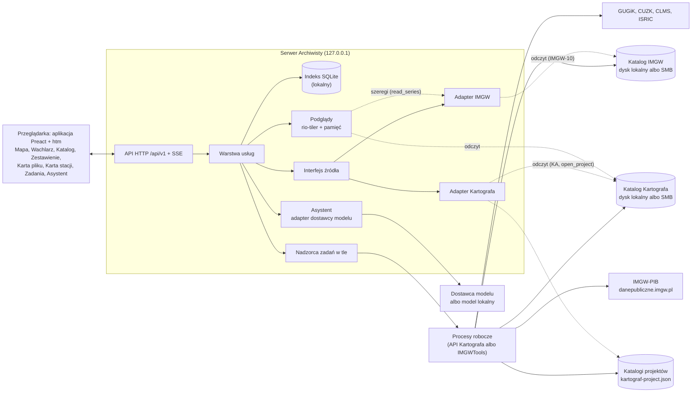
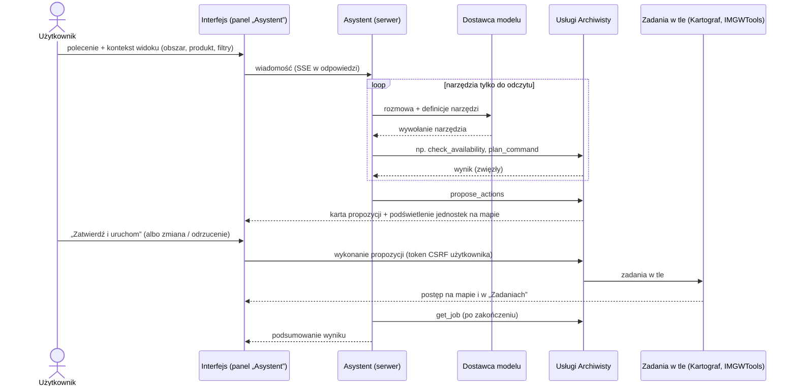

# Archiwista — specyfikacja

**Data:** 2026-10-17
**Status:** specyfikacja do przeglądu (bez kodu aplikacji); wymagania produktowe: [`docs/PRD.md`](PRD.md), zakres i priorytety wydań: [`docs/SCOPE.md`](SCOPE.md) (mają pierwszeństwo w kwestiach zakresu i priorytetów); szczegóły w tym specu; decyzje:
[`docs/DECISIONS.md`](DECISIONS.md); mockup interfejsu: katalog `mockup/`
(sekcja 16)
**Zależność:** Kartograf 0.8.0 (`develop`) — publiczne API
(`kartograf/__init__.py`, `__all__`) i formaty na dysku: sidecar
`kartograf-meta/1`, układ `data/` z magazynem wersji (`versions/`), manifest
projektu `kartograf-project/1`, plan aktualizacji `kartograf-plan/1`, raport
dostępności `kartograf-availability/1`; od v0.6 także KF (scalona
powierzchnia PL + CZ, 12.5); od v0.5 IMGWTools (dane IMGW) —
wydanie z wymaganiami IMGW-1..IMGW-14 (sekcja 12.7, dokument
[`docs/wymagania-imgwtools.md`](wymagania-imgwtools.md); dziś 2.1.1, Beta,
bez magazynu): katalog `imgw-store/1`, sidecar `imgw-meta/1`, szeregi
`imgw-series/1` (12.8), manifest projektu `imgw-project/1` (IMGW-14), a od
v0.6 wydanie ze stacjami ČHMÚ (IMGW-15..IMGW-19)
**Dokumenty źródłowe (repozytorium Kartografa):** `docs/ARCHITECTURE.md` 1
i 3.1-3.5, `docs/USAGE.md`, `docs/SCOPE.md` 3.3 (roadmapa, zasady nakładek),
`docs/DECISIONS.md` ADR-022, ADR-024, ADR-027, ADR-036, ADR-037, ADR-039 do
ADR-044, spec manifestu `docs/superpowers/specs/2026-10-15-manifest-projektu-design.md`
**Dokumenty źródłowe (IMGWTools i IMGW):** `README.md`,
`docs/ARCHITECTURE.md`, opisy formatów IMGW w `data/desc/`,
`src/imgwtools/core/url_builder.py` i `src/imgwtools/stations.py`
repozytorium IMGWTools; regulamin IMGW-PIB
(https://danepubliczne.imgw.pl/regulations) i opis API
(https://danepubliczne.imgw.pl/apiinfo); pomiary serwerów IMGW
z 2026-10-17 (4.8); dane ČHMÚ: `docs/OBSERWATOR_SPEC.md`
i `docs/OBSERWATOR_RESEARCH.md` repozytorium IMGWTools
(https://opendata.chmi.cz, 4.8.6)

Konwencje dokumentu: nazwy z Kartografa (funkcje, pola sidecara, katalogi)
są zapisane w `kodzie`; teksty interfejsu w cudzysłowie „…”; prawdziwe
ścieżki danych zastępuje `<katalog-danych>`. Odwołania „ARCH”, „USAGE”,
„SCOPE” i „ADR-0xx” bez dopisku dotyczą dokumentów Kartografa; decyzje
Archiwisty mają postać „A-ADR-0xx” (`docs/DECISIONS.md` w tym repozytorium).
Wymagania wobec producentów to „KA-1”…„KH-2” (Kartograf) i „IMGW-1”…
„IMGW-14” (IMGWTools, 12.7); odwołania `plik:linia` do innych repozytoriów
zaczynają się od ich nazwy (np. `IMGWTools/src/imgwtools/stations.py:349`).

**Spis treści:** 1. Cel i użytkownicy · 2. Słownik pojęć · 3. Przypadki
użycia · 4. Model danych i indeks · 5. Architektura · 6. Interfejs ·
7. Asystent · 8. Łączenie danych · 9. API HTTP · 10. Bezpieczeństwo ·
11. Testy i weryfikacja · 12. Wymagania wobec Kartografa i IMGWTools ·
13. Roadmapa · 14. Ryzyka · 15. Pytania otwarte · 16. Mockup

---

## 1. Cel i użytkownicy

### 1.1 Problem

Kartograf zapisuje dane w uporządkowanym magazynie, ale magazyn szybko
rośnie: dziesiątki tysięcy plików, kilka wersji tego samego arkusza (loty,
wydania), wiele projektów przypinających różne wersje, dane PL i CZ
w różnych układach, na dysku lokalnym albo na udziale sieciowym. Proste
pytania wymagają dziś znajomości CLI, reguł katalogów `data/` i czytania
plików JSON:

- „Co mam w magazynie dla tej zlewni i z którego roku?”
- „Z którego roku źródło ma komplet arkuszy dla tego obszaru?”
- „Czy jest nowszy nalot niż ten, którego używa projekt?”
- „Których plików użył projekt X i czy są nienaruszone?”
- „Jak to wszystko wczytać do QGIS jednym ruchem?”
- „Czym różni się lot 2019 od 2025 na tym arkuszu?”

Dane pomiarowe IMGW-PIB (stany wody, przepływy, opad, temperatura) mają
podobny kłopot w innej postaci: krajowe archiwa w setkach plików ZIP
o zmiennym kodowaniu, publikowane z opóźnieniem i odświeżane, stacje
z położeniem tylko w części źródeł, a IMGWTools zapisuje je dziś płasko,
bez wersji i sum kontrolnych:

- „Które wodowskazy w tej zlewni mają ciągłe przepływy dobowe od 1951?”
- „Czy IMGW opublikował nowy rocznik albo poprawił stary?”

### 1.2 Cel

Archiwista to manager magazynu danych w przeglądarce: danych przestrzennych
Kartografa i danych pomiarowych IMGW-PIB zapisywanych przez IMGWTools
(dwóch producentów, A-ADR-019). Pozwala:

1. **Widzieć** — przegląd i wyszukiwanie archiwum, mapa z obrysami
   i podglądami, wersje, pochodzenie, licencje, projekty; stacje IMGW
   z szeregami i ich pokryciem w czasie.
2. **Sprawdzać** — dostępność danych dla zaznaczonego obszaru lokalnie
   (magazyn) i u źródła (GUGiK, CUZK, IMGW), aktualność wersji, integralność
   przypiętych plików.
3. **Działać** — pobierać, aktualizować i przypinać dane w projektach;
   każde działanie wykonuje w tle publiczne API producenta (Kartografa
   albo IMGWTools), z postępem, komunikatami i anulowaniem.
4. **Przygotować do łączenia** — mozaika arkuszy, zestawienie PL + CZ,
   zestaw do projektu QGIS, porównanie wersji (sekcja 8).
5. **Zlecać w języku naturalnym** — asystent (agent LLM) planuje
   przygotowanie danych, a wykonuje je dopiero po potwierdzeniu
   użytkownika (sekcja 7).

**Nadrzędna zasada (jak w Kartografie): układ, interfejs i API proste,
zrozumiałe i wygodne dla ludzi.** W praktyce:

- ludzkie nazwy zamiast katalogów („NMT 1 m · PL-1992 · EVRF2007” zamiast
  `nmt/pl_1992_1m_evrf2007`), a surowa wartość zawsze o jedno kliknięcie;
- każde działanie z siecią albo zapisem najpierw pokazuje plan (co, ile
  plików, ile już jest lokalnie, ile danych, dokąd), a po wykonaniu —
  co się stało;
- zero cichych zmian: nic nie jest pobierane, przepinane ani nadpisywane
  bez jawnej decyzji człowieka;
- komunikaty producentów (`Info:`, `Warning:` i błędy Kartografa,
  komunikaty IMGWTools) pokazujemy bez przeróbek — ten sam tekst co w CLI;
- każde działanie da się powtórzyć z wiersza poleceń: Archiwista pokazuje
  odpowiadające polecenie `kartograf …` albo `imgw …` do skopiowania.

### 1.3 Granice (czym Archiwista nie jest)

- **Nie jest programem GIS.** Podglądy służą rozpoznaniu danych, a nie
  analizie; analizy robi się w QGIS (Archiwista przygotowuje do tego
  zestaw, sekcja 8.4).
- **Nie ma własnego mechanizmu pobierania ani obróbki.** Pobieranie
  i aktualizację danych Archiwista zleca producentom magazynu: Kartografowi
  (dane przestrzenne) i IMGWTools (dane IMGW; A-ADR-019). Nakładki wołają
  wyłącznie publiczne API bibliotek i nie mają
  własnej logiki pobierania ani obróbki (SCOPE 3.3). Brakująca funkcja
  producenta to wymaganie wobec niego (sekcja 12), a nie obejście
  w Archiwiście.
- **Nie usuwa danych z magazynu** (Kartograf niczego nie usuwa; sekcja 15,
  P4).
- **Nie trzyma niczego na udziale sieciowym.** Indeks, podglądy i historia
  zadań leżą lokalnie i można je w każdej chwili odbudować; źródłem prawdy
  są sidecary i manifesty (SCOPE 3.3). Konta, grupy, role i widoczność
  projektów nie wynikają z plików, więc leżą w osobnej lokalnej bazie stanu
  (4.3, A-ADR-029) — też nigdy na udziale; przebudowa indeksu jej nie
  dotyka. Wyjątkiem są dane użytkownika,
  które Archiwista zapisuje na jego polecenie w katalogu projektu (zestawy,
  pliki obszarów, migawki danych własnych — 4.7.1, A-ADR-027): to nie stan
  Archiwisty, tylko pliki w otwartym formacie, czytelne bez niego.
- **Nie jest edytorem danych ani systemem historii obiektów.** Dane własne
  wersjonuje migawkami całych plików (4.7.1); edycja i historia zmian
  pojedynczych obiektów są poza zakresem.
- **Nie zastępuje wtyczki QGIS** (podprojekt 4 roadmapy Kartografa). Zastępuje
  podprojekt 5 („GUI webowe”) i jest osobnym projektem (A-ADR-001).
- **Nie jest programem analiz hydrologicznych.** Pokazuje fakty o szeregach
  IMGW (pokrycie, luki, wartości i ekstrema opublikowane przez IMGW), ale
  nie liczy przepływów charakterystycznych, analiz częstości ani statystyk;
  robią to Hydrolog i Retman, a Archiwista przygotowuje dla nich dane
  (decyzja użytkownika 2026-10-17; sekcja 15, P17).
- **Nie pokazuje danych bieżących IMGW** (stany wody, ostrzeżenia) — tylko
  archiwa i szeregi z magazynu (decyzja użytkownika 2026-10-17).

### 1.4 Użytkownicy i tryby pracy

| Persona | Kim jest | Czego potrzebuje od Archiwisty |
|---|---|---|
| **Ola, hydrolożka** | Przygotowuje dane do modelu zlewni; zna QGIS, CLI używa rzadko | obszar na mapie → co jest dostępne i z którego roku → pobierz → zestaw do QGIS; wodowskazy w zlewni z ciągłymi przepływami dobowymi i szeregi dla Hydrologa |
| **Marek, specjalista GIS** | Zna Kartografa i CLI | przegląd wersji i kampanii, mozaiki, porównania lotów, kontrola aktualności, dane z pogranicza PL/CZ |
| **Zespół projektowy (później)** | Kilka osób, wspólny magazyn na udziale SMB | które projekty używają których danych, kto i kiedy pobrał, co można zaktualizować — bez pobierania tego samego dwa razy |
| **Deweloper Hydrografa/Hydrologa** | Używa Kartografa jako biblioteki | sprawdzenie zawartości magazynu, ścieżki niezmiennych wersji (także szeregów IMGW) do skryptów |

Tryby pracy:

- **Lokalny (od v0.1, domyślny):** jedna osoba, serwer na `127.0.0.1`,
  bez logowania; magazyn na dysku lokalnym albo na udziale SMB.
- **Zespołowy (v0.4):** jeden serwer Archiwisty w sieci lokalnej
  z logowaniem i rolami, wspólny magazyn na udziale SMB bez blokad zakresów
  bajtów (A-ADR-013; sekcja 15, P1). Architektura od v0.1 nie zakłada, że
  przeglądarka i serwer widzą ten sam system plików (sekcja 5.1), a model
  uprawnień i widoczność projektów działają od v0.1 (10.2, A-ADR-029).

## 2. Słownik pojęć

Jedno słownictwo w dokumentacji, interfejsie i API. Pojęcia Kartografa
zachowują jego znaczenie.

| Pojęcie | Znaczenie | Źródło |
|---|---|---|
| **Magazyn** | Nazwany w konfiguracji Archiwisty zestaw katalogów producentów: **katalog Kartografa** (`--output`, `output_dir`, układ `data/`: katalogi produktów, segmenty, wersje) i/lub **katalog IMGW** (magazyn IMGWTools, `imgw-store/1`); żaden nie leży wewnątrz drugiego. Archiwista obsługuje kilka magazynów (np. lokalny i zespołowy) | ARCH 3.3; A-ADR-019 |
| **Producent** | Biblioteka, która jako jedyna zapisuje swój katalog magazynu i jest właścicielem jego formatu: Kartograf (dane przestrzenne) albo IMGWTools (dane IMGW) | A-ADR-019 |
| **Interfejs źródła** | (Archiwista) wspólny interfejs adapterów producentów: skan, metadane, zasięg, polecenia, plan, wykonanie; adapter Kartografa i adapter IMGW to jedyne miejsca importu ich bibliotek | sekcja 5.3 |
| **Produkt** | Rodzaj danych wybierany `--product` w grupie komend (NMT, ortofotomapa, BDOT10k, granice PRG…); katalog najwyższego poziomu magazynu | ARCH 3.3 reguła 10 |
| **Źródło (zbiór)** | Deskryptor Kartografa; dla danych IMGW — zbiór IMGWTools. **Klucz zbioru** `<kraj>.<dostawca>.<zbiór>[_<wariant>]` = pole `dataset` sidecara, np. `pl.gugik.nmt_1m`, `pl.imgw.hydro_daily`; dla Archiwisty nieprzejrzysty identyfikator (bez rozbioru na części), niezmienny po wydaniu producenta (4.2.1). Dostawcę mówi pole `provider`, nie środkowa część klucza | ARCH 3.1; sekcje 4.2.1, 4.8 |
| **Segment** | Katalog `<produkt>/<kraj>_<tokeny>` — jeden wariant treści (układ, rozdzielczość, układ wysokości, format, rocznik, poziom…), np. `nmt/pl_1992_1m_evrf2007` | ARCH 3.3 reguły 1, 8-10 |
| **Jednostka** | Obszar jednego pliku: godło arkusza, kafel, TERYT, KU, kod kraju albo wycinek `<coords>` | `UnitFile.unit`, `PlanItem.unit` |
| **Slot (miejsce pliku)** | Segment + hierarchia jednostki + nazwa pliku, czyli „ten plik” niezależnie od wersji, np. `nmt/pl_1992_1m_evrf2007` + `N-34/130/D/d/2/4` + `N-34-130-D-d-2-4.asc` | `PlanItem` (`segment`, `hierarchy`, `name`) |
| **Wersja** | Niezmienna treść slotu: `<segment>/versions/<hierarchia>/<etykieta>_<sha8>/<plik>` z sidecarem wersji; tożsamość wersji = SHA-256 treści | ADR-036 |
| **Etykieta wersji** | Czytelna nazwa wersji: kampania `<data>_<id>` (np. `2025-04-26_82710`), wydanie (`2.0`, `2024`, `2024_2025-02-06`) albo data pobrania; skąd — mówi `extra.version.label_source` | ARCH 3.3 reguła 6 |
| **Bieżąca wersja** | Wersja, na którą wskazuje ścieżka standardowa `<segment>/<hierarchia>/<plik>` (dowiązanie twarde do najnowszej lokalnej wersji); `full_sheet/` wskazuje najnowszy pełny lot | ARCH 3.3 reguły 6-7 |
| **Sidecar** | `<plik>.meta.json` (`kartograf-meta/1`): pochodzenie, układy, `nodata`, zadanie, licencja, `sha256`. Sidecar wersji jest niezmienny; sidecar ścieżki standardowej to kopia z celem dowiązania (`extra.link_target`). W katalogu IMGW — `imgw-meta/1` (12.8) | ARCH 3.2 |
| **Kampania (lot, nalot)** | Pomiar GUGiK arkusza: data aktualności i numer zgłoszenia pracy; rok kampanii = rok danych | ADR-028, ADR-030 |
| **Wydanie** | Wersja publikacji źródła bez kampanii: rocznik BDOT10k, `2.0` SoilGrids, data wpisu feedu ATOM CUZK | ADR-036 D29, ADR-042 |
| **Arkusz pełny / niepełny** | Rekord skorowidza `TAK`/`NIE` (`czy_ark_wypelniony`, w sidecarze `extra.source.full_sheet`): czy arkusz jest w całości wypełniony treścią | ARCH 3.2 |
| **Zadanie Kartografa (obszarowe)** | Jedno wywołanie dla obszaru; jego pliki — także po obu stronach granicy PL/CZ — łączy wspólne `extra.parent_request` | ARCH 3.4 |
| **Projekt** | Katalog z manifestem Kartografa `kartograf-project.json` (`kartograf-project/1`) i/lub manifestem IMGWTools `imgw-project.json` (`imgw-project/1`): zadania projektu (komendy danych producenta z opcjami) i przypięte wersje plików; każdy manifest zapisuje tylko jego producent | ARCH 3.5, ADR-040; IMGW-14, A-ADR-023 |
| **Zadanie projektu** | Wpis `tasks[]` manifestu: nazwa, komenda (np. `elevation download` albo komenda IMGW `series select`) i opcje | spec manifestu 3.3; IMGW-14 |
| **Przypięcie** | Wpis `files[]` zadania projektu: która wersja (`version` albo `path` wersji w katalogu IMGW, `sha256`) jest używana | spec manifestu 3.3; IMGW-14 |
| **Dostępność** | Co źródło ma dla obszaru: lata, warianty, kompletność arkuszy — raport `check_availability` (`kartograf-availability/1`) | ADR-041 |
| **Wariant** | (Archiwista) zestaw plików produktu o wspólnym: rok, układzie poziomym, rozdzielczości, układzie wysokości i zgłoszeniu/kampanii; formaty plików (np. `ASC`, `ASCII-NMT`) są jego plakietkami, nie kluczem; jedna karta w interfejsie | sekcja 6.4, A-ADR-017 |
| **Aktualność** | Czy lokalna albo przypięta wersja jest najnowsza u źródła — plan `check_*` (`kartograf-plan/1`; statusy `current`, `newer`, `missing`, `unverifiable`, `check_failed`) | ADR-036 |
| **Obszar** | Zaznaczenie użytkownika: prostokąt, wielokąt, plik geometrii, godło, TERYT, KU albo kraj | — |
| **Pokrycie roku** | (Archiwista) etykieta roku albo wydania dla obszaru: „pełne”, „pełne · 2 kampanie”, „częściowe · 58%”, „brak danych” — oraz osobna plakietka stanu magazynu: „pobrane”, „pobrane 5/12”, „niepobrane” | sekcja 6.4 |
| **Zestaw** | (Archiwista) wybór wersji przygotowany do użycia poza magazynem: projekt QGIS, lista ścieżek, atrybucje, VRT-owijki; generowany z projektu albo z zaznaczenia, odtwarzalny, nie jest danymi | sekcja 8.4 |
| **Produkt pochodny** | (propozycja dla Kartografa) wynik łączenia zapisany w magazynie jako wersja z sidecarem i listą wejść (`extra.source_files[]`, wzór HSG); w katalogu IMGW — szeregi zbioru (IMGWTools) | sekcje 8.1, 4.8 |
| **Zbiór IMGW** | Rodzaj archiwów IMGW-PIB o wspólnym formacie, np. hydro dobowe, opad dobowy; jednostką publikacji jest okres (rok albo miesiąc) dla całego kraju | sekcja 4.8 |
| **Archiwum IMGW** | Plik opublikowany przez IMGW-PIB (np. `codz_2024.zip`), zapisany w katalogu IMGW 1:1 jako niezmienna wersja z sidecarem (`sha256`, `ETag`, `Last-Modified`); slot = ścieżka pliku na serwerze IMGW | sekcja 4.8.1, IMGW-4 |
| **Stacja** | Punkt pomiarowy IMGW-PIB: wodowskaz (hydro) albo stacja meteorologiczna (klimatologiczna, opadowa); identyfikator — 9-cyfrowy kod, np. `149190310`. Od v0.6 także stacja ČHMÚ (CZ; identyfikator dostawcy `CHMI`, nazwa wyświetlana „ČHMÚ”) z identyfikatorem WIGOS; tożsamość stacji = dostawca + identyfikator | sekcje 4.8.1, 4.8.6 |
| **Nieopublikowany** | (stacje ČHMÚ) plik stacji za dany rok albo element, którego źródło nie publikuje; w planie IMGWTools `unverifiable` z `error` `"nieopublikowany"`, w pobieraniu płaskim `not_published`. Informacja, nie problem: inaczej niż `missing` (plik opublikowany, brak lokalnie) | sekcja 4.8.6, IMGW-16 |
| **Katalog stacji** | Wersjonowana lista stacji z położeniem, jego źródłem i niepewnością (IMGWTools, GeoJSON) | sekcja 4.8.1, IMGW-9 |
| **Szereg** | Wartości zmiennych jednej stacji z jednego zbioru IMGW w kolejnych dniach (miesiącach, półroczach): plik Parquet stacji w wersji **szeregów zbioru** — migawki wszystkich stacji zbioru zbudowanej przez IMGWTools z określonych wersji archiwów | sekcja 4.8.1, IMGW-7 |
| **Zmienna** | Wielkość szeregu: H — stan wody [cm], Q — przepływ [m³/s], T — temperatura wody [°C], P — opad [mm], Tmax, Tmin, Tśr — temperatura powietrza [°C] | sekcja 4.8 |
| **Rok hydrologiczny** | Od 1 XI roku poprzedniego do 31 X (np. r.h. 2024 = 2023.11.01–2024.10.31); numeruje archiwa i charakterystyki hydro IMGW, a archiwa meteo numeruje rok kalendarzowy; w interfejsie oba rodzaje lat są dostępne dla danych hydro i meteo (przełącznik) | sekcje 4.8.2, 6.7 |
| **Pokrycie szeregu** | (Archiwista) etykieta jednej wielkości (zmiennej) stacji w zakresie lat — osobna dla każdej wielkości, nigdy jedna na stację (P16): „ciągły · 1951–2025”, „luki 3% · najdł. …”, „częściowy · od 1972”, „brak danych”, „nieznane” — oraz plakietka archiwów w magazynie („pobrane 60/75 lat”) | sekcja 4.8.4, A-ADR-021 |
| **Położenie (geometria)** | (Archiwista) odniesienie przestrzenne obiektu indeksu: obrys wersji, punkt stacji, zasięg kraju — albo **brak położenia** z powodem (np. stacja bez współrzędnych, plik bez rozpoznanego zasięgu). Obiekty bez położenia nie są na mapie; pokazuje je „Katalog” | sekcje 4.3, 6.8, A-ADR-022 |
| **Wachlarz** | (Archiwista) widok warstw lat (kampanii, wydań) wyniku: miniatury obszaru ułożone na łuku jak stos plików w docku macOS, każda w całości, wybrana powiększona; zastąpił „Stos” (decyzja użytkownika 2026-10-17) | sekcje 5.4, 6.5 c, A-ADR-018 |
| **Indeks** | (Archiwista) lokalna baza SQLite z opisem magazynów i projektów; pamięć podręczna, nie źródło prawdy | sekcja 4 |
| **Dane własne** | (Archiwista) pliki rastrowe i wektorowe użytkownika (np. sieć kanalizacyjna) w folderze danych projektu, domyślnie `<katalog projektu>/dane/`; nie należą do żadnego producenta, Archiwista je czyta i robi ich migawki | sekcja 4.7.1, A-ADR-027 |
| **Migawka** | (Archiwista) niezmienna kopia pliku danych własnych z sumą SHA-256 i opisem `migawka.json`, zapisana przez Archiwistę na polecenie użytkownika w `<folder danych>/.wersje/`; tylko przyrost | sekcja 4.7.1, A-ADR-027 |
| **Zadanie w tle** | (Archiwista) długa operacja — skan, sprawdzenie, pobranie, łączenie, eksport — w osobnym procesie, z postępem i anulowaniem; widok „Zadania” | sekcja 5.6 |
| **Propozycja** | (Archiwista) plan działań przygotowany przez asystenta; staje się zadaniami w tle dopiero po potwierdzeniu użytkownika | sekcja 7 |

„Zadanie” bez dopisku nie występuje w interfejsie: zawsze „zadanie
projektu” (Kartograf albo IMGWTools) albo „zadanie w tle” (Archiwista).

## 3. Przypadki użycia

Każdy przypadek: kto i w jakiej sytuacji, przebieg w interfejsie, co
dzieje się pod spodem (wywołania Kartografa) i po czym poznać sukces.
Przykładowy obszar „Kraków” to bbox `561000,239000,573000,249000`
(EPSG:2180, 120 km²) — ten sam, którego używa mockup (sekcja 16).

### UC-01. Obszar → produkt → dostępność → pobranie (główny przepływ)

**Ola** przygotowuje NMT dla zlewni i nie wie, z którego roku jest komplet
arkuszy.

1. W widoku „Mapa” zaznacza obszar: rysuje prostokąt albo wielokąt, wpisuje
   godło albo TERYT, albo wczytuje `zlewnia.gpkg`.
2. Z listy produktów wybiera „NMT” (grupa „Wysokości”) i w chipach wariantu
   ustala „układ arkuszy: PL-1992”, bo chce plików w EPSG:2180.
3. Archiwista od razu pokazuje stan magazynu (z indeksu, bez sieci),
   a w tle uruchamia sprawdzenie u źródła: `check_availability(product="nmt",
   country="pl", bbox=…)`.
4. Wynik pojawia się jako warstwy lat na mapie i w panelu „Zestawienie”:
   2023 „pełne · 2 kampanie” z plakietką „pobrane 5/12”, 2022 „częściowe ·
   58%”, a przy 2019 dopisek „1 ark. niepełny” (definicje: sekcja 6.4). Ola
   przełącza panel na „Oś czasu”, a widok na „Wachlarz”, żeby zobaczyć
   wszystkie lata naraz, każdy w całości.
5. Przy roku 2023 klika „Pobierz…”. Okno planu (`check_data(…, year=2023)`)
   mówi: 12 arkuszy, 5 już w magazynie, 7 do pobrania, ok. 265 MB, zapis do
   magazynu „Zespół”; pokazuje polecenie `kartograf elevation download …`
   i opcję „Dodaj jako zadanie projektu”.
6. Po potwierdzeniu startuje zadanie w tle (`download_data(…)`). Arkusze na
   mapie zmieniają kolor w miarę pobierania; komunikaty Kartografa
   pojawiają się w zadaniu.

**Sukces:** plakietka roku zmienia się na „pobrane”, nowe wersje są
w katalogu, a magazyn jest bajtowo taki sam jak po tym samym poleceniu
z CLI.

### UC-02. „Co już mam?” bez sieci

**Marek** jest w terenie bez internetu. Zaznacza obszar i wybiera „Wszystkie
produkty”. Archiwista pokazuje tylko magazyn (indeks): pliki przecinające
obszar, pogrupowane wg produktu i roku danych, z lokalnym pokryciem
obszaru. Sprawdzenie u źródła jest wyłączone z komunikatem „Brak sieci —
pokazuję tylko magazyn”; jeśli wcześniej sprawdzano ten obszar, widać
ostatni raport z datą.
Od v0.5 widać też stacje IMGW obszaru z etykietami pokrycia z lokalnych
szeregów (4.8.4).

**Sukces:** odpowiedź w sekundę, bez jednego zapytania sieciowego.

### UC-03. Wyszukiwanie po identyfikatorze

Marek wkleja do pola wyszukiwania godło `N-34-130-D-d-2-4`, TERYT `1465`,
numer zgłoszenia `GK-FOTO.6201.11.2025`, początek sumy `fdd30535` albo
kod stacji IMGW `149190310`. Archiwista rozpoznaje rodzaj identyfikatora
i pokazuje pasujące sloty wszystkich produktów i stacje; filtry zawężają
wynik (sekcja 6.6).

### UC-04. Karta pliku i historia wersji

Ola otwiera arkusz `N-34-130-D-d-2-4`. „Karta pliku” pokazuje oś wersji
(loty 2019, 2023, 2025), która wersja jest bieżąca, która pełna
(`full_sheet/`), które projekty przypinają którą wersję, metadane po
ludzku („skaning laserowy, błąd średni wysokości 0,06 m, arkusz pełny”),
licencję z przyciskiem „Kopiuj atrybucję”, podgląd oraz akcje: „Kopiuj
ścieżkę wersji”, „Polecenie Kartografa”, „Sprawdź aktualność”, „Porównaj
wersje”, „Dodaj do projektu”.

### UC-05. Czy są nowsze dane?

Marek zaznacza segment w obszarze albo cały projekt i klika „Sprawdź
aktualność”. Zadanie w tle wywołuje `check_*` (albo `check_project`)
i pokazuje plan po ludzku: „aktualne”, „nowsza: 2025-04-26_82710”, „nie da
się sprawdzić bez pobrania”, „błąd sprawdzenia: …”. Przycisk „Pobierz
nowsze” wykonuje ten sam plan (`update="upgrade"`, `plan=…`), a pozycje,
które w międzyczasie się zmieniły, Kartograf zgłasza jako nieaktualne.

### UC-06. Projekt: przypięcia, weryfikacja, aktualizacja

Ola otwiera projekt „Raba”: zadania projektu z opcjami (pokazanymi jako
polecenia Kartografa) i przypięte wersje. „Status” odpowiada natychmiast
(`get_project_status`), „Weryfikuj” liczy sumy SHA-256 w tle
(`verify_project`), „Sprawdź aktualizacje” porównuje przypięcia ze źródłem
(`check_project`), „Przepnij” przechodzi na nowsze dane jednego zadania
(`download_project(update="upgrade", tasks=["teren"])`). Z wyniku
dostępności (UC-01) dodaje zadanie „Dodaj rok 2025 do projektu”
(`add_project_task` z `year=2025`). Projekt „Raba” ma też zadanie IMGW
„przeplywy” (manifest `imgw-project.json`, IMGW-14): te same akcje wołają
funkcje projektu IMGWTools, a lista zadań ma kolumnę producenta.

### UC-07. Które projekty używają tego pliku?

Kierownik zespołu przed porządkami w magazynie filtruje „Nieużywane przez
żaden projekt” i „Niebieżące wersje”, widzi ich zajętość i listę.
Na karcie pliku widać „Przypięta w: Raba (teren), Wisła-2026 (dem)”.
Archiwista niczego nie usuwa; raport służy decyzji (sekcja 15, P4).

### UC-08. Mozaika arkuszy (od v1.3)

Marek potrzebuje NMT 0,5 m z 2023 dla obszaru jako jednej warstwy.
Z wiersza roku wybiera „Łączenie › Mozaika”: VRT (natychmiast, bez kopii
danych) albo GeoTIFF na wspólnej siatce przycięty do obszaru. Plan pokazuje
wejścia (konkretne wersje), siatkę i rozmiar wyniku. Wynik trafia do
magazynu jako produkt pochodny z sidecarem (sekcja 8.2).

### UC-09. Pogranicze PL + CZ (od v0.6; zestaw QGIS od v1.1)

Marek modeluje zlewnię Olzy. Obszar przecina granicę; dostępność pokazuje
lata PL i bieżące modele CZ. Pobranie idzie jednym zadaniem Kartografa
(`country="auto"`, `cutout=True`, wspólny `horizontal_crs`, układ wysokości
`pl=EVRF2007,cz=EVRF2007`); pliki PL i CZ są zgrupowane po
`extra.parent_request`, a kontrola zgodności podpowiada brakujące pobranie.
„Łączenie › PL + CZ” liczy w Kartografie jedną powierzchnię na wspólnej
siatce z raportem styku (sekcja 8.3); od v1.1 obie warstwy można też
wyeksportować bez scalania do zestawu QGIS. Wodowskazy ČHMÚ na czeskiej
części zlewni widać obok stacji IMGW (UC-20).

### UC-10. Zestaw do QGIS (od v1.1)

Ola wybiera w projekcie „Zestaw QGIS”. W katalogu projektu powstaje
`zestawy/<nazwa>/` z plikiem `.qgz`, listą ścieżek i atrybucjami. QGIS
otwiera projekt bez pytań o układy, a warstwy wskazują dokładnie przypięte
wersje (sekcja 8.4).

### UC-11. Porównanie lotów (model różnic od v1.3)

Marek porównuje loty 2019 i 2025 jednego arkusza: tabela różnic metadanych,
kurtyna na mapie, a po dodaniu funkcji do Kartografa — model różnic
wysokości ze statystyką („średnia zmiana −0,04 m; 2,1 ha zmian > 0,5 m”)
(sekcja 8.5).

### UC-12. Asystent (od v1.2)

Ola pisze: „Przygotuj NMT 1 m i ortofotomapę dla zaznaczonego obszaru
z najnowszego roku z pełnym pokryciem i dodaj do projektu Raba”. Asystent
odczytuje zaznaczenie, sprawdza dostępność (tylko odczyt), wybiera rok
i przedstawia propozycję: dwa polecenia Kartografa, 24 arkusze, 9 już
lokalnie, ok. 1,2 GB, dwa nowe zadania projektu; arkusze propozycji są
podświetlone na mapie. Dopiero „Zatwierdź i uruchom” uruchamia zadania
w tle; po ich zakończeniu asystent podsumowuje wynik (sekcja 7).

### UC-13. Kondycja magazynu

Marek otwiera „Magazyn › Stan”: zajętość wg produktów (każda wersja liczona
raz), a obok problemy z wyjaśnieniem i poleceniem naprawy: segmenty
nierozpoznane (np. nazwy z wersji deweloperskiej 0.8.0-dev), pliki bez
sidecara, katalogi `kampanie/` z 0.7.x, pozostałości `versions/.incoming/`
starsze niż 24 h, sidecary dowiązań wskazujące brakującą wersję, przypięcia
projektów bez pliku w magazynie; w katalogu IMGW — pozostałości
`.incoming/`, katalog w nieobsługiwanej wersji kontraktu i szeregi
nieaktualne wobec archiwów.

### UC-14. Zespół (od v0.4)

Kasia loguje się do Archiwisty zespołu. Widzi historię („Marek pobrał NMT
2025 dla Raby, wczoraj 14:02”) i wspólną kolejkę zadań, więc nie pobiera
tego samego drugi raz. Jako zwykły „użytkownik” przegląda magazyn, widzi
projekty publiczne, swoje i udostępnione jej osobie albo działowi, i tworzy
zestawy; pobierać do magazynu może osoba z uprawnieniem „zapis do magazynu”
(sekcja 10.2, A-ADR-029).

### UC-15. Wklejone polecenie Kartografa

Marek wkleja `kartograf elevation download --product nmt --sheet … -o
./data`. Archiwista rozpoznaje polecenie (ten sam parser co
`kartograf project add`), wypełnia formularz, zamienia `-o` na wybrany
magazyn, pokazuje plan i uruchamia zadanie w tle.

### UC-16. Stacje w zlewni i pokrycie szeregów (od v0.5)

**Ola** liczy przepływy dla zlewni Raby i szuka wodowskazów z długimi
szeregami.

1. Wczytuje granicę zlewni z Hydrografa (`zlewnia.gpkg`, EPSG:2180) jako
   obszar.
2. Wybiera produkt „Stany i przepływy dobowe” (grupa „Pomiary IMGW”)
   i zmienną, według której mapa koloruje punkty („Q”); etykiety wszystkich
   zmiennych (H, Q, T) są pokazane osobno.
3. Mapa pokazuje wodowskazy obszaru jako punkty; stacja blisko granicy ma
   plakietkę „na granicy obszaru”. Stacji bez położenia nie ma na mapie:
   licznik „2 stacje bez położenia” prowadzi do „Katalogu” (6.8), gdzie
   wybiera się je po rzece albo kodzie hydrograficznym (P13, P19).
   „Zestawienie” ma wiersz na stację z osobną etykietą pokrycia dla H,
   Q i T w latach hydrologicznych (domyślnie dla hydro, przełącznik na
   kalendarzowe — 4.8.4, 6.7), a sprawdzenie u źródła podaje lata opublikowane (rocznik
   2025: publikacja 2026.08.31).
4. Bez archiwów w magazynie etykiety brzmią „nieznane”; „Pobierz
   archiwa…” otwiera „Okno planu” z poleceniem `imgw …`, a po pobraniu
   IMGWTools buduje szeregi zbioru i etykiety się pojawiają.
5. Lista obejmuje wszystkie stacje obszaru, także z lukami i bez danych Q
   — każda z etykietą (P14). Ola zawęża ją jawnymi filtrami: „≥ 30 lat
   pełnych” albo „rzeka: Raba z dopływami” (kod hydrograficzny `2138…`,
   P19).
6. „Dodaj do projektu…” zapisuje wybór (stacje jako lista kodów, zmienna,
   lata i ich rodzaj) jako zadanie projektu IMGW (IMGW-14, A-ADR-023).

**Sukces:** etykiety zgodne z ręcznym wyliczeniem z archiwów, a katalog
IMGW bajtowo taki sam jak po tym samym poleceniu `imgw` z CLI.

### UC-17. Karta stacji i porównanie (od v0.5)

Ola otwiera stację „Stróża”: karta stacji ma metadane (kod, rzeka i jej kod
hydrograficzny, położenie ze źródłem i niepewnością), pokrycie H, Q i T,
wykres Q dobowego (luki jako przerwy, maksima roczne opublikowane przez
IMGW jako punkty), wersje szeregów i archiwów oraz formuły IMGW
z „Kopiuj atrybucję”. „Porównaj z…” nakłada Q z Gdowa i Proszówek na
wspólnej osi czasu. Archiwista nie liczy statystyk (1.3).

### UC-18. Przepływy dobowe dla zlewni przez asystenta (od v1.2)

Ola pisze: „Przygotuj przepływy dobowe dla stacji w tej zlewni”. Asystent
wyszukuje stacje, sprawdza pokrycie i lata opublikowane, planuje
synchronizację archiwów i szeregi, a do propozycji dodaje zadanie projektu
IMGW, zestaw z CSV dla Hydrologa i ostrzeżenia (stacja od 1972, luki, tylko
H, opóźnienie publikacji, cel użycia danych IMGW); stacji z lukami nie
pomija (P14). Po „Zatwierdź i uruchom” startują zadania w tle IMGWTools.
Obliczenia, np. przepływy charakterystyczne, robi Hydrolog albo Retman
(decyzja użytkownika 2026-10-17; 7.11; sekcja 15, P17).

### UC-19. Nowa publikacja IMGW (od v0.5)

Marek klika „Sprawdź aktualność” przy archiwach hydro dobowych. IMGWTools
wysyła zapytania `HEAD` i porównuje `ETag` i `Last-Modified` z wersjami
w magazynie: „nowsza publikacja: mies_2024.zip”, „nowy rocznik u źródła:
2025”. „Pobierz nowsze” zapisuje nowe wersje archiwów (stare zostają)
i nową wersję szeregów zbioru. Zestawy wskazujące starsze szeregi są
oznaczone „nieaktualny — wygeneruj ponownie”.

### UC-20. Stacje ČHMÚ w zlewni przygranicznej (od v0.6)

Ola liczy przepływy dla zlewni Olzy, której górna część leży w Czechach.
Po wczytaniu granicy zlewni mapa pokazuje wodowskazy IMGW i ČHMÚ (plakietka
dostawcy przy punkcie); „Zestawienie” ma etykiety pokrycia H, Q i T obu
dostawców w tych samych zasadach (4.8.4, 4.8.6). „Sprawdź aktualność”
i „Pobierz archiwa…” dla stacji ČHMÚ idą przez IMGWTools z „Oknem planu”
i poleceniem `imgw …`; plan obejmuje tylko stacje obszaru, bo ČHMÚ
publikuje archiwa per stacja. „Karta stacji” ČHMÚ podaje atrybucję CC BY 4.0
z sidecara, a „Dodaj do projektu…” zapisuje stacje obu dostawców w jednym
zadaniu projektu IMGW.

**Sukces:** etykiety zgodne z ręcznym wyliczeniem z archiwów ČHMÚ, a katalog
IMGW bajtowo taki sam jak po tym samym poleceniu `imgw` z CLI.

## 4. Model danych i indeks

### 4.1 Co czytamy z dysku (źródła prawdy)

Archiwista nie ma własnych danych o magazynie poza pamięcią podręczną.
Wszystko, co pokazuje, wynika z plików producentów — Kartografa i IMGWTools:

| Plik | Gdzie | Zmienność | Jak czytamy |
|---|---|---|---|
| Sidecar wersji | `<segment>/versions/<hierarchia>/<etykieta>_<sha8>/<plik>.meta.json` | niezmienny (ADR-036) | raz, przy pierwszym zobaczeniu katalogu wersji |
| Plik danych wersji | obok sidecara wersji | niezmienny | podczas indeksowania wyłącznie `stat` (rozmiar); treść tylko na żądanie (podgląd, weryfikacja) |
| Sidecar ścieżki standardowej i `full_sheet/` | `<segment>/<hierarchia>/<plik>.meta.json`, `<segment>/full_sheet/…` | zmienny (dowiązanie przestawiane na nowszą wersję) | przy zmianie rozmiaru albo czasu modyfikacji; cel dowiązania wyłącznie z `extra.link_target` |
| Manifest projektu | `<katalog projektu>/kartograf-project.json` i `<katalog projektu>/imgw-project.json` | zmienny | przy zmianie czasu modyfikacji albo sumy pliku; zawsze przez `open_project` producenta (ścisła walidacja Kartografa; IMGWTools — IMGW-14) |
| Plan aktualizacji | plik `kartograf-plan/1` zapisany `--plan` | jednorazowy | na żądanie (import planu z CLI) |
| Znacznik katalogu IMGW | `<katalog IMGW>/imgw-store.json` | zmienia się tylko z wersją kontraktu | przy każdym skanie: rozpoznanie katalogu i wersji `imgw-store/1` (IMGW-13) |
| Sidecar wersji IMGW (archiwum, katalog stacji, szeregi zbioru) | `<katalog IMGW>/{archives,stations,series}/versions/…/<plik>.meta.json` (`imgw-meta/1`) | niezmienny | raz, przez `read_meta` (IMGW-10) |
| Spis szeregów zbioru | `<katalog IMGW>/series/versions/<zbiór>/<etykieta>_<sha8>/series.json` | niezmienny | raz na wersję: pokrycie stacji do indeksu (IMGW-8) |
| Archiwum ZIP, katalog stacji (GeoJSON), plik szeregu stacji (Parquet) | w katalogu wersji | niezmienne | archiwum — tylko `stat`; katalog stacji — raz na wersję; szereg — na żądanie (wykres, zestaw) przez API IMGWTools |

Pozostałości i przypadki brzegowe są pokazywane, nigdy pomijane po cichu:
katalogi robocze `versions/.incoming/` (pomijane przy indeksowaniu;
Kartograf sprząta je po 24 h, starsze zgłaszamy), katalogi `kampanie/`
z 0.7.x (nieczytane przez Kartografa 0.8.0), segmenty spoza rejestru (np.
`orto/pl_2000_oblique` z wersji deweloperskiej 0.8.0-dev — w przykładowym
magazynie testu na żywo wydania 0.8.0 są takie katalogi i sidecary
z dawnymi kluczami źródeł, np. `cz.cuzk.hy_net`), pliki bez sidecara,
sidecary nieczytelne i sidecary sprzed ADR-031 (polskie klucze: brak klucza
= brak informacji, jak w Kartografie).
W katalogu IMGW analogicznie: pozostałości `.incoming/` starsze niż 24 h,
pliki bez sidecara, sidecary nieczytelne, katalogi nieznane i katalog
w nieobsługiwanej wersji kontraktu (np. `imgw-store/2` — zgłaszany,
nieczytany; IMGW-13).

**Archiwista nie zapisuje niczego w magazynie** (w żadnym z katalogów
producentów). W katalogu projektu
zapisuje wyłącznie katalog zestawu (sekcja 8.4) i plik geometrii obszaru
(narysowanego albo wczytanego z pliku) dla nowego zadania projektu
(`obszary/`, 10.1); manifesty zmieniają tylko API ich producentów —
Kartografa i IMGWTools (A-ADR-003, A-ADR-023).

### 4.2 Odczyt przez API producentów

Reguły układu `data/` (ARCH 3.3, reguły 1-10), rozpoznawanie dowiązań,
tolerancyjne czytanie starych sidecarów i wyliczanie zasięgu pliku to
wiedza o formacie Kartografa. Archiwista nie ma własnego czytnika tego
formatu: korzysta z pakietu wymagań **KA** (sekcja 12: `iter_store`,
`read_sidecar`, `describe_segment`, `file_footprint`, `link_target`,
`pinned_transform`). Dzięki temu zmiana układu w Kartografie nie
rozjedzie się z Archiwistą, a wtyczka QGIS i Hydrograf mogą korzystać
z tych samych funkcji. Konsekwencja: v0.1 wymaga wydania Kartografa z KA
(A-ADR-014).

Katalog IMGW Archiwista czyta tak samo — przez publiczne API odczytu
IMGWTools (IMGW-10: `store_info`, `iter_store`, `read_meta`,
`current_version`, `read_catalog`, `read_series_index`, `read_series`), bez
własnego parsera archiwów ZIP, plików Parquet ani sidecarów `imgw-meta/1`
(A-ADR-014, A-ADR-019). Oba adaptery stoją za wspólnym interfejsem źródła
(5.3): indeks, mapa i działania nie wiedzą, który producent zapisał plik.

#### 4.2.1 Klucze zbiorów (kontrakt z producentami)

Klucz zbioru — pole `dataset` sidecara (`kartograf-meta/1`, `imgw-meta/1`)
i klucz deskryptora źródła Kartografa albo zbioru IMGWTools — ma postać
`<kraj>.<dostawca>.<zbiór>[_<wariant>]`:

- małe litery ASCII i cyfry; kropka tylko między trzema częściami,
  podkreślenie wewnątrz części (`pl.gugik.nmt_0_5m`, `cz.cuzk.dmr5g_laz`,
  `pl.imgw.meteo_climate_daily`);
- `<kraj>` — kod ISO 3166-1 alfa-2 małymi literami, a dla zbiorów
  ponadnarodowych zasięg (`eu.clms.corine`, `global.isric.soilgrids`);
- `<dostawca>` — przedrostek klucza nadany przez producenta (`gugik`,
  `cuzk`, `imgw`, `chmi`), a nie identyfikator dostawcy;
- `<zbiór>[_<wariant>]` — nazwa zbioru i opcjonalny wariant.

Zobowiązania producentów (KA-8, IMGW-20):

1. **Niezmienność.** Klucz opublikowany w wydaniu producenta się nie
   zmienia; sidecary wersji są niezmienne (ADR-036, IMGW-1), więc każdy
   kiedykolwiek zapisany klucz zostaje na dysku na zawsze.
2. **Zmiana nazwy tylko przez tabelę aliasów producenta.** Surowy `dataset`
   zostaje w sidecarze bez zmian, a API odczytu podaje obok znormalizowany
   `dataset_key` (bieżący klucz deskryptora). Wzór: `_DEV_DATASETS`
   Kartografa (`Kartograf/kartograf/store.py:186`, ADR-044 D7) czytane
   przez `read_sidecar` (KA-2). Klucz nieznany producentowi daje pusty
   `dataset_key`, nie błąd.
3. **Dostawca z pola `provider`.** Tożsamość dostawcy jest w polu
   `provider` sidecara i deskryptora (Kartograf: `provider_name`
   deskryptora, np. `GUGiK`, `CUZK`, `Copernicus CLMS`, `ISRIC` —
   `Kartograf/kartograf/sources/sidecar.py:242`; IMGWTools: `IMGW-PIB`,
   `CHMI` — IMGW-15), a kraj w polu `country`; środkowa część klucza
   (`imgw`, `chmi`) nie jest identyfikatorem dostawcy.

Archiwista traktuje klucz jako nieprzejrzysty identyfikator: porównuje go
w całości (indeks, filtry, powiązanie wersji z segmentem), ale nigdy nie
wyprowadza z niego produktu, wariantu, dostawcy ani kraju — bierze je
z pól sidecara i z `describe_segment` (KA-3). Dzięki temu nieregularne
klucze niczego nie psują, np. `pl.gugik.nmpt` (NMPT 1 m bez `_1m`; klucz
z 0.7 (ADR-031) zachowany w ADR-041 i ADR-044,
`Kartograf/kartograf/sources/registry.py:313`).

### 4.3 Indeks lokalny

Indeks (A-ADR-002) to plik SQLite (tryb WAL) na dysku lokalnym, w katalogu danych
użytkownika (`platformdirs`: Linux `~/.local/share/archiwista/`, Windows
`%LOCALAPPDATA%\Archiwista\`); obok leżą pamięć podglądów (`cache/`)
i dzienniki zadań (`jobs/`). Konfiguracja (magazyny, katalogi projektów,
limity, dostawca asystenta, preferencje widoku — np. zapamiętany rodzaj
lat dla danych hydro i meteo, 6.7) jest w czytelnym pliku TOML w katalogu
konfiguracji użytkownika i w widoku „Ustawienia”. Indeks można usunąć
w każdej chwili — „Przebuduj indeks” odtworzy go z magazynów i manifestów;
tracona jest tylko historia zadań i rozmów asystenta.

**Baza stanu** (A-ADR-029) to osobny plik SQLite
`<katalog danych użytkownika>/state.sqlite`, także wyłącznie lokalny: konta
(`users`), grupy i członkostwa (`groups`, `memberships`), role (`admin`,
`store_writer`), widoczność projektów (`project_acl`: klucz projektu —
katalog po `realpath`, niezależny od indeksu; właściciel; `public` /
`users` / `group` / `private`; wpisy osób i grup) i dziennik zmian
uprawnień. Tego stanu nie da się odtworzyć z dysku, więc „Przebuduj
indeks” go nie dotyka, schemat zmienia się migracjami (nie przebudową),
a kopię zapasową daje `archiwista state export` (JSON
`archiwista-state/1`), odtwarzaną przez `archiwista state import` do pustej
bazy.

Zawartość (tabele logiczne; schemat ustali plan implementacji):

| Tabela | Co trzyma |
|---|---|
| `stores` | magazyny: identyfikator (krótka nazwa nadana przez użytkownika, np. `zespol`), katalogi producentów (Kartograf, IMGW) i aliasy ścieżek, dostępność, czasy i statystyki skanów |
| `segments` | segmenty: producent, produkt, źródło (`dataset`), ludzka nazwa (`describe_segment`; dla IMGW nazwa zbioru), rozpoznany / nierozpoznany |
| `slots` | sloty: segment, hierarchia, nazwa, rodzaj i kod jednostki, bieżąca wersja, wersja `full_sheet/`, liczba wersji; w katalogu IMGW slotem jest plik archiwum (ścieżka na serwerze), katalog stacji albo szeregi zbioru |
| `versions` | wersje: etykieta i jej źródło, `sha256`, rozmiar, układy, rozdzielczość, `nodata`, rok i data danych, kampania i numer zgłoszenia, wydanie, data pobrania, pełny arkusz, pokrycie (`extra.coverage`), licencja, klucz grupy `parent_request`, zasięg natywny i jego źródło, rodzaj położenia (`footprint`, `country`, `none` z powodem; A-ADR-022), stan, pełny sidecar (JSON) |
| `footprints` | R*Tree: zasięg wersji w WGS84 (filtr obszaru i mapa) — tylko wersje z obrysem |
| `stations` | stacje z bieżącej wersji katalogu stacji: kod, rodzaj, nazwa, rzeka, kod hydrograficzny (z indeksem prefiksowym, P19) i kolejność, położenie (WGS84) ze źródłem i niepewnością albo brak położenia z powodem z katalogu (IMGW-9), kwadrat 1° z kodu, czynna albo historyczna, rok założenia, rzędna zera wodowskazu, kilometr biegu rzeki |
| `station_points` | R*Tree: punkty stacji (prostokąty zdegenerowane) — filtr obszaru i warstwa stacji |
| `station_series` | szereg stacji w wersji szeregów zbioru: plik, `sha256`, zmienne z jednostkami, pierwsza i ostatnia data, lista przerw, liczba sum zbiorczych (ze spisu `series.json`, IMGW-8) oraz okresy znane wersji |
| `series_years` | pokrycie zmiennej po latach hydrologicznych i kalendarzowych (jednostki, jednostki z wartością, najdłuższa przerwa) — wyliczane przy indeksowaniu z list przerw; Oś czasu i filtry |
| `search` | FTS5: godła, TERYT, KU, etykiety, numery zgłoszeń, nazwy plików, ludzkie nazwy produktów, nazwy projektów i zadań projektów, kody i nazwy stacji, nazwy rzek |
| `projects`, `project_tasks`, `pins` | znane projekty, ich zadania i przypięcia powiązane z wersjami, z producentem manifestu (Kartograf, IMGWTools) — indeks „które projekty używają pliku” (SCOPE 3.3) |
| `availability` | ostatnie raporty dostępności per obszar i produkt, z datą (widoczne bez sieci); dla zbiorów IMGW — lata opublikowane z datami publikacji |
| `jobs`, `job_events` | historia zadań w tle i ich zdarzenia |
| `conversations`, `messages`, `proposals` | rozmowy z asystentem i jego propozycje |

Atrybuty do filtrów są wyliczane przy indeksowaniu z sidecara przez
`read_sidecar` (KA-2), który normalizuje pola różniące się między
produktami: **rok danych** (kampania, data lotu LAZ, rocznik wydania) jest
osobnym polem niż **data pobrania** i nigdy nie jest nią zastępowany;
wersja bez roku danych ma rok pusty, a nie rok pobrania.

**Zasięg (obrys) pliku** liczy `file_footprint` (KA-4) wg kolejności
źródeł: `request.bbox` z `bbox_crs` (wycinki, wyniki obszaru kolekcji,
SoilGrids, HSG) → godło z parsera (PL-1992, PL-2000, TM33) → nagłówek pliku
(GeoTIFF, ASC, JPEG z JGW, GeoPackage, LAS) → jednostka (TERYT z PRG, KU
z RUIAN, arkusz SM5 z indeksu CUZK — z siecią w zadaniu `footprints` (5.6)
i lokalną pamięcią podręczną, z której skan bez sieci bierze obrysy już
znanych jednostek) → kraj.
Zasięg bez źródła oznaczamy „bez obrysu” (plik jest w „Katalogu”, nie ma
go na mapie). Przeliczenie do WGS84 wyłącznie przypiętą transformacją
Kartografa (KA-6): domyślny transformator potrafi cicho użyć operacji
przybliżonej, a dla S-JTSK to przesunięcie rzędu 100 m (ADR-024).
Archiwa i szeregi IMGW mają zasięg „kraj”; na mapie są stacje — punkty
z katalogu stacji (IMGW-9) w R*Tree `station_points`.

**Położenie obiektów (P13, A-ADR-022).** Każdy obiekt indeksu — wersja,
slot, stacja — ma rodzaj położenia: `footprint` (obrys), `point` (stacja),
`country` (zasięg kraju: pliki krajowe, archiwa i szeregi IMGW) albo
`none` z powodem — pliki: `no_source` („bez obrysu”), `unreadable`
(sidecar nieczytelny); stacje: powód z katalogu stacji (IMGW-9: `none`
— żadne źródło nie ma współrzędnych, `zero` — `0,0`, `outside_country`).
Zasady wspólne dla wszystkich producentów i produktów:

1. Mapa rysuje tylko `footprint` i `point`; położenie nigdy nie jest
   zgadywane ani przybliżane (np. środkiem kwadratu 1° z kodu stacji).
2. Obiekty `country` i `none` są w „Katalogu” (6.8) — widoku bez mapy
   z wyszukiwaniem i filtrami atrybutów, który pokazuje wszystkie rodzaje
   położenia.
3. Filtr obszaru dzieli wynik na „w obszarze” (przecięcie), „na granicy
   obszaru” (stacje, 6.7), „cały kraj” (`country`, gdy kraj obszaru się
   zgadza) i „bez położenia” (`none`) — ostatnia grupa nigdy nie jest
   po cichu dołączana do obszaru ani z niego usuwana; zawęża się ją
   filtrami atrybutów (rzeka i kod hydrograficzny, nazwa, kraj, jednostka,
   produkt). Dla stacji dochodzi zgrubna wskazówka „kwadrat 1° z kodu
   przecina obszar” (4.8.1), opisana jako wniosek z kodu, nie położenie.
4. Każdy widok mapy z wynikiem podaje licznik obiektów bez położenia
   („3 stacje bez położenia”, „2 pliki bez obrysu”) z przejściem do
   „Katalogu” z tym samym produktem i filtrami.

### 4.4 Budowa i odświeżanie

- **Pełny skan** (pierwsze uruchomienie, „Przebuduj indeks”): przejście
  `iter_store` osobno dla każdego segmentu z `list_segments` (KA-1)
  w ograniczonej puli wątków (opóźnienia SMB, nie procesor); sidecar każdego
  wpisu czyta raz sam `iter_store`, a zapis do indeksu idzie paczkami
  w transakcjach; zadanie w tle z postępem.
- **Skan przyrostowy:** katalogi wersji `<etykieta>_<sha8>` są niezmienne,
  więc znanych wersji nie czytamy ponownie (`skip_versions`, KA-1: znana
  wersja kosztuje tylko listing swojego katalogu) — sprawdzamy pojawienie
  się nowych katalogów wersji, zniknięcie znanych i zmianę sidecarów
  dowiązań. Bieżącą wersję wyznacza sidecar dowiązania
  (`StoreEntry.version_path`); skan nie woła `link_target` (KA-5), które na
  udziale bez stabilnych i-węzłów potwierdza cel treścią — to działanie na
  żądanie. Czas modyfikacji katalogu jest tylko wskazówką (na udziale
  z pamięcią atrybutów bywa opóźniony), dlatego okresowo wykonujemy pełny
  skan kontrolny (domyślnie raz na dobę, w tle).
- **Odświeżenie na żądanie dla widoku:** gdy użytkownik pyta o obszar
  i produkt, Archiwista najpierw odświeża dokładnie sloty jednostek tego
  obszaru (`iter_store(segment=…, units=…)`, KA-1; jednostki z raportu
  dostępności, z siatki godeł `find_sheets_for_bbox` albo z obrysów
  w indeksie), a dopiero potem pokazuje stan magazynu — odpowiedź na
  bieżące pytanie jest aktualna w sekundach także na SMB, niezależnie od
  pełnych skanów.
- **Po własnych zadaniach:** wynik Kartografa (`files[].file.version_path`,
  przypięcia projektu) trafia do indeksu od razu, bez skanu.
- **Katalog IMGW** jest tylko przyrostowy (IMGW-1): skan przyrostowy to
  wylistowanie nowych katalogów wersji przez `iter_store` IMGWTools. Nowa
  wersja katalogu stacji albo szeregów zbioru przebudowuje tabele
  `stations`, `station_series` i `series_years` z jednego pliku (katalogu
  albo spisu `series.json`), bez czytania plików Parquet; widok stacji
  nie wymaga sieci ani odczytu szeregów.
- **Wyzwalacze:** start aplikacji (przyrostowy, jeśli ostatni starszy niż
  15 min), interwał (domyślnie 15 min dla udziału, 5 min dla dysku
  lokalnego), przycisk „Odśwież” (magazyn, segment, widok), koniec zadania
  w tle; obserwacja zmian systemu plików tylko dla dysków lokalnych
  (opcjonalnie).
- **Magazyn niedostępny** (brak katalogu albo pusty punkt montowania):
  skan przerwany, indeks bez zmian, baner „Magazyn niedostępny od 14:02 —
  pokazuję stan z indeksu”; działania zapisu wyłączone. Nigdy nie
  oznaczamy całego magazynu jako usuniętego z powodu odłączonego udziału.
- **Zniknięcia:** wersja, której nie ma po pełnym przejściu, dostaje stan
  „brak pliku” (z datą); przypinające ją projekty są oznaczone. Wpis
  znika z indeksu dopiero po kolejnym pełnym skanie.
- **Zmiana schematu indeksu** w nowej wersji Archiwisty = przebudowa (to
  pamięć podręczna — bez migracji).
- Polecenia producentów wykonywane poza Archiwistą (CLI Kartografa
  i IMGWTools, Hydrograf) są normalną sytuacją: indeks zobaczy je przy
  najbliższym odświeżeniu.

### 4.5 Wydajność

Magazyn odniesienia: 50 000 slotów, 80 000 wersji (ok. 260 000 plików
z sidecarami i dowiązaniami, ok. 150 000 katalogów), 30 projektów; udział
SMB 3 w sieci 1 Gb/s albo dysk lokalny SSD. Cele (kryteria akceptacji v0.1,
test na magazynie syntetycznym z generatora, sekcja 11):

| Operacja | Udział SMB | Dysk lokalny |
|---|---|---|
| pierwszy pełny skan | ≤ 10 min | ≤ 2 min |
| skan przyrostowy bez zmian (w tle) | ≤ 3 min | ≤ 20 s |
| odświeżenie widoku (obszar + produkt, ≤ 500 slotów) | ≤ 5 s | ≤ 1 s |
| zapytanie listy (strona 50 wierszy), p95 | ≤ 200 ms | ≤ 200 ms |
| obrysy w widoku mapy (≤ 5 000 obiektów; powyżej agregacja do siatki), p95 | ≤ 300 ms | ≤ 300 ms |
| wyszukiwanie tekstowe, p95 | ≤ 200 ms | ≤ 200 ms |
| karta pliku bez podglądu, p95 | ≤ 200 ms | ≤ 200 ms |
| (v0.5) warstwa stacji w widoku (≤ 5 000 punktów; powyżej skupienia), p95 | ≤ 300 ms | ≤ 300 ms |
| (v0.5) tabela stacji obszaru z etykietami pokrycia (≤ 200 stacji), p95 | ≤ 300 ms | ≤ 300 ms |
| (v0.5) wykres pełnego szeregu dobowego stacji (ok. 27 tys. dni → ≤ 2 000 punktów), pierwszy odczyt, p95 | ≤ 500 ms | ≤ 200 ms |
| (v0.5) pierwszy skan katalogu IMGW odniesienia | ≤ 2 min | ≤ 30 s |

Indeks ≤ 500 MB dla 80 000 wersji; pamięć serwera ≤ 500 MB bez podglądów.
Katalog IMGW odniesienia: zbiory z 4.8 w pełnym zakresie lat (ok. 2 000
archiwów), katalog ok. 3 500 stacji, po jednej wersji szeregów zbioru.
Interfejs nigdy nie czeka na skan: zapytania idą do indeksu, a stan
indeksu („Indeks z 14:02, skan trwa: 63%”) jest zawsze widoczny.

### 4.6 Praca na udziale SMB

1. Na udziale nie ma żadnego pliku Archiwisty (SQLite, pamięć, blokady).
   Archiwista tylko czyta; zapisy wykonują producenci: Kartograf, który
   działa bez blokad zakresów bajtów (wersje przez `os.link`, manifest przez
   blokadę `mkdir` i `os.replace`), i IMGWTools (punkt 9).
2. Cel dowiązania wyłącznie z sidecara dowiązania (`extra.link_target`).
   Żadnej logiki na numerach i-węzłów ani licznikach dowiązań: na udziale
   CIFS przykładowego magazynu ścieżka standardowa i jej wersja zwróciły
   różne numery i-węzłów i różne liczniki dowiązań (pomiar 2026-10-17).
   Potwierdzenie treścią na takich udziałach robi Kartograf (KA-5).
3. Zajętość = suma rozmiarów plików w `versions/` (każda wersja raz);
   suma po ścieżkach liczyłaby dowiązania twarde wielokrotnie.
4. GeoPackage z magazynu otwieramy tylko do odczytu jako niezmienny
   (`immutable=1`): wersje się nie zmieniają, a zwykłe otwarcie SQLite na
   udziale zakłada blokady.
5. Plik, który zniknął między listowaniem a odczytem, jest pomijany
   i sprawdzany ponownie w następnym skanie.
6. Nie podążamy za dowiązaniami symbolicznymi wychodzącymi poza magazyn.
7. Ten sam udział bywa zamontowany pod różnymi ścieżkami (`Z:\kartograf`,
   `/mnt/nas/kartograf`): magazyn w konfiguracji ma aliasy ścieżek. Manifest
   projektu musi wskazywać magazyn poprawnie dla procesu, który pobiera
   (Kartograf czyta `output_dir` sam) — dlatego w zespole zalecamy względne
   `output_dir`, gdy projekty i magazyn leżą na tym samym udziale,
   a poprawkę ścieżki robi funkcja Kartografa (KH-1), nie ręczna edycja
   przez Archiwistę.
8. Udział niepodłączony — jak w 4.4: baner, bez skanu i bez zadań zapisu
   (Kartograf i tak wymaga istniejącego katalogu magazynu).
9. Katalog IMGW podlega tym samym zasadom: zapisuje go wyłącznie IMGWTools
   (przez `.incoming/` i publikację wyłączną, IMGW-2), bez dowiązań twardych
   i bez plików zmiennych — więc nie dotyczą go pułapki i-węzłów
   z punktu 2; pliki Parquet i GeoJSON są czytane wprost, bez blokad; cache
   SQLite IMGWTools nie jest częścią magazynu i nigdy nie leży na udziale
   (IMGW-1).

### 4.7 Projekty

- **Odkrywanie:** katalogi projektów z konfiguracji są przeszukiwane
  w poszukiwaniu `kartograf-project.json` i `imgw-project.json` (głębokość
  ≤ 4, z pominięciem `.git`, katalogów magazynów i katalogów ukrytych);
  projektem jest katalog z jednym z nich albo z oboma. Projekt można też
  dodać ręcznie albo utworzyć (`init_project` producenta, którego dane
  dodaje się jako pierwsze; drugi manifest powstaje przy pierwszym
  zadaniu drugiego producenta).
- **Odczyt:** zawsze `open_project` producenta. Niepoprawny manifest jest
  widoczny z tekstem błędu producenta (np. „nieznany klucz 'optons'”);
  błąd jednego manifestu nie ukrywa zadań drugiego.
- **Powiązanie z magazynem:** `output_dir` projektu (a w manifeście IMGW
  `store_dir`) dopasowujemy do katalogu producenta w skonfigurowanym
  magazynie po ścieżce rozstrzygniętej albo aliasie; brak dopasowania —
  „Magazyn projektu nieznany: dodaj magazyn”.
- **Przypięcia → wersje:** po ścieżce `version` (względnej do magazynu)
  i `sha256`; przypięcie bez wersji w indeksie ma stan „brak pliku”.
- **Indeks użycia** („Przypięta w: …”) to tabela przypięć; nic nie trafia
  do sidecarów (sidecar jest niezmienny, SCOPE 3.3).
- **Zmiany manifestu** wykrywamy po czasie modyfikacji i sumie pliku;
  manifest zmieniony w trakcie pracy (inny proces, CLI) jest czytany
  ponownie przed każdą akcją, a konflikt zgłasza producent (blokady
  `.kartograf-project.lock` i `.imgw-project.lock`, scalanie per zadanie).
- **Dane IMGW w projektach (P18, A-ADR-023):** od v0.5 dane IMGW są
  zadaniami projektu i przypięciami w manifeście IMGWTools
  `imgw-project.json` (`imgw-project/1`, IMGW-14) obok
  `kartograf-project.json`; format manifestu Kartografa się nie zmienia.
  Zadanie IMGW trafia do projektu wyłącznie przez API IMGWTools:
  „Dodaj do projektu…” (z „Zestawienia” stacji, „Katalogu”, „Karty
  stacji” albo propozycji asystenta) otwiera „Okno planu” z poleceniem
  `imgw project add …`, a po potwierdzeniu proces roboczy woła
  `add_project_task` (walidacja jak w CLI) i — jeśli wybrano „Pobierz
  teraz” — `download_project`, który synchronizuje potrzebne archiwa,
  buduje albo ponownie używa szeregów zbioru i przypina wersje (szeregi
  zbioru, pliki stacji, katalog stacji, archiwa wejściowe). Stacje są
  zapisane jawną listą kodów; wybór obszarem zapisuje też plik geometrii
  z sumą (jak w Kartografie), a stacje bez położenia dodaje się tylko
  jawnie (A-ADR-022). „Status”, „Weryfikuj”, „Sprawdź aktualizacje”
  i „Przepnij” działają dla zadań obu producentów, każdy przez swoje API.
  Zestaw (8.4) bierze wersje IMGW z przypięć, a `polecenia.sh` odtwarza je
  poleceniem `imgw project download`.

#### 4.7.1 Dane własne i migawki (v0.2, A-ADR-027)

Decyzja użytkownika 2026-10-18: dane własne są czytane z folderu przypisanego
do projektu, a migawki robi Archiwista w tym folderze.

- **Folder danych:** każdy projekt ma folder danych własnych — domyślnie
  `<katalog projektu>/dane/`, w ustawieniach projektu można wskazać inny
  (zapis w konfiguracji Archiwisty, nie w manifeście producenta). Folder jest
  indeksowany jak magazyn tylko do odczytu: pliki rastrowe i wektorowe
  rozpoznane przez GDAL/OGR (GeoPackage, Shapefile jako komplet plików,
  GeoTIFF, GeoJSON, FlatGeobuf…), z zasięgiem, układem, warstwami, liczbą
  obiektów i schematem atrybutów; inne pliki — „nierozpoznane”. Odczyt
  w procesie roboczym jak przy plikach geometrii (10.1).
- **Widok:** rodzaj ogólny (PRD N8.3): obrys z zasięgu, podgląd jak dla
  plików magazynu (5.7), metadane; w widoku projektu grupa „Dane własne”
  obok zadań producentów, na mapie razem z przypiętymi danymi projektu.
  Bez etykiet dostępności (brak źródła zdalnego).
- **Migawka** („Zrób migawkę”; w zespole właściciel projektu albo administrator, A-ADR-029): plan pokazuje
  plik, rozmiar i miejsce; kopia trafia do
  `<folder danych>/.wersje/<nazwa>/<RRRR-MM-DD>_<sha8>/` razem
  z `migawka.json` (`archiwista-snapshot/1`: ścieżka źródłowa, pliki z sumami
  SHA-256, rozmiar, data, autor, liczba obiektów, zasięg, opis
  użytkownika). Zasady:
  1. tylko przyrost: migawek nie nadpisuje się ani nie usuwa;
  2. zapis atomowy: kopia do `.wersje/.incoming/<host>_<pid>_<token>/`,
     sprawdzenie sum, publikacja przez zmianę nazwy katalogu — błąd, gdy
     cel istnieje; pozostałości starsze niż 24 h zgłasza „Magazyn”;
  3. spójna kopia pliku w użyciu: GeoPackage przez kopię zapasową SQLite
     (nie kopię bajtów przy otwartym WAL), Shapefile i inne formaty
     wieloplikowe jako komplet;
  4. ta sama treść co ostatnia migawka = „bez zmian od migawki z …”, bez
     nowego katalogu.
- **Seria wersji:** migawki pliku to jego wersje: oś wersji w „Karcie
  pliku”, warstwy w „Wachlarzu”, kurtyna i porównanie metadanych (liczba
  obiektów, zasięg, schemat). Różnica obiektów (dodane, usunięte, zmienione)
  — później, osobną decyzją.
- **Zmiana od migawki:** skan porównuje bieżący plik z ostatnią migawką
  (suma, data, liczba obiektów) i pokazuje „zmieniony od migawki z …”;
  historia zaobserwowanych stanów (bez treści) leży w indeksie.

### 4.8 Dane IMGW: zbiory, stacje, szeregi

Dane pomiarowe IMGW-PIB zapisuje IMGWTools w katalogu IMGW magazynu
(A-ADR-019; kontrakt: 12.7–12.8). Archiwista czyta je przez API odczytu
IMGWTools, a w indeksie trzyma tylko pamięć podręczną (4.3). Zakres v0.5 (MVP v1.0)
(decyzja użytkownika 2026-10-17; ścieżki względem
`https://danepubliczne.imgw.pl/data/dane_pomiarowo_obserwacyjne/`,
`IMGWTools/src/imgwtools/core/url_builder.py:104-250`):

| Zbiór (klucz — propozycja) | Archiwa IMGW | Zmienne | Interwał, lata |
|---|---|---|---|
| Hydro dobowe (`pl.imgw.hydro_daily`) | `dane_hydrologiczne/dobowe/<rok>/codz_<rok>_<mm>.zip` (do 2022), `codz_<rok>.zip` (od 2023) | H — stan wody [cm], Q — przepływ [m³/s], T — temperatura wody [°C] | doba; hydrologiczne, 1951–2025 |
| Hydro miesięczne (`pl.imgw.hydro_monthly`) | `dane_hydrologiczne/miesieczne/<rok>/mies_<rok>.zip` | H, Q, T: min., śr. i maks. miesiąca | miesiąc; hydrologiczne |
| Hydro półroczne i roczne (`pl.imgw.hydro_semiannual`) | `dane_hydrologiczne/polroczne_i_roczne/<rok>/polr_<H\|Q\|T>_<rok>.zip` | H, Q, T: min., śr. i maks. z datami wystąpienia ekstremów; półrocze zimowe (XI–IV), letnie (V–X), rok | półrocze, rok; hydrologiczne |
| Meteo dobowe — klimat (`pl.imgw.meteo_climate_daily`) | `dane_meteorologiczne/dobowe/klimat/<folder>/<rok>_k.zip` (do 2000; folder = pięciolecie), `<rok>_<mm>_k.zip` (od 2001) | Tmax, Tmin, Tśr — temperatura powietrza [°C]; P — suma dobowa opadu [mm] | doba; kalendarzowe, od 1951 |
| Meteo dobowe — opad (`pl.imgw.meteo_precip_daily`) | `dane_meteorologiczne/dobowe/opad/<folder>/<rok>_o.zip` (do 2000), `<rok>_<mm>_o.zip` (od 2001) | P [mm] | doba; kalendarzowe, od 1950 |

Poza zakresem MVP v1.0: dane bieżące i ostrzeżenia (API IMGW), stany alarmowe,
zjawiska lodowe (`zjaw_<rok>.zip`), meteo terminowe i miesięczne, synop
(pliki na stację), PMAXTP i siatki IMGW (np. PL1GD-T). Archiwa obsługuje
jeden mechanizm, więc kolejne zbiory to nowe wpisy IMGWTools, bez zmian
w modelu.

#### 4.8.1 Stacje, szeregi, archiwa i wersje

| Byt | Atrybuty | Skąd |
|---|---|---|
| **Stacja** | kod — 9 cyfr jako tekst (np. `149190310`; pierwsza cyfra: `1` hydro, `2` albo `3` meteo; cyfry 2–3 i 4–5 to stopnie szerokości i długości kwadratu 1° — wniosek z danych, do potwierdzenia u IMGW: zgodny dla 905 z 910 stacji hydro z API mapy i 786 z 787 stacji publicznego API meteo); rodzaj (`hydro`, `meteo`), dla meteo także klimatologiczna albo opadowa; nazwa; rzeka i jej kod hydrograficzny z listy IMGW (np. Raba `2138`, Mszanka `21382`); kolejność z listy IMGW (rośnie z biegiem rzeki — wniosek z danych); położenie (lon, lat; EPSG:4326 przyjęty — IMGW go nie deklaruje) albo brak, źródło i niepewność położenia, data katalogu; czynna (jest w publicznym API w dniu katalogu) albo historyczna; rok założenia, rzędna zera wodowskazu, kilometr biegu rzeki, wysokość stacji meteo | katalog stacji (IMGW-9) |
| **Szereg** | stacja × zbiór: zmienne z jednostkami, interwał (doba, miesiąc, półrocze, rok), rodzaj lat, dla każdej zmiennej pierwsza i ostatnia data z wartością oraz lista przerw | plik Parquet stacji w wersji szeregów zbioru i spis `series.json` (IMGW-7, IMGW-8) |
| **Szeregi zbioru** | wersja = migawka szeregów wszystkich stacji zbioru zbudowana z określonych wersji archiwów (`source_files[]`); okresy wejść (`periods`) wyznaczają lata znane (4.8.4) | sidecar `imgw-meta/1` i spis (12.8) |
| **Archiwum IMGW** | ścieżka na serwerze (slot), okres (rok albo miesiąc), wersje z `sha256`, rozmiarem, `ETag`, `Last-Modified` i datą pobrania | sidecar `imgw-meta/1` (IMGW-3, IMGW-5) |
| **Katalog stacji** | wersja listy stacji z położeniem; źródła (URL, czas, liczba stacji) w sidecarze | IMGW-9 |

**Wersje.** Tożsamością wersji jest SHA-256 treści (jak w Kartografie),
a etykieta jest tylko nazwą:

- **archiwum** — data `Last-Modified` publikacji (np. `2025-08-28`,
  `label_source = "last_modified"`), bez nagłówka — data pobrania
  (`"downloaded"`); inna treść = nowa wersja, ta sama treść pod nowymi
  nagłówkami = `relabeled`; bieżąca = najpóźniejsza publikacja;
- **szeregi zbioru** — najpóźniejszy `Last-Modified` wejść (`"inputs"`, jak
  wydanie wejść HSG); nowa wersja tylko przy innym zestawie `sha256`
  archiwów wejściowych albo nowej wersji schematu `imgw-series/1`;
  bieżąca = najpóźniej zbudowana; „nieaktualne”, gdy bieżące archiwa zbioru
  nie są jej wejściami;
- **katalog stacji** — data pobrania (`"downloaded"`); bieżąca = najnowsza.

Bieżącą wersję wylicza API IMGWTools (IMGW-10), nie Archiwista. Starych
wersji nikt nie usuwa: zestaw wskazujący starsze szeregi zostaje
odtwarzalny, a Archiwista oznacza go jako „nieaktualny” (8.4).

**Położenie stacji** (pomiar 2026-10-17). Archiwa IMGW nie niosą
współrzędnych; IMGWTools składa je w katalogu stacji (IMGW-9) ze źródeł
w tej kolejności:

| Źródło | Co daje | Uwagi |
|---|---|---|
| publiczne API `danepubliczne.imgw.pl/api/data/hydro` (wymienione na stronie `apiinfo`, bez opisu pól) | 913 stacji hydro: `lon`, `lat`, rzeka, województwo, rok założenia, rzędna zera wodowskazu, kilometr biegu rzeki | 32 stacje z zastępczym `0,0` (= brak położenia); zwykle 4 miejsca po przecinku, 46 stacji — od 1 do 3; odpowiada bez nagłówka `User-Agent` |
| publiczne API `…/api/data/meteo` | 788 stacji meteo, 787 z `lon` i `lat`; rok założenia, wysokość | tylko sieć telemetryczna: z 2 149 kodów listy meteo w repozytorium IMGWTools (`data/meteo_stations_names.csv`) położenie ma 562, a 225 stacji API na tej liście nie ma |
| statyczny plik IMGWTools `data/hydro_stations_locations.csv` | 1 288 stacji hydro, także zamkniętych | pochodzenie nieznane; wobec API hydro (779 wspólnych stacji): mediana różnic 33 m, p90 127 m, maks. 2,9 km |
| plik współrzędnych użytkownika (kod, `lon`, `lat`, opis źródła) | uzupełnienia, np. stacji zamkniętych | `location_source = "user"` |
| API mapy `hydro-back.imgw.pl` (nieudokumentowane) | 910 stacji hydro z TERYT i biurem IMGW | bez `User-Agent` odpowiada 403 — **niewymagane** |

Stacja bez położenia nie jest zgadywana ani pokazywana na mapie (P13,
A-ADR-022): zostaje w katalogu stacji z powodem braku (IMGW-9),
a Archiwista pokazuje ją w „Katalogu” (6.8), gdzie wybiera się ją po
atrybutach (rzeka i kod hydrograficzny, nazwa, rodzaj); kwadrat 1° z kodu
jest tam tylko zgrubną wskazówką. Niepewność położenia to
większa z wartości: 150 m (p90 różnic między źródłami, zaokrąglone w górę)
i połowa kroku zaokrąglenia współrzędnych (dwa miejsca po przecinku — do
ok. 550 m).

#### 4.8.2 Czas

- **Rok hydrologiczny** N trwa od 1 XI roku N−1 do 31 X roku N
  (`IMGWTools/src/imgwtools/db/models.py:101-140`); numeruje archiwa
  i charakterystyki hydro. Półrocza: zimowe XI–IV (wskaźnik 13), letnie V–X
  (14), rok (15) (`IMGWTools/data/desc/dane_hydrologiczne/polr_info.txt`).
- **Archiwa meteo** są numerowane rokiem kalendarzowym. Numeracja archiwów
  nie wiąże widoku: oba rodzaje lat są dostępne dla danych hydro i meteo
  (P15, 6.7). Rok hydrologiczny meteo zaczyna się 1 XI poprzedniego roku
  kalendarzowego, więc jest znany dopiero z archiwami XI–XII tego roku;
  rok kalendarzowy hydro — analogicznie z archiwami I–X i XI–XII dwóch
  lat hydrologicznych. Wyjątek: charakterystyki półroczne i roczne IMGW
  są liczone w latach hydrologicznych (półrocza XI–IV i V–X) i nie mają
  odpowiednika kalendarzowego, więc ten zbiór zostaje w latach
  hydrologicznych, a przełącznik rodzaju lat go nie dotyczy (wyjaśnienie
  przy przełączniku; decyzja użytkownika 2026-10-17, P15).
- **Daty w szeregach** są kalendarzowe (ISO w plikach i API, `RRRR.MM.DD`
  w interfejsie, A-ADR-016); rok hydrologiczny jest kolumną pomocniczą we
  wszystkich zbiorach (IMGW-7). Widok liczy pokrycie w wybranym rodzaju
  lat (6.7).
- **Publikacja z opóźnieniem:** archiwa hydro pojawiają się albo są
  odświeżane 10–19 miesięcy po końcu roku (pomiar `Last-Modified`
  2026-10-17: `codz_2023.zip` — 2024-12-11, `codz_2024.zip` — 2025-08-28,
  `codz_2025.zip` — 2026-08-31, `codz_2022_06.zip` — 2024-04-24). Interfejs
  pokazuje daty publikacji ostatnich roczników.

#### 4.8.3 Wartości i braki

Normalizację robi IMGWTools (IMGW-6); Archiwista dostaje wartość albo brak
z flagą i nie zna kodów IMGW:

| Zbiór | Brak wartości | Wartość szczególna | Opis IMGW (`IMGWTools/data/desc/`) |
|---|---|---|---|
| hydro dobowe | H `9999`; Q `99999.999` („przepływ nie był opracowywany”); T `99.9`; dzień bez rekordu | — | `dane_hydrologiczne/codz_info.txt` |
| hydro miesięczne, półroczne i roczne | jak wyżej — przerwy w obserwacjach uniemożliwiły obliczenie charakterystyki | — | `mies_info.txt`, `polr_info.txt` |
| meteo klimat i opad | status „8” (brak pomiaru); miesiąc bez rekordów | status „9” (brak zjawiska) = 0; opad: dzień bez rekordu w miesiącu z rekordami = brak zjawiska; suma dobowa opadu poprzedzona dniami ze statusem „8” = **suma zbiorcza** za te dni (flaga, nie wartość dobowa) | `dane_meteorologiczne/k_d_format.txt`, `o_d_format.txt` |

Brak Q nie oznacza braku H, więc pokrycie liczy się osobno dla każdej
zmiennej. Wartości nigdy nie są uzupełniane ani interpolowane. Część danych
IMGW może być niezweryfikowana (regulamin §6 ust. 3) — mówi o tym karta
stacji.

#### 4.8.4 Pokrycie i etykiety szeregów

Etykieta (A-ADR-021) mówi, jak kompletna jest zmienna stacji w zakresie
lat. Liczy ją serwer z list przerw w spisie szeregów (IMGW-8), osobno dla
każdej zmiennej.

**Etykiety osobno dla każdej wielkości (P16, decyzja użytkownika
2026-10-17).** Stacja nie ma jednej etykiety pokrycia: każda wielkość
zbioru ma własną etykietę, lata pełne i listę przerw — hydro: H, Q i T;
meteo: opad, temperatura powietrza (Tmax, Tmin, Tśr) i inne zmienne zbioru.
Interfejs pokazuje je razem i osobno (panel stacji, „Zestawienie”,
„Katalog”, karta stacji), a filtry pokrycia dotyczą wskazanej zmiennej
(„Q: ≥ 30 lat pełnych”) i nie wpływają na pozostałe: brak Q nie ukrywa H.
Wiersz zmiennej ma skróconą postać „brak danych (tylko H)”, a bez nazwy
zmiennej obok — „brak danych Q (tylko H)”. Oznaczenia dla stacji
i zmiennej:

- **R** — zakres lat widoku w wybranym rodzaju lat (4.8.2); domyślnie od
  pierwszego roku zbioru do ostatniego opublikowanego.
- **Jednostka czasu** — doba (zbiory dobowe), miesiąc (miesięczne),
  półrocze (półroczne i roczne).
- **Jednostki znane** — jednostki R w okresach wejść bieżącej wersji
  szeregów zbioru (`periods`). Pozostałe są **nieznane** (archiwum
  niepobrane albo szeregi nieprzygotowane) i nie są lukami. Rok jest znany,
  gdy znane są wszystkie jego jednostki.
- **Wartość** — jednostka z wartością po normalizacji (4.8.3); suma
  zbiorcza opadu jest wartością dnia, w którym ją podano, a dni przed nią
  ze statusem „8” są brakami.
- **y₁, y₂** — pierwszy i ostatni znany rok R z co najmniej jedną wartością;
  **K₁, K₂** — pierwszy i ostatni znany rok R.
- **Braki** — znane jednostki lat y₁–y₂ bez wartości; **udział braków** =
  braki / znane jednostki lat y₁–y₂.

| Etykieta | Kiedy |
|---|---|
| „ciągły · 1951–2025” | y₁ = K₁, y₂ = K₂ i zero braków; w etykiecie lata y₁–y₂ |
| „luki 3% · najdł. 1981.06.02–1982.12.31” | y₁ = K₁, y₂ = K₂ i braki > 0. Udział braków w procentach zaokrąglony **w górę** do całości (2,15% → „3%”); udział niezerowy poniżej 1% to „<1%”, nigdy „0%”. Najdłuższa przerwa = najdłuższy ciąg kolejnych znanych jednostek bez wartości (daty `RRRR.MM.DD`, dla charakterystyk `RRRR.MM`) |
| „częściowy · od 1972”, „częściowy · do 1990”, „częściowy · 1972–1990” | y₁ > K₁ lub y₂ < K₂ — stacja (albo zmienna) zaczyna się lub kończy w trakcie zakresu; przy brakach w latach y₁–y₂ dopisek „· luki N%” |
| „brak danych” (hydro: „brak danych Q (tylko H)”, gdy w tych latach jest H) | znane lata R bez żadnej wartości |
| „nieznane” | żaden rok R nie jest znany |

Gdy część lat R jest nieznana, etykieta dostaje dopisek „· nieznane:
2011–2025” (najwyżej dwa przedziały, inaczej „· nieznane: 15 lat”).
W szczegółach wiersza: liczba braków, **lata pełne** (znane lata y₁–y₂ bez
braków; filtr „≥ 30 lat pełnych” odpowiada progowi, poniżej którego Hydrolog
ostrzega przy analizie częstości wezbrań —
`Hydrolog/hydrolog/statistics/high_flows.py:167-172`), przerwy dłuższe niż
30 dni i liczba sum zbiorczych.

**Wszystkie dane, także z brakami (P14, decyzja użytkownika 2026-10-17).**
„Ciągły” znaczy zero braków — bez tolerancji. Etykieta opisuje szereg, ale
niczego nie odfiltrowuje: IMGWTools pobiera wszystkie archiwa zakresu
i buduje szeregi wszystkich stacji zbioru (IMGW-7), a mapa, „Zestawienie”,
„Oś czasu”, „Katalog”, karta stacji, zestaw, eksport CSV (IMGW-12)
i propozycje asystenta obejmują każdą stację i każdy szereg niezależnie od
braków, z etykietą („luki 3%”, „częściowy”, „brak danych Q (tylko H)”).
Filtry pokrycia („≥ 30 lat pełnych”, „etykieta: ciągły”) działają tylko
po jawnym włączeniu, są widoczne jako chipy, a licznik mówi, ile stacji
ukrywają („ukryte filtrem: 4”).

**Plakietka archiwów w magazynie** — archiwa są krajowe, więc jedna dla
zbioru i zakresu, nie dla stacji:

| Plakietka | Kiedy |
|---|---|
| „pobrane” | każdy rok R ma w magazynie bieżące wersje wszystkich części archiwum zbioru (np. do 2022 dwanaście plików `codz_<rok>_<mm>`, od 2023 jeden `codz_<rok>`) |
| „pobrane 60/75 lat” | część lat |
| „niepobrane” | żaden rok |

Obok stoi stan szeregów zbioru: „szeregi 2026-08-31” (etykieta bieżącej
wersji), „szeregi nieaktualne” (bieżące archiwa nie są jej wejściami) albo
„szeregi nieprzygotowane”, a po sprawdzeniu u źródła — ostatni rocznik
opublikowany i data jego publikacji.

**Wygląd** (jak 6.4: nigdy sam kolor): „ciągły” — zieleń z pełnym
wypełnieniem; „luki” — zieleń z przerywanym wzorem; „częściowy” — bursztyn
z kreskowaniem; „brak danych” — szarość z kropkami; „nieznane” — bez
wypełnienia, ze znakiem „?”.

#### 4.8.5 Licencja i warunki IMGW

Regulamin IMGW-PIB (https://danepubliczne.imgw.pl/regulations):

- **§5 ust. 3** — praca albo produkt z danymi IMGW niesie formułę
  „Źródłem pochodzenia danych jest Instytut Meteorologii i Gospodarki
  Wodnej – Państwowy Instytut Badawczy”;
- **§5 ust. 4** — po przetworzeniu dochodzi „Dane Instytutu Meteorologii
  i Gospodarki Wodnej – Państwowego Instytutu Badawczego zostały
  przetworzone”;
- **cel użycia** — Archiwista zakłada użytek prywatny albo badawczy
  (decyzja użytkownika 2026-10-17; regulamin §2 pkt 2, §4, §5 ust. 1);
  cele z §3 ust. 2 (m.in. działalność gospodarcza, badania na potrzeby
  planowania w gospodarowaniu wodami) wymagają umowy z IMGW-PIB, chyba że
  chodzi o dane o wysokiej wartości;
- **§6 ust. 3** — część danych może być niezweryfikowana.

| Gdzie | Formuły |
|---|---|
| sidecar archiwum i katalogu stacji (`license.attribution`, IMGW-3) | §5 ust. 3 |
| sidecar szeregów zbioru i eksport CSV (dane przetworzone: normalizacja i zmiana formatu) | §5 ust. 3 i 4 |
| karta stacji, wykres (wartości uproszczone do wyświetlenia), porównanie | §5 ust. 3 i 4, z „Kopiuj atrybucję” |
| zestaw (`ATRYBUCJE.txt`, 8.4) | formuły wszystkich wersji zestawu, bez powtórzeń |
| „Okno planu” i propozycje asystenta | komunikat IMGWTools o celu użycia (IMGW-11), bez blokowania |

Tekst formuł pochodzi z sidecarów, nie z kodu Archiwisty. Archiwista
informuje o warunkach, ale ich nie egzekwuje — nie zna celu użycia.

#### 4.8.6 Stacje ČHMÚ (CZ, od v0.6)

Od v0.6 IMGWTools zapisuje w tym samym katalogu IMGW także dane ČHMÚ
(Český hydrometeorologický ústav, https://opendata.chmi.cz; decyzja
użytkownika 2026-10-18; wymagania IMGW-15..IMGW-19). Archiwista czyta je tym
samym adapterem IMGW i pokazuje w tych samych widokach co stacje IMGW (6.7):
stacje na mapie i w „Katalogu”, „Zestawienie” z pokryciem szeregów osobno
dla każdej zmiennej, „Karta stacji” z wykresem, aktualność i synchronizacja
archiwów, zadania projektu IMGW. Zakres (klucze — propozycja; ścieżki
ustali IMGWTools):

| Zbiór | Archiwa ČHMÚ | Zmienne | Interwał, lata |
|---|---|---|---|
| Hydro dobowe (`cz.chmi.hydro_daily`) | `hydrology/historical/data/daily/H_<WIGOS>_DQ_<rok>.json` — plik na stację i rok | H [cm], Q [m³/s], T [°C] | doba; oba rodzaje lat |
| Meteo dobowe (`cz.chmi.meteo_daily`) | `meteorology/climate/historical/…` — pliki na stację | opad [mm], temperatura powietrza [°C] | doba; oba rodzaje lat |

Różnice wobec IMGW, które obsługuje IMGWTools, a Archiwista tylko pokazuje:

- **Dostawca**: identyfikator `CHMI` (wartość maszynowa w `provider`
  sidecarów, wpisów i filtrów), nazwa wyświetlana „ČHMÚ” z deskryptora
  dostawcy IMGWTools; przedrostek kluczy zbiorów `cz.chmi.` nie jest
  identyfikatorem dostawcy (IMGW-15).
- **Jednostka publikacji to stacja**, nie kraj: nie ma archiwum całego
  kraju, więc sprawdzenie aktualności i synchronizacja obejmują wybrane
  stacje (obszar, lista kodów, zadanie projektu), nie „cały zbiór”. Plik
  stacji za rok, którego ČHMÚ nie publikuje, ma stan „nieopublikowany”
  (IMGWTools: `unverifiable` z `error` `"nieopublikowany"`): neutralna
  informacja, nie błąd ani problem, i nie to samo co `missing`
  („nowy plik u źródła” — opublikowany, niepobrany). W pokryciu taki rok
  jest nieznany, nie luką (IMGW-16).
- **Identyfikator** stacji to WIGOS (np. `0-203-0-…`); tożsamość w indeksie
  i w zadaniach projektu = dostawca + identyfikator, więc kody PL i CZ się
  nie zderzają. Katalog stacji ČHMÚ (z metadanych `meta1.json` i listy stacji
  meteo) ma te same pola i reguły braku położenia co 4.8.1; kod hierarchii
  zlewni (np. číslo hydrologického pořadí), jeśli źródło go podaje, jest
  tekstem jak kod hydrograficzny IMGW (filtr prefiksu P19 — do
  potwierdzenia).
- **Format**: JSON w UTF-8, brak wartości jako `null`; normalizacja do
  rekordów z flagą (4.8.3) i kolumna `hydro_year` (XI–X) są po stronie
  IMGWTools, więc etykiety 4.8.4 i przełącznik rodzaju lat działają bez
  zmian.
- **Licencja** CC BY 4.0: atrybucja ČHMÚ w `license.attribution` sidecarów
  (IMGW-19), w karcie stacji i w zestawie — tekst z sidecara, nie z kodu
  Archiwisty; regulamin IMGW (4.8.5) stacji ČHMÚ nie dotyczy.

Poza zakresem v0.6: dane bieżące i godzinowe ČHMÚ, ostrzeżenia CAP, stany
SPA (pokazywane najwyżej jako atrybuty stacji). Adapter: jeden adapter IMGW,
dopóki ČHMÚ jest dostawcą w pakiecie IMGWTools; gdyby trafił do osobnego
pakietu albo pakiet zmienił nazwę (np. „Obserwator”), decyzja o adapterze
i extra zapadnie przy tym wydaniu (5.8, A-ADR-024; pytanie otwarte w PRD).

## 5. Architektura

Status: przyjęta (etap 0, decyzja użytkownika 2026-10-18): A-ADR-004, 006, 007, 008, 013, 015 i A-ADR-028 (interfejs w Preact + htm bez kroku budowania, zastępuje A-ADR-005). Wymagania produktowe niezależne od technologii są w `docs/PRD.md`.

### 5.1 Przegląd



Zasady architektury:

- **API najpierw.** Jedno API HTTP (`/api/v1`, sekcja 9) obsługuje
  przeglądarkę, narzędzia asystenta i skrypty użytkownika. Interfejs nie
  ma żadnej ścieżki obok API.
- **Producenci w adapterach.** Kod Archiwisty importuje Kartografa
  wyłącznie w `archiwista/adapter/kartograf/`, a IMGWTools wyłącznie
  w `archiwista/adapter/imgw/`; test pilnuje, że nigdzie indziej (wzór:
  test importów CLI w Kartografie, ADR-037 Z1). Reszta Archiwisty zna tylko
  interfejs źródła (5.3). Adapter tłumaczy, nie decyduje: żadnych reguł
  danych, wyboru arkuszy, wersji, transformacji ani normalizacji wartości.
- **Źródła jako wtyczki.** Kartograf jest wymaganą zależnością, IMGWTools
  opcjonalną (extra `archiwista[imgw]`); adaptery rejestruje się przez entry
  points (grupa `archiwista.sources`), a brak pakietu producenta daje „źródło
  niedostępne” — ukryte widoki, błąd API i brak narzędzi asystenta — nie
  awarię aplikacji (5.8, A-ADR-024).
- **Operacje długie i zapisujące w procesach roboczych.** Serwer nie
  wykonuje pobrań ani ciężkich obliczeń w swoim procesie (budowa COG,
  łączenie, sumy SHA-256 — to zadania w tle, 5.6); w serwerze zostaje tylko
  lekkie renderowanie kafli z gotowych plików. Awaria GDAL-a albo przerwanie
  zadania nie kładzie interfejsu.
- **Przeglądarka nie zna systemu plików serwera.** Pliki są wskazywane
  identyfikatorami z indeksu i serwowane przez API — tak samo lokalnie
  i w trybie zespołu. Ścieżki do skopiowania (np. do QGIS) pokazujemy
  w postaci właściwej dla klienta (aliasy ścieżek, 4.6).
- **Każde działanie ma wykonawcę.** Lokalnie „lokalny użytkownik”,
  w zespole zalogowana osoba — historia zadań i dziennik działań od v0.1
  zapisują, kto i co zlecił.

### 5.2 Wybór technologii

Wybory technologii przyjęte w etapie 0 (decyzja użytkownika 2026-10-18; A-ADR-004, 006, 007, 008, 015, 028). Kolumna „Odrzucone warianty” dokumentuje ocenę:

| Obszar | Wybór | Odrzucone warianty i powód |
|---|---|---|
| Język serwera | **Python 3.12+** | Node.js, Go, Rust: Kartograf jest biblioteką Pythona; z innego języka zostaje wołanie CLI i parsowanie tekstu — dokładnie to, co Kartograf odrzucił w ADR-037 (opcja C) |
| Framework HTTP | **FastAPI + Uvicorn + Pydantic 2** — typowane modele = schemat OpenAPI dla interfejsu, asystenta i skryptów; ten sam wybór co Hydrograf (jego ADR-002) | Flask: bez typowanych schematów i OpenAPI bez dodatków; Django: ORM i panel administracyjny zbędne, cięższy; NiceGUI, Streamlit, Panel, Dash: interfejs związany z procesem Pythona, Streamlit przelicza skrypt przy każdej interakcji (nie nadaje się do długich zadań i wielu widoków), brak czystego API dla asystenta i zespołu |
| Indeks | **SQLite (WAL) na dysku lokalnym + R*Tree + FTS5** — w standardowym module `sqlite3`, zero usług | PostgreSQL/PostGIS: serwer do instalacji dla jednej osoby; DuckDB z rozszerzeniem przestrzennym: rozszerzenie pobierane z sieci, jeden pisarz; SpatiaLite: dodatkowa biblioteka natywna, a obrysy prostokątne wystarczą R*Tree; indeks tylko w pamięci: pełny skan przy każdym starcie (minuty na SMB); SQLite na udziale: wykluczone (SCOPE 3.3) |
| Zadania w tle | **Procesy robocze uruchamiane przez nadzorcę w serwerze**, kolejka w indeksie, zdarzenia w JSON Lines przez potok | wątki w procesie serwera: wątku nie da się przerwać, awaria biblioteki natywnej kładzie serwer; Celery/RQ + Redis: infrastruktura ponad potrzeby jednej osoby i małego zespołu; asyncio: Kartograf jest synchroniczny |
| Strumień do przeglądarki | **Server-Sent Events** (postęp, komunikaty, odpowiedź asystenta) | WebSocket: dwukierunkowość zbędna, trudniejsze proxy i testy; odpytywanie: opóźnienia i ruch |
| Interfejs | **Preact + htm, moduły ES bez kroku budowania** (A-ADR-028) — jak mockup; biblioteki (Preact, htm, MapLibre) dołączone do pakietu Pythona, bez CDN i bez Node.js | Svelte 5 + TypeScript + Vite (A-ADR-005, zastąpiona): drugi ekosystem (Node.js, krok budowania) i przepisanie mockupu; szablony serwerowe + htmx: dobre dla list i formularzy, ale główny ekran to aplikacja mapowa ze wspólnym stanem (obszar, warstwy lat, Wachlarz, panele, czat, postęp), który w htmx rozpada się na fragmenty HTML i ręczny JS; React, Vue: krok budowania i więcej zależności przy tej samej skali |
| Mapa | **MapLibre GL JS** — WebGL (płynnie dziesiątki tysięcy obrysów i punktów stacji), style wektorowe i wyrażenia (kolor i wzór wg pokrycia i stanu), źródła XYZ i WMS (GUGiK, CUZK) w EPSG:3857. „Wachlarz” nie jest warstwą mapy, tylko komponentem SVG interfejsu (5.4), więc nie wymaga 3D (errata A-ADR-006) | Leaflet (precedens Hydrografa, jego ADR-003): wydajność warstwy canvas przy dziesiątkach tysięcy obrysów; OpenLayers: dowolne układy, ale cięższe API (a przeliczenie do wyświetlania i tak robi serwer); CesiumJS: ciężki silnik globu; deck.gl: możliwy dodatek później (chmury punktów), dziś zbędna warstwa |
| Wykresy | **Własne komponenty SVG**: oś czasu lat i pokrycia, wykres szeregu i porównanie do 5 serii, z agregacją po stronie serwera do ≤ 2 000 punktów na serię | biblioteki wykresów (np. uPlot, ECharts): po agregacji serwera kilka serii po 2 000 punktów to lekki SVG; zależność dopiero, gdy pomiar w v0.5 pokaże, że SVG nie wystarcza |
| Podglądy rastrów | **rio-tiler** (biblioteka na rasterio/GDAL, które instaluje już Kartograf): kafle XYZ na żądanie; lokalny COG dla plików bez kafelkowania; pamięć po `sha256` wersji | TiTiler jako osobna usługa: dodatkowy proces; GeoServer/MapServer: ciężkie serwery i konfiguracja warstw; `gdal2tiles` z góry: minuty i gigabajty na arkusz |
| Podglądy wektorów | **pyogrio** (już w zależnościach Kartografa) → GeoJSON obiektów w widoku; kafle MVT później, gdy potrzebne | GeoServer, Martin, pg_tileserv: wymagają serwera albo PostGIS |
| Chmury punktów | **laspy + lazrs**: nagłówek i obraz 2D z próbki; 3D po v1.0 | Potree: konwersja do oktdrzewa (osobne narzędzie C++); COPC: konwersja całej chmury — później |
| Asystent | **Cienki własny adapter dostawców** (Anthropic Messages API, API zgodne z OpenAI — także modele lokalne: Ollama, vLLM, llama.cpp) z narzędziami = operacjami API Archiwisty | LangChain, LlamaIndex: duże zależności i abstrakcje ponad potrzebę; agent w przeglądarce: klucze API w przeglądarce; wyłącznie zewnętrzny agent przez MCP: wymaga osobnego klienta (MCP jako dodatkowe wejście do tych samych narzędzi — po v1.0) |
| Pakowanie | **Pakiet Pythona `archiwista`**, komenda `archiwista`; Kartograf zależnością wymaganą, IMGWTools extra `archiwista[imgw]` (wtyczki, A-ADR-024, 5.8); instalacja `pip`, `pipx` albo `uv tool`; obraz Dockera opcjonalnie dla serwera zespołu | Electron/Tauri: przeglądarka wystarcza, więcej do utrzymania; Docker jako jedyna droga: zbędny dla jednej osoby, montowanie SMB w kontenerze komplikuje instalację |

### 5.3 Moduły serwera

Propozycja podziału (ostateczny ustali plan implementacji):

| Moduł | Odpowiedzialność |
|---|---|
| `archiwista/app.py` | aplikacja FastAPI, rejestracja tras, pliki statyczne interfejsu |
| `archiwista/config.py` | konfiguracja (TOML): magazyny (katalogi producentów), aliasy ścieżek, katalogi projektów, limity, podkłady, dostawca asystenta |
| `archiwista/security.py` | sprawdzanie `Host`, token startowy, CSRF, nagłówki CSP, `current_principal` (tożsamość żądania); od v0.4 uwierzytelnianie |
| `archiwista/state/` | baza stanu (4.3): konta, grupy, członkostwa, role, widoczność projektów, dziennik zmian uprawnień; migracje, eksport |
| `archiwista/auth/` | `Principal` (`id`, `kind`, `roles`, `groups`), `can(principal, action, resource)`, `visible_projects(principal)` — jedno miejsce decyzji o uprawnieniach dla API, CLI i zapytań indeksu (A-ADR-029) |
| `archiwista/sources/` | interfejs źródła: protokół adaptera, wspólne typy (wpis magazynu, metadane, plan, zdarzenia zadań), rejestr adapterów ładowanych z entry points (grupa `archiwista.sources`), stany źródeł, sprawdzenie wersji i schematów producentów (5.8) |
| `archiwista/adapter/kartograf/` | jedyne miejsce importu Kartografa: wywołania KA-KH i konwersje typów |
| `archiwista/adapter/imgw/` | jedyne miejsce importu IMGWTools: wywołania IMGW-1..IMGW-14 (od v0.6 także IMGW-15..IMGW-19 — stacje ČHMÚ) i konwersje typów |
| `archiwista/index/` | schemat, skaner, zapytania, obrysy, wyszukiwanie, stacje i pokrycie szeregów |
| `archiwista/jobs/` | nadzorca, kolejka, proces roboczy (`python -m archiwista.jobs.worker`), protokół zdarzeń |
| `archiwista/previews/` | kafle i podglądy rastrów, wektorów, LAZ, ZIP; dane wykresów szeregów (agregacja do wyświetlenia); pamięć podglądów |
| `archiwista/sets/` | zestaw do projektu/QGIS (tryb 3 łączenia, sekcja 8.4) |
| `archiwista/assistant/` | adaptery dostawców, narzędzia, propozycje, rozmowy, liczniki kosztów |
| `archiwista/api/` | trasy `/api/v1` (sekcja 9) — cienkie, tylko wywołania warstwy usług |
| `archiwista/web/` | interfejs: moduły ES (Preact + htm) i dołączone biblioteki, serwowane statycznie — bez kroku budowania (A-ADR-028) |
| `archiwista/cli.py` | `archiwista serve`, `archiwista reindex`, `archiwista doctor` (diagnostyka: Kartograf, IMGWTools, magazyny i katalogi producentów, uprawnienia, port), `archiwista token` (jednorazowy token sesji agenta), `archiwista users`, `groups`, `share` (administracja uprawnień), `archiwista state export` i `state import`; polecenia odczytu `status`, `sources`, `search`, `entry`, `version`, `projects`, `project` z `--json` o schemacie odpowiedzi API (`archiwista/reader.py`; `docs/API_dla_agentow.md`) |

Interfejs (`archiwista/web/`, A-ADR-028): trasy
z całym stanem w adresie URL (obszar, produkt, filtry, widok mapy — link
można wysłać koledze), komponenty widoków z sekcji 6, zgodność z OpenAPI
serwera sprawdzana testami kontraktu, teksty interfejsu w jednym słowniku (polski; inne języki
możliwe później).

**Interfejs źródła** (`archiwista/sources/`; nazwy ustali plan
implementacji). Dwa adaptery, jedna umowa — warstwy wyżej nie wiedzą,
który producent zapisał plik:

| Operacja | Po co | Adapter Kartografa | Adapter IMGW |
|---|---|---|---|
| `probe(root)` | rozpoznanie katalogu producenta i wersji kontraktu | układ `data/` (KA-1) | `store_info` (`imgw-store/1`; IMGW-10, IMGW-13) |
| `iter_entries(root, *, scope)` | skan: wersje, wersje bieżące, problemy (4.4) | `list_segments`, `iter_store` (KA-1; bieżąca wersja z sidecara dowiązania, bez `link_target`) | `iter_store`, `current_version` (IMGW-10) |
| `read_meta(entry)` | metadane we wspólnej kopercie: zbiór, etykieta i jej źródło, daty, `sha256`, rozmiar, licencja, wejścia (`source_files`) | `read_sidecar` (KA-2), `describe_segment` (KA-3) | `read_meta` (IMGW-10) — `imgw-meta/1` (IMGW-3) |
| `footprint(entry)` | geometria na mapie albo brak położenia z powodem (4.3, A-ADR-022) | obrys `file_footprint` (KA-4; sieć tylko w zadaniu `footprints`); bez źródła — `no_source` | kraj dla archiwów i szeregów; punkty stacji z katalogu albo powód braku (IMGW-9) |
| `commands()`, `validate(…)`, `format_command(…)` | formularze i polecenie do skopiowania | KB-1, KB-3, KB-4 | IMGW-11 |
| `plan(command, options)` | „Okno planu” bez pobierania | `check_command` (KB-5) | `check_store` (IMGW-5) |
| `run(command, options, *, on_progress, on_notice, cancel)` | działanie — tylko w procesie roboczym (5.6) | `run_command` (KB-5) | `run_command` → `sync_store`, `build_series` (IMGW-5, IMGW-7, IMGW-11) |
| `project(…)` | manifest projektu producenta: odczyt, dodanie i usunięcie zadania, pobranie z przypięciem, sprawdzenie, weryfikacja, status (4.7) | `open_project`, `add_project_task`, `remove_project_task`, `download_project`, `check_project`, `verify_project`, `get_project_status` | te same funkcje projektu IMGWTools (IMGW-14) |

Adapter IMGW ma też zdolność „stacje i szeregi”, której adapter Kartografa
nie implementuje: `stations(version)` (IMGW-9), `series_index(version)`
(spis z pokryciem, IMGW-8), `read_series(version, station, …)` (IMGW-10)
i od v1.1 `export_series(…)` (IMGW-12). Adaptery rejestruje się jako wtyczki (5.8): interfejs ma od v0.1
adapter Kartografa i mechanizm wtyczek z atrapą drugiego adaptera, a test
pilnuje, że warstwy wyżej nie zależą od Kartografa (sekcje 11 i 13).

### 5.4 Mapa, podkłady i kafle

- Wyświetlanie w EPSG:3857; obrysy w WGS84 z indeksu; dane w swoich
  układach są przeliczane wyłącznie do wyświetlania (przypięta
  transformacja Kartografa, KA-6).
- Podkłady: BKG TopPlusOpen „web_grau” (szary z natury, licencja dl-de/by-2-0,
  atrybucja „© BKG (2026), dl-de/by-2-0”) — domyślny, online, żeby dane i obrysy
  były czytelne na neutralnym tle (A-ADR-016, errata 1), ortofotomapa i mapa
  topograficzna GUGiK (WMS), ortofoto CUZK (WMS), „bez podkładu”. OpenStreetMap
  tylko jako podkład skonfigurowany przez użytkownika: tile.openstreetmap.org wymaga
  nagłówka `Referer`, którego Archiwista nie wysyła (`Referrer-Policy: no-referrer`),
  a jego zasady korzystania z kafli nie pasują do pracy zespołu. „Tryb offline”
  w ustawieniach wyłącza wszystkie zewnętrzne zapytania przeglądarki (sekcja 15, P6).
- Warstwy danych: obrysy (kolor wg stanu i pokrycia), podglądy rastrów
  (kafle `/api/v1/…/tiles/{z}/{x}/{y}.png`), obiekty wektorowe (GeoJSON).
- Warstwa stacji IMGW: punkty z indeksu (`station_points`), symbol wg
  rodzaju stacji, stan pokrycia kolorem i wzorem, skupienia przy małym
  przybliżeniu (6.7). Stacji bez położenia na mapie nie ma — licznik
  prowadzi do „Katalogu” (4.3, 6.8). Warstwy stacji nie ma
  w „Wachlarzu” (to nie warstwy lat).
- Siatka godeł (PL-1992, PL-2000, TM33) jako nakładka do wyboru arkuszy:
  serwer liczy ją dla widoku funkcjami Kartografa (`find_sheets_for_bbox`,
  parsery).
- „Wachlarz” (6.5 c; A-ADR-018, errata 1) nie jest warstwą mapy, tylko
  komponentem SVG interfejsu: warstwy lat (kampanii, wydań) wyniku jako
  miniatury obszaru ułożone na łuku jak stos plików w docku macOS —
  najnowszy rok na górze, każda miniatura w całości we własnym miejscu na
  łuku (żadna nie zasłania innej), wybrana powiększona w łuku, a na
  szerokim ekranie także duży podgląd obok. Miniatura to obrys obszaru
  i arkuszy w układzie obszaru (PL: EPSG:2180, z obrysów indeksu przez
  KA-6) w kolorach pokrycia (6.4: pełne, kampanie roku, kreskowanie
  niepełnych), a arkusze w magazynie — z lekkim podglądem danych (5.7)
  i obwódką „pobrane”. Obok miniatury stoi podpis: rok, etykieta pokrycia,
  plakietka magazynu, wariant. Najechanie podświetla rok, kliknięcie
  wybiera go w panelu i na mapie; wynik zadania (np. mozaika) jest
  dodatkową miniaturą na szczycie. Wymaganie A-ADR-018: wybrany rok jest
  zawsze widoczny w całości.

### 5.5 Konfiguracja i uruchomienie

`archiwista serve` uruchamia serwer na `127.0.0.1` (port z konfiguracji),
otwiera przeglądarkę z jednorazowym tokenem w adresie (sekcja 10.1)
i wypisuje adres w terminalu. Przy pierwszym uruchomieniu kreator pyta
o magazyn — katalog `--output` Kartografa i, opcjonalnie (tylko gdy źródło IMGW
jest dostępne, 5.8), katalog IMGW (magazyn IMGWTools, A-ADR-019) — i o katalogi
projektów, sprawdza wersje i schematy producentów (5.8; zakresy zgodne z wymaganiami z sekcji 12) oraz to,
że żaden katalog producenta nie leży wewnątrz drugiego, i zakłada indeks.
`archiwista doctor` wypisuje diagnostykę po polsku (wersje i stan wtyczek
źródeł, zgodność schematów producentów, dostępność
magazynów i katalogów producentów, wersja kontraktu `imgw-store/1`,
uprawnienia, dowiązania twarde na udziale, port). Wpis magazynu
w konfiguracji (schemat ustali plan implementacji):

```toml
[[stores]]
id = "zespol"                          # krótka nazwa w API i interfejsie
name = "Zespół"
kartograf = "/mnt/nas/kartograf"       # katalog --output Kartografa
imgw = "/mnt/nas/imgw"                 # katalog IMGW (imgw-store/1); opcjonalny
path_aliases = { "/mnt/nas/" = 'Z:\' }  # ten sam udział na innym komputerze (4.6)
```

### 5.6 Zadania w tle

| Rodzaj | Co wywołuje | Sieć | Co zapisuje |
|---|---|---|---|
| `scan` | `list_segments`, `iter_store` (KA-1), `open_project`; katalog IMGW: `iter_store` IMGWTools (IMGW-10) | nie | indeks |
| `footprints` | `file_footprint(network=True)` (KA-4) dla wersji bez obrysu, z lokalną pamięcią obrysów jednostek; odmowa w trybie offline | tak | indeks, pamięć obrysów jednostek |
| `link_check` | `link_target` (KA-5) dla jednego slotu, na żądanie z „Karty pliku” | nie | indeks (problem przy niezgodności) |
| `availability` | `check_availability` (wysokości), dla pozostałych produktów rozszerzenia KD; zbiory IMGW: lata opublikowane z listingu i `HEAD` (`check_store`, IMGW-5) | tak | raport w indeksie |
| `check` | `check_command` (KB-5) → `check_data`, `check_landcover`, `check_soil`, `check_hsg`, `check_collection` → plan `kartograf-plan/1`; IMGW: `check_store` (IMGW-5) → plan aktualności archiwów i stan szeregów | tak | — |
| `download` | `run_command` (KB-5) → `download_data`, `download_landcover`, `download_soil`, `calculate_hsg`, `download_collection` z `update` i `plan`; IMGW: `sync_store` (IMGW-5) | tak | magazyn (przez producenta) |
| `series` | `build_series` IMGWTools (IMGW-7) — szeregi zbioru z bieżących archiwów | nie | katalog IMGW (przez IMGWTools) |
| `project` | `download_project`, `check_project`, `verify_project` producenta zadania (Kartograf; IMGWTools — IMGW-14) | zależnie od trybu | magazyn, manifest (przez producenta) |
| `compose` | funkcje łączenia Kartografa (KE, KF, KG) | zwykle nie | magazyn (przez Kartografa) |
| `export` | zestaw do QGIS (Archiwista), szeregi do CSV przez `export_series` (IMGW-12) | nie | katalog zestawu w projekcie |
| `preview` | lokalny COG albo podgląd dużego pliku | nie | pamięć podglądów |

- **Cykl życia:** „w kolejce” → „trwa” → „zakończone” / „błąd” /
  „anulowane” / „przerwane” (serwer zatrzymany w trakcie); w API
  `queued`, `running`, `succeeded`, `failed`, `cancelled`, `interrupted`.
  Każde zadanie zapisuje wykonawcę (`actor`: lokalnie `local`, w zespole
  konto). Propozycja asystenta nie jest zadaniem, dopóki człowiek jej nie
  zatwierdzi.
- **Równoległość (domyślnie):** 2 zadania sieciowe naraz, 1 zadanie na
  projekt (blokada manifestu), zadania obliczeniowe do połowy rdzeni,
  1 zadanie zapisujące indeks na magazyn (`scan`, `footprints`; kolejne
  dostaje `409 conflict`). Zadania nakładające się (ten sam segment i te same
  jednostki) są oznaczone ostrzeżeniem — Kartograf i tak zapisze wersję
  raz (zapis wyłączny), ale druga osoba straciłaby czas.
- **Protokół proces roboczy → nadzorca:** JSON Lines na standardowym
  wyjściu: `progress` (z `DownloadProgress`: `current`, `total`, jednostka,
  status, komunikat; z KC-2 także faza i bajty), `notice` (`Notice`:
  poziom, kod, tekst), `result` (raport Kartografa w postaci JSON), `error`
  (typ wyjątku Kartografa i tekst). Nadzorca zapisuje zdarzenia w indeksie
  i przekazuje je przez SSE.
- **Anulowanie:** docelowo kooperacyjne — parametr `cancel` w funkcjach
  Kartografa (KC-1): Kartograf kończy bieżącą jednostkę i zwraca częściowy
  raport. Do czasu KC-1: sygnał przerwania (SIGINT; na Windows
  CTRL_BREAK_EVENT do grupy procesu), który w procesie roboczym jest
  `KeyboardInterrupt` — jak Ctrl-C w CLI Kartografa: wersje powstają
  atomowo z `versions/.incoming/`, więc nie zostaje pół wersji, a bloki
  `finally` zwalniają blokadę manifestu. Po 30 s bez zakończenia proces
  jest kończony siłą; tylko wtedy, jeśli trafi to w milisekundy zapisu
  manifestu, zostaje `.kartograf-project.lock`, którą Kartograf każe usunąć
  ręcznie — Archiwista rozpoznaje ten stan i pokazuje instrukcję (sekcja
  14). Po anulowaniu Archiwista odświeża sloty, których dotyczyło zadanie.
  Zadania IMGWTools tak samo: `cancel` (IMGW-11), a do tego czasu sygnał
  przerwania; zapis przez `.incoming/` (IMGW-2) nie zostawia połowy wersji,
  a pozostawioną blokadę `.imgw-project.lock` (IMGW-14) rozpoznajemy jak
  blokadę Kartografa.
- **Restart serwera:** zadania „trwa” bez żywego procesu dostają stan
  „przerwane” z przyciskiem „Ponów”; ponowienie jest bezpieczne (Kartograf
  używa gotowych wersji lokalnych).
- **Dzienniki:** plik na zadanie (logger Kartografa na poziomie INFO
  i zdarzenia), przechowywanie 90 dni albo 1 GB.
- **Cache metadanych Kartografa:** procesy robocze dostają lokalny
  `MetadataCache` w katalogu danych Archiwisty — nigdy `cache=True` (plik
  w bieżącym katalogu) i nigdy na udziale (zasada M12 specu manifestu).
  Procesy robocze IMGWTools działają bez cache SQLite (domyślne
  `db_enabled = False`) i bez ścieżek względnych wobec bieżącego katalogu
  (IMGW-1).
- **Dane uwierzytelniające źródeł** (np. `CLMS_CREDENTIALS`) przechodzą do
  procesów roboczych ze środowiska; Archiwista ich nie czyta, nie zapisuje
  i nie pokazuje — widać tylko „CLMS: skonfigurowane / brak (podgląd
  WMS)”.
- **Polecenie producenta:** każde zadanie pobrania, sprawdzenia, łączenia
  i szeregów pokazuje równoważne polecenie CLI — `kartograf …`
  (`format_command`, KB-4) albo `imgw …` (IMGW-11).

### 5.7 Podglądy

| Rodzina plików | Podgląd | Uwagi |
|---|---|---|
| NMT, NMPT, DMR, DMP, SoilGrids | cieniowanie i hipsometria z legendą | ASC (tekst, bez kafelkowania) → lokalny COG z piramidą przy pierwszym podglądzie (zadanie `preview`); GeoTIFF kafelkowany czytany wprost |
| Ortofotomapa, true orto, intensywność, mapy TIFF | RGB albo skala szarości z rozciągnięciem | JPEG CUZK z plikami JGW: VRT-owijka z układem z sidecara (`extra.world_files`) |
| CORINE, HSG | paleta klas z legendą | |
| GeoPackage (BDOT10k, PRG, EGiB, ZABAGED, RUIAN…) | warstwy, liczba obiektów, obiekty w widoku (GeoJSON, do 5 000), próbka atrybutów | otwarcie `immutable=1`; powyżej limitu „Przybliż albo otwórz w QGIS” |
| ZIP (SHP, GML, CityGML, XLS, PDF, OBJ) | lista członów z rozmiarami i rozpoznanym formatem | podgląd SHP i GML przez `/vsizip/` później |
| LAZ | nagłówek (zasięg, liczba punktów, klasy, gęstość) i obraz 2D z próbki | widok 3D po v1.0 (sekcja 15, P5) |
| TXT/XYZ, PDF | metadane; PDF w przeglądarce | |
| Szeregi IMGW (Parquet w wersji szeregów zbioru) | wykres zmiennej (do 2 000 punktów na serię: min./śr./maks. w przedziałach), pierwsze i ostatnie wiersze | odczyt przez `read_series` (IMGW-10); pamięć po `sha256` pliku stacji (6.7) |
| Archiwa IMGW (ZIP), katalog stacji (GeoJSON) | lista członów z rozmiarami; punkty i tabela atrybutów | treść archiwów czyta tylko IMGWTools |

Zasady: `nodata` przezroczyste; przeliczenia i przepróbkowanie tylko do
wyświetlenia (podgląd nigdy nie jest produktem danych); pamięć podglądów
po `sha256` wersji i stylu — wersje są niezmienne, więc pamięć nigdy nie
jest nieaktualna; limit pamięci 20 GB (LRU, ustawienie); plik większy niż
2 GB nie dostaje podglądu automatycznie — przycisk „Zbuduj podgląd”.

**Podglądy są lekkie (A-ADR-018):** niskiej rozdzielczości, generowane
z nakładek przeglądowych (piramida/overviews COG), nie z pełnych danych
rastra; służą rozpoznaniu zawartości, nie analizie. Zrzuty ekranu i podglądy
przechowywane w repozytorium (dokumentacja, mockup) to WebP albo JPEG
o szerokości ok. 1280 px, nie PNG pełnej rozdzielczości.

### 5.8 Źródła jako wtyczki: rejestracja, instalacja, wersje

Decyzja A-ADR-024 (uzupełnia A-ADR-001 i A-ADR-019). Odrzucone: obie
biblioteki wymagane (IMGWTools Beta blokowałby wydania, konflikty wersji),
czytanie formatów i wywoływanie CLI bez zależności (łamie A-ADR-014),
producenci jako usługi HTTP (koszt).

**Instalacja.** Kartograf jest wymaganą zależnością (`kartograf>=0.8.0,<0.9`
— publiczny odczyt magazynu KA-1..KA-6 wchodzi do Kartografa 0.8.0;
A-ADR-024 errata 1), IMGWTools — extra:

```bash
pip install archiwista             # Kartograf; źródło IMGW niedostępne
pip install "archiwista[imgw]"     # Kartograf + IMGWTools
```

`pipx` i `uv tool` działają tak samo (`pipx install "archiwista[imgw]"`).
Doinstalowanie IMGWTools do istniejącej instalacji nie wymaga zmian
konfiguracji: wpis katalogu IMGW w magazynie jest wtedy zaczytywany przy
następnym starcie, a indeks odświeżany zwykłym skanem.

**Rejestracja.** Adaptery źródeł są wtyczkami wskazanymi przez entry points
w grupie `archiwista.sources` (`pyproject.toml`):

```toml
[project.entry-points."archiwista.sources"]
kartograf = "archiwista.adapter.kartograf:load"
imgw = "archiwista.adapter.imgw:load"   # ładowany tylko z extra [imgw]
```

Rejestr (`archiwista/sources/`) ładuje entry points leniwie, po jednym,
i zapisuje stan każdego źródła: `available`, `not_installed` (ImportError
pakietu producenta), `incompatible` (wersja albo schemat poza wspieranym
zakresem) albo `error` (wyjątek przy ładowaniu — nie kładzie serwera i jest
widoczny w `GET /sources`, „Ustawieniach” i `archiwista doctor`). Fabryka
wtyczki zwraca adapter z interfejsem źródła (5.3) i deklaracją: identyfikator
producenta, biblioteka i wspierany zakres wersji, czytane schematy. Test
importów z A-ADR-019 zostaje: wyłącznie adapter importuje bibliotekę
producenta, a rejestr i reszta Archiwisty znają tylko interfejs.

**Źródło niedostępne** (stan inny niż `available`) to stan, nie awaria
aplikacji:

- interfejs ukrywa widoki tego źródła (dla IMGW: warstwę stacji, „Zestawienie”
  i „Kartę stacji”, grupę „bez położenia” stacji) i pokazuje w „Ustawieniach”
  i „Magazynie” stan oraz jak go naprawić (6.2);
- API zwraca `503` z kodem `source_unavailable` albo `source_incompatible`
  (komunikat po polsku, np. „pip install \"archiwista[imgw]\"”), a `GET /sources`
  podaje stany (9.1);
- asystent nie oferuje narzędzi tego źródła (7.3);
- skan pomija katalog źródła, ale nie usuwa jego wpisów w konfiguracji;
  zadania w tle takiego źródła nie startują.

**Wersje i schematy.** Przy starcie, w kreatorze i w `archiwista doctor`
Archiwista sprawdza wersję każdej biblioteki producenta względem zakresu
z `pyproject.toml` oraz schematy, które czyta: `kartograf-meta/1`,
`kartograf-project/1`, `imgw-meta/1`, `imgw-project/…` (wersje kontraktu:
`store_info`, IMGW-10, IMGW-13). Niezgodność daje czytelny komunikat po
polsku (zainstalowana wersja, wspierany zakres, polecenie naprawy) i stan
`incompatible` wyłącznie dla tego źródła. Napotkanie nieznanej wersji schematu
w pliku (np. `imgw-meta/2`) jest problemem pliku w indeksie, nie stanem
źródła.

**Zależności i CI.** Jeden plik blokady zależności (lock) obejmuje spójny
zestaw bibliotek naukowych z extra `[imgw]` włącznie, więc oba źródła działają
w jednym środowisku. CI ma dwie konfiguracje (bez i z `[imgw]`) oraz zadanie
testów kontraktu względem gałęzi `develop` producentów (sekcja 11).

**Trzeci producent** to nowa wtyczka: nowy adapter i entry point, bez zmian
w warstwach wyżej; wtedy wraca rozważenie wspólnej biblioteki kontraktu
(A-ADR-019, opcja E; A-ADR-023).

## 6. Interfejs

Wzorce interfejsu zostaną potwierdzone na mockupie przed implementacją
(sekcja 16). Nazwy widoków i etykiet poniżej są wspólne dla specu
i mockupu.

### 6.1 Zasady

- **Mapa w centrum, przegląd w środku, szczegóły obok.** Główny ekran to
  mapa; ten sam wynik można oglądać jako „Mapa”, „Wachlarz” albo „Katalog”
  (przełącznik widoku), a „Katalog” pokazuje cały zestaw jako „Kafle”,
  „Lista” albo „Oś czasu”. Panel boczny po prawej to „Szczegóły zestawu”
  — jeden, wybrany zestaw.
- **Jedna informacja — jedno miejsce** (uwaga użytkownika 2026-10-17 po
  przeglądzie mockupu: prawy panel powtarzał treść środka). Każda
  informacja ma jedno miejsce, a role obszarów są stałe:

  | Obszar | Co pokazuje | Czego nie powtarza |
  |---|---|---|
  | Panel „Wybór” (lewy) | obszar, produkt, podsumowanie sprawdzenia: lata wg etykiet pokrycia, data raportu, źródło liczb | listy lat ani szczegółów zestawu |
  | Środek: „Mapa”, „Wachlarz”, „Katalog” | przegląd zestawów i wybór: lata jako przyciski na mapie, warstwy lat w „Wachlarzu”, wszystkie warianty w „Katalogu” (karty, lista, oś czasu); kafel, wiersz i komórka osi to zestaw — kliknięcie, `Enter` albo `Spacja` go wybiera | nalotu, kampanii i polecenia pobrania wybranego zestawu |
  | Panel „Szczegóły zestawu” (prawy) | tylko wybrany zestaw: formaty (wybór formatu pobrania), arkusze TAK/NIE, nalot, kampanie, pokrycie, polecenie producenta, akcje („Pobierz…”, „Mozaika…”, „Karta pliku”), poza „Katalogiem” przełącznik wariantów roku | listy lat, tabeli ani osi czasu |
  | „Asystent” | rozmowa, plany i postęp zadań | — |

  Wybór jest jeden i wspólny: zestaw wybrany w dowolnym widoku zaznacza się
  w pozostałych (mapa, „Wachlarz”, „Katalog”, panel). Panel szczegółów
  pojawia się dopiero z wynikiem i można go zwinąć; plakietka roku na mapie
  jest tylko wtedy, gdy panel jest zwinięty. Szkice 6.5 a, b, i, j pokazują
  wcześniejszy układ z panelem „Zestawienie” (Tabela, Oś czasu) — ich
  tabela i oś czasu należą według tej zasady do środka („Katalog”: „Lista”,
  „Oś czasu”). Mockup: zrzuty `24-katalog-wybor`, `25-panel-szczegoly`.
- **Szerokie ekrany (≥ 2400 px, ultrawide do 5120 px).** Dodatkowe miejsce
  dostają panele i treść, a nie tylko mapa: „Wybór”, „Asystent”
  i „Szczegóły zestawu” stoją obok mapy jednocześnie, z domyślną
  szerokością rosnącą z ekranem (panel szczegółów najmniej — trzyma jeden
  zestaw); „Oś czasu” w „Katalogu” daje latom więcej miejsca bez
  powiększania tekstu; „Wachlarz” powiększa miniatury i podgląd wybranego
  roku i jest wyśrodkowany, „Katalog” układa lata w kolumnach. Gdy na
  środek zostaje ≥ 2000 px, „Wachlarz” albo „Katalog” stoi obok mapy (dwie
  połowy) zamiast ją zastępować. Tekst nie rozciąga się na całą szerokość
  (czytelna długość linii, ok. 80 znaków).
- **Regulowana szerokość paneli bocznych.** Każdy panel na komputerze ma
  uchwyt na krawędzi (`role="separator"`, `aria-valuenow/min/max`):
  przeciąganie myszą lub dotykiem, strzałki na uchwycie (z `Shift` większy
  krok), `Home`/`End` = minimum/maksimum, dwuklik albo `Enter` = szerokość
  domyślna. Szerokości mają granice (np. „Szczegóły zestawu” 340–720 px), środek
  zachowuje co najmniej 480 px, a szerokości użytkownika są zapamiętywane
  w przeglądarce (`localStorage`). Mapa (MapLibre `resize()`) i „Wachlarz”
  dopasowują się na bieżąco. Mockup: zrzuty `22-ultrawide-*`, `23`.
- **Na mapie tylko obiekty z położeniem** (P13, A-ADR-022): obiekty bez
  położenia (stacje bez współrzędnych, pliki bez obrysu) pokazuje
  „Katalog” (6.8); mapa podaje ich licznik z przejściem do „Katalogu”
  i nigdy nie zgaduje położenia.
- **Jedno pole wyszukiwania** (paleta poleceń, `Ctrl+K`): godło, TERYT,
  produkt, projekt, etykieta wersji albo akcja („Sprawdź aktualność”).
- **Stan w adresie URL:** obszar, produkt, filtry, widok i położenie mapy —
  link otwiera ten sam widok (przyda się w zespole).
- **Plan przed działaniem:** każde działanie z siecią albo zapisem otwiera
  „Okno planu” (6.5 h, l) z liczbą plików, tym, co już jest lokalnie,
  rozmiarem, miejscem zapisu i poleceniem producenta (`kartograf …` albo
  `imgw …`).
- **Przejrzystość:** ludzka nazwa na wierzchu, wartość techniczna
  (segment, klucz źródła, kod EPSG, ścieżka wersji) w „Szczegółach
  technicznych” albo w podpowiedzi.
- **Komunikaty producentów bez zmian:** `Info:` i `Warning:` Kartografa
  oraz komunikaty IMGWTools jako powiadomienia i lista w zadaniu, błąd
  walidacji przy polu formularza (ten sam tekst co w CLI).
- **Postęp na mapie:** jednostki zadania zmieniają kolor w miarę pobierania;
  pasek zadań na dole ekranu pokazuje trwające zadania.
- **Teksty po polsku** (z polskimi znakami; w szkicach poniżej skróty),
  liczby `12 345`, daty w interfejsie `RRRR.MM.DD` (łatwe sortowanie; w API i plikach ISO `RRRR-MM-DD`, A-ADR-016; etykiety wersji, np. `2025-04-26_82710`, to identyfikatory i zostają bez zmian), rozmiary w MB i GB, odmiana
  liczebników („1 kampania”, „2 kampanie”, „5 kampanii”).
- **Dostępność cyfrowa (WCAG 2.1 AA):** kontrast, obsługa klawiaturą
  (`/` albo `Ctrl+K` wyszukiwanie, `Esc` zamyka, `?` lista skrótów), etykiety
  ARIA; stan pokrycia nigdy wyłącznie kolorem — zawsze także tekst i wzór.
- **Motyw jasny i ciemny.**

### 6.2 Nawigacja

| Pozycja | Zawartość |
|---|---|
| „Mapa” | główny przepływ (6.3): obszar → produkt → dostępność; tryby „Mapa”, „Wachlarz”, „Katalog”; panel „Zestawienie” |
| „Katalog” | widok bez mapy (6.8): wszystkie obiekty produktu albo zbioru z wyszukiwaniem i filtrami — z obszarem albo bez, także obiekty bez położenia; ten sam stan co tryb „Katalog” w „Mapie” |
| „Projekty” | lista znanych projektów, widok projektu (6.5 g) |
| „Zadania” | kolejka i historia zadań w tle (6.5 f); licznik trwających przy nazwie |
| „Łączenie” | kreatory: „Mozaika”, „PL + CZ”, „Zestaw QGIS”, „Porównanie” (sekcja 8) |
| „Magazyn” | magazyny, zajętość wg produktów, stan i problemy (UC-13) |
| „Ustawienia” | magazyny i aliasy ścieżek, katalogi projektów, podkłady i tryb offline, limity, pamięć podglądów, asystent |
| „Asystent” | czat dostępny z każdego widoku: na komputerze przypięty panel boczny (mapa się zwęża), na telefonie szuflada (sekcja 7.5, A-ADR-018) |
| „Karta pliku” | otwierana nad bieżącym widokiem (z własnym adresem URL) z listy, mapy, Wachlarza, Katalogu i wyszukiwania |
| „Karta stacji” | stacja IMGW: metadane, położenie albo powód jego braku, pokrycie, wykres, wersje (6.5 k, 6.7); otwierana jak „Karta pliku” z mapy, „Zestawienia”, „Katalogu”, wyszukiwania i porównania |

Widoki i pozycje związane ze źródłem niedostępnym (np. bez IMGWTools: warstwa
stacji, „Zestawienie” stacji, „Karta stacji”, wybór IMGW w „Ustawieniach”
i grupa „bez położenia” stacji) są ukryte; „Ustawienia” i „Magazyn” pokazują
stan źródeł i jak doinstalować brakujące (`archiwista[imgw]`; 5.8).

### 6.3 Główny przepływ: obszar → produkt → dostępność

1. **Obszar.** Narzędzia: prostokąt, wielokąt, „Widok mapy”, godło (wpisane
   albo kliknięte w siatce godeł), kod jednostki (TERYT, KU; wyszukiwanie po
   nazwie po KB-7), plik geometrii (GPKG, SHP, GeoJSON — kopiowany do
   lokalnego katalogu roboczego Archiwisty, a dla zadania projektu do
   `obszary/` projektu, 10.1; Kartograf dostaje ścieżkę kopii),
   kraj. Nad mapą stoi plakietka „Obszar: Kraków · 120 km² · PL” z „Zmień”
   i „Wyczyść”. Kraj (PL, CZ, oba) wynika z obszaru
   (`countries_for_bbox`); obszar przecinający granicę daje wyniki PL i CZ
   obok siebie.
2. **Produkt.** Lista z wyszukiwaniem pogrupowana jak grupy Kartografa
   („Wysokości”, „Obrazy”, „Pokrycie terenu”, „Gleby”, „Granice”,
   „Ewidencja”, „Modele 3D”, „Hydrografia”, „Nazwy”, „Mapy”, „Geodezja”)
   oraz grupa „Pomiary IMGW” (zbiory z 4.8: „Stany i przepływy dobowe”,
   „Charakterystyki miesięczne”, „Charakterystyki półroczne i roczne”,
   „Opad dobowy”, „Temperatura powietrza dobowa”), z krótkim opisem
   i krajami. Pozycja „Wszystkie produkty” pokazuje tylko magazyn (UC-02).
3. **Sprawdzenie.** Część lokalna (indeks, po odświeżeniu slotów obszaru,
   4.4) pojawia się od razu; sprawdzenie u źródła biegnie jako zadanie
   w tle z postępem w panelu („Sprawdzam skorowidz GUGiK: 3/7 warstw
   rocznych”). Raport sprzed mniej niż 7 dni (TTL cache Kartografa) jest
   pokazywany z datą; „Sprawdź ponownie” wymusza zapytanie (`force=True`).
   Co daje źródło, zależy od rodziny produktu:

   | Rodzina | Sprawdzenie u źródła | Wiersze zestawienia |
   |---|---|---|
   | NMT, NMPT, LAZ (PL, CZ) | `check_availability` (`kartograf-availability/1`) | lata × warianty z kompletnością arkuszy |
   | Obrazy PL (ortofotomapa, true orto, intensywność) | dziś plan `check_data` jednostek; lata i pełność z skorowidza po KD-3 | lata (po KD-3), inaczej jednostki |
   | Produkty jednostkowe (BDOT10k, BDOO, PRG, EGiB, modele 3D…) | plan `check_*` jednostek; dostępne wydania z rejestru, istnienie paczek po KD-4 | wydania (roczniki) |
   | Wyniki obszaru (WFS, ArcGIS, OGC API: PRG obszaru, ZABAGED, RUIAN…) | plan `check_collection` | jeden wiersz „bieżące” |
   | SoilGrids, CORINE, HSG | plan `check_*`; wydanie z sygnału `metadata` (HSG: wydanie wejść) | wydania |
   | Pomiary IMGW (stacje i szeregi) | lata opublikowane: listing katalogów i `HEAD` archiwów (`Last-Modified`, `ETag`; `check_store`, IMGW-5); stacje z katalogu stacji; pokrycie stacji znane dopiero z archiwów w magazynie (IMGW nie publikuje indeksu stacji) | stacje (Tabela), stacje × lata (Oś czasu); 6.7 |

4. **Wynik.** Warstwy lat (albo kampanii, wydań) na mapie z przyciskami
   lat, przełącznik „Mapa / Wachlarz / Katalog” („Katalog”: Kafle, Lista,
   Oś czasu) i panel „Szczegóły zestawu” wybranego zestawu (6.1). Nad
   widokiem stoi aktywny filtr wariantu w postaci
   chipów („NMT · 1 m · EVRF2007 · ASC · układ arkuszy: dowolny”). Wiersz
   i karta to wariant (6.4: rok, układ poziomy, rozdzielczość, układ
   wysokości, zgłoszenie); formaty tego samego zestawu są jego plakietkami,
   np. „5 m · EVRF2007 · ASC, ASCII-NMT”, a wybór formatu następuje dopiero
   przy pobieraniu. Wymiar, którego użytkownik nie ustalił (np. układ
   arkuszy), wybiera dla każdego roku osobno ranking z 6.4, a wiersz
   pokazuje wybraną wartość (np. „PL-2000”) i chip „+N warianty”, gdy rok
   ma inne warianty. Domyślny wariant jest widoczny i zmienialny — nic nie
   jest wybierane po cichu.
   Dla pomiarów IMGW wiersz to stacja, a chipy — zmienna (np. „Q”) i rodzaj
   lat (6.7); lista obejmuje wszystkie stacje obszaru, także z lukami
   (P14), a licznik „N stacji bez położenia” prowadzi do „Katalogu” (6.8).
5. **Akcje wiersza.** „Pobierz…”, „Dodaj do projektu…”, „Pokaż na mapie”,
   „Porównaj z…”, „Mozaika…”, „Polecenie Kartografa”; dla stacji IMGW:
   „Karta stacji”, „Porównaj z…”, „Pobierz archiwa…”, „Przygotuj
   szeregi…”, „Dodaj do projektu…” (zadanie projektu IMGW, IMGW-14),
   „Dodaj do zestawu”, „Polecenie IMGWTools”. Każda z siecią albo zapisem
   przechodzi przez „Okno planu”.

### 6.4 Etykiety pokrycia

Etykieta (A-ADR-010) mówi, co źródło ma dla obszaru w danym roku i wariancie;
plakietka obok mówi, co z tego jest w magazynie. Definicje opierają się
na raporcie dostępności Kartografa (`AvailabilityCombination`: `complete`,
`sheets_full`, `sheets_partial`, `campaigns`, `uncovered_m2`;
`AvailabilityArea.land_m2`) — „ląd” to obszar przecięty z lądem PRG, tak
jak liczy Kartograf (ADR-041 R8).

| Etykieta | Kiedy | Dane Kartografa |
|---|---|---|
| „pełne” | `complete = true` i jedna kampania tego roku sama pokrywa ląd obszaru pełnymi arkuszami (`TAK`) | `complete`; podział arkuszy na kampanie — KD-1 |
| „pełne · 2 kampanie” (N kampanie/kampanii) | `complete = true`, ale żadna kampania sama; pełne arkusze N kampanii tego roku razem pokrywają ląd. N = liczba różnych kampanii wśród arkuszy, które pobierze Kartograf (najnowszy rekord arkusza, ADR-028) | `complete`, KD-1 (`campaigns` liczy także rekordy niepełne, więc samo `len(campaigns)` nie wystarcza) |
| „częściowe · 58%” | `complete = false`; 58% = ląd w ramkach pełnych arkuszy / `land_m2` (dolna granica tego, co na pewno ma dane), zaokrąglone w dół — niepełna kombinacja nigdy nie pokazuje 100%, a udział niezerowy poniżej 1% to „<1%”. Dopisek „· N ark. niepełnych”, gdy `sheets_partial` niepuste | `full_m2` — KD-2 (nowe pole); `land_m2`, `sheets_partial` |
| „brak danych” | rok bez żadnej kombinacji w aktywnym wariancie | brak kombinacji |

W szczegółach wiersza dochodzi górna granica: ląd w ramkach dowolnych
arkuszy (`land_m2 - uncovered_m2`) / `land_m2` („w ramkach arkuszy: 92%”),
lista arkuszy niepełnych i obszar bez arkuszy. Po pobraniu Kartograf mierzy
rzeczywiste pokrycie lotu niepełnego (`extra.coverage` w sidecarze wersji)
i karta pliku pokazuje je zamiast szacunku.

**Plakietka magazynu:**

| Plakietka | Kiedy |
|---|---|
| „pobrane” | każda jednostka kombinacji (arkusze pełne i niepełne) ma w magazynie wersję z tej kombinacji (kampania z tego roku, ten wariant) |
| „pobrane 5/12” | część jednostek |
| „niepobrane” | żadna |

Bez sieci (brak raportu źródła) plakietka mówi „lokalnie 83% obszaru”:
udział obszaru w obrysach wersji z tego roku i wariantu w magazynie.

**Wybór kombinacji roku:** gdy w aktywnym wariancie rok ma kilka kombinacji
(np. PL-1992 i PL-2000), wiersz pokazuje najlepszą wg kolejności: pełna
przed częściową → większy udział pełnych arkuszy → mniej kampanii (mniej
szwów między lotami) → drobniejsza rozdzielczość → kolejność raportu
Kartografa; pozostałe są pod chipem „+N warianty”. Przykład z mockupu
(obszar „Kraków”, NMT 1 m, 2023): PL-1992 daje „pełne · 2 kampanie”,
PL-2000 — „pełne” z jednej kampanii, więc wiersz 2023 pokazuje „pełne ·
PL-2000”, a PL-1992 jest pod „+1 wariant”. Kto potrzebuje arkuszy
w EPSG:2180, ustala „układ arkuszy: PL-1992” i ranking go nie zmienia.

**Wariant i formaty (A-ADR-017).** Karta w „Zestawieniu”, „Wachlarzu”
i „Katalogu” to **wariant**: (produkt, rok, układ poziomy, rozdzielczość,
układ wysokości, zgłoszenie/kampania). Format plików nie należy do klucza
wariantu: pliki tego samego zestawu w kilku formatach (np. NMT 2019,
5 m, EVRF2007, zgłoszenie DFT.7201.003.2019: `ASC` i `ASCII-NMT`) to
jedna karta, a formaty są jej plakietkami: „5 m · EVRF2007 · ASC,
ASCII-NMT”. Archiwista grupuje je sam z kombinacji raportu
`check_availability` (Kartograf zwraca kombinacje z formatem i się nie
zmienia). Zasady:

- Liczniki („N wariantów”, chip „+N warianty”), wiersze tabeli, słupki osi
  czasu, miniatury „Wachlarza”, karty „Katalogu”, miniatury i ranking powyżej
  liczą warianty, nie formaty: dwa formaty jednego zestawu to jeden
  wariant. Etykieta pokrycia i rozmiar dotyczą zestawu arkuszy, więc są
  wspólne dla formatów; rozmiar jest podawany dla formatu domyślnego.
- Format wybiera się dopiero w „Pobierz…” i „Oknie planu”, domyślnie
  pierwszy rastrowy gotowy do mozaiki (ASC, GeoTIFF, w tej kolejności);
  gdy wariant takiego nie ma (np. tylko `ASCII-NMT` albo ZIP), nic nie
  jest wybierane po cichu: plan wymaga jawnego wyboru. Wybrany format
  trafia do polecenia (`--format`, jeśli komenda go przyjmuje).
- Plakietka magazynu liczy jednostki w wybranym (domyślnym) formacie;
  jednostka mająca wersję tylko w innym formacie zestawu jest oznaczona
  w szczegółach („w innym formacie: ASCII-NMT”) i nie wlicza się do
  „pobrane”.
- Różne zgłoszenia o tym samym roku, układzie, rozdzielczości
  i układzie wysokości to osobne warianty (inna kampania, inny lot).
- Karta pliku pokazuje format konkretnego pliku; wersje innych formatów
  tego samego slotu są linkami „Inne formaty”.

**Inne rodziny produktów:**

- **CZ** (CUZK nie publikuje lat ani flag pełności): jeden wiersz na
  model i układ, np. „DMR 4G · S-JTSK · Bpv — pełne (publ. 2025-02)”;
  „pełne” = każdy arkusz obszaru ma plik (`complete`), „częściowe · 2 ark.
  bez pliku” (`sheets_missing`).
- **Produkty jednostkowe** (BDOT10k, BDOO, PRG, modele 3D…): wiersz na
  wydanie; „pełne” = każda jednostka obszaru ma paczkę u źródła, „częściowe
  · 3/4 jedn.”, „brak danych”; plakietka „pobrane 3/4” (po KD-4; do tego
  czasu tylko plakietka magazynu i plan jednostek).
- **Pomiary IMGW:** etykiety opisują czas, nie obszar — definicje,
  plakietka archiwów w magazynie i wygląd w 4.8.4 (A-ADR-021).

**Wygląd:** „pełne” — zieleń i wypełnienie pełne; „pełne · N kampanie” —
zieleń z cienkim wzorem szwów; „częściowe” — bursztyn z kreskowaniem;
„brak danych” — szarość z kropkami; plakietka — kółko pełne, połówka,
puste. Kolory dobrane dla daltonistów; tekst etykiety zawsze widoczny.
Odmiana: „1 kampania”, „2-4 kampanie”, „5+ kampanii” (wg reguł języka:
22-24 kampanie, 25 kampanii) i „1 ark. niepełny”, „2 ark. niepełne”,
„5 ark. niepełnych”.

### 6.5 Widoki (szkice)

Asystent (7.5) nie ma osobnego szkicu w tej sekcji: na komputerze to
przypięty panel boczny obok mapy (mapa się zwęża), na telefonie szuflada
(A-ADR-018).

Szkice pokazują układ i treść, nie wygląd (ten ustali mockup); lata, liczby
i etykiety wersji są ilustracyjne. Szkic a) ma ustalony układ arkuszy
PL-1992 (jak w UC-01).

**a) „Mapa” z panelem „Zestawienie” (Tabela)**

```text
+-----------------------------------------------------------------------------+
| ARCHIWISTA  Mapa  Katalog  Projekty  Zadania (1)  Łączenie  Magazyn [Ctrl+K] |
+-----------------------------------------------------------------------------+
| Obszar: Kraków · 120 km² · PL [Zmień]   Produkt: [NMT v]                    |
| Widok: (Mapa) Wachlarz Katalog                                              |
+---------------------------------------+-------------------------------------+
|                                       | ZESTAWIENIE      [Tabela] Oś czasu  |
|  +----+----+----+----+                | NMT · 1 m · EVRF2007 · PL-1992      |
|  |####|####|####|////|  #### pełny    |                       +2 warianty   |
|  +----+----+----+----+  //// niepełny | ----------------------------------- |
|  |####|####|####|####|  .... brak     | Rok   Pokrycie             Magazyn  |
|  +----+----+----+----+  [=] pobrany   | 2025  pełne                ( )      |
|  |####|####|####|####|                | 2023  pełne · 2 kampanie   5/12     |
|  +----+----+----+----+                | 2022  częściowe · 58%      ( )      |
|                                       | 2019  częściowe · 97%      (=)      |
|  Lata: [x]2025 [x]2023 [ ]2022        |       · 1 ark. niepełny             |
|        [ ]2019                        | ----------------------------------- |
|                                       | ( ) niepobrane  (=) pobrane         |
|                                       | [Pobierz...]  [Dodaj do projektu]   |
+---------------------------------------+-------------------------------------+
| Trwa: Pobieranie NMT 2023 (Kraków)  4/7 ark.  [######----]  [Anuluj]        |
+-----------------------------------------------------------------------------+
```

**b) Panel „Zestawienie” — Oś czasu** (lata na osi poziomej, także te bez
danych; słupek = udział lądu w arkuszach pełnych i niepełnych; pod
słupkiem stan magazynu)

```text
 ZESTAWIENIE  Tabela [Oś czasu]          NMT · 1 m · EVRF2007 · PL-1992
 100% |  //                          ##            ##
  75% |  ##                   //     ##            ##
  50% |  ##                   ##     ##            ##
  25% |  ##                   ##     ##            ##
   0% +--+------+------+------+------+------+------+----->
        2019   2020   2021   2022   2023   2024   2025
        (=)                  ( )    5/12          ( )
 ## pełne arkusze  // niepełne  (=) pobrane  5/12 częściowo  ( ) niepobrane
```

**c) „Wachlarz”** (warstwy lat wyniku jako miniatury obszaru na łuku jak
stos plików w docku macOS: najnowszy rok na górze, każda miniatura
w całości we własnym miejscu, wybrana powiększona w łuku i duża obok;
kliknięcie wybiera rok w panelu i na mapie; 5.4, A-ADR-018 errata 1;
mockup: zrzuty `05a`–`05c`, `14`, `17`, `21-wachlarz-*`)

```text
 WACHLARZ LAT · 5 warstw    najnowszy rok na górze · każda w całości
        [####]  2025  pełne                 niepobrane
      [####]    2024  pełne                 niepobrane
   +--------+                                2023 pełne · 2 kampanie
   |##//##//|  2023  pełne · 2 kampanie    +---------------------------+
   |##//##//|        pobrane 5/12          |####////####////####////###|
   +--------+        1 m · PL-1992         |####////####////####////###|
      [##..]    2022  częściowe · 58%      | (wybrany rok, duży widok) |
        [#...]  2019  częściowe · 97%      +---------------------------+
 #### arkusz pełny  // kampanie roku  .... niepełny  [=] pobrane (podgląd)
```

**d) „Katalog”** (cały zestaw jako karty; miniatura z podglądów, gdy dane
są lokalnie, inaczej schemat arkuszy; tryb listy i obiekty bez położenia —
6.8, szkic m)

```text
+--------------------+ +--------------------+ +--------------------+
| 2025               | | 2023               | | 2022               |
| [schemat arkuszy]  | | [miniatura]        | | [schemat arkuszy]  |
| pełne              | | pełne · 2 kampanie | | częściowe · 58%    |
| ASC                | | ASC, ASCII-NMT     | | GeoTIFF            |
| 12 ark. · 0,46 GB  | | 12 ark. · 0,45 GB  | | 9 ark. · 4 niepełne|
| niepobrane         | | pobrane 5/12       | | niepobrane         |
+--------------------+ +--------------------+ +--------------------+
```

**e) „Karta pliku”**

```text
NMT 1 m · PL-1992 · EVRF2007 > N-34-130-D-d-2-4                         [x]
Arkusz 1:10 000 · GUGiK · PL-PGiK-40a [Kopiuj atrybucję]
-----------------------------------------------------------------------------
Wersje:      2019-06-11_61234     2023-05-02_80011     2025-04-26_82710
             o--------------------o--------------------O  bieżąca, pełna
Przypięta w: -                    Wisła-2026 (dem)     Raba (teren)
-----------------------------------------------------------------------------
[Podgląd] [Metadane] [Pochodzenie] [Szczegóły techniczne]
 Kampania 82710 · lot 2025.04.26 · skaning laserowy · błąd wys. 0,06 m
 Arkusz pełny · 37,8 MB · EPSG:2180 · EPSG:9651 · nodata -9999
-----------------------------------------------------------------------------
[Kopiuj ścieżkę wersji] [Polecenie Kartografa] [Sprawdź aktualność]
[Porównaj wersje] [Dodaj do projektu]
```

**f) „Zadania”**

```text
ZADANIA W TLE                                  [Wszystkie] [Trwa] [Błędy]
TRWA     Pobieranie: NMT 1 m 2023 (Kraków)    4/7 ark. [######----] [Anuluj]
         Info: (tekst Kartografa bez zmian)
GOTOWE   Sprawdzenie aktualności: projekt Raba        2 min temu
         3 aktualne, 1 nowsza                        [Pokaż plan]
BŁĄD     Pobieranie: BDOT10k 1261                    wczoraj 14:02
         (tekst błędu Kartografa)                    [Ponów] [Dziennik]
```

**g) Projekt**

```text
PROJEKT Raba        katalog: ~/projekty/raba · magazyn: Zespół
[Status] [Weryfikuj] [Sprawdź aktualizacje] [Pobierz] [Zestaw QGIS] [+ Zadanie]
-----------------------------------------------------------------------------
Zadanie   Polecenie                                    Pliki  Stan
teren     elevation download --product nmt ...         12     przypięte 2026.10.20
pokrycie  landcover download --product bdot10k ...     2      przypięte · 1 nowsza
gleby     soil hsg --bbox ... --depth 0-5cm            4      niepobrane
```

**h) „Okno planu”**

```text
POBRAĆ?  NMT 1 m · EVRF2007 · 2023 · obszar Kraków
  12 arkuszy: 5 w magazynie, 7 do pobrania (ok. 265 MB)
  Magazyn: Zespół
  [ ] Dodaj jako zadanie projektu [Raba v]  nazwa [teren-2023]
  Polecenie: kartograf elevation download --product nmt --country pl
    --bbox 561000,239000,573000,249000 --sheet-system 1992 --resolution 1m
    --vertical-crs EVRF2007 --year 2023 -o <magazyn>              [Kopiuj]
  [Anuluj]                                          [Pobierz 7 arkuszy]
```

**i) „Mapa” ze stacjami IMGW i „Zestawienie” (Tabela)** (nazwy stacji
z listy IMGW; pokrycie, lata i liczby ilustracyjne)

```text
+-----------------------------------------------------------------------------+
| ARCHIWISTA  Mapa  Katalog  Projekty  Zadania  Łączenie  Magazyn  [Ctrl+K]   |
+-----------------------------------------------------------------------------+
| Obszar: Zlewnia Raby (zlewnia.gpkg) · 1 470 km² · PL [Zmień]                |
| Produkt: [Stany i przepływy dobowe (IMGW) v]   Kolor punktów: (Q) H T       |
| Lata: [hydrologiczne v] 1951–2025                   Widok: (Mapa) Katalog   |
+---------------------------------------+-------------------------------------+
|                                       | ZESTAWIENIE      [Tabela] Oś czasu  |
|   [^] Rabka 2                         | Hydro dobowe · 9 stacji · 1951–2025 |
|           [^] Mszana Dolna            | ----------------------------------- |
|       [^] Kasinka Mała                | Proszówki                           |
|  [^] Stróża       [.] Dobczyce        |   H ciągły · 1951–2025              |
|                [^] Gdów               |   Q ciągły · 1951–2025              |
|                      [^] Proszówki    |   T częściowy · od 1972             |
|  [^?] Stradomka                       | Stróża                              |
|                                       |   H ciągły · 1951–2025              |
|  [^] wodowskaz  [.] brak danych Q     |   Q luki 3% · najdł. 1981.06.02–    |
|  [?] na granicy obszaru               |     1982.12.31                      |
|  2 bez położenia → [Katalog]          |   T luki 12% · od 1972              |
|                                       | Dobczyce                            |
|                                       |   H ciągły · 1951–2025              |
|                                       |   Q brak danych (tylko H)           |
|                                       |   T brak danych                     |
|                                       | ...                                 |
|                                       | Archiwa: pobrane · szeregi aktualne |
|                                       | r.h. 2025 opubl. 2026.08.31         |
|                                       | [Sprawdź aktualność] [Zestaw...]    |
+---------------------------------------+-------------------------------------+
```

**j) „Zestawienie” stacji — Oś czasu** (wiersz = stacja × zmienna — stacja
rozwija się do wierszy zmiennych, każda z własnym pokryciem; kolumna = rok
w wybranym rodzaju lat; pod spodem archiwa w magazynie — wspólne dla
wszystkich stacji, bo archiwa są krajowe)

```text
 ZESTAWIENIE  Tabela [Oś czasu]     Hydro dobowe · lata hydrologiczne (XI–X)
                  1951    1961    1971    1981    1991    2001    2011    2025
                  |       |       |       |       |       |       |          |
 Proszówki    H   ############################################################
              Q   ############################################################
 Stróża       H   ############################################################
              Q   ########################::###############:##################
 Mszana Dolna Q   ................############################################
 Kasinka Mała Q   ################################............................
 Dobczyce     H   ############################################################
              Q   ............................................................
 Archiwa          ============================================================
 # rok pełny   : rok z lukami   . brak danych   ? nieznane (archiwum
   niepobrane)   = archiwa w magazynie   (szkic: 1 znak = 1,25 roku;
   w interfejsie komórka = 1 rok, podpowiedź: etykieta i najdł. przerwa)
```

**k) „Karta stacji”**

```text
Wodowskaz STRÓŻA · Raba (kod hydrograficzny 2138) · 149190310           [x]
IMGW-PIB · czynna · lata hydrologiczne (XI–X)            [Kopiuj atrybucję]
Położenie: 49,7963° N, 19,9247° E · API IMGW (danepubliczne), 2026.10.17
           · niepewność ±150 m                          [Strona stacji IMGW]
-----------------------------------------------------------------------------
[Wykres] [Metadane] [Pochodzenie] [Szczegóły techniczne]
(Dobowe) Miesięczne  Półroczne i roczne      Zmienna: (Q) H T  [Porównaj z...]
 m³/s                                          zakres: 1950.11.01–2025.10.31
  300 |       o                            o
  200 |  o    |      o                     |     o           o
  100 | ||   |||  | ||  |  (przerwa)  |  | || ||   | |  || ||
    0 +-----+-----+-----+-----+-----+-----+-----+-----+-----+-----+--
      1951  1958  1966  1973  1981  1988  1996  2003  2011  2018  2025
      wykres uproszczony: min./śr./maks. z 14 dni · przerwa = brak danych
      o maks. roczne opublikowane przez IMGW (polr_Q)
-----------------------------------------------------------------------------
Pokrycie — osobno dla każdej zmiennej:
H: ciągły · 1951–2025 · 75 lat pełnych
Q: luki 3% · najdł. 1981.06.02–1982.12.31 (578 dni) · 71 lat pełnych
T: częściowy · od 1972 · luki 12%
Szeregi: hydro dobowe · wersja 2026-08-31_ab12cd34 · z 867 archiwów [Lista]
-----------------------------------------------------------------------------
[Kopiuj ścieżkę pliku] [Polecenie IMGWTools] [Sprawdź aktualność]
[Przygotuj szeregi...] [Dodaj do zestawu]
Źródłem pochodzenia danych jest Instytut Meteorologii i Gospodarki Wodnej –
Państwowy Instytut Badawczy. Dane Instytutu Meteorologii i Gospodarki Wodnej –
Państwowego Instytutu Badawczego zostały przetworzone.
```

**l) „Okno planu” dla archiwów IMGW**

```text
POBRAĆ?  Archiwa IMGW · hydro dobowe · lata hydrologiczne 1951–2025
  867 plików: 720 w magazynie (1951–2010), 147 do pobrania (ok. 30 MB)
  Potem: szeregi zbioru z bieżących archiwów (ok. 1 300 stacji; obszar: 9)
  Magazyn: Zespół (katalog IMGW)
  Dane IMGW-PIB: cel prywatny lub badawczy; inne cele wymagają umowy
  z IMGW-PIB (regulamin §3 ust. 2)
  Polecenie: imgw store sync --dataset hydro-daily --years 1951-2025
    --series --store <katalog IMGW>                              [Kopiuj]
  [Anuluj]                                         [Pobierz 147 plików]
```

**m) „Katalog” — lista z obiektami bez położenia** (stacje IMGW; dla
plików Kartografa ten sam układ z grupą „bez obrysu”; nazwy i kody stacji
bez położenia zastąpione opisem — szkic pokazuje układ; 6.8)

```text
+-----------------------------------------------------------------------------+
| ARCHIWISTA  Mapa  Katalog  Projekty  Zadania  Łączenie  Magazyn  [Ctrl+K]   |
+-----------------------------------------------------------------------------+
| KATALOG  Stany i przepływy dobowe (IMGW)   [Szukaj: nazwa, kod, rzeka]      |
| Zakres: [obszar: Zlewnia Raby v]   Rzeka: [2138 · Raba z dopływami v]       |
| Położenie: [x] w obszarze [x] na granicy [x] bez położenia   Lata: [r.h. v] |
| Widok: (Lista) Karty                  Pokrycie: H, Q i T osobno [Filtr +]   |
+-----------------------------------------------------------------------------+
| W OBSZARZE (9)                                             [Pokaż na mapie] |
| Stacja      Kod        Rzeka (kod)  Pokrycie                     Położenie  |
| Proszówki   (kod)      Raba (2138)  H ciągły · 1951–2025         API IMGW   |
|                                     Q ciągły · 1951–2025                    |
| Stróża      149190310  Raba (2138)  H ciągły · 1951–2025         API IMGW   |
|                                     Q luki 3% · najdł. …                    |
|                                     T częściowy · od 1972                   |
| …                                                                           |
| BEZ POŁOŻENIA (2) — pasują do filtrów atrybutów; nie ma ich na mapie        |
| (nazwa)     (kod)      (dopływ)     H ciągły · 1951–1990         brak: 0,0  |
|                        (2138…)      Q częściowy · do 1990                   |
| (nazwa)     (kod)      (dopływ)     H ciągły · 1951–2025         brak       |
|                        (2138…)      Q brak danych (tylko H)                 |
|   kwadrat 1° z kodu przecina obszar — wskazówka zgrubna, nie położenie      |
+-----------------------------------------------------------------------------+
| [Dodaj do projektu...]  [Dodaj do zestawu]  [Plik współrzędnych...]         |
+-----------------------------------------------------------------------------+
```

### 6.6 Wyszukiwanie i filtry

Filtry (w panelu i w adresie URL): produkt; kraj; układ poziomy; układ
wysokości; rozdzielczość; rok danych (zakres); kampania albo wydanie
(etykieta); wersje: „bieżące” (domyślnie), „wszystkie”, „pełne arkusze”
(`full_sheet/`), „przypięte w projektach”, „niebieżące i nieprzypięte”;
obszar (z mapy); projekt („używane przez”, „nieużywane przez żaden
projekt”); stan („w porządku”, „brak pliku”, „bez sidecara”,
„nierozpoznane”); dostawca i licencja; data pobrania.
Dla pomiarów IMGW dochodzą: rodzaj stacji (wodowskaz, klimatologiczna,
opadowa); zmienna (stacje, które ją mają; nie ogranicza kolumn pokrycia); rodzaj
lat (hydrologiczne, kalendarzowe — dla hydro i meteo, 6.7); stacja czynna
albo historyczna; filtry pokrycia osobno dla wskazanej zmiennej (P16):
lata pełne („Q: ≥ 30”) i etykieta pokrycia („H: ciągły”) — kilka takich
chipów łączy się spójnikiem „i”, a brak jednej zmiennej nie ukrywa
pozostałych; rzeka — nazwa albo kod hydrograficzny (P19, decyzja
użytkownika 2026-10-17) w dwóch odmianach: „dokładnie ta rzeka” (równy
kod) albo „z dopływami” (kod zaczyna się od kodu rzeki: Raba `2138`
obejmuje Mszankę `21382` i Stradomkę `21388`). Filtr rzeki działa na
atrybutach katalogu stacji, więc obejmuje też stacje bez położenia;
podpowiedź wymienia rzeki objęte filtrem. Reguła prefiksu to hierarchia
kodów podziału hydrograficznego (MPHP) — wniosek z listy IMGW, sprawdzany
testem na przykładach z tej listy. Filtry pokrycia działają tylko po
jawnym włączeniu (P14, 4.8.4).

Dla wszystkich produktów dochodzi **położenie** (4.3, A-ADR-022): „w obszarze”,
„na granicy obszaru” (stacje), „cały kraj”, „bez położenia” (stacje bez
współrzędnych, pliki bez obrysu) — z licznikami; obiekty bez położenia
pokazuje tylko „Katalog” (6.8).

Wyszukiwanie rozpoznaje: godło PL-1992, PL-2000, TM33 i SM5; TERYT (2, 4,
6 i 7 cyfr); KU (6 cyfr); kod EPSG; etykietę wersji (`2025-04-26_82710`);
numer zgłoszenia pracy; początek sumy SHA-256 (od 8 znaków); nazwę pliku;
nazwę projektu i zadania projektu; kod stacji IMGW (9 cyfr), nazwę stacji
i rzeki. Dla wprawnych: prefiksy `produkt:nmt rok:2023 uklad:2180
projekt:raba`, `stacja:149190310 zmienna:Q rzeka:Raba`, `kodrzeki:2138`
(z dopływami `kodrzeki:2138*`), `polozenie:brak` (każdy prefiks ma
odpowiednik w filtrach).

### 6.7 Stacje i szeregi IMGW

Zasady widoków dla pomiarów IMGW (szkice 6.5 i–l, definicje 4.8; wzorce do
potwierdzenia na mockupie, M11):

- **Punkty na mapie.** Stacje obszaru z warstwy `station_points`: symbol
  wg rodzaju (wodowskaz, stacja klimatologiczna, posterunek opadowy), stan
  pokrycia jednej zmiennej kolorem i wzorem obwódki (4.8.4), podpis —
  nazwa, a dla wodowskazu także rzeka; przy małym przybliżeniu skupienia
  z liczbą stacji. Rodzaj stacji i zmienną koloru („Kolor punktów”)
  wybierają chipy nad panelem; „Opad dobowy” łączy stacje klimatologiczne
  i posterunki opadowe. Punkt ma jeden kolor, ale podpowiedź punktu i panel
  stacji podają etykiety wszystkich jej zmiennych osobno (H, Q, T albo
  opad, temperatura i inne zmienne zbioru; P16) — stacja nie ma jednej
  etykiety pokrycia.
- **Stacja w obszarze** to punkt w wielokącie obszaru (punkty WGS84
  przeliczone do układu obszaru przypiętą transformacją, KA-6). Stacja
  bliżej granicy niż jej niepewność położenia (4.8.1) ma plakietkę „na
  granicy obszaru”, a przełącznik „Uwzględnij stacje na granicy”
  (domyślnie tak) jest zawsze widoczny. Stacje bez położenia nie trafiają
  na mapę ani do wyboru po cichu (P13, A-ADR-022): licznik „N stacji bez
  położenia” prowadzi do „Katalogu” (6.8), gdzie wybiera się je po
  atrybutach — rzece i kodzie hydrograficznym (także z dopływami, P19),
  nazwie, rodzaju; kwadrat 1° z kodu przecinający obszar jest tam tylko
  zgrubną wskazówką.
- **Zestawienie.** „Tabela”: stacja, rzeka, rodzaj, a dla każdej zmiennej
  zbioru osobno etykieta pokrycia i lata pełne (P16), plakietka szeregów;
  sortowanie wg kolejności wzdłuż rzek (z listy IMGW), nazwy albo liczby
  lat pełnych wskazanej zmiennej. „Oś czasu”: stacja × zmienna × lata
  (stacja rozwija się do wierszy zmiennych), komórka = udział jednostek z wartością w roku (pełna, ułamek, brak,
  nieznane), podpowiedź z etykietą i najdłuższą przerwą; pod osią pasek
  archiwów w magazynie i daty publikacji ostatnich roczników. Wiersze
  obejmują wszystkie stacje, także z lukami i bez danych (P14). „Wachlarz”
  nie dotyczy stacji (to nie warstwy lat), a „Katalog” pokazuje je jako
  listę albo karty, także bez położenia (6.8).
- **Rodzaj lat (P15, decyzja użytkownika 2026-10-17).** Przełącznik
  „lata hydrologiczne / kalendarzowe” jest dostępny dla danych hydro
  i meteo. Domyślnie: hydro — hydrologiczne (jak archiwa, charakterystyki
  IMGW i Hydrolog), meteo — kalendarzowe (jak archiwa). Wybór jest
  zapamiętywany osobno dla danych hydro i meteo w ustawieniach użytkownika
  (plik konfiguracji, 4.3; w trybie zespołu — przy koncie) i obowiązuje we
  wszystkich widokach do następnej zmiany; parametr `year_type` w adresie
  URL ma pierwszeństwo (link otwiera ten sam widok), ale nie zmienia
  zapamiętanego wyboru. W widoku mieszanym (porównanie stacji hydro
  i meteo, „Wszystkie produkty”) obowiązuje jeden rodzaj lat — wybór
  zapamiętany dla hydro. Wyjątek: charakterystyki półroczne i roczne
  zostają w latach hydrologicznych (4.8.2). Zmiana przelicza etykiety
  z list przerw, bez odczytu szeregów, a nagłówki zawsze pokazują
  konwencję: „r.h. 2024 (2023.11.01–2024.10.31)” albo „2024
  (kalendarzowy)”; zestaw (8.4) i eksport CSV (IMGW-12) zapisują rodzaj
  lat.
- **Karta stacji** (6.5 k): metadane (kod, rodzaj, rzeka i kod
  hydrograficzny, rok założenia, rzędna zera wodowskazu, kilometr biegu
  rzeki), położenie ze źródłem, datą katalogu i niepewnością albo powód
  braku położenia, pokrycie
  każdej zmiennej osobno (etykieta, lata pełne, najdłuższa przerwa; bez
  etykiety zbiorczej stacji, P16), wykres, wersje szeregów i archiwów wejściowych
  (`sha256`, `ETag`, `Last-Modified`), formuły IMGW z „Kopiuj atrybucję”
  i link „Strona stacji IMGW” (`https://hydro.imgw.pl/#/station/hydro/<kod>`
  — zwykły link, bez zapytań w tle). Akcje: „Kopiuj ścieżkę pliku”,
  „Polecenie IMGWTools”, „Sprawdź aktualność”, „Przygotuj szeregi…”,
  „Porównaj z…”, „Dodaj do projektu…” (IMGW-14), „Dodaj do zestawu”.
- **Wykres.** Jedna zmienna albo dwie o różnych jednostkach (dwie osie);
  zakres przez zaznaczenie. Serwer zwraca najwyżej 2 000 punktów na serię:
  przy dłuższym zakresie min./śr./maks. w przedziałach z dopiskiem
  „wykres uproszczony: … z 14 dni”, po przybliżeniu wartości dobowe. Brak
  = przerwa linii, nigdy interpolacja; suma zbiorcza opadu ma osobny
  znacznik; ekstrema z charakterystyk półrocznych i rocznych (`polr_*`)
  to punkty z datą — wartości opublikowane przez IMGW, nie obliczone przez
  Archiwistę. Agregacja służy tylko wyświetleniu (jak podglądy, 5.7)
  i nigdy nie trafia do zestawu ani magazynu.
- **Porównanie stacji.** 2–5 stacji, jedna zmienna, wspólna oś czasu
  i rodzaj lat; paski pokrycia obok siebie i tabela faktów (okres, luki,
  lata pełne, źródło położenia). Bez statystyk i korelacji (1.3).
- **Łączenie z danymi przestrzennymi.** Obszar z pliku — np. granica
  zlewni z Hydrografa (`zlewnia.gpkg`, EPSG:2180) — wybiera jednocześnie
  dane Kartografa i stacje IMGW: „Wszystkie produkty” (UC-02) pokazuje
  sloty i stacje obszaru, a zestaw (8.4) łączy warstwy obu producentów
  z atrybucjami obu. Opcjonalnie, po mockupie (M11): wspólna oś czasu lat
  lotów NMT i pokrycia szeregów.
- **Licencja.** Pod wykresem, w karcie stacji i w porównaniu stoją
  formuły IMGW (4.8.5), a dla stacji ČHMÚ — atrybucja CC BY 4.0 z sidecara.
- **Stacje ČHMÚ (od v0.6, 4.8.6).** Te same widoki i zasady; punkt, wiersz
  i karta mają plakietkę dostawcy („IMGW-PIB”, „ČHMÚ” — nazwa wyświetlana
  dla identyfikatora `CHMI`), filtr „Dostawca” działa w mapie,
  „Zestawieniu” i „Katalogu”, a porównanie łączy stacje obu dostawców na
  wspólnej osi czasu. „Sprawdź aktualność” i „Pobierz archiwa…” dla stacji
  ČHMÚ obejmują tylko wybrane stacje (archiwa per stacja). Wynik
  sprawdzenia rozróżnia „nowy plik u źródła” (`missing`, do pobrania)
  i „nieopublikowany” (szary, neutralny tekst bez ikony ostrzeżenia,
  nie liczy się do problemów ani błędów zadania; licznik osobno, np.
  „12 plików nieopublikowanych przez ČHMÚ”).

### 6.8 Katalog: dane bez położenia

„Katalog” to drugi, bezprzestrzenny sposób prezentacji danych (P13,
decyzja użytkownika 2026-10-17; A-ADR-022). Mapa pokazuje tylko obiekty
z położeniem (4.3); „Katalog” pokazuje wszystkie obiekty wybranego
produktu albo zbioru — także bez położenia — i dotyczy każdego producenta
i produktu, nie tylko IMGW (szkice 6.5 d, m).

- **Wejście.** Pozycja nawigacji „Katalog” (6.2), tryb „Katalog”
  w „Mapie” (ten sam stan: produkt, obszar, filtry, adres URL), licznik
  „N stacji bez położenia” albo „N plików bez obrysu” na mapie i w
  „Zestawieniu” (otwiera „Katalog” z tym samym produktem i filtrami
  i z rozwiniętą grupą „bez położenia”), wyszukiwanie (`Ctrl+K`).
- **Zakres.** Z obszarem albo bez. Z obszarem wynik dzieli się na grupy
  z 4.3 (pkt 3): „w obszarze”, „na granicy obszaru”, „cały kraj”, „bez
  położenia” — każda z licznikiem, żadna nie jest ukryta domyślnie,
  a obiekty bez położenia nigdy nie są przypisywane do obszaru. Bez
  obszaru — wszystkie obiekty produktu albo zbioru.
- **Wyszukiwanie i filtry** jak w 6.6 (chipy, adres URL), w tym filtry
  niezależne od geometrii: nazwa, kod i identyfikator (kod stacji, godło,
  TERYT, etykieta wersji), rzeka i kod hydrograficzny (z dopływami, P19),
  kraj, produkt i wariant, stan, projekt; dla stacji także rodzaj,
  zmienna, etykieta i lata pełne wskazanej zmiennej (P16), czynna albo
  historyczna.
- **Układ.** „Lista” (wiersze z sortowaniem, wirtualizowana — cel z 4.5)
  albo „Karty” (szkic 6.5 d; M5). Kolumny: nazwa, identyfikator,
  producent i produkt, położenie (źródło albo powód braku z podpowiedzią,
  4.3), etykiety pokrycia osobno dla każdej zmiennej (w „Liście” kolejne
  wiersze zmiennych, w „Kartach” lista zmiennych; P16) i plakietka magazynu,
  bieżąca wersja. Stacje są
  sortowane jak w „Zestawieniu” (kolejność wzdłuż rzek z listy IMGW),
  pozostałe obiekty — wg nazwy albo identyfikatora.
- **Akcje** jak na mapie i w „Zestawieniu”: „Karta pliku”, „Karta
  stacji”, „Pokaż na mapie” (tylko z położeniem), „Porównaj z…”,
  „Pobierz…”, „Dodaj do projektu…” (stacje bez położenia tylko jawnie,
  A-ADR-023), „Dodaj do zestawu”. W zestawie (8.4) obiekty bez położenia
  są tabelami bez geometrii (np. CSV stacji z powodem braku położenia),
  nie warstwami mapy.
- **Uzupełnienie położenia stacji.** „Plik współrzędnych…” otwiera „Okno
  planu” z poleceniem IMGWTools, które buduje nową wersję katalogu
  stacji z plikiem współrzędnych użytkownika (`location_source = "user"`,
  4.8.1, IMGW-9); Archiwista nie zapisuje współrzędnych sam. Stacja
  z położeniem z nowej wersji trafia na mapę po przeindeksowaniu.

## 7. Asystent (agent czatu)

### 7.1 Cel i granice

Asystent pozwala zlecić przygotowanie danych zdaniem po polsku („NMT 1 m
i ortofotomapa dla zaznaczonego obszaru z najnowszego pełnego roku, dodaj
do projektu Raba”, „przygotuj przepływy dobowe dla stacji w tej zlewni”).
Jest drugą drogą do tych samych operacji co interfejs: korzysta wyłącznie
z API Archiwisty, a przez nie z API producentów — Kartografa i IMGWTools
(A-ADR-011, A-ADR-019).

Granice uprawnień (twarde, wymuszane przez serwer, nie przez treść
promptu):

- **Nic nie pobiera, nie przepina i nie zapisuje bez potwierdzenia.**
  Asystent może tylko czytać i przygotować propozycję; wykonanie wymaga
  kliknięcia „Zatwierdź i uruchom” przez człowieka.
- **Nic nie usuwa** — takiego narzędzia nie ma (Archiwista niczego nie
  usuwa).
- **Nie zmienia ustawień, magazynów ani manifestów wprost**, nie czyta
  treści plików ani dowolnych ścieżek, nie uruchamia poleceń systemu.
- **Domyślnie wyłączony:** działa dopiero po wybraniu dostawcy modelu
  w „Ustawieniach” (7.6).
- **Niczego nie liczy:** przygotowuje dane i polecenia dla Hydrologa
  i Retmana, ale nie oblicza statystyk ani wskaźników hydrologicznych (1.3;
  decyzja użytkownika 2026-10-17, sekcja 15, P17).

### 7.2 Przebieg



Asystent działa na serwerze, nie w przeglądarce: klucze API zostają po
stronie serwera, a narzędzia są tymi samymi operacjami warstwy usług co
API HTTP (sekcja 9). Każda wiadomość niesie **kontekst widoku** — obszar
(GeoJSON, powierzchnia, kraje), produkt, aktywny wariant i rok, filtry —
widoczny jako plakietka w polu wiadomości („Kontekst: Kraków · NMT ·
2023”), którą można odpiąć.

### 7.3 Narzędzia

| Narzędzie | Co robi | Rodzaj |
|---|---|---|
| `get_view_context` | bieżący obszar, produkt, wariant, filtry, widoczne warstwy | odczyt |
| `list_products` | produkty, kraje, opisy i opcje (katalog komend, KB-1, IMGW-11) | odczyt |
| `find_units` | jednostki po nazwie albo kodzie: gmina, powiat, KU (KB-7) | odczyt |
| `search_store` | wyszukiwanie w indeksie z filtrami (jak `GET /api/v1/slots`) | odczyt |
| `get_slot`, `get_version` | karta pliku: wersje, metadane, przypięcia | odczyt |
| `list_projects`, `get_project` | projekty, zadania projektów, przypięcia, stan (bez sieci) | odczyt |
| `find_stations` | stacje obszaru albo po atrybutach (rzeka i kod hydrograficzny z dopływami, P19): rodzaj, zmienna, lata, etykiety pokrycia osobno dla każdej zmiennej stacji (P16), położenie i jego źródło albo powód braku; zawsze z licznikiem stacji bez położenia (jak `GET /stations`) | odczyt |
| `get_station` | karta stacji: metadane, pokrycie każdej zmiennej osobno, wersje szeregów i archiwów, formuły IMGW | odczyt |
| `get_series_coverage` | pokrycie zmiennych stacji po latach z indeksu; bez archiwów — „nieznane” i plan ich pobrania | odczyt |
| `check_availability` | dostępność u źródła dla obszaru; dla zbiorów IMGW — lata opublikowane i daty publikacji | odczyt z siecią (limit na turę, wyłączalny) |
| `plan_command` | plan polecenia producenta (`check_command` KB-5, `check_store` IMGW-5): jednostki albo pliki, lokalne, do pobrania, rozmiar | odczyt z siecią |
| `validate_command`, `format_command` | walidacja bez sieci i tekst polecenia (KB-3, KB-4, IMGW-11) | odczyt |
| `get_job`, `list_jobs` | stan i wynik zadań w tle | odczyt |
| `show_on_map`, `open_view` | podświetlenie jednostek albo obszaru, przybliżenie, otwarcie widoku lub karty pliku | efekt w interfejsie (bez zmian danych) |
| `propose_actions` | propozycja: lista działań (pobranie, zadanie projektu Kartografa albo IMGW, przepięcie, łączenie, zestaw) | propozycja — wymaga potwierdzenia |

Wykonanie propozycji nie jest narzędziem asystenta. Serwer przyjmuje je
wyłącznie z interfejsu, z tokenem CSRF sesji użytkownika (sekcja 10.1);
w trybie zespołu — z uprawnieniami osoby, która zatwierdza.

Zestaw narzędzi zależy od dostępnych źródeł (A-ADR-024, 5.8): bez zainstalowanego
IMGWTools asystent nie dostaje narzędzi IMGW (`find_stations`, `get_station`,
`get_series_coverage` ani wariantów IMGW pozostałych narzędzi), a jego opis zawiera
tylko dostępne źródła; zapytanie o dane IMGW kończy się wskazówką, że źródło
IMGW jest niedostępne, i jak je doinstalować — bez próby obejścia.

### 7.4 Propozycja i potwierdzenie

Propozycja to dane, nie tekst modelu: lista działań, a dla każdego
polecenie producenta (`producer`, `command`, `options`), magazyn,
ewentualny projekt i nazwa zadania projektu, podsumowanie planu
(`check_command` albo `check_store`: jednostki albo pliki, ile lokalnie,
ile do pobrania, szacowany rozmiar), ostrzeżenia (komunikaty producentów)
oraz suma całości. Karta propozycji w czacie i podświetlenie na mapie
powstają z tych danych, więc to, co widzi człowiek, jest dokładnie tym,
co się wykona.

- Użytkownik może odznaczyć część działań, zmienić opcje (formularz jak
  w „Pobierz…”) albo odrzucić propozycję.
- Przed wykonaniem Archiwista ponownie waliduje polecenia
  (`validate_command`) i — gdy plan jest starszy niż 15 minut — sprawdza
  go ponownie; różnice pokazuje przed startem.
- Propozycja wskazuje format plików dla każdego pobrania wariantu
  (`format` w opcjach polecenia); asystent proponuje domyślny format
  rastrowy (ASC, GeoTIFF), a inny tylko na wyraźną prośbę, i pisze
  „wariant” w znaczeniu z 6.4 (jak w „Pobierz…”).
- Duże działania (domyślnie ponad 5 GB albo ponad 500 plików) wymagają
  dodatkowego potwierdzenia („Rozumiem: ok. 12 GB”). Limity Kartografa
  (np. kolekcja: 100 plików i 10 GB na zadanie) obowiązują bez zmian.
- Propozycja wygasa po 24 h; wykonana staje się zwykłymi zadaniami w tle
  (widocznymi w „Zadaniach” i na mapie), a asystent dostaje ich wynik
  i podsumowuje go w rozmowie.

### 7.5 Szkic panelu

**Układ (A-ADR-018, decyzja użytkownika 2026-10-17):** na komputerze czat
to **przypięty panel boczny** — mapa się zwęża, a nie jest zasłaniana;
panel nie jest pływającym oknem ani dolną szufladą. Na telefonie czat to
**szuflada** wysuwana na ekran. Zawartość (rozmowa, karta propozycji, pole
polecenia) jest ta sama w obu układach.

```text
Komputer: mapa | panel „Zestawienie” | przypięty „Asystent” (mapa węższa)
Telefon:  mapa pełna szerokość; „Asystent” jako szuflada wysuwana od dołu

ASYSTENT                                          [Nowa rozmowa] [x]
Ty: NMT 1 m dla zaznaczonego obszaru z najnowszego pełnego roku,
    dodaj do projektu Raba.
Asystent: Rok 2025 jest „pełne” (12 arkuszy, PL-1992, EVRF2007);
    2023 też pełne, ale z 2 kampanii. Proponuję:
  +---------------------------------------------------------------+
  | PROPOZYCJA (wygasa za 24 h)                                   |
  | [x] Pobierz NMT 1 m · EVRF2007 · 2025 — 12 ark., 0 lokalnie,  |
  |     ok. 455 MB do magazynu Zespół                             |
  |     kartograf elevation download --product nmt --country pl   |
  |     --bbox ... --resolution 1m --vertical-crs EVRF2007        |
  |     --year 2025 --sheet-system 1992                           |
  | [x] Dodaj zadanie projektu Raba: „teren-2025”                 |
  | Razem: 12 plików, ok. 455 MB                                  |
  |                       [Zmień] [Odrzuć] [Zatwierdź i uruchom]  |
  +---------------------------------------------------------------+
[Kontekst: Kraków · NMT x]  Napisz polecenie...                 [Wyślij]
Zużycie w tym miesiącu: 41 tys. tokenów (ok. 0,30 USD z 20 USD)
```

### 7.6 Dostawca modelu

Konfigurowalny w „Ustawieniach” (plik TOML); domyślnie `none` (panel
wyłączony):

```toml
[assistant]
provider = "none"            # none | anthropic | openai | openai_compatible
model = ""                   # nazwa modelu dostawcy
base_url = ""                # openai_compatible: np. http://localhost:11434/v1 (Ollama)
api_key_env = ""             # NAZWA zmiennej środowiskowej z kluczem, nigdy sam klucz
allow_source_checks = true   # asystent może sprawdzać dostępność u źródła
monthly_budget = 20.0        # miesięczny limit kosztu w walucie cennika; po przekroczeniu asystent odmawia
price_input_per_mtok = 0.0   # cennik wpisany przez użytkownika (Archiwista nie zgaduje cen)
price_output_per_mtok = 0.0
```

Adaptery: Anthropic Messages API, OpenAI Chat Completions i każdy serwer
zgodny z nim (Ollama, vLLM, llama.cpp — modele lokalne). Wymagania wobec
modelu: wywoływanie narzędzi, kontekst co najmniej 32 tys. tokenów,
dobry polski. Lista przetestowanych modeli z wynikami ewaluacji (7.10)
jest w dokumentacji użytkownika — zestaw zmienia się szybciej niż spec.

### 7.7 Prywatność

- **Co trafia do dostawcy:** wiadomości użytkownika, opis narzędzi
  i produktów, wyniki narzędzi — metadane magazynu (produkty, jednostki,
  etykiety, daty, rozmiary), obszar (współrzędne), nazwy projektów i zadań
  projektów, ścieżki **względne** do magazynu (`<magazyn>/nmt/…`).
- **Co nigdy nie trafia:** treść plików danych, ścieżki bezwzględne
  (katalogi domowe, nazwy serwerów), klucze i dane uwierzytelniające,
  dzienniki zadań.
- **Wartości szeregów IMGW** to treść danych — nie trafiają do dostawcy;
  asystent widzi tylko metadane stacji i pokrycie (etykiety, lata, przerwy).
- **Obszar zainteresowania bywa poufny** (np. plany klienta): pierwsze
  uruchomienie asystenta pokazuje, co jest wysyłane i dokąd; dla projektów
  poufnych zalecany jest model lokalny (nic nie opuszcza komputera ani
  sieci lokalnej).
- **Historia rozmów** leży lokalnie w indeksie (domyślnie 90 dni), z „Usuń
  rozmowę” i „Eksportuj”; w zespole — osobno dla każdej osoby.
- Archiwista nie wysyła żadnej telemetrii.

### 7.8 Koszty

- Licznik tokenów na wiadomość, rozmowę i miesiąc (z pól użycia
  dostawcy) i koszt szacowany z cennika wpisanego przez użytkownika.
- Miesięczny limit: po jego przekroczeniu asystent odmawia z jasnym
  komunikatem do początku następnego miesiąca (albo zmiany limitu).
- Oszczędność wbudowana w narzędzia: zwięzłe wyniki (podsumowania,
  stronicowanie, najwyżej 50 wierszy), pamięć podręczna promptu u dostawców,
  którzy ją mają, skracanie starszej części rozmowy, brak jakiejkolwiek
  pracy asystenta w tle — działa tylko po wiadomości użytkownika.
- Sprawdzenia u źródła nie kosztują pieniędzy, ale obciążają publiczne
  usługi: limit na turę (7.9) i cache Kartografa.

### 7.9 Bezpieczeństwo asystenta

- **Wstrzyknięcie poleceń** przez dane (pola sidecarów, atrybuty, nazwy
  projektów) nie może nic zepsuć: asystent nie ma narzędzi wykonujących,
  a propozycję zatwierdza człowiek na podstawie danych strukturalnych.
- **Limity na turę:** do 20 wywołań narzędzi, do 5 sprawdzeń u źródła,
  do 2 minut; po przekroczeniu asystent kończy turę i mówi dlaczego.
- **Dziennik:** każde wywołanie narzędzia (nazwa, skrót argumentów,
  rozmiar wyniku, czas) jest widoczne w „Szczegółach rozmowy”.

### 7.10 Jakość

Zestaw ewaluacyjny: co najmniej 30 poleceń po polsku (obszar, produkt,
rok, projekt, pogranicze, łączenie, polecenia niejednoznaczne i wrogie;
od v1.2 także co najmniej 5 o danych IMGW: stacje w zlewni, zmienna,
lata, cel użycia) na magazynie testowym z nagranymi odpowiedziami
producentów; oczekiwane propozycje (polecenia i opcje) porównywane
automatycznie. W bramce offline — nagrane odpowiedzi modelu
(deterministycznie); na żywo — przy zmianie modelu albo promptu. Kryteria
v1.2: co najmniej 80% poprawnych propozycji na modelu referencyjnym i zero
wykonań bez potwierdzenia (także dla poleceń wrogich).

### 7.11 Przykład: przepływy dobowe dla stacji w zlewni (od v1.2)

Ola (obszar: granica zlewni Raby z pliku Hydrografa) pisze: „Przygotuj
przepływy dobowe dla stacji w tej zlewni”. Przebieg (nazwy stacji z listy
IMGW, liczby ilustracyjne, polecenia IMGWTools — propozycje z 12.7):

1. `get_view_context` — obszar i bieżący produkt.
2. `find_stations(area, product="hydro_daily", variable="Q")` — 9 stacji
   z etykietami pokrycia (wszystkie, także z lukami, P14) i licznik stacji
   bez położenia; gdy archiwów nie ma w magazynie — „nieznane”.
3. `check_availability(product="hydro_daily")` — lata opublikowane
   1951–2025, rocznik 2025 opublikowany 2026.08.31.
4. `plan_command(producer="imgwtools", command="store sync", …)` — 867
   plików: 720 w magazynie, 147 do pobrania (ok. 30 MB), potem szeregi
   zbioru.
5. `propose_actions` — karta propozycji: (1) synchronizacja archiwów
   i szeregi zbioru, (2) zadanie projektu IMGW „przeplywy” w projekcie Raba
   (`imgw project add`, 9 stacji jako lista kodów, Q, lata hydrologiczne;
   IMGW-14), (3) zestaw „raba-przeplywy” z CSV przepływów 9 stacji
   (eksport IMGWTools), warstwą stacji i `ATRYBUCJE.txt`; ostrzeżenia:
   „Mszana Dolna: dane od 1972”, „Stróża: luki 3%”, „Dobczyce: tylko H”,
   „r.h. 2025 opublikowany 2026.08.31” i komunikat IMGWTools o celu użycia
   danych; stacje podświetlone na mapie.
6. Po „Zatwierdź i uruchom” — zadania w tle IMGWTools; asystent podsumowuje
   wynik i wskazuje pliki CSV jako wejście Hydrologa (`daily_values`,
   `dates`), ale niczego nie liczy.

Pytania doprecyzowujące: Q czy H, zakres lat (domyślnie pełny), co ze
stacjami na granicy obszaru i bez położenia (te ostatnie tylko jawnie, po
rzece albo kodzie hydrograficznym — 6.8). Stacji z lukami asystent nie
pomija: każda trafia do propozycji z etykietą pokrycia (P14), a wybór
zapisuje jako zadanie projektu IMGW (IMGW-14). **Decyzja użytkownika
2026-10-17 (sekcja 15, P17):** obliczenia — przepływy charakterystyczne,
analiza częstości, niżówki — robią Hydrolog albo Retman; asystent
Archiwisty tylko przygotowuje dane i polecenia.

## 8. Łączenie danych

Cztery tryby „przygotowania do łączenia” (decyzja użytkownika
2026-10-17): mozaika arkuszy, zestawienie PL + CZ, zestaw do projektu
i QGIS, porównanie wersji. Każdy opisany jest tak samo: wejście, wynik,
gdzie zapisywany, sidecar wyniku, ograniczenia, co Kartograf już zapewnia,
co trzeba dodać i gdzie to zaimplementować.

### 8.1 Wspólne zasady

- **L1. Wejście = konkretne wersje** (`versions/…` i `sha256`), nigdy
  ścieżki standardowe: dowiązanie może przeskoczyć na nowszy lot, a wynik
  zmieniłby wtedy treść po cichu. Wybór z interfejsu (rok z zestawienia,
  zaznaczenie, zadanie projektu) jest rozwijany do listy wersji pokazanej
  w planie.
- **L2. Zero cichych zamian.** Różne układy poziome, rozdzielczości,
  układy wysokości albo typy danych to błąd z wyjaśnieniem albo jawny wybór
  użytkownika (układ wyniku, rozdzielczość, metoda przepróbkowania), który
  trafia do sidecara wyniku.
- **L3. Transformacje tylko przypięte** (ADR-022, ADR-024, ADR-027):
  operacja z dokładnością, wymuszona na GDAL-u, opisana w `transform`
  sidecara; brak bezpiecznej operacji = błąd przed obliczeniami.
- **L4. `nodata` przenoszone, nigdy zero.** Piksel bez danych w źródle
  pozostaje bez danych w wyniku.
- **L5. Wynik danych (raster, wektor) = produkt pochodny w magazynie
  Kartografa**: wersja z sidecarem `kartograf-meta/1`, `extra.derived`
  (nazwa operacji) i listą wejść `extra.source_files[]` (`name`, `file` —
  ścieżka wersji, `sha256`, `label`) — dokładnie jak HSG (ADR-036 D33).
  Ta sama lista wejść i parametrów = ta sama wersja (`reused`), więc wynik
  liczony raz służy całemu zespołowi.
- **L6. Wynik opakowania** (projekt QGIS, lista ścieżek, VRT-owijki) to
  katalog zestawu w projekcie: nie dane, bez wersji, odtwarzalny z manifestu
  (8.4).
- **L7. Plan przed obliczeniem:** każda operacja łączenia ma bliźniaka
  `check_*` (ADR-037 Z2) — wejścia, siatka i układ wyniku, rozmiar,
  ostrzeżenia — bez liczenia; Archiwista pokazuje go w „Oknie planu”.
- **L8. Odtwarzalność w projekcie:** operacja łączenia jest komendą
  Kartografa, więc może być zadaniem projektu (pozycja w
  `kartograf/project/commands.py`): wejścia przypięte z rolą `input`, wynik
  z rolą `output` — jak `soil hsg`.

Propozycja nazw w Kartografie (ostateczne ustali ADR Kartografa): komendy
w grupach danych, jak `soil hsg` (ADR-039: grupy wg typu danych) —
`kartograf elevation mosaic` i `kartograf imagery mosaic` (`build_mosaic`
/ `check_mosaic`), `kartograf elevation cross-border`
(`build_cross_border` / `check_cross_border`), `kartograf elevation compare`
(`compare_versions` / `check_compare`). Wejście jako wybór danych (te same
opcje co pobranie — Kartograf dociąga brakujące wersje jak HSG, a wybór
rozwija się do konkretnych wersji zapisanych w `source_files`, L1) albo
jawna lista wersji (to, co użytkownik zaznaczył w Archiwiście).

### 8.2 Tryb 1: mozaika (zestaw rastrów z wielu arkuszy)

**Wejście.** Wersje jednego produktu rastrowego (NMT, NMPT, ortofotomapa,
true orto, intensywność, mapy TIFF) z jednego segmentu, a po rozszerzeniu
o reprojekcję także z segmentów różniących się tylko układem arkuszy
(strefy PL-2000; CZ: arkusze SM5 w EPSG:5514 i kafle TM33 w EPSG:3045).
Źródła wyboru: wiersz roku z „Zestawienia”, zaznaczenie na mapie
albo w „Katalogu”, przypięcia zadania projektu.
Wybór wariantu z „Zestawienia” lub „Katalogu” (A-ADR-017) rozwija się do
wersji w jednym formacie: domyślnie rastrowym gotowym do mozaiki (ASC,
GeoTIFF), a gdy wariant ma kilka takich formatów — wybranym w planie.
Formatów nierastrowych (np. ASCII-NMT, archiwa) mozaika nie przyjmuje;
mieszanie formatów w jednym wejściu to błąd (L2), bo jawny wybór formatu
jest częścią planu.

**Wynik.** Do wyboru:

- **VRT** (domyślnie dla dużych obszarów): mały plik XML odwołujący się do
  plików wersji ścieżkami względnymi, z jawnym układem i `nodata` (ASC
  ich nie niesie); bez kopii danych, gotowy od razu.
- **GeoTIFF (COG) na wspólnej siatce:** jeden plik, przycięty do obszaru
  (opcjonalnie), kompresja DEFLATE z predyktorem, typ danych wejść,
  `nodata` jawne (NMT: −9999).

Parametry jawne: układ wyniku (domyślnie układ wejść, gdy jest jeden),
rozdzielczość (domyślnie wejść; zmiana tylko z metodą: dwuliniowa dla
wysokości, najbliższy sąsiad dla klas i obrazów), reguła nakładania (arkusze
jednego wyboru się nie nakładają; przy wejściach nakładających się —
najnowsza kampania wygrywa, z listą w sidecarze, albo błąd).

**Gdzie zapisywany.** W magazynie, jako produkt pochodny (L5). Propozycja
segmentu zgodna z regułą 10 (token operacji przed układem wysokości):
`nmt/pl_1992_0.5m_mosaic_evrf2007/bbox/561000_239000_573000_249000.tif`
(albo `.vrt`); układ pliku z sidecara, jak w `bbox/` wycinków. Wersja:
etykieta z wejść (rok, gdy wszystkie z jednego roku, inaczej zakres lat),
`<sha8>` z treści. VRT w magazynie odwołuje się do wersji tego samego
magazynu, więc przenosi się razem z nim (`rsync -aH`).

**Sidecar wyniku** (przykład):

```json
{
  "dataset": "pl.gugik.nmt_0_5m",
  "country": "PL",
  "product": "nmt",
  "provider": "GUGiK",
  "horizontal_crs": "EPSG:2180",
  "vertical_crs": "EPSG:9651",
  "vertical_source": "native",
  "resolution": "0.5m",
  "nodata": -9999.0,
  "request": {"bbox": [561000.0, 239000.0, 573000.0, 249000.0],
              "bbox_crs": "EPSG:2180", "year": 2023, "format": "tif"},
  "transform": null,
  "extra": {
    "derived": "mosaic",
    "source_files": [
      {"name": "M-34-64-D-d-1-4-1",
       "file": "nmt/pl_1992_0.5m_evrf2007/versions/M-34/64/D/d/1/4/1/2023-05-02_80011_ab12cd34/M-34-64-D-d-1-4-1.asc",
       "sha256": "ab12cd34…", "label": "2023-05-02_80011"}
    ],
    "version": {"label": "2023", "label_source": "inputs"}
  },
  "license": {"id": "PL-PGiK-40a", "attribution": "…", "url": "https://www.geoportal.gov.pl"},
  "sha256": "…", "size_bytes": 0, "schema": "kartograf-meta/1"
}
```

**Ograniczenia.**

- Różne układy poziome → reprojekcja przypiętą operacją (L3), wyłącznie
  w Kartografie; bez niej — błąd z listą grup układów.
- Różne rozdzielczości (np. 0,5 m i 1 m) → błąd, chyba że użytkownik
  wybierze rozdzielczość i metodę.
- **Różne układy wysokości (EVRF2007 i KRON86, Bpv i EVRF2007) → zawsze
  błąd.** Kartograf nie przelicza wysokości przy łączeniu; podpowiedź
  wskazuje polecenie pobrania właściwego wariantu.
- Różne kampanie i lata są dozwolone, ale wynik je wylicza (sidecar,
  plan), a interfejs ostrzega o możliwych szwach (różne daty lotów, różne
  barwy ortofotomap).
- Ortofotomapa RGB: `mosaic_and_crop` z `dtype` owija tylko rastry
  jednopasmowe — mozaika RGB bez zmiany typu.
- Archiwa GUGiK (TBD, TIN, XYZ, DXF…) i pliki ZIP nie są rastrami siatki —
  poza trybem.
- Rozmiar: szacunek przed obliczeniem (piksele × typ); powyżej 2 GB
  ostrzeżenie i propozycja VRT.
- Arkusz opublikowany w innym układzie niż wynika z godła (E17) — prawdą
  jest `horizontal_crs` sidecara (Kartograf to sprawdza).

**Co Kartograf już zapewnia.** `mosaic_and_crop` (publiczne, stabilne od
0.7.1: ten sam układ i rozdzielczość, `nodata` przenoszone, jawny `dtype`,
źródła otwierane pojedynczo — ponad 1 200 arkuszy) i `check_source_grid`
(źródła poza siatką większości); wycinek `cutout=True` (jeden GeoTIFF
obszaru wprost ze źródła — WCS 1 m PL, ImageServer CZ, ortofotomapa
Standard/High) — często lepszy niż mozaika, gdy nie są potrzebne konkretne
loty ani rozdzielczość inna niż 1 m; wewnętrznie `warp_to_grid`
i `PinnedTransform` (ADR-027).

**Co trzeba dodać (KE).** `build_mosaic` / `check_mosaic` z zapisem wersji
i sidecara (L5), reprojekcją przypiętą i zapisem VRT; komendy CLI; pozycje
w `kartograf/project/commands.py`.

**Gdzie implementować.** Obliczenie, reprojekcja, zapis i sidecar —
Kartograf. Wybór wejść, plan, uruchomienie w tle, podgląd wyniku —
Archiwista.

### 8.3 Tryb 2: zestawienie PL + CZ

Kartograf świadomie nie scala danych z dwóch krajów (ARCH 1: osobne pliki
i sidecary per kraj powiązane `extra.parent_request`; scalenie w jedną
powierzchnię to R6 w backlogu Kartografa — jako KF blokuje v0.6, 12.5).

**Wejście.** Pliki PL i CZ tego samego rodzaju dla obszaru przygranicznego,
zwykle z jednego zadania `country="auto"` (wspólne `parent_request`), np.
wycinek NMT PL 1 m i wycinek DMR 5G 2 m w tym samym `horizontal_crs`;
albo wektory: granice PRG i RUIAN, BDOT10k i ZABAGED.

**Wynik.** Dwa warianty:

- **„Zestawienie bez scalania”** (od v0.6, bez zmian w Kartografie): pliki
  PL i CZ razem na mapie i w katalogu (grupa `parent_request`), sprawdzenie
  zgodności (układy, rozdzielczości, pion, daty) z podpowiedzią brakującego
  pobrania (np. CZ w EVRF2007: `--vertical-crs pl=EVRF2007,cz=EVRF2007`);
  od v1.1 eksport do zestawu QGIS (8.4) z grupami „PL” i „CZ” oraz
  atrybucjami obu dostawców. Wektory zawsze w tym wariancie: schematy
  atrybutów PRG i RUIAN (BDOT10k i ZABAGED) są różne, a ich harmonizacja
  jest poza zakresem v1.0.
- **„Scalona powierzchnia”** (od v0.6; Kartograf R6 = KF): jeden raster na wspólnej
  siatce w układzie wybranym przez użytkownika (np. EPSG:2180, 5514, 3045),
  wspólna rozdzielczość wybrana jawnie z metodą, wysokości w EVRF2007 po
  obu stronach, reguła styku: dane PL na terytorium PL (maska lądu PRG, jak
  w wycinku PL), dane CZ na terytorium CZ, a w pasie styku pierwszeństwo
  kraju terytorium; raport różnic na styku (średnia, odchylenie, długość
  styku).

**Gdzie zapisywany.** Zestaw — katalog zestawu (8.4). Scalona powierzchnia —
magazyn, produkt pochodny; propozycja segmentu: `nmt/pl-cz_2180_1m_evrf2007/
bbox/<coords>.tif` (kraj `pl-cz`, układ wyniku jako token jak
`--horizontal-crs EPSG:3045 -> 3045`, reguła 10).

**Sidecar wyniku.** Jak w 8.2, a dodatkowo: wejścia z obu krajów
w `source_files`, `transform` z opisem każdej przypiętej operacji
(S-JTSK → ETRS89: EPSG:1622/1623, nominalnie 1,0 m — ADR-024 errata 2),
`extra.parent_request` zadania wejściowego, reguła styku i statystyka
różnic. Wartość pola `country` dla wyniku dwukrajowego ustali ADR
Kartografa.

**Ograniczenia.**

- Pion: tylko jedna rodzina układu wysokości (EVRF2007 po obu stronach;
  realizacje PL `EPSG:9651` i CZ `EPSG:5621` — różnica realizacji opisana
  w sidecarze); Bpv z EVRF2007 → błąd z podpowiedzią pobrania CZ
  w EVRF2007 (przeliczenie Bpv → EVRF2007 robi Kartograf przy pobraniu).
- Rozdzielczości PL i CZ są zwykle różne (1 m i 2 m albo 5 m) — wybór
  rozdzielczości i metody jest obowiązkowy.
- Daty pomiarów po obu stronach są różne; raport styku pokazuje skalę
  różnic.
- CUZK wypełnia obszar za granicą zerami (ADR-022), a 0 m wygląda jak
  poziom morza — scalanie opiera się na `nodata` z sidecara i masce
  terytorium, nigdy nie traktuje zera spoza kraju jako danych (L4).
- Dokładność transformacji S-JTSK ok. 1 m wchodzi do sidecara wyniku.

**Co Kartograf już zapewnia.** Osobne pliki per kraj z jawnymi układami
obu osi, `nodata`, opisem operacji z dokładnością i wspólnym
`parent_request` (ARCH 1: „Kartograf dostarcza wszystko, czego takie
scalenie wymaga”); `--country auto --cutout --horizontal-crs` daje oba
wycinki w jednym układzie; maska lądu PRG wycinka PL; pomiar styku na żywo
(ARCH 4.6).

**Co trzeba dodać (KF).** `build_cross_border` / `check_cross_border`
(backlog R6 i `harmonize_dem`, oba już opisane w Kartografie jako
kandydaci do API) z regułą styku, kontrolą pionu i raportem.

**Gdzie implementować.** Scalanie — Kartograf. Grupowanie po
`parent_request`, kontrola zgodności z podpowiedzią, plan i zadanie w tle
(v0.6) oraz zestaw bez scalania (v1.1) — Archiwista.

### 8.4 Tryb 3: zestaw do projektu i QGIS (od v1.1)

**Wejście.** Projekt (wszystkie albo wybrane zadania projektu) z przypiętymi
wersjami — droga główna. Także zaznaczenie w katalogu albo na mapie
(bieżące wersje) — „zestaw doraźny”, z zachętą „Dodaj do projektu, by
zachować wersje”.
Stacje IMGW wchodzą do zestawu przez zadania projektu IMGW z przypiętymi
wersjami (`imgw-project.json`, IMGW-14; 4.7) — tak jak dane Kartografa.
Zestaw doraźny może też dołączyć stacje bez zadania projektu (zaznaczenie
na mapie albo w „Katalogu”, wiersze „Zestawienia”, propozycja asystenta)
— wtedy ich wybór i bieżące wersje zapisuje tylko `zestaw.json`. Stacje
bez położenia są w zestawie tabelą (CSV z powodem braku położenia), nie
punktami warstwy stacji (6.8).

**Wynik** — katalog zestawu:

| Plik | Zawartość |
|---|---|
| `<nazwa>.qgz` | projekt QGIS: grupa na zadanie projektu (albo produkt), warstwa na przypięty plik wskazująca plik **wersji** (niezmienne bajty), układ warstwy z sidecara (`horizontal_crs`), styl domyślny wg produktu (cieniowanie NMT, RGB ortofotomapy, paleta CORINE, klasy HSG), układ projektu = układ większości warstw, atrybucje w metadanych projektu; grupa „IMGW”: warstwa stacji (plik wersji katalogu stacji z filtrem na wybrane kody) i tabele szeregów z `szeregi/` |
| `vrt/` | VRT-owijki dla plików bez zapisanego układu (ASC, JPEG z JGW) — z jawnym SRS z sidecara; opcjonalnie mozaiki VRT zadań (tylko odwołania) |
| `pliki.csv` | zadanie projektu, jednostka, produkt, ścieżka wersji (względna do magazynu i bezwzględna), ścieżka standardowa, etykieta, `sha256`, rozmiar, układ poziomy i wysokości, licencja; dla IMGW: stacja, zbiór, zmienne, plik szeregu w wersji szeregów zbioru z `sha256` i ścieżka CSV w zestawie |
| `pliki.txt` | sama lista ścieżek wersji (do skryptów, np. Hydrografa) |
| `szeregi/` | szeregi IMGW w CSV (`<kod>_<zbiór>.csv`) z eksportu IMGWTools (IMGW-12) — nie przeróbka Archiwisty; jednostki w nagłówku, braki jako puste komórki, kolumna flag; wejście m.in. dla Hydrologa |
| `ATRYBUCJE.txt` | teksty atrybucji z sidecarów (`license.attribution`) bez powtórzeń — wymóg licencji GUGiK (art. 40a), CC BY 4.0 CUZK i regulaminu IMGW-PIB (§5 ust. 3 i 4; 4.8.5) |
| `polecenia.sh` | polecenia Kartografa odtwarzające zadania projektu (`format_command`, KB-4) i polecenia `imgw project download` odtwarzające zadania projektu IMGW, a dla stacji doraźnych — polecenia `imgw …` odtwarzające archiwa i szeregi (IMGW-11, IMGW-14) |
| `zestaw.json` | opis zestawu (`archiwista-set/1`): projekt, sumy obu manifestów, chwila wygenerowania, wersje Archiwisty, Kartografa i IMGWTools, lista plików, a dla IMGW — stacje, zmienne, lata i ich rodzaj, wersje szeregów i katalogu stacji — pozwala wykryć zestaw nieaktualny |

**Gdzie zapisywany.** Domyślnie `<katalog projektu>/zestawy/<nazwa>/`, nie
w magazynie (to nie dane) i bez wersji; ponowne wygenerowanie podmienia
katalog atomowo (nowy katalog, potem zamiana nazwy). Zmiana przypięć
w manifeście (Kartografa albo IMGW) po wygenerowaniu oznacza zestaw jako
„nieaktualny — wygeneruj ponownie”. Ścieżki w `.qgz` i VRT są względne do pliku, gdy
projekt i magazyn mają wspólny korzeń (np. ten sam udział), inaczej
bezwzględne; w trybie zespołu w postaci właściwej dla klienta (aliasy
ścieżek, 4.6).
Nowa bieżąca wersja szeregów zbioru oznacza w ten sam sposób zestaw ze
starszą wersją jako „nieaktualny”; wersje wskazane w zestawie zostają
w katalogu IMGW (nikt ich nie usuwa).

**Opcja „z kopią danych”** (od v1.3, domyślnie wyłączona): kopia
przypiętych plików z sidecarami do `dane/<zadanie projektu>/` — paczka do
przekazania poza zespół; plan pokazuje rozmiar przed kopiowaniem.

**Sidecar.** Zestaw nie jest danymi, więc nie ma sidecara; `zestaw.json`
opisuje go w całości, a każdy plik ma swój sidecar wersji w magazynie.

**Ograniczenia.** QGIS ≥ 3.34 LTR (QGZ, VRT); GeoPackage wielowarstwowy =
warstwa QGIS na warstwę; paczki ZIP z SHP lub GML — warstwy przez
`/vsizip/`, gdy format rozpoznany, inaczej tylko na liście; LAZ — warstwa
chmury punktów (QGIS przy pierwszym otwarciu buduje indeks — informacja
w zestawie); CityGML i OBJ — tylko na liście; projekt bez przypięć
(zadania niepobrane) — zestaw obejmuje tylko przypięte pliki i mówi o tym.

**Co Kartograf już zapewnia.** Manifest z przypięciami (`open_project`),
sidecary z układami i licencją, `verify_project` (zestaw można zweryfikować
przed przekazaniem).

**Co trzeba dodać.** Od Kartografa nic obowiązkowego; `format_command`
(KB-4) do `polecenia.sh`. Od IMGWTools: `export_series` (IMGW-12),
`format_command` (IMGW-11) i manifest projektu z przypięciami (IMGW-14).

**Gdzie implementować.** Archiwista w całości — to opakowanie
i prezentacja bez obróbki danych (CSV szeregów IMGW eksportuje IMGWTools).

### 8.5 Tryb 4: porównanie wersji

**Wejście.** Dwie wersje tego samego slotu (loty 2019 i 2025 arkusza,
BDOT10k powiatu z dwóch dat, SoilGrids w dwóch wydaniach), dwa sloty tego
samego produktu i obszaru (dwa wycinki z różnych dat) albo dwa lata
z „Zestawienia” (zbiory wersji).

**Wynik** — trzy poziomy:

1. **Metadane** (zawsze, natychmiast): tabela różnic sidecarów — daty
   (lot, PZGiK, pobranie), kampania i numer zgłoszenia, źródło danych,
   dokładności (`height_rmse_m`, `position_rmse_m`), pełny arkusz
   i pokrycie, rozdzielczość, układy, `sha256`, rozmiar, adres źródła,
   licencja, wersja Kartografa.
2. **Wizualnie** (z podglądów): kurtyna i przenikanie na mapie, dwa widoki
   obok siebie zsynchronizowane, przełączanie lat w „Wachlarzu”.
3. **Różnice obliczone** (KG): raster — model różnic `B − A` na wspólnej
   siatce ze statystyką (średnia, odchylenie, percentyle, powierzchnia
   zmian powyżej progu, histogram); wektor — liczby obiektów w warstwach,
   różnice schematu, później obiekty dodane, usunięte i zmienione po stałym
   identyfikatorze (np. `lokalnyId` BDOT10k).

**Gdzie zapisywany.** Poziomy 1 i 2 niczego nie zapisują (raport można
wyeksportować jako JSON albo CSV, np. do katalogu projektu). Poziom 3 —
magazyn, produkt pochodny; slot musi wskazywać obie wersje (np. etykiety
A i B w nazwie pliku), bo różne pary to różne treści, które nie mogą
dzielić slotu (reguła 9); propozycja: `nmt/pl_1992_1m_diff_evrf2007/
<hierarchia>/<godło>_<etykieta A>_<etykieta B>.tif`.

**Sidecar wyniku.** Jak w 8.2: `extra.derived = "compare"`, dwa wpisy
`source_files` (A i B), statystyka różnic, próg istotności, przepróbkowanie
(jeśli było), `nodata`.

**Ograniczenia.**

- Ten sam układ wysokości — inaczej błąd (różnica EVRF2007 i KRON86 to nie
  zmiana terenu).
- Ta sama siatka albo jawne wyrównanie z metodą w sidecarze.
- `nodata` w którejkolwiek wersji = `nodata` w wyniku; loty niepełne —
  porównanie tylko w części wspólnej, z jej udziałem w raporcie.
- Różne kampanie mają różne dokładności: raport podaje próg istotności
  z błędów średnich obu lotów (√(σA² + σB²)), żeby szum nie udawał zmian.
- Ortofotomapy: tylko poziomy 1 i 2 (różnica pikseli barw nie ma sensu
  fizycznego).
- Wektory bez stałego identyfikatora — tylko liczby i schemat.

**Co Kartograf już zapewnia.** Obie wersje leżą w magazynie i są
niezmienne; sidecary niosą kampanię, daty, dokładności i pokrycie
(`extra.coverage`).

**Co trzeba dodać (KG).** `compare_versions` / `check_compare` (raster),
później `compare_vector_versions`.

**Gdzie implementować.** Poziomy 1 i 2 — Archiwista (prezentacja metadanych
i podglądów). Poziom 3 — Kartograf.

### 8.6 Kartograf czy Archiwista — rekomendacja

| Tryb | Część | Gdzie |
|---|---|---|
| Mozaika | obliczenie, reprojekcja, VRT/GeoTIFF, sidecar | **Kartograf** (KE) |
| | wybór wejść, plan, zadanie w tle, podgląd | Archiwista |
| PL + CZ | scalona powierzchnia | **Kartograf** (KF = R6) |
| | grupowanie po `parent_request`, kontrola zgodności, zestaw bez scalania | Archiwista |
| Zestaw QGIS | całość | **Archiwista** |
| Porównanie | metadane i porównanie wizualne | **Archiwista** |
| | model różnic, zmiany wektorów | **Kartograf** (KG) |
| Szeregi IMGW | archiwa, szeregi zbioru, eksport CSV | **IMGWTools** (IMGW-5, IMGW-7, IMGW-12) |
| | wybór stacji, plan, zadanie w tle, wykres, zestaw | Archiwista |

**Rekomendacja: każda operacja, która tworzy albo zmienia dane, trafia do
biblioteki producenta — Kartografa albo IMGWTools (CLI = API); Archiwista
dostarcza wybór, plan, uruchomienie, podgląd i opakowanie.** Uzasadnienie:

1. **Zasada nakładek** (SCOPE 3.3): nakładki wołają wyłącznie publiczne
   API i nie mają własnej logiki pobierania ani obróbki. Mozaika,
   reprojekcja i różnica to obróbka.
2. **Polityka transformacji** (ADR-022, ADR-024, ADR-027): przypięte
   operacje, korekta osi i kotwica siatki mieszkają w `transform/crs.py`
   i `transform/raster.py`. Druga implementacja w Archiwiście to ryzyko
   powrotu błędów klasy „135 m obok prawdy” (ADR-024).
3. **CLI = API** (ADR-037): ta sama operacja z CLI, biblioteki
   (Hydrograf), wtyczki QGIS i Archiwisty, z testami zgodności; R6
   i `harmonize_dem` są już w backlogu Kartografa jako kandydaci do API.
4. **Odtwarzalność:** tylko komenda Kartografa może być zadaniem projektu
   z przypięciami wejść i wyniku (wzór `soil hsg`).
5. **Wspólny magazyn:** wynik jako wersja z sidecarem jest widoczny
   i ponownie używany przez wszystkich (L5), zamiast liczenia w każdej
   instancji osobno.

Rozważony kontrargument — tempo: Archiwista czeka na wydania Kartografa.
Odpowiedź: kolejność roadmapy (sekcja 13) najpierw daje tryby bez nowych
funkcji Kartografa (zestawienie PL + CZ bez scalania, porównanie metadanych
i wizualne); KF blokuje v0.6, więc i MVP (decyzja użytkownika 2026-10-18,
ryzyko w 14), a KE i KG przychodzą po MVP.

## 9. API HTTP

### 9.1 Zasady

- Prefiks `/api/v1`, JSON w UTF-8; nazwy pól po angielsku (`snake_case`),
  teksty dla ludzi (etykiety, komunikaty) po polsku. Schemat OpenAPI:
  `/api/v1/openapi.json`; dokumentacja interaktywna `/api/docs` (tylko
  w trybie lokalnym). Do v1.0 API może się zmieniać; od v1.0 `/api/v1` jest
  stabilne.
- **Czytelne identyfikatory:** magazyn ma krótką nazwę (`zespol`), slot
  i wersja są adresowane ścieżką względną do magazynu
  (`nmt/pl_1992_1m_evrf2007/…`). Serwer przyjmuje tylko ścieżki znane
  indeksowi — nigdy dowolnej ścieżki systemu plików (10.1).
- **Polecenia producentów:** każde polecenie wskazuje producenta
  (`producer`: `kartograf` albo `imgwtools`). Opcje poleceń Kartografa mają
  tę samą postać JSON co `tasks[].options` w manifeście projektu (`bbox`
  jako 4 liczby z `bbox_crs`, wartości per kraj jako obiekt
  `{"pl": …, "cz": …}`, listy jako tablice), a opcje IMGWTools — postać
  z jego katalogu komend (IMGW-11).
- **Etykiety pokrycia liczy serwer** i zwraca obok wartości
  strukturalnych — interfejs, asystent i skrypty mają jedno słownictwo.
- **Operacje długie:** `202 Accepted` z zasobem zadania w tle; zdarzenia
  przez SSE (`/jobs/{id}/events`). Drugie zadanie zapisujące indeks tego
  samego magazynu (skan, obrysy) dostaje `409 conflict` z identyfikatorem
  trwającego zadania w polu `job`.
- **Błędy:** RFC 9457 (`application/problem+json`) z polami `type`,
  `title`, `status`, `detail` (po polsku), `code` (`validation_error`,
  `not_found`, `conflict`, `offline_mode`, `session_required`,
  `csrf_rejected`, `permission_denied`, `store_unavailable`, `source_unavailable`,
  `source_incompatible`, `kartograf_error`, `imgwtools_error`,
  `budget_exceeded`…) i — gdy błąd pochodzi od
  producenta — `kartograf` albo `imgwtools` (`exception`, `message` bez
  zmian). Operacja na źródle, którego pakiet nie jest zainstalowany
  (`source_unavailable`, stan `not_installed`) albo którego wersja lub schemat
  jest niezgodny (`source_incompatible`), zwraca `503` z polem `source`
  (`id`, `state`, komunikat po polsku z poleceniem instalacji albo
  wspieranym zakresem); `GET /sources` podaje stan każdego źródła (5.8).
- **Stronicowanie:** `limit` (do 200) i nieprzezroczysty `cursor`.
- **Filtry** w zapytaniu mają nazwy filtrów interfejsu (6.6); obszar
  w zapytaniu jako `bbox` + `bbox_crs`, w treści jako GeoJSON (WGS84) albo
  identyfikator obszaru.
- **Bezpieczeństwo:** bez CORS; żądania zmieniające stan wymagają sesji
  i nagłówka `X-Archiwista-CSRF` z tokenem CSRF sesji (10.1); klienci bez
  przeglądarki (skrypty, agent) używają tej samej sesji i nagłówka;
  w trybie zespołu — sesja zalogowanej osoby i rola (10.2).

### 9.2 Zasoby

| Metoda i ścieżka | Co robi |
|---|---|
| `POST /session` | wymiana jednorazowego tokenu na sesję (ciasteczko `HttpOnly`) i token CSRF (10.1) |
| `GET /session` | stan sesji: wykonawca (`actor`), token CSRF, wygaśnięcie |
| `POST /session/tokens` | jednorazowy token kolejnej sesji (np. agenta), ważny 5 min (10.1) |
| `GET /stores` | magazyny, dostępność, statystyki |
| `GET /sources` | źródła danych (wtyczki): producent, stan (`available`, `not_installed`, `incompatible`, `error`), wersja biblioteki, wspierany zakres, schematy, komunikat po polsku (5.8) |
| `GET /stores/{store}` | stan magazynu: zajętość wg produktów, problemy, ostatni skan |
| `POST /stores/{store}/scan` | skan (`mode`: `incremental` albo `full`, opcjonalnie `segment`) → zadanie w tle; `409 conflict`, gdy trwa zadanie zapisujące indeks magazynu |
| `POST /stores/{store}/footprints` | obrysy jednostek (TERYT, KU, SM5) z siecią dla wersji bez obrysu → zadanie w tle (5.6); w trybie offline `409 offline_mode` |
| `POST /stores/{store}/link-check` | potwierdzenie celu dowiązania slotu treścią (`slot`; KA-5) → zadanie w tle |
| `GET /products` | produkty z opisami, krajami i licznikami w magazynach (KB-1, IMGW-11 + indeks) |
| `GET /slots` | wyszukiwanie i filtry: sloty z bieżącą wersją; `location` (`any` — domyślnie, `with`, `none`) i grupy położenia z licznikami (4.3, 6.8); `unit` — dokładny kod jednostki (TERYT, KU, godło) |
| `GET /stores/{store}/slots/{slot}` | karta pliku: wersje, bieżąca i pełna, przypięcia |
| `GET /stores/{store}/versions/{version}` | wersja: metadane po ludzku i sidecar |
| `GET /stores/{store}/versions/{version}/sidecar` | surowy sidecar |
| `GET /stores/{store}/versions/{version}/file` | plik danych (strumień; potrzebny w trybie zespołu) |
| `GET /stores/{store}/versions/{version}/preview.png` | miniatura |
| `GET /stores/{store}/versions/{version}/tiles/{z}/{x}/{y}.png` | kafle podglądu (`style`: `hillshade`, `rgb`, `classes`…) |
| `GET /stores/{store}/versions/{version}/features` | obiekty wektorowe w widoku (`layer`, `bbox`, `limit`) |
| `GET /stores/{store}/versions/{version}/members` | lista członów ZIP |
| `GET /groups/{parent_request}` | pliki jednego zadania Kartografa (także PL i CZ) |
| `GET /compare?a=…&b=…` | porównanie metadanych dwóch wersji (8.5, poziom 1) |
| `GET /map/footprints` | obrysy w widoku (`bbox`, `zoom`, filtry) albo agregacja |
| `GET /map/sheets` | siatka godeł w widoku (`system`, `scale`) |
| `GET /map/stations` | punkty stacji IMGW w widoku (`bbox`, `zoom`, filtry) jako GeoJSON albo skupienia |
| `GET /stations` | stacje w obszarze i filtrach (`area_id` albo `bbox` + `bbox_crs`, `product`, `variable` (powtarzalny: stacje mające zmienną), `kind`, `years`, `year_type`, `coverage` (powtarzalny filtr jednej zmiennej, np. `Q:continuous`, `H:gaps`), `min_complete_years` (powtarzalny, np. `Q:30`), `active`, `boundary`, `location`, `river_code` + `river_scope`: `exact` albo `tributaries`) z etykietami pokrycia osobno dla każdej zmiennej stacji (P16), plakietką archiwów i grupami położenia z licznikami (stacje bez położenia — po filtrach atrybutów, 6.8) |
| `GET /stations/{code}` | karta stacji: metadane, położenie ze źródłem i niepewnością, pokrycie każdej zmiennej osobno, wersje szeregów i archiwów wejściowych, formuły IMGW |
| `GET /stations/{code}/coverage` | pokrycie zmiennych po latach (`variable` powtarzalny, domyślnie wszystkie zmienne stacji; `year_type`, `years`) — Oś czasu |
| `GET /stations/{code}/series` | dane wykresu (`variable`, `from`, `to`, `max_points` ≤ 2 000, `version`): wartości albo min./śr./maks. w przedziałach, braki jako `null`, znaczniki sum zbiorczych i ekstremów IMGW; tylko do wyświetlenia |
| `GET /stations/compare` | 2–5 stacji jednej zmiennej (`codes`, `variable`, `from`, `to`, `year_type`, `max_points`) na wspólnej osi czasu |
| `POST /areas` | obszar z GeoJSON albo z pliku geometrii → `id`, powierzchnia, kraje (limity: 10.1) |
| `GET /areas/{id}` | obszar: geometria (WGS84), powierzchnia, kraje |
| `GET /local-coverage` | stan magazynu dla obszaru i produktu („lokalnie 83% obszaru”; `area_id`, `product`, `store`) po odświeżeniu slotów obszaru (4.4); procent w układzie płaskim kraju produktu |
| `POST /availability` | dostępność obszaru dla produktu → zadanie w tle; wynik: stan lokalny, raport źródła, wiersze z etykietami; dla zbiorów IMGW — lata opublikowane z datami publikacji i stacje obszaru z etykietami pokrycia |
| `GET /availability` | ostatni raport dla obszaru i produktu (bez sieci) |
| `GET /commands` | katalog komend danych producentów (KB-1, IMGW-11) |
| `POST /commands/parse` | wklejone polecenie → `command`, `options` (KB-2) |
| `POST /commands/validate` | walidacja bez sieci (KB-3, IMGW-11) |
| `POST /commands/format` | opcje → tekst polecenia `kartograf …` albo `imgw …` (KB-4, IMGW-11) |
| `POST /jobs` | zadanie w tle: `check`, `download`, `series`, `project`, `compose`, `export`, `preview`; polecenie z `producer` (9.1) |
| `GET /jobs`, `GET /jobs/{id}` | lista i stan zadań z wykonawcą (`actor`) |
| `GET /jobs/{id}/events` | strumień SSE: `progress`, `notice`, `state` (`queued`, `running`, `succeeded`, `failed`, `cancelled`, `interrupted`; przy `failed` — `error`); wznowienie przez `Last-Event-ID` |
| `POST /jobs/{id}/cancel`, `POST /jobs/{id}/retry` | anulowanie, ponowienie |
| `GET /jobs/{id}/log` | dziennik zadania |
| `GET /projects`, `POST /projects` | lista; rejestracja istniejącego (`path`) albo nowy (`path`, `producer`, `output_dir` albo `store_dir` → `init_project` producenta) |
| `GET /projects/{id}` | zadania projektu obu producentów (pole `producer`), przypięcia, stan z indeksu |
| `GET /projects/{id}/status` | `get_project_status` producentów (bez sieci, szybkie) |
| `POST /projects/{id}/tasks` | `add_project_task` producenta (`producer`; walidacja bez sieci; IMGW: IMGW-14) |
| `DELETE /projects/{id}/tasks/{name}` | `remove_project_task` producenta zadania (pliki zostają w magazynie) |
| `POST /projects/{id}/sets`, `GET /projects/{id}/sets` | zestaw do QGIS (zadanie `export`), lista zestawów |
| `POST /assistant/conversations`, `GET …`, `DELETE …/{id}` | rozmowy |
| `POST /assistant/conversations/{id}/messages` | wiadomość → strumień SSE (tekst, wywołania narzędzi, propozycje, efekty w interfejsie) |
| `GET /assistant/proposals/{id}` | propozycja |
| `POST /assistant/proposals/{id}/execute`, `…/reject` | wykonanie albo odrzucenie — tylko z interfejsu, z tokenem CSRF |
| `GET /settings`, `PUT /settings` | ustawienia (w zespole: administrator) |
| `GET /users`, `POST /users`, `PATCH /users/{id}`, `DELETE /users/{id}` | konta i ich role (`admin`, `store_writer`) — tylko administrator; od v0.4 także hasła i logowanie (10.2) |
| `GET /groups`, `POST /groups`, `PUT /groups/{id}/members`, `DELETE /groups/{id}` | grupy (np. działy) i członkostwa — tylko administrator |
| `GET /projects/{id}/access`, `PUT /projects/{id}/access` | właściciel i widoczność projektu (`public`, `users`, `group`, `private`) z listą osób i grup — właściciel albo administrator; każda zmiana trafia do dziennika uprawnień |
| `GET /preferences`, `PUT /preferences` | preferencje widoku osoby: zapamiętany rodzaj lat dla danych hydro i meteo (6.7); w zespole — przy koncie, bez uprawnień administratora |
| `GET /health` | wersje Archiwisty, Kartografa i IMGWTools, stan magazynów (katalogów producentów), indeksu i zadań |

### 9.3 Przykłady

**Wyszukiwanie** — `GET /api/v1/slots?q=N-34-130-D-d-2-4&versions=current&limit=1`

```json
{
  "items": [
    {
      "store": "zespol",
      "slot": "nmt/pl_1992_1m_evrf2007/N-34/130/D/d/2/4/N-34-130-D-d-2-4.asc",
      "segment": {"path": "nmt/pl_1992_1m_evrf2007",
                  "label": "NMT 1 m · PL-1992 · EVRF2007",
                  "dataset": "pl.gugik.nmt_1m"},
      "unit": {"kind": "sheet", "code": "N-34-130-D-d-2-4"},
      "current_version": {
        "path": "nmt/pl_1992_1m_evrf2007/versions/N-34/130/D/d/2/4/2025-04-26_82710_fdd30535/N-34-130-D-d-2-4.asc",
        "label": "2025-04-26_82710",
        "label_source": "campaign",
        "data_date": "2025-04-26",
        "full_sheet": true,
        "sha256": "fdd30535e8085f861a106824ba4401a7e96187a6c54abc33511803acd87b4623",
        "size_bytes": 37798349
      },
      "versions_count": 1,
      "crs": {"horizontal": "EPSG:2180", "vertical": "EPSG:9651"},
      "pinned_by": [{"project": "raba", "task": "teren"}]
    }
  ],
  "next_cursor": null
}
```

**Dostępność** — `POST /api/v1/availability` z `{"area_id": "krakow",
"product": "nmt"}` daje `202` i zadanie; jego wynik (fragment):

```json
{
  "area": {"id": "krakow", "area_km2": 120.0, "countries": ["PL"]},
  "product": "nmt",
  "checked_at": "2026-10-20T08:15:02Z",
  "variant": {"resolution": "1m", "vertical_crs": "EVRF2007",
              "format": "ASC", "sheet_system": "1992", "other_variants": 2},
  "rows": [
    {"year": 2023, "label": "pełne · 2 kampanie",
     "coverage": {"complete": true, "campaigns": 2, "full_share": 1.0,
                  "partial_sheets": 0, "sheets": 12},
     "local": {"label": "pobrane 5/12", "units": 5, "of": 12}},
    {"year": 2022, "label": "częściowe · 58%",
     "coverage": {"complete": false, "campaigns": 1, "full_share": 0.58,
                  "partial_sheets": 4, "sheets": 9},
     "local": {"label": "niepobrane", "units": 0, "of": 9}}
  ],
  "source": {"schema": "kartograf-availability/1", "ok": true}
}
```

**Pobranie** — `POST /api/v1/jobs`

```json
{
  "kind": "download",
  "producer": "kartograf",
  "store": "zespol",
  "command": "elevation download",
  "options": {"product": "nmt", "country": "pl",
              "bbox": [561000, 239000, 573000, 249000], "bbox_crs": "EPSG:2180",
              "sheet_system": "1992", "resolution": "1m",
              "vertical_crs": "EVRF2007", "year": 2023},
  "update": null,
  "project_task": {"project": "raba", "name": "teren-2023"}
}
```

Odpowiedź `202`: `{"id": "j-2026-10-20-0007", "state": "queued", "events":
"/api/v1/jobs/j-2026-10-20-0007/events"}`. Strumień zdarzeń:

```text
event: progress
data: {"current": 3, "total": 7, "unit": "N-34-…", "status": "downloaded"}

event: notice
data: {"level": "info", "code": "sheet_list", "text": "(tekst Kartografa bez zmian)"}

event: state
data: {"state": "succeeded", "summary": {"new": 7, "local": 5, "failed": 0}}
```

**Błąd z Kartografa** — `422`, `application/problem+json`:

```json
{
  "type": "/api/v1/problems/validation",
  "title": "Niepoprawne opcje polecenia",
  "status": 422,
  "code": "validation_error",
  "detail": "(tekst ValidationError Kartografa bez zmian)",
  "kartograf": {"exception": "ValidationError",
                "message": "(tekst ValidationError Kartografa bez zmian)"}
}
```

**Źródło niedostępne** — `GET /api/v1/stations?…` bez zainstalowanego IMGWTools,
`503`, `application/problem+json` (kod `source_unavailable`, A-ADR-024):

```json
{
  "type": "/api/v1/problems/source-unavailable",
  "title": "Źródło danych niedostępne",
  "status": 503,
  "code": "source_unavailable",
  "detail": "Źródło danych IMGW jest niedostępne: pakiet IMGWTools nie jest zainstalowany. Zainstaluj go poleceniem: pip install \"archiwista[imgw]\".",
  "source": {"id": "imgw", "state": "not_installed", "extra": "imgw"}
}
```

**Stacje w obszarze** — `GET /api/v1/stations?area_id=raba&product=hydro_daily&years=1951-2025&year_type=hydrological&limit=1`
(`coverage` ma osobny wpis dla każdej zmiennej stacji — nigdy jeden dla
całej stacji, P16; pole `label` to tekst interfejsu z datami `RRRR.MM.DD`, pola strukturalne
w ISO; liczby ilustracyjne)

```json
{
  "area": {"id": "raba", "area_km2": 1470.0, "countries": ["PL"]},
  "product": "hydro_daily",
  "variables": [{"code": "H", "label": "stan wody", "unit": "cm"},
                {"code": "Q", "label": "przepływ", "unit": "m3/s"},
                {"code": "T", "label": "temperatura wody", "unit": "°C"}],
  "years": {"from": 1951, "to": 2025, "type": "hydrological"},
  "archives": {"label": "pobrane", "years_local": 75, "of": 75,
               "published": {"last_year": 2025, "last_modified": "2026-08-31"}},
  "series": {"label": "2026-08-31", "state": "current"},
  "items": [
    {
      "code": "149190310",
      "name": "STRÓŻA",
      "kind": "hydro",
      "river": {"name": "Raba", "code": "2138"},
      "location": {"lon": 19.9247, "lat": 49.7963, "source": "imgw_api_hydro",
                   "catalog": "2026-10-17", "uncertainty_m": 150,
                   "on_boundary": false},
      "coverage": {
        "H": {"state": "continuous", "label": "ciągły · 1951–2025",
              "first": "1950-11-01", "last": "2025-10-31", "missing_share": 0.0,
              "complete_years": 75, "unknown_years": []},
        "Q": {"state": "gaps",
              "label": "luki 3% · najdł. 1981.06.02–1982.12.31",
              "first": "1950-11-01", "last": "2025-10-31",
              "units": 27394, "with_value": 26804, "missing_share": 0.0215,
              "longest_gap": {"from": "1981-06-02", "to": "1982-12-31",
                              "units": 578},
              "complete_years": 71, "unknown_years": []},
        "T": {"state": "partial", "label": "częściowy · od 1972 · luki 12%",
              "first": "1971-11-01", "last": "2025-10-31",
              "missing_share": 0.12, "complete_years": 41, "unknown_years": []}
      },
      "file": "series/versions/hydro_daily/2026-08-31_ab12cd34/stations/149190310.parquet"
    }
  ],
  "unlocated": [],
  "next_cursor": "…"
}
```

**Dane wykresu** — `GET /api/v1/stations/149190310/series?variable=Q&from=1950-11-01&to=2025-10-31&max_points=2000`
(27 394 dni → przedziały 14-dniowe; wartości ilustracyjne)

```json
{
  "station": "149190310",
  "variable": {"code": "Q", "unit": "m3/s"},
  "file": {"path": "series/versions/hydro_daily/2026-08-31_ab12cd34/stations/149190310.parquet",
           "sha256": "…"},
  "aggregation": {"kind": "min_mean_max", "bucket_days": 14},
  "points": [
    {"t": "1950-11-01", "min": 2.9, "mean": 3.6, "max": 5.1},
    {"t": "1981-06-02", "min": null, "mean": null, "max": null}
  ],
  "markers": [
    {"t": "1997-07-09", "kind": "annual_max", "value": 412.0, "source": "polr_Q_1997"}
  ],
  "attribution": "Źródłem pochodzenia danych jest … zostały przetworzone."
}
```

## 10. Bezpieczeństwo

### 10.1 Tryb lokalny (domyślny)

Decyzja: A-ADR-012.

- **Tylko `127.0.0.1`.** Uruchomienie na innym adresie wymaga trybu
  zespołu ze skonfigurowanym logowaniem — inaczej serwer odmawia startu.
- **Nagłówek `Host`** tylko `127.0.0.1:<port>` albo `localhost:<port>`
  (ochrona przed DNS rebinding).
- **Token startowy:** losowy (128 bitów) przy każdym uruchomieniu,
  jednorazowy, ważny 10 min, we **fragmencie** adresu otwieranego przez
  `archiwista serve` (`http://127.0.0.1:<port>/#token=…`) — fragment nie
  trafia do serwera, dziennika dostępu ani nagłówka `Referer`. Interfejs
  wymienia go przez `POST /api/v1/session` i usuwa z adresu
  (`history.replaceState`). Bez sesji inny użytkownik albo proces tego
  samego komputera dostaje `401`. Token można wyłączyć w konfiguracji
  (niezalecane).
- **Sesja:** ciasteczko `archiwista_session` (`HttpOnly`,
  `SameSite=Strict`, `Path=/`); wykonawcą jest „lokalny użytkownik”
  (`actor` = `local`).
- **CSRF:** osobny 128-bitowy token CSRF sesji, wydawany przy wymianie
  tokenu — w ciasteczku `archiwista_csrf` (bez `HttpOnly`,
  `SameSite=Strict`) i w odpowiedzi `POST`/`GET /api/v1/session`. Żądania
  zmieniające stan wymagają nagłówka `X-Archiwista-CSRF` równego tokenowi
  sesji i ciasteczku (double-submit); obca strona nie ustawi go bez CORS,
  a CORS jest wyłączony.
- **`Origin` i `Sec-Fetch-Site`:** obecny `Origin` musi być adresem
  serwera. Żądanie zmieniające stan z `Sec-Fetch-Site` (przeglądarka) musi
  mieć `Sec-Fetch-Site: same-origin` i `Origin`; odczyt z `cross-site` jest
  odrzucany, a `none` (adres wpisany albo otwarty z terminala)
  i `same-origin` przechodzą. Klient bez `Origin` i `Sec-Fetch-*` (curl,
  skrypt agenta) przechodzi wyłącznie z sesją i — przy zmianie stanu —
  z nagłówkiem CSRF. Pliki interfejsu nie wymagają sesji, `/api/*` (poza
  wymianą tokenu) — tak.
- **Kolejne sesje (agent zewnętrzny):** jednorazowy token ważny 5 min
  wystawia zalogowana przeglądarka (`POST /api/v1/session/tokens`, z CSRF)
  albo właściciel w terminalu (`archiwista token`); w indeksie leży tylko
  skrót SHA-256 tokenu. Dziennik dostępu serwera jest domyślnie wyłączony,
  a włączony redaguje `token=`.
- **CSP:** `default-src 'self'; script-src 'self'; style-src 'self';
  worker-src 'self'; img-src 'self' data: blob: <podkłady>; connect-src
  'self' <podkłady>; font-src 'self'; object-src 'none'; base-uri 'none';
  form-action 'self'; frame-ancestors 'none'` — `<podkłady>` to źródła
  skonfigurowanych podkładów, tylko w trybie online (MapLibre pobiera kafle
  przez `fetch`, więc potrzebują ich także `connect-src`); worker MapLibre
  z pakietu jako moduł z tego samego pochodzenia, bez `blob:`. Zmiana trybu
  offline albo podkładów przeładowuje stronę. Dodatkowo `Referrer-Policy: no-referrer`
  i `X-Content-Type-Options: nosniff`. Biblioteki interfejsu są w pakiecie
  (bez CDN — działa też bez internetu).
- **Ścieżki:** API przyjmuje tylko ścieżki znane indeksowi; plik do
  odczytu jest rozstrzygany (`realpath`) i musi leżeć w korzeniu
  skonfigurowanego magazynu albo katalogu projektu; dowiązania symboliczne
  wychodzące poza korzeń są odrzucane.
- **Zapis:** Archiwista nie ma kodu zapisującego w magazynie (w żadnym
  z katalogów producentów); zapisuje
  tylko indeks, pamięć podglądów i dzienniki (lokalnie) oraz — na polecenie
  użytkownika — w katalogu projektu: migawki danych własnych
  w `<folder danych>/.wersje/` (4.7.1, od v0.2), plik geometrii
  w `<katalog projektu>/obszary/` przy dodawaniu zadania projektu z obszarem
  narysowanym albo wczytanym z pliku (zalecenie specu manifestu: geometria
  w katalogu projektu przenosi się razem z nim) i katalog zestawu (od v1.1).
- **Pliki geometrii od użytkownika:** treść ≤ 50 MB; archiwum odrzucane
  przed rozpakowaniem, gdy zadeklarowany rozmiar po rozpakowaniu przekracza
  200 MB albo człon wychodzi poza katalog; odczyt w procesie roboczym
  zabijanym po 30 s (GDAL na niezaufanym wejściu nie kładzie ani nie
  blokuje serwera); geometria ≤ 100 000 wierzchołków, bez cichego
  upraszczania; kopia w lokalnym katalogu roboczym usuwana po 7 dniach.
- **Sekrety:** klucz dostawcy modelu tylko przez nazwę zmiennej
  środowiskowej (później: systemowy magazyn kluczy); nigdy w przeglądarce,
  w odpowiedziach API ani w dziennikach. Dane uwierzytelniające źródeł
  (`CLMS_CREDENTIALS`) — jak 5.6.
- **Zależności:** wersje przypięte; audyt podatności (`pip-audit`,
  `npm audit`) w bramce wydania.

### 10.2 Tryb zespołu i uprawnienia (model od v0.1, logowanie v0.4; rozszerzenia od v1.1 i v1.2)

- **Granica odpowiedzialności (A-ADR-029):** Archiwista egzekwuje uprawnienia
  wyłącznie we własnej powierzchni — interfejs, API HTTP, CLI, tokeny agentów,
  pamięć podglądów. Bezpieczeństwo serwera i udziału oraz dostęp do systemu
  plików to odpowiedzialność administratora serwera, nie Archiwisty: osoba
  z dostępem do udziału widzi pliki niezależnie od widoczności projektu.
- **Model od v0.1:** każda usługa i każde zapytanie dostaje `Principal`
  (`id`, `kind`, `roles`, `groups`) z `current_principal`; decyzje podejmuje jedno
  miejsce (`can(principal, action, resource)`, `visible_projects(principal)`).
  W trybie lokalnym `Principal` to właściciel z rolami `admin`
  i `store_writer`, więc widzi i może wszystko; konta, grupy i widoczność
  projektów można zakładać już w v0.1 (API i CLI administratora, baza stanu
  4.3), a logowanie innych osób działa od v0.4.
- **Logowanie (v0.4):** konta lokalne serwera (hasła Argon2id w bazie stanu,
  sesje z wygasaniem) albo uwierzytelnianie przez odwrotne proxy
  (nagłówek ufany wyłącznie od skonfigurowanego adresu proxy — droga do SSO
  i Active Directory); opcjonalnie grupy z LDAP/AD; zarządzanie kontami
  i ekran udostępniania projektu w interfejsie.
- **Role:** zwykły „użytkownik” (bez ról: przegląd magazynu, podglądy, widoczne
  dla niego projekty, zmiany i udostępnianie własnych projektów, migawki w nich;
  od v1.1 zestawy, od v1.2 rozmowy z asystentem; wykonanie propozycji wymaga
  uprawnień danego działania), „zapis do magazynu” (`store_writer`: działania
  zapisujące magazyn centralny przez API producentów — pobieranie, pobranie
  projektu, synchronizacja i szeregi IMGW, od v0.6 łączenie; sprawdzane od v0.3),
  „administrator” (`admin`; administrator systemu Archiwista, nie serwera:
  ustawienia, magazyny, konta, grupy, uprawnienia, wszystkie projekty; od v1.2
  dostawca asystenta). Ustawienie `store_write_for_all` nadaje zapis do
  magazynu wszystkim.
- **Widoczność projektu:** `public` (wszyscy), `users` (wybrane osoby),
  `group` (wybrana grupa, np. dział), `private` (tylko właściciel);
  administrator widzi wszystkie. Projekt znaleziony skanem bez wpisu ma
  widoczność z ustawienia `default_project_visibility` (domyślnie `public`).
  Magazyn centralny widzą wszyscy; widoczność obejmuje projekt, jego dane
  własne, migawki i przypięcia („Przypięta w:”, wyszukiwanie, podglądy danych
  własnych). Projekt niewidoczny → `404 not_found`; widoczny, ale bez
  uprawnienia do działania → `403 permission_denied`. Raporty zbiorcze liczą
  wszystkie projekty, nazwy podają tylko widocznych.
- **TLS** obowiązkowe poza `127.0.0.1` (odwrotne proxy z certyfikatem albo
  TLS serwera); HSTS.
- **Dziennik działań:** kto zlecił i anulował zadanie, zatwierdził
  propozycję (od v1.2), zmienił ustawienia — w lokalnej bazie serwera, z eksportem;
  zmiany kont, ról, grup i widoczności projektów — od v0.1 w dzienniku
  uprawnień bazy stanu.
- **Limity per osoba:** liczba zadań w tle naraz; budżet asystenta od v1.2.
- Zapisy do wspólnego magazynu nadal wyłącznie przez producentów (Kartograf,
  IMGWTools) w procesach roboczych serwera; równoległe użycie CLI przez
  członków zespołu jest bezpieczne dzięki gwarancjom producentów (zapis
  wyłączny wersji, blokada manifestu Kartografa).

### 10.3 Zagrożenia i ochrona

| Zagrożenie | Skutek | Ochrona |
|---|---|---|
| Obca strona wysyła żądania do `127.0.0.1` (CSRF, DNS rebinding) | pobrania, odczyt danych | `Host`, token startowy, token CSRF w nagłówku, `Origin` i `Sec-Fetch-Site`, brak CORS, `SameSite=Strict` |
| Inna osoba na tym samym komputerze | dostęp do interfejsu | token startowy |
| Ścieżka spoza magazynu w żądaniu | odczyt dowolnego pliku | tylko ścieżki z indeksu, `realpath` w korzeniach |
| Złośliwy plik geometrii | awaria albo zawieszenie biblioteki natywnej | proces roboczy, limity rozmiaru i czasu |
| Wstrzyknięcie poleceń do asystenta | niechciane działania | brak narzędzi wykonujących, potwierdzenie człowieka (7.9) |
| Wyciek klucza API | koszty, nadużycia | klucz tylko w środowisku serwera |
| Masowe pobranie przez pomyłkę | gigabajty, obciążenie źródeł | „Okno planu”, progi dodatkowego potwierdzenia, limity Kartografa |
| Przerwanie w trakcie zapisu | uszkodzony magazyn albo manifest | atomowość zapisu producentów (Kartograf; IMGWTools — IMGW-2); rozpoznanie pozostawionej blokady manifestu (5.6) |
| Ujawnienie obszaru zainteresowania (podkłady, dostawca modelu) | poufność projektu | tryb offline, model lokalny, informacja przy pierwszym użyciu |
| Nietypowe albo uszkodzone archiwum IMGW (kodowanie, ZIP) | awaria albo zawieszenie parsera | parsowanie wyłącznie w IMGWTools w procesie roboczym, limity rozmiaru i czasu, błąd zadania z tekstem IMGWTools |

## 11. Testy i weryfikacja

- **Bramka (jak w Kartografie):** `pytest -m "not live"`, `ruff check .`,
  `ruff format --check .`, `mypy archiwista/ tests/`; interfejs: testy
  w przeglądarce (Playwright) i kontrola składni modułów ES; bez kroku
  budowania (A-ADR-028). Wszystko offline.
- **Magazyn testowy:** generator (`tests/fixtures/make_store.py`) buduje
  mały magazyn obejmujący każdą rodzinę produktów (rastry 64 × 64 px, małe
  GeoPackage, ZIP, LAZ z kilkoma punktami), wersje i dowiązania twarde,
  `full_sheet/`, wycinki `bbox/`, kolekcje, HSG oraz przypadki brzegowe:
  `kampanie/`, klucze z wersji deweloperskich, segmenty nierozpoznane, pliki
  bez sidecara, `.incoming`. Test kontraktu: `iter_store` Kartografa (KA-1)
  na tym magazynie daje oczekiwaną listę — magazyn testowy jest zgodny
  z formatem Kartografa, a nie z wyobrażeniem Archiwisty. Osobno duży
  magazyn syntetyczny (50 000 slotów) do testów wydajności (`-m perf`).
- **Katalog IMGW testowy (od v0.5):** buduje go IMGWTools (nie Archiwista)
  z małych archiwów-fixtur: kilka stacji, oba układy plików dobowych hydro
  (miesięczne do 2022, roczne od 2023), CP1250, UTF-8 z BOM, linie
  w cudzysłowach, kody braków, statusy „8” i „9”, suma zbiorcza opadu;
  wersje archiwów (także `relabeled`), dwie wersje szeregów zbioru (bieżąca
  i nieaktualna), katalog stacji (stacja bez położenia, `0,0`, współrzędne
  z dwoma miejscami po przecinku) i przypadki brzegowe (`.incoming/`,
  nieznana wersja kontraktu, sidecar nieczytelny, plik bez sidecara) oraz
  katalog projektu z `imgw-project.json` obok `kartograf-project.json`
  (zadanie przypięte i niepobrane, manifest niepoprawny, pozostawiona
  blokada). Test kontraktu: `iter_store` i `open_project` IMGWTools
  (IMGW-10, IMGW-14) na tym katalogu dają oczekiwaną listę — katalog jest
  zgodny z formatem IMGWTools, a nie z wyobrażeniem Archiwisty.
- **Testy jednostkowe i integracyjne:** indeks (skan pełny, przyrostowy,
  zniknięcia, magazyn niedostępny, dowiązania na „udziale” bez i-węzłów);
  etykiety pokrycia (6.4) na nagranych raportach dostępności, w tym obszar
  „Kraków” z prawdziwych rekordów skorowidza; każdy zasób API i błędy
  RFC 9457; zadania w tle (protokół, anulowanie sygnałem i kooperacyjne,
  restart → „przerwane”, ponowienie); podglądy każdej rodziny i klucze
  pamięci; zestaw (warstwy, układy i ścieżki w `.qgz`, `pliki.csv`,
  atrybucje); asystent (narzędzia, walidacja propozycji, wykonanie tylko
  z CSRF, polecenia wrogie na nagranych odpowiedziach modelu).
- **Etykiety szeregów i stacje w obszarze (od v0.5):** tabela przypadków
  granicznych 4.8.4 — zero braków, jeden dzień braku („<1%”), zaokrąglenie
  w górę (2,15% → „3%”), rok przestępny, granica roku hydrologicznego
  (31 X / 1 XI), etykiety osobno dla każdej zmiennej (P16: stacja z H bez Q ma dwie różne etykiety, filtr „Q: …” nie ukrywa H), zmiana rodzaju lat dla hydro i dla meteo (P15; także
  zapamiętanie wyboru, pierwszeństwo `year_type` z adresu URL i zbiór
  półroczny zostający w latach hydrologicznych), stacja otwarta albo
  zamknięta w zakresie („częściowy”), brak Q przy H, lata nieznane, opad
  „brak zjawiska” = 0, suma zbiorcza; żadna stacja nie znika z listy
  z powodu braków bez jawnego filtra (P14); wybór stacji w obszarze
  (granica, niepewność położenia); obiekty bez położenia — grupy
  położenia i liczniki, brak na mapie, obecność w „Katalogu”, filtry
  atrybutów (P13, 4.3, 6.8), także dla plików Kartografa „bez obrysu”;
  filtr kodu hydrograficznego „dokładnie” i „z dopływami” na przykładach
  z listy IMGW (Raba `2138`, Mszanka `21382`, Stradomka `21388`; P19);
  wykres bez interpolacji braków.
- **Uprawnienia (od v0.1, A-ADR-029):** macierz widoczności `public` /
  `users` / `group` / `private` × właściciel / osoba albo członek grupy
  z wpisu / inna osoba / administrator (także agent z tokenem każdej z nich)
  na poziomie usług, API i CLI — kilka tożsamości wstrzykniętych w testach,
  choć tryb lokalny ma jednego właściciela; każda trasa zwracająca projekty
  albo przypięcia w tej macierzy; `404` dla niewidocznego projektu, `403
  permission_denied` dla działania bez uprawnienia; od v0.3 działania
  zapisujące magazyn z `store_writer`, bez niego i z `store_write_for_all`;
  przebudowa indeksu nie zmienia bazy stanu, eksport → import ją odtwarza.
- **Zgodność z producentami:** test importów — Kartograf tylko
  w `archiwista/adapter/kartograf/`, IMGWTools tylko
  w `archiwista/adapter/imgw/`, reszta zna wyłącznie `archiwista/sources/`
  (od v0.1 także test z atrapą drugiego adaptera); test parytetu —
  pobranie przez API Archiwisty i tym samym poleceniem CLI na nagranych
  odpowiedziach źródeł daje ten sam magazyn (wersje, `sha256`, sidecary
  przy zamrożonym zegarze) i te same przypięcia w manifeście (wzór: testy
  zgodności Kartografa, ADR-037 Z7), a od v0.5 tak samo synchronizacja
  i szeregi IMGW wobec poleceń `imgw …`; wspierane zakresy wersji
  Kartografa (zależność wymagana) i IMGWTools (extra `[imgw]`)
  w `pyproject.toml` (5.8).
- **Dwie konfiguracje (A-ADR-024):** CI uruchamia pełny zestaw (bramka
  powyżej) osobno bez `[imgw]` i z `[imgw]`. Bez IMGWTools: testy IMGW
  pomijane z jawnym powodem, a interfejs, API i asystent zachowują się
  zgodnie z „źródło niedostępne” (ukryte widoki stacji, błąd
  `source_unavailable` po polsku, brak narzędzi IMGW w asystencie);
  test importów pilnuje, że Archiwista startuje bez pakietu `imgwtools`.
  Z `[imgw]`: testy adaptera IMGW i kontraktu na katalogu zbudowanym przez
  IMGWTools. Sprawdzenie wersji i schematów (`kartograf-meta/1`,
  `kartograf-project/1`, `imgw-meta/1`, `imgw-project/…`) ma testy
  zgodności i niezgodności z komunikatem, a rejestr wtyczek — test
  z atrapą drugiego adaptera zarejestrowaną przez entry point i test
  uszkodzonej wtyczki (wyjątek przy ładowaniu nie kładzie serwera).
  Osobne zadanie CI: testy kontraktu względem `develop` Kartografa
  i `master` IMGWTools (wczesne wykrycie zmian łamiących); jeden plik
  blokady (lock) dla obu konfiguracji.
- **Interfejs:** Playwright offline na magazynie testowym ze źródłami
  z nagrań: główny przepływ (UC-01), karta pliku, zadanie z anulowaniem,
  status i weryfikacja projektu, od v1.1 zestaw, od v1.2 asystent z nagranym modelem, od
  v0.5 stacje w zlewni (UC-16), karta stacji z wykresem z luką (UC-17)
  i nowa publikacja IMGW (UC-19);
  dostępność cyfrowa (axe) na kluczowych widokach; zrzuty kluczowych
  ekranów do porównań.
- **Wydajność:** cele z 4.5 na magazynie syntetycznym; pomiar na
  prawdziwym udziale SMB jako scenariusz świadomy (`-m smb`).
- **Testy na żywo (świadomie, `-m live`):** UC-01 (Kraków, NMT), UC-05,
  UC-06, od v0.6 UC-09 (pogranicze, scalona powierzchnia) i UC-20 (stacje
  ČHMÚ), od v1.1 UC-10 (otwarcie zestawu w QGIS — ręcznie),
  od v0.5 UC-19 (`HEAD` archiwów hydro 2023–2025, synchronizacja jednego
  roku) i katalog stacji z publicznego API IMGW;
  dane wyłącznie w `<katalog-danych>` poza repo i poza `/tmp`; raport
  w `docs/research/<RRRR-MM-DD>-<temat>/raport.md` z dokładnymi poleceniami
  i wynikami (ścieżki jako `<katalog-danych>`).
- **Dowód działania przy każdej wersji:** uruchomienie aplikacji
  (`archiwista serve`), przejście kryteriów akceptacji wersji (sekcja 13)
  w przeglądarce i zrzuty ekranu w raporcie wydania.

## 12. Wymagania wobec Kartografa i IMGWTools

Luki w publicznym API producentów, które Archiwista potrzebuje wypełnić
u nich, a nie u siebie (zasada nakładek SCOPE 3.3; A-ADR-014, A-ADR-019):
Kartograf 0.8.0 (12.1–12.6) i IMGWTools 2.1.1 (12.7–12.8). Nazwy są
propozycjami — ostateczne ustalą ADR producentów. Wszystkie nowe funkcje
Kartografa przestrzegają jego reguł: argumenty tylko nazwane (ADR-044
errata 1), bliźniak `check_*` dla operacji zapisujących (ADR-037 Z2),
`on_notice`, komunikaty po polsku w ASCII (Z5), wyjątki z hierarchii
`KartografError`, eksport w `kartograf.__all__`, opis w ARCH i USAGE,
testy zgodności CLI i API; reguły IMGWTools — 12.7.

Kolumna „Wersja” mówi, od której wersji Archiwisty wymaganie blokuje
(sekcja 13).

### 12.1 KA — odczyt magazynu

Stan (2026-10-18): KA-1..KA-6 przyjęte w Kartografie 0.8.0 (ADR-045, ARCH
3.3.1; gałąź `feat/archiwista-store-api` do scalenia) — nazwy w tabeli są
ostateczne, a kolumna „API” opisuje kontrakt, na którym opiera się plan
v0.1. Wszystkie funkcje są tylko do odczytu; dowolnie wiele wywołań
`iter_store` może biec naraz w osobnych wątkach (różne segmenty albo
rozłączne paczki `units` jednego segmentu; każdy generator konsumuje jeden
wątek), tak samo `read_sidecar`, `describe_segment` i `link_target`.

| ID | API (propozycja) | Po co | Wersja |
|---|---|---|---|
| KA-1 | `list_segments(output_dir) -> list[str]` — posortowane `<produkt>/<wariant>` wszystkich rzeczywistych katalogów drugiego poziomu (bez dowiązań symbolicznych i katalogów z kropką), także nierozpoznanych (1 listing katalogu `--output` + 1 na produkt); `iter_store(output_dir, *, segment=None, units=None, skip_versions=None) -> Iterator[StoreEntry]` — wersje, dowiązania (ścieżka standardowa, `full_sheet/`), pozostałości (`kampanie/`, `.incoming` starsze niż 24 h, segmenty spoza rejestru, pliki bez sidecara, sidecary nieczytelne); `units` zawęża przejście do katalogów hierarchii podanych jednostek segmentu (godła, TERYT, `<coords>`), bez listowania całego segmentu; `skip_versions` — ścieżki względne katalogów wersji znanych wywołującemu (`<segment>/versions/<hierarchia>/<etykieta>_<sha8>`): ich pliki wracają bez otwierania sidecara (`sidecar=None`, `skipped=True`; koszt: listing katalogu); `StoreEntry`: rodzaj, segment, hierarchia, nazwa, ścieżka, ścieżka wersji, etykieta, `sha8`, sidecar, problem, `skipped`. Koszt na wpis: katalog — 1 listing; dowiązanie, `full_sheet/`, nowa wersja, sidecar nieczytelny — 1 odczyt sidecara; wersja pominięta i brak sidecara — 0 otwarć; plik danych nigdy nie jest otwierany ani `stat`-owany | indeks bez własnej kopii reguł `data/` (4.2), skan równoległy po segmentach i przyrostowy bez ponownego czytania wersji, szybkie odświeżenie widoku (4.4) | v0.1 |
| KA-2 | `read_sidecar(path) -> Sidecar` — typowany, tolerancyjny odczyt `kartograf-meta/1` (także sprzed ADR-031 i klucze deweloperskie 0.8.0-dev): pola z ARCH 3.2, surowy `dataset` i rozpoznany klucz deskryptora, znormalizowane: rok i data danych, kampania, numer zgłoszenia, wydanie, pełny arkusz, pokrycie, jednostka | filtry, karta pliku, rok danych ≠ data pobrania (4.3) | v0.1 |
| KA-3 | `describe_segment(segment) -> SegmentInfo` — odwrotność `resolve_subdir`/`content_segment`: produkt, kraj, klucz deskryptora, nazwa dla ludzi (nazwa deskryptora + wariant: rozdzielczość, układ wysokości, format, rocznik, poziom), `known` | ludzkie nazwy („NMT 1 m · PL-1992 · EVRF2007”) | v0.1 |
| KA-4 | `file_footprint(entry, *, network=False, cache=None) -> Footprint \| None` — zasięg w WGS84 i natywny z układem i źródłem (`request`, `sheet`, `header`, `unit`); offline dla godeł PL i TM33, bboxów zadań i nagłówków; dla TERYT (PRG), KU (RUIAN), SM5 (indeks CUZK) — z `cache` należącym do wywołującego (`MutableMapping[tuple[str, str], BBox]`, klucz `("teryt" \| "ku" \| "sm5", kod)`), czytanym także bez sieci, a uzupełnianym tylko przy `network=True`; przyjmuje także pozycję planu (`PlanItem`) | mapa, filtr obszaru, podświetlanie planowanych jednostek (6.3, 7.4) | v0.1 (`PlanItem`: v0.3) |
| KA-5 | `link_target(path) -> Path \| None` — cel ścieżki standardowej albo `full_sheet/` z `extra.link_target`, z potwierdzeniem treścią na udziałach bez stabilnych i-węzłów (może przeczytać cały plik, by policzyć SHA-256) | „bieżąca wersja” bez logiki i-węzłów (4.6) — wyłącznie na żądanie (zadanie `link_check`, 5.6); skan bierze cel z sidecara dowiązania (`StoreEntry.version_path`) | v0.1 |
| KA-6 | `pinned_transform(src_crs, dst_crs) -> PinnedTransform` — publiczny dostęp do `transform/crs.py` (`transform(xs, ys)`, `description`, `accuracy_m`) | obrysy i wektory na mapie bez operacji przybliżonych (S-JTSK: ok. 100 m) | v0.1 |
| KA-7 | (opcjonalnie, po pomiarach z v0.1) dziennik zmian magazynu: osobny plik na proces piszący (bez wspólnego pliku i blokad), z listą nowych wersji i przestawionych dowiązań | tańsze odświeżanie indeksu na SMB (4.4) | — |
| KA-8 | **Konwencja kluczy zbiorów** (4.2.1) jako reguła kontraktu w ARCH: klucz deskryptora = `dataset` sidecara w postaci `<kraj>.<dostawca>.<zbiór>[_<wariant>]` (małe litery, kropki między częściami, podkreślenia wewnątrz); niezmienny po wydaniu; zmiana nazwy wyłącznie przez tabelę aliasów (surowy `dataset` w sidecarze bez zmian, znormalizowany `dataset_key` przy odczycie — jak `_DEV_DATASETS`, `Kartograf/kartograf/store.py:186`); dostawca w polu `provider` sidecara (`provider_name` deskryptora), nie w kluczu | indeks, filtry i przypięcia oparte na kluczu bez rozbioru klucza; stare sidecary czytelne po zmianie nazwy | v0.1 (0.8.0 spełnia w kodzie; brak zapisanej reguły) |

Uwagi do KA-8 (do decyzji Kartografa, niewymagane — Archiwista nie czyta
klucza po częściach): klucze ponadnarodowe `eu.clms.corine`
i `global.isric.soilgrids` (`Kartograf/kartograf/sources/registry.py:2888,
2919`) mają w pierwszej części zasięg, a nie kod kraju (w deskryptorze
`country` `EU` i `GLOBAL`) — 4.2.1 przyjmuje to jako regułę; `pl.gugik.nmpt`
(NMPT 1 m bez `_1m`) to znany wyjątek historyczny (klucz z 0.7, ADR-031;
zachowany w ADR-041 i ADR-044) — bez zmiany.

### 12.2 KB — katalog komend i wywołanie ogólne

| ID | API (propozycja) | Po co | Wersja |
|---|---|---|---|
| KB-1 | `data_commands() -> tuple[CommandInfo, ...]` — komendy danych (jak `kartograf/project/commands.py::COMMANDS`) z produktami z rejestru i opcjami: nazwa, rodzaj (`str`, `int`, `flag`, `bbox`, `path`, `per_country`, `str_list`), dozwolone wartości z rejestru i wariantów, wymagalność i zależności (np. `cutout` wymaga `horizontal_crs`), flaga CLI, opis po polsku z `--help` | formularze pobierania bez kopii reguł Kartografa; lista produktów; narzędzia asystenta; ta sama potrzeba we wtyczce QGIS | v0.3 |
| KB-2 | `parse_command(argv) -> CommandCall` (`command`, `options`) — ten sam parser co `kartograf project add` | wklejone polecenie (UC-15) | v0.3 |
| KB-3 | `validate_command(command, options) -> None` — walidacja bez sieci (ta sama co `add_project_task`); `ValidationError` z nazwą opcji, której dotyczy | błędy przy właściwym polu formularza | v0.3 |
| KB-4 | `format_command(command, options) -> str` — tekst `kartograf …` | „Polecenie Kartografa”, `polecenia.sh`, propozycje asystenta | v0.3 |
| KB-5 | `run_command(command, options, *, output_dir, update=None, plan=None, cache, workers=None, on_progress=None, on_notice=None, cancel=None)` i `check_command(...) -> UpdatePlan` — wywołanie po nazwie komendy z raportem jej rodziny | proces roboczy bez przełącznika po funkcjach Kartografa | v0.3 |
| KB-6 | `command_for_file(sidecar) -> CommandCall` — polecenie, które wybiera ten plik (z `request`, `dataset`, wariantu i roku) | „Polecenie Kartografa” i „Dodaj do projektu” z karty pliku | v1.1 |
| KB-7 | `find_admin_units(query, *, country, level) -> list[AdminUnit]` (kod, nazwa, poziom, obwiednia) — PRG i RUIAN, po nazwie albo kodzie | wybór obszaru po nazwie gminy lub powiatu; narzędzie asystenta | v0.3 (bez KB-7: tylko kody) |

### 12.3 KC — długie operacje

| ID | API (propozycja) | Po co | Wersja |
|---|---|---|---|
| KC-1 | parametr `cancel: Callable[[], bool] \| None` we wszystkich funkcjach pobrania, sprawdzenia, HSG, łączenia i projektu oraz w `check_availability` — sprawdzany między jednostkami i kawałkami transferu; wynik: częściowy raport (`failed` z `kind="cancelled"`) bez częściowych wersji | anulowanie z interfejsu bez zabijania procesu (5.6) | v0.3 |
| KC-2 | jednolity `on_progress` we wszystkich powyższych (w 0.8.0 nie mają go m.in. `download_soil`, `calculate_hsg`, `check_*`, `verify_project`, `check_availability`); `DownloadProgress` z fazą (`index`, `download`, `write`, `verify`, `compose`) oraz `bytes_done`/`bytes_total` | pasek postępu, także dla plików krajowych 0,3-25 GB | v0.3 |
| KC-3 | `PlanItem.size_bytes` — rozmiar pozycji planu, gdy znany tanio (rekord indeksu, `HEAD`, feed ATOM) | „ok. 265 MB” w „Oknie planu” i propozycjach | v0.3 |

### 12.4 KD — dostępność rozszerzona

| ID | API (propozycja) | Po co | Wersja |
|---|---|---|---|
| KD-1 | w `AvailabilityCombination` szczegóły arkuszy: arkusz → rekord, który pobierze Kartograf (kampania, data lotu, pełny) oraz kompletność każdej kampanii z osobna | etykiety „pełne” i „pełne · N kampanie” (6.4) | v0.3 |
| KD-2 | `AvailabilityCombination.full_m2` — ląd obszaru w ramkach pełnych arkuszy (z tej samej siatki 1 m co `complete`) | „częściowe · 58%” (6.4) | v0.3 |
| KD-3 | raport dostępności dla obrazów PL (ortofotomapa, true orto, intensywność): lata i pełność arkuszy ze skorowidza WMS | zestawienie lat dla obrazów | v0.3 |
| KD-4 | dostępność wydań produktów jednostkowych (BDOT10k i jego archiwum, BDOO, modele 3D, CORINE): które jednostki obszaru mają paczkę w danym wydaniu | wiersze wydań z etykietą pokrycia (6.4) | v0.3 |

### 12.5 KE, KF, KG — łączenie (sekcja 8)

| ID | API (propozycja) | Po co | Wersja |
|---|---|---|---|
| KE | `build_mosaic` / `check_mosaic` (+ `kartograf elevation mosaic`, `kartograf imagery mosaic`; pozycje projektu): wejście jako wybór danych albo lista wersji; VRT albo GeoTIFF na wspólnej siatce; reprojekcja przypięta; produkt pochodny z `extra.derived` i `extra.source_files` | tryb 1 (8.2) | v1.3 |
| KF | `build_cross_border` / `check_cross_border` (+ `kartograf elevation cross-border`) — R6 z backlogu: wspólna siatka, EVRF2007 po obu stronach, reguła styku, raport styku | tryb 2, scalona powierzchnia (8.3) | v0.6 |
| KG | `compare_versions` / `check_compare` (+ `kartograf elevation compare`): model różnic ze statystyką i progiem istotności; później `compare_vector_versions` | tryb 4, poziom 3 (8.5) | v1.3 |

### 12.6 KH — projekty

| ID | API (propozycja) | Po co | Wersja |
|---|---|---|---|
| KH-1 | `set_project_output_dir(project_dir, *, output_dir)` — zmiana magazynu projektu z walidacją (zapis atomowy pod blokadą jak inne zmiany manifestu) | przeniesienie magazynu albo inna ścieżka udziału bez ręcznej edycji JSON (4.6) | v0.3 |
| KH-2 | (opcjonalnie) `download_project(..., offline=True)` — przypięcie wyłącznie lokalnych wersji, bez zapytań; jednostka wymagająca sieci = błąd zadania | „Dodaj do projektu” bez sieci (UC-02) | — |

### 12.7 IMGW — wymagania wobec IMGWTools

IMGWTools 2.1.1 (Beta) nie ma magazynu: `imgw fetch` zapisuje ZIP-y płasko
do `--output`, wprost do pliku docelowego, bez sidecarów, sum i wersji,
a dobowe i terminowe archiwa meteo zderzają się nazwami; cache SQLite (WAL)
obejmuje tylko hydro i zostawia pierwszą wczytaną wartość (`INSERT OR
IGNORE`) (`IMGWTools/src/imgwtools/cli/fetch.py:28-67`,
`IMGWTools/src/imgwtools/core/url_builder.py:230-241`,
`IMGWTools/src/imgwtools/db/repository.py:226, 328, 434`). Wymagania
poniżej czynią
z IMGWTools producenta katalogu IMGW (A-ADR-019, A-ADR-020). Reguły jak
w Kartografie: argumenty tylko nazwane, bliźniak `check_*` dla operacji
zapisujących, `on_progress`, `on_notice` (komunikaty po polsku), `cancel`,
wyjątki z hierarchii `IMGWError`, eksport w `imgwtools.__all__`, CLI = API,
testy offline na fixturach archiwów. Rdzeń zostaje lekki (`httpx`,
`pydantic`), a zapis i odczyt Parquet idą do dodatku (np.
`imgwtools[store]`). IMGW-2, IMGW-4 i IMGW-11 naprawiają też błędy
niezależne od Archiwisty. Samodzielny dokument wymagań dla zespołu
IMGWTools (cel, kryteria akceptacji, priorytety, zależności i kolejność
wdrożenia): [`docs/wymagania-imgwtools.md`](wymagania-imgwtools.md).

Stacje ČHMÚ (CZ) od v0.6 (decyzja użytkownika 2026-10-18; 4.8.6): IMGWTools
3.0.0 ma magazyn wersjonowany bez warstwy dostawców (`provider` w sidecarze
stale `IMGW-PIB`), a dostawcę ČHMÚ opisuje szkic `docs/OBSERWATOR_SPEC.md`
(planowane w IMGWTools 4.0, „Obserwator”; stan 2026-10-18: specyfikacja,
bez kodu). Archiwista potrzebuje od tego wydania IMGW-15..IMGW-19, w tych
samych kontraktach (`imgw-store/1`, `imgw-meta/1`, `imgw-series/1`,
`imgw-project/1` — zmiany addytywne według IMGW-13) i przez to samo API
odczytu, żeby adapter IMGW obsłużył obu dostawców bez osobnej ścieżki.
Uwagi IMGWTools (2026-10-18, ADR-003 IMGWTools — propozycja; spec
`docs/superpowers/specs/2026-10-18-chmi-provider-design.md`): identyfikator
dostawcy `CHMI` (nazwa wyświetlana „ČHMÚ”), plik nieopublikowany przez
źródło = `unverifiable` z `error` `"nieopublikowany"`, nie `missing`.

| ID | Wymaganie (propozycja) | Po co | Wersja |
|---|---|---|---|
| IMGW-1 | **Magazyn wersjonowany** (`imgw-store/1`, 12.8): własny katalog ze znacznikiem `imgw-store.json`, nigdy wewnątrz katalogu Kartografa (ani odwrotnie); niezmienne wersje `<etykieta>_<sha8>` (tożsamość = SHA-256 treści) archiwów, katalogu stacji i szeregów zbiorów; katalog tylko przyrostowy — bez nadpisywania, usuwania, dowiązań twardych i plików zmiennych; wersję bieżącą wylicza API (IMGW-10) z reguły z 4.8.1; ścieżki niezależne od bieżącego katalogu (dziś `data_dir` i `db_path` są względne, `IMGWTools/src/imgwtools/config.py:35-39`); cache SQLite tylko lokalnie, nigdy w katalogu IMGW | wersje, odtwarzalne zestawy i praca zespołowa na SMB bez blokad; prostsza semantyka niż ADR-036 Kartografa to mniej miejsc na rozbieżność dwóch implementacji | v0.5 |
| IMGW-2 | **Zapis atomowy**: katalog roboczy `.incoming/<host>_<pid>_<token>/` na tym samym systemie plików, jeden odczyt treści (SHA-256), `fsync`, publikacja wyłączna (np. `os.rename` gotowego katalogu wersji — błąd, gdy cel istnieje), sprzątanie pozostałości starszych niż 24 h; pliki szeregów budowane lokalnie i kopiowane jako gotowe bajty; płaskie `imgw fetch` — `.part` i `os.replace`, a niepełny plik nigdy nie jest „już istnieje” (dziś zapis wprost do pliku docelowego, `IMGWTools/src/imgwtools/cli/fetch.py:28-67`) | brak połowicznych plików po przerwaniu i anulowaniu (5.6) | v0.5 |
| IMGW-3 | **Sidecar `imgw-meta/1`** (12.8): `<plik>.meta.json` przy każdej wersji, pisany raz; wspólna koperta pól z `kartograf-meta/1` i pola IMGW (producent i jego wersja, okres, schemat szeregów, źródła katalogu stacji); `license.attribution` z formułami IMGW (4.8.5) | jedna logika wersji, pochodzenia i licencji w indeksie dla obu producentów | v0.5 |
| IMGW-4 | **Archiwa 1:1 i rozdzielone nazwy**: publiczny katalog plików `archive_files(dataset, *, years, months=None)` ze ścieżką względną jak na serwerze i polami okresu; slot archiwum = ta ścieżka, więc `dane_meteorologiczne/dobowe/klimat/2001/2001_01_k.zip` i `…/terminowe/klimat/2001/2001_01_k.zip` się nie zderzają (dziś w płaskim `--output` drugi plik jest po cichu pomijany, `IMGWTools/src/imgwtools/core/url_builder.py:230-241`); ten sam układ w płaskim `imgw fetch`; listy stacji IMGW (`lista_stacji_hydro.csv`, `wykaz_stacji.csv`) też jako archiwa | brak cichych pominięć; jedna lista plików dla CLI, API i Archiwisty | v0.5 |
| IMGW-5 | **Aktualność i synchronizacja**: `check_store(root, *, datasets, years) -> StorePlan` bez pobierania — `HEAD` archiwów (`ETag`, `Last-Modified`; `Content-Length` jako rozmiar w planie) i listing lat opublikowanych; statusy jak `kartograf-plan/1` (`current`, `newer`, `missing`, `unverifiable`, `check_failed`) i stan szeregów zbiorów (`current`, `outdated`); postać JSON `imgw-plan/1` dla `--plan`; `sync_store(root, *, plan=None, series=True, …)`: nowa wersja tylko przy innej treści, ta sama treść pod nowymi nagłówkami = `relabeled` (nowa etykieta, kopia treści — archiwa są małe), pozycje zmienione od planu zgłaszane jako nieaktualne; `download_*` zwracają też nagłówki odpowiedzi (dziś same bajty, `IMGWTools/src/imgwtools/fetch.py:453-460, 549-556`) | „Sprawdź aktualność” i „Pobierz nowsze” (UC-19); opóźnione i ponowne publikacje IMGW (4.8.2) | v0.5 |
| IMGW-6 | **Parsery i normalizacja**: parsery dobowe meteo — klimat (`k_d`) i opad (`o_d`) — obok hydro (`IMGWTools/src/imgwtools/db/parsers.py:436-445`); rekordy z flagą: wartość, brak, brak zjawiska = 0, suma zbiorcza opadu (4.8.3); wykrywanie kodowania, separatora i cudzysłowów dla wszystkich roczników 1951–2025 (dziś sprawdzone 2019–2024) | wartości i braki bez wiedzy o formacie IMGW poza IMGWTools (A-ADR-014) | v0.5 |
| IMGW-7 | **Szeregi zbioru**: `build_series(root, *, dataset) -> SeriesReport` — migawka wszystkich stacji zbioru z bieżących wersji archiwów, także stacji z lukami i bez położenia (nic nie jest pomijane z powodu braków, P14): plik Parquet `imgw-series/1` na stację i spis `series.json` (12.8); kolumna `hydro_year` we wszystkich zbiorach, także meteo (oba rodzaje lat dla obu rodzajów danych, P15); `source_files[]` = archiwa wejściowe; ten sam zestaw `sha256` wejść i ta sama wersja schematu = `reused`, bez zapisu (wzór HSG, ADR-036 D33) — chroni też przed wersjami różnymi tylko bajtami zapisu biblioteki Parquet; publikacja jak IMGW-2 | wykres, pokrycie, zestaw i Hydrolog bez parsowania archiwów | v0.5 |
| IMGW-8 | **Pokrycie szeregów**: `summarize_coverage(records) -> list[StationCoverage]` — osobno dla każdej zmiennej stacji (P16; wynik per stacja × zmienna, bez agregatu stacji): pierwsza i ostatnia data z wartością, lista przerw (od–do), liczba jednostek z wartością i sum zbiorczych; zapis w `series.json` razem z okresami wejść | etykiety 4.8.4 dla dowolnego zakresu i rodzaju lat bez czytania szeregów (A-ADR-021) | v0.5 |
| IMGW-9 | **Katalog stacji**: wersjonowany `stations.geojson` (RFC 7946) z polami z 4.8.1 dla hydro i meteo; źródła i walidacja z 4.8.1 (publiczne API IMGW → statyczny plik IMGWTools → plik użytkownika; `0,0` i punkty poza krajem = brak położenia); stacja bez położenia to pełnoprawny wpis (`geometry: null` i powód braku: `none`, `zero`, `outside_country`), nigdy pomijany (P13, A-ADR-022); kod hydrograficzny jako tekst (porównanie prefiksów, P19) i kolejność z listy IMGW (dziś odrzucane, `IMGWTools/src/imgwtools/stations.py:284-292`); naprawa nieistniejącego pola `riverName` (`IMGWTools/src/imgwtools/stations.py:349`); API mapy `hydro-back` niewymagane | stacje na mapie, w Katalogu (także bez położenia) i w zlewni; odtwarzalny wybór stacji, gdy źródła się zmienią | v0.5 |
| IMGW-10 | **API odczytu** (odpowiednik KA): `store_info(root)` (wersje kontraktów), `iter_store(root, *, kind=None) -> Iterator[StoreEntry]` (wersje i problemy: `.incoming/` starsze niż 24 h, sidecar nieczytelny, nieznana wersja schematu, plik bez sidecara, katalog nieznany), `read_meta(path) -> Meta` (typowany, tolerancyjny), `current_version(slot)`, `read_catalog(version)`, `read_series_index(version)`, `read_series(version, *, station, variables, start=None, end=None)` | adapter IMGW bez własnego parsera plików (A-ADR-014, A-ADR-019) | v0.5 |
| IMGW-11 | **Katalog komend i CLI = API** (odpowiednik KB): `data_commands()` (komendy, opcje, dozwolone wartości, opisy po polsku), `validate_command`, `format_command` → `imgw …`, `run_command` i `check_command` z `on_progress`, `on_notice` (poziom, kod, tekst — także informacja o celu użycia danych, 4.8.5) i `cancel` sprawdzanym między plikami; CLI woła te same funkcje (dziś `imgw fetch` pobiera własną `download_file`, `IMGWTools/src/imgwtools/cli/fetch.py:12-67`); wyjątki z hierarchii `IMGWError` | formularze, „Okno planu”, polecenie do skopiowania, anulowanie bez zabijania procesu | v0.5 |
| IMGW-12 | **Eksport szeregu**: `export_series(version, station, path, *, variables, year_type=None, format="csv")` — UTF-8, separator `,`, kropka dziesiętna, daty ISO, nagłówek z jednostkami, kolumna roku w wybranej konwencji (`year_type`: `hydrological` albo `calendar`, dla hydro i meteo, P15; `None` = konwencja numeracji archiwów zbioru, czyli `year_type` spisu `series.json`), pusta komórka = brak, kolumna flag; wszystkie dni ciągłego kalendarza stacji, także z brakami (P14) | zestaw (8.4) dla Excela, QGIS i Hydrologa (`daily_values`, `dates`), konsumowany przez Archiwistę od v1.1 | v0.5 (IMGWTools) |
| IMGW-13 | **Wersjonowanie schematów**: `imgw-store/1`, `imgw-meta/1`, `imgw-series/1`, `imgw-project/1` — w obrębie `/1` tylko zmiany addytywne, zmiana niezgodna = `/2` i czytnik obu wersji w okresie przejściowym; polityka wersji API odczytu; testy kontraktu offline na fixturach archiwów (CP1250, UTF-8 z BOM, cudzysłowy, oba układy plików dobowych hydro) | Archiwista deklaruje obsługiwane wersje i nie czyta nieznanych zamiast zgadywać | v0.5 |
| IMGW-14 | **Manifest projektu IMGW** (`imgw-project/1`, P18, A-ADR-023): plik `imgw-project.json` w katalogu projektu obok `kartograf-project.json` (każdy plik ma jednego właściciela; projekt może mieć jeden albo oba); pola: `schema`, `store_dir` (katalog IMGW; ścieżki względne i bezwzględne jak w manifeście Kartografa), `tasks[]` — `name` (reguły nazw Kartografa), `command` (komenda IMGW z IMGW-11, np. `series select`), `options` (zbiór, stacje jako jawna lista kodów — wybór obszarem zapisany po rozstrzygnięciu, z `geometry` i `geometry_sha256` jak w Kartografie — zmienne, lata i `year_type`), `pinned_at`, `imgwtools_version`, `files[]` (`role`: `series`, `station_series`, `catalog`, `input`; `path` — ścieżka wersji względna do `store_dir`; `sha256`; `station` dla plików stacji); API = CLI (`imgw project init/add/remove/download/status/verify`): `init_project`, `open_project` (pełna walidacja, błędy po polsku), `add_project_task` (walidacja jak `validate_command`), `remove_project_task`, `download_project` (synchronizacja potrzebnych archiwów, szeregi z `reused`, przypięcie; odtwarzanie tylko przy identycznych `sha256`), bliźniak `check_project` (`imgw-plan/1`), `verify_project`, `get_project_status` (bez sieci); zapis atomowy (`os.replace`) pod blokadą `.imgw-project.lock` (`mkdir`, właściciel, bez przejmowania) i scalanie per zadanie | dane IMGW jako zadania i przypięcia projektu w v1.0: „Dodaj do projektu” dla stacji, status, weryfikacja, odtwarzanie u kolegi, zestaw z przypięć (4.7, 8.4) | v0.5 |
| IMGW-15 | **Dostawca w kontrakcie**: każdy zbiór, sidecar, wpis katalogu stacji i zadanie projektu niesie dostawcę (`dataset` `cz.chmi.<zbiór>`, `country` `CZ`, `provider` `CHMI` — identyfikator maszynowy; nazwa wyświetlana „ČHMÚ” z deskryptora dostawcy); tożsamość stacji = dostawca + identyfikator (WIGOS dla ČHMÚ); `store_info` podaje obsługiwanych dostawców (identyfikator, nazwa wyświetlana, zbiory, licencja); filtr `provider` (`IMGW-PIB` \| `CHMI`) w `iter_store`, `read_catalog` i katalogu komend; slot archiwum ČHMÚ = ścieżka pliku na serwerze (jak IMGW-4); zmiana tylko addytywna w `/1` albo `/2` z czytnikiem obu (IMGW-13) | jeden adapter i jeden indeks dla stacji PL i CZ, bez zderzeń kodów; plakietka „ČHMÚ” bez tłumaczenia w kodzie Archiwisty | v0.6 |
| IMGW-16 | **Archiwa ČHMÚ, aktualność i synchronizacja**: zbiory z 4.8.6 jako archiwa 1:1 z sidecarem `imgw-meta/1` (zapis jak IMGW-1..IMGW-3); `check_store`/`sync_store` dla `cz.chmi.*` z argumentem `stations` (jednostką publikacji jest stacja — bez „całego kraju”), sygnał z listingu katalogu serwera, statusy jak IMGW-5; plik nieopublikowany przez źródło = `unverifiable` z `error` `"nieopublikowany"` (synchronizacja: `unchanged` bez wersji; pobieranie płaskie: `not_published`), odrębny od `missing` (plik opublikowany, brak lokalnie), bez błędu zadania; plan `imgw-plan/1` z liczbą zapytań | aktualność i „Pobierz nowsze” dla stacji ČHMÚ w zlewni; „nieopublikowany” jako informacja, nie problem | v0.6 |
| IMGW-17 | **Katalog stacji ČHMÚ**: wersjonowany wpis katalogu stacji (hydro z `meta1.json`, meteo z listy stacji ČHMÚ) z polami i walidacją 4.8.1 (położenie WGS84 ze źródłem i niepewnością; poza CZ albo `0,0` = brak położenia, wpis zostaje); nazwa, rzeka, kod hierarchii zlewni jako tekst, jeśli źródło go podaje; progi SPA jako atrybuty | stacje ČHMÚ na mapie, w „Katalogu” i w zlewni | v0.6 |
| IMGW-18 | **Szeregi i pokrycie ČHMÚ**: `build_series` dla `cz.chmi.*` (`imgw-series/1`: te same kolumny, `null` → brak z flagą, `hydro_year` XI–X dla hydro i meteo); `summarize_coverage` osobno dla każdej zmiennej (IMGW-8) zapisane w `series.json`; `read_series`, `read_series_index` i `export_series` bez zmian sygnatur | etykiety pokrycia, wykres i zestaw dla stacji ČHMÚ tak samo jak dla IMGW | v0.6 |
| IMGW-19 | **Komendy, projekt i licencja ČHMÚ**: komendy synchronizacji i szeregów ČHMÚ w `data_commands()` z `format_command` → `imgw …` (CLI = API, `cancel`); zadania projektu `imgw-project/1` ze stacjami obu dostawców; `license` CC BY 4.0 z atrybucją wymaganą przez ČHMÚ w sidecarach archiwów, katalogu i szeregów oraz w eksporcie CSV; komunikaty `on_notice` po polsku | „Okno planu”, polecenie do skopiowania, zadania projektu i atrybucje bez wiedzy Archiwisty o ČHMÚ | v0.6 |
| IMGW-20 | **Konwencja kluczy zbiorów** (4.2.1): klucz zbioru = `dataset` sidecara `imgw-meta/1` i spisu `series.json` w postaci `<kraj>.<dostawca>.<zbiór>[_<wariant>]` (małe litery, kropki między częściami, podkreślenia wewnątrz: `pl.imgw.hydro_daily`, `cz.chmi.meteo_daily`); niezmienny od pierwszego wydania z magazynem; zmiana nazwy wyłącznie przez tabelę aliasów IMGWTools — surowy `dataset` w sidecarze bez zmian, znormalizowany `dataset_key` z `read_meta` (wzór: `_DEV_DATASETS` Kartografa); dostawca wyłącznie w polu `provider` (`IMGW-PIB`, `CHMI`), a przedrostek klucza (`imgw`, `chmi`) nie jest jego identyfikatorem (IMGW-15) | indeks, filtry i przypięcia oparte na kluczu bez rozbioru klucza; ten sam kontrakt kluczy co w Kartografie (KA-8); stare sidecary czytelne po zmianie nazwy | v0.5 |

### 12.8 Kontrakt formatu IMGW (rekomendacja, A-ADR-020)

**Sidecar: własny `imgw-meta/1`, nie zgodność z `kartograf-meta/1`.**
Format zna i rozwija tylko jego producent (A-ADR-019), a nazwa schematu
mówi, kto zapisał plik — sidecar `kartograf-meta/1` od IMGWTools myliłby
`read_sidecar` Kartografa, wtyczkę QGIS i Hydrografa (np. polem
`kartograf_version`). Pola przestrzenne (`horizontal_crs`, `vertical_crs`,
`resolution`, `nodata`, `transform`) nic nie znaczą dla archiwów
i szeregów; potrzebne są za to jednostki, kody braków, okresy i stacje. To,
co dałaby zgodność, daje **wspólna koperta** — te same nazwy i znaczenia
pól:

| Pole | Znaczenie w `imgw-meta/1` |
|---|---|
| `schema` | `imgw-meta/1` |
| `dataset`, `country`, `provider` | `pl.imgw.<zbiór>` (np. `pl.imgw.hydro_daily`; konwencja kluczy 4.2.1, IMGW-20), `PL`, `IMGW-PIB` |
| `request` | co dało plik: archiwum — ścieżka na serwerze i okres; szeregi zbioru — zbiór i okresy wejść; katalog stacji — źródła |
| `license` | `{id, attribution, url}` z formułami IMGW (4.8.5) |
| `downloaded_at` | chwila zapisu wersji (UTC, ISO 8601) |
| `sha256`, `size_bytes` | treść pliku; dla szeregów zbioru — treść spisu `series.json`, który wylicza `sha256` każdego pliku stacji |
| `extra.version` | `label`, `label_source` (`last_modified`, `downloaded`, `inputs`; 4.8.1) |
| `extra.http` | `url`, `etag`, `last_modified`, `content_length` odpowiedzi IMGW |
| `extra.derived`, `extra.source_files[]` | szeregi zbioru: `series`; wejścia (`name`, `file` — ścieżka wersji archiwum, `sha256`, `label`), jak HSG (ADR-036 D33) |

Pola tylko IMGW: `producer` (`imgwtools`), `producer_version`,
`extra.period` (rok albo miesiąc archiwum i rodzaj roku),
`extra.series_schema` (`imgw-series/1`), `extra.catalog` (źródła katalogu
stacji: URL, czas, liczba stacji, `sha256` odpowiedzi; samych odpowiedzi
API IMGWTools nie przechowuje, bo niosą dane bieżące). Koperta jest też
kandydatem na wspólny `store-meta/1`, gdyby doszedł trzeci producent.

**Układ katalogu IMGW (`imgw-store/1`)** — tylko przyrost (IMGW-1):

```text
<katalog IMGW>/
  imgw-store.json                  {"schema": "imgw-store/1", "created_by": "imgwtools …"}
  archives/versions/<katalog na serwerze>/<plik bez rozszerzenia>/<etykieta>_<sha8>/<plik>
                                   + <plik>.meta.json
    np. archives/versions/dane_hydrologiczne/dobowe/2024/codz_2024/2025-08-28_7c41e0b2/codz_2024.zip
  stations/versions/<etykieta>_<sha8>/stations.geojson        + stations.geojson.meta.json
  series/versions/<zbiór>/<etykieta>_<sha8>/series.json       + series.json.meta.json
                                            stations/<kod>.parquet
    np. series/versions/hydro_daily/2026-08-31_ab12cd34/stations/149190310.parquet
  .incoming/<host>_<pid>_<token>/  katalogi robocze (sprzątane po 24 h)
```

**Szeregi zbioru (`imgw-series/1`).** Jedna wersja to migawka wszystkich
stacji zbioru zbudowana z określonych wersji archiwów: plik Parquet na
stację (ciągły kalendarz od pierwszego do ostatniego rekordu stacji;
kolumny: `date` — data kalendarzowa, `hydro_year` we wszystkich zbiorach
(także meteo, P15), a dla
każdej zmiennej wartość i flaga: `value`, `missing`, `no_phenomenon`,
`accumulated`; jednostki w metadanych pliku) oraz spis `series.json`
z konwencją numeracji archiwów zbioru (`year_type`; to nie rodzaj lat
widoku — ten wybiera użytkownik, 6.7), okresami wejść (`periods`) i — dla
każdej stacji — plikiem, jego
`sha256`, liczbą wierszy i pokryciem zmiennych (IMGW-8). Ze spisu
Archiwista buduje indeks pokrycia jednym odczytem; pliki Parquet czyta
dopiero do wykresu i zestawu. Sidecar i spis (fragmenty, wartości
ilustracyjne):

```json
{
  "schema": "imgw-meta/1",
  "producer": "imgwtools",
  "producer_version": "…",
  "dataset": "pl.imgw.hydro_daily",
  "country": "PL",
  "provider": "IMGW-PIB",
  "request": {"dataset": "hydro_daily", "periods": [["1950-11-01", "2025-10-31"]]},
  "license": {"id": "IMGW-PIB",
              "attribution": "Źródłem pochodzenia danych jest Instytut Meteorologii i Gospodarki Wodnej – Państwowy Instytut Badawczy. Dane Instytutu Meteorologii i Gospodarki Wodnej – Państwowego Instytutu Badawczego zostały przetworzone.",
              "url": "https://danepubliczne.imgw.pl/regulations"},
  "downloaded_at": "2026-10-17T12:00:00.000000Z",
  "sha256": "ab12cd34…",
  "size_bytes": 0,
  "extra": {
    "version": {"label": "2026-08-31", "label_source": "inputs"},
    "derived": "series",
    "series_schema": "imgw-series/1",
    "source_files": [
      {"name": "codz_2025.zip",
       "file": "archives/versions/dane_hydrologiczne/dobowe/2025/codz_2025/2026-08-31_5e0c1a77/codz_2025.zip",
       "sha256": "5e0c1a77…", "label": "2026-08-31"}
    ]
  }
}
```

```json
{
  "schema": "imgw-series/1",
  "dataset": "pl.imgw.hydro_daily",
  "year_type": "hydrological",
  "periods": [["1950-11-01", "2025-10-31"]],
  "stations": {
    "149190310": {
      "file": "stations/149190310.parquet", "sha256": "…", "rows": 27394,
      "variables": {
        "Q": {"unit": "m3/s", "first": "1950-11-01", "last": "2025-10-31",
              "with_value": 26804,
              "gaps": [["1981-06-02", "1982-12-31"], ["2003-01-14", "2003-01-25"]]},
        "H": {"unit": "cm", "first": "1950-11-01", "last": "2025-10-31",
              "with_value": 27394, "gaps": []}
      }
    }
  }
}
```

**Wersjonowanie schematów (IMGW-13):** `imgw-store/1`, `imgw-meta/1`,
`imgw-series/1` i `imgw-project/1` zmieniają się addytywnie; zmiana niezgodna to `/2`
i czytnik obu wersji w okresie przejściowym. Archiwista deklaruje
obsługiwane wersje, a katalogu w nieznanej wersji nie czyta, tylko go
zgłasza (UC-13).

### 12.9 Czego nie wymagamy

- Żadnych pól Archiwisty w sidecarach ani w manifeście; żadnego pliku
  Archiwisty w magazynie (identyfikator magazynu, indeks, blokady).
- Żadnej logiki interfejsu w Kartografie: etykiety pokrycia, style podglądów
  i projekt QGIS należą do Archiwisty.
- Żadnych zmian formatów `kartograf-meta/1`, `kartograf-project/1`
  i `kartograf-plan/1` poza wymienionymi rozszerzeniami (nowe pola są
  addytywne; produkty pochodne używają kształtu HSG).
- Od IMGWTools — analogicznie: żadnych pól ani plików Archiwisty
  w katalogu IMGW, żadnej logiki interfejsu (etykiety pokrycia liczy
  Archiwista z list przerw), żadnej zależności od Kartografa (i odwrotnie);
  API mapy `hydro-back` nie jest wymagane (4.8.1).

## 13. Roadmapa (v0.1 → v1.0 MVP → v1.x)

MVP = v1.0 (decyzja użytkownika 2026-10-17, A-ADR-025; v0.6 „PL + CZ” w MVP — errata 3, 2026-10-18). Kolejność i zakres wydań określa `docs/SCOPE.md`; ta sekcja zachowuje szczegóły zakresu poszczególnych wersji i kryteria akceptacji. Najpierw powstają funkcje niewymagające nowych funkcji Kartografa, a później tryby zależne od jego wydań. Dane IMGW (v0.5) czekają na wydanie IMGWTools z kontraktem (12.7), a v0.6 — na KF w Kartografie i stacje ČHMÚ w IMGWTools (IMGW-15..IMGW-19); interfejs źródła i mechanizm wtyczek powstają w v0.1 (A-ADR-024), więc adapter IMGW (extra `archiwista[imgw]`) nie wymaga przebudowy.

| Wersja | Zakres | Wymaga od producentów |
|---|---|---|
| v0.1 „Przeglądarka” | lokalnie, tylko odczyt: indeks, Mapa, Katalog, Karta pliku, Projekty (podgląd), Magazyn (stan), stan lokalny obszaru; mechanizm wtyczek źródeł z atrapą drugiego adaptera; model uprawnień (baza stanu, `Principal`, widoczność projektów, API i CLI administratora) | KA-1..KA-6 |
| v0.2 „Podglądy” | podglądy, Wachlarz i Oś czasu dla danych lokalnych, porównanie metadanych i kurtyna; dane własne projektu i migawki | — |
| v0.3 „Działania” | dostępność u źródła z etykietami (wysokości PL i CZ, obrazy PL, wydania produktów jednostkowych), Okno planu, pobieranie, zadania w tle, aktualność, akcje projektów; uprawnienie „zapis do magazynu” sprawdzane przy działaniach | KA-4 dla pozycji planu, KB-1..KB-5, KB-7, KC-1..KC-3, KD-1..KD-4, KH-1 |
| v0.4 „Zespół” | serwer w sieci lokalnej: logowanie, zarządzanie kontami i ekran udostępniania projektu w interfejsie, opcjonalnie grupy LDAP/AD, TLS, dziennik działań, wspólna kolejka | — |
| v0.5 „Stacje IMGW” | extra `archiwista[imgw]` (adapter IMGW jako wtyczka); katalog IMGW: stacje na mapie i w Katalogu (także bez położenia), Zestawienie i Karta stacji z wykresem, porównanie stacji, etykiety pokrycia szeregów osobno dla każdej zmiennej, w obu rodzajach lat, aktualność i synchronizacja archiwów, szeregi, zadania projektu IMGW | IMGWTools: IMGW-1..IMGW-14 |
| v0.6 „PL + CZ” | pogranicze: zestawienie PL + CZ bez scalania (grupa `parent_request`, kontrola zgodności) i scalona powierzchnia przygraniczna przez Kartografa (tryb 2, 8.3); stacje ČHMÚ przez IMGWTools w widokach v0.5 (4.8.6) | Kartograf: KF; IMGWTools: IMGW-15..IMGW-19 |
| v1.0 „Wydanie (MVP)” | stabilne API, instalacja Linux i Windows, dokumentacja użytkownika, audyty; scenariusze MVP | wydania Kartografa i IMGWTools wymagane do v0.6 |
| v1.1 „Zestaw” | zestaw do QGIS (w tym warstwa stacji IMGW i ČHMÚ, CSV i formuły), eksport PL + CZ bez scalania do zestawu, polecenie z karty pliku | KB-6; IMGW-12 |
| v1.2 „Asystent” | czat z narzędziami (także IMGW), propozycje i potwierdzenie; budżet asystenta per osoba | — |
| v1.3 „Mozaika i porównanie” | mozaika VRT/GeoTIFF, model różnic, zestaw z kopią danych | KE, KG |

### v0.1 „Przeglądarka”

Zakres: `archiwista serve` z kreatorem pierwszego uruchomienia; magazyny
i katalogi projektów; interfejs źródła z adapterem Kartografa (5.3) i mechanizm
wtyczek (rejestr z entry points, stany źródeł, sprawdzenie wersji i schematów,
błąd „źródło niedostępne”; 5.8) z atrapą drugiego adaptera;
indeks (pełny, przyrostowy, odświeżanie widoku);
„Mapa” z obrysami i zaznaczaniem obszaru (prostokąt, wielokąt, godło, plik)
oraz stanem magazynu dla obszaru i produktu („lokalnie 83% obszaru”);
„Katalog” z filtrami, wyszukiwaniem i grupą „bez obrysu” (6.8); „Karta pliku” (wersje, metadane,
licencja, grupa `parent_request`, kopiowanie ścieżek); „Projekty” (manifesty,
przypięcia, `get_project_status`, indeks użycia); „Magazyn” (zajętość,
problemy); ochrona trybu lokalnego (10.1); model uprawnień (10.2, A-ADR-029):
baza stanu (4.3), `Principal` w każdej usłudze i zapytaniu, widoczność
projektów w zapytaniach indeksu i API, API i CLI administratora kont, grup
i udostępniania, dziennik zmian uprawnień, `archiwista state export`
i `state import`.

Kryteria akceptacji:

1. Indeks przykładowego magazynu testu na żywo wydania 0.8.0
   (`<katalog-danych>`) zgodny z `iter_store`: te same wersje, dowiązania
   i problemy (także segmenty i klucze z wersji deweloperskiej).
2. Cele z 4.5 spełnione na magazynie syntetycznym 50 000 slotów.
3. Magazyn zamontowany tylko do odczytu — wszystkie funkcje v0.1 działają.
4. Odłączony udział: baner, indeks bez zmian; po podłączeniu odświeżenie
   bez przebudowy.
5. Testy bezpieczeństwa (Host, token, CSRF, ścieżki) zielone; serwer
   odmawia startu poza `127.0.0.1` bez trybu zespołu.
6. Każda wartość techniczna ma ludzką nazwę, a każda ludzka nazwa —
   dostęp do wartości technicznej.
7. Warstwy poza adapterami korzystają tylko z interfejsu źródła: test
   importów i test z atrapą drugiego adaptera zielone (sekcja 11).
8. Mechanizm wtyczek (A-ADR-024): adaptery rejestrowane przez entry points
   w grupie `archiwista.sources`; atrapa drugiego adaptera, zarejestrowana
   w teście tą samą drogą, pojawia się w interfejsie i API bez zmian
   w warstwach wyżej; brak pakietu producenta daje „źródło niedostępne”
   (nie awarię), a sprawdzenie wersji i schematów przy starcie pokazuje
   czytelny komunikat po polsku (5.8).
9. Uprawnienia (A-ADR-029): macierz widoczności `public` / `users` / `group` /
   `private` × właściciel / osoba lub członek grupy z wpisu / inna osoba /
   administrator zgodna w usługach, API (`/projects`, „Przypięta w:”,
   wyszukiwanie) i CLI; projekt niewidoczny → `404`, działanie bez
   uprawnienia → `403 permission_denied`; trasy administratora odrzucają
   osobę bez `admin`; tryb lokalny widzi wszystko; „Przebuduj indeks” nie
   zmienia bazy stanu, a eksport → import (`archiwista state export`,
   `state import`) ją odtwarza.

### v0.2 „Podglądy”

Zakres: podglądy (5.7) z pamięcią po `sha256`; „Wachlarz” i „Oś czasu” dla
danych lokalnych (lata i kampanie w magazynie); porównanie metadanych
i kurtyna (8.5, poziomy 1 i 2); dane własne i migawki (4.7.1, A-ADR-027).

Kryteria: każdy typ pliku przykładowego magazynu ma podgląd albo podany
powód braku; obrysy CZ zgodne z rzeczywistością (punkt kontrolny na styku
PL/CZ, odchyłka ≤ 2 m); ten sam plik nie jest przeliczany drugi raz; limit
pamięci podglądów przestrzegany; mapa z 5 000 obrysów płynna (≥ 30 klatek/s
na komputerze odniesienia). Dane własne: folder projektu z GeoPackage,
Shapefile i GeoTIFF zaindeksowany z zasięgiem i podglądem; migawka
GeoPackage otwartego do edycji w QGIS daje spójną kopię (test integralności
SQLite); przerwanie migawki nie zostawia częściowej wersji; ta sama treść
nie tworzy drugiej migawki; zmiana pliku po migawce jest wykryta.

### v0.3 „Działania”

Zakres: główny przepływ z dostępnością u źródła (wysokości PL i CZ; obrazy
PL — KD-3; wydania produktów jednostkowych, np. BDOT10k — KD-4; decyzje
użytkownika 2026-10-18)
i etykietami pokrycia (6.4); „Okno planu”; pobieranie z formularza
i z wklejonego polecenia; zadania w tle z postępem i anulowaniem;
sprawdzanie aktualności i „Pobierz nowsze”; akcje projektów (utworzenie,
dodanie i usunięcie zadania projektu, pobranie, przepięcie, sprawdzenie,
weryfikacja); wybór obszaru po nazwie jednostki; sprawdzenie uprawnienia
„zapis do magazynu” (`store_writer`, `store_write_for_all`) przed każdym
działaniem zapisującym magazyn (10.2).

Kryteria:

1. Parytet z CLI: pobranie przez Archiwistę i tym samym poleceniem CLI daje
   te same wersje, `sha256` i przypięcia (sidecary przy zamrożonym zegarze).
2. Anulowanie w trakcie: brak częściowych wersji; `kartograf project
   verify` i skan bez błędów.
3. Etykiety pokrycia dla obszaru „Kraków” zgodne z ręcznym wyliczeniem
   z rekordów skorowidza.
4. Każde działanie z siecią albo zapisem przechodzi przez „Okno planu”.
5. Restart serwera w trakcie zadania → „przerwane”; ponowienie nie pobiera
   ponownie gotowych jednostek.
6. Testy na żywo UC-01 i UC-06 z raportem.
7. Działanie zapisujące magazyn bez `store_writer` (i bez
   `store_write_for_all`) → `403 permission_denied`, bez zadania w tle.

### v0.4 „Zespół”

Zakres: 10.2 i topologia z A-ADR-013 (serwer w sieci lokalnej): logowanie,
zarządzanie kontami i ekran udostępniania projektu w interfejsie na modelu
uprawnień z v0.1, opcjonalnie grupy z LDAP/AD, TLS, dziennik działań,
wspólna kolejka, limity zadań per osoba, aliasy ścieżek per klient,
pobieranie plików przez HTTP.

Kryteria: scenariusz na żywo z trzema osobami — wspólna kolejka nie pobiera
tej samej jednostki dwa razy; uprawnienia ról sprawdzone testami; dziennik
działań kompletny; serwer nie startuje poza `127.0.0.1` bez logowania i TLS.

### v0.5 „Stacje IMGW”

Zakres: adapter IMGW jako wtyczka (`archiwista[imgw]`, A-ADR-024) i katalog IMGW w konfiguracji magazynu (A-ADR-019);
indeks stacji, szeregów i archiwów; warstwa stacji, „Katalog” stacji
z grupą „bez położenia” i filtrem kodu hydrograficznego (6.8, P13, P19),
„Zestawienie” stacji (Tabela, Oś czasu) z etykietami pokrycia szeregów
osobnymi dla każdej zmiennej (4.8.4, P16) i przełącznikiem rodzaju lat dla hydro i meteo (P15); „Karta
stacji” z wykresem; porównanie stacji; sprawdzenie aktualności archiwów
(`ETag`, `Last-Modified`), synchronizacja i szeregi jako zadania w tle
IMGWTools z „Oknem planu” i poleceniem `imgw …`; zadania projektu IMGW
z przypięciami (`imgw-project.json`, IMGW-14, A-ADR-023); w zespole pobiera osoba z uprawnieniem „zapis do magazynu”, jak dla Kartografa.

Dlaczego v0.5: korzysta z mechanizmów v0.3–v0.4 (zadania w tle, „Okno
planu”, tryb zespołu), a IMGWTools potrzebuje czasu na
kontrakt magazynu (dziś Beta bez magazynu); jest przed v1.0, bo dane IMGW
należą do zakresu wydania (decyzja użytkownika 2026-10-17). Gdy IMGWTools
wyda IMGW-1..IMGW-10 wcześniej, część tylko do odczytu (mapa, karta,
wykres) może wejść wcześniej bez zmiany kolejności pozostałych wersji.

Extra `archiwista[imgw]` (A-ADR-024): adapter IMGW jest wtyczką, więc v0.5
korzysta z interfejsu źródła i mechanizmu wtyczek z v0.1; wersja wnosi do pakietu
extra `[imgw]` (zakres wersji IMGWTools ustalany przy wydaniu), wpis
entry point adaptera IMGW, sprawdzenie wersji i schematów `imgw-meta/1`
i `imgw-project/…` oraz drugą konfigurację CI (z `[imgw]`). Bez
IMGWTools aplikacja działa jak w v0.4, a widoki IMGW są
ukryte (5.8).

Kryteria akceptacji:

1. Indeks katalogu IMGW testowego zgodny z `iter_store` IMGWTools (te same
   wersje i problemy); katalog zamontowany tylko do odczytu — przegląd,
   karta stacji i wykres działają.
2. Parytet z CLI: synchronizacja i szeregi przez Archiwistę i tym samym
   poleceniem `imgw …` dają te same wersje i `sha256` (nagrane odpowiedzi
   IMGW, zamrożony zegar).
3. Etykiety pokrycia zgodne z ręcznym wyliczeniem dla tabeli przypadków
   granicznych (sekcja 11), w obu rodzajach lat dla hydro i meteo;
   wszystkie stacje obecne niezależnie od braków (P14).
4. Nowe `ETag` i `Last-Modified` na nagraniu → „nowsza publikacja”; po
   pobraniu nowa wersja archiwum i nowa wersja szeregów zbioru, stare
   wersje nietknięte.
5. Anulowanie synchronizacji w trakcie: brak częściowych wersji; skan bez
   błędów poza zgłoszonymi pozostałościami `.incoming/`.
6. Stacje w zlewni z pliku Hydrografa (EPSG:2180) zgodne z ręcznym
   przecięciem; stacje przy granicy z plakietką wg niepewności położenia;
   stacje bez położenia nie na mapie, tylko w „Katalogu” — z licznikiem
   na mapie i wyborem po rzece albo kodzie hydrograficznym (6.8).
7. Wykres pełnego szeregu dobowego stacji spełnia cel z 4.5, a luka
   w danych jest przerwą linii (test na szeregu z luką — zero interpolacji).
8. Formuły IMGW (§5 ust. 3, przy szeregach także ust. 4) w sidecarach,
   karcie stacji i porównaniu.
9. Zadanie projektu IMGW: „Dodaj do projektu…” i tym samym poleceniem
   `imgw project add` dają ten sam `imgw-project.json`; `download_project`
   przypina wersje, a na pustym katalogu IMGW kolegi odtwarza je
   z identycznymi `sha256`; „Status” i „Weryfikuj” działają dla zadań obu
   producentów w jednym projekcie.
10. Test na żywo (świadomy) z raportem: aktualność roczników 2023–2025
    hydro dobowych i synchronizacja jednego roku z szeregami.

### v0.6 „PL + CZ”

Zakres: tryb 2 (8.3) — zestawienie PL + CZ bez scalania (pliki obu krajów
razem na mapie i w „Katalogu” z grupą `parent_request`, kontrola zgodności
układów, rozdzielczości, pionu i dat z podpowiedzią brakującego pobrania)
i „Łączenie › PL + CZ”: scalona powierzchnia przez KF Kartografa z planem
`check_cross_border` w „Oknie planu”, zadaniem w tle, poleceniem
`kartograf elevation cross-border` i wynikiem jako produktem pochodnym
w magazynie (L1–L8, 8.1), także jako zadanie projektu; stacje ČHMÚ (4.8.6)
przez adapter IMGW w widokach v0.5: mapa i „Katalog” z plakietką dostawcy,
„Zestawienie” z etykietami pokrycia każdej zmiennej, „Karta stacji”
z wykresem, porównanie stacji PL i CZ, aktualność i synchronizacja
wybranych stacji, zadania projektu IMGW; w zespole łączenie i pobieranie
wymaga uprawnienia „zapis do magazynu” (10.2).

Dlaczego v0.6, przed v1.0: pogranicze PL + CZ należy do MVP (decyzja
użytkownika 2026-10-18, A-ADR-025 errata 3); korzysta z działań v0.3,
trybu zespołu v0.4 i widoków stacji v0.5. Wydanie czeka na KF w publicznym
API Kartografa (dziś R6 w backlogu; Kartograf 0.8.0 ma już pobieranie CZ:
wycinki, arkusze SM5 i kafle TM33, LAZ, ortofotomapę, `countries_for_bbox`)
i na IMGWTools ze stacjami ČHMÚ (IMGW-15..IMGW-19).

Kryteria akceptacji:

1. Powierzchnia dla obszaru przy granicy (np. Cieszyn) w EPSG:2180
   i EPSG:5514 z raportem styku trafia do magazynu z sidecarem
   i `source_files`, a ponowne uruchomienie daje `reused`; Bpv z EVRF2007 →
   błąd z podpowiedzią; ani jednego zera w miejscu `nodata`.
2. Parytet z CLI: scalenie przez Archiwistę i tym samym poleceniem
   `kartograf elevation cross-border` daje tę samą wersję i `sha256`.
3. Pliki PL i CZ jednego zadania są zgrupowane po `parent_request`;
   niezgodny pion albo układ daje ostrzeżenie z gotowym poleceniem
   brakującego pobrania.
4. Indeks katalogu IMGW z danymi ČHMÚ zgodny z `iter_store` IMGWTools; kody
   stacji PL i CZ się nie zderzają; wpisy ČHMÚ mają `provider` `CHMI`,
   a interfejs pokazuje plakietkę „ČHMÚ”; stacje ČHMÚ bez położenia tylko
   w „Katalogu”.
5. Etykiety pokrycia stacji ČHMÚ zgodne z ręcznym wyliczeniem dla tabeli
   przypadków granicznych (sekcja 11), w obu rodzajach lat; rok
   nieopublikowany przez ČHMÚ jest nieznany, nie luką. Sprawdzenie
   aktualności pokazuje plik nieopublikowany (`unverifiable` z `error`
   `"nieopublikowany"`) jako neutralne „nieopublikowany”, osobno od „nowy
   plik u źródła” (`missing`), bez problemu i bez błędu zadania.
6. Parytet z CLI dla synchronizacji i szeregów ČHMÚ (te same wersje
   i `sha256` na nagranych odpowiedziach); anulowanie bez częściowych
   wersji.
7. Atrybucja CC BY 4.0 ČHMÚ w karcie stacji, porównaniu i sidecarach;
   zadanie projektu IMGW ze stacjami obu dostawców odtwarza się
   z identycznymi `sha256`.
8. Testy na żywo z raportem: UC-09 (zlewnia Olzy, scalona powierzchnia)
   i UC-20 (aktualność i synchronizacja kilku stacji ČHMÚ).

### v1.0 „Wydanie (MVP)”

Zakres: stabilne `/api/v1`; instalacja `pipx`/`uv tool` na Linuksie
i Windows, obraz Dockera dla serwera zespołu; dokumentacja użytkownika po
polsku; audyt dostępności cyfrowej (WCAG 2.1 AA) i przegląd bezpieczeństwa;
pomiar wydajności na prawdziwym udziale SMB.

Kryteria: scenariusze MVP UC-01..UC-07, UC-09, UC-13..UC-17, UC-19 i UC-20
przejdą na żywo i są opisane w raporcie. Po MVP: UC-08 od v1.3, UC-09
w wariancie zestawu bez scalania i UC-10 od v1.1, UC-11 od v1.3
(model różnic; kurtyna jest od v0.2), UC-12 i UC-18 od v1.2.
Cele z 4.5 spełnione na prawdziwym udziale; brak znanych błędów
krytycznych; CI zielone w obu konfiguracjach (bez i z `[imgw]`)
z bieżącymi wydaniami Kartografa i IMGWTools.

### Po MVP

### v1.1 „Zestaw”

Zakres: tryb 3 (8.4), eksport zestawienia PL + CZ bez scalania do zestawu
(8.3), „Polecenie Kartografa” i „Dodaj do projektu” z karty pliku (KB-6),
„Katalog” jako karty.

Kryteria: `.qgz` otwiera się w QGIS 3.34 LTR i 3.40 bez pytań o układ;
warstwy wskazują pliki wersji; sumy w `pliki.csv` równe przypięciom;
`ATRYBUCJE.txt` wymienia każdego dostawcę zestawu; zmiana przypięć
w manifeście oznacza zestaw jako nieaktualny; UC-09 (pogranicze) na żywo
w wariancie bez scalania. Zestaw IMGW obejmuje warstwę stacji, szeregi CSV
z eksportu IMGWTools (IMGW-12) i formuły IMGW w `ATRYBUCJE.txt`;
zestaw z przypięć IMGW bierze wersje z `imgw-project.json`, a po aktualizacji
szeregów zestaw ze starszymi wersjami jest oznaczony „nieaktualny”.

### v1.2 „Asystent”

Zakres: sekcja 7, w tym narzędzia IMGW (7.3, 7.11) i UC-18; od tej wersji
obowiązują limity budżetu asystenta per osoba w zespole.

Kryteria: zero wykonań bez potwierdzenia (także dla poleceń wrogich);
co najmniej 80% poprawnych propozycji w zestawie ewaluacyjnym na modelu
referencyjnym; licznik kosztów i limit miesięczny działają; `provider =
"none"` wyłącza panel i wszystkie zapytania do dostawców; wynik modelu
lokalnego (API zgodne z OpenAI) jest zmierzony i opublikowany w dokumentacji;
co najmniej 5 poleceń IMGW w zestawie ewaluacyjnym, zero wykonań IMGW
bez potwierdzenia, propozycje bez obliczeń.

### v1.3 „Mozaika i porównanie”

Zakres: tryb 1 (8.2), tryb 4 poziom 3 (8.5), zestaw „z kopią danych”.

Kryteria: mozaika VRT i GeoTIFF arkuszy NMT 0,5 m dla obszaru trafia do
magazynu z sidecarem i `source_files`, a ponowne uruchomienie daje
`reused`; różne układy wysokości kończą się błędem z podpowiedzią; model
różnic ma statystykę i próg istotności; obie operacje działają jako zadania
projektu z przypięciem wejść i wyniku.

## 14. Ryzyka

| Ryzyko | Skutek | Szansa | Ograniczenie |
|---|---|---|---|
| Zależność od wydań Kartografa (KA-KH) | Archiwista czeka; KF (scalona powierzchnia, dziś R6 w backlogu) blokuje v0.6, a więc MVP v1.0 | średnia | KA jest mały i pierwszy; roadmapa zaczyna od części bez nowych funkcji; KF zgłoszony wcześnie jako wymaganie MVP (12.5); wspólny harmonogram z roadmapą Kartografa |
| Semantyka SMB (pamięć atrybutów, i-węzły, czasy katalogów) | indeks nieaktualny | wysoka | niezmienne wersje, sidecary dowiązań jako prawda, odświeżanie widoku przed odpowiedzią, dobowy skan kontrolny, widoczny stan indeksu; KA-7 po pomiarach |
| Duże pliki (arkusz ASC ok. 38 MB tekstu, pliki krajowe do 25 GB) | wolne podglądy, miejsce na dysku | wysoka | podglądy na żądanie, lokalne COG, limit pamięci, bez automatycznych podglądów powyżej 2 GB |
| Przeliczenie do wyświetlania operacją przybliżoną | obrysy CZ ok. 100 m obok | średnia | KA-6, test punktu kontrolnego na styku |
| Przerwanie zadania w chwili zapisu manifestu | blokada `.kartograf-project.lock` do ręcznego usunięcia | niska | najpierw sygnał przerwania, KC-1, rozpoznanie stanu i instrukcja w interfejsie |
| Zmiany łamiące w Kartografie 0.x | awarie po aktualizacji | średnia | zakres wersji, testy kontraktu, CI przeciw `develop` Kartografa |
| Asystent: błędne propozycje, koszty | złe działania, rachunki | średnia | propozycje z danych, potwierdzenie człowieka, ewaluacja, limit miesięczny, domyślnie wyłączony |
| Rozrost zakresu w stronę programu GIS | wolniejsza praca, mniej prostoty | średnia | granice z 1.3; analizy w QGIS przez zestaw |
| Etykiety pokrycia źle rozumiane | zły wybór roku | średnia | mockup (M2), definicje w podpowiedziach, dolna i górna granica w szczegółach |
| Windows w zespole (ścieżki UNC, sygnały, dowiązania twarde na SMB) | różne zachowanie | średnia | aliasy ścieżek, `CTRL_BREAK_EVENT`, `archiwista doctor`, testy na Windows przed v1.0 |
| Obciążenie publicznych usług | spowolnienia, blokady po stronie źródeł | niska | cache Kartografa, limity asystenta, 2 zadania sieciowe naraz |
| Interfejs bez kontroli typów (A-ADR-028: Preact + htm bez kroku budowania) | błędy wykrywane dopiero w działaniu | średnia | testy w przeglądarce (Playwright), adnotacje JSDoc, testy kontraktu z OpenAPI; dodanie Vite i TypeScriptu później bez przepisywania komponentów |
| Warunki licencji danych przy przekazaniu | naruszenie atrybucji | niska | atrybucje w karcie pliku, zestawie i kopii danych |
| Zależność od IMGWTools (2.1.1, Beta, bez magazynu; IMGW-1..IMGW-14); od A-ADR-024 opcjonalna (extra `[imgw]`) | dane IMGW (v0.5), a z nimi MVP (v1.0, A-ADR-025), czekają na IMGWTools; wydania v0.1–v0.4 i instalacja bez IMGW go nie potrzebują | średnia | IMGWTools jest wtyczką i nie blokuje v0.1–v0.4 (5.8); kontrakt uzgodniony wcześnie (12.7–12.8, `docs/wymagania-imgwtools.md`), interfejs źródła od v0.1, testy kontraktu na katalogu zbudowanym przez IMGWTools; IMGW-2, IMGW-4 i IMGW-11 naprawiają błędy niezależne od Archiwisty |
| Stacje ČHMÚ w IMGWTools (IMGW-15..IMGW-19; dziś szkic „Obserwator” bez kodu, możliwa zmiana nazwy pakietu) | v0.6, a z nim MVP, czeka na IMGWTools; zmiana nazwy pakietu albo osobny pakiet zmienia adapter i extra | średnia | wymagania zgłoszone przed v0.5 (`docs/wymagania-imgwtools.md`), te same kontrakty z dostawcą jako zmiana addytywna, jeden adapter IMGW; decyzja o adapterze przy wydaniu IMGWTools (4.8.6, A-ADR-024) |
| Archiwa ČHMÚ per stacja (brak archiwum kraju) | setki zapytań przy synchronizacji, wolne plany | średnia | synchronizacja tylko wybranych stacji (obszar, projekt), plan z liczbą zapytań, 2 zadania sieciowe naraz |
| Konflikty wersji bibliotek naukowych między Kartografem i IMGWTools (numpy, pandas, GDAL/rasterio, pyarrow) | niemożliwa instalacja albo rozjazd środowiska z `[imgw]` | średnia | jeden plik blokady dla spójnego zestawu, CI w dwóch konfiguracjach (bez i z `[imgw]`), testy kontraktu względem `develop` producentów (5.8, 11, A-ADR-024) |
| Niezgodna wersja albo schemat zainstalowanego producenta (np. `imgw-meta/2`) | źródło nie działa albo czyta błędnie | średnia | sprawdzenie przy starcie i w `archiwista doctor`, czytelny komunikat po polsku, wyłączone tylko to źródło (5.8) |
| Dwie implementacje semantyki wersji (ADR-036 Kartografa i katalog IMGW) | rozbieżne gwarancje („nigdy nie nadpisuje”) | średnia | prostszy kontrakt IMGW (tylko przyrost, bez dowiązań i plików zmiennych), testy kontraktu po obu stronach, opis w ADR IMGWTools |
| Nieudokumentowane API mapy IMGW (`hydro-back`, bez `User-Agent` odpowiada 403) | brak położenia stacji, kruchy katalog stacji | średnia | API mapy niewymagane: podstawą publiczne API `danepubliczne` (hydro i meteo; odpowiada bez `User-Agent`, pomiar 2026-10-17); katalog stacji wersjonowany w magazynie |
| Brak położenia stacji meteo (z 2 149 kodów listy meteo IMGWTools publiczne API ma 562) | stacje poza mapą, niepełny wybór w zlewni | wysoka | „Katalog” z grupą „bez położenia” i filtrami atrybutów (rzeka, kod hydrograficzny z dopływami; 6.8, P13, P19), licznik na mapie, plik współrzędnych użytkownika, wniosek do IMGW-PIB o wykaz |
| Jakość współrzędnych (`0,0` u 32 z 913 stacji API hydro, 1–3 miejsca po przecinku u 46; różnice źródeł: p90 127 m, maks. 2,9 km) | stacja w złej zlewni | średnia | walidacja w IMGWTools (`0,0` i poza krajem = brak), niepewność w atrybutach, plakietka „na granicy obszaru”, źródło w karcie stacji |
| Opóźnienie publikacji IMGW (10–19 miesięcy) i ponowne publikacje archiwów | niekompletny ostatni rok, ciche zmiany danych | wysoka | lata opublikowane i daty publikacji w interfejsie; sygnał `ETag`/`Last-Modified`; nowe wersje zamiast nadpisania; zestawy ze starszymi wersjami oznaczone |
| Warunki IMGW (cel użycia, regulamin §3 ust. 2; formuły, §5 ust. 3–4) | naruszenie regulaminu | średnia | formuły w sidecarach, karcie stacji i zestawie; komunikat IMGWTools o celu użycia w planie; założenie: użytek prywatny albo badawczy (4.8.5) |
| Przyrost wersji szeregów (pełna migawka zbioru po każdej zmianie archiwów) | zajętość katalogu IMGW (rząd 0,1 GB na migawkę zbioru — szacunek) | średnia | `reused` przy tych samych wejściach, synchronizacja tylko na żądanie, pomiar w v0.5 |
| Asystent Archiwisty a Retman | dublowanie, niejasny podział | niska | Archiwista tylko przygotowuje dane, obliczenia w Hydrologu i Retmanie (P17, decyzja użytkownika 2026-10-17); wspólnym językiem są polecenia producentów |
| Dwa manifesty w jednym projekcie (Kartograf i IMGWTools) | niespójny obraz projektu (np. ta sama nazwa zadania u obu producentów, jeden manifest niepoprawny) | niska | widok projektu z kolumną producenta, ostrzeżenie o powtórzonej nazwie, błąd jednego manifestu nie ukrywa drugiego, `zestaw.json` z sumami obu; wspólny manifest producentów — gdy dojdzie trzeci producent (A-ADR-023) |
| Filtr widoczności pominięty w nowej trasie lub zapytaniu (wyszukiwanie, „Przypięta w:”, podglądy danych własnych) | wyciek nazw i danych projektów prywatnych | średnia | model od v0.1 (A-ADR-029): `Principal` w każdej usłudze, jedno miejsce decyzji (`can`, `visible_projects`) w usługach i zapytaniach, nie w trasach; macierz widoczności w bramce v0.1 (11) |
| Utrata bazy stanu (konta, grupy, widoczność projektów) — nie da się jej odbudować z dysku | projekty wracają do widoczności domyślnej | niska | baza tylko lokalnie, migracje zamiast przebudowy, `archiwista state export` / `state import` w dokumentacji kopii zapasowych (4.3) |

## 15. Pytania otwarte (z rekomendacjami)

| # | Pytanie | Rekomendacja |
|---|---|---|
| P1 | Zespół: instancja na osobę (każdy lokalnie, wspólny udział) czy jeden serwer w sieci lokalnej? | **Rozstrzygnięte 2026-10-18 (decyzja użytkownika, A-ADR-013):** jeden serwer od v0.4 (wspólna kolejka bez podwójnych pobrań, jedna historia, ścieżki po stronie serwera); instancje lokalne zawsze wspierane |
| P2 | Czy wyniki łączenia (mozaika, PL + CZ, różnice) mają być produktami pochodnymi w magazynie Kartografa (wzór HSG, nowe tokeny segmentów `mosaic`, `diff`, kraj `pl-cz`)? | **Tak** (8.6, A-ADR-009); alternatywa — osobny katalog wyników poza magazynem — traci wersjonowanie, współdzielenie i przypinanie w projektach |
| P3 | Komendy łączenia w grupach danych (`kartograf elevation mosaic`, jak `soil hsg`) czy nowa grupa (`kartograf compose …`)? | **W grupach danych** (ADR-039: grupy wg typu danych) |
| P4 | Usuwanie wersji z magazynu? | **Nie w v1.0:** tylko raport „kandydaci do usunięcia” (niebieżące i nieprzypięte w znanych projektach) z zajętością. Usuwanie — jeśli kiedyś — jako funkcja Kartografa z potwierdzeniem, bo Archiwista nie zna projektów spoza swojego indeksu |
| P5 | Podgląd 3D chmur punktów LAZ? | **Po v1.0;** do rozpoznania danych wystarcza nagłówek i obraz 2D |
| P6 | Podkłady online (OSM, WMS GUGiK i CUZK) ujawniają obszar zainteresowania zewnętrznym serwerom — dopuszczalne? | **Rozstrzygnięte 2026-10-17 (A-ADR-016):** podkład to monochromatyczna (szara) wersja OSM, **online domyślnie**, z trybem offline (przełącznik „Tryb offline”); w zespole decyduje administrator |
| P7 | Domyślny dostawca modelu asystenta? | **Brak** (asystent wyłączony) do świadomego wyboru; dla projektów poufnych model lokalny |
| P8 | Licencja Archiwisty? | ~~MIT, jak Kartograf~~ **Rozstrzygnięte 2026-10-17: MIT (plik `LICENSE`); kontrybucje z CLA jak w Hydrauliku — A-ADR-026.** |
| P9 | Przypinanie w projekcie dowolnej starszej wersji wskazanej w przeglądarce? Model zadań Kartografa wybiera wersję tylko opcjami (np. `year`), a dla produktów z etykietą daty pobrania starszej wersji nie da się wskazać | **Nie w v1.0;** przypinamy przez zadania projektu (KB-6 podpowiada opcje); starsze wersje — porównanie i zestaw doraźny |
| P10 | Platformy | **Linux i Windows** od v1.0; macOS bez gwarancji |
| P11 | Framework interfejsu | ~~Svelte~~ **Rozstrzygnięte 2026-10-18 (decyzja użytkownika, A-ADR-028):** Preact + htm bez kroku budowania, jak mockup |
| P12 | „Stos”: płyty z obrysami (MapLibre) czy z teksturami podglądów (dodatkowo deck.gl)? Wybrany rok musi być widoczny w całości; wariant układu (wachlarz jak stos w docku macOS?) do potwierdzenia po mockupie | ~~Obrysy w v0.2; tekstury tylko, jeśli mockup pokaże wyraźną wartość; układ wachlarzem — otwarte~~ **Rozstrzygnięte 2026-10-17 (decyzja użytkownika, A-ADR-018 errata 1):** „Wachlarz” całkowicie zastępuje „Stos” — miniatury lat na łuku, każda w całości, wybrana powiększona; obrysy arkuszy w kolorach pokrycia, a arkusze w magazynie z lekkim podglądem (5.4, 6.5 c); widok izometryczny, `fill-extrusion` i tekstury w deck.gl odpadają |
| P13 | Źródło współrzędnych stacji meteo, zwłaszcza zamkniętych (publiczne API meteo ma tylko stacje sieci telemetrycznej: 787 z położeniem) | **Rozstrzygnięte 2026-10-17 (decyzja użytkownika, A-ADR-022):** stacje bez współrzędnych **nie są pokazywane na mapie**; dane bez położenia (każdego producenta, nie tylko IMGW) pokazuje „Katalog” — lista i karty z wyszukiwaniem i filtrami atrybutów, a mapa ma licznik „N stacji bez położenia” z przejściem do niego (4.3, 6.8). Źródła współrzędnych bez zmian: publiczne API IMGW dla czynnych, plik współrzędnych użytkownika (`location_source = "user"`), wniosek do IMGW-PIB o wykaz (regulamin §8) — nigdy zgadywanie; kwadrat 1° z kodu tylko jako zgrubna wskazówka w „Katalogu” |
| P14 | Definicja „ciągłości” szeregu | **Rozstrzygnięte 2026-10-17 (decyzja użytkownika, A-ADR-021 errata 1):** „ciągły” = **zero brakujących jednostek** w znanych latach zakresu, bez tolerancji. Pobieramy i pokazujemy **wszystkie** dane, także z brakami — z odpowiednią etykietą; nic nie jest odfiltrowywane z powodu braków, a filtry pokrycia („≥ 30 lat pełnych”) działają tylko jawnie (4.8.4) |
| P15 | Rok hydrologiczny czy kalendarzowy w interfejsie? | **Rozstrzygnięte 2026-10-17 (decyzja użytkownika, A-ADR-021 errata 1):** oba rodzaje lat dla **obu** rodzajów danych (hydro i meteo) z przełącznikiem; domyślnie hydro — hydrologiczny, meteo — kalendarzowy; wybór zapamiętywany osobno dla hydro i meteo w ustawieniach użytkownika, `year_type` w adresie URL ma pierwszeństwo; charakterystyki półroczne i roczne IMGW tylko w latach hydrologicznych, przełącznik ich nie dotyczy — potwierdzone (4.8.2, 6.7) |
| P16 | Q i H osobno? | **Rozstrzygnięte 2026-10-17 (decyzja użytkownika, A-ADR-021 errata 2):** etykiety pokrycia **osobno dla każdej wielkości**, nie jedna na stację — hydro: H, Q, T; meteo: opad, temperatura i inne zmienne zbioru. Panel stacji, „Zestawienie”, „Katalog” i karta stacji pokazują je razem; filtry pokrycia dotyczą wskazanej zmiennej; API zwraca `coverage` per zmienna (4.8.4, 6.7, 6.8, 9) |
| P17 | Czy asystent tylko przygotowuje dane, a obliczenia (przepływy charakterystyczne, analiza częstości, niżówki) robią Hydrolog i Retman? | **Rozstrzygnięte 2026-10-17 (decyzja użytkownika):** tak — asystent tylko przygotowuje dane i polecenia, może wskazać wejście Hydrologa (CSV: `daily_values`, `dates`), ale niczego nie liczy; obliczenia w Hydrologu i Retmanie (1.3, 7.1, 7.11) |
| P18 | Dane IMGW w projektach: manifest `kartograf-project/1` przyjmuje tylko komendy Kartografa | ~~Nie w v1.0: odtwarzalność przez niezmienne wersje i zestaw~~ **Rozstrzygnięte 2026-10-17 (decyzja użytkownika, A-ADR-023):** dane IMGW **są w manifeście projektu w v1.0** — w manifeście IMGWTools `imgw-project.json` (`imgw-project/1`) obok `kartograf-project.json`; zadanie IMGW trafia do projektu wyłącznie przez API IMGWTools (`add_project_task`, `download_project`; CLI `imgw project …`) — nowe wymaganie IMGW-14 (v0.5); dwa pliki manifestu (`kartograf-project.json` i `imgw-project.json`) — potwierdzone; format manifestu Kartografa bez zmian (4.7, 8.4, 12.7) |
| P19 | Kod hydrograficzny jako filtr „zlewnia rzeki” (prefiks: Raba `2138`, Mszanka `21382`, Stradomka `21388`)? | **Rozstrzygnięte 2026-10-17 (decyzja użytkownika):** tak — jako jeden z wielu filtrów: „dokładnie ta rzeka” albo „z dopływami” (prefiks kodu); działa na atrybutach, więc obejmuje też stacje bez położenia; reguła prefiksu sprawdzana testem na liście IMGW (6.6, 6.8, IMGW-9) |

## 16. Mockup

Równolegle z tym specem powstaje klikalny mockup interfejsu: katalog
`mockup/` w tym repozytorium (historia pierwszych wersji: gałąź `feat/mockup`). To statyczny
prototyp na danych z prawdziwych rekordów skorowidza GUGiK dla obszaru
„Kraków” (bbox `561000,239000,573000,249000`, EPSG:2180) — nie kod
produkcyjny i nie wybór technologii. Pola proponowane dla Kartografa
(KD-1: arkusz → kampania, KD-2: `full_m2`) mockup wylicza z tych samych
rekordów i oznacza jako proponowane.

Aktualizacja 2026-10-18 (zakres MVP): mockup pokazuje podglądy zgodnie
z PRD („Widoki według rodzaju danych”) — ortofotomapę każdego roku
z archiwalnego WMS GUGiK z wymiarem czasu, NMT składany z kafli arkuszy
w magazynie (cieniowanie z prawdziwych plików arkuszy pobranych Kartografem;
usługa cieniowania GUGiK nie ma wymiaru czasu), BDOT10k jako powiaty z PRG — oraz dane własne projektu
z migawkami (4.7.1, A-ADR-027; sieć kanalizacyjna to dane przykładowe).
Asystent i mozaika mają w mockupie plakietkę „po MVP”.

Decyzje, które mockup ma pomóc podjąć:

| # | Pytanie do sprawdzenia na mockupie |
|---|---|
| M1 | Czy start od mapy (obszar → produkt → dostępność) jest naturalny, czy lepszy byłby start od katalogu? |
| M2 | Czy etykiety „pełne”, „pełne · 2 kampanie”, „częściowe · 58%”, „brak danych” i plakietka magazynu są zrozumiałe bez instrukcji; kolory i wzory (6.4) |
| M3 | „Zestawienie”: domyślnie „Tabela” czy „Oś czasu”; ile informacji w wierszu |
| M4 | ~~„Stos”: czy widok izometryczny pomaga wybrać rok (zostaje jako tryb czy znika); płyty z obrysami czy z teksturami (P12); wariant układu~~ **Rozstrzygnięte 2026-10-17 (decyzja użytkownika, A-ADR-018 errata 1):** „Wachlarz” całkowicie zastępuje „Stos” — warstwy lat jako miniatury na łuku jak stos plików w docku macOS, każda w całości, wybrana powiększona; izometryczny „Stos” i przełącznik „Wachlarz / Stos” usunięte z mockupu (zrzuty `05a`–`05c`, `14`, `17`, `21-wachlarz-*`) |
| M5 | „Katalog”: karty czy lista; co pokazuje karta; grupa „bez położenia” i licznik na mapie (6.8, P13) |
| M6 | „Asystent”: ~~panel boczny czy dolny~~ **rozstrzygnięte 2026-10-17 (A-ADR-018):** komputer — przypięty panel boczny (mapa się zwęża), telefon — szuflada; otwarte: wygląd karty propozycji i podświetlenia na mapie |
| M7 | Postęp zadań: na mapie (jednostki zmieniają kolor) i w pasku „Zadania” |
| M8 | „Karta pliku”: oś wersji, przypięcia, kolejność i nazwy akcji |
| M9 | Słownictwo: nazwy widoków, etykiet i akcji; format dat w interfejsie. **Rozstrzygnięte 2026-10-17 (A-ADR-016):** `RRRR.MM.DD` w interfejsie (np. `2024.06.21`, zakres lotu `2024.06.21–2024.07.30`), ISO `RRRR-MM-DD` w API i plikach |
| M10 | Motyw jasny i ciemny, typografia, gęstość informacji |
| M11 | Stacje IMGW: symbole i skupienia na mapie, etykiety pokrycia szeregów (4.8.4) i ich wzory, Oś czasu stacji × lata, przełącznik rodzaju lat, „Karta stacji” z wykresem (agregacja, przerwy, ekstrema), porównanie stacji, karta propozycji asystenta dla danych IMGW |

Słownictwo uzgodnione z autorem mockupu (2026-10-17): widoki „Mapa”,
„Wachlarz” (zastąpił „Stos”, decyzja użytkownika 2026-10-17), „Katalog”, panel „Zestawienie” z zakładkami „Tabela” i „Oś czasu”,
„Karta pliku”, „Zadania”, „Asystent”; w nawigacji „Projekty”, „Łączenie”,
„Magazyn”, „Ustawienia” (w mockupie nieaktywne); etykiety pokrycia
i plakietki z 6.4 (z odmianą „2-4 kampanie”, „5+ kampanii”), chip „+N
warianty” oraz przyciski karty propozycji asystenta „Zatwierdź i uruchom”,
„Zmień”, „Odrzuć” („Anuluj” zostaje dla zadań w tle).

Po przeglądzie mockupu decyzje użytkownika trafią do `docs/DECISIONS.md`
(nowy ADR „Wzorce interfejsu po mockupie”) i do sekcji 6 tego specu.
Mockup leży w katalogu `mockup/` jako materiał porównawczy; nie jest kodem
aplikacji.
