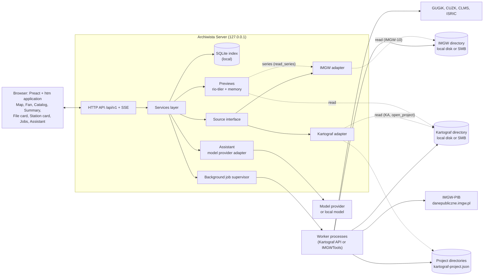
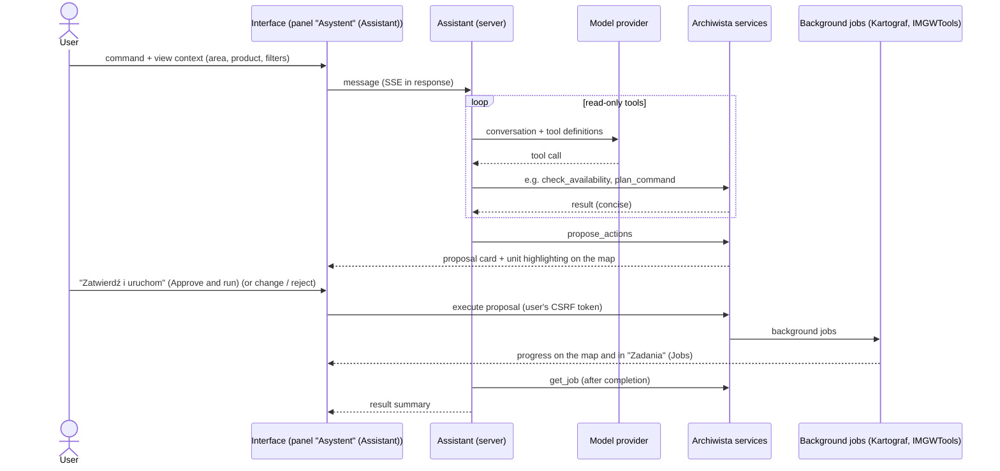

# Archiwista — specification

**Date:** 2026-10-17
**Status:** specification for review (no application code); product requirements: [`docs/PRD.md`](PRD.md), scope and release priorities: [`docs/SCOPE.md`](SCOPE.md) (they take precedence on scope and priorities); details in this spec; decisions:
[`docs/DECISIONS.md`](DECISIONS.md); interface mockup: the `mockup/` directory
(section 16)
**Dependency:** Kartograf 0.8.0 (`develop`) — public API
(`kartograf/__init__.py`, `__all__`) and on-disk formats: sidecar
`kartograf-meta/1`, the `data/` layout with a version store (`versions/`), project manifest
`kartograf-project/1`, update plan `kartograf-plan/1`, availability report
`kartograf-availability/1`; from v0.6 also KF (merged
PL + CZ surface, 12.5); from v0.5 IMGWTools (IMGW data) —
a release with requirements IMGW-1..IMGW-14 (section 12.7; today 2.1.1, Beta,
no store): catalog `imgw-store/1`, sidecar `imgw-meta/1`, series
`imgw-series/1` (12.8), project manifest `imgw-project/1` (IMGW-14), and from
v0.6 a release with ČHMÚ stations (IMGW-15..IMGW-19)
**Source documents (Kartograf repository):** `docs/ARCHITECTURE.md` 1
and 3.1-3.5, `docs/USAGE.md`, `docs/SCOPE.md` 3.3 (roadmap, overlay rules),
`docs/DECISIONS.md` ADR-022, ADR-024, ADR-027, ADR-036, ADR-037, ADR-039 to
ADR-044, project manifest spec `docs/superpowers/specs/2026-10-15-manifest-projektu-design.md`
**Source documents (IMGWTools and IMGW):** `README.md`,
`docs/ARCHITECTURE.md`, IMGW format descriptions in `data/desc/`,
`src/imgwtools/core/url_builder.py` and `src/imgwtools/stations.py`
of the IMGWTools repository; IMGW-PIB terms of use
(https://danepubliczne.imgw.pl/regulations) and API description
(https://danepubliczne.imgw.pl/apiinfo); measurements of the IMGW servers
from 2026-10-17 (4.8); ČHMÚ data: `docs/OBSERWATOR_SPEC.md`
and `docs/OBSERWATOR_RESEARCH.md` of the IMGWTools repository
(https://opendata.chmi.cz, 4.8.6)

Document conventions: names from Kartograf (functions, sidecar fields, directories)
are written in `kodzie`; interface texts in quotes "…"; real
data paths are replaced by `<data-dir>`. References "ARCH", "USAGE",
"SCOPE" and "ADR-0xx" without a qualifier refer to Kartograf's documents; Archiwista's
decisions take the form "A-ADR-0xx" (`docs/DECISIONS.md` in this repository).
Requirements for producers are "KA-1"…"KH-2" (Kartograf) and "IMGW-1"…
"IMGW-14" (IMGWTools, 12.7); `plik:linia` references to other repositories
start with their name (e.g. `IMGWTools/src/imgwtools/stations.py:349`).

**Table of contents:** 1. Purpose and users · 2. Glossary · 3. Use
cases · 4. Data model and index · 5. Architecture · 6. Interface ·
7. Assistant · 8. Combining data · 9. HTTP API · 10. Security ·
11. Tests and verification · 12. Requirements for Kartograf and IMGWTools ·
13. Roadmap · 14. Risks · 15. Open questions · 16. Mockup

---

## 1. Purpose and users

### 1.1 Problem

Kartograf writes data to an organized store, but the store grows quickly:
tens of thousands of files, several versions of the same sheet (flights,
releases), many projects pinning different versions, PL and CZ data
in different coordinate systems, on a local disk or a network share.
Simple questions today require knowing the CLI, the `data/` directory rules and reading
JSON files:

- "What do I have in the store for this catchment and from which year?"
- "From which year does the source have a complete set of sheets for this area?"
- "Is there a newer flight than the one the project uses?"
- "Which files did project X use and are they intact?"
- "How do I load all of this into QGIS in one go?"
- "How does the 2019 flight differ from 2025 on this sheet?"

IMGW-PIB measurement data (water levels, flows, precipitation, temperature) has
a similar problem in a different form: national archives in hundreds of ZIP files
with varying encoding, published with a delay and refreshed, stations
with a location in only some of the sources, and IMGWTools currently stores them flat,
without versions or checksums:

- "Which gauging stations in this catchment have continuous daily flows since 1951?"
- "Has IMGW published a new annual volume or corrected an old one?"

### 1.2 Purpose

Archiwista is a data store manager in the browser: for Kartograf's spatial data
and for IMGW-PIB measurement data written by IMGWTools
(two producers, A-ADR-019). It allows you to:

1. **See** — browse and search the archive, a map with footprints
   and previews, versions, provenance, licenses, projects; IMGW stations
   with series and their coverage over time.
2. **Check** — data availability for a selected area locally
   (store) and at the source (GUGiK, CUZK, IMGW), version currency, integrity
   of pinned files.
3. **Act** — download, update and pin data in projects;
   each action is run in the background by the producer's public API (Kartograf
   or IMGWTools), with progress, messages and cancellation.
4. **Prepare for combining** — sheet mosaic, PL + CZ combination,
   a set for a QGIS project, version comparison (section 8).
5. **Commission in natural language** — the assistant (an LLM agent) plans
   data preparation and runs it only after the user's
   confirmation (section 7).

**The overriding principle (as in Kartograf): layout, interface and API simple,
understandable and convenient for people.** In practice:

- human names instead of directories ("NMT 1 m · PL-1992 · EVRF2007" instead of
  `nmt/pl_1992_1m_evrf2007`), and the raw value is always one click away;
- every action involving the network or writing first shows a plan (what, how many
  files, how many are already local, how much data, where to), and after execution —
  what happened;
- no silent changes: nothing is downloaded, repinned or overwritten
  without an explicit human decision;
- producers' messages (`Info:`, `Warning:` and Kartograf errors,
  IMGWTools messages) are shown unaltered — the same text as in the CLI;
- every action can be repeated from the command line: Archiwista shows the
  corresponding `kartograf …` or `imgw …` command to copy.

### 1.3 Boundaries (what Archiwista is not)

- **It is not a GIS program.** Previews serve to recognize data, not
  to analyze it; analyses are done in QGIS (Archiwista prepares a set
  for that, section 8.4).
- **It has no download or processing mechanism of its own.** Archiwista commissions
  downloading and updating data from the store's producers: Kartograf
  (spatial data) and IMGWTools (IMGW data; A-ADR-019). Overlays call
  only the libraries' public API and have no
  download or processing logic of their own (SCOPE 3.3). A missing producer function
  is a requirement for the producer (section 12), not a workaround
  in Archiwista.
- **It does not delete data from the store** (Kartograf deletes nothing; section 15,
  P4).
- **It keeps nothing on a network share.** The index, previews and job history
  are local and can be rebuilt at any time; the source of truth is
  sidecars and manifests (SCOPE 3.3). Accounts, groups, roles and project visibility
  do not derive from files, so they live in a separate local state database
  (4.3, A-ADR-029) — also never on a share; rebuilding the index
  does not touch it. The exception is user data
  that Archiwista writes on the user's command in the project directory (sets,
  area files, snapshots of own data — 4.7.1, A-ADR-027): this is not Archiwista's
  state, but files in an open format, readable without it.
- **It is not a data editor or a system for the history of objects.** It
  versions own data with snapshots of whole files (4.7.1); editing and the history of changes
  to individual objects are out of scope.
- **It does not replace the QGIS plugin** (subproject 4 of Kartograf's roadmap). It replaces
  subproject 5 ("web GUI") and is a separate project (A-ADR-001).
- **It is not a hydrological analysis program.** It shows facts about IMGW
  series (coverage, gaps, values and extremes published by IMGW), but
  does not compute characteristic flows, frequency analyses or statistics;
  Hydrolog and Retman do that, and Archiwista prepares data for them
  (user decision 2026-10-17; section 15, P17).
- **It does not show current IMGW data** (water levels, warnings) — only
  archives and series from the store (user decision 2026-10-17).

---

### 1.4 Users and operating modes

| Persona | Who they are | What they need from Archiwista |
|---|---|---|
| **Ola, hydrologist** | Prepares data for a catchment model; knows QGIS, rarely uses the CLI | area on the map → what is available and from which year → download → set for QGIS; gauging stations in the catchment with continuous daily flows and series for Hydrolog |
| **Marek, GIS specialist** | Knows Kartograf and the CLI | review of versions and campaigns, mosaics, flight comparisons, currency checks, data from the PL/CZ border area |
| **Project team (later)** | A few people, a shared store on an SMB share | which projects use which data, who downloaded it and when, what can be updated — without downloading the same thing twice |
| **Hydrograf/Hydrolog developer** | Uses Kartograf as a library | checking the contents of the store, paths of immutable versions (including IMGW series) for scripts |

Operating modes:

- **Local (from v0.1, default):** one person, server on `127.0.0.1`,
  no login; the store is on a local disk or on an SMB share.
- **Team (v0.4):** one Archiwista server on the local network
  with login and roles, a shared store on an SMB share without byte-range
  locks (A-ADR-013; section 15, P1). From v0.1 the architecture does not assume that the
  browser and the server see the same file system (section 5.1), and the
  permissions model and project visibility work from v0.1 (10.2, A-ADR-029).

## 2. Glossary

One vocabulary across the documentation, the interface and the API. Kartograf's terms
keep their meaning.

| Term | Meaning | Source |
|---|---|---|
| **Store** | A set of producer directories named in Archiwista's configuration: a **Kartograf directory**, the store root of Kartograf (the directory that holds `kartograf-store.json` and the product directories, segments and versions; usually called `data/`) and/or an **IMGW directory** (an IMGWTools store, `imgw-store/1`); neither lies inside the other. Archiwista handles several stores (e.g. local and team) | ARCH 3.3; A-ADR-019 |
| **Producer** | A library that is the only one to write its store directory and owns its format: Kartograf (spatial data) or IMGWTools (IMGW data) | A-ADR-019 |
| **Source interface** | (Archiwista) the common interface of producer adapters: scan, metadata, extent, commands, plan, execution; the Kartograf adapter and the IMGW adapter are the only places that import their libraries | section 5.3 |
| **Product** | A kind of data selected with `--product` in a command group (DEM, orthophotomap, BDOT10k, PRG boundaries…); a top-level directory of the store | ARCH 3.3 rule 10 |
| **Source (dataset)** | A Kartograf descriptor; for IMGW data, an IMGWTools dataset. The **dataset key** `<country>.<provider>.<dataset>[_<variant>]` = the `dataset` field of the sidecar, e.g. `pl.gugik.nmt_1m`, `pl.imgw.hydro_daily`; for Archiwista an opaque identifier (not split into parts), unchanged after the producer's release (4.2.1). The provider is given by the `provider` field, not by the middle part of the key | ARCH 3.1; sections 4.2.1, 4.8 |
| **Segment** | The directory `<product>/<country>_<tokens>`: one content variant (CRS, resolution, height system, format, vintage, level…), e.g. `nmt/pl_1992_1m_evrf2007` | ARCH 3.3 rules 1, 8-10 |
| **Unit** | The area of one file: sheet code, tile, TERYT, KU, country code or a `<coords>` cutout | `UnitFile.unit`, `PlanItem.unit` |
| **Slot (file location)** | Segment + unit hierarchy + file name, i.e. "this file" regardless of version, e.g. `nmt/pl_1992_1m_evrf2007` + `N-34/130/D/d/2/4` + `N-34-130-D-d-2-4.asc` | `PlanItem` (`segment`, `hierarchy`, `name`) |
| **Version** | The immutable content of a slot: `<segment>/versions/<hierarchy>/<label>_<sha8>/<file>` with a version sidecar; version identity = SHA-256 of the content | ADR-036 |
| **Version label** | A readable name of the version: campaign `<date>_<id>` (e.g. `2025-04-26_82710`), release (`2.0`, `2024`, `2024_2025-02-06`) or download date; where it comes from is given by `extra.version.label_source` | ARCH 3.3 rule 6 |
| **Current version** | The version the standard path `<segment>/<hierarchy>/<file>` points to (a hard link to the newest local version); `full_sheet/` points to the newest full flight | ARCH 3.3 rules 6-7 |
| **Sidecar** | `<file>.meta.json` (`kartograf-meta/1`): provenance, CRS, `nodata`, job, license, `sha256`. The version sidecar is immutable; the sidecar of the standard path is a copy with the link target (`extra.link_target`). In the IMGW directory, `imgw-meta/1` (12.8) | ARCH 3.2 |
| **Campaign (flight, survey)** | A GUGiK measurement of a sheet: the currency date and the work submission number; campaign year = data year | ADR-028, ADR-030 |
| **Release** | A version of a source publication without a campaign: the BDOT10k vintage, SoilGrids `2.0`, the entry date of the CUZK ATOM feed | ADR-036 D29, ADR-042 |
| **Full / partial sheet** | The index record `TAK`/`NIE` (`czy_ark_wypelniony`, in the sidecar `extra.source.full_sheet`): whether the sheet is completely filled with content | ARCH 3.2 |
| **Kartograf job (area)** | One call for an area; its files, also on both sides of the PL/CZ border, are linked by a common `extra.parent_request` | ARCH 3.4 |
| **Project** | A directory with the Kartograf manifest `kartograf-project.json` (`kartograf-project/1`) and/or the IMGWTools manifest `imgw-project.json` (`imgw-project/1`): project jobs (the producer's data commands with options) and pinned file versions; each manifest is written only by its producer | ARCH 3.5, ADR-040; IMGW-14, A-ADR-023 |
| **Project job** | An entry of `tasks[]` in the manifest: name, command (e.g. `elevation download` or the IMGW command `series select`) and options | manifest spec 3.3; IMGW-14 |
| **Pin** | An entry of `files[]` of a project job: which version (`version` or the `path` of a version in the IMGW directory, `sha256`) is used | manifest spec 3.3; IMGW-14 |
| **Availability** | What the source has for an area: years, variants, sheet completeness; the `check_availability` report (`kartograf-availability/1`) | ADR-041 |
| **Variant** | (Archiwista) a set of product files sharing: year, horizontal CRS, resolution, height system and submission/campaign; file formats (e.g. `ASC`, `ASCII-NMT`) are its badges, not the key; one card in the interface | section 6.4, A-ADR-017 |
| **Currency** | Whether the local or pinned version is the newest at the source: a `check_*` plan (`kartograf-plan/1`; statuses `current`, `newer`, `missing`, `unverifiable`, `check_failed`) | ADR-036 |
| **Area** | The user's selection: rectangle, polygon, geometry file, sheet code, TERYT, KU or country | — |
| **Year coverage** | (Archiwista) a coverage label of a year or release for an area: "pełne" (full), "pełne · 2 kampanie" (full, 2 campaigns), "częściowe · 58%" (partial, 58%), "brak danych" (no data), plus a separate store-state badge: "pobrane" (downloaded), "pobrane 5/12" (downloaded 5/12), "niepobrane" (not downloaded) | section 6.4 |
| **Set** | (Archiwista) a selection of versions prepared for use outside the store: a QGIS project, a list of paths, attributions, VRT wrappers; generated from a project or from a selection, rebuildable, it is not data | section 8.4 |
| **Derived product** | (proposal for Kartograf) the result of merging, saved in the store as a version with a sidecar and a list of inputs (`extra.source_files[]`, the HSG pattern); in the IMGW directory, the series of a dataset (IMGWTools) | sections 8.1, 4.8 |
| **IMGW dataset** | A kind of IMGW-PIB archives with a common format, e.g. daily hydro, daily precipitation; the publication unit is a period (year or month) for the whole country | section 4.8 |
| **IMGW archive** | A file published by IMGW-PIB (e.g. `codz_2024.zip`), saved in the IMGW directory 1:1 as an immutable version with a sidecar (`sha256`, `ETag`, `Last-Modified`); slot = the file path on the IMGW server | section 4.8.1, IMGW-4 |
| **Station** | An IMGW-PIB measuring point: a water gauge (hydro) or a meteorological station (climatological, precipitation); identifier: a 9-digit code, e.g. `149190310`. From v0.6 also a ČHMÚ station (CZ; provider identifier `CHMI`, display name "ČHMÚ") with a WIGOS identifier; station identity = provider + identifier | sections 4.8.1, 4.8.6 |
| **Unpublished** | (ČHMÚ stations) a station file for a given year or an element that the source does not publish; in the IMGWTools plan `unverifiable` with `error` `"nieopublikowany"`, in flat download `not_published`. Information, not a problem: unlike `missing` (file published, absent locally) | section 4.8.6, IMGW-16 |
| **Station catalog** | A versioned list of stations with location, its source and uncertainty (IMGWTools, GeoJSON) | section 4.8.1, IMGW-9 |
| **Series** | The values of the variables of one station from one IMGW dataset over consecutive days (months, half-years): a station Parquet file in a version of the **dataset series**, a snapshot of all stations of the dataset built by IMGWTools from specific archive versions | section 4.8.1, IMGW-7 |
| **Variable** | A quantity of a series: H is water level [cm], Q is discharge [m³/s], T is water temperature [°C], P is precipitation [mm], Tmax, Tmin, Tśr (Tmean) are air temperature [°C] | section 4.8 |
| **Hydrological year** | From 1 XI of the previous year to 31 X (e.g. h.y. 2024 = 2023.11.01–2024.10.31); it numbers IMGW hydro archives and characteristics, while meteo archives are numbered by calendar year; in the interface both kinds of years are available for hydro and meteo data (a switch) | sections 4.8.2, 6.7 |
| **Series coverage** | (Archiwista) a label of one quantity (variable) of a station over a range of years, separate for each quantity, never one per station (P16): "ciągły · 1951–2025" (continuous · 1951–2025), "luki 3% · najdł. …" (gaps 3% · longest …), "częściowy · od 1972" (partial · from 1972), "brak danych" (no data), "nieznane" (unknown), plus an archive badge in the store ("pobrane 60/75 lat", downloaded 60/75 years) | section 4.8.4, A-ADR-021 |
| **Location (geometry)** | (Archiwista) the spatial reference of an index object: version footprint, station point, country extent, or **no location** with a reason (e.g. a station without coordinates, a file with no recognized extent). Objects without a location are not on the map; the "Katalog" (Catalog) shows them | sections 4.3, 6.8, A-ADR-022 |
| **the Fan ("Wachlarz")** | (Archiwista) a view of the year layers (campaigns, releases) of a result: thumbnails of the area arranged on an arc like a stack of files in the macOS dock, each in full, the selected one enlarged; it replaced the "Stos" (Stack) (user decision 2026-10-17) | sections 5.4, 6.5 c, A-ADR-018 |
| **Index** | (Archiwista) a local SQLite database describing stores and projects; a cache, not the source of truth | section 4 |
| **Own data** | (Archiwista) the user's raster and vector files (e.g. a sewer network) in the project's data folder, by default `<project directory>/dane/`; they belong to no producer, Archiwista reads them and makes snapshots of them | section 4.7.1, A-ADR-027 |
| **Snapshot** | (Archiwista) an immutable copy of an own-data file with a SHA-256 sum and a `migawka.json` description, saved by Archiwista at the user's command in `<data folder>/.wersje/`; append-only | section 4.7.1, A-ADR-027 |
| **Background job** | (Archiwista) a long operation (scan, check, download, merge, export) in a separate process, with progress and cancellation; the "Zadania" (Jobs) view | section 5.6 |
| **Proposal** | (Archiwista) a plan of actions prepared by the assistant; it becomes background jobs only after the user's confirmation | section 7 |

"Task" without a qualifier does not appear in the interface: it is always a "project task" (Kartograf or IMGWTools) or a "background job" (Archiwista).

## 3. Use cases

Each case: who and in what situation, the course in the interface, what happens underneath (Kartograf calls) and how to tell it succeeded.
The sample area "Kraków" is the bbox `561000,239000,573000,249000`
(EPSG:2180, 120 km²), the same one the mockup uses (section 16).

### UC-01. Area → product → availability → download (main flow)

**Ola** is preparing a DEM for a catchment and does not know which year has a complete set of sheets.

1. In the "Mapa" (Map) view she selects an area: she draws a rectangle or polygon, enters a sheet code or TERYT, or loads `zlewnia.gpkg`.
2. From the product list she picks "NMT" (DEM) (group "Wysokości" (Elevations)) and in the variant chips sets "układ arkuszy: PL-1992" (sheet layout: PL-1992), because she wants files in EPSG:2180.
3. Archiwista immediately shows the state of the store (from the index, no network), and in the background starts a check at the source: `check_availability(product="nmt",
   country="pl", bbox=…)`.
4. The result appears as year layers on the map and in the "Zestawienie" (Summary) panel: 2023 "pełne · 2 kampanie" (complete · 2 campaigns) with a badge "pobrane 5/12" (downloaded 5/12), 2022 "częściowe ·
   58%" (partial · 58%), and next to 2019 a note "1 ark. niepełny" (1 sheet incomplete) (definitions: section 6.4). Ola
   switches the panel to "Oś czasu" (the Timeline) and the view to "Wachlarz" (the Fan) to see
   all years at once, each in full.
5. At the year 2023 she clicks "Pobierz…" (Download…). The plan window (`check_data(…, year=2023)`)
   says: 12 sheets, 5 already in the store, 7 to download, approx. 265 MB, written to
   the "Zespół" (Team) store; it shows the command `kartograf elevation download …`
   and the option "Dodaj jako zadanie projektu" (Add as a project task).
6. After confirmation a background job starts (`download_data(…)`). The sheets
   on the map change color as they are downloaded; Kartograf's messages
   appear in the job.

**Success:** the year badge changes to "pobrane" (downloaded), the new versions are
in the catalog, and the store is byte-for-byte the same as after the same command
from the CLI.

### UC-02. "What do I already have?" without a network

**Marek** is in the field without internet. He selects an area and chooses "Wszystkie
produkty" (All products). Archiwista shows only the store (index): files intersecting the
area, grouped by product and data year, with local coverage of the
area. The check at the source is disabled with the message "Brak sieci —
pokazuję tylko magazyn"; if this area was checked earlier, the
last report is shown with its date.
From v0.5 the IMGW stations of the area are also shown, with coverage labels from local
series (4.8.4).

**Success:** a response within a second, without a single network request.

### UC-03. Search by identifier

Marek pastes into the search field the sheet code `N-34-130-D-d-2-4`, the TERYT `1465`,
the submission number `GK-FOTO.6201.11.2025`, the beginning of a checksum `fdd30535` or
the IMGW station code `149190310`. Archiwista recognizes the type of identifier
and shows the matching slots of all products and stations; filters narrow
the result (section 6.6).

### UC-04. File card and version history

Ola opens the sheet `N-34-130-D-d-2-4`. The "Karta pliku" (File card) shows the version
timeline (flights 2019, 2023, 2025), which version is current, which is full
(`full_sheet/`), which projects pin which version, metadata in
plain language ("laser scanning, mean height error 0.06 m, full sheet"),
the license with a "Kopiuj atrybucję" (Copy attribution) button, a preview and the actions: "Kopiuj
ścieżkę wersji" (Copy version path), "Polecenie Kartografa" (Kartograf command), "Sprawdź aktualność" (Check for updates), "Porównaj
wersje" (Compare versions), "Dodaj do projektu" (Add to project).

### UC-05. Is there newer data?

Marek selects a segment in the area or a whole project and clicks "Sprawdź
aktualność" (Check for updates). A background job calls `check_*` (or `check_project`)
and shows the plan in plain language: "aktualne" (up to date), "nowsza: 2025-04-26_82710" (newer: 2025-04-26_82710), "nie da
się sprawdzić bez pobrania" (cannot be checked without downloading), "błąd sprawdzenia: …" (check error: …). The "Pobierz
nowsze" (Download newer) button executes the same plan (`update="upgrade"`, `plan=…`), and items
that changed in the meantime are reported by Kartograf as outdated.

### UC-06. Project: pins, verification, update

Ola opens the project "Raba": project tasks with options (shown as
Kartograf commands) and pinned versions. "Status" answers immediately
(`get_project_status`), "Weryfikuj" (Verify) computes SHA-256 checksums in the background
(`verify_project`), "Sprawdź aktualizacje" (Check for updates) compares pins with the source
(`check_project`), "Przepnij" (Re-pin) moves one task to newer data
(`download_project(update="upgrade", tasks=["teren"])`). From the availability result (UC-01) she adds the task "Dodaj rok 2025 do projektu" (Add year 2025 to the project)
(`add_project_task` with `year=2025`). The project "Raba" also has an IMGW task
"przeplywy" (manifest `imgw-project.json`, IMGW-14): the same actions call
IMGWTools project functions, and the task list has a producer column.

### UC-07. Which projects use this file?

Before cleaning up the store, the team lead filters "Nieużywane przez
żaden projekt" (Not used by any project) and "Niebieżące wersje" (Non-current versions), and sees their size and the list.
On the file card "Przypięta w: Raba (teren), Wisła-2026 (dem)" (Pinned in: Raba (teren), Wisła-2026 (dem)) is shown.
Archiwista deletes nothing; the report serves the decision (section 15, P4).

### UC-08. Sheet mosaic (from v1.3)

Marek needs a 0.5 m DEM from 2023 for an area as a single layer.
From the year row he chooses "Łączenie › Mozaika" (Merge › Mosaic): a VRT (immediately, without copying
data) or a GeoTIFF on a common grid clipped to the area. The plan shows
the inputs (specific versions), the grid and the size of the result. The result goes to
the store as a derived product with a sidecar (section 8.2).

### UC-09. PL + CZ border area (from v0.6; QGIS set from v1.1)

Marek models the Olza catchment. The area crosses the border; availability shows
PL years and current CZ models. The download runs as one Kartograf job
(`country="auto"`, `cutout=True`, a common `horizontal_crs`, height system
`pl=EVRF2007,cz=EVRF2007`); PL and CZ files are grouped by
`extra.parent_request`, and the consistency check suggests a missing download.
"Łączenie › PL + CZ" (Merge › PL + CZ) computes in Kartograf a single surface on a common
grid with a seam report (section 8.3); from v1.1 both layers can also be
exported without merging to a QGIS set. ČHMÚ gauges on the Czech
part of the catchment are shown next to IMGW stations (UC-20).

### UC-10. QGIS set (from v1.1)

Ola chooses "Zestaw QGIS" (QGIS set) in the project. In the project directory
`zestawy/<name>/` is created with a `.qgz` file, a list of paths and attributions. QGIS
opens the project without asking about coordinate systems, and the layers point to exactly the pinned
versions (section 8.4).

### UC-11. Flight comparison (difference model from v1.3)

Marek compares the 2019 and 2025 flights of one sheet: a table of metadata differences,
the curtain on the map, and, once the function is added to Kartograf, a height
difference model with statistics ("mean change −0.04 m; 2.1 ha of changes > 0.5 m")
(section 8.5).

### UC-12. Assistant (from v1.2)

Ola writes: "Przygotuj NMT 1 m i ortofotomapę dla zaznaczonego obszaru
z najnowszego roku z pełnym pokryciem i dodaj do projektu Raba" (Prepare a 1 m DEM and an orthophoto for the selected area
from the latest year with full coverage and add them to the Raba project). The assistant
reads the selection, checks availability (read-only), picks the year
and presents a proposal: two Kartograf commands, 24 sheets, 9 already
local, approx. 1.2 GB, two new project tasks; the proposal's sheets are
highlighted on the map. Only "Zatwierdź i uruchom" (Approve and run) starts the background
jobs; after they finish the assistant summarizes the result (section 7).

### UC-13. Store health

Marek opens "Magazyn › Stan" (Store › State): usage by product (each version counted
once), and next to it problems with an explanation and a repair command: unrecognized
segments (e.g. names from the development version 0.8.0-dev), files without a
sidecar, `kampanie/` directories from 0.7.x, leftovers of `versions/.incoming/`
older than 24 h, link sidecars pointing to a missing version, project pins
without a file in the store; in the IMGW catalog: leftovers of
`.incoming/`, a directory in an unsupported contract version and series
outdated relative to the archives.

### UC-14. Team (from v0.4)

Kasia logs in to the team's Archiwista. She sees the history ("Marek pobrał NMT
2025 dla Raby, wczoraj 14:02" (Marek downloaded the 2025 DEM for Raba, yesterday 14:02)) and the shared job queue, so she does not download
the same thing a second time. As a regular "użytkownik" (user) she browses the store, sees
public projects, her own and those shared with her personally or with her department, and creates
sets; downloading to the store can be done by a person with the "zapis do magazynu" (store write) permission
(section 10.2, A-ADR-029).

### UC-15. Pasted Kartograf command

Marek pastes `kartograf elevation download --product nmt --sheet … -o
./data`. Archiwista recognizes the command (the same parser as
`kartograf project add`), fills in the form, replaces `-o` with the selected
store, shows the plan and starts a background job.

### UC-16. Stations in a catchment and series coverage (from v0.5)

**Ola** is calculating flows for the Raba catchment and is looking for gauging stations with long
series.

1. She loads the catchment boundary from Hydrograf (`zlewnia.gpkg`, EPSG:2180) as the
   area.
2. She selects the product "Stany i przepływy dobowe" (Daily levels and flows) (group "Pomiary IMGW" (IMGW measurements))
   and the variable by which the map colours the points ("Q"); the labels of all
   variables (H, Q, T) are shown separately.
3. The map shows the area's gauging stations as points; a station close to the boundary has
   a badge "na granicy obszaru" (on the area boundary). Stations without a location are not on the map:
   the counter "2 stacje bez położenia" (2 stations without a location) leads to the "Katalog" (Catalog) view (6.8), where
   they are selected by river or hydrographic code (P13, P19).
   The "Zestawienie" (Summary) has a row per station with a separate coverage label for H,
   Q and T in hydrological years (by default for hydro, with a switch to
   calendar years — 4.8.4, 6.7), and the check at the source gives the published years (yearbook
   2025: publication 2026.08.31).
4. Without archives in the store the labels read "nieznane" (unknown); "Pobierz
   archiwa…" (Download archives…) opens the "Okno planu" (Plan window) with the `imgw …` command, and after the download
   IMGWTools builds the dataset series and the labels appear.
5. The list covers all stations of the area, including those with gaps and without Q data
   — each with a label (P14). Ola narrows it with explicit filters: "≥ 30 lat
   pełnych" (≥ 30 full years) or "rzeka: Raba z dopływami" (river: Raba with tributaries) (hydrographic code `2138…`,
   P19).
6. "Dodaj do projektu…" (Add to project…) saves the selection (stations as a list of codes, variable,
   years and their kind) as an IMGW project job (IMGW-14, A-ADR-023).

**Success:** labels consistent with a manual calculation from the archives, and the IMGW
directory byte-identical to the one produced by the same `imgw` command from the CLI.

### UC-17. Station card and comparison (from v0.5)

Ola opens the station "Stróża": the station card has metadata (code, river and its
hydrographic code, location with source and uncertainty), coverage of H, Q and T,
a chart of daily Q (gaps as breaks, annual maxima published by
IMGW as points), versions of series and archives, and IMGW formulas
with "Kopiuj atrybucję" (Copy attribution). "Porównaj z…" (Compare with…) overlays Q from Gdów and Proszówki on
a common time axis. Archiwista does not compute statistics (1.3).

### UC-18. Daily flows for a catchment via the assistant (from v1.2)

Ola writes: "Przygotuj przepływy dobowe dla stacji w tej zlewni" (Prepare daily flows for the stations in this catchment). The assistant
finds the stations, checks coverage and published years, plans the
archive synchronisation and the series, and adds to the proposal an IMGW project
job, a set with CSV for Hydrolog, and warnings (station since 1972, gaps, only
H, publication delay, purpose of use of IMGW data); it does not
skip stations with gaps (P14). After "Zatwierdź i uruchom" (Approve and run) the IMGWTools background jobs start.
Calculations, e.g. characteristic flows, are done by Hydrolog or Retman
(user decision 2026-10-17; 7.11; section 15, P17).

### UC-19. New IMGW publication (from v0.5)

Marek clicks "Sprawdź aktualność" (Check for updates) next to the daily hydro archives. IMGWTools
sends `HEAD` requests and compares `ETag` and `Last-Modified` with the versions
in the store: "nowsza publikacja: mies_2024.zip" (newer publication: mies_2024.zip), "nowy rocznik u źródła:
2025" (new yearbook at the source: 2025). "Pobierz nowsze" (Download newer) saves new archive versions (the old ones stay)
and a new version of the dataset series. Sets pointing to older series are
marked "nieaktualny — wygeneruj ponownie" (outdated — regenerate).

### UC-20. ČHMÚ stations in a border catchment (from v0.6)

Ola is calculating flows for the Olza catchment, whose upper part lies in Czechia.
After loading the catchment boundary the map shows IMGW and ČHMÚ gauging stations (a
provider badge at the point); the "Zestawienie" (Summary) has coverage labels for H, Q and T of both
providers under the same rules (4.8.4, 4.8.6). "Sprawdź aktualność"
and "Pobierz archiwa…" for ČHMÚ stations go through IMGWTools with the "Okno planu" (Plan window)
and the `imgw …` command; the plan covers only the stations of the area, because ČHMÚ
publishes archives per station. The ČHMÚ "Karta stacji" (Station card) gives the CC BY 4.0 attribution
from the sidecar, and "Dodaj do projektu…" (Add to project…) saves stations of both providers in one
IMGW project — one job per dataset, so separately for IMGW stations
and ČHMÚ stations (IMGW-19).

**Success:** labels consistent with a manual calculation from the ČHMÚ archives, and the IMGW
directory byte-identical to the one produced by the same `imgw` command from the CLI.

## 4. Data model and index

### 4.1 What we read from disk (sources of truth)

Archiwista has no data of its own about the store apart from the cache.
Everything it shows comes from the producers' files — Kartograf's and IMGWTools':

| File | Where | Mutability | How we read it |
|---|---|---|---|
| Version sidecar | `<segment>/versions/<hierarchy>/<label>_<sha8>/<file>.meta.json` | immutable (ADR-036) | once, when the version directory is first seen |
| Version data file | next to the version sidecar | immutable | during indexing only `stat` (size); content only on demand (preview, verification) |
| Sidecar of the standard path and `full_sheet/` | `<segment>/<hierarchy>/<file>.meta.json`, `<segment>/full_sheet/…` | mutable (link repointed to a newer version) | on change of size or modification time; the link target only from `extra.link_target` |
| Project manifest | `<project directory>/kartograf-project.json` and `<project directory>/imgw-project.json` | mutable | on change of modification time or file checksum; always through the producer's `open_project` (strict Kartograf validation; IMGWTools — IMGW-14) |
| Update plan | a `kartograf-plan/1` file saved with `--plan` | one-off | on demand (import of a plan from the CLI) |
| IMGW directory marker | `<katalog IMGW>/imgw-store.json` (`schema`, `tool`, `created_at`, `producer_version`, `created_by`) | changes only with the contract version | at every scan: recognition of the directory and of the `imgw-store/1` version (IMGW-13) |
| IMGW version sidecar (archive, station catalog, dataset series) | `<katalog IMGW>/{archives,stations,series}/versions/…/<file>.meta.json` (`imgw-meta/1`) | immutable | once, through `read_meta` (IMGW-10) |
| Dataset series listing | `<katalog IMGW>/series/versions/<dataset>/<label>_<sha8>/series.json` | immutable | once per version: station coverage into the index (IMGW-8) |
| ZIP archive, station catalog (GeoJSON), station series file (Parquet) | in the version directory | immutable | archive — only `stat`; station catalog — once per version; series — on demand (chart, set) through the IMGWTools API |

Leftovers and edge cases are shown, never silently skipped:
working directories `versions/.incoming/` (skipped during indexing;
Kartograf cleans them up after 24 h, older ones we report), `kampanie/` directories
from 0.7.x (not read by Kartograf 0.8.0), segments outside the registry (e.g.
`orto/pl_2000_oblique` from the development version 0.8.0-dev — in the sample
store of the 0.8.0 release live test there are such directories and sidecars
with old source keys, e.g. `cz.cuzk.hy_net`), files without a sidecar,
unreadable sidecars and sidecars from before ADR-031 (Polish keys: missing key
= no information, as in Kartograf).
In the IMGW directory analogously: `.incoming/` leftovers older than 24 h,
version directories without a main-file sidecar (`missing_sidecar` — an interrupted
publication or one in progress: not a version, a non-critical problem
and possibly transient, which the next write of the same content completes;
IMGW-2), unreadable sidecars, unknown directories and a directory
in an unsupported contract version (e.g. `imgw-store/2` — reported,
not read; IMGW-13).

**Archiwista writes nothing to the store** (in none of the producers'
directories). In the project directory
it writes only the set directory (section 8.4) and the area geometry file
(drawn or loaded from a file) for a new project job
(`obszary/`, 10.1); manifests are changed only by the APIs of their producers —
Kartograf and IMGWTools (A-ADR-003, A-ADR-023).

### 4.2 Reading through the producers' API

The rules of the `data/` layout (ARCH 3.3, rules 1-10), recognising links,
tolerant reading of old sidecars and computing a file's extent are
knowledge about Kartograf's format. Archiwista has no reader of its own for
this format: it uses the **KA** requirements package (section 12: `iter_store`,
`read_sidecar`, `describe_segment`, `file_footprint`, `link_target`,
`pinned_transform`). Thanks to this, a layout change in Kartograf
does not drift apart from Archiwista, and the QGIS plugin and Hydrograf can use
the same functions. Consequence: v0.1 requires a Kartograf release with KA
(A-ADR-014).

Archiwista reads the IMGW catalog the same way — through IMGWTools' public read API
(IMGW-10: `store_info`, `iter_store`, `read_meta`,
`current_version`, `read_catalog`, `read_series_index`, `read_series`), without
its own parser of ZIP archives, Parquet files or `imgw-meta/1` sidecars
(A-ADR-014, A-ADR-019). Both adapters sit behind a common source interface
(5.3): the index, the map and actions do not know which producer wrote the file.

#### 4.2.1 Dataset keys (contract with producers)

The dataset key — the `dataset` field of the sidecar (`kartograf-meta/1`, `imgw-meta/1`)
and the key of the Kartograf source descriptor or of an IMGWTools dataset — has the form
`<country>.<provider>.<dataset>[_<variant>]`:

- lowercase ASCII letters and digits; a dot only between the three parts,
  an underscore inside a part (`pl.gugik.nmt_0_5m`, `cz.cuzk.dmr5g_laz`,
  `pl.imgw.meteo_climate_daily`);
- `<country>` — an ISO 3166-1 alpha-2 code in lowercase, and for supranational
  datasets the scope (`eu.clms.corine`, `global.isric.soilgrids`);
- `<provider>` — the key prefix assigned by the producer (`gugik`,
  `cuzk`, `imgw`, `chmi`), not the provider identifier;
- `<dataset>[_<variant>]` — the dataset name and an optional variant.

Producer commitments (KA-8, IMGW-20):

1. **Immutability.** A key published in a producer release does not
   change; version sidecars are immutable (ADR-036, IMGW-1), so every
   key ever written stays on disk forever.
2. **Renaming only through the producer's alias table.** The raw `dataset`
   stays in the sidecar unchanged, and the read API supplies alongside it a normalised
   `dataset_key` (the current descriptor key). Model: Kartograf's `_DEV_DATASETS`
   (`Kartograf/kartograf/store.py:186`, ADR-044 D7) read
   by `read_sidecar` (KA-2). A key unknown to the producer gives an empty
   `dataset_key`, not an error.
3. **Provider from the `provider` field.** The provider's identity is in the
   `provider` field of the sidecar and the descriptor (Kartograf: the descriptor's `provider_name`,
   e.g. `GUGiK`, `CUZK`, `Copernicus CLMS`, `ISRIC` —
   `Kartograf/kartograf/sources/sidecar.py:242`; IMGWTools: `IMGW-PIB`,
   `CHMI` — IMGW-15), and the country in the `country` field; the middle part of the key
   (`imgw`, `chmi`) is not a provider identifier.

Archiwista treats the key as an opaque identifier: it compares it
as a whole (index, filters, linking a version to a segment), but never
derives the product, variant, provider or country from it — it takes them
from the sidecar fields and from `describe_segment` (KA-3). Thanks to this,
irregular keys break nothing, e.g. `pl.gugik.nmpt` (NMPT 1 m without `_1m`; a key
from 0.7 (ADR-031) preserved in ADR-041 and ADR-044,
`Kartograf/kartograf/sources/registry.py:313`).

### 4.3 Local index

The index (A-ADR-002) is a SQLite file (WAL mode) on the local disk, in the user's data directory
(`platformdirs`: Linux `~/.local/share/archiwista/`, Windows
`%LOCALAPPDATA%\Archiwista\`); next to it are the preview cache (`cache/`)
and the job logs (`jobs/`). The configuration (stores, project directories,
limits, assistant provider, view preferences — e.g. the remembered kind of
years for hydro and meteo data, 6.7) is in a readable TOML file in the user's
configuration directory and in the "Ustawienia" (Settings) view. The index can be deleted
at any time — "Przebuduj indeks" (Rebuild index) recreates it from the stores and manifests;
only the job history and the assistant conversations are lost.

The **state database** (A-ADR-029) is a separate SQLite file
`<user data directory>/state.sqlite`, also strictly local: accounts
(`users`), groups and memberships (`groups`, `memberships`), roles (`admin`,
`store_writer`), project visibility (`project_acl`: project key —
the directory after `realpath`, independent of the index; owner; `public` /
`users` / `group` / `private`; entries for people and groups) and the log of permission
changes. This state cannot be rebuilt from disk, so "Przebuduj
indeks" (Rebuild index) does not touch it, the schema changes through migrations (not by rebuilding),
and a backup is provided by `archiwista state export` (JSON
`archiwista-state/1`), restored by `archiwista state import` into an empty
database.

In a production deployment the store may remain on an HDD/NAS, but the Archiwista
data directory (index and preview cache) should be on a local SSD.
`state.sqlite` requires a backup; store files must not be copied
manually in order to speed up previews.

Contents (logical tables; the schema will be set by the implementation plan):

| Table | What it holds |
|---|---|
| `stores` | stores: identifier (a short name given by the user, e.g. `zespol`), producer directories (Kartograf, IMGW) and path aliases, availability, scan times and statistics |
| `segments` | segments: producer, product, source (`dataset`), human-readable name (`describe_segment`; for IMGW the name of the dataset from the IMGWTools registry in Polish, for a station catalog the name after its provider, the country of the provider and the family of the dataset as the product: `hydro`, `meteo`, `pmaxtp` or `stations`, because IMGWTools has no products and the "Magazyn" (Store) view and the Map panel group by product — ADR 0032, decision 10; a producer without a list of segments, like IMGWTools, describes the segments that its entries named, after the pass), recognized / unrecognized |
| `slots` | slots: segment, hierarchy, name, unit kind and code, the producer's slot key (`slot_key`, opaque to the index), current version, `full_sheet/` version, number of versions; in the IMGW catalog a slot is an archive file (path on the server), a station directory or the dataset series — the name of an archive slot is its file, that of a station directory its key (`catalog:pl.imgw.stations`), and the slot key is the IMGWTools key (`archive:pl.imgw.hydro_daily:2024/codz_2024.zip`) |
| `versions` | versions: label and its source, `sha256`, size, coordinate systems, resolution, `nodata`, data year and date, campaign and request number, release, download date, provider (`provider`: `IMGW-PIB`, `CHMI`), full sheet, coverage (`extra.coverage`), license, `parent_request` group key, native extent and its source, kind of location (`footprint`, `country`, `none` with a reason; A-ADR-022), state, full sidecar (JSON) |
| `observations` | the publication history of a slot (IMGW only): a source served other bytes with the content of a version the producer already has — time, address, `ETag`, `Last-Modified`, size, `sha256` and the version with that content; it is neither a version nor a current version and enters no count; a record the pass did not see disappears |
| `footprints` | R*Tree: version extent in WGS84 (area filter and map) — only versions with a footprint |
| `stations` | stations from the current version of the station catalog: code, kind, name, river, hydrographic code (with a prefix index, P19) and order, location (WGS84) with source and uncertainty, or no location with the reason from the catalog (IMGW-9), 1° square from the code, active or historical, year established, gauge zero elevation, river kilometre |
| `station_points` | R*Tree: station points (degenerate rectangles) — area filter and station layer |
| `station_series` | a station's series in a dataset series version: file, `sha256`, variables with units, first and last date, list of gaps, number of aggregate sums (from the `series.json` listing, IMGW-8) and the periods known to the version |
| `series_years` | variable coverage by hydrological and calendar years (units, units with a value, longest gap) — computed during indexing from the gap lists; the Timeline and filters |
| `search` | FTS5: sheet codes, TERYT, KU, labels, request numbers, file names, human-readable product names, project names and project tasks, station codes and names, river names |
| `projects`, `project_tasks`, `pins` | known projects, their tasks and pins linked to versions, with the manifest producer (Kartograf, IMGWTools) — the "which projects use the file" index (SCOPE 3.3) |
| `availability` | latest availability reports per area and product, with a date (visible without a network); for IMGW datasets — published years with publication dates |
| `jobs`, `job_events` | history of background jobs and their events |
| `conversations`, `messages`, `proposals` | conversations with the assistant and its proposals |

Attributes for filters are computed during indexing from the sidecar by
`read_sidecar` (KA-2), which normalizes fields that differ between
products: the **data year** (campaign, LAZ flight date, release year) is
a separate field from the **download date** and is never replaced by it;
a version without a data year has an empty year, not the download year.

The **extent (footprint) of a file** is computed by `file_footprint` (KA-4) in the following order of
sources: `request.bbox` with `bbox_crs` (clips, collection area results,
SoilGrids, HSG) → sheet code from the parser (PL-1992, PL-2000, TM33) → file header
(GeoTIFF, ASC, JPEG with JGW, GeoPackage, LAS) → unit (TERYT from PRG, KU
from RUIAN, SM5 sheet from the CUZK index — with a network in the `footprints` job (5.6)
and with a local cache, from which a scan without a network takes the footprints of already
known units) → country.
An extent without a source is marked "bez obrysu" (no footprint) (the file is in the "Katalog" (Catalog), not
on the map). Conversion to WGS84 uses only Kartograf's pinned
transformation (KA-6): the default transformer can silently use an
approximate operation, and for S-JTSK that is a shift on the order of 100 m (ADR-024).
IMGW archives and series have the "country" extent; the map shows stations — points
from the station catalog (IMGW-9) in the `station_points` R*Tree.

**Location of objects (P13, A-ADR-022).** Every index object — version,
slot, station — has a kind of location: `footprint` (footprint), `point` (station),
`country` (country extent: national files, IMGW archives and series) or
`none` with a reason — files: `no_source` ("bez obrysu"),
`unreadable` (unreadable sidecar); stations: the reason from the station catalog
(IMGW-9: `none` — no source has coordinates, `zero` — `0,0`, `outside_country`).
Rules common to all producers and products:

1. The map draws only `footprint` and `point`; a location is never
   guessed or approximated (e.g. by the centre of the 1° square from the station code).
2. `country` and `none` objects are in the "Katalog" (Catalog) (6.8) — a view without a map
   with search and attribute filters, which shows all kinds of
   location.
3. The area filter splits the result into "w obszarze" (in the area) (intersection), "na granicy
   obszaru" (on the area boundary) (stations, 6.7), "cały kraj" (the whole country) (`country`, when the country of the area
   matches) and "bez położenia" (no location) (`none`) — the last group is never
   silently added to the area or removed from it; it is narrowed
   with attribute filters (river and hydrographic code, name, country, unit,
   product). For stations there is also a rough hint "kwadrat 1° z kodu
   przecina obszar" (the 1° square from the code intersects the area) (4.8.1), described as an inference from the code, not a location.
4. Every map view with a result gives a count of objects without a location
   ("3 stacje bez położenia", "2 pliki bez obrysu") with a link to the
   "Katalog" (Catalog) with the same product and filters.

### 4.4 Build and refresh

- **Full scan** (first start, "Przebuduj indeks" (Rebuild index)): a pass of
  `iter_store` separately for each segment from `list_segments` (KA-1)
  in a bounded thread pool (SMB latency, not CPU); on a share, a
  segment is read in disjoint parts (`list_partitions`, KA-1),
  the heaviest first (weight: known versions of the part), so the largest segment
  does not end up last on a single thread; a local disk is read by one thread
  (GIL). The sidecar of each entry is read once by `iter_store` itself, and writes to the
  index go in batches within transactions; a background job with progress
  (an event after each segment, when all of its parts have finished).
- **Incremental scan:** version directories `<label>_<sha8>` are immutable,
  so known versions are neither read nor listed again: the index passes
  `iter_store` a mapping of version directory → file names (`skip_versions`,
  KA-1; a known directory costs 0 operations). The mapping covers only
  directories whose files were all valid versions at the last read;
  a directory with a problem, with a version marked "brak pliku" (file missing) or without
  metadata is listed and read like a new one. We check for the appearance of
  new version directories, the disappearance of known ones (a listing of the slot directory
  in `versions/`) and changes to link sidecars; a file deleted or added
  manually inside a known version directory is seen only by the full
  verification scan (below, "Triggers"). The current version is determined by the link
  sidecar (`StoreEntry.version_path`); the scan does not call `link_target`
  (KA-5), which on a share without stable inodes confirms the target by content
  — that is an on-demand action. The directory modification time is only
  a hint (on a share with an attribute cache it may be delayed) and does not
  replace the full verification scan.
- **Refresh on demand for a view:** when the user asks about an area
  and a product, Archiwista first refreshes exactly the slots of the units of that
  area (`iter_store(segment=…, units=…)`, KA-1; units from the availability
  report, from the sheet grid `find_sheets_for_bbox` or from footprints
  in the index), and only then shows the state of the store — the answer to
  the current question is up to date within seconds, also on SMB, independently of
  full scans. Known version directories of the area's slots and of their neighbours
  from the same directory (e.g. all units of a segment's `bbox/`) go
  into the `skip_versions` mapping, so they are not listed.
- **After own jobs:** Kartograf's result (`files[].file.version_path`,
  project pins) goes into the index immediately, without a scan.
- **The IMGW catalog** is incremental only (IMGW-1): an incremental scan is
  listing the new version directories through IMGWTools' `iter_store`. A new
  version of a station catalog or of a dataset's series rebuilds the tables
  `stations`, `station_series` and `series_years` from a single file (the catalog
  or the `series.json` listing), without reading Parquet files; the station view
  needs neither the network nor reading the series. `iter_store` has no scope
  below the directory, so an IMGW scan always covers the whole directory, and the
  dataset (segment) is only a label: the job that scans one segment is taken by the
  producer that has it in the index (`segments.producer`; a name the index does not
  know is taken by the producers that scan by segments, that is, Kartograf), and for
  an IMGW dataset it ends with the error `unsupported` before anything is scanned
  (ADR 0032, decision 9).
- **The current version of an IMGW slot** does not follow from a link (IMGWTools has
  none), so at the end of the pass Archiwista asks the producer (`current_version`,
  the capability `CurrentVersionAdapter`) about the slots the pass touched: a version
  written, returning or gone, a problem found or resolved, and the slots without a
  current version although the pass saw a version of them (an interrupted scan
  leaves such slots). A scan with no changes asks for nothing; an answer that names
  a version the pass did not see (one published after the listing) waits for the
  next scan. A slot with a damaged version has no current version (an older one does
  not take its place) and is "nieczytelny" (unreadable) with the problem from
  `iter_store`; a version directory without a sidecar (`missing_sidecar`) is not a
  version and does not change the current version.
- **Triggers:** application start (incremental, if the last one is older than
  15 min), interval (by default 15 min for a share, 5 min for a local
  disk), the "Odśwież" (Refresh) button (store, segment, view), end of a background
  job; file-system change watching for local disks only
  (optional). A full verification scan every `full_scan_interval_h` hours
  (a setting, 24 h by default) or on demand with the "Pełny skan" (Full scan) button
  in the "Magazyn" (Store) view — only it notices a file deleted or added manually
  inside a known version directory. The time of the last full scan is visible
  in "Magazyn" (Store), in `/health` (`full_scan_at`) and in `archiwista status`.
- **Store unavailable** (missing directory or an empty mount point):
  scan aborted, index unchanged, banner "Magazyn niedostępny od 14:02 —
  pokazuję stan z indeksu"; write actions disabled. We never
  mark the whole store as deleted because of a disconnected share.
- **Disappearances:** a version that is missing after a full pass gets the state
  "brak pliku" (file missing) (with a date); projects pinning it are marked. The entry
  disappears from the index only after the next full scan.
- **A change of index schema** in a new version of Archiwista = rebuild (it is a
  cache — no migration).
- Producer commands run outside Archiwista (Kartograf's CLI
  and IMGWTools', Hydrograf) are a normal situation: the index will see them at the
  next refresh.

### 4.5 Performance

Reference store: 50,000 slots, 80,000 versions (about 260,000 files
with sidecars and links, about 150,000 directories), 30 projects; an SMB 3
share on a 1 Gb/s network or a local SSD disk. Targets (acceptance criteria for v0.1,
a test on a synthetic store from the generator, section 11):

| Operacja | Udział SMB | Dysk lokalny |
|---|---|---|
| first full scan | ≤ 10 min | ≤ 2 min |
| incremental scan with no changes (in the background) | ≤ 3 min | ≤ 20 s |
| view refresh (area + product, ≤ 500 slots) | ≤ 5 s | ≤ 1 s |
| list query (page of 50 rows), p95 | ≤ 200 ms | ≤ 200 ms |
| footprints in the map view (≤ 5,000 objects; above that aggregation to a grid), p95 | ≤ 300 ms | ≤ 300 ms |
| text search, p95 | ≤ 200 ms | ≤ 200 ms |
| file card without preview, p95 | ≤ 200 ms | ≤ 200 ms |
| (v0.5) station layer in the view (≤ 5,000 points; above that clusters), p95 | ≤ 300 ms | ≤ 300 ms |
| (v0.5) table of the area's stations with coverage labels (≤ 200 stations), p95 | ≤ 300 ms | ≤ 300 ms |
| (v0.5) chart of a station's full daily series (about 27 thousand days → ≤ 2,000 points), first read, p95 | ≤ 500 ms | ≤ 200 ms |
| (v0.5) first scan of the reference IMGW catalog | ≤ 2 min | ≤ 30 s |

Index ≤ 500 MB for 80,000 versions; server memory ≤ 500 MB without previews.
Reference IMGW catalog: datasets from 4.8 over the full range of years (about 2,000
archives), a catalog of about 3,500 stations, one version of the dataset's series each.
The interface never waits for a scan: queries go to the index, and the state of the
index ("Indeks z 14:02, skan trwa: 63%") is always visible.

Measurements of release 0.2.0 on the same store and share:
[`reports/v0.2-measurements.md`](reports/v0.2-measurements.md) —
full scan on SSD 64.8 s, incremental 13.2–13.6 s, map query
for 4964 footprints p95 117.4 ms after the response improvement (`5610065`),
index 263 MB and server RSS 188–202 MiB. For previews, the p95 of an orthophoto
tile after the first read is 222 ms, a GeoPackage snapshot of 123 MB
5.8–6.3 s, own scan of 1000 files p95 0.89–1.07 s.
The threshold of ≥ 30 frames/s at 5000 footprints remains unverified
without access to a hardware GPU (SwiftShader: 8.4 frames/s).

### 4.6 Working on an SMB share

1. There is no Archiwista file on the share (SQLite, cache, locks).
   Archiwista only reads; writes are done by the producers: Kartograf, which
   works without byte-range locks (versions through `os.link`, manifest through
   a `mkdir` lock and `os.replace`), and IMGWTools (point 9).
2. The link target comes only from the link sidecar (`extra.link_target`).
   No logic based on inode numbers or link counts: on a CIFS share of the sample store
   the standard path and its version returned
   different inode numbers and different link counts (measurement 2026-10-17).
   Confirmation by content on such shares is done by Kartograf (KA-5).
3. Occupied space = the sum of file sizes in `versions/` (each version once);
   a sum over paths would count hard links multiple times.
4. A GeoPackage from the store is opened read-only as immutable
   (`immutable=1`): versions do not change, while an ordinary SQLite open on
   a share takes locks.
5. A file that disappeared between listing and reading is skipped
   and checked again in the next scan.
6. We do not follow symbolic links pointing outside the store.
7. The same share may be mounted under different paths (`Z:\kartograf`,
   `/mnt/nas/kartograf`): the store in the configuration has path aliases. A project
   manifest must point to the store correctly for the process that fetches
   (Kartograf reads `root` itself) — therefore in a team we recommend a relative
   `root` when projects and store are on the same share,
   and the path correction is done by a Kartograf feature (KH-1), not by manual editing
   through Archiwista.
8. Share not connected — as in 4.4: banner, no scan and no write jobs
   (Kartograf requires an existing store directory anyway).
9. The IMGW catalog follows the same rules: it is written exclusively by IMGWTools,
   following Kartograf's publication model (IMGW-2): files from `.incoming/`
   reach the version directory through hard links (`os.link`), the sidecar
   of the main file commits the version last. A share with the IMGW catalog must
   therefore support hard links — the same requirement as for Kartograf's catalog
   (point 1; checked by `archiwista doctor`, 5.5); without them
   an IMGWTools write ends with the error `not_atomic`. After publication each file
   has one name (no persistent hard links) and there are no mutable
   files — so the inode pitfalls from point 2 do not apply to it; Parquet
   and GeoJSON files are read directly, without locks; IMGWTools' SQLite cache
   is not part of the store and never lives on a share (IMGW-1).

### 4.7 Projects

- **Discovery:** the project directories from the configuration are searched
  for `kartograf-project.json` and `imgw-project.json` (depth
  ≤ 4, skipping `.git`, store directories and hidden directories);
  a project is a directory with one of them or with both. A project can also
  be added manually or created (`init_project` of the producer whose data
  is added first; the second manifest is created at the first
  job of the second producer).
- **Reading:** always `open_project` of the producer. An invalid manifest is
  shown with the producer's error text (e.g. "nieznany klucz 'optons'");
  an error in one manifest does not hide the jobs of the other.
- **Link to the store:** the project's `root` (and in the IMGW manifest
  `store_dir`) is matched to the producer's directory in the configured
  store by resolved path or alias; no match —
  "Magazyn projektu nieznany: dodaj magazyn".
- **Pins → versions:** by the `version` path (relative to the store)
  and `sha256`; a pin without a version in the index has the state "brak pliku".
- **Usage index** ("Przypięta w: …") is a table of pins; nothing goes
  into sidecars (a sidecar is immutable, SCOPE 3.3).
- **Manifest changes** are detected by modification time and file checksum;
  a manifest changed while the application is running (another process, CLI) is read
  again before every action, and the conflict is reported by the producer (locks
  `.kartograf-project.lock` and `.imgw-project.lock`, merging per job).
- **IMGW data in projects (P18, A-ADR-023):** from v0.5 IMGW data are
  project jobs and pins in the IMGWTools manifest
  `imgw-project.json` (`imgw-project/1`, IMGW-14) next to
  `kartograf-project.json`; the Kartograf manifest format does not change.
  An IMGW job gets into a project only through the IMGWTools API:
  "Dodaj do projektu…" (Add to project…; from the station "Zestawienia" (Summary), the "Katalog" (Catalog), the
  "Karta stacji" (Station card) or an assistant proposal) opens the "Okno planu" (Plan window) with the command
  `imgw project add …`, and after confirmation the worker process calls
  `add_project_task` (validation as in the CLI) and, if "Pobierz
  teraz" (Download now) was selected, `download_project`, which synchronizes the needed archives,
  builds or reuses the dataset series and pins versions (dataset
  series, station files, station catalog, input archives). Stations are
  saved as an explicit list of codes; selection by area also saves a geometry file
  with a checksum (as in Kartograf), and stations without a location are added only
  explicitly (A-ADR-022). "Status", "Weryfikuj" (Verify), "Sprawdź aktualizacje" (Check for updates)
  and "Przepnij" (Re-pin) work for the jobs of both producers, each through its own API.
  The set (8.4) takes IMGW versions from the pins, and `polecenia.sh` recreates them
  with the command `imgw project download`.

#### 4.7.1 Own data and snapshots (v0.2, A-ADR-027)

User decision of 2026-10-18: own data are read from the folder assigned
to the project, and snapshots are made by Archiwista in that folder.

- **Data folder:** every project has an own-data folder — by default
  `<project directory>/dane/`; a different folder can be set only by an
  administrator (`settings.write`, `PUT /projects/{project}/data-dir`;
  a project owner setting from v0.4). The default folder must also
  lie outside the store and Archiwista's local directory. Archiwista's
  configuration saves the choice, the producer's manifest remains unchanged.
  The folder is indexed like a read-only store: raster
  and vector files recognized by GDAL/OGR (GeoPackage, Shapefile as a complete set
  of files, GeoTIFF, GeoJSON, FlatGeobuf…), with extent, CRS, layers,
  feature count and attribute schema; other files are "nierozpoznane" (unrecognized). Reading
  happens in the worker process as with geometry files (10.1).
- **Three SQLite states:** a GeoPackage without `-wal` (and without an active `-journal`)
  is read through `immutable=1` with an immutability check; with `-wal`
  and `-shm` a local copy of committed rows is created through
  `Connection.backup`; with `-wal` without `-shm` (or with an active `-journal`)
  the stable files are copied to a working directory and the state is
  recreated only there. GDAL does not open an active WAL directly in the
  source folder; working files are outside the store and the project folder
  (`owndata/content.py:consistent_sqlite_read`).
- **View:** general kind (PRD N8.3): footprint from the extent, preview as for
  store files (5.7), metadata; in the project view the "Dane własne" (Own data) group
  next to the producers' jobs, on the map together with the project's pinned data.
  No availability labels (there is no remote source).
- **Snapshot** ("Zrób migawkę" (Make a snapshot); requires `project.write`: the project owner
  or an administrator, A-ADR-029): the plan shows
  the file, size and location; the copy goes to
  `<data folder>/.wersje/<name>/<YYYY-MM-DD>_<sha8>/` together
  with `migawka.json` (`archiwista-snapshot/1`: source path, files with SHA-256
  checksums, size, date, author, feature count, extent, user
  description). Rules:
  1. append-only: snapshots are never overwritten or deleted;
  2. atomic write: copy to `.wersje/.incoming/<host>_<pid>_<token>/`,
     checksum verification, publication by renaming the directory — an error when
     the target exists; leftovers older than 24 h are a project problem;
  3. consistent copy of a file in use: GeoPackage through an SQLite backup
     (not a byte copy with an open WAL), Shapefile and other multi-file
     formats as a complete set;
  4. the same content as the last snapshot = "bez zmian od migawki z …", with no
     new directory.
- **Version series:** a file's snapshots are its versions: the version timeline in the
  "Karta pliku" (File card), layers in the "Wachlarz" (the Fan), the curtain and metadata comparison (feature
  count, extent, schema). Feature differences (added, removed, changed)
  — later, as a separate decision.
- **Change since snapshot:** a scan compares the current file with the last snapshot
  (checksum, date, feature count) and shows "zmieniony od migawki z …";
  the history of observed states (without content) is kept in the index.

### 4.8 IMGW data: datasets, stations, series

IMGW-PIB measurement data is written by IMGWTools to the IMGW directory of the store
(A-ADR-019; contract: 12.7–12.8). Archiwista reads it through the IMGWTools
read API and keeps only a cache in the index (4.3). Scope of v0.5 (MVP v1.0)
(user decision 2026-10-17; paths relative to
`https://danepubliczne.imgw.pl/data/dane_pomiarowo_obserwacyjne/`,
`IMGWTools/src/imgwtools/core/url_builder.py:104-250`):

| Dataset (IMGWTools key) | IMGW archives | Variables | Interval, years |
|---|---|---|---|
| Hydro daily (`pl.imgw.hydro_daily`) | `dane_hydrologiczne/dobowe/<year>/codz_<year>_<mm>.zip` (up to 2022), `codz_<year>.zip` (from 2023) | H — water level [cm], Q — discharge [m³/s], T — water temperature [°C] | day; hydrological, 1951–2025 |
| Hydro monthly (`pl.imgw.hydro_monthly`) | `dane_hydrologiczne/miesieczne/<year>/mies_<year>.zip` | H, Q, T: month minimum, mean and maximum (`H_min`, `H_mean`, `H_max`, … `T_max`) | month; hydrological |
| Hydro semiannual and annual (`pl.imgw.hydro_semiannual`) | `dane_hydrologiczne/polroczne_i_roczne/<year>/polr_<H\|Q\|T>_<year>.zip` | H, Q, T: min., mean and max. (`H_min` … `T_max`) with the dates of the extremes; winter half-year (XI–IV), summer half-year (V–X), year (the listing has keys with the period, e.g. `Q_max@winter`) | half-year, year; hydrological |
| Meteo daily — climate (`pl.imgw.meteo_climate_daily`) | `dane_meteorologiczne/dobowe/klimat/<folder>/<year>_k.zip` (up to 2000; folder = five-year period), `<year>_<mm>_k.zip` (from 2001) | Tmax, Tmin, Tmean (`Tmean`) — air temperature [°C]; P — daily precipitation total [mm]; in 3.0.0 also `Tground` — minimum ground-level temperature [°C] and `snow_cover` — snow cover depth [cm] | day; calendar, from 1951 |
| Meteo daily — precipitation (`pl.imgw.meteo_precip_daily`) | `dane_meteorologiczne/dobowe/opad/<folder>/<year>_o.zip` (up to 2000), `<year>_<mm>_o.zip` (from 2001) | P [mm]; in 3.0.0 also `snow_cover` — snow cover depth [cm] and `fresh_snow` — depth of freshly fallen snow [cm] | day; calendar, from 1950 |

The names of variables and units in IMGWTools files (the `series.json` listing,
Parquet metadata, CSV export) are keys, not interface texts: `H`, `Q`,
`T`, `Tmax`, `Tmin`, `Tmean`, `P` etc. and the units `cm`, `m3/s`,
`degC`, `mm`; the interface shows them in Polish ([m³/s], [°C], "Tśr").

Outside the scope of MVP v1.0: current data and warnings (IMGW API), alarm levels,
ice phenomena (`zjaw_<year>.zip`), term and monthly meteo, synop
(per-station files), PMAXTP and IMGW grids (e.g. PL1GD-T). The archives are handled by
a single mechanism, so further datasets are new IMGWTools entries, with no changes
to the model.

#### 4.8.1 Stations, series, archives and versions

| Entity | Attributes | Source |
|---|---|---|
| **Station** | code — 9 digits as text (e.g. `149190310`; first digit: `1` hydro, `2` or `3` meteo; digits 2–3 and 4–5 are the degrees of latitude and longitude of the 1° square — an inference from the data, to be confirmed with IMGW: consistent for 905 of 910 hydro stations from the map API and 786 of 787 stations of the public meteo API); kind (`hydro`, `meteo`), for meteo also climatological or precipitation (`meteo_kind`: `climate` — a station in the current `pl.imgw.meteo_climate_daily` series, `precipitation` — only in the current `pl.imgw.meteo_precip_daily` series, `null` — a station without a current series, and always for ČHMÚ; Archiwista shows `null` as "rodzaj nieznany" (kind unknown), not as an error; IMGWTools `slave` in `0d98f3b` always writes `null` — filling in 3.0.0 (fix on branch fix/archiwista-compat-2)); name; river and its hydrographic code from the IMGW list (e.g. Raba `2138`, Mszanka `21382`); order from the IMGW list (grows along the river's course — an inference from the data); location (lon, lat; EPSG:4326 assumed — IMGW does not declare it) or none, the source and uncertainty of the location, catalog date (the label of the catalog version and `downloaded_at` of its sidecar, not a station field); active (present in the public API on the catalog date; `active`) or historical; year of establishment, gauge zero elevation, river kilometre, height of the meteo station | station catalog (IMGW-9; `stations.geojson` fields) |
| **Series** | station × dataset: variables with units, interval (day, month, half-year, year), kind of years, for each variable the first and last date with a value and a list of gaps | the station's Parquet file in the dataset's series version and the `series.json` listing (IMGW-7, IMGW-8) |
| **Dataset series** | version = snapshot of the series of all stations in the dataset built from specified versions of archives (`source_files[]`); the periods of the inputs (`periods`, and for ČHMÚ stations — the station periods `stations[<code>].periods`) determine the known years (4.8.4) | `imgw-meta/1` sidecar and the listing (12.8) |
| **IMGW archive** | path on the server (slot `archive:<key>:<path relative to the dataset directory>`, e.g. `archive:pl.imgw.hydro_daily:2024/codz_2024.zip`), period (year or month), versions with `sha256`, size, `ETag`, `Last-Modified` and download date; for ČHMÚ also signal observations (`observations/`, `imgw-observation/1`) — the publication history of a file without new content, not versions (4.8.6) | `imgw-meta/1` sidecar (IMGW-3, IMGW-5, IMGW-16) |
| **Station catalog** | a version of the station list with locations, separate for each provider (slots `catalog:pl.imgw.stations`, `catalog:cz.chmi.stations`); sources (URL, time, number of stations) in the sidecar | IMGW-9, IMGW-17 |

**Versions.** The identity of a version is the SHA-256 of the bytes (as in Kartograf),
and the label is only a name — a UTC date, and when on the same day
the same bytes arrive under a different signal, with the suffix `+<8 hex>` (e.g.
`2025-08-28+1a2b3c4d`; the version directory is `<label>_<sha8>`):

- **archive** — the `Last-Modified` date of the publication (e.g. `2025-08-28`,
  `label_source = "last_modified"`), without the header — the download date
  (`"downloaded"`); different bytes = a new version (for ČHMÚ — unless it is the same
  canonical content: then `unchanged` with a signal observation, 4.8.6), the same
  bytes under new headers = `relabeled`; current = the latest
  publication;
- **dataset series** — the latest `Last-Modified` of the inputs (`"inputs"`, like the
  release of HSG inputs); a new version only for a different set of `sha256` of
  the input archives or a new version of the `imgw-series/1` schema;
  current = the most recently built; "nieaktualne" (outdated) when the current archives of the dataset
  are not its inputs (IMGWTools `series_state`: `outdated`; no version —
  `missing`);
- **station catalog** — the download date (`"downloaded"`); current = the newest.

The current version is computed by the IMGWTools API (`current_version`, IMGW-10), not
by Archiwista: the index stores the answer after a scan of the slots the scan
touched (4.4). A damaged version in a slot yields an error instead of silently choosing
an older one, so the slot then has no current version, and Archiwista shows it as
unreadable with the problems from `iter_store`
(12.7, IMGW-10). A version directory without the main file's sidecar is not
a version, but an interrupted or ongoing publication (IMGW-2): `current_version`
skips it without an error, and Archiwista shows the current version and next to it the problem
`missing_sidecar` (4.4). Nobody deletes old versions: a set pointing to older
series remains rebuildable, and Archiwista marks it as "nieaktualny" (outdated)
(8.4).

**Station location** (measurement 2026-10-17). IMGW archives carry no
coordinates; IMGWTools assembles them in the station catalog (IMGW-9) from sources
in this order:

| Source | What it provides | Notes |
|---|---|---|
| public API `danepubliczne.imgw.pl/api/data/hydro` (listed on the `apiinfo` page, without field descriptions) | 913 hydro stations: `lon`, `lat`, river, voivodeship, year of establishment, gauge zero elevation, river kilometre | 32 stations with the placeholder `0,0` (= no location); usually 4 decimal places, 46 stations — from 1 to 3; responds without a `User-Agent` header |
| public API `…/api/data/meteo` | 788 meteo stations, 787 with `lon` and `lat`; year of establishment, height | telemetric network only: of the 2,149 codes of the meteo list in the IMGWTools repository (`data/meteo_stations_names.csv`) 562 have a location, and 225 API stations are not on that list |
| IMGWTools local location file `hydro_stations_locations.csv` (`station_code,latitude,longitude`; in 3.0.0 outside the package — in `IMGW_REFERENCE_DIR`, by default `<cache_dir>/imgw/reference`; created by `python -m imgwtools.reference_data` from the map API) | hydro stations (file from the IMGWTools 2.1.1 repository: 1,288, including closed ones) | measurement for the 2.1.1 file (origin unknown) against the hydro API (779 common stations): median difference 33 m, p90,127 m, max. 2.9 km; no file = no this source |
| user coordinates file (CSV UTF-8 `station_code,latitude,longitude[,source]`) | supplements to locations of stations known from other sources, e.g. closed ones | `location_source = "user"`; a code only from this file does not create a station — it goes to the catalog problems (`catalog_problem`) |
| map API `hydro-back.imgw.pl` (undocumented) | 910 hydro stations with TERYT and the IMGW office | without `User-Agent` it responds 403 — **not required**; in 3.0.0 only indirectly, through the local location file (catalog building does not query it) |

A station without a location is neither guessed nor shown on the map (P13,
A-ADR-022): it stays in the station catalog with the reason for the missing location (IMGW-9),
and Archiwista shows it in the "Katalog" (Catalog) (6.8), where it is selected by
attributes (river and hydrographic code, name, type); the 1° square from the code
is only a rough hint there. The location uncertainty is the
greater of: 150 m (p90 of differences between sources, rounded up)
and half the coordinate rounding step (two decimal places — up to
about 550 m).

#### 4.8.2 Time

- **Hydrological year** N runs from 1 XI of year N−1 to 31 X of year N
  (`IMGWTools/src/imgwtools/db/models.py:101-140`); it numbers the archives
  and the hydro characteristics. Half-years: winter XI–IV (indicator 13), summer V–X
  (14), year (15) (`IMGWTools/data/desc/dane_hydrologiczne/polr_info.txt`).
- **Meteo archives** are numbered by calendar year. The numbering of the archives
  does not bind the view: both kinds of years are available for hydro and meteo data
  (P15, 6.7). The meteo hydrological year starts on 1 XI of the previous
  calendar year, so it is known only once the XI–XII archives of that year are available;
  the hydro calendar year works analogously, with the I–X and XI–XII archives of two
  hydrological years. Exception: IMGW half-year and annual characteristics
  are computed in hydrological years (half-years XI–IV and V–X) and have no
  calendar equivalent, so this dataset stays in hydrological
  years, and the year-kind switch does not apply to it (explanation
  at the switch; user decision 2026-10-17, P15).
- **Dates in series** are calendar dates (ISO in files and the API, `RRRR.MM.DD`
  in the interface, A-ADR-016); the hydrological year is a helper column in
  all datasets (IMGW-7). The view computes coverage in the selected kind of
  years (6.7).
- **Delayed publication:** hydro archives appear or are
  refreshed 10–19 months after the end of the year (`Last-Modified` measurement
  2026-10-17: `codz_2023.zip` — 2024-12-11, `codz_2024.zip` — 2025-08-28,
  `codz_2025.zip` — 2026-08-31, `codz_2022_06.zip` — 2024-04-24). The interface
  shows the publication dates of the latest yearly archives.

#### 4.8.3 Values and gaps

IMGWTools does the normalization (IMGW-6); Archiwista receives a value or a gap
with a flag and does not know IMGW codes:

| Dataset | Missing value | Special value | IMGW description (`IMGWTools/data/desc/`) |
|---|---|---|---|
| daily hydro | H `9999`; Q `99999.999` ("przepływ nie był opracowywany"); T `99.9`; day without a record | — | `dane_hydrologiczne/codz_info.txt` |
| monthly, half-year and annual hydro | as above — gaps in observations made it impossible to compute the characteristic | — | `mies_info.txt`, `polr_info.txt` |
| meteo climate and precipitation | status "8" (no measurement); month without records | status "9" (no phenomenon) = 0; precipitation: day without a record in a month with records = no phenomenon; daily precipitation sum preceded by days with status "8" = **cumulative sum** for those days (a flag, not a daily value) | `dane_meteorologiczne/k_d_format.txt`, `o_d_format.txt` |

A missing Q does not mean a missing H, so coverage is computed separately for each
variable. Values are never filled in or interpolated. Some IMGW data
may be unverified (terms of use §6 para. 3) — the station card
says so.

#### 4.8.4 Coverage and series labels

The label (A-ADR-021) says how complete a station's variable is within the range of
years. The server computes it from the gap lists in the series inventory (IMGW-8), separately for
each variable.

**Labels separately for each quantity (P16, user decision
2026-10-17).** A station does not have one coverage label: each quantity
of the dataset has its own label, full years and gap list — hydro:
H, Q and T; meteo: precipitation, air temperature (Tmax, Tmin, Tśr) and other variables of the dataset.
The interface shows them together and separately (station panel, "Zestawienie" (Summary),
"Katalog" (Catalog), station card), and coverage filters apply to the indicated variable
("Q: ≥ 30 lat pełnych") and do not affect the others: a missing Q does not hide H.
A variable row has the short form "brak danych (tylko H)", and without the variable
name next to it — "brak danych Q (tylko H)". Definitions for a station
and a variable:

- **R** — the year range of the view in the selected kind of years (4.8.2); by default from the
  first year of the dataset to the last published one.
- **Time unit** — day (daily datasets), month (monthly),
  half-year (half-year and annual).
- **Known units** — units of R in the input periods of the current version of the
  dataset's series (`periods`); when the inventory gives station periods
  (`stations[<code>].periods` — datasets with station files, ČHMÚ), the units
  known for a station are the units of R in its periods (A-ADR-021 errata 3).
  The rest are **unknown** (archive or station file not downloaded, year
  not published by ČHMÚ, series not prepared) and are not gaps.
  A year is known when all its units are known.
- **Value** — a unit with a value after normalization (4.8.3); a cumulative
  precipitation sum is the value of the day on which it was reported, and the days before it
  with status "8" are gaps.
- **y₁, y₂** — the first and last known year of R with at least one value;
  **K₁, K₂** — the first and last known year of R.
- **Gaps** — known units of years y₁–y₂ without a value; **gap share** =
  gaps / known units of years y₁–y₂.

| Label | When |
|---|---|
| "ciągły · 1951–2025" | y₁ = K₁, y₂ = K₂ and zero gaps; the label shows years y₁–y₂ |
| "luki 3% · najdł. 1981.06.02–1982.12.31" | y₁ = K₁, y₂ = K₂ and gaps > 0. The gap share in percent is rounded **up** to a whole number (2.15% → "3%"); a nonzero share below 1% is "<1%", never "0%". Longest gap = the longest run of consecutive known units without a value (dates `RRRR.MM.DD`, for characteristics `RRRR.MM`) |
| "częściowy · od 1972", "częściowy · do 1990", "częściowy · 1972–1990" | y₁ > K₁ or y₂ < K₂ — the station (or variable) starts or ends within the range; with gaps in years y₁–y₂ the suffix "· luki N%" is added |
| "brak danych" (hydro: "brak danych Q (tylko H)" when H exists in those years) | known years of R without any value |
| "nieznane" | no year of R is known |

When some years of R are unknown, the label gets the suffix "· nieznane:
2011–2025" (at most two ranges, otherwise "· nieznane: 15 lat").
In the row details: the number of gaps, **full years** (known years of y₁–y₂ without
gaps; the filter "≥ 30 lat pełnych" corresponds to the threshold below which Hydrolog
warns when analyzing flood frequency —
`Hydrolog/hydrolog/statistics/high_flows.py:167-172`), gaps longer than
30 days and the number of cumulative sums.

**All data, including data with gaps (P14, user decision 2026-10-17).**
"Ciągły" (continuous) means zero gaps — no tolerance. The label describes the series but
filters nothing out: IMGWTools downloads all archives of the range
and builds series for all stations of the dataset (IMGW-7), and the map, "Zestawienie",
"Oś czasu" (Timeline), "Katalog", station card, set, CSV export (IMGW-12)
and assistant proposals cover every station and every series regardless of
gaps, with a label ("luki 3%", "częściowy", "brak danych Q (tylko H)").
Coverage filters ("≥ 30 lat pełnych", "etykieta: ciągły") work only
when explicitly enabled, are visible as chips, and a counter says how many stations
they hide ("ukryte filtrem: 4").

**Archive badge in the store** — archives are national, so there is one badge per
dataset and range, not per station:

| Badge | When |
|---|---|
| "pobrane" | every year of R has in the store the current versions of all parts of the dataset's archive (e.g. up to 2022 twelve `codz_<year>_<mm>` files, from 2023 one `codz_<year>`) |
| "pobrane 60/75 lat" | some of the years |
| "niepobrane" | no year |

Next to it is the state of the dataset's series: "szeregi 2026-08-31" (the label of the current version), "szeregi nieaktualne" (the current archives are not its inputs) or "szeregi nieprzygotowane" (IMGWTools `series_state`: `current`, `outdated`, `missing`), and after a check at the source, the last published year and the date of its publication.

**Appearance** (as in 6.4: never color alone): "ciągły" (continuous) — green with full fill; "luki" (gaps) — green with a dashed pattern; "częściowy" (partial) — amber with hatching; "brak danych" (no data) — gray with dots; "nieznane" (unknown) — no fill, with a "?" mark.

#### 4.8.5 IMGW license and terms

IMGW-PIB regulations (https://danepubliczne.imgw.pl/regulations):

- **§5 para. 3** — a work or product containing IMGW data carries the formula "Źródłem pochodzenia danych jest Instytut Meteorologii i Gospodarki Wodnej – Państwowy Instytut Badawczy";
- **§5 para. 4** — after processing, the following is added: "Dane Instytutu Meteorologii i Gospodarki Wodnej – Państwowego Instytutu Badawczego zostały przetworzone";
- **purpose of use** — Archiwista assumes private or research use (user decision 2026-10-17; regulations §2 item 2, §4, §5 para. 1); the purposes in §3 para. 2 (including business activity, research for planning in water management) require an agreement with IMGW-PIB, unless the data are high-value data;
- **§6 para. 3** — some of the data may be unverified.

| Where | Formulas |
|---|---|
| archive and station catalog sidecar (`license.attribution`, IMGW-3) | §5 para. 3 |
| dataset series sidecar and CSV export (processed data: normalization and format change) | §5 para. 3 and 4 |
| station card, chart (values simplified for display), comparison | §5 para. 3 and 4, with "Kopiuj atrybucję" (Copy attribution) |
| set (`ATRYBUCJE.txt`, 8.4) | formulas of all versions of the set, without repetitions |
| "Okno planu" (Plan window) and assistant proposals | IMGWTools message about the purpose of use (IMGW-11), without blocking |

The text of the formulas comes from the sidecars, not from Archiwista's code. Archiwista informs about the terms but does not enforce them — it does not know the purpose of use.

#### 4.8.6 ČHMÚ stations (CZ, from v0.6)

From v0.6 IMGWTools also writes ČHMÚ data to the same IMGW directory (Český hydrometeorologický ústav, https://opendata.chmi.cz; user decision 2026-10-18; requirements IMGW-15..IMGW-19). Archiwista reads them with the same IMGW adapter and shows them in the same views as IMGW stations (6.7): stations on the map and in the "Katalog" (Catalog), the "Zestawienie" (Summary) with series coverage separately for each variable, the "Karta stacji" (Station card) with a chart, freshness and synchronization of archives, IMGW project jobs. Scope (IMGWTools 3.0.0 keys and paths, ADR-003 D4 IMGWTools):

| Dataset | ČHMÚ archives | Variables | Interval, years |
|---|---|---|---|
| Daily hydro (`cz.chmi.hydro_daily`) | `hydrology/historical/data/daily/H_<WIGOS>_DQ_<year>.json` — one JSON file per station and year | H [cm], Q [m³/s], T [°C] | day; archives numbered by calendar years (`year_type` `calendar`), the view — both kinds of years |
| Daily meteo (`cz.chmi.meteo_daily`) | `meteorology/climate/historical_csv/data/daily/{precipitation,temperature}/dly-<WIGOS>-{SRA,T,TMA,TMI}.csv` — one CSV file per station and element, whole history | precipitation `P` [mm], air temperature `Tmean`, `Tmax`, `Tmin` [°C] | day; `year_type` `calendar`, the view — both kinds of years |

Differences from IMGW, which IMGWTools handles and Archiwista only displays:

- **Provider**: the identifier `CHMI` (machine value in `provider` of sidecars, entries and filters), display name "ČHMÚ" from the IMGWTools provider descriptor; the dataset key prefix `cz.chmi.` is not the provider identifier (IMGW-15).
- **The publication unit is the station**, not the country: there is no archive of the whole country, so the freshness check and synchronization cover selected stations (area, list of codes, project job), not "the whole dataset". A station file for a year that ČHMÚ does not publish has the state "nieopublikowany" (unpublished) (IMGWTools: `unverifiable` with `error` `"nieopublikowany"`): neutral information, not an error or a problem, and not the same as `missing` ("nowy plik u źródła" (new file at the source) — published, not downloaded). In coverage such a year is unknown, not a gap (IMGW-16). Station selection is mandatory (`stations`), years are chosen only for hydro (a meteo file covers the station's whole history); IMGW-PIB and ČHMÚ are not combined in one check.
- **Versions and pins** (ADR-003 D6, D14, D17, D18 IMGWTools): the same bytes under a new signal = `relabeled`, as with IMGW; different bytes of the same canonical content (`content_sha256`, form `chmi-json/1`: JSON in canonical form without the envelope fields `zaznamID` and `datumVytvoreni`; `cz.chmi.hydro_daily` and the station lists have it) = `unchanged` without a new version, and the new signal goes once to the `observations/` registry of the slot. Archiwista shows observations as the publication history of a file — they are not versions or problems. A ČHMÚ pin is restored with identical bytes or explicitly by content (`restored_by_content`, job state `content_match` — "zgodne treścią" (matching by content), not "bieżące" (current)); a project job concerns one dataset, so one provider.
- **Identifier** of a station is WIGOS (e.g. `0-203-0-…`); identity in the index and in project jobs = provider + identifier, so PL and CZ codes do not collide. The ČHMÚ station catalog is a separate version (`stations/versions/chmi_stations/…`, slot `catalog:cz.chmi.stations`; hydro from the metadata `meta1.json` and `meta3.json`, meteo from `meta1-<YYYYMMDD>.json`, both families also from station list archives) with the same fields and rules for missing location as 4.8.1 (`meteo_kind`, `river_order`, `gauge_zero_m`, `river_km` empty), with SPA thresholds in the `thresholds` object; the hydro catchment hierarchy code is `HLGP4` (text, e.g. `1-05-03-0110`; meteo does not have it), and the prefix filter by full segments (e.g. `1-05`) works like P19.
- **Format**: hydro — JSON in UTF-8 (missing = no row or `null`), meteo — CSV (missing = empty `VALUE`); normalization to records with a flag (4.8.3; meteo also the source `QUALITY` and `FLAG` in the columns `<V>_quality`, `<V>_source_flag`) and the `hydro_year` column (XI–X) are on the IMGWTools side; the inventory has `year_type` `calendar` and station periods (`stations[<code>].periods`), so the labels of 4.8.4 (units known per station) and the year-kind switch work unchanged.
- **License** CC BY 4.0 (`license.id` `CC-BY-4.0`, additive `terms_url`): ČHMÚ attribution in `license.attribution` of sidecars (IMGW-19; in series, catalog and export with a note about processing), in the station card and in the set — text from the sidecar, not from Archiwista's code; the IMGW regulations (4.8.5) do not apply to ČHMÚ stations.

Out of scope for v0.6: current and hourly ČHMÚ data, CAP warnings, SPA states (shown at most as station attributes). Adapter: one IMGW adapter — IMGWTools 3.0.0 has ČHMÚ in the `imgwtools` package (ADR-003 IMGWTools); should the provider ever move to a separate package or the package be renamed (e.g. "Obserwator"), the decision on the adapter and extra will be made at that release (5.8, A-ADR-024; open question in the PRD).

## 5. Architecture

Status: accepted (stage 0, user decision 2026-10-18): A-ADR-004, 006, 007, 008, 013, 015 and A-ADR-028 (Preact + htm interface without a build step, replaces A-ADR-005). Product requirements independent of technology are in `docs/PRD.md`.

### 5.1 Overview



In the current v0.2, `PRV` is a service that supervises
`archiwista.previews.worker` processes: rio-tiler/GDAL/OGR/laspy do not read
data files in the server process. The cache and the `work/` directories are local,
`ObjectResolver` authorizes `ref` before the cache, and writing outside the Archiwista
directory is limited to snapshots in the project folder; the IMGW adapter,
the assistant and the download jobs in the diagram belong to later versions.

Architecture principles:

- **API first.** A single HTTP API (`/api/v1`, section 9) serves the
  browser, the assistant tools and user scripts. The interface has
  no path beside the API.
- **Producers in adapters.** Archiwista code imports Kartograf
  only in `src/archiwista/adapter/kartograf/`, and IMGWTools only
  in `src/archiwista/adapter/imgw/`; a test ensures that nowhere else (model:
  the CLI import test in Kartograf, ADR-037 Z1). The rest of Archiwista knows only the
  source interface (5.3). The adapter translates, it does not decide: no data
  rules, no choice of sheets, versions, transformations or value normalization.
- **Sources as plugins.** Kartograf is a required dependency, IMGWTools
  optional (extra `archiwista[imgw]`); adapters are registered through entry
  points (group `archiwista.sources`), and a missing producer package gives "źródło
  niedostępne" — hidden views, an API error and no assistant tools — not
  an application failure (5.8, A-ADR-024).
- **Long-running and writing operations in worker processes.** The server does not
  perform downloads or heavy computation in its own process (COG building,
  merging, SHA-256 sums — these are background jobs, 5.6); the server keeps only
  lightweight tile rendering from ready files. A GDAL crash or an interrupted
  job does not take down the interface.
- **The browser does not know the server's file system.** Files are referenced
  by identifiers from the index and served through the API — the same locally
  and in team mode. Paths to copy (e.g. to QGIS) are shown
  in the form appropriate for the client (path aliases, 4.6).
- **Every action has an executor.** Locally "lokalny użytkownik",
  in a team the logged-in person — the job history and the action log from v0.1
  record who ordered what.

### 5.2 Technology choice

Technology choices adopted in stage 0 (user decision 2026-10-18; A-ADR-004, 006, 007, 008, 015, 028). The column "Odrzucone warianty" (Rejected options) documents the evaluation:

| Obszar | Wybór | Odrzucone warianty i powód |
|---|---|---|
| Server language | **Python 3.12+** | Node.js, Go, Rust: Kartograf is a Python library; from another language all that remains is calling the CLI and parsing text — exactly what Kartograf rejected in ADR-037 (option C) |
| HTTP framework | **FastAPI + Uvicorn + Pydantic 2** — typed models = OpenAPI schema for the interface, the assistant and scripts; the same choice as Hydrograf (its ADR-002) | Flask: no typed schemas and OpenAPI only with add-ons; Django: ORM and admin panel unnecessary, heavier; NiceGUI, Streamlit, Panel, Dash: interface tied to the Python process, Streamlit reruns the script on every interaction (unsuitable for long jobs and many views), no clean API for the assistant and the team |
| Index | **SQLite (WAL) on a local disk + R*Tree + FTS5** — in the standard `sqlite3` module, zero services | PostgreSQL/PostGIS: a server to install for one person; DuckDB with the spatial extension: extension downloaded from the network, one writer; SpatiaLite: an additional native library, and rectangular footprints are covered by R*Tree; in-memory-only index: a full scan at every start (minutes over SMB); SQLite on a share: excluded (SCOPE 3.3) |
| Background jobs | **Worker processes started by the job supervisor in the server**, a queue in the index, events as JSON Lines through a pipe | threads in the server process: a thread cannot be interrupted, a native library crash takes down the server; Celery/RQ + Redis: infrastructure beyond the needs of one person and a small team; asyncio: Kartograf is synchronous |
| Stream to the browser | **Server-Sent Events** (progress, messages, assistant reply) | WebSocket: bidirectionality unnecessary, harder proxies and tests; polling: delays and traffic |
| Interface | **Preact + htm, ES modules with no build step** (A-ADR-028) — like the mockup; libraries (Preact, htm, MapLibre) bundled in the Python package, no CDN and no Node.js | Svelte 5 + TypeScript + Vite (A-ADR-005, superseded): a second ecosystem (Node.js, build step) and a rewrite of the mockup; server templates + htmx: good for lists and forms, but the main screen is a map application with shared state (area, year layers, the Fan, panels, chat, progress), which in htmx falls apart into HTML fragments and manual JS; React, Vue: a build step and more dependencies at the same scale |
| Map | **MapLibre GL JS** — WebGL (tens of thousands of footprints and station points smoothly), vector styles and expressions (colour and pattern by coverage and state), XYZ and WMS sources (GUGiK, CUZK) in EPSG:3857. "Wachlarz" (the Fan) is not a map layer but an SVG component of the interface (5.4), so it does not require 3D (erratum to A-ADR-006) | Leaflet (Hydrograf's precedent, its ADR-003): canvas layer performance with tens of thousands of footprints; OpenLayers: arbitrary projections, but a heavier API (and the conversion for display is done by the server anyway); CesiumJS: a heavy globe engine; deck.gl: a possible addition later (point clouds), an unnecessary layer today |
| Charts | **Custom SVG components**: the timeline of years and coverage, the series chart and comparison of up to 5 series, with server-side aggregation to ≤ 2,000 points per series | chart libraries (e.g. uPlot, ECharts): after server aggregation, a few series of 2,000 points each are lightweight SVG; a dependency only when a measurement in v0.5 shows SVG is not enough |
| Raster previews | **rio-tiler** (a library on top of rasterio/GDAL, which Kartograf already installs): XYZ tiles on demand; a local COG for files without tiling; cache keyed by the version's `sha256` | TiTiler as a separate service: an additional process; GeoServer/MapServer: heavy servers and layer configuration; `gdal2tiles` up front: minutes and gigabytes per sheet |
| Vector previews | **pyogrio** (already in Kartograf's dependencies) → GeoJSON of the objects in view; MVT tiles later, when needed | GeoServer, Martin, pg_tileserv: require a server or PostGIS |
| Point clouds | **laspy + lazrs**: header and a 2D image from a sample; 3D after v1.0 | Potree: conversion to an octree (a separate C++ tool); COPC: conversion of the whole cloud — later |
| Assistant | **A thin custom provider adapter** (Anthropic Messages API, OpenAI-compatible API — also local models: Ollama, vLLM, llama.cpp) with tools = Archiwista API operations | LangChain, LlamaIndex: large dependencies and abstractions beyond need; an agent in the browser: API keys in the browser; only an external agent through MCP: requires a separate client (MCP as an additional entry to the same tools — after v1.0) |
| Packaging | **The Python package `archiwista`**, the command `archiwista`; Kartograf a required dependency, IMGWTools the extra `archiwista[imgw]` (plugins, A-ADR-024, 5.8); installation with `pip`, `pipx` or `uv tool`; a Docker image optionally for the team server | Electron/Tauri: the browser is enough, more to maintain; Docker as the only route: unnecessary for one person, mounting SMB in a container complicates installation |

### 5.3 Server modules

Proposed split (the final one will be set by the implementation plan):

| Module | Responsibility |
|---|---|
| `src/archiwista/app.py` | FastAPI application, route registration, static files of the interface |
| `src/archiwista/config.py` | configuration (TOML): stores (producer directories), path aliases, project directories, limits, basemaps, assistant provider |
| `src/archiwista/security.py` | `Host` check, startup token, CSRF, CSP headers, `current_principal` (request identity); authentication from v0.4 |
| `src/archiwista/state/` | state database (4.3): accounts, groups, memberships, roles, project visibility, permission change log; migrations, export |
| `src/archiwista/auth/` | `Principal` (`id`, `kind`, `roles`, `groups`), `can(principal, action, resource)`, `visible_projects(principal)` — a single place for permission decisions for the API, CLI and index queries (A-ADR-029) |
| `src/archiwista/sources/` | source interface: adapter protocol, shared types (store entry, metadata, plan, job events), registry of adapters loaded from entry points (group `archiwista.sources`), source states, check of producer versions and schemas (5.8) |
| `src/archiwista/adapter/kartograf/` | the only place that imports Kartograf: KA-KH calls and type conversions |
| `src/archiwista/adapter/imgw/` | the only place that imports IMGWTools: IMGW-1..IMGW-14 calls (from v0.6 also IMGW-15..IMGW-19 — ČHMÚ stations) and type conversions |
| `src/archiwista/index/` | schema, scanner, queries, footprints, search, stations and series coverage |
| `src/archiwista/jobs/` | job supervisor, queue, worker process (`python -m archiwista.jobs.worker`), event protocol |
| `src/archiwista/previews/` | tiles and previews of rasters, vectors, LAZ, ZIP; series chart data (aggregation for display); preview cache |
| `src/archiwista/sets/` | set for a project/QGIS (connection mode 3, section 8.4) |
| `src/archiwista/assistant/` | provider adapters, tools, proposals, conversations, cost counters |
| `src/archiwista/api/` | `/api/v1` routes (section 9) — thin, only calls to the service layer |
| `src/archiwista/web/` | interface: ES modules (Preact + htm) and bundled libraries, served statically — no build step (A-ADR-028) |
| `src/archiwista/cli.py` | `archiwista serve`, `archiwista reindex`, `archiwista doctor` (diagnostics: Kartograf, IMGWTools, stores and producer directories, permissions, port), `archiwista token` (one-time agent session token), `archiwista users`, `groups`, `share` (permission administration), `archiwista state export` and `state import`; read commands `status`, `sources`, `search`, `entry`, `version`, `projects`, `project` with `--json` using the API response schema (`archiwista/reader.py`; `docs/AGENT_API.md`) |

Interface (`src/archiwista/web/`, A-ADR-028): routes
with the whole state in the URL (area, product, filters, map view — the link
can be sent to a colleague), view components from section 6, compliance with the server's OpenAPI
checked by contract tests, interface texts in a single dictionary (Polish; other languages
possible later).

**Source interface** (`src/archiwista/sources/`; names will be set by the implementation
plan). Two adapters, one contract — the layers above do not know
which producer wrote the file:

| Operation | Purpose | Kartograf adapter | IMGW adapter |
|---|---|---|---|
| `probe(root)` | recognition of the producer directory and contract version; a refusal has a `reason` and a `hint` | the marker `kartograf-store.json` and the segments of `list_segments` (KA-1; A-ADR-031) | `store_info` (`imgw-store/1`; IMGW-10, IMGW-13) |
| `iter_entries(root, *, scope)` | scan: versions, current versions, problems (4.4) | `list_segments`, `list_partitions`, `iter_store` (KA-1; on a share of segment parts in parallel; current version from the link sidecar, without `link_target`) | `iter_store`, `current_version` (IMGW-10) |
| `read_meta(entry)` | metadata in a shared envelope: dataset, label and its source, dates, `sha256`, size, license, inputs (`source_files`) | `read_sidecar` (KA-2), `describe_segment` (KA-3) | `read_meta` (IMGW-10) — `imgw-meta/1` (IMGW-3) |
| `footprint(entry)` | geometry on the map or no location with a reason (4.3, A-ADR-022) | footprint `file_footprint` (KA-4; network only in the `footprints` job); without a source — `no_source` | country for archives and series; station points from the catalog or the reason for absence (IMGW-9) |
| `commands()`, `validate(…)`, `format_command(…)` | forms and a command to copy | KB-1, KB-3, KB-4 | IMGW-11 |
| `plan(command, options)` | "Okno planu" (Plan window) without downloading | `check_command` (KB-5) | `check_store` (IMGW-5) |
| `run(command, options, *, on_progress, on_notice, cancel)` | action — only in the worker process (5.6) | `run_command` (KB-5) | `run_command` → `sync_store`, `build_series` (IMGW-5, IMGW-7, IMGW-11) |
| `project(…)` | producer project manifest: reading, adding and removing a job, download with pinning, check, verification, status (4.7) | `open_project`, `add_project_task`, `remove_project_task`, `download_project`, `check_project`, `verify_project`, `get_project_status` | the same IMGWTools project functions (IMGW-14) |
| `default_root()` | optional: the directory the producer uses when a call names no store, with the layer of the settings that gave it, whether it exists and whether it holds the marker; the wizard offers it and `archiwista doctor` prints it, no call ever uses it (A-ADR-033) | `store_root()` | `store_root()` of `imgwtools.config` (`IMGW_ROOT`, else `<data_dir>/imgw`) |

The IMGW adapter also has a "stations and series" capability, which the Kartograf adapter
does not implement: `stations(version)` (IMGW-9), `series_index(version)`
(index with coverage, IMGW-8), `read_series(version, station, …)` (IMGW-10)
and from v1.1 `export_series(…)` (IMGW-12). Adapters are registered as plugins (5.8): from v0.1 the interface has
the Kartograf adapter and a plugin mechanism with a stub of a second adapter, and a test
ensures that the layers above do not depend on Kartograf (sections 11 and 13).

### 5.4 Map, basemaps and tiles

- Display in EPSG:3857; footprints in WGS84 from the index; data in their
  own coordinate systems is converted for display only (Kartograf's pinned
  transformation, KA-6).
- Basemaps (A-ADR-016, erratum 2): the default is "OpenFreeMap szary" (OpenFreeMap gray) — OpenFreeMap
  vector tiles (OpenMapTiles schema from OpenStreetMap data, no
  key and no `Referer` header; attribution "OpenFreeMap © OpenMapTiles
  Data from OpenStreetMap") in Archiwista's own light gray style: background,
  water, buildings, boundaries, roads and names of places and waters in the order
  `name:pl`, `name:latin`, `name` — Polish names in Poland and Polish
  exonyms abroad (Praga, Drezno, Lwów), no German names of Polish
  cities. Labels use only glyphs bundled in the package (Noto Sans: Latin
  with extensions, Cyrillic, punctuation), with no external sprites
  or fonts; the style does not show names of parks, peaks and streets that would require other scripts,
  and MapLibre draws a character outside the glyphs locally (this is not a
  map failure). The second built-in basemap: "OSM GUGiK szary (tylko Polska)" (OSM GUGiK gray, Poland only) — raster
  OSM BaseMap from the GUGiK server in shades of gray, with Polish names, but
  **only within Poland** (attribution "© OpenStreetMap contributors,
  GUGiK"). More can be added in the settings: GUGiK orthophoto and
  topographic map (WMS), CUZK orthophoto (WMS); the legend always contains
  "bez podkładu" (no basemap). Basemap kinds (`kind`): `xyz` (template `{z}/{x}/{y}`),
  `wms` (GetMap in EPSG:3857), `vector` (TileJSON address of tiles in the
  OpenMapTiles schema; tiles must share the TileJSON origin, because the CSP knows only the address
  from the settings). Archiwista checks the addresses of all tiles in the TileJSON before
  using the basemap: if even one has an origin different from the configured
  TileJSON address, it does not load the tiles and shows a message about the unavailable
  basemap. OpenStreetMap (tile.openstreetmap.org) only as a basemap
  configured by the user: it requires the `Referer` header, which
  Archiwista does not send (`Referrer-Policy: no-referrer`), and its tile usage
  policy does not suit team work. "Tryb offline" (Offline mode)
  in the settings disables all external browser requests
  (section 15, P6).
- Data layers: footprints (color by state and coverage), raster previews
  (tiles `/api/v1/…/tiles/{z}/{x}/{y}.png`), vector objects (GeoJSON).
- IMGW station layer: points from the index (`station_points`), symbol by
  station kind, coverage state by color and pattern, clusters at low
  zoom (6.7). Stations without a location are not on the map — the counter
  leads to the "Katalog" (Catalog) (4.3, 6.8). The station layer is not present
  in the "Wachlarz" (the Fan) (it is not a layer of years).
- Sheet grid (PL-1992, PL-2000, TM33) as an overlay for selecting sheets:
  the server computes it for the view with Kartograf's functions (`find_sheets_for_bbox`,
  parsers).
- The "Wachlarz" (the Fan) (6.5 c; A-ADR-018, erratum 1) is not a map layer but a
  SVG component of the interface: the result's year layers (campaigns, releases) as
  thumbnails of the area arranged on an arc like a stack of files in the macOS dock —
  newest year on top, each thumbnail fully in its own place on the
  arc (none covers another), the selected one enlarged in the arc, and on a
  wide screen also a large preview beside it. A thumbnail is the footprint of the area
  and sheets in the area's coordinate system (PL: EPSG:2180, from index footprints via
  KA-6) in coverage colors (6.4: full, campaigns of the year, hatching of
  incomplete ones), and sheets in the store — with a light preview of the data (5.7)
  and a "pobrane" (downloaded) outline. Next to the thumbnail is a caption: year, coverage label,
  store badge, variant. Hovering highlights the year, clicking
  selects it in the panel and on the map; a job result (e.g. a mosaic) is an
  additional thumbnail at the top. Requirement A-ADR-018: the selected year is
  always fully visible.

### 5.5 Configuration and startup

`archiwista serve` starts the server on `127.0.0.1` (port from the configuration),
opens the browser with a one-time token in the address (section 10.1)
and prints the address in the terminal. On first run the wizard asks
for the store — Kartograf's store root (the directory with `kartograf-store.json`) and/or
(only when the IMGW source is available, 5.8) the IMGW directory (an IMGWTools store,
A-ADR-019), at least one of them — and for the project
directories, checks the versions and schemas of the producers (5.8; ranges compatible with the requirements from section 12) and that
no producer directory lies inside another one or inside a store of any producer, or
holds one (the marker `kartograf-store.json` or `imgw-store.json` in a parent
directory or up to two levels below; the full search of the tree is done by the
producer's writer), and creates the index.
The wizard offers the directory each producer itself would use for a store (`default_root`, 5.3) under an empty field of that producer (Kartograf, IMGWTools) when it exists and holds the producer's marker; it is entered only by a click and never written by Archiwista.
`archiwista doctor` prints diagnostics in Polish (versions and state of source
plugins, compatibility of producer schemas, availability of
stores and producer directories, version of the `imgw-store/1` contract,
permissions, hard links on a share, port). A store entry
in the configuration (the schema will be set by the implementation plan):

```toml
[[stores]]
id = "zespol"                          # short name in the API and interface
name = "Zespół"
kartograf = "/mnt/nas/kartograf"       # Kartograf store root (kartograf-store.json); optional when imgw is there
imgw = "/mnt/nas/imgw"                 # IMGW directory (imgw-store/1); optional when kartograf is there
path_aliases = { "/mnt/nas/" = 'Z:\' }  # the same share on another computer (4.6)
```

An entry has at least one of the directories `kartograf` and `imgw` (neither is a
settings error); an entry with `kartograf` alone, as in the versions before the IMGW
source, works unchanged. Saving the settings does not decide on the availability of
a source: a new or moved `imgw` directory requires the source `imgw` in the state
`available`, and an entry saved earlier stays even when the IMGWTools package has
disappeared (5.8).

### 5.6 Background jobs

| Kind | What it calls | Network | What it writes |
|---|---|---|---|
| `scan` | `list_segments`, `iter_store` (KA-1), `open_project`; IMGW catalog: IMGWTools `iter_store` (IMGW-10) | no | index |
| `footprints` | `file_footprint(network=True)` (KA-4) for versions without a footprint, with a local unit footprint cache; refused in offline mode | yes | index, unit footprint cache |
| `link_check` | `link_target` (KA-5) for a single slot, on demand from the "Karta pliku" (File card) | no | index (a problem on mismatch) |
| `availability` | `check_availability` (heights), for the other products of the KD extension; IMGW datasets: published years from the listing and `HEAD` (`check_store`, IMGW-5) | yes | report in the index |
| `check` | `check_command` (KB-5) → `check_data`, `check_landcover`, `check_soil`, `check_hsg`, `check_collection` → `kartograf-plan/1` plan; IMGW: `check_store` (IMGW-5) → archive freshness plan and series state | yes | — |
| `download` | `run_command` (KB-5) → `download_data`, `download_landcover`, `download_soil`, `calculate_hsg`, `download_collection` with `update` and `plan`; IMGW: `sync_store` (IMGW-5) | yes | store (through the producer) |
| `series` | IMGWTools `build_series` (IMGW-7) — dataset series from the current archives | no | IMGW catalog (through IMGWTools) |
| `project` | `download_project`, `check_project`, `verify_project` of the job's producer (Kartograf; IMGWTools — IMGW-14) | depending on mode | store, manifest (through the producer) |
| `compose` | Kartograf's merge functions (KE, KF, KG) | usually no | store (through Kartograf) |
| `export` | set for QGIS (Archiwista), series to CSV through `export_series` (IMGW-12) | no | set directory in the project |
| `preview` | local COG or preview of a large file | no | preview cache |

- **Life cycle:** "w kolejce" (queued) → "trwa" (running) → "zakończone" (succeeded) / "błąd" (error) /
  "anulowane" (cancelled) / "przerwane" (interrupted) (server stopped midway); in the API
  `queued`, `running`, `succeeded`, `failed`, `cancelled`, `interrupted`.
  Each job records its executor (`actor`: `local` locally, the
  account in a team). An assistant's proposal is not a job until a human
  approves it.
- **Concurrency (default):** 2 network jobs at a time, 1 job per
  project (manifest lock), compute jobs up to half of the cores,
  1 index-writing job per store (`scan`, `footprints`; the next one
  gets `409 conflict`). Overlapping jobs (the same segment and the same
  units) are marked with a warning — Kartograf will still write the version
  once (exclusive write), but the second person would waste time.
- **Worker process → job supervisor protocol:** JSON Lines on standard
  output: `progress` (from `DownloadProgress`: `current`, `total`, unit,
  status, message; from KC-2 also phase and bytes), `notice` (`Notice`:
  level, code, text), `result` (Kartograf's report as JSON), `error`
  (Kartograf exception type and text). The job supervisor stores the events in the index
  and passes them on through SSE.
- **Cancellation:** eventually cooperative — a `cancel` parameter in
  Kartograf's functions (KC-1): Kartograf finishes the current unit and returns a partial
  report. Until KC-1: an interrupt signal (SIGINT; on Windows
  CTRL_BREAK_EVENT to the process group), which in the worker process is
  `KeyboardInterrupt` — like Ctrl-C in Kartograf's CLI: versions are created
  atomically from `versions/.incoming/`, so no half-written version remains, and `finally`
  blocks release the manifest lock. After 30 s without finishing, the process
  is killed; only if that hits the milliseconds of the manifest write
  does `.kartograf-project.lock` remain, which Kartograf says to remove
  manually — Archiwista recognizes this state and shows instructions (section
  14). After cancellation, Archiwista refreshes the slots the job concerned.
  IMGWTools jobs work the same way: `cancel` (IMGW-11), and until then an
  interrupt signal; writing through `.incoming/` with a sidecar that commits the version
  (IMGW-2) does not leave half a version: an interrupt or killing the process during
  publication can leave at most a version directory without a sidecar (problem
  `missing_sidecar`, 4.4), which is not a version, and repeating the same
  job completes it (the station catalog and an archive without `Last-Modified` —
  only on the same UTC day, because the label is the build or download date;
  otherwise the problem remains until removed manually). A left-over
  `.imgw-project.lock` (IMGW-14) is recognized like a Kartograf lock.
- **Server restart:** "trwa" (running) jobs without a live process get the state
  "przerwane" (interrupted) with a "Ponów" (Retry) button; retrying is safe (Kartograf
  uses the ready local versions).
- **Logs:** one file per job (Kartograf's logger at INFO level
  and events), retained for 90 days or 1 GB (the last job of each
  kind in a store is kept). Routine scans — incremental scans of an entire
  store from the scheduler, finished successfully and with no changes in the index, with no
  messages other than `footprints_failed` (footprints that failed are retried by
  every scan; this is not a change either, likewise re-reading the
  manifests of projects without a store) — disappear with their history and log after
  48 h, except the newest in a store; full scans stay. Pruning
  runs at server start and every hour.
- **Kartograf metadata cache:** worker processes get a local
  `MetadataCache` in Archiwista's data directory — never `cache=True` (a file
  in the current directory) and never on a share (rule M12 of the manifest spec).
  IMGWTools worker processes run without the SQLite cache (default
  `db_enabled = False`) and without paths relative to the current directory
  (IMGW-1).
- **Source credentials** (e.g. `CLMS_CREDENTIALS`) are passed to the
  worker processes from the environment; Archiwista does not read, store
  or show them — only "CLMS: skonfigurowane / brak (podgląd
  WMS)" (CLMS: configured / missing (WMS preview)) is visible.
- **Producer command:** every download, check, merge
  and series job shows the equivalent CLI command — `kartograf …`
  (`format_command`, KB-4) or `imgw …` (IMGW-11).

### 5.7 Previews

| File family | Preview | Notes |
|---|---|---|
| NMT, NMPT, DMR, DMP, SoilGrids | hillshade and hypsometric tinting with a legend | ASC (text, not tiled) → local COG with a pyramid at the first preview (`preview` job); tiled GeoTIFF is read directly |
| Orthophotomap, true orthophoto, intensity, TIFF maps | RGB or grayscale with contrast stretch | CZ JPEG with JGW: georeference from the header footprint KA-4, without reading the world file; rotation → `no_georeference` |
| CORINE, HSG | class palette with a legend | |
| GeoPackage (BDOT10k, PRG, EGiB, ZABAGED, RUIAN…) | layers, feature count, features in view (GeoJSON, up to 5,000), attribute sample | opened with `immutable=1`; above the limit "Przybliż albo otwórz w QGIS" |
| ZIP (SHP, GML, CityGML, XLS, PDF, OBJ) | list of members with sizes and recognised format | SHP and GML preview via `/vsizip/` later |
| LAZ | header (extent, point count, classes, density) and a 2D image from a sample | 3D view after v1.0 (section 15, P5) |
| TXT, PDF | metadata and the reason `document_no_preview` | PDF without delivering the file to the browser (v0.4); XYZ grids like ASC |
| IMGW series (Parquet in the dataset's series version) | variable chart (up to 2,000 points per series: min./avg./max. in intervals), first and last rows | read through `read_series` (IMGW-10); cache keyed by the `sha256` of the station file (6.7) |
| IMGW archives (ZIP), station catalog (GeoJSON) | list of members with sizes; points and attribute table | the contents of the archives are read only by IMGWTools |

Rules: `nodata` is transparent; conversions and resampling are only for
display (a preview is never a data product); the preview cache key covers
the `sha256` of the content and the metadata that affect the result
(format, CRS and georeference, `nodata`, product and data kind);
thumbnails and tiles are also distinguished by style. A change in the way of
rendering raises the renderer version and invalidates its old objects. Cache
limit 20 GB (LRU, a setting); a file larger than 2 GB does not get a preview
automatically
— the "Zbuduj podgląd" (Build preview) button.

Release v0.2: `GET /…/preview` returns `ready`, `needs_build`, `building`
or `unavailable` and an understandable `reason` (`code`, description, recommendation).
Renderers run in isolated processes (`python -P -m
archiwista.previews.worker`), and the local COG is created in the `preview` job.
All images/tiles go through the API with a CSRF header; vector `features`
are simplified to the zoom (≤ 5000 features and 500,000 vertices).
Layer tiles are composed from version tiles. The supported own data families
also include Shapefile, GeoJSON, FlatGeobuf and native TAB; an auxiliary
JGW file gets `auxiliary_file`, a ZIP gets `archive_members_only`, a raster
without a map gets `no_georeference`. A raster > 1 Gpx or > 8 GiB of unpacked
data requires an on-demand build. Sandboxed reading disables GDAL access
to other files in the directory (`GDAL_DISABLE_READDIR_ON_OPEN=EMPTY_DIR`).

**Previews are lightweight (A-ADR-018):** low-resolution, generated
from overview layers (COG pyramid/overviews), not from the full raster
data; they serve to recognise the content, not for analysis. Screenshots and previews
stored in the repository (documentation, mockup) are WebP or JPEG
about 1280 px wide, not full-resolution PNG.

**Pre-building (v0.3; user decision 2026-10-19).** The background job
`preview_warm` (5.6) prepares thumbnails and an overview at low zoom for the
current versions, not all tiles. After an index refresh it may
cover newly detected versions if the administrator enables the setting
(disabled by default). The manual `archiwista preview warm` accepts filters
for product/segment, project and area, and `--json`; the HTTP API and the agent
token provide an equivalent action. The job can be cancelled, and the existing
renderer pool serves it with low priority: pre-building does not
delay interactive previews. It respects the cache limit and LRU, does not
evict recently used previews; when the available budget is exhausted
it stops and reports the cause and the number of skipped versions. It does not use
the network and reads the store as read-only. The same visibility rules
apply as for previews (A-ADR-029): own data of private projects
only for authorised users, without revealing hidden projects in the selection,
results or in the preview cache.

A store on an HDD/NAS can stay on slower media, while the local
preview cache on an SSD serves the first display of a prepared
version; the first read of an unprepared version remains the slow path.

### 5.8 Sources as plugins: registration, installation, versions

Decision A-ADR-024 (supplements A-ADR-001 and A-ADR-019). Rejected: both
libraries required (IMGWTools Beta would block releases, version conflicts),
reading formats and calling the CLI without dependencies (breaks A-ADR-014),
producers as HTTP services (cost).

**Installation.** Kartograf is a required dependency (`kartograf>=0.8.0,<0.9`
— the public store reading KA-1..KA-6 arrives in Kartograf 0.8.0;
A-ADR-024 erratum 1), IMGWTools is an extra:

```bash
pip install archiwista             # Kartograf; IMGW source unavailable
pip install "archiwista[imgw]"     # Kartograf + IMGWTools
```

`pipx` and `uv tool` work the same way (`pipx install "archiwista[imgw]"`).
Installing IMGWTools into an existing installation requires no configuration
changes: the IMGW catalog entry in the store is then loaded at the
next start, and the index is refreshed by an ordinary scan.

**Registration.** Source adapters are plugins pointed to by entry points
in the `archiwista.sources` group (`pyproject.toml`):

```toml
[project.entry-points."archiwista.sources"]
kartograf = "archiwista.adapter.kartograf:load"
imgw = "archiwista.adapter.imgw:load"   # loaded only with extra [imgw]
```

The registry (`src/archiwista/sources/`) loads entry points lazily, one by one,
and records the state of each source: `available`, `not_installed` (ImportError
of the producer package), `incompatible` (version or schema outside the supported
range) or `error` (exception on loading — it does not bring the server down and is
visible in `GET /sources`, in "Ustawienia" (Settings) and in `archiwista doctor`). The plugin
factory returns an adapter with the source interface (5.3) and a declaration: producer
identifier, library and supported version range, schemas read. The import
test from A-ADR-019 stays: only the adapter imports the producer's library,
and the registry and the rest of Archiwista know only the interface.

**An unavailable source** (a state other than `available`) is a state, not an
application failure:

- the interface hides the views of this source (for IMGW: the station layer, "Zestawienie" (Summary)
  and "Karta stacji" (Station card), the "bez położenia" (without location) group of stations) and shows in "Ustawienia" (Settings)
  and "Magazyn" (Store) the state and how to fix it (6.2);
- the API returns `503` with the code `source_unavailable` or `source_incompatible`
  (message in Polish, e.g. „pip install \"archiwista[imgw]\"”), and `GET /sources`
  reports the states (9.1);
- the assistant does not offer the tools of this source (7.3);
- a scan skips the source's catalog but does not remove its configuration
  entries; background jobs of such a source do not start.

**Versions and schemas.** At start, in the wizard and in `archiwista doctor`
Archiwista checks the version of each producer library against the range
from `pyproject.toml` and the schemas it reads: `kartograf-meta/1`,
`kartograf-project/1`, `imgw-meta/1`, `imgw-project/…` (contract versions:
`store_info`, IMGW-10, IMGW-13). A mismatch gives a readable message in
Polish (installed version, supported range, repair command) and the state
`incompatible` for that source only. Encountering an unknown schema version
in a file (e.g. `imgw-meta/2`) is a file problem in the index, not a state
of the source.

**Dependencies and CI.** A single dependency lock file covers a consistent
set of scientific libraries including the `[imgw]` extra, so both sources work
in one environment. CI has two configurations (without and with `[imgw]`) and a job
of contract tests against the producers' `develop` branch (section 11).

**A third producer** is a new plugin: a new adapter and entry point, with no changes
in the layers above; the consideration of a shared contract library then returns
(A-ADR-019, option E; A-ADR-023).

## 6. Interface

The interface patterns will be confirmed on the mockup before implementation
(section 16). The names of views and labels below are shared by the spec
and the mockup.

### 6.1 Principles

- **Map at the center, overview in the middle, details alongside.** The main screen is
  the map; the same result can be viewed as "Mapa" (Map), "Wachlarz" (the Fan) or "Katalog" (Catalog)
  (view switcher), and "Katalog" shows the whole set as "Kafle" (Tiles),
  "Lista" (List) or "Oś czasu" (the Timeline). The side panel on the right is "Szczegóły zestawu" (Set details)
  — one selected set.
- **One piece of information — one place** (user remark of 2026-10-17 after
  the mockup review: the right panel repeated the content of the middle): Every
  piece of information has one place, and the roles of the areas are fixed:

  | Area | What it shows | What it does not repeat |
  |---|---|---|
  | "Wybór" (Selection) panel (left) | area, product, check summary: years by coverage labels, report date, source of the numbers | lists of years or set details |
  | Middle: "Mapa", "Wachlarz", "Katalog" | overview of sets and selection: years as buttons on the map, year layers in the "Wachlarz", all variants in the "Katalog" (cards, list, timeline); a tile, row and timeline cell is a set — a click, `Enter` or `Spacja` selects it | the flight, campaigns and download command of the selected set |
  | "Szczegóły zestawu" (Set details) panel (right) | only the selected set: formats (download format choice), sheets YES/NO, flight, campaigns, coverage, producer command, actions ("Pobierz…" (Download…), "Mozaika…" (Mosaic…), "Karta pliku" (File card)), outside the "Katalog" a year variant switcher | lists of years, a table or the timeline |
  | "Asystent" (Assistant) | conversation, plans and job progress | — |

  There is one shared selection: a set selected in any view is highlighted
  in the others (map, "Wachlarz", "Katalog", panel). The details panel
  appears only with a result and can be collapsed; the year badge on the map
  is shown only when the panel is collapsed. Sketches 6.5 a, b, i, j show
  the earlier layout with the "Zestawienie" (Summary) panel (Table, Timeline) — under this principle their
  table and timeline belong to the middle ("Katalog": "Lista",
  "Oś czasu"). Mockup: screenshots `24-katalog-wybor`, `25-panel-szczegoly`.
- **Wide screens (≥ 2400 px, ultrawide up to 5120 px).** The extra space
  goes to panels and content, not only to the map: "Wybór", "Asystent"
  and "Szczegóły zestawu" stand next to the map at the same time, with a default
  width growing with the screen (the details panel least — it holds one
  set); the "Oś czasu" in the "Katalog" gives the years more room without
  enlarging the text; the "Wachlarz" enlarges thumbnails and the preview of the selected
  year and is centered, the "Katalog" arranges years in columns. When ≥ 2000 px remain
  for the middle, the "Wachlarz" or "Katalog" stands next to the map (two
  halves) instead of replacing it. Text does not stretch to the full width
  (readable line length, about 80 characters).
- **Adjustable width of side panels.** On a computer every panel
  has a handle on its edge (`role="separator"`, `aria-valuenow/min/max`):
  dragging with mouse or touch, arrow keys on the handle (with `Shift` a larger
  step), `Home`/`End` = minimum/maximum, double-click or `Enter` = default width.
  Widths have limits (e.g. "Szczegóły zestawu" 340–720 px), the middle
  keeps at least 480 px, and user widths are remembered
  in the browser (`localStorage`). The map (MapLibre `resize()`) and the "Wachlarz"
  adjust live. Mockup: screenshots `22-ultrawide-*`, `23`.
- **Only objects with a position on the map** (P13, A-ADR-022): objects without
  a position (stations without coordinates, files without a footprint) are shown by the
  "Katalog" (6.8); the map gives their count with a link to the "Katalog"
  and never guesses a position.
- **One search field** (command palette, `Ctrl+K`): sheet code, TERYT,
  product, project, version label or action ("Sprawdź aktualność" (Check currency)).
- **State in the URL:** area, product, filters, view and map position —
  the link opens the same view (useful in a team).
- **Plan before action:** every action involving the network or a write opens
  the "Okno planu" (Plan window) (6.5 h, l) with the number of files, what is already local,
  the size, the write location and the producer command (`kartograf …` or
  `imgw …`).
- **Transparency:** a human-readable name on top, the technical value
  (segment, source key, EPSG code, version path) in "Szczegóły techniczne" (Technical details)
  or in a tooltip.
- **Producer messages unchanged:** `Info:` and `Warning:` from Kartograf
  and IMGWTools messages as notifications and a list in the job, a validation
  error next to the form field (the same text as in the CLI).
- **Progress on the map:** job units change color as they are downloaded;
  the job bar at the bottom of the screen shows running jobs.
- **Texts in Polish** (with Polish characters; abbreviated in the sketches below),
  numbers `12 345`, dates in the interface `RRRR.MM.DD` (easy sorting; in the API and files ISO `RRRR-MM-DD`, A-ADR-016; version labels, e.g. `2025-04-26_82710`, are identifiers and stay unchanged), sizes in MB and GB, inflection
  of numerals ("1 kampania", "2 kampanie", "5 kampanii").
- **Digital accessibility (WCAG 2.1 AA):** contrast, keyboard support
  (`/` or `Ctrl+K` search, `Esc` closes, `?` list of shortcuts), ARIA
  labels; the coverage state is never conveyed by color alone — always also text and a pattern.
- **Light and dark theme.**

### 6.2 Navigation

| Item | Content |
|---|---|
| "Mapa" (Map) | main flow (6.3): area → product → availability; modes "Mapa", "Wachlarz", "Katalog"; the "Zestawienie" panel |
| "Katalog" (Catalog) | view without a map (6.8): all objects of a product or dataset with search and filters — with or without an area, including objects without a position; the same state as the "Katalog" mode in the "Mapa" |
| "Projekty" (Projects) | list of known projects, project view (6.5 g) |
| "Zadania" (Jobs) | queue and history of background jobs (6.5 f); a counter of running ones next to the name |
| "Łączenie" (Combining) | wizards: "Mozaika" (Mosaic), "PL + CZ", "Zestaw QGIS" (QGIS set), "Porównanie" (Comparison) (section 8) |
| "Magazyn" (Store) | stores, usage by product, state and problems (UC-13) |
| "Ustawienia" (Settings) | stores and path aliases, project directories, base maps and offline mode, limits, preview cache, assistant |
| "Asystent" (Assistant) | chat available from every view: on a computer a pinned side panel (the map narrows), on a phone a drawer (section 7.5, A-ADR-018) |
| "Karta pliku" (File card) | opened over the current view (with its own URL) from the list, map, the Fan, the Catalog and search |
| "Karta stacji" (Station card) | an IMGW station: metadata, position or the reason for its absence, coverage, chart, versions (6.5 k, 6.7); opened like the "Karta pliku" from the map, the "Zestawienie", the "Katalog", search and comparison |

Views and items tied to an unavailable source (e.g. without IMGWTools: the station
layer, the station "Zestawienie", the "Karta stacji", the IMGW choice in "Ustawienia"
and the "bez położenia" (without position) group of stations) are hidden; "Ustawienia" and "Magazyn" show
the state of the sources and how to install the missing ones (`archiwista[imgw]`; 5.8).

### 6.3 Main flow: area → product → availability

1. **Area.** Tools: rectangle, polygon, "Widok mapy" (Map view), sheet code (typed
   or clicked in the sheet grid), unit code (TERYT, KU; search by
   name after KB-7), geometry file (GPKG, SHP, GeoJSON — copied to
   Archiwista's local working directory, and for a project job to
   the project's `obszary/`, 10.1; Kartograf receives the path of the copy),
   country. Above the map sits a badge "Obszar: Kraków · 120 km² · PL" with "Zmień"
   (Change) and "Wyczyść" (Clear). The country (PL, CZ, both) follows from the area
   (`countries_for_bbox`); an area crossing the border gives PL and CZ results
   side by side.
2. **Product.** A searchable list grouped like Kartograf's groups
   ("Wysokości", "Obrazy", "Pokrycie terenu", "Gleby", "Granice",
   "Ewidencja", "Modele 3D", "Hydrografia", "Nazwy", "Mapy", "Geodezja")
   and the group "Pomiary IMGW" (IMGW measurements; datasets from 4.8: "Stany i przepływy dobowe", 
   "Charakterystyki miesięczne", "Charakterystyki półroczne i roczne",
   "Opad dobowy", "Temperatura powietrza dobowa"), with a short description
   and countries. The item "Wszystkie produkty" (All products) shows only the store (UC-02).
3. **Check.** The local part (index, after refreshing the area's slots,
   4.4) appears immediately; the check at the source runs as a background
   job with progress in the panel ("Sprawdzam skorowidz GUGiK: 3/7 warstw
   rocznych"). A report less than 7 days old (Kartograf's cache TTL) is
   shown with its date; "Sprawdź ponownie" (Check again) forces a query (`force=True`).
   What the source provides depends on the product family:

   | Family | Check at the source | Summary rows |
   |---|---|---|
   | NMT, NMPT, LAZ (PL, CZ) | `check_availability` (`kartograf-availability/1`) | years × variants with sheet completeness |
   | Imagery PL (orthophotomap, true ortho, intensity) | today the `check_data` plan of units; years and completeness from the index after KD-3 | years (after KD-3), otherwise units |
   | Unit products (BDOT10k, BDOO, PRG, EGiB, 3D models…) | `check_*` plan of units; available releases from the registry, existence of packages after KD-4 | releases (annual editions) |
   | Area results (WFS, ArcGIS, OGC API: area PRG, ZABAGED, RUIAN…) | `check_collection` plan | one "bieżące" (current) row |
   | SoilGrids, CORINE, HSG | `check_*` plan; release from the `metadata` signal (HSG: release of the inputs) | releases |
   | IMGW measurements (stations and series) | published years: directory listing and `HEAD` of archives (`Last-Modified`, `ETag`; `check_store`, IMGW-5); stations from the station catalog; station coverage is known only from archives in the store (IMGW does not publish a station index) | stations (Table), stations × years (Timeline); 6.7 |

4. **Result.** Layers of years (or campaigns, releases) on the map with year
   buttons, the "Mapa / Wachlarz / Katalog" (Map / the Fan / Catalog) switch ("Katalog": Kafle (Tiles), Lista (List),
   Oś czasu (Timeline)) and the "Szczegóły zestawu" (Set details) panel of the selected set (6.1). Above the
   view sits the active variant filter in the form of
   chips ("NMT · 1 m · EVRF2007 · ASC · układ arkuszy: dowolny"). A row
   and a card is a variant (6.4: year, horizontal system, resolution, height
   system, submission); the formats of the same set are its badges,
   e.g. "5 m · EVRF2007 · ASC, ASCII-NMT", and the format is chosen only
   at download. A dimension the user has not fixed (e.g. sheet
   layout) is chosen for each year separately by the ranking from 6.4, and the row
   shows the chosen value (e.g. "PL-2000") and a chip "+N warianty" when the year
   has other variants. The default variant is visible and changeable — nothing
   is chosen silently.
   For IMGW measurements a row is a station, and the chips are the variable (e.g. "Q") and the kind of
   years (6.7); the list covers all stations of the area, including those with gaps
   (P14), and the counter "N stacji bez położenia" leads to the "Katalog" (Catalog) (6.8).
5. **Row actions.** "Pobierz…" (Download…), "Dodaj do projektu…" (Add to project…), "Pokaż na mapie" (Show on map),
   "Porównaj z…" (Compare with…), "Mozaika…" (Mosaic…), "Polecenie Kartografa" (Kartograf command); for IMGW stations:
   "Karta stacji" (Station card), "Porównaj z…", "Pobierz archiwa…" (Download archives…), "Przygotuj
   szeregi…" (Prepare series…), "Dodaj do projektu…" (an IMGW project job, IMGW-14),
   "Dodaj do zestawu" (Add to set), "Polecenie IMGWTools" (IMGWTools command). Each one involving the network or a write
   goes through the "Okno planu" (Plan window).

### 6.4 Coverage labels

The label (A-ADR-010) says what the source has for the area in a given year and variant;
the badge next to it says how much of that is in the store. The definitions are based
on Kartograf's availability report (`AvailabilityCombination`: `complete`,
`sheets_full`, `sheets_partial`, `campaigns`, `uncovered_m2`;
`AvailabilityArea.land_m2`) — "land" is the area intersected with PRG land, as
Kartograf computes it (ADR-041 R8).

| Label | When | Kartograf data |
|---|---|---|
| "pełne" (complete) | `complete = true` and a single campaign of that year covers the area's land with full sheets on its own (`TAK`) | `complete`; split of sheets into campaigns — KD-1 |
| "pełne · 2 kampanie" (complete · 2 campaigns) (N campaigns) | `complete = true`, but no single campaign does it alone; the full sheets of N campaigns of that year together cover the land. N = number of distinct campaigns among the sheets that Kartograf will download (the newest sheet record, ADR-028) | `complete`, KD-1 (`campaigns` also counts incomplete records, so `len(campaigns)` alone is not enough) |
| "częściowe · 58%" (partial · 58%) | `complete = false`; 58% = land within the footprints of full sheets / `land_m2` (the lower bound of what certainly has data), rounded down — an incomplete combination never shows 100%, and a non-zero share below 1% is "<1%". The suffix "· N ark. niepełnych" (N incomplete sheets) is added when `sheets_partial` is not empty | `full_m2` — KD-2 (new field); `land_m2`, `sheets_partial` |
| "brak danych" (no data) | a year with no combination in the active variant | no combination |

The row details add the upper bound: land within the frames of any
sheets (`land_m2 - uncovered_m2`) / `land_m2` ("w ramkach arkuszy: 92%" (within sheet frames: 92%)),
the list of incomplete sheets and the area without sheets. After the download Kartograf measures
the actual coverage of an incomplete flight (`extra.coverage` in the version sidecar)
and the file card shows it instead of the estimate.

**Store badge:**

| Badge | When |
|---|---|
| "pobrane" (downloaded) | every unit of the combination (full and incomplete sheets) has a version from this combination in the store (campaign of this year, this variant) |
| "pobrane 5/12" (downloaded 5/12) | some of the units |
| "niepobrane" (not downloaded) | none |

Without a network (no source report) the badge says "lokalnie 83% obszaru" (locally 83% of the area):
the share of the area covered by the footprints of versions from this year and variant in the store.

**Choosing the year's combination:** when in the active variant a year has several combinations
(e.g. PL-1992 and PL-2000), the row shows the best one by this order: complete
before partial → larger share of full sheets → fewer campaigns (fewer
seams between flights) → finer resolution → order of Kartograf's
report; the others are under the chip "+N warianty" (+N variants). Example from the mockup
(area "Kraków", NMT 1 m, 2023): PL-1992 gives "pełne · 2 kampanie",
PL-2000 gives "pełne" from a single campaign, so the 2023 row shows "pełne ·
PL-2000", and PL-1992 is under "+1 wariant" (+1 variant). Whoever needs sheets
in EPSG:2180 sets "układ arkuszy: PL-1992" (sheet system: PL-1992) and the ranking does not change it.

**Variant and formats (A-ADR-017).** A card in the "Zestawienie" (Summary), the "Wachlarz" (the Fan)
and the "Katalog" (Catalog) is a **variant**: (product, year, horizontal system, resolution,
height system, submission/campaign). The file format is not part of the variant
key: files of the same set in several formats (e.g. NMT 2019,
5 m, EVRF2007, submission DFT.7201.003.2019: `ASC` and `ASCII-NMT`) are
one card, and the formats are its badges: "5 m · EVRF2007 · ASC,
ASCII-NMT". Archiwista groups them itself from the combinations of the
`check_availability` report (Kartograf returns combinations with the format and
does not change). Rules:

- Counters ("N wariantów" (N variants), chip "+N warianty"), table rows, Timeline
  bars, thumbnails of the "Wachlarz", cards of the "Katalog", thumbnails and the ranking above
  count variants, not formats: two formats of one set are one
  variant. The coverage label and the size concern the set of sheets, so they are
  shared by the formats; the size is given for the default format.
- The format is chosen only in "Pobierz…" (Download…) and the "Okno planu" (Plan window); by default
  the first raster format ready for a mosaic (ASC, GeoTIFF, in that order);
  when the variant has none (e.g. only `ASCII-NMT` or ZIP), nothing
  is chosen silently: the plan requires an explicit choice. The chosen format
  goes into the command (`--format`, if the command accepts it).
- The store badge counts units in the chosen (default) format;
  a unit that has a version only in another format of the set is marked
  in the details ("w innym formacie: ASCII-NMT" (in another format: ASCII-NMT)) and does not count towards
  "pobrane".
- Different submissions with the same year, system, resolution
  and height system are separate variants (different campaign, different flight).
- The file card shows the format of the specific file; versions of other formats
  of the same slot are links "Inne formaty" (Other formats).

**Other product families:**

- **CZ** (CUZK does not publish years or completeness flags): one row per
  model and system, e.g. "DMR 4G · S-JTSK · Bpv — pełne (publ. 2025-02)";
  "pełne" = every sheet of the area has a file (`complete`), "częściowe · 2 ark.
  bez pliku" (partial · 2 sheets without a file) (`sheets_missing`).
- **Unit products** (BDOT10k, BDOO, PRG, 3D models…): a row per
  release; "pełne" = every unit of the area has a package at the source, "częściowe
  · 3/4 jedn." (partial · 3/4 units), "brak danych"; the badge "pobrane 3/4" (after KD-4; until then
  only the store badge and the unit plan).
- **IMGW measurements:** the labels describe time, not area — definitions,
  the badge of archives in the store and the appearance in 4.8.4 (A-ADR-021).

**Appearance:** "pełne" — green and full fill; "pełne · N kampanie" —
green with a thin seam pattern; "częściowe" — amber with hatching;
"brak danych" — grey with dots; badge — full circle, half,
empty. Colours chosen for colour-blind users; the label text is always visible.
Inflection: "1 kampania", "2-4 kampanie", "5+ kampanii" (by language rules:
22-24 kampanie, 25 kampanii) and "1 ark. niepełny", "2 ark. niepełne",
"5 ark. niepełnych".

### 6.5 Views (sketches)

The Assistant (7.5) has no separate sketch in this section: on a computer it is a
pinned side panel next to the map (the map narrows), on a phone a drawer
(A-ADR-018).

The sketches show layout and content, not appearance (the mockup will settle that); years, numbers
and version labels are illustrative. Sketch a) has the sheet system
PL-1992 set (as in UC-01).

**a) "Mapa" (Map) with the "Zestawienie" (Summary) panel (Table)**

```text
+-----------------------------------------------------------------------------+
| ARCHIWISTA  Mapa  Katalog  Projekty  Zadania (1)  Łączenie  Magazyn [Ctrl+K] |
+-----------------------------------------------------------------------------+
| Obszar: Kraków · 120 km² · PL [Zmień]   Produkt: [NMT v]                    |
| Widok: (Mapa) Wachlarz Katalog                                              |
+---------------------------------------+-------------------------------------+
|                                       | ZESTAWIENIE      [Tabela] Oś czasu  |
|  +----+----+----+----+                | NMT · 1 m · EVRF2007 · PL-1992      |
|  |####|####|####|////|  #### pełny    |                       +2 warianty   |
|  +----+----+----+----+  //// niepełny | ----------------------------------- |
|  |####|####|####|####|  .... brak     | Rok   Pokrycie             Magazyn  |
|  +----+----+----+----+  [=] pobrany   | 2025  pełne                ( )      |
|  |####|####|####|####|                | 2023  pełne · 2 kampanie   5/12     |
|  +----+----+----+----+                | 2022  częściowe · 58%      ( )      |
|                                       | 2019  częściowe · 97%      (=)      |
|  Lata: [x]2025 [x]2023 [ ]2022        |       · 1 ark. niepełny             |
|        [ ]2019                        | ----------------------------------- |
|                                       | ( ) niepobrane  (=) pobrane         |
|                                       | [Pobierz...]  [Dodaj do projektu]   |
+---------------------------------------+-------------------------------------+
| Trwa: Pobieranie NMT 2023 (Kraków)  4/7 ark.  [######----]  [Anuluj]        |
+-----------------------------------------------------------------------------+
```

**b) "Zestawienie" panel — Timeline** (years on the horizontal axis, including those without
data; bar = share of land in full and incomplete sheets; under the
bar the store state)

```text
 ZESTAWIENIE  Tabela [Oś czasu]          NMT · 1 m · EVRF2007 · PL-1992
 100% |  //                          ##            ##
  75% |  ##                   //     ##            ##
  50% |  ##                   ##     ##            ##
  25% |  ##                   ##     ##            ##
   0% +--+------+------+------+------+------+------+----->
        2019   2020   2021   2022   2023   2024   2025
        (=)                  ( )    5/12          ( )
 ## pełne arkusze  // niepełne  (=) pobrane  5/12 częściowo  ( ) niepobrane
```

**c) "Wachlarz" (the Fan)** (layers of the result's years as thumbnails of the area on an arc like
a stack of files in the macOS dock: the newest year on top, each thumbnail
whole in its own place, the selected one enlarged in the arc and large beside it;
a click selects the year in the panel and on the map; 5.4, A-ADR-018 erratum 1;
mockup: screenshots `05a`–`05c`, `14`, `17`, `21-wachlarz-*`)

```text
 WACHLARZ LAT · 5 warstw    najnowszy rok na górze · każda w całości
        [####]  2025  pełne                 niepobrane
      [####]    2024  pełne                 niepobrane
   +--------+                                2023 pełne · 2 kampanie
   |##//##//|  2023  pełne · 2 kampanie    +---------------------------+
   |##//##//|        pobrane 5/12          |####////####////####////###|
   +--------+        1 m · PL-1992         |####////####////####////###|
      [##..]    2022  częściowe · 58%      | (wybrany rok, duży widok) |
        [#...]  2019  częściowe · 97%      +---------------------------+
 #### arkusz pełny  // kampanie roku  .... niepełny  [=] pobrane (podgląd)
```

**d) "Katalog" (Catalog)** (the whole set as cards; thumbnail from previews when the data
is local, otherwise a sheet schema; list mode and objects without a location —
6.8, sketch m)

```text
+--------------------+ +--------------------+ +--------------------+
| 2025               | | 2023               | | 2022               |
| [schemat arkuszy]  | | [miniatura]        | | [schemat arkuszy]  |
| pełne              | | pełne · 2 kampanie | | częściowe · 58%    |
| ASC                | | ASC, ASCII-NMT     | | GeoTIFF            |
| 12 ark. · 0,46 GB  | | 12 ark. · 0,45 GB  | | 9 ark. · 4 niepełne|
| niepobrane         | | pobrane 5/12       | | niepobrane         |
+--------------------+ +--------------------+ +--------------------+
```

**e) "Karta pliku" (File card)**

```text
NMT 1 m · PL-1992 · EVRF2007 > N-34-130-D-d-2-4                         [x]
Arkusz 1:10 000 · GUGiK · PL-PGiK-40a [Kopiuj atrybucję]
-----------------------------------------------------------------------------
Wersje:      2019-06-11_61234     2023-05-02_80011     2025-04-26_82710
             o--------------------o--------------------O  bieżąca, pełna
Przypięta w: -                    Wisła-2026 (dem)     Raba (teren)
-----------------------------------------------------------------------------
[Podgląd] [Metadane] [Pochodzenie] [Szczegóły techniczne]
 Kampania 82710 · lot 2025.04.26 · skaning laserowy · błąd wys. 0,06 m
 Arkusz pełny · 37,8 MB · EPSG:2180 · EPSG:9651 · nodata -9999
-----------------------------------------------------------------------------
[Kopiuj ścieżkę wersji] [Polecenie Kartografa] [Sprawdź aktualność]
[Porównaj wersje] [Dodaj do projektu]
```

**f) "Zadania" (Jobs)**

```text
ZADANIA W TLE                                  [Wszystkie] [Trwa] [Błędy]
TRWA     Pobieranie: NMT 1 m 2023 (Kraków)    4/7 ark. [######----] [Anuluj]
         Info: (tekst Kartografa bez zmian)
GOTOWE   Sprawdzenie aktualności: projekt Raba        2 min temu
         3 aktualne, 1 nowsza                        [Pokaż plan]
BŁĄD     Pobieranie: BDOT10k 1261                    wczoraj 14:02
         (tekst błędu Kartografa)                    [Ponów] [Dziennik]
```

**g) Project**

```text
PROJEKT Raba        katalog: ~/projekty/raba · magazyn: Zespół
[Status] [Weryfikuj] [Sprawdź aktualizacje] [Pobierz] [Zestaw QGIS] [+ Zadanie]
-----------------------------------------------------------------------------
Zadanie   Polecenie                                    Pliki  Stan
teren     elevation download --product nmt ...         12     przypięte 2026.10.20
pokrycie  landcover download --product bdot10k ...     2      przypięte · 1 nowsza
gleby     soil hsg --bbox ... --depth 0-5cm            4      niepobrane
```

**h) "Okno planu" (Plan window)**

```text
POBRAĆ?  NMT 1 m · EVRF2007 · 2023 · obszar Kraków
  12 arkuszy: 5 w magazynie, 7 do pobrania (ok. 265 MB)
  Magazyn: Zespół
  [ ] Dodaj jako zadanie projektu [Raba v]  nazwa [teren-2023]
  Polecenie: kartograf elevation download --product nmt --country pl
    --bbox 561000,239000,573000,249000 --sheet-system 1992 --resolution 1m
    --vertical-crs EVRF2007 --year 2023 -o <store>              [Kopiuj]
  [Anuluj]                                          [Pobierz 7 arkuszy]
```

**i) "Mapa" (Map) with IMGW stations and "Zestawienie" (Summary) (Table)** (station names
from the IMGW list; coverage, years and numbers are illustrative)

```text
+-----------------------------------------------------------------------------+
| ARCHIWISTA  Mapa  Katalog  Projekty  Zadania  Łączenie  Magazyn  [Ctrl+K]   |
+-----------------------------------------------------------------------------+
| Obszar: Zlewnia Raby (zlewnia.gpkg) · 1 470 km² · PL [Zmień]                |
| Produkt: [Stany i przepływy dobowe (IMGW) v]   Kolor punktów: (Q) H T       |
| Lata: [hydrologiczne v] 1951–2025                   Widok: (Mapa) Katalog   |
+---------------------------------------+-------------------------------------+
|                                       | ZESTAWIENIE      [Tabela] Oś czasu  |
|   [^] Rabka 2                         | Hydro dobowe · 9 stacji · 1951–2025 |
|           [^] Mszana Dolna            | ----------------------------------- |
|       [^] Kasinka Mała                | Proszówki                           |
|  [^] Stróża       [.] Dobczyce        |   H ciągły · 1951–2025              |
|                [^] Gdów               |   Q ciągły · 1951–2025              |
|                      [^] Proszówki    |   T częściowy · od 1972             |
|  [^?] Stradomka                       | Stróża                              |
|                                       |   H ciągły · 1951–2025              |
|  [^] wodowskaz  [.] brak danych Q     |   Q luki 3% · najdł. 1981.06.02–    |
|  [?] na granicy obszaru               |     1982.12.31                      |
|  2 bez położenia → [Katalog]          |   T luki 12% · od 1972              |
|                                       | Dobczyce                            |
|                                       |   H ciągły · 1951–2025              |
|                                       |   Q brak danych (tylko H)           |
|                                       |   T brak danych                     |
|                                       | ...                                 |
|                                       | Archiwa: pobrane · szeregi aktualne |
|                                       | r.h. 2025 opubl. 2026.08.31         |
|                                       | [Sprawdź aktualność] [Zestaw...]    |
+---------------------------------------+-------------------------------------+
```

**j) Station "Zestawienie" (Summary) — Timeline** (row = station × variable — a station
expands into variable rows, each with its own coverage; column = year
in the chosen kind of years; below, the archives in the store — shared by
all stations, because the archives are national)

```text
 ZESTAWIENIE  Tabela [Oś czasu]     Hydro dobowe · lata hydrologiczne (XI–X)
                  1951    1961    1971    1981    1991    2001    2011    2025
                  |       |       |       |       |       |       |          |
 Proszówki    H   ############################################################
              Q   ############################################################
 Stróża       H   ############################################################
              Q   ########################::###############:##################
 Mszana Dolna Q   ................############################################
 Kasinka Mała Q   ################################............................
 Dobczyce     H   ############################################################
              Q   ............................................................
 Archiwa          ============================================================
 # rok pełny   : rok z lukami   . brak danych   ? nieznane (archiwum
   niepobrane)   = archiwa w magazynie   (szkic: 1 znak = 1,25 roku;
   w interfejsie komórka = 1 rok, podpowiedź: etykieta i najdł. przerwa)
```

**k) "Karta stacji" (Station card)**

```text
Wodowskaz STRÓŻA · Raba (kod hydrograficzny 2138) · 149190310           [x]
IMGW-PIB · czynna · lata hydrologiczne (XI–X)            [Kopiuj atrybucję]
Położenie: 49,7963° N, 19,9247° E · API IMGW (danepubliczne), 2026.10.17
           · niepewność ±150 m                          [Strona stacji IMGW]
-----------------------------------------------------------------------------
[Wykres] [Metadane] [Pochodzenie] [Szczegóły techniczne]
(Dobowe) Miesięczne  Półroczne i roczne      Zmienna: (Q) H T  [Porównaj z...]
 m³/s                                          zakres: 1950.11.01–2025.10.31
  300 |       o                            o
  200 |  o    |      o                     |     o           o
  100 | ||   |||  | ||  |  (przerwa)  |  | || ||   | |  || ||
    0 +-----+-----+-----+-----+-----+-----+-----+-----+-----+-----+--
      1951  1958  1966  1973  1981  1988  1996  2003  2011  2018  2025
      wykres uproszczony: min./śr./maks. z 14 dni · przerwa = brak danych
      o maks. roczne opublikowane przez IMGW (polr_Q)
-----------------------------------------------------------------------------
Pokrycie — osobno dla każdej zmiennej:
H: ciągły · 1951–2025 · 75 lat pełnych
Q: luki 3% · najdł. 1981.06.02–1982.12.31 (578 dni) · 71 lat pełnych
T: częściowy · od 1972 · luki 12%
Szeregi: hydro dobowe · wersja 2026-08-31_ab12cd34 · z 867 archiwów [Lista]
-----------------------------------------------------------------------------
[Kopiuj ścieżkę pliku] [Polecenie IMGWTools] [Sprawdź aktualność]
[Przygotuj szeregi...] [Dodaj do zestawu]
Źródłem pochodzenia danych jest Instytut Meteorologii i Gospodarki Wodnej –
Państwowy Instytut Badawczy. Dane Instytutu Meteorologii i Gospodarki Wodnej –
Państwowego Instytutu Badawczego zostały przetworzone.
```

**l) "Okno planu" (Plan window) for IMGW archives**

```text
POBRAĆ?  Archiwa IMGW · hydro dobowe · lata hydrologiczne 1951–2025
  867 plików: 720 w magazynie (1951–2010), 147 do pobrania (ok. 30 MB)
  Potem: szeregi zbioru z bieżących archiwów (ok. 1 300 stacji; obszar: 9)
  Magazyn: Zespół (katalog IMGW)
  Dane IMGW-PIB: cel prywatny lub badawczy; inne cele wymagają umowy
  z IMGW-PIB (regulamin §3 ust. 2)
  Polecenie: imgw store sync --dataset hydro-daily --years 1951-2025
    --series --store <katalog IMGW>                              [Kopiuj]
  [Anuluj]                                         [Pobierz 147 plików]
```

**m) "Katalog" (Catalog) — list with objects without a location** (IMGW stations; for
Kartograf files the same layout with a "bez obrysu" (without footprint) group; names and codes of stations
without a location replaced by a description — the sketch shows the layout; 6.8)

```text
+-----------------------------------------------------------------------------+
| ARCHIWISTA  Mapa  Katalog  Projekty  Zadania  Łączenie  Magazyn  [Ctrl+K]   |
+-----------------------------------------------------------------------------+
| KATALOG  Stany i przepływy dobowe (IMGW)   [Szukaj: nazwa, kod, rzeka]      |
| Zakres: [obszar: Zlewnia Raby v]   Rzeka: [2138 · Raba z dopływami v]       |
| Położenie: [x] w obszarze [x] na granicy [x] bez położenia   Lata: [r.h. v] |
| Widok: (Lista) Karty                  Pokrycie: H, Q i T osobno [Filtr +]   |
+-----------------------------------------------------------------------------+
| W OBSZARZE (9)                                             [Pokaż na mapie] |
| Stacja      Kod        Rzeka (kod)  Pokrycie                     Położenie  |
| Proszówki   (kod)      Raba (2138)  H ciągły · 1951–2025         API IMGW   |
|                                     Q ciągły · 1951–2025                    |
| Stróża      149190310  Raba (2138)  H ciągły · 1951–2025         API IMGW   |
|                                     Q luki 3% · najdł. …                    |
|                                     T częściowy · od 1972                   |
| …                                                                           |
| BEZ POŁOŻENIA (2) — pasują do filtrów atrybutów; nie ma ich na mapie        |
| (nazwa)     (kod)      (dopływ)     H ciągły · 1951–1990         brak: 0,0  |
|                        (2138…)      Q częściowy · do 1990                   |
| (nazwa)     (kod)      (dopływ)     H ciągły · 1951–2025         brak       |
|                        (2138…)      Q brak danych (tylko H)                 |
|   kwadrat 1° z kodu przecina obszar — wskazówka zgrubna, nie położenie      |
+-----------------------------------------------------------------------------+
| [Dodaj do projektu...]  [Dodaj do zestawu]  [Plik współrzędnych...]         |
+-----------------------------------------------------------------------------+
```

### 6.6 Search and filters

Filters (in the panel and in the URL): product; country; horizontal reference system; height
reference system; resolution; data year (range); campaign or release
(label); versions: "bieżące" (current, default), "wszystkie" (all), "pełne arkusze" (full sheets)
(`full_sheet/`), "przypięte w projektach" (pinned in projects), "niebieżące i nieprzypięte" (non-current and unpinned);
area (from the map); project ("używane przez" (used by), "nieużywane przez żaden
projekt" (not used by any project)); state ("w porządku" (OK), "brak pliku" (file missing), "bez sidecara" (no sidecar),
"nierozpoznane" (unrecognised)); supplier and licence; download date.
For IMGW measurements the following are added: station type (water gauge, climatological,
precipitation); variable (stations that have it; it does not limit the coverage columns); year
type (hydrological, calendar — for hydro and meteo, 6.7); active
or historical station; coverage filters separately for the chosen variable (P16):
full years ("Q: ≥ 30") and coverage label ("H: ciągły" (continuous)) — several such
chips are combined with "and", and the lack of one variable does not hide
the others; river — name or hydrographic code (P19, user decision
2026-10-17) in two variants: "dokładnie ta rzeka" (exactly this river) (equal
code) or "z dopływami" (with tributaries) (the code starts with the river's code: Raba `2138`
includes Mszanka `21382` and Stradomka `21388`). The river filter works on
the attributes of the station catalogue, so it also covers stations without a location;
the tooltip lists the rivers covered by the filter. The prefix rule is the hierarchy
of hydrographic division codes (MPHP) — a conclusion from the IMGW list, verified by a
test on examples from that list. Coverage filters work only after being
explicitly enabled (P14, 4.8.4).

For all products, **location** is added (4.3, A-ADR-022): "w obszarze" (in the area),
"na granicy obszaru" (on the area boundary) (stations), "cały kraj" (whole country), "bez położenia" (no location) (stations without
coordinates, files without a footprint) — with counters; objects without a location
are shown only by the "Katalog" (Catalog) view (6.8).

Search recognises: sheet code PL-1992, PL-2000, TM33 and SM5; TERYT (2, 4,
6 and 7 digits); KU (6 digits); EPSG code; version label (`2025-04-26_82710`);
work ticket number; the beginning of a SHA-256 sum (from 8 characters); file name;
project name and project job name; IMGW station code (9 digits), station name
and river name. For advanced users: prefixes `produkt:nmt rok:2023 uklad:2180
projekt:raba`, `stacja:149190310 zmienna:Q rzeka:Raba`, `kodrzeki:2138`
(with tributaries `kodrzeki:2138*`), `polozenie:brak` (every prefix has
a counterpart in the filters).

### 6.7 IMGW stations and series

Rules of the views for IMGW measurements (sketches 6.5 i–l, definitions 4.8; patterns
to be confirmed in the mockup, M11):

- **Points on the map.** Stations of the area from the `station_points` layer: symbol
  by type (water gauge, climatological station, precipitation post), coverage
  state of one variable by colour and outline pattern (4.8.4), label —
  name, and for a water gauge also the river; at low zoom, clusters
  with the number of stations. The station type and the colour variable ("Kolor punktów" (Point colour))
  are chosen with chips above the panel; "Opad dobowy" (Daily precipitation) combines climatological stations
  and precipitation posts. A point has one colour, but the point tooltip and the station
  panel give the labels of all its variables separately (H, Q, T or
  precipitation, temperature and other variables of the dataset; P16) — a station has no single
  coverage label.
- **A station in the area** is a point inside the area polygon (WGS84 points
  converted to the area's system with the pinned transformation, KA-6). A station
  closer to the boundary than its location uncertainty (4.8.1) has the badge "na granicy obszaru" (on the area boundary),
  and the switch "Uwzględnij stacje na granicy" (Include stations on the boundary)
  (default: yes) is always visible. Stations without a location do not end up
  on the map or in the selection silently (P13, A-ADR-022): the counter "N stacji bez
  położenia" (N stations without location) leads to the "Katalog" (Catalog) view (6.8), where they are selected
  by attributes — river and hydrographic code (also with tributaries, P19),
  name, type; the 1° square from the code that intersects the area is there only a
  rough hint.
- **Summary.** "Tabela" (Table): station, river, type, and for each variable of the
  dataset separately the coverage label and full years (P16), series badge;
  sorting by order along rivers (from the IMGW list), by name or by the number of
  full years of the chosen variable. "Oś czasu" (the Timeline): station × variable × years
  (a station expands into variable rows), cell = share of units with a value in the year (full, fraction, none,
  unknown), tooltip with the label and the longest gap; below the axis a bar
  of archives in the store and the publication dates of the latest annual volumes. The rows
  cover all stations, also those with gaps and without data (P14). "Wachlarz"
  (the Fan) does not apply to stations (they are not year layers), and the "Katalog" (Catalog) view shows them as
  a list or cards, also without a location (6.8).
- **Year type (P15, user decision 2026-10-17).** The switch
  "lata hydrologiczne / kalendarzowe" (hydrological / calendar years) is available for hydro and meteo
  data. Default: hydro — hydrological (like the archives, IMGW characteristics
  and Hydrolog), meteo — calendar (like the archives). The choice is
  remembered separately for hydro and meteo data in the user settings
  (configuration file, 4.3; in team mode — with the account) and applies in
  all views until the next change; the `year_type` parameter in the URL
  takes precedence (the link opens the same view), but does not change the
  remembered choice. In a mixed view (comparison of hydro and meteo
  stations, "Wszystkie produkty" (All products)) one year type applies — the choice
  remembered for hydro. Exception: half-year and annual characteristics
  stay in hydrological years (4.8.2). The change recalculates labels
  from the gap lists, without reading the series, and headers always show
  the convention: "r.h. 2024 (2023.11.01–2024.10.31)" or "2024
  (kalendarzowy)"; the set (8.4) and the CSV export (IMGW-12) record the year
  type.
- **Station card** (6.5 k): metadata (code, type, river and hydrographic
  code, year of establishment, gauge zero elevation, river
  kilometre), location with source, catalogue date and uncertainty or the reason
  for the missing location, coverage
  of each variable separately (label, full years, longest gap; no
  aggregate station label, P16), chart, versions of series and input archives
  (`sha256`, `ETag`, `Last-Modified`), IMGW formulas with "Kopiuj atrybucję" (Copy attribution)
  and the link "Strona stacji IMGW" (IMGW station page) (`https://hydro.imgw.pl/#/station/hydro/<code>`
  — a plain link, no background requests). Actions: "Kopiuj ścieżkę pliku" (Copy file path),
  "Polecenie IMGWTools" (IMGWTools command), "Sprawdź aktualność" (Check freshness), "Przygotuj szeregi…" (Prepare series…),
  "Porównaj z…" (Compare with…), "Dodaj do projektu…" (Add to project…) (IMGW-14), "Dodaj do zestawu" (Add to set).
- **Chart.** One variable or two with different units (two axes);
  range by selection. The server returns at most 2,000 points per series:
  for a longer range min/avg/max in intervals with the note
  "wykres uproszczony: … z 14 dni" (simplified chart: … from 14 days), after zooming in daily values. A gap
  = a break in the line, never interpolation; the aggregate precipitation sum has a separate
  marker; extremes from half-year and annual characteristics (`polr_*`)
  are points with a date — values published by IMGW, not calculated by
  Archiwista. Aggregation serves only display (like previews, 5.7)
  and never goes into a set or the store.
- **Station comparison.** 2–5 stations, one variable, a common timeline
  and year type; coverage bars side by side and a table of facts (period, gaps,
  full years, location source). No statistics or correlations (1.3).
- **Linking with spatial data.** An area from a file — e.g. a catchment
  boundary from Hydrograf (`zlewnia.gpkg`, EPSG:2180) — selects Kartograf's
  data and IMGW stations at the same time: "Wszystkie produkty" (All products) (UC-02) shows
  the slots and stations of the area, and the set (8.4) combines the layers of both producers
  with the attributions of both. Optionally, after the mockup (M11): a common timeline of the years of
  NMT flights and series coverage.
- **Licence.** Below the chart, in the station card and in the comparison are placed
  the IMGW formulas (4.8.5), and for ČHMÚ stations — the CC BY 4.0 attribution from the sidecar.
- **ČHMÚ stations (from v0.6, 4.8.6).** The same views and rules; the point, row
  and card have a supplier badge ("IMGW-PIB", "ČHMÚ" — the display name
  for the identifier `CHMI`), the "Dostawca" (Supplier) filter works in the map,
  the "Zestawienie" (Summary) and the "Katalog" (Catalog), and the comparison combines stations of both suppliers on a
  common timeline. "Sprawdź aktualność" (Check freshness) and "Pobierz archiwa…" (Download archives…) for ČHMÚ
  stations cover only the selected stations (archives per station). The result of the
  check distinguishes "nowy plik u źródła" (new file at the source) (`missing`, to be downloaded)
  and "nieopublikowany" (unpublished) (grey, neutral text without a warning icon,
  not counted as problems or job errors; a separate counter, e.g.
  "12 plików nieopublikowanych przez ČHMÚ" (12 files not published by ČHMÚ)).

### 6.8 Catalog: data without a location

The "Katalog" (Catalog) is the second, non-spatial way of presenting data (P13,
user decision 2026-10-17; A-ADR-022). The map shows only objects
with a location (4.3); the "Katalog" shows all objects of the selected
product or dataset, including those without a location, and applies to every producer
and product, not only IMGW (sketches 6.5 d, m).

- **Entry.** The "Katalog" navigation item (6.2), the "Katalog" mode
  in the "Mapa" (Map) (the same state: product, area, filters, URL), the counter
  "N stations without a location" or "N files without a footprint" on the map and in
  the "Zestawienie" (Summary) (it opens the "Katalog" with the same product and filters
  and with the "bez położenia" (without location) group expanded), search (`Ctrl+K`).
- **Scope.** With an area or without one. With an area, the result is divided into the groups
  from 4.3 (item 3): "w obszarze" (in the area), "na granicy obszaru" (on the area boundary), "cały kraj" (whole country), "bez
  położenia" (without location), each with a counter, none hidden by default,
  and objects without a location are never assigned to an area. Without
  an area, all objects of the product or dataset.
- **Search and filters** as in 6.6 (chips, URL), including filters
  independent of geometry: name, code and identifier (station code, sheet code,
  TERYT, version label), river and hydrographic code (with tributaries, P19),
  country, product and variant, state, project; for stations also type,
  variable, label and full years of the indicated variable (P16), active or
  historical.
- **Layout.** "Lista" (List) (rows with sorting, virtualized, the goal from 4.5)
  or "Karty" (Cards) (sketch 6.5 d; M5). Columns: name, identifier,
  producer and product, location (source or reason for absence with a hint,
  4.3), coverage labels separately for each variable (in the "Lista" consecutive
  variable rows, in the "Karty" a list of variables; P16) and store badge,
  current version. Stations are
  sorted as in the "Zestawienie" (order along rivers from the IMGW list),
  other objects by name or identifier.
- **Actions** as on the map and in the "Zestawienie": "Karta pliku" (File card), "Karta
  stacji" (Station card), "Pokaż na mapie" (Show on map) (only with a location), "Porównaj z…" (Compare with…),
  "Pobierz…" (Download…), "Dodaj do projektu…" (Add to project…) (stations without a location only explicitly,
  A-ADR-023), "Dodaj do zestawu" (Add to set). In a set (8.4), objects without a location
  are tables without geometry (e.g. a station CSV with the reason for the missing location),
  not map layers.
- **Completing a station's location.** "Plik współrzędnych…" (Coordinates file…) opens the "Okno
  planu" (Plan window) with an IMGWTools command that builds a new version of the station
  catalog with the user's coordinates file (`location_source = "user"`,
  4.8.1, IMGW-9); Archiwista does not write coordinates itself. A station
  with a location from the new version appears on the map after reindexing.

## 7. Assistant (chat agent)

### 7.1 Purpose and limits

The Assistant lets the user order data preparation with a sentence in Polish ("NMT 1 m
i ortofotomapa dla zaznaczonego obszaru z najnowszego pełnego roku, dodaj
do projektu Raba", "przygotuj przepływy dobowe dla stacji w tej zlewni").
It is a second route to the same operations as the interface: it uses only
the Archiwista API, and through it the producers' APIs, Kartograf and IMGWTools
(A-ADR-011, A-ADR-019).

Permission limits (hard, enforced by the server, not by the content of
the prompt):

- **It downloads, re-pins and saves nothing without confirmation.**
  The Assistant can only read and prepare a proposal; execution requires
  a human to click "Zatwierdź i uruchom" (Approve and run).
- **It deletes nothing**: there is no such tool (Archiwista deletes nothing).
- **It does not change settings, stores or manifests directly**, does not read
  file contents or arbitrary paths, and does not run system commands.
- **Disabled by default:** it works only after a model provider is selected
  in "Ustawienia" (Settings) (7.6).
- **It calculates nothing:** it prepares data and commands for Hydrolog
  and Retman, but does not compute statistics or hydrological indicators (1.3;
  user decision 2026-10-17, section 15, P17).

### 7.2 Flow



The Assistant runs on the server, not in the browser: API keys stay on the
server side, and the tools are the same service-layer operations as the
HTTP API (section 9). Each message carries a **view context**: the area
(GeoJSON, surface area, countries), product, active variant and year, filters,
shown as a badge in the message field ("Kontekst: Kraków · NMT ·
2023"), which can be unpinned.

### 7.3 Tools

| Tool | What it does | Kind |
|---|---|---|
| `get_view_context` | current area, product, variant, filters, visible layers | read |
| `list_products` | products, countries, descriptions and options (command catalog, KB-1, IMGW-11) | read |
| `find_units` | units by name or code: municipality, county, KU (KB-7) | read |
| `search_store` | search in the index with filters (like `GET /api/v1/slots`) | read |
| `get_slot`, `get_version` | file card: versions, metadata, pins | read |
| `list_projects`, `get_project` | projects, project jobs, pins, state (no network) | read |
| `find_stations` | stations of an area or by attributes (river and hydrographic code with tributaries, P19): type, variable, years, coverage labels separately for each variable of the station (P16), location and its source or the reason for its absence; always with a counter of stations without a location (like `GET /stations`) | read |
| `get_station` | station card: metadata, coverage of each variable separately, versions of series and archives, IMGW formulas | read |
| `get_series_coverage` | coverage of a station's variables by year from the index; without archives: "unknown" and a plan to download them | read |
| `check_availability` | availability at the source for an area; for IMGW datasets, published years and publication dates | read with network (limit per turn, can be disabled) |
| `plan_command` | plan of a producer command (`check_command` KB-5, `check_store` IMGW-5): units or files, local, to download, size | read with network |
| `validate_command`, `format_command` | validation without network and command text (KB-3, KB-4, IMGW-11) | read |
| `get_job`, `list_jobs` | state and result of background jobs | read |
| `show_on_map`, `open_view` | highlighting units or an area, zooming, opening a view or a file card | interface effect (no data changes) |
| `propose_actions` | proposal: a list of actions (download, Kartograf or IMGW project job, re-pinning, merging, set) | proposal, requires confirmation |

Executing a proposal is not an Assistant tool. The server accepts it
only from the interface, with the CSRF token of the user's session (section 10.1);
in team mode, with the permissions of the person who approves.

The set of tools depends on the available sources (A-ADR-024, 5.8): without IMGWTools
installed, the Assistant gets no IMGW tools (`find_stations`, `get_station`,
`get_series_coverage` or the IMGW variants of the other tools), and its description contains
only the available sources; a query about IMGW data ends with a hint that the IMGW
source is unavailable and how to install it, without any attempt to work around it.

### 7.4 Proposal and confirmation

A proposal is data, not model text: a list of actions, and for each
a producer command (`producer`, `command`, `options`), the store,
an optional project and project job name, a plan summary
(`check_command` or `check_store`: units or files, how many local,
how many to download, estimated size), warnings (producers' messages)
and the total of everything. The proposal card in the chat and the highlighting on the map
are built from this data, so what the human sees is exactly what
will be executed.

- The user can deselect some of the actions, change options (a form as
  in "Pobierz…"), or reject the proposal.
- Before execution, Archiwista validates the commands again
  (`validate_command`) and, when the plan is older than 15 minutes, checks
  it again; it shows the differences before the start.
- The proposal specifies the file format for each variant download
  (`format` in the command options); the Assistant proposes the default raster
  format (ASC, GeoTIFF), and another only on explicit request, and writes
  "wariant" (variant) in the sense of 6.4 (as in "Pobierz…").
- Large actions (by default over 5 GB or over 500 files) require
  additional confirmation ("Rozumiem: ok. 12 GB"). Kartograf's limits
  (e.g. collection: 100 files and 10 GB per job) apply unchanged.
- A proposal expires after 24 h; once executed, it becomes ordinary background jobs
  (visible in "Zadania" (Jobs) and on the map), and the Assistant receives their result
  and summarizes it in the conversation.

### 7.5 Panel sketch

**Layout (A-ADR-018, user decision 2026-10-17):** on a computer the chat
is a **pinned side panel**: the map narrows instead of being covered;
the panel is neither a floating window nor a bottom drawer. On a phone the chat is a
**drawer** that slides onto the screen. The content (conversation, proposal card, command
field) is the same in both layouts.

```text
Komputer: mapa | panel „Zestawienie” | przypięty „Asystent” (mapa węższa)
Telefon:  mapa pełna szerokość; „Asystent” jako szuflada wysuwana od dołu

ASYSTENT                                          [Nowa rozmowa] [x]
Ty: NMT 1 m dla zaznaczonego obszaru z najnowszego pełnego roku,
    dodaj do projektu Raba.
Asystent: Rok 2025 jest „pełne” (12 arkuszy, PL-1992, EVRF2007);
    2023 też pełne, ale z 2 kampanii. Proponuję:
  +---------------------------------------------------------------+
  | PROPOZYCJA (wygasa za 24 h)                                   |
  | [x] Pobierz NMT 1 m · EVRF2007 · 2025 — 12 ark., 0 lokalnie,  |
  |     ok. 455 MB do magazynu Zespół                             |
  |     kartograf elevation download --product nmt --country pl   |
  |     --bbox ... --resolution 1m --vertical-crs EVRF2007        |
  |     --year 2025 --sheet-system 1992                           |
  | [x] Dodaj zadanie projektu Raba: „teren-2025”                 |
  | Razem: 12 plików, ok. 455 MB                                  |
  |                       [Zmień] [Odrzuć] [Zatwierdź i uruchom]  |
  +---------------------------------------------------------------+
[Kontekst: Kraków · NMT x]  Napisz polecenie...                 [Wyślij]
Zużycie w tym miesiącu: 41 tys. tokenów (ok. 0,30 USD z 20 USD)
```

### 7.6 Model provider

Configurable in "Ustawienia" (Settings) (a TOML file); the default is `none` (panel
disabled):

```toml
[assistant]
provider = "none"            # none | anthropic | openai | openai_compatible
model = ""                   # provider's model name
base_url = ""                # openai_compatible: e.g. http://localhost:11434/v1 (Ollama)
api_key_env = ""             # NAME of the environment variable holding the key, never the key itself
allow_source_checks = true   # the assistant may check availability at the source
monthly_budget = 20.0        # monthly cost limit in the price list's currency; once exceeded the assistant refuses
price_input_per_mtok = 0.0   # price list entered by the user (Archiwista does not guess prices)
price_output_per_mtok = 0.0
```

Adapters: Anthropic Messages API, OpenAI Chat Completions and any server
compatible with it (Ollama, vLLM, llama.cpp — local models). Requirements for the
model: tool calling, a context of at least 32k tokens,
good Polish. The list of tested models with evaluation results (7.10)
is in the user documentation — the set changes faster than the spec.

### 7.7 Privacy

- **What goes to the provider:** user messages, descriptions of tools
  and products, tool results — store metadata (products, units,
  labels, dates, sizes), the area (coordinates), names of projects and project
  jobs, **relative** paths within the store (`<store>/nmt/…`).
- **What never goes:** the content of data files, absolute paths
  (home directories, server names), keys and credentials,
  job logs.
- **IMGW series values** are data content — they do not go to the provider;
  the assistant sees only station metadata and coverage (labels, years, gaps).
- **The area of interest may be confidential** (e.g. a client's plans): the first
  run of the assistant shows what is sent and where; for confidential
  projects a local model is recommended (nothing leaves the computer or the
  local network).
- **Conversation history** is kept locally in the index (90 days by default), with "Usuń
  rozmowę" (Delete conversation) and "Eksportuj" (Export); in a team — separately for each person.
- Archiwista sends no telemetry.

### 7.8 Costs

- A token counter per message, conversation and month (from the provider's
  usage fields) and an estimated cost based on a price list entered by the user.
- Monthly limit: once it is exceeded, the assistant refuses with a clear
  message until the start of the next month (or until the limit is changed).
- Savings built into the tools: concise results (summaries,
  paging, at most 50 rows), prompt cache at providers
  that have one, shortening the older part of the conversation, no background
  work by the assistant at all — it acts only after a user message.
- Checks at the source cost no money, but they load public
  services: the per-turn limit (7.9) and Kartograf's cache.

### 7.9 Assistant security

- **Prompt injection** through data (sidecar fields, attributes, project
  names) cannot break anything: the assistant has no executing tools,
  and a proposal is approved by a human on the basis of structured data.
- **Per-turn limits:** up to 20 tool calls, up to 5 checks at the source,
  up to 2 minutes; after exceeding them the assistant ends the turn and says why.
- **Log:** every tool call (name, argument digest,
  result size, time) is visible in "Szczegóły rozmowy" (Conversation details).

### 7.10 Quality

Evaluation set: at least 30 commands in Polish (area, product,
year, project, border region, merging, ambiguous and hostile commands;
from v1.2 also at least 5 about IMGW data: stations in a catchment, variable,
years, purpose of use) on a test store with recorded responses of
producers; expected proposals (commands and options) are compared
automatically. In the offline gate — recorded model responses
(deterministically); live — when the model or the prompt changes. Criteria
for v1.2: at least 80% correct proposals on the reference model and zero
executions without confirmation (also for hostile commands).

### 7.11 Example: daily flows for stations in a catchment (from v1.2)

Ola (area: the boundary of the Raba catchment from a Hydrograf file) writes: "Przygotuj
przepływy dobowe dla stacji w tej zlewni". The course (station names from the IMGW
list, illustrative numbers, IMGWTools commands — proposals from 12.7):

1. `get_view_context` — the area and the current product.
2. `find_stations(area, product="hydro_daily", variable="Q")` — 9 stations
   with coverage labels (all of them, including those with gaps, P14) and a count of stations
   without a location; when the archives are not in the store — "nieznane".
3. `check_availability(product="hydro_daily")` — published years
   1951–2025, the 2025 year published 2026.08.31.
4. `plan_command(producer="imgwtools", command="store sync", …)` — 867
   files: 720 in the store, 147 to download (about 30 MB), then the series
   of the dataset.
5. `propose_actions` — a proposal card: (1) synchronisation of archives
   and the dataset series, (2) an IMGW project job "przeplywy" in the Raba project
   (`imgw project add`, 9 stations as a list of codes, Q, hydrological years;
   IMGW-14), (3) the set "raba-przeplywy" with CSV flows of the 9 stations
   (IMGWTools export), a station layer and `ATRYBUCJE.txt`; warnings:
   "Mszana Dolna: dane od 1972", "Stróża: luki 3%", "Dobczyce: tylko H",
   "r.h. 2025 opublikowany 2026.08.31" and the IMGWTools message about the purpose of use
   of the data; stations highlighted on the map.
6. After "Zatwierdź i uruchom" (Approve and run) — IMGWTools background jobs; the assistant summarises
   the result and points to the CSV files as input for Hydrolog (`daily_values`,
   `dates`), but calculates nothing.

Clarifying questions: Q or H, the range of years (full by default), what to do with
stations on the border of the area and without a location (the latter only explicitly, by
river or hydrographic code — 6.8). The assistant does not skip stations with gaps:
each goes into the proposal with a coverage label (P14), and the choice
is saved as an IMGW project job (IMGW-14). **User decision
2026-10-17 (section 15, P17):** calculations — characteristic flows,
frequency analysis, low flows — are done by Hydrolog or Retman; the Archiwista
assistant only prepares data and commands.

## 8. Merging data

Four modes of "preparation for merging" (user decision
2026-10-17): sheet mosaic, PL + CZ set-up,
a set for a project and QGIS, version comparison. Each is described in the same way: input, result,
where it is saved, the result sidecar, limitations, what Kartograf already provides,
what must be added and where to implement it.

### 8.1 Common principles

- **L1. Input = specific versions** (`versions/…` and `sha256`), never
  standard paths: a link may jump to a newer flight, and the result
  would then silently change its content. A selection from the interface (a year from the summary,
  a selection, a project job) is expanded to the list of versions shown
  in the plan.
- **L2. No silent substitutions.** Different horizontal systems, resolutions,
  height systems or data types are an error with an explanation or an explicit choice
  by the user (result system, resolution, resampling method), which
  goes into the result sidecar.
- **L3. Only pinned transformations** (ADR-022, ADR-024, ADR-027):
  an operation with accuracy, enforced on GDAL, described in the `transform`
  of the sidecar; no safe operation = an error before the calculations.
- **L4. `nodata` is carried over, never zero.** A pixel without data in the source
  remains without data in the result.
- **L5. A data result (raster, vector) = a derived product in the Kartograf
  store**: a version with a `kartograf-meta/1` sidecar, `extra.derived`
  (the operation name) and a list of inputs `extra.source_files[]` (`name`, `file` —
  the version path, `sha256`, `label`) — exactly like HSG (ADR-036 D33).
  The same list of inputs and parameters = the same version (`reused`), so a result
  computed once serves the whole team.
- **L6. A packaging result** (QGIS project, list of paths, VRT wrappers) is
  a set directory in the project: not data, without versions, rebuildable from the manifest
  (8.4).
- **L7. Plan before calculation:** every merging operation has a `check_*`
  twin (ADR-037 Z2) — inputs, grid and result system, size,
  warnings — without computing; Archiwista shows it in the "Okno planu" (Plan window).
- **L8. Reproducibility in the project:** a merging operation is a Kartograf
  command, so it can be a project job (an entry in
  `kartograf/project/commands.py`): inputs pinned with the role `input`, the result
  with the role `output` — like `soil hsg`.

Proposed names in Kartograf (the final ones will be set by a Kartograf ADR): commands
in data groups, like `soil hsg` (ADR-039: groups by data type) —
`kartograf elevation mosaic` and `kartograf imagery mosaic` (`build_mosaic`
/ `check_mosaic`), `kartograf elevation cross-border`
(`build_cross_border` / `check_cross_border`), `kartograf elevation compare`
(`compare_versions` / `check_compare`). The input is a data selection (the same
options as for download — Kartograf fetches missing versions like HSG, and the selection
expands to the specific versions saved in `source_files`, L1) or
an explicit list of versions (what the user selected in Archiwista).

### 8.2 Mode 1: mosaic (a set of rasters from many sheets)

**Input.** Versions of a single raster product (NMT, NMPT, orthophotomap,
true ortho, intensity, TIFF maps) from one segment, and, once reprojection is
added, also from segments that differ only in the sheet layout
(PL-2000 zones; CZ: SM5 sheets in EPSG:5514 and TM33 tiles in EPSG:3045).
Sources of the selection: a year row from the "Zestawienie" (Summary),
a selection on the map or in the "Katalog" (Catalog),
a project job's pins.
Choosing a variant from the "Zestawienie" (Summary) or the "Katalog" (Catalog) (A-ADR-017) expands to
versions in a single format: by default a raster format ready for mosaicking (ASC,
GeoTIFF), and when the variant has several such formats, the one chosen in the plan.
The mosaic does not accept non-raster formats (e.g. ASCII-NMT, archives);
mixing formats in one input is an error (L2), because an explicit choice of
format is part of the plan.

**Result.** To choose from:

- **VRT** (default for large areas): a small XML file referring to the
  version files by relative paths, with an explicit CRS and `nodata` (ASC
  does not carry them); no copy of the data, ready immediately.
- **GeoTIFF (COG) on a common grid:** a single file, optionally cropped to the
  area, DEFLATE compression with a predictor, the data type of the inputs,
  explicit `nodata` (NMT: −9999).

Explicit parameters: the result CRS (by default the CRS of the inputs, when there is one),
resolution (by default that of the inputs; changed only together with a method: bilinear for
heights, nearest neighbour for classes and images), overlap rule (sheets
of a single selection do not overlap; with overlapping inputs, the
newest campaign wins, with a list in the sidecar, or an error).

**Where it is saved.** In the store, as a derived product (L5). The proposed
segment follows rule 10 (operation token before the height system):
`nmt/pl_1992_0.5m_mosaic_evrf2007/bbox/561000_239000_573000_249000.tif`
(or `.vrt`); the file's CRS comes from the sidecar, as in the `bbox/` of cutouts. Version:
a label from the inputs (the year, when all are from one year, otherwise the range of years),
`<sha8>` from the content. A VRT in the store refers to versions of the same
store, so it moves together with it (`rsync -aH`).

**Result sidecar** (example):

```json
{
  "dataset": "pl.gugik.nmt_0_5m",
  "country": "PL",
  "product": "nmt",
  "provider": "GUGiK",
  "horizontal_crs": "EPSG:2180",
  "vertical_crs": "EPSG:9651",
  "vertical_source": "native",
  "resolution": "0.5m",
  "nodata": -9999.0,
  "request": {"bbox": [561000.0, 239000.0, 573000.0, 249000.0],
              "bbox_crs": "EPSG:2180", "year": 2023, "format": "tif"},
  "transform": null,
  "extra": {
    "derived": "mosaic",
    "source_files": [
      {"name": "M-34-64-D-d-1-4-1",
       "file": "nmt/pl_1992_0.5m_evrf2007/versions/M-34/64/D/d/1/4/1/2023-05-02_80011_ab12cd34/M-34-64-D-d-1-4-1.asc",
       "sha256": "ab12cd34…", "label": "2023-05-02_80011"}
    ],
    "version": {"label": "2023", "label_source": "inputs"}
  },
  "license": {"id": "PL-PGiK-40a", "attribution": "…", "url": "https://www.geoportal.gov.pl"},
  "sha256": "…", "size_bytes": 0, "schema": "kartograf-meta/1"
}
```

**Limitations.**

- Different horizontal CRSs → reprojection with a pinned operation (L3), only
  in Kartograf; without it, an error with a list of CRS groups.
- Different resolutions (e.g. 0.5 m and 1 m) → error, unless the user
  chooses a resolution and a method.
- **Different height systems (EVRF2007 and KRON86, Bpv and EVRF2007) → always
  an error.** Kartograf does not convert heights when combining; the hint
  points to the command for downloading the right variant.
- Different campaigns and years are allowed, but the result lists them (sidecar,
  plan), and the interface warns about possible seams (different flight dates, different
  colours of orthophotomaps).
- RGB orthophotomap: `mosaic_and_crop` with `dtype` wraps only single-band
  rasters — an RGB mosaic without a type change.
- GUGiK archives (TBD, TIN, XYZ, DXF…) and ZIP files are not grid rasters —
  outside the mode.
- Size: an estimate before computing (pixels × type); above 2 GB
  a warning and a proposal to use VRT.
- A sheet published in a CRS other than the one implied by the sheet code (E17): the truth
  is the sidecar's `horizontal_crs` (Kartograf checks this).

**What Kartograf already provides.** `mosaic_and_crop` (public, stable since
0.7.1: the same CRS and resolution, `nodata` carried over, explicit `dtype`,
sources opened one at a time — over 1,200 sheets) and `check_source_grid`
(sources outside the grid of the majority); the cutout `cutout=True` (a single GeoTIFF
of the area straight from the source — WCS 1 m PL, ImageServer CZ, orthophotomap
Standard/High) — often better than a mosaic when specific
flights are not needed, nor a resolution other than 1 m; internally `warp_to_grid`
and `PinnedTransform` (ADR-027).

**What needs to be added (KE).** `build_mosaic` / `check_mosaic` with writing of the version
and sidecar (L5), pinned reprojection and VRT writing; CLI commands; entries
in `kartograf/project/commands.py`.

**Where to implement.** Computation, reprojection, writing and the sidecar —
Kartograf. Choosing inputs, the plan, running as a background job, preview of the result —
Archiwista.

### 8.3 Mode 2: PL + CZ summary

Kartograf deliberately does not merge data from two countries (ARCH 1: separate files
and sidecars per country linked by `extra.parent_request`; merging into one
surface is R6 in Kartograf's backlog — as KF it blocks v0.6, 12.5).

**Input.** PL and CZ files of the same kind for a border area,
usually from a single `country="auto"` job (shared `parent_request`), e.g.
a PL NMT 1 m cutout and a DMR 5G 2 m cutout in the same `horizontal_crs`;
or vectors: PRG and RUIAN boundaries, BDOT10k and ZABAGED.

**Result.** Two variants:

- **"Zestawienie bez scalania" (Summary without merging)** (from v0.6, no changes in Kartograf): PL
  and CZ files together on the map and in the catalog (the `parent_request` group), a
  consistency check (CRSs, resolutions, vertical datum, dates) with a hint about the missing
  download (e.g. CZ in EVRF2007: `--vertical-crs pl=EVRF2007,cz=EVRF2007`);
  from v1.1 export to a QGIS set (8.4) with the groups "PL" and "CZ" and
  the attributions of both providers. Vectors always use this variant: the attribute
  schemas of PRG and RUIAN (BDOT10k and ZABAGED) differ, and their harmonisation
  is outside the scope of v1.0.
- **"Scalona powierzchnia" (Merged surface)** (from v0.6; Kartograf R6 = KF): a single raster on a common
  grid in a CRS chosen by the user (e.g. EPSG:2180, 5514, 3045),
  a common resolution chosen explicitly with a method, heights in EVRF2007 on
  both sides, a contact rule: PL data on PL territory (PRG land mask, as
  in the PL cutout), CZ data on CZ territory, and in the contact strip the
  territory's country takes precedence; a report of differences at the contact (mean, deviation, length
  of the contact).

**Where it is saved.** The set — the set directory (8.4). The merged surface —
the store, a derived product; proposed segment: `nmt/pl-cz_2180_1m_evrf2007/
bbox/<coords>.tif` (country `pl-cz`, the result CRS as a token like
`--horizontal-crs EPSG:3045 -> 3045`, rule 10).

**Result sidecar.** As in 8.2, and additionally: inputs from both countries
in `source_files`, `transform` with a description of each pinned operation
(S-JTSK → ETRS89: EPSG:1622/1623, nominally 1.0 m — ADR-024 errata 2),
`extra.parent_request` of the input job, the contact rule and the statistics
of differences. The value of the `country` field for a two-country result will be set by an ADR
of Kartograf.

**Limitations.**

- Vertical: only one family of height system (EVRF2007 on both sides;
  the PL realisation `EPSG:9651` and the CZ realisation `EPSG:5621` — the difference between realisations is described
  in the sidecar); Bpv with EVRF2007 → an error with a hint to download CZ
  in EVRF2007 (the Bpv → EVRF2007 conversion is done by Kartograf at download).
- PL and CZ resolutions are usually different (1 m and 2 m or 5 m) — choosing
  a resolution and a method is mandatory.
- Measurement dates on both sides differ; the contact report shows the scale
  of the differences.
- CUZK fills the area beyond the border with zeros (ADR-022), and 0 m looks like
  sea level — merging relies on `nodata` from the sidecar and the territory mask,
  and never treats a zero from outside the country as data (L4).
- The accuracy of the S-JTSK transformation, about 1 m, goes into the result's sidecar.

**What Kartograf already provides.** Separate files per country with explicit CRSs
of both axes, `nodata`, a description of the operation with its accuracy and a shared
`parent_request` (ARCH 1: "Kartograf provides everything such
merging requires"); `--country auto --cutout --horizontal-crs` gives both
cutouts in one CRS; the PRG land mask of the PL cutout; live measurement of the contact
(ARCH 4.6).

**What needs to be added (KF).** `build_cross_border` / `check_cross_border`
(backlog R6 and `harmonize_dem`, both already described in Kartograf as
API candidates) with the contact rule, vertical checking and the report.

**Where to implement.** Merging — Kartograf. Grouping by
`parent_request`, the consistency check with a hint, the plan and a background job
(v0.6), and the set without merging (v1.1) — Archiwista.

### 8.4 Mode 3: set for a project and QGIS (from v1.1)

**Input.** A project (all or selected project jobs) with pinned
versions — the main path. Also a selection in the catalog or on the map
(current versions) — an "ad hoc set", with the prompt "Dodaj do projektu, by
zachować wersje" (Add to the project to keep the versions).
IMGW stations enter the set through IMGW project jobs with pinned
versions (`imgw-project.json`, IMGW-14; 4.7) — just like Kartograf's data.
An ad hoc set can also include stations without a project job (a selection
on the map or in the "Katalog" (Catalog), rows of the "Zestawienie" (Summary), an assistant proposal)
— then their selection and current versions are recorded only in `zestaw.json`. Stations
without a location are in the set as a table (CSV with the reason for the missing location), not as
points of the station layer (6.8).

**Result** — the set directory:

| File | Contents |
|---|---|
| `<name>.qgz` | QGIS project: a group per project job (or product), a layer per pinned file pointing to the **version** file (immutable bytes), layer CRS from the sidecar (`horizontal_crs`), default style by product (NMT hillshade, orthophoto RGB, CORINE palette, HSG classes), project CRS = CRS of most layers, attributions in the project metadata; the "IMGW" group: a station layer (version file of the station catalog with a filter on the selected codes) and series tables from `szeregi/` |
| `vrt/` | VRT wrappers for files without a stored CRS (ASC, JPEG with JGW) — with an explicit SRS from the sidecar; optionally VRT mosaics of jobs (references only) |
| `pliki.csv` | project job, unit, product, version path (relative to the store and absolute), standard path, label, `sha256`, size, horizontal and height CRS, license; for IMGW: station, dataset, variables, series file in the dataset's series version with `sha256`, and the CSV path in the set |
| `pliki.txt` | just the list of version paths (for scripts, e.g. Hydrograf) |
| `szeregi/` | IMGW series as CSV (`<code>_<dataset>.csv`) from the IMGWTools export (IMGW-12) — not processed by Archiwista; units in the header, gaps as empty cells, a flag column; input for, among others, Hydrolog |
| `ATRYBUCJE.txt` | attribution texts from sidecars (`license.attribution`) without repetitions — required by the GUGiK license (art. 40a), CC BY 4.0 CUZK and the IMGW-PIB terms (§5 para. 3 and 4; 4.8.5) |
| `polecenia.sh` | Kartograf commands that rebuild the project jobs (`format_command`, KB-4) and `imgw project download` commands that rebuild the IMGW project jobs, and for ad hoc stations — `imgw …` commands that rebuild the archives and series (IMGW-11, IMGW-14) |
| `zestaw.json` | description of the set (`archiwista-set/1`): project, sums of both manifests, generation time, versions of Archiwista, Kartograf and IMGWTools, list of files, and for IMGW — stations, variables, years and their kind, versions of the series and of the station catalog — allows detecting an outdated set |

**Where it is saved.** By default `<project directory>/zestawy/<name>/`, not
in the store (it is not data) and without versions; regenerating replaces the
directory atomically (new directory, then a rename). A change of pins
in the manifest (Kartograf's or IMGW's) after generation marks the set as
"nieaktualny — wygeneruj ponownie" (outdated — regenerate). Paths in `.qgz` and VRT are relative to the file when the
project and the store share a common root (e.g. the same share), otherwise
absolute; in team mode in the form appropriate for the client (path
aliases, 4.6).
A new current version of a dataset's series marks a set with an
older version as "nieaktualny" (outdated) in the same way; the versions referenced in the set remain
in the IMGW catalog (nobody deletes them).

**The "with data copy" option** (from v1.3, off by default): a copy of the
pinned files with sidecars to `dane/<project task>/` — a package to
hand over outside the team; the plan shows the size before copying.

**Sidecar.** A set is not data, so it has no sidecar; `zestaw.json`
describes it completely, and each file has its own version sidecar in the store.

**Limitations.** QGIS ≥ 3.34 LTR (QGZ, VRT); a multi-layer GeoPackage =
one QGIS layer per layer; ZIP packages with SHP or GML — layers through
`/vsizip/` when the format is recognized, otherwise only in the list; LAZ — a
point cloud layer (QGIS builds an index on first opening — information
in the set); CityGML and OBJ — only in the list; a project without pins
(jobs not downloaded) — the set covers only pinned files and says so.

**What Kartograf already provides.** A manifest with pins (`open_project`),
sidecars with CRS and license, `verify_project` (the set can be verified
before handover).

**What needs to be added.** Nothing mandatory from Kartograf; `format_command`
(KB-4) for `polecenia.sh`. From IMGWTools: `export_series` (IMGW-12),
`format_command` (IMGW-11) and a project manifest with pins (IMGW-14).

**Where to implement.** Archiwista entirely — it is packaging
and presentation without data processing (the IMGW series CSV is exported by IMGWTools).

### 8.5 Mode 4: version comparison

**Input.** Two versions of the same slot (flights of 2019 and 2025 of a sheet,
BDOT10k of a county from two dates, SoilGrids in two releases), two slots of the
same product and area (two extracts from different dates), or two years
from the "Zestawienie" (Summary) (dataset versions).

**Result** — three levels:

1. **Metadata** (always, immediate): a table of sidecar differences — dates
   (flight, PZGiK, download), campaign and submission number, data source,
   accuracies (`height_rmse_m`, `position_rmse_m`), full sheet
   and coverage, resolution, CRS, `sha256`, size, source address,
   license, Kartograf version.
2. **Visual** (from previews): the curtain and cross-fade on the map, two views
   side by side synchronized, switching years in the "Wachlarz" (the Fan).
3. **Computed differences** (KG): raster — a difference model `B − A` on a common
   grid with statistics (mean, deviation, percentiles, area
   of change above a threshold, histogram); vector — object counts in layers,
   schema differences, later objects added, removed and changed by a stable
   identifier (e.g. `lokalnyId` of BDOT10k).

**Where it is saved.** Levels 1 and 2 save nothing (the report can be
exported as JSON or CSV, e.g. to the project directory). Level 3 —
the store, a derived product; the slot must point to both versions (e.g. labels
A and B in the file name), because different pairs are different contents that cannot
share a slot (rule 9); proposal: `nmt/pl_1992_1m_diff_evrf2007/
<hierarchy>/<sheet code>_<etykieta A>_<etykieta B>.tif`.

**Result sidecar.** As in 8.2: `extra.derived = "compare"`, two `source_files`
entries (A and B), difference statistics, significance threshold, resampling
(if any), `nodata`.

**Limitations.**

- The same height CRS — otherwise an error (the difference between EVRF2007 and KRON86 is not
  a change of terrain).
- The same grid or an explicit alignment with the method in the sidecar.
- `nodata` in either version = `nodata` in the result; incomplete flights —
  comparison only in the common part, with its share in the report.
- Different campaigns have different accuracies: the report gives a significance threshold
  from the mean errors of both flights (√(σA² + σB²)), so that noise does not pose as change.
- Orthophotos: only levels 1 and 2 (a pixel difference of colors has no
  physical meaning).
- Vectors without a stable identifier — only counts and schema.

**What Kartograf already provides.** Both versions are in the store and are
immutable; sidecars carry the campaign, dates, accuracies and coverage
(`extra.coverage`).

**What needs to be added (KG).** `compare_versions` / `check_compare` (raster),
later `compare_vector_versions`.

**Where to implement.** Levels 1 and 2 — Archiwista (presentation of metadata
and previews). Level 3 — Kartograf.

### 8.6 Kartograf or Archiwista — recommendation

| Mode | Part | Where |
|---|---|---|
| Mosaic | computation, reprojection, VRT/GeoTIFF, sidecar | **Kartograf** (KE) |
| | input selection, plan, background job, preview | Archiwista |
| PL + CZ | merged surface | **Kartograf** (KF = R6) |
| | grouping by `parent_request`, consistency check, set without merging | Archiwista |
| QGIS set | everything | **Archiwista** |
| Comparison | metadata and visual comparison | **Archiwista** |
| | difference model, vector changes | **Kartograf** (KG) |
| IMGW series | archives, dataset series, CSV export | **IMGWTools** (IMGW-5, IMGW-7, IMGW-12) |
| | station selection, plan, background job, chart, set | Archiwista |

**Recommendation: every operation that creates or changes data goes to
the producer's library — Kartograf or IMGWTools (CLI = API); Archiwista
provides selection, plan, launch, preview and packaging.** Rationale:

1. **The overlay principle** (SCOPE 3.3): overlays call only the public
   API and have no download or processing logic of their own. Mosaic,
   reprojection and difference are processing.
2. **Transformation policy** (ADR-022, ADR-024, ADR-027): pinned
   operations, axis correction and the grid anchor live in `transform/crs.py`
   and `transform/raster.py`. A second implementation in Archiwista risks
   the return of errors of the "135 m off the truth" class (ADR-024).
3. **CLI = API** (ADR-037): the same operation from the CLI, the library
   (Hydrograf), the QGIS plugin and Archiwista, with conformance tests; R6
   and `harmonize_dem` are already in Kartograf's backlog as API candidates.
4. **Reproducibility:** only a Kartograf command can be a project job
   with pinned inputs and result (the `soil hsg` pattern).
5. **Shared store:** a result as a version with a sidecar is visible
   and reused by everyone (L5), instead of being computed separately in each
   instance.

Counterargument considered — pace: Archiwista waits for Kartograf releases.
Answer: the roadmap order (section 13) first delivers the modes that need no new
Kartograf features (a PL + CZ listing without merging, metadata comparison
and visual comparison); KF blocks v0.6, and so the MVP too (user decision
2026-10-18, risk in 14), while KE and KG come after the MVP.

## 9. HTTP API

### 9.1 Principles

- Prefix `/api/v1`, JSON in UTF-8; field names in English (`snake_case`),
  texts for people (labels, messages) in Polish. OpenAPI schema:
  `/api/v1/openapi.json`; interactive documentation `/api/docs` (only
  in local mode). Until v1.0 the API may change; from v1.0 `/api/v1` is
  stable.
- **Readable identifiers:** a store has a short name (`zespol`), a slot
  and a version are addressed by a path relative to the store
  (`nmt/pl_1992_1m_evrf2007/…`). The server accepts only paths known to the
  index — never an arbitrary file system path (10.1).
- **Producer commands:** every command names the producer
  (`producer`: `kartograf` or `imgwtools`). Kartograf command options have
  the same JSON form as `tasks[].options` in the project manifest (`bbox`
  as 4 numbers with `bbox_crs`, per-country values as an object
  `{"pl": …, "cz": …}`, lists as arrays), and IMGWTools options have the form
  from its command catalog (IMGW-11).
- **Coverage labels are computed by the server** and returned alongside the
  structural values — the interface, the assistant and scripts share one vocabulary.
- **Long operations:** `202 Accepted` with a background job resource; events
  via SSE (`/jobs/{id}/events`). A second job writing the index of the same
  store (scan, footprints) gets `409 conflict` with the identifier of the
  running job in the `job` field. A job that failed has an
  `error` described like a request problem: `code` from the registry, `detail`, `hint`
  and `details` with the job's cause in `reason` (`worker_crashed`,
  `interrupted`, `offline_mode`, `snapshot_blocked`...); this also applies to the
  last `state` event.
- **Errors:** RFC 9457 (`application/problem+json`) with the fields `type` (the code's entry
  in the Nogat error registry: `…/ERROR_REGISTRY.md#<code>`), `title` (the title
  from the registry), `status`
  (from the registry), `detail` and `hint`, `instance` (the request path),
  `code` (the code from the registry: `validation_error`, `not_found`, `conflict`,
  `forbidden`, `unauthorized`, `method_not_allowed`, `rate_limited`,
  `missing_dependency`, `store_unavailable`, `data_error`, `unsupported`,
  `calculation_error`, `internal_error`), `details` and — for invalid
  values — `errors[]` (JSON `pointer`, `type`, `message`). The project's own cause
  is `details.reason` (`session_required`, `csrf_rejected`,
  `invalid_host`, `permission_denied`, `offline_mode`, `source_unavailable`,
  `source_incompatible`, `kartograf_error`, `imgwtools_error`…), and the context
  is the remaining `details` fields: `job`, `source`, `problems`, `layers`,
  `preview_reason`, `blocked_by`, `building`, `build_required` and — when the error
  comes from a producer — `kartograf` or `imgwtools` (`exception`,
  `message` unchanged). An operation on a source whose package is not
  installed (`missing_dependency`, cause `source_unavailable`, state
  `not_installed`) or whose version or schema is incompatible
  (`source_incompatible`) returns `503` with the `details.source` field (`id`,
  `state`, versions) and the install command or the supported range in `hint`;
  `GET /sources` gives the state of each source (5.8).
- **Text language (AGI-6.4, AGI-9.2):** `title`, `detail`, `hint`, texts
  in `details` (`preview_reason`, `problems`) and `message` in `errors[]` are in
  English, and in Polish when `Accept-Language` prefers Polish (highest
  weight; another language, an invalid header and no header give English). Every
  JSON response under `/api/v1`, problem and event stream has
  `Content-Language` and `Vary: Accept-Language`; images, `openapi.json`
  (always in English) and interface files do not have them. The interface sends
  `Accept-Language: pl`. Texts stored at the time of an event stay
  in Polish: the store state `detail` (column `stores.detail`), the `message`
  of job `notice` events, texts in a job's `result` and `error.details`;
  the `detail` and `hint` of a job error remember the message key and values and are
  rendered in the request language on read (a row from before this change
  stays in Polish). Commands: text for a person (help, diagnostics, the line
  before an error document) in Polish, the `--json` output and the
  `archiwista-error/1` document in English.
- **Pagination:** `limit` (up to 200) and an opaque `cursor`.
- **Filters** in the query have the names of the interface filters (6.6); an area
  in the query as `bbox` + `bbox_crs`, in the body as GeoJSON (WGS84) or an
  area identifier.
- **Security:** no CORS; every `/api` request (except the token exchange),
  including reads, requires a session and the `X-Archiwista-CSRF` header with the session's
  CSRF token (10.1); clients without a browser (scripts, the agent) use the same
  session and header; in team mode — the session of a logged-in person and a role (10.2).

### 9.2 Resources

| Method and path | What it does |
|---|---|
| `POST /session` | exchange of a one-time token for a session (`HttpOnly` cookie) and a CSRF token sent with every request (10.1); only here does the response contain the token |
| `GET /session` | session state: actor (`actor`), kind (`kind`), the actor's roles read on every request (`roles`; the interface uses them to show administrator actions), label (`label`), expiry — without the CSRF token |
| `DELETE /session` | logout: ends the session and removes the cookie |
| `POST /session/tokens` | one-time agent session token, valid for 5 min (10.1); an agent session gets `403 permission_denied` |
| `GET /stores` | stores, availability, statistics |
| `GET /sources` | data sources (plugins): producer, state (`available`, `not_installed`, `incompatible`, `error`), library version, supported scope, schemas, message in Polish (5.8), and `default_root` (the directory the producer uses when a call names no store: path, layer of the settings, existence, marker; `null` without one; not in `/health`, A-ADR-033) |
| `GET /stores/{store}` | store state: occupancy by product, problems, last scan |
| `POST /stores/{store}/scan` | scan (`mode`: `incremental` or `full`, optionally `segment`) → background job; `409 conflict` when a job writing the store index is running |
| `POST /stores/{store}/footprints` | footprints of units (TERYT, KU, SM5) with the network for versions without a footprint → background job (5.6); in offline mode `409 offline_mode` |
| `POST /stores/{store}/link-check` | confirmation of the slot link target by content (`slot`; KA-5) → background job |
| `GET /products` | products with descriptions, countries and counters in stores (KB-1, IMGW-11 + index) |
| `GET /slots` | search and filters: slots with the current version; `location` (`any`, `with`, `none`), `unit` and `project` (only pins in the visible project) |
| `GET /stores/{store}/slots/{slot}` | file card: versions, current and full, pins |
| `GET /stores/{store}/versions/{version}` | version: metadata in human-readable form and sidecar |
| `GET /stores/{store}/versions/{version}/sidecar` | raw sidecar |
| `GET`/`POST /stores/{store}/versions/{version}/preview` | preview state or build in a `preview` job |
| `GET /stores/{store}/versions/{version}/file` | data file (stream; needed in team mode) |
| `GET /stores/{store}/versions/{version}/preview.png` | thumbnail |
| `GET /stores/{store}/versions/{version}/tiles/{z}/{x}/{y}.png` | preview tiles (`style`: `hillshade`, `rgb`, `classes`…) |
| `GET /stores/{store}/versions/{version}/features` | vector features in the view (`layer`, `bbox`, `limit`) |
| `GET /stores/{store}/versions/{version}/members` | list of ZIP members |
| `GET /requests/{parent_request}` | files of one Kartograf job (also PL and CZ); `/groups` belongs to permission groups |
| `GET /compare?a=…&b=…` | comparison of `ref` metadata of two versions, own files or snapshots (8.5, level 1) |
| `GET /map/footprints` | footprints in the view (`bbox`, `zoom`, filters) or aggregation |
| `GET /map/sheets` | sheet grid in the view (`system`, `scale`) |
| `GET /map/stations` | IMGW station points in the view (`bbox`, `zoom`, filters) as GeoJSON or clusters |
| `GET /stations` | stations in an area and filters (`area_id` or `bbox` + `bbox_crs`, `product`, `variable` (repeatable: stations having the variable), `kind`, `years`, `year_type`, `coverage` (repeatable filter of a single variable, e.g. `Q:continuous`, `H:gaps`), `min_complete_years` (repeatable, e.g. `Q:30`), `active`, `boundary`, `location`, `river_code` + `river_scope`: `exact` or `tributaries`) with coverage labels separately for each variable of the station (P16), an archive badge and location groups with counters (stations without a location — after attribute filters, 6.8) |
| `GET /stations/{code}` | station card: metadata, location with source and uncertainty, coverage of each variable separately, versions of series and input archives, IMGW formulas |
| `GET /stations/{code}/coverage` | coverage of variables by year (`variable` repeatable, by default all variables of the station; `year_type`, `years`) — the Timeline |
| `GET /stations/{code}/series` | chart data (`variable`, `from`, `to`, `max_points` ≤ 2,000, `version`): values or min./avg./max. in intervals, gaps as `null`, markers of IMGW aggregate sums and extremes; for display only |
| `GET /stations/compare` | 2–5 stations of one variable (`codes`, `variable`, `from`, `to`, `year_type`, `max_points`) on a common time axis |
| `POST /areas` | area from GeoJSON or from a geometry file → `id`, surface area, countries (limits: 10.1) |
| `GET /areas/{id}` | area: geometry (WGS84), surface area, countries |
| `GET /local-coverage` | store state for an area and product ("lokalnie 83% obszaru"; `area_id`, `product`, `store`) after refreshing the area's slots (4.4); the percentage in the flat coordinate system of the product's country |
| `GET /local-layers`, `GET /local-layers/thumbnail.png`, `GET /local-layers/tiles/{z}/{x}/{y}.png` | local years/campaigns, layer thumbnail and tiles |
| `GET /projects/{project}/files`, `GET /projects/{project}/files/{file_id}` | the project's own folder and file card, only for those who can see the project |
| `PUT /projects/{project}/data-dir` | the administrator sets the own data folder |
| `POST /projects/{project}/scan` | background scan of own data, for those who can see the project |
| `GET /projects/{project}/files/{file_id}/snapshot-plan`, `POST …/snapshots` | plan and snapshot requiring `project.write` |
| `GET /projects/{project}/files/{file_id}/layers` | working file and snapshots as layers |
| `GET`/`POST /projects/{project}/files/{file_id}/preview` and `…/snapshots/{label}/preview` | previews of own data and snapshots; analogous `preview.png`, `tiles`, `features`, `members` |
| `POST /availability` | availability of an area for a product → background job; result: local state, source report, rows with labels; for IMGW datasets — published years with publication dates and the area's stations with coverage labels |
| `GET /availability` | last report for an area and product (no network) |
| `GET /commands` | catalog of producers' data commands (KB-1, IMGW-11) |
| `POST /commands/parse` | pasted command → `command`, `options` (KB-2) |
| `POST /commands/validate` | validation without the network (KB-3, IMGW-11) |
| `POST /commands/format` | options → text of the `kartograf …` or `imgw …` command (KB-4, IMGW-11) |
| `POST /jobs` | background job: `check`, `download`, `series`, `project`, `compose`, `export`, `preview`; command with `producer` (9.1) |
| `GET /jobs`, `GET /jobs/{id}` | list and state of jobs with the actor (`actor`), `project` filter; a hidden project job → `404` |
| `GET /jobs/{id}/events` | SSE of a visible job (`progress`, `notice`, `state`), resumption via `Last-Event-ID` |
| `POST /jobs/{id}/cancel`, `POST /jobs/{id}/retry` | cancel, retry |
| `GET /jobs/{id}/log` | job log |
| `GET /projects`, `POST /projects` | list; registration of an existing project (`path`) or a new one (`path`, `producer`, `root` → the producer's `init_project`; one member for both producers: `root` of Kartograf, `store_dir` of IMGWTools underneath) |
| `GET /projects/{id}` | project jobs of both producers (`producer` field), pins, state from the index |
| `GET /projects/{id}/status` | producers' `get_project_status` (no network, fast) |
| `POST /projects/{id}/tasks` | the producer's `add_project_task` (`producer`; validation without the network; IMGW: IMGW-14) |
| `DELETE /projects/{id}/tasks/{name}` | `remove_project_task` of the job's producer (files stay in the store) |
| `POST /projects/{id}/sets`, `GET /projects/{id}/sets` | set for QGIS (`export` job), list of sets |
| `POST /assistant/conversations`, `GET …`, `DELETE …/{id}` | conversations |
| `POST /assistant/conversations/{id}/messages` | message → SSE stream (text, tool calls, proposals, effects in the interface) |
| `GET /assistant/proposals/{id}` | proposal |
| `POST /assistant/proposals/{id}/execute`, `…/reject` | execution or rejection — only from the interface, with a CSRF token |
| `GET /settings`, `PUT /settings` | settings (in team mode: administrator) |
| `GET /users`, `POST /users`, `PATCH /users/{id}`, `DELETE /users/{id}` | accounts and their roles (`admin`, `store_writer`) — administrator only; from v0.4 also passwords and login (10.2) |
| `GET /groups`, `POST /groups`, `PUT /groups/{id}/members`, `DELETE /groups/{id}` | groups (e.g. departments) and memberships — administrator only |
| `GET /projects/{id}/access`, `PUT /projects/{id}/access` | owner and visibility of a project (`public`, `users`, `group`, `private`) with a list of people and groups — owner or administrator; every change goes to the permissions log |
| `GET /preferences`, `PUT /preferences` | a person's view preferences: remembered kind of years for hydro and meteo data (6.7); in team mode — tied to the account, without administrator permissions |
| `GET /health` | versions of Archiwista, Kartograf and IMGWTools, state of stores (producers' directories), index and jobs |

### 9.3 Examples

**Search** — `GET /api/v1/slots?q=N-34-130-D-d-2-4&versions=current&limit=1`

```json
{
  "items": [
    {
      "store": "zespol",
      "slot": "nmt/pl_1992_1m_evrf2007/N-34/130/D/d/2/4/N-34-130-D-d-2-4.asc",
      "segment": {"path": "nmt/pl_1992_1m_evrf2007",
                  "label": "NMT 1 m · PL-1992 · EVRF2007",
                  "dataset": "pl.gugik.nmt_1m"},
      "unit": {"kind": "sheet", "code": "N-34-130-D-d-2-4"},
      "current_version": {
        "path": "nmt/pl_1992_1m_evrf2007/versions/N-34/130/D/d/2/4/2025-04-26_82710_fdd30535/N-34-130-D-d-2-4.asc",
        "label": "2025-04-26_82710",
        "label_source": "campaign",
        "data_date": "2025-04-26",
        "full_sheet": true,
        "sha256": "fdd30535e8085f861a106824ba4401a7e96187a6c54abc33511803acd87b4623",
        "size_bytes": 37798349
      },
      "versions_count": 1,
      "crs": {"horizontal": "EPSG:2180", "vertical": "EPSG:9651"},
      "pinned_by": [{"project": "raba", "task": "teren"}]
    }
  ],
  "next_cursor": null
}
```

**Availability** — `POST /api/v1/availability` with `{"area_id": "krakow",
"product": "nmt"}` returns `202` and a job; its result (excerpt):

```json
{
  "area": {"id": "krakow", "area_km2": 120.0, "countries": ["PL"]},
  "product": "nmt",
  "checked_at": "2026-10-20T08:15:02Z",
  "variant": {"resolution": "1m", "vertical_crs": "EVRF2007",
              "format": "ASC", "sheet_system": "1992", "other_variants": 2},
  "rows": [
    {"year": 2023, "label": "pełne · 2 kampanie",
     "coverage": {"complete": true, "campaigns": 2, "full_share": 1.0,
                  "partial_sheets": 0, "sheets": 12},
     "local": {"label": "pobrane 5/12", "units": 5, "of": 12}},
    {"year": 2022, "label": "częściowe · 58%",
     "coverage": {"complete": false, "campaigns": 1, "full_share": 0.58,
                  "partial_sheets": 4, "sheets": 9},
     "local": {"label": "niepobrane", "units": 0, "of": 9}}
  ],
  "source": {"schema": "kartograf-availability/1", "ok": true}
}
```

**Download** — `POST /api/v1/jobs`

```json
{
  "kind": "download",
  "producer": "kartograf",
  "store": "zespol",
  "command": "elevation download",
  "options": {"product": "nmt", "country": "pl",
              "bbox": [561000, 239000, 573000, 249000], "bbox_crs": "EPSG:2180",
              "sheet_system": "1992", "resolution": "1m",
              "vertical_crs": "EVRF2007", "year": 2023},
  "update": null,
  "project_task": {"project": "raba", "name": "teren-2023"}
}
```

Response `202`: `{"id": "j-2026-10-20-0007", "state": "queued", "events":
"/api/v1/jobs/j-2026-10-20-0007/events"}`. Event stream:

```text
event: progress
data: {"current": 3, "total": 7, "unit": "N-34-…", "status": "downloaded"}

event: notice
data: {"level": "info", "code": "sheet_list", "text": "(tekst Kartografa bez zmian)"}

event: state
data: {"state": "succeeded", "summary": {"new": 7, "local": 5, "failed": 0}}
```

**Error from Kartograf** — `500`, `application/problem+json` (code `data_error`,
cause `kartograf_error`):

```json
{
  "type": "https://github.com/Daldek/Nogat/blob/main/standards/ERROR_REGISTRY.md#data_error",
  "title": "Invalid data",
  "status": 500,
  "detail": "(tekst ValidationError Kartografa bez zmian)",
  "instance": "/api/v1/map/sheets",
  "code": "data_error",
  "details": {
    "reason": "kartograf_error",
    "kartograf": {"exception": "ValidationError",
                  "message": "(tekst ValidationError Kartografa bez zmian)"}
  }
}
```

**Source unavailable** — `GET /api/v1/stations?…` without IMGWTools installed,
`503`, `application/problem+json` (code `missing_dependency`, cause
`source_unavailable`, A-ADR-024):

```json
{
  "type": "https://github.com/Daldek/Nogat/blob/main/standards/ERROR_REGISTRY.md#missing_dependency",
  "title": "Missing optional dependency",
  "status": 503,
  "detail": "Źródło danych IMGW jest niedostępne: pakiet IMGWTools nie jest zainstalowany. Zainstaluj go poleceniem: pip install \"archiwista[imgw]\".",
  "instance": "/api/v1/stations",
  "code": "missing_dependency",
  "hint": "Zainstaluj go poleceniem: pip install \"archiwista[imgw]\".",
  "details": {
    "reason": "source_unavailable",
    "source": {"id": "imgw", "state": "not_installed", "extra": "imgw"}
  }
}
```

**Stations in an area** — `GET /api/v1/stations?area_id=raba&product=hydro_daily&years=1951-2025&year_type=hydrological&limit=1`
(`coverage` has a separate entry for each variable of the station — never one for
the whole station, P16; the `label` field is interface text with dates in the `RRRR.MM.DD` format, structural fields
in ISO; illustrative numbers)

```json
{
  "area": {"id": "raba", "area_km2": 1470.0, "countries": ["PL"]},
  "product": "hydro_daily",
  "variables": [{"code": "H", "label": "stan wody", "unit": "cm"},
                {"code": "Q", "label": "przepływ", "unit": "m3/s"},
                {"code": "T", "label": "temperatura wody", "unit": "°C"}],
  "years": {"from": 1951, "to": 2025, "type": "hydrological"},
  "archives": {"label": "pobrane", "years_local": 75, "of": 75,
               "published": {"last_year": 2025, "last_modified": "2026-08-31"}},
  "series": {"label": "2026-08-31", "state": "current"},
  "items": [
    {
      "code": "149190310",
      "name": "STRÓŻA",
      "kind": "hydro",
      "river": {"name": "Raba", "code": "2138"},
      "location": {"lon": 19.9247, "lat": 49.7963, "source": "imgw_api_hydro",
                   "catalog": "2026-10-17", "uncertainty_m": 150,
                   "on_boundary": false},
      "coverage": {
        "H": {"state": "continuous", "label": "ciągły · 1951–2025",
              "first": "1950-11-01", "last": "2025-10-31", "missing_share": 0.0,
              "complete_years": 75, "unknown_years": []},
        "Q": {"state": "gaps",
              "label": "luki 3% · najdł. 1981.06.02–1982.12.31",
              "first": "1950-11-01", "last": "2025-10-31",
              "units": 27394, "with_value": 26804, "missing_share": 0.0215,
              "longest_gap": {"from": "1981-06-02", "to": "1982-12-31",
                              "units": 578},
              "complete_years": 71, "unknown_years": []},
        "T": {"state": "partial", "label": "częściowy · od 1972 · luki 12%",
              "first": "1971-11-01", "last": "2025-10-31",
              "missing_share": 0.12, "complete_years": 41, "unknown_years": []}
      },
      "file": "series/versions/hydro_daily/2026-08-31_ab12cd34/stations/149190310.parquet"
    }
  ],
  "unlocated": [],
  "next_cursor": "…"
}
```

**Chart data** — `GET /api/v1/stations/149190310/series?variable=Q&from=1950-11-01&to=2025-10-31&max_points=2000`
(27,394 days → 14-day intervals; illustrative values)

```json
{
  "station": "149190310",
  "variable": {"code": "Q", "unit": "m3/s"},
  "file": {"path": "series/versions/hydro_daily/2026-08-31_ab12cd34/stations/149190310.parquet",
           "sha256": "…"},
  "aggregation": {"kind": "min_mean_max", "bucket_days": 14},
  "points": [
    {"t": "1950-11-01", "min": 2.9, "mean": 3.6, "max": 5.1},
    {"t": "1981-06-02", "min": null, "mean": null, "max": null}
  ],
  "markers": [
    {"t": "1997-07-09", "kind": "annual_max", "value": 412.0, "source": "polr_Q_1997"}
  ],
  "attribution": "Źródłem pochodzenia danych jest … zostały przetworzone."
}
```

## 10. Security

### 10.1 Local mode (default)

Decision: A-ADR-012.

- **Only `127.0.0.1`.** Running on any other address requires team mode
  with login configured — otherwise the server refuses to start.
- **The `Host` header** only `127.0.0.1:<port>` or `localhost:<port>`
  (protection against DNS rebinding).
- **Startup token:** random (128 bits) at every launch,
  single-use, valid for 10 min, in the **fragment** of the address opened by
  `archiwista serve` (`http://127.0.0.1:<port>/#token=…`) — the fragment does
  not reach the server, the access log or the `Referer` header. The UI
  exchanges it through `POST /api/v1/session` and removes it from the address
  (`history.replaceState`). Without a session, another user or process on the
  same computer gets `401`. The token can be disabled in the configuration
  (not recommended).
- **Session:** the `archiwista_session` cookie (`HttpOnly`,
  `SameSite=Strict`, `Path=/`); the actor is the "local user"
  (`actor` = `local`). Browsers send cookies to every port of a
  host, so the cookie alone is never enough (A-ADR-012 errata 2).
- **Session CSRF token:** a separate 128-bit session secret, returned only
  in the response to `POST /api/v1/session` (not in a cookie and not in a `GET`).
  **Every** `/api` request — reads too — requires the `X-Archiwista-CSRF`
  header equal to this token (otherwise `403 csrf_rejected`).
  The UI keeps it in the `sessionStorage` of its own origin (scheme, host
  and port), so a page on another port of this computer does not know it; a new tab
  gets it from an open Archiwista tab (`BroadcastChannel`). It reads job
  events through `fetch` (with the header), not `EventSource`. A foreign page
  cannot set the header without CORS, and CORS is disabled. `DELETE
  /api/v1/session` ends the session (logout).
- **Links from sidecars:** the license address from a sidecar (data from a shared
  store) is a link only for `http(s)` to another computer — never to a
  loopback address.
- **`Origin` and `Sec-Fetch-Site`:** a present `Origin` must be the address of the
  server. A state-changing request with `Sec-Fetch-Site` (a browser) must
  have `Sec-Fetch-Site: same-origin` and `Origin`; a read with `cross-site` is
  rejected, while `none` (an address typed in or opened from the terminal)
  and `same-origin` pass. A client without `Origin` and `Sec-Fetch-*` (curl,
  an agent script) passes only with a session and the CSRF header — also
  for reads. UI files do not require a session, `/api/*` (except the
  token exchange) does.
- **Further sessions (external agent):** a single-use token valid for 5 min
  is issued by the owner's browser session (`POST /api/v1/session/tokens`)
  or by the owner in the terminal (`archiwista token`); an agent session does not
  issue tokens (`403 permission_denied`). The index holds only the SHA-256 hash
  of the token and who issued it (`id`, `kind`) — session roles and groups are
  read from the state database on every request, so revoking a role, disabling
  or deleting an account takes effect immediately (a disabled account ends its sessions).
  An agent session ends at the latest 12 h after start; `archiwista token
  --revoke-all` immediately ends all agent sessions and invalidates
  unused agent tokens. Each session has a label (`label`), which
  jobs (`actor_kind`, `session`) and the permissions log record next to the
  actor. The server access log is disabled by default, and when enabled
  it redacts `token=`.
- **Opening the browser:** `archiwista serve` does not put the address with the token
  on the browser's command line (readable by other accounts through
  `/proc`): it opens a file `open-<random>.html` (mode `0600`) in the private
  data directory, which redirects to the address; the file disappears after the token
  is used, after it expires and when the server stops. The address is also
  printed in the terminal.
- **Request limits:** request body ≤ 4 KiB for the token exchange and ≤ 1 MiB for
  the remaining routes (checked before reading the body, also with
  `Transfer-Encoding: chunked`; `413 request_too_large`); area files
  have their own limit of 50 MB. The server handles at most 100 connections at a time.
- **Private local data:** the data directory (index, state database, area
  copies, job logs) has mode `0700` (an existing one too), `archiwista`
  commands and worker processes run with `umask 077`;
  `archiwista doctor` warns when the data directory is accessible to other
  accounts.
- **CSP:** `default-src 'self'; script-src 'self'; style-src 'self';
  worker-src 'self'; img-src 'self' data: blob: <basemaps>; connect-src
  'self' <basemaps>; font-src 'self'; object-src 'none'; base-uri 'none';
  form-action 'self'; frame-ancestors 'none'` — `<basemaps>` are the sources of the
  configured basemaps, only in online mode (MapLibre fetches tiles
  and TileJSON through `fetch`, so `connect-src` needs them too; the tiles of a
  vector basemap live in the origin of its TileJSON); the MapLibre worker
  comes from the package as a module from the same origin, without `blob:`. Changing offline
  mode or basemaps reloads the page. Additionally `Referrer-Policy: no-referrer`
  and `X-Content-Type-Options: nosniff`. The UI libraries are in the package
  (no CDN — it also works without the internet).
- **File reading in v0.2:** isolated GDAL processes with an explicit format
  driver (`formats.py`), `GDAL_DISABLE_READDIR_ON_OPEN=EMPTY_DIR`,
  `GDAL_PAM_ENABLED=NO`, `PROJ_NETWORK=OFF`, `GDAL_SKIP` as a second
  line of defense, with a time and memory limit. The server does not open data for
  rendering; before the preview cache it checks `ref` and the visibility of the
  project. Tiles from `/api/v1` also require a session and CSRF.
- **Paths:** the API accepts only paths known to the index; the file to
  read is resolved (`realpath`) and must lie in the root of a
  configured store or the project directory; symbolic links
  leading outside the root are rejected. The same applies to checking links
  and project state in jobs. A project manifest that is a symbolic
  link outside the configured projects directory is not read:
  the project appears as invalid with the message `path_outside_root`.
- **Writing:** Archiwista has no code that writes to the store (in none
  of the producer directories); it writes
  only the index, the preview cache and logs (locally) and — at the
  user's command — in the project directory: snapshots of own data
  in `<data folder>/.wersje/` (4.7.1, from v0.2), a geometry file
  in `<project directory>/obszary/` when adding a project job with an area
  drawn or loaded from a file (a recommendation of the manifest spec: geometry
  in the project directory moves together with it) and the set directory (from v1.1).
- **Geometry files from the user:** content ≤ 50 MB; an archive is rejected
  before unpacking when the declared unpacked size exceeds
  200 MB or a member leaves the directory; reading in a worker process
  killed after 30 s (GDAL on untrusted input neither crashes nor
  blocks the server); geometry ≤ 100,000 vertices, with no silent
  simplification; the copy in the local working directory is removed after 7 days.
  GeoJSON is first read as JSON: a `crs` member of a type other than
  `name` (e.g. `link`, `url`) is rejected before GDAL; the reading process
  gets a minimal environment without proxies and credentials, with
  `GDAL_HTTP_PROXY` pointing to a closed local port, so GDAL fetches nothing
  from the network.
- **Secrets:** the model provider key only through the name of an environment
  variable (later: the system keyring); never in the browser,
  in API responses or in logs. Source credentials
  (`CLMS_CREDENTIALS`) — as in 5.6.
- **Dependencies:** pinned versions; a vulnerability audit (`pip-audit`,
  `npm audit`) in the release gate. External UI files
  (`src/archiwista/web/vendor/`) and Swagger UI from `/api/docs`
  (`src/archiwista/api/swagger/`) are built into the package, with no CDN. Each of these
  directories has a `vendor.json` manifest: name, version, license, source
  (an npm package with the registry's `integrity` or an archive with sha256), for each
  file the path in the source (`from`) and the sha256 sum; exceptions are described
  (`modified`). The test `tests/unit/test_vendor_integrity.py` checks without
  the network that every file in these directories is in the manifest and has a recorded sum;
  an unknown or changed file is an error. Archiwista's own files
  (`vendor.json`, `archiwista-docs.js`) are excluded by name. The Python
  environment is pinned by `requirements.lock` with sha256 sums (`pip install
  --require-hashes`); local Kartograf and Archiwista are then installed
  in editable mode with `--no-deps`. Updating an external library: download
  the package from the source, check `integrity`, replace the files and sums
  in the manifest in the same commit.

### 10.2 Team mode and permissions (model from v0.1, login from v0.4; extensions from v1.1 and v1.2)

- **Responsibility boundary (A-ADR-029):** Archiwista enforces permissions
  only within its own surface — the interface, HTTP API, CLI, agent tokens,
  preview cache. Security of the server and the share, as well as file system
  access, is the responsibility of the server administrator, not of Archiwista: a person
  with access to the share sees the files regardless of project visibility.
- **Model from v0.1:** every service and every request gets a `Principal`
  (`id`, `kind`, `roles`, `groups`) from `current_principal`; decisions are made in one
  place (`can(principal, action, resource)`, `visible_projects(principal)`).
  In local mode the `Principal` is the owner with the roles `admin`
  and `store_writer`, so it sees and can do everything; accounts, groups and project
  visibility can already be created in v0.1 (administrator API and CLI, state database
  4.3), and login of other people works from v0.4.
- **Login (v0.4):** local server accounts (Argon2id passwords in the state database,
  sessions with expiry) or authentication through a reverse proxy
  (header trusted only from the configured proxy address — the path to SSO
  and Active Directory); optionally groups from LDAP/AD; account management
  and a project sharing screen in the interface.
- **Roles:** a regular "user" (without roles: browsing the store, previews, projects
  visible to them, changes to and sharing of their own projects, snapshots in them;
  from v1.1 sets, from v1.2 conversations with the assistant; executing a proposal requires
  the permissions of the given action), "write to the store" (`store_writer`: actions
  that write to the central store through the producers' API — download, project
  download, synchronization and IMGW series, from v0.6 merging; checked from v0.3),
  "administrator" (`admin`; administrator of the Archiwista system, not of the server:
  settings, stores, accounts, groups, permissions, all projects; from v1.2
  the assistant provider). The `store_write_for_all` setting grants write access to the
  store to everyone.
- **Project visibility:** `public` (everyone), `users` (selected people),
  `group` (a selected group, e.g. a department), `private` (owner only);
  the administrator sees all. A project found by a scan without an entry has
  the visibility from the `default_project_visibility` setting (default `public`).
  The central store is visible to everyone; visibility covers the project, its own
  data, snapshots and pins ("Przypięta w:" (Pinned in:), search, previews of own
  data). An invisible project → `404 not_found`; visible but without
  permission for the action → `403 permission_denied`. Aggregate reports count
  all projects and give names only of the visible ones.
- **TLS** is mandatory outside `127.0.0.1` (reverse proxy with a certificate or
  server TLS); HSTS.
- **Action log:** who ordered and cancelled a job, approved a
  proposal (from v1.2), changed settings — in the server's local database, with export;
  changes to accounts, roles, groups and project visibility — from v0.1 in the permissions
  log of the state database.
- **Per-person limits:** number of background jobs at once; assistant budget from v1.2.
- Writes to the shared store still only through the producers (Kartograf,
  IMGWTools) in the server's worker processes; parallel use of the CLI by
  team members is safe thanks to the producers' guarantees (exclusive write
  of a version, Kartograf's manifest lock).

### 10.3 Threats and protection

| Threat | Consequence | Protection |
|---|---|---|
| A foreign site sends requests to `127.0.0.1` (CSRF, DNS rebinding) | downloads, data reading | `Host`, startup token, CSRF token in a header, `Origin` and `Sec-Fetch-Site`, no CORS, `SameSite=Strict` |
| Another person on the same computer | access to the interface and local data | startup token kept off the command line (file `0600`), CSRF token in the header of every request (a cookie sent to another port is not enough), data directory `0700`, `umask 077` |
| A path outside the store in a request | reading of any file | only paths from the index, `realpath` within the roots |
| A malicious geometry file | crash or hang of a native library | worker process, size and time limits |
| Command injection into the assistant | unwanted actions | no executing tools, human confirmation (7.9) |
| API key leak | costs, abuse | key only in the server environment |
| Accidental mass download | gigabytes, load on sources | "Okno planu" (Plan window), additional confirmation thresholds, Kartograf's limits |
| Interruption during a write | corrupted store or manifest | atomic writes by the producers (Kartograf; IMGWTools — IMGW-2); recognition of a leftover manifest lock (5.6) |
| Disclosure of the area of interest (basemaps, model provider) | project confidentiality | offline mode, local model, notice on first use |
| Unusual or corrupted IMGW archive (encoding, ZIP) | crash or hang of the parser | parsing only in IMGWTools in a worker process, size and time limits, job error with IMGWTools text |

## 11. Testing and verification

- **Gate (as in Kartograf):** `pytest -m "not live"`, `ruff check .`,
  `ruff format --check .`, `mypy src tests`; interface: browser tests
  (Playwright) and a syntax check of the ES modules; no build step
  (A-ADR-028). Everything offline.
- **Test store:** a generator (`tests/fixtures/make_store.py`) builds a
  small store covering every product family (64 × 64 px rasters, small
  GeoPackage, ZIP, LAZ with a few points), versions and hard links,
  `full_sheet/`, `bbox/` clips, collections, HSG and edge cases:
  `kampanie/`, keys from development versions, unrecognised segments, files
  without a sidecar, `.incoming`. Contract test: Kartograf's `iter_store` (KA-1)
  on this store returns the expected list — the test store conforms
  to the Kartograf format, not to Archiwista's idea of it. Separately, a large
  synthetic store (50,000 slots) for performance tests (`-m perf`).
- **Test IMGW catalog (from v0.5):** built by IMGWTools (not Archiwista)
  from small fixture archives: several stations, both daily hydro file layouts
  (monthly until 2022, annual from 2023), CP1250, UTF-8 with BOM, lines
  in quotation marks, missing-data codes, statuses "8" and "9", the aggregate precipitation sum;
  archive versions (including `relabeled`), two versions of a dataset's series (current
  and outdated), a station catalog (a station without a location, `0,0`, coordinates
  with two decimal places) and edge cases (`.incoming/`,
  unknown contract version, unreadable sidecar, file without a sidecar) as well as a
  project directory with `imgw-project.json` next to `kartograf-project.json`
  (a pinned and not downloaded job, an invalid manifest, a leftover
  lock). Contract test: IMGWTools' `iter_store` and `open_project`
  (IMGW-10, IMGW-14) on this catalog return the expected list — the catalog conforms
  to the IMGWTools format, not to Archiwista's idea of it.
- **Unit and integration tests:** index (full scan, incremental,
  disappearances, store unavailable, hard links on a "share" without inodes);
  coverage labels (6.4) on recorded availability reports, including the
  "Kraków" area from real records of the sheet index; every API resource and
  RFC 9457 errors; background jobs (protocol, cancellation by signal and cooperative,
  restart → "przerwane" (interrupted), retry); previews of every family and cache
  keys; set (layers, CRSs and paths in `.qgz`, `pliki.csv`,
  attributions); assistant (tools, proposal validation, execution only
  with CSRF, hostile commands on recorded model responses).
- **Series labels and stations in an area (from v0.5):** the table of edge cases
  from 4.8.4 — zero gaps, one day of gap ("<1%"), rounding
  up (2.15% → "3%"), leap year, hydrological year boundary
  (31 X / 1 XI), labels separately for each variable (P16: a station with H but no Q has two different labels, the "Q: …" filter does not hide H), switching the year type for hydro and for meteo (P15; also
  remembering the choice, precedence of `year_type` from the URL and a
  half-year dataset staying in hydrological years), a station opened or
  closed within the range ("częściowy" (partial)), missing Q with H, unknown years, precipitation
  "brak zjawiska" (no phenomenon) = 0, the aggregate sum; no station disappears from the list
  because of gaps without an explicit filter (P14); station selection in an area
  (boundary, location uncertainty); objects without a location — location
  groups and counters, absent on the map, present in the "Katalog" (Catalog), attribute
  filters (P13, 4.3, 6.8), also for Kartograf files "without a footprint";
  the hydrographic code filter "exactly" and "with tributaries" on examples
  from the IMGW list (Raba `2138`, Mszanka `21382`, Stradomka `21388`; P19);
  a chart without interpolation of gaps.
- **Permissions (from v0.1, A-ADR-029):** a visibility matrix `public` /
  `users` / `group` / `private` × owner / person or group member
  from the entry / another person / administrator (also an agent with a token of each of them)
  at the level of services, API and CLI — several identities injected in tests,
  although local mode has a single owner; every route returning projects
  or pins in this matrix; `404` for an invisible project, `403
  permission_denied` for an action without permission; from v0.3 actions
  writing to the store with `store_writer`, without it and with `store_write_for_all`;
  rebuilding the index does not change the state database, export → import restores it.
- **Compliance with producers:** an import test — Kartograf only
  in `src/archiwista/adapter/kartograf/`, IMGWTools only
  in `src/archiwista/adapter/imgw/`, the rest knows only `src/archiwista/sources/`
  (from v0.1 also a test with a mock second adapter); a parity test —
  a download through the Archiwista API and by the same CLI command on recorded
  source responses yields the same store (versions, `sha256`, sidecars
  with a frozen clock) and the same pins in the manifest (model: Kartograf's
  compliance tests, ADR-037 Z7), and from v0.5 likewise synchronisation
  and IMGW series against the `imgw …` commands; supported version ranges
  of Kartograf (required dependency) and IMGWTools (extra `[imgw]`)
  in `pyproject.toml` (5.8).
- **Two configurations (A-ADR-024):** CI runs the full set (the gate
  above) separately without `[imgw]` and with `[imgw]`. Without IMGWTools: IMGW tests
  are skipped with an explicit reason, and the interface, API and assistant behave
  according to "źródło niedostępne" (source unavailable) (station views hidden, the error
  `source_unavailable` in Polish, no IMGW tools in the assistant);
  the import test ensures that Archiwista starts without the `imgwtools` package.
  With `[imgw]`: tests of the IMGW adapter and of the contract on a catalog built by
  IMGWTools. The check of versions and schemas (`kartograf-meta/1`,
  `kartograf-project/1`, `imgw-meta/1`, `imgw-project/…`) has tests
  of compatibility and incompatibility with a message, and the plugin registry — a test
  with a mock second adapter registered through an entry point and a test of a
  broken plugin (an exception on loading does not bring the server down).
  A separate CI job: contract tests against Kartograf's `develop`
  and IMGWTools' `master` (early detection of breaking changes); one
  lock file for both configurations.
- **Interface:** Playwright offline on the test store with sources
  from recordings: the main flow (UC-01), the file card, a job with cancellation,
  project status and verification, from v1.1 the set, from v1.2 the assistant with a recorded model, from
  v0.5 stations in a catchment (UC-16), a station card with a chart with a gap (UC-17)
  and a new IMGW publication (UC-19);
  digital accessibility (axe) on key views; screenshots of key
  screens for comparisons.
- **Performance:** the targets from 4.5 on the synthetic store; measurement on a
  real SMB share as a deliberate scenario (`-m smb`).
- **Live tests (deliberately, `-m live`):** UC-01 (Kraków, NMT), UC-05,
  UC-06, from v0.6 UC-09 (border area, merged surface) and UC-20 (ČHMÚ
  stations), from v1.1 UC-10 (opening the set in QGIS — manually),
  from v0.5 UC-19 (`HEAD` of the hydro archives 2023–2025, synchronisation of one
  year) and the station catalog from the public IMGW API;
  data only in `<data-dir>` outside the repo and outside `/tmp`; a report
  in `docs/research/<YYYY-MM-DD>-<topic>/raport.md` with exact commands
  and results (paths as `<data-dir>`).
- **Proof of operation for every version:** starting the application
  (`archiwista serve`), going through the version's acceptance criteria (section 13)
  in the browser, and screenshots in the release report.

## 12. Requirements for Kartograf and IMGWTools

Gaps in the producers' public API that Archiwista needs filled
on their side, not on its own (the overlay rule SCOPE 3.3; A-ADR-014, A-ADR-019):
Kartograf 0.8.0 (12.1–12.6) and IMGWTools 2.1.1 (12.7–12.8). The names are
proposals — the producers' ADRs will settle them finally. All new Kartograf functions
follow its rules: keyword-only arguments (ADR-044
erratum 1), a `check_*` twin for writing operations (ADR-037 Z2),
`on_notice`, messages in Polish in ASCII (Z5), exceptions from the
`KartografError` hierarchy, export in `kartograf.__all__`, description in ARCH and USAGE,
CLI and API compliance tests; IMGWTools rules — 12.7.

The "Wersja" (Version) column says from which Archiwista version the requirement blocks
(section 13).

### 12.1 KA — store reading

State (2026-10-18): KA-1..KA-6 accepted in Kartograf 0.8.0 (ADR-045, ARCH
3.3.1; branch `feat/archiwista-store-api` awaiting merge) — the names in the table are
final, and the "API" column describes the contract on which the v0.1 plan
is based. All functions are read-only; any number of `iter_store` calls
can run at the same time in separate threads (different segments, parts
of one segment from `list_partitions`, or disjoint `units` batches of one
segment; each generator consumes one thread), and so can `read_sidecar`,
`describe_segment` and `link_target`. Addendum 2026-10-19 (v0.1 measurements,
`docs/reports/v0.1-measurements.md`): `list_partitions`, the `partition` argument
and the mapping in `skip_versions` in the same 0.8.0 release — a scan on a share
splits the largest segment between threads, and an incremental scan and a view refresh
do not list known version directories (4.4).

| ID | API (proposal) | Purpose | Version |
|---|---|---|---|
| KA-1 | `list_segments(root) -> list[str]` — sorted `<product>/<variant>` of all real second-level directories (without symbolic links and directories with a dot), including unrecognised ones (1 listing of the store root + 1 per product); `list_partitions(root, segment, *, target=32) -> list[str]` — disjoint parts of a segment for parallel `iter_store` calls: `.` (segment level), `<directory>[/<directory>…]` (a hierarchy directory with the subtree under the standard path, `full_sheet/` and `versions/`) or `<directory>/.` (the directory alone, when its subdirectories are separate parts), split by levels until there are fewer parts than `target` (cost: 3 listings + up to 3 per split directory); `iter_store(root, *, segment=None, units=None, skip_versions=None, partition=None) -> Iterator[StoreEntry]` — versions, links (standard path, `full_sheet/`), leftovers (`kampanie/`, `.incoming` older than 24 h, segments outside the registry, files without a sidecar, unreadable sidecars); `units` narrows the walk to the hierarchy directories of the given units of a segment (sheet codes, TERYT, `<coords>`), without listing the whole segment; `partition` (requires `segment`, without `units`) reads one part of `list_partitions` — the sum of the parts gives the whole segment, each entry once; `skip_versions` — version directories known to the caller, relative paths `<segment>/versions/<hierarchy>/<label>_<sha8>`: a set — their files are returned without opening the sidecar (`sidecar=None`, `skipped=True`; cost: a directory listing); a mapping directory → data file names — a directory present in the parent's listing is not listed, and the given names (narrowed by `units`) are returned as skipped (cost: 0; a file deleted or added in such a directory is seen only by a walk without the mapping); `StoreEntry`: kind, segment, hierarchy, name, path, version path, label, `sha8`, sidecar, problem, `skipped`. Cost per entry: directory — 1 listing; link, `full_sheet/`, new version, unreadable sidecar — 1 sidecar read; skipped version and missing sidecar — 0 opens; a data file is never opened or `stat`-ed | an index without its own copy of the `data/` rules (4.2), a parallel scan by segments and their parts, an incremental one without re-reading and listing known versions, a fast view refresh (4.4) | v0.1 |
| KA-2 | `read_sidecar(path) -> Sidecar` — a typed, tolerant read of `kartograf-meta/1` (also from before ADR-031 and the 0.8.0-dev developer keys): fields from ARCH 3.2, the raw `dataset` and the recognised descriptor key, normalised: data year and date, campaign, submission number, release, full sheet, coverage, unit | filters, file card, data year ≠ download date (4.3) | v0.1 |
| KA-3 | `describe_segment(segment) -> SegmentInfo` — the inverse of `resolve_subdir`/`content_segment`: product, country, descriptor key, human-readable name (descriptor name + variant: resolution, height system, format, vintage, level), `known` | human-readable names ("NMT 1 m · PL-1992 · EVRF2007") | v0.1 |
| KA-4 | `file_footprint(entry, *, network=False, cache=None) -> Footprint \| None` — extent in WGS84 and native with the CRS and source (`request`, `sheet`, `header`, `unit`); offline for PL and TM33 sheet codes, job bboxes and headers; for TERYT (PRG), KU (RUIAN), SM5 (CUZK index) — with a `cache` owned by the caller (`MutableMapping[tuple[str, str], BBox]`, key `("teryt" \| "ku" \| "sm5", code)`), read also without network, and filled only with `network=True`; also accepts a plan item (`PlanItem`) | map, area filter, highlighting of planned units (6.3, 7.4) | v0.1 (`PlanItem`: v0.3) |
| KA-5 | `link_target(path) -> Path \| None` — the target of a standard path or `full_sheet/` from `extra.link_target`, confirmed by content on shares without stable inodes (it may read the whole file to compute SHA-256) | "current version" without inode logic (4.6) — on request only (the `link_check` job, 5.6); the scan takes the target from the link's sidecar (`StoreEntry.version_path`) | v0.1 |
| KA-6 | `pinned_transform(src_crs, dst_crs) -> PinnedTransform` — public access to `transform/crs.py` (`transform(xs, ys)`, `description`, `accuracy_m`) | footprints and vectors on the map without approximate operations (S-JTSK: about 100 m) | v0.1 |
| KA-7 | (optional, after the v0.1 measurements) store change log: a separate file per writing process (no shared file and no locks), with a list of new versions and re-pointed links | cheaper index refresh on SMB (4.4) | — |
| KA-8 | **Dataset key convention** (4.2.1) as a contract rule in ARCH: descriptor key = the sidecar's `dataset` in the form `<country>.<provider>.<dataset>[_<variant>]` (lowercase, dots between parts, underscores within); immutable after release; renaming only through an alias table (the raw `dataset` in the sidecar unchanged, a normalised `dataset_key` on read — like `_DEV_DATASETS`, `Kartograf/kartograf/store.py:186`); the provider in the sidecar's `provider` field (the descriptor's `provider_name`), not in the key | index, filters and pins based on the key without parsing the key; old sidecars readable after a rename | v0.1 (0.8.0 satisfies it in code; the rule is not written down) |

Notes on KA-8 (for Kartograf to decide, not required — Archiwista does not read
the key by parts): the supranational keys `eu.clms.corine`
and `global.isric.soilgrids` (`Kartograf/kartograf/sources/registry.py:2888,
2919`) have a scope rather than a country code in the first part (in the descriptor
`country` `EU` and `GLOBAL`) — 4.2.1 adopts this as a rule; `pl.gugik.nmpt`
(NMPT 1 m without `_1m`) is a known historical exception (a key from 0.7, ADR-031;
kept in ADR-041 and ADR-044) — unchanged.

### 12.2 KB — command catalog and generic invocation

| ID | API (proposal) | Purpose | Version |
|---|---|---|---|
| KB-1 | `data_commands() -> tuple[CommandInfo, ...]` — data commands (like `kartograf/project/commands.py::COMMANDS`) with products from the registry and options: name, kind (`str`, `int`, `flag`, `bbox`, `path`, `per_country`, `str_list`), allowed values from the registry and variants, whether required and dependencies (e.g. `cutout` requires `horizontal_crs`), CLI flag, description in Polish from `--help` | download forms without a copy of Kartograf's rules; product list; assistant tools; the same need in the QGIS plugin | v0.3 |
| KB-2 | `parse_command(argv) -> CommandCall` (`command`, `options`) — the same parser as `kartograf project add` | pasted command (UC-15) | v0.3 |
| KB-3 | `validate_command(command, options) -> None` — validation without network (the same as `add_project_task`); `ValidationError` with the name of the option concerned | errors at the right form field | v0.3 |
| KB-4 | `format_command(command, options) -> str` — the `kartograf …` text | "Polecenie Kartografa" (Kartograf command), `polecenia.sh`, assistant proposals | v0.3 |
| KB-5 | `run_command(command, options, *, root, update=None, plan=None, …)` and `check_command(…)` — invocation by command name; Kartograf returns the envelope `kartograf-result/1` (the report of the family, or the plan, in `result`) and has no `cancel` yet (request KC-1) | worker process without a switch over Kartograf functions | v0.3 |
| KB-6 | `command_for_file(sidecar) -> CommandCall` — the command that selects this file (from `request`, `dataset`, variant and year) | "Polecenie Kartografa" (Kartograf command) and "Dodaj do projektu" (Add to project) from the file card | v1.1 |
| KB-7 | `find_admin_units(query, *, country, level) -> list[AdminUnit]` (code, name, level, envelope) — PRG and RUIAN, by name or code | choosing an area by municipality or county name; assistant tool | v0.3 (without KB-7: codes only) |

### 12.3 KC — long-running operations

| ID | API (proposal) | Purpose | Version |
|---|---|---|---|
| KC-1 | parameter `cancel: Callable[[], bool] \| None` in all download, check, HSG, merge and project functions and in `check_availability` — checked between units and transfer chunks; result: a partial report (`failed` with `kind="cancelled"`) without partial versions | cancelling from the interface without killing the process (5.6) | v0.3 |
| KC-2 | uniform `on_progress` in all of the above (in 0.8.0 the following lack it, among others: `download_soil`, `calculate_hsg`, `check_*`, `verify_project`, `check_availability`); `DownloadProgress` with a phase (`index`, `download`, `write`, `verify`, `compose`) and `bytes_done`/`bytes_total` | progress bar, also for national files of 0.3-25 GB | v0.3 |
| KC-3 | `PlanItem.size_bytes` — size of a plan item, when it is cheaply known (index record, `HEAD`, ATOM feed) | "ok. 265 MB" in the "Okno planu" (Plan window) and in proposals | v0.3 |

### 12.4 KD — extended availability

| ID | API (proposal) | Purpose | Version |
|---|---|---|---|
| KD-1 | sheet details in `AvailabilityCombination`: sheet → the record that Kartograf will download (campaign, flight date, full), and the completeness of each campaign separately | labels "pełne" (full) and "pełne · N kampanie" (full · N campaigns) (6.4) | v0.3 |
| KD-2 | `AvailabilityCombination.full_m2` — land of the area within the footprints of full sheets (from the same 1 m grid as `complete`) | "częściowe · 58%" (partial · 58%) (6.4) | v0.3 |
| KD-3 | availability report for PL images (orthophotomap, true ortho, intensity): years and sheet completeness from the WMS sheet index | summary of years for images | v0.3 |
| KD-4 | availability of releases of single-unit products (BDOT10k and its archive, BDOO, 3D models, CORINE): which units of the area have a package in a given release | release rows with a coverage label (6.4) | v0.3 |

### 12.5 KE, KF, KG — merging (section 8)

| ID | API (proposal) | Purpose | Version |
|---|---|---|---|
| KE | `build_mosaic` / `check_mosaic` (+ `kartograf elevation mosaic`, `kartograf imagery mosaic`; project items): input as a data selection or a list of versions; VRT or GeoTIFF on a common grid; reprojection pinned; derived product with `extra.derived` and `extra.source_files` | mode 1 (8.2) | v1.3 |
| KF | `build_cross_border` / `check_cross_border` (+ `kartograf elevation cross-border`) — R6 from the backlog: common grid, EVRF2007 on both sides, seam rule, seam report | mode 2, merged surface (8.3) | v0.6 |
| KG | `compare_versions` / `check_compare` (+ `kartograf elevation compare`): difference model with statistics and a significance threshold; later `compare_vector_versions` | mode 4, level 3 (8.5) | v1.3 |

### 12.6 KH — projects

| ID | API (proposal) | Purpose | Version |
|---|---|---|---|
| KH-1 | `set_project_root(project_dir, *, root)` — changing a project's store with validation (atomic write under a lock like other manifest changes) | moving the store or a different share path without manually editing JSON (4.6) | v0.3 |
| KH-2 | (optional) `download_project(..., offline=True)` — pinning local versions only, without requests; a unit that requires the network = job error | "Dodaj do projektu" (Add to project) without network (UC-02) | — |

### 12.7 IMGW — requirements for IMGWTools

IMGWTools 2.1.1 (Beta) had no store: `imgw fetch` wrote ZIP files flat
to `--output`, directly to the target file, without sidecars, checksums or versions,
and the daily and term meteo archives collided on names; the SQLite cache (WAL)
covered only hydro and kept the first loaded value (`INSERT OR
IGNORE`) (`IMGWTools/src/imgwtools/cli/fetch.py:28-67`,
`IMGWTools/src/imgwtools/core/url_builder.py:230-241`,
`IMGWTools/src/imgwtools/db/repository.py:226, 328, 434`). The requirements
below make
IMGWTools a producer of the IMGW catalog (A-ADR-019, A-ADR-020). Rules as
in Kartograf: named arguments only, a `check_*` twin for operations
that write, `on_progress`, `on_notice` (messages in Polish), `cancel`,
exceptions from the `IMGWError` hierarchy, export in `imgwtools.__all__`, CLI = API,
offline tests on archive fixtures. The core stays light (`httpx`,
`pydantic`), and Parquet writing and reading go into an extra (e.g.
`imgwtools[store]`). IMGW-2, IMGW-4 and IMGW-11 also fix errors
independent of Archiwista. A standalone requirements document for the IMGWTools team
(goal, acceptance criteria, priorities, dependencies and rollout
order) was kept until IMGWTools 3.0.0 met IMGW-1..IMGW-20; it is in the git
history (`git show 345a7d8:docs/IMGWTOOLS_REQUIREMENTS.md`).

ČHMÚ (CZ) stations from v0.6 (user decision 2026-10-18; 4.8.6): Archiwista
needs IMGW-15..IMGW-19 in the same contracts (`imgw-store/1`,
`imgw-meta/1`, `imgw-series/1`, `imgw-project/1` — additive changes according to
IMGW-13) and through the same read API, so that the IMGW adapter can handle both
providers without a separate path. IMGWTools implemented this as the
`CHMI` provider (display name "ČHMÚ") of the `imgwtools` package (ADR-003 IMGWTools,
accepted 2026-10-18; spec
`docs/superpowers/specs/2026-10-18-chmi-provider-design.md`; the value domains of `/1`
widened before tag 3.0.0, and the provider code — according to
erratum D16 — in 3.0.0 instead of 3.1.0; the draft `docs/OBSERWATOR_SPEC.md`
superseded in its ČHMÚ part). A file not published by the source =
`unverifiable` with `error` `"nieopublikowany"`, not `missing`.

**Implementation state (conformance audit 2026-10-19):** IMGWTools 3.0.0
(branch `slave` from `0d98f3b`, untagged) meets IMGW-1..IMGW-20; the table
gives names and signatures from 3.0.0 (ADR-001..ADR-003 IMGWTools), while the goals, acceptance
criteria, the state of each requirement and Archiwista's answers to
the ADR-003 questions were in that document (sections 4 and 6.3), which is now in the
git history (`git show 345a7d8:docs/IMGWTOOLS_REQUIREMENTS.md`).
Writing the IMGW catalog follows Kartograf's publication model (erratum
ADR-001 IMGWTools of 2026-10-19, `0d98f3b`, instead of `renameat2`,
available only on Linux): hard links from `.incoming/`, the sidecar
of the main file commits the version last, and the `imgw-store.json` marker
is also created through a hard link. Writing from Linux, macOS and Windows works,
on an SMB share — when the share supports hard links (a requirement
shared with Kartograf, 4.6 items 1 and 9); IMGWTools has not yet run writing on real Windows
and macOS. In 3.0.0 (fixes on branch
fix/archiwista-compat-2): rolling back an interrupted publication without removing
files taken over by a concurrent write (IMGW-2), `meteo_kind`
in the station catalog (always empty in `0d98f3b`) and a regression test for name
collisions (IMGW-4).
IMGWTools describes the criteria involving the network (live tests) as done; the audit
did not repeat them.

| ID | Requirement (names from IMGWTools 3.0.0) | Why | Version |
|---|---|---|---|
| IMGW-1 | **Versioned store** (`imgw-store/1`, 12.8): its own directory with an `imgw-store.json` marker, never inside a Kartograf directory (nor the reverse); immutable versions `<label>_<sha8>` (identity = SHA-256 of the content; the label is a name — UTC date, with the same bytes under a different signal on the same day with a suffix `+<8 hex>`) of archives, the station catalog and dataset series; the catalog is append-only — no overwriting, deleting, permanent hard links (after publication each file has one name) and no mutable files; the current version is computed by the API (IMGW-10) from the rule in 4.8.1; paths independent of the current directory (in 2.1.1 `data_dir` and `db_path` were relative, `IMGWTools/src/imgwtools/config.py:35-39`; in 3.0.0 the store is independent of it, but the local IMGW-9 location file still lies by default in `./data`); the SQLite cache only locally, never in the IMGW directory (3.0.0: cache removed); the marker and versions are created through hard links, so writing requires a file system with hard links, like the Kartograf store (without them `not_atomic`; 4.6 item 9) | versions, rebuildable sets and team work on SMB without locks; simpler semantics than ADR-036 of Kartograf means fewer places for the two implementations to diverge | v0.5 |
| IMGW-2 | **Atomic write**: a working directory `.incoming/<host>_<pid>_<token>/` on the same file system, a single read of the content (SHA-256), `fsync`, exclusive publication (error when the target exists; 3.0.0: Kartograf's model — files by hard links `os.link` into the version directory, the sidecar of the main file commits the version last; a directory without a sidecar is an interrupted publication, not a version: `current_version` skips it, `iter_store` reports `missing_sidecar`, the next write of the same content completes it; Linux, macOS, Windows and SMB with hard links), cleanup of leftovers older than 24 h; series files built locally and copied as ready bytes; flat download (2.1.1: `imgw fetch`; 3.0.0: `imgw datasets download`) — `.part` and `os.replace`, and an incomplete file is never "already exists" (in 2.1.1 writing directly to the target file, `IMGWTools/src/imgwtools/cli/fetch.py:28-67`) | no half-written files after interruption and cancellation (5.6) | v0.5 |
| IMGW-3 | **Sidecar `imgw-meta/1`** (12.8): `<file>.meta.json` next to each version, written once; a common envelope of fields from `kartograf-meta/1` and IMGW fields (producer and its version, period, series schema, sources of the station catalog); `license.attribution` with IMGW formulas (4.8.5); 3.0.0: the `request` of dataset series is just the dataset key (input periods are in `series.json`), `license.id` `IMGW-PIB` or `CC-BY-4.0` with an additive `terms_url`, and datasets with a canonical form (ČHMÚ) have additive `content_sha256` and `content_form` | one logic of version, provenance and license in the index for both producers | v0.5 |
| IMGW-4 | **1:1 archives and separated names**: a public file catalog `archive_files(dataset, /, *, years=None, months=None, params=None, stations=None)` with a relative path as on the server and period fields; the archive slot from this path (`archive:<key>:<path relative to the dataset directory>`), so `dane_meteorologiczne/dobowe/klimat/2001/2001_01_k.zip` and `…/terminowe/klimat/2001/2001_01_k.zip` do not collide (in 2.1.1 in the flat `--output` the second file was silently skipped, `IMGWTools/src/imgwtools/core/url_builder.py:230-241`); the same layout in flat download (3.0.0: `imgw datasets download`); IMGW station lists (`lista_stacji_hydro.csv`, `wykaz_stacji.csv`) also as archives | no silent skips; one file list for CLI, API and Archiwista | v0.5 |
| IMGW-5 | **Freshness and synchronization**: `check_store(root, /, *, datasets, years=None, months=None, stations=None, plan=None, …) -> StorePlan` without downloading — `HEAD` of archives (`ETag`, `Last-Modified`; `Content-Length` as the size in the plan) and a listing of published years; `years` required for `pl.imgw.*`, `stations` not allowed for them (selection error → `IMGWValidationError` with `details.option` before the network); statuses like `kartograf-plan/1` (`current`, `newer`, `missing`, `unverifiable`, `check_failed`) and the state of dataset series `series_state` by dataset slug (`current`, `outdated`, `missing`); JSON form `imgw-plan/1` for `--plan`; `sync_store(root, /, *, datasets=None, …, plan=None, series=True, …) -> SyncReport` (plan or selectors): a new version only for different bytes, the same bytes under new headers = `relabeled` (new label, copy of the content — archives are small), items changed since the plan = `stale_plan` without downloading; item statuses `new`, `relabeled`, `unchanged`, `restored_by_content` (project), `failed`, `stale_plan`, `cancelled`, and for series `new`, `unchanged`, `cancelled`, `failed`; `download_hydro_data`/`download_meteo_data` return `DownloadResult` (`data`, `url`, `etag`, `last_modified`, `content_length`) instead of bare bytes (2.1.1: `IMGWTools/src/imgwtools/fetch.py:453-460, 549-556`) — a change incompatible with 2.x | "Sprawdź aktualność" (Check freshness) and "Pobierz nowsze" (Download newer) (UC-19); delayed and repeated IMGW publications (4.8.2) | v0.5 |
| IMGW-6 | **Parsers and normalization**: daily meteo parsers — climate (`k_d`) and precipitation (`o_d`) — alongside hydro (`IMGWTools/src/imgwtools/db/parsers.py:436-445`); records with a flag: value, missing, no phenomenon = 0, precipitation accumulated sum (4.8.3); detection of encoding, separator and quotes for all vintages 1951–2025 (in 2.1.1 checked for 2019–2024) | values and gaps without knowledge of the IMGW format outside IMGWTools (A-ADR-014) | v0.5 |
| IMGW-7 | **Dataset series**: `build_series(root, /, *, dataset, …) -> SeriesReport` (`new`, `unchanged`, `cancelled`, `failed`) — a snapshot of all stations of the dataset from the current archive versions, including stations with gaps and without location (nothing is skipped because of missing data, P14): an `imgw-series/1` Parquet file per station (columns `date`, `hydro_year`, `<V>_value`, `<V>_flag`) and the `series.json` index (12.8); the `hydro_year` column in all datasets, also meteo (both kinds of years for both kinds of data, P15); `source_files[]` = input archives; the same set of input `sha256` and the same schema version = `unchanged`, without writing (HSG pattern, ADR-036 D33) — it also protects against versions that differ only in the write bytes of the Parquet library; publication as in IMGW-2 | chart, coverage, set and Hydrolog without parsing archives | v0.5 |
| IMGW-8 | **Series coverage**: `summarize_coverage(records, /, *, dataset, station_periods=None) -> list[StationCoverage]` — separately for each variable of a station (P16; result per station × variable, no station aggregate): first and last date with a value, list of gaps (from–to), number of units with a value and accumulated sums (`with_value`, `accumulated`); stored in `series.json` together with the input periods (`periods`; in datasets with station files, ČHMÚ, also the station periods `stations[<code>].periods`) | labels of 4.8.4 for any range and kind of years without reading series (A-ADR-021) | v0.5 |
| IMGW-9 | **Station catalog**: a versioned `stations.geojson` (RFC 7946) with the fields from 4.8.1 for hydro and meteo; sources and validation from 4.8.1 (public IMGW API → IMGWTools local location file → user file `station_code,latitude,longitude[,source]`, which supplements locations only — a code present only in it goes to `CatalogReport.problems`, not to the catalog; `0,0` and points outside the country = no location); a station without a location is a full entry (`geometry: null` and the reason for the lack: `none`, `zero`, `outside_country`), never skipped (P13, A-ADR-022); the hydrographic code as text (prefix comparison, P19) and the order from the IMGW list (rejected in 2.1.1, `IMGWTools/src/imgwtools/stations.py:284-292`); fix of the nonexistent field `riverName` (`IMGWTools/src/imgwtools/stations.py:349`); the `hydro-back` map API not required; `meteo_kind` = `climate` \| `precipitation` \| `null` (a station without a current series; ČHMÚ always `null`; Archiwista shows `null` as "rodzaj nieznany" (kind unknown), not an error): `slave` at `0d98f3b` always writes `null` — filled in 3.0.0 (fix on branch fix/archiwista-compat-2) | stations on the map, in the "Katalog" (Catalog) (also without location) and in the catchment; rebuildable station selection when sources change | v0.5 |
| IMGW-10 | **Read API** (the counterpart of KA): `store_info(root, /)` (contract versions, providers), `iter_store(root, /, *, kind=None, provider=None) -> Iterator[StoreEntry]` (entries `archive`, `series`, `catalog`, `pmaxtp`, `observation` and `problem` with `problem_code` — among others `.incoming/` older than 24 h, unreadable sidecar, unknown schema version, version directory without a sidecar (`missing_sidecar`: interrupted or ongoing publication, IMGW-2 — a non-critical and possibly transient problem), unknown directory; ČHMÚ signal observations are publication history, not versions or problems), `read_meta(path, /) -> Meta` (typed, tolerant; `path` = main file of the version or its sidecar), `current_version(root, /, *, slot)` (slots `archive:<key>:<path>`, `series:<key>`, `catalog:pl.imgw.stations` \| `catalog:cz.chmi.stations`; a damaged version in a slot → `IMGWDataError`, and the adapter then shows the slot's problems from `iter_store`; a directory without a sidecar is not a version and is skipped without error), `read_catalog(version=None, /, *, root=None, provider=None)`, `read_series_index(version, /)`, `read_series(version=None, /, *, root=None, dataset=None, station, variables=None, start=None, end=None) -> Iterator[NormalizedRecord]` | IMGW adapter without its own file parser (A-ADR-014, A-ADR-019) | v0.5 |
| IMGW-11 | **Command catalog and CLI = API** (the counterpart of KB): `data_commands()` (commands, options, allowed values, descriptions in Polish), `validate_command`, `format_command` → `imgw …`, `run_command` and `check_command` with `on_progress`, `on_notice` (level, code, text — also the information about the purpose of data use, 4.8.5) and `cancel` checked between files; the CLI calls the same functions (in 2.1.1 `imgw fetch` downloaded with its own `download_file`, `IMGWTools/src/imgwtools/cli/fetch.py:12-67`); exceptions from the `IMGWError` hierarchy | forms, the "Okno planu" (Plan window), a command to copy, cancellation without killing the process | v0.5 |
| IMGW-12 | **Series export**: `export_series(version=None, /, *, root=None, dataset=None, station, variables=None, start=None, end=None, year_type=None, format="csv", path=None, …) -> Path \| Iterator[str]` (`station` and `path` named only; `path=None` = row stream) — UTF-8, separator `,`, decimal point, ISO dates, one header row with units, a year column in the chosen convention (`year_type`: `hydrological` or `calendar`, for hydro and meteo, P15; `None` = the numbering convention of the dataset's archives, i.e. the `year_type` of the `series.json` index), empty cell = missing, a flag column, formulas in the columns `attribution_source` and `attribution_processed` of the first data row; all days of the station's continuous calendar, also those with gaps (P14) | set (8.4) for Excel, QGIS and Hydrolog (`daily_values`, `dates`), consumed by Archiwista from v1.1 | v0.5 (IMGWTools) |
| IMGW-13 | **Schema versioning**: `imgw-store/1`, `imgw-meta/1`, `imgw-series/1`, `imgw-project/1` (3.0.0 adds among others `imgw-plan/1` and `imgw-observation/1`) — within `/1` only additive changes, an incompatible change = `/2` and a reader of both versions in a transition period; read API version policy; offline contract tests on archive fixtures (CP1250, UTF-8 with BOM, quotes, both layouts of daily hydro files) | Archiwista declares the supported versions and does not read unknown ones instead of guessing | v0.5 |
| IMGW-14 | **IMGW project manifest** (`imgw-project/1`, P18, A-ADR-023): the file `imgw-project.json` in the project directory next to `kartograf-project.json` (each file has one owner; a project can have one or both); fields: `schema`, `store_dir` (the IMGW directory; relative and absolute paths as in the Kartograf manifest), optional `extensions`, `tasks[]` — `name` (Kartograf's name rules), `command` (an IMGW command from IMGW-11, e.g. `series select`), `options` (dataset — a job concerns one dataset, so one provider; stations as an explicit list of codes — a selection by area saved after resolution, with the area file in `options.geometry`; variables, years and `year_type`), `geometry_sha256` (a job field: map path → SHA-256, only for selection by area), `pinned_at`, `imgwtools_version`, `files[]` (`role`: `series`, `station_series`, `catalog`, `input`; `path` — version path relative to `store_dir`; `sha256`; `station_code` for station files; for the canonical form of ČHMÚ also `content_sha256` and `content_form`); API = CLI (`imgw project init/add/remove/set-store/download/check/status/verify`): `init_project`, `open_project` (full validation, errors in Polish), `add_project_task` (validation as `validate_command`), `remove_project_task`, `set_project_store`, `download_project` (synchronization of the needed archives, series `unchanged`, pinning; restoring with identical `sha256` or — ČHMÚ — explicitly by content, IMGW-19), the twin `check_project` (`imgw-plan/1`), `verify_project`, `get_project_status` (no network); task states `unpinned`, `current`, `content_match`, `missing`, `changed`, `upgraded`, `failed`, `cancelled`; atomic write (`os.replace`) under the lock `.imgw-project.lock` (`mkdir`, owner, no takeover) and per-task merging | IMGW data as project tasks and pins in v1.0: "Dodaj do projektu" (Add to project) for stations, status, verification, restoring on a colleague's machine, a set from pins (4.7, 8.4) | v0.5 |
| IMGW-15 | **Provider in the contract**: every dataset, sidecar, station catalog entry and project job carries a provider (`dataset` `cz.chmi.<dataset>`, `country` `CZ`, `provider` `CHMI` — machine identifier; display name "ČHMÚ" from the provider descriptor); station identity = provider + identifier (WIGOS for ČHMÚ); `store_info` lists the supported providers (identifier, display name, datasets, license); `provider` filter (`IMGW-PIB` \| `CHMI`) in `iter_store`, `read_catalog` and the command catalog; ČHMÚ archive slot = file path on the server (as in IMGW-4); change only additive in `/1` or `/2` with a reader of both (IMGW-13) | one adapter and one index for PL and CZ stations, without code collisions; the "ČHMÚ" badge without translation in Archiwista's code | v0.6 |
| IMGW-16 | **ČHMÚ archives, freshness and synchronization**: the datasets from 4.8.6 as 1:1 archives with an `imgw-meta/1` sidecar (written as in IMGW-1..IMGW-3); `check_store`/`sync_store` for `cz.chmi.*` with a required `stations` (the unit of publication is the station — no "whole country"; `years` optional for hydro, not allowed for meteo; no combining with `pl.imgw.*` in one call), signal from the server directory listing, statuses as in IMGW-5; a file not published by the source = `unverifiable` with `error` `"nieopublikowany"` (synchronization: `unchanged` without a version; flat download: `not_published`), distinct from `missing` (file published, absent locally), without a job error; the same bytes under a new signal = `relabeled`, different bytes of the same canonical content (`content_sha256`, form `chmi-json/1`) = `unchanged` with the message `content_unchanged` and a signal observation (`observations/`, `imgw-observation/1`); an `imgw-plan/1` plan with the number of requests | freshness and "Pobierz nowsze" (Download newer) for ČHMÚ stations in the catchment; "nieopublikowany" (not published) as information, not a problem | v0.6 |
| IMGW-17 | **ČHMÚ station catalog**: a separate version of the provider's station catalog (slot `catalog:cz.chmi.stations`, `stations/versions/chmi_stations/`; hydro from `meta1.json`, `meta3.json` and the station list archive, meteo from `meta1-<YYYYMMDD>.json` and the station list archive) with the fields and validation of 4.8.1 (WGS84 position with source and uncertainty; outside CZ or `0,0` = no position, the entry stays); name, river, catchment hierarchy code (`HLGP4`) as text in `hydrographic_code`; SPA thresholds in the `thresholds` object | ČHMÚ stations on the map, in the "Katalog" (Catalog) and in the catchment | v0.6 |
| IMGW-18 | **ČHMÚ series and coverage**: `build_series` for `cz.chmi.*` (`imgw-series/1`: the same columns, `null` → missing with a flag, `hydro_year` XI–X for hydro and meteo; `year_type` of the listing `calendar`; station periods `stations[<code>].periods`, so a year without a station file is unknown, not a gap; meteo also `<V>_quality` and `<V>_source_flag`); `summarize_coverage` separately for each variable (IMGW-8) written in `series.json`; `read_series`, `read_series_index` and `export_series` with unchanged signatures | coverage labels, chart and set for ČHMÚ stations the same as for IMGW | v0.6 |
| IMGW-19 | **ČHMÚ commands, project and license**: ČHMÚ synchronization and series commands in `data_commands()` with `format_command` → `imgw …` (CLI = API, `cancel`); an `imgw-project/1` project with jobs of both providers (a job = one dataset, so one provider); restoring ČHMÚ pins with identical bytes or explicitly by content (`restored_by_content`, job state `content_match`); `license` CC BY 4.0 (`id` `CC-BY-4.0`, `terms_url`) with ČHMÚ attribution in archive sidecars, the catalog and series, and in the CSV export (in processed form with a note about the processing); `on_notice` messages in Polish | the "Okno planu" (Plan window), a command to copy, project jobs and attributions without Archiwista's knowledge of ČHMÚ | v0.6 |
| IMGW-20 | **Dataset key convention** (4.2.1): dataset key = `dataset` of the `imgw-meta/1` sidecar and of the `series.json` listing in the form `<country>.<provider>.<dataset>[_<variant>]` (lowercase, dots between parts, underscores within: `pl.imgw.hydro_daily`, `cz.chmi.meteo_daily`); unchanged from the first release with the store; renaming only through the IMGWTools alias table — raw `dataset` in the sidecar unchanged, normalized `dataset_key` from `read_meta` (`None` for an unknown key, not an empty string; 3.0.0: `DATASET_KEY_ALIASES`, `resolve_dataset_key`; model: `_DEV_DATASETS` of Kartograf); the provider only in the `provider` field (`IMGW-PIB`, `CHMI`), and the key prefix (`imgw`, `chmi`) is not its identifier (IMGW-15) | index, filters and pins based on the key without parsing the key; the same key contract as in Kartograf (KA-8); old sidecars readable after renaming | v0.5 |

### 12.8 IMGW format contract (recommendation, A-ADR-020)

State: the contract is implemented in IMGWTools 3.0.0 (ADR-001 and ADR-003
of IMGWTools); the description below gives the form from 3.0.0.

**Sidecar: its own `imgw-meta/1`, not compatibility with `kartograf-meta/1`.**
Only its producer knows and develops the format (A-ADR-019), and the schema
name tells who wrote the file — a `kartograf-meta/1` sidecar from IMGWTools would mislead
Kartograf's `read_sidecar`, the QGIS plugin and Hydrograf (e.g. through the field
`kartograf_version`). The spatial fields (`horizontal_crs`, `vertical_crs`,
`resolution`, `nodata`, `transform`) mean nothing for archives
and series; what is needed instead is units, missing-value codes, periods and stations. What
compatibility would have given is provided by a **common envelope** — the same field names and meanings:

| Field | Meaning in `imgw-meta/1` |
|---|---|
| `schema` | `imgw-meta/1` |
| `dataset`, `country`, `provider` | `pl.imgw.<dataset>` (e.g. `pl.imgw.hydro_daily`; key convention 4.2.1, IMGW-20), `PL`, `IMGW-PIB`; ČHMÚ — `cz.chmi.<dataset>`, `CZ`, `CHMI`; station catalog — `pl.imgw.stations`, `cz.chmi.stations` |
| `request` | what produced the file: archive — `server_path`, `year`, `month` (ČHMÚ also `station_code`, `param`); dataset series — only `dataset` (the full key; the periods of the inputs are in `series.json`: `periods`, and for ČHMÚ also `stations[<code>].periods`); station catalog — `user_locations` (the user's file name or `null`), and the sources in `extra.catalog` |
| `license` | `{id, attribution, url}` with the IMGW formulas (4.8.5); `id` `IMGW-PIB` (ČHMÚ: `CC-BY-4.0` and the additive `terms_url`); in the series sidecar (and the ČHMÚ catalog) the processing formula is appended after ". ", without a trailing period |
| `downloaded_at` | the moment the version was written (UTC, ISO 8601) |
| `sha256`, `size_bytes` | the content of the file; for dataset series — the content of the index `series.json`, which lists the `sha256` of each station file |
| `extra.version` | `label`, `label_source` (`last_modified`, `downloaded`, `inputs`; 4.8.1) |
| `extra.http` | `url`, `etag`, `last_modified`, `content_length` of the IMGW response |
| `extra.derived`, `extra.source_files[]` | dataset series: `series`, station catalog: `catalog`; series inputs (`name`, `file` — the path of the archive version, `sha256`, `label`; ČHMÚ also `content_sha256`, `content_form`), as in HSG (ADR-036 D33) |
| `content_sha256`, `content_form` | additive, optional, always together: the SHA-256 sum of the canonical form and its identifier (`chmi-json/1`) — only datasets with a canonical form (`cz.chmi.hydro_daily`, ČHMÚ station lists); the IMGW sidecars do not have these fields (read as `null`) |

IMGW-only fields: `producer` (`imgwtools`), `producer_version`,
`extra.period` (the year or month of the archive and the year type),
`extra.series_schema` (`imgw-series/1`), `extra.catalog` (the station catalog
sources: URL, time, number of stations, `sha256` of the response; IMGWTools does not store
the API responses themselves, because they carry current data). The envelope is also
a candidate for a common `store-meta/1`, should a third producer appear.

**IMGW directory layout (`imgw-store/1`)** — increment only (IMGW-1):

```text
<IMGW directory>/
  imgw-store.json                  {"schema": "imgw-store/1", "tool": "imgw", "created_at": "…", "producer_version": "…", "created_by": "imgwtools …"}
  archives/versions/<directory on the server>/<file without extension>/<label>_<sha8>/<file>
                                   + <file>.meta.json
    e.g. archives/versions/dane_hydrologiczne/dobowe/2024/codz_2024/2025-08-28_7c41e0b2/codz_2024.zip
  archives/versions/<…>/<file without extension>/observations/<YYYY-MM-DD>_<sha8>.json
                                   observations of the ČHMÚ signal (imgw-observation/1; not versions)
  stations/versions/<label>_<sha8>/stations.geojson        + stations.geojson.meta.json
  stations/versions/chmi_stations/<label>_<sha8>/stations.geojson   ČHMÚ station catalog
  series/versions/<dataset slug>/<label>_<sha8>/series.json + series.json.meta.json
                                            stations/<code>.parquet
    e.g. series/versions/hydro_daily/2026-08-31_ab12cd34/stations/149190310.parquet
  pmaxtp/versions/…                PMAXTP cells (outside the MVP scope)
  .incoming/<host>_<pid>_<token>/  working directories (cleaned up after 24 h)
```

**Dataset series (`imgw-series/1`).** One version is a snapshot of all
stations of the dataset built from specific archive versions: one Parquet file per
station (a continuous calendar from the first to the last record of the station;
columns: `date` — the calendar date (in monthly and half-year datasets
the start of the period), `hydro_year` in all datasets (also meteo, P15),
and for each variable `<V>_value` and `<V>_flag` (`value`, `missing`,
`no_phenomenon`, `accumulated`); half-years — also `period`, `<V>_start`,
`<V>_end`, `<V>_occurrences`; ČHMÚ meteo — `<V>_quality`
and `<V>_source_flag`; units in the file metadata — `units`, JSON, e.g.
`degC`) and the index `series.json` with the numbering convention of the dataset's archives
(`year_type`; this is not the year type of the view — that is chosen by the user, 6.7;
ČHMÚ — `calendar`), the periods of the inputs (`periods`) and — for each station —
its file, its `sha256`, the number of rows, the variable coverage (IMGW-8; per
variable `unit`, `first`, `last`, `with_value`, `accumulated`, `gaps`,
in half-years keys with the period, e.g. `Q_min@winter`) and — in datasets
with station files (ČHMÚ) — its `periods`. From the index
Archiwista builds the coverage index in a single read; it reads the Parquet files
only for the chart and the set. Sidecar and index (excerpts, illustrative values):

```json
{
  "schema": "imgw-meta/1",
  "producer": "imgwtools",
  "producer_version": "…",
  "dataset": "pl.imgw.hydro_daily",
  "country": "PL",
  "provider": "IMGW-PIB",
  "request": {"dataset": "pl.imgw.hydro_daily"},
  "license": {"id": "IMGW-PIB",
              "attribution": "Źródłem pochodzenia danych jest Instytut Meteorologii i Gospodarki Wodnej – Państwowy Instytut Badawczy. Dane Instytutu Meteorologii i Gospodarki Wodnej – Państwowego Instytutu Badawczego zostały przetworzone",
              "url": "https://danepubliczne.imgw.pl/regulations"},
  "downloaded_at": "2026-10-17T12:00:00.000000Z",
  "sha256": "ab12cd34…",
  "size_bytes": 0,
  "extra": {
    "version": {"label": "2026-08-31", "label_source": "inputs"},
    "derived": "series",
    "series_schema": "imgw-series/1",
    "source_files": [
      {"name": "codz_2025.zip",
       "file": "archives/versions/dane_hydrologiczne/dobowe/2025/codz_2025/2026-08-31_5e0c1a77/codz_2025.zip",
       "sha256": "5e0c1a77…", "label": "2026-08-31"}
    ]
  }
}
```

```json
{
  "schema": "imgw-series/1",
  "dataset": "pl.imgw.hydro_daily",
  "year_type": "hydrological",
  "periods": [["1950-11-01", "2025-10-31"]],
  "stations": {
    "149190310": {
      "file": "stations/149190310.parquet", "sha256": "…", "rows": 27394,
      "variables": {
        "Q": {"unit": "m3/s", "first": "1950-11-01", "last": "2025-10-31",
              "with_value": 26804, "accumulated": 0,
              "gaps": [["1981-06-02", "1982-12-31"], ["2003-01-14", "2003-01-25"]]},
        "H": {"unit": "cm", "first": "1950-11-01", "last": "2025-10-31",
              "with_value": 27394, "accumulated": 0, "gaps": []}
      }
    }
  }
}
```

The ČHMÚ dataset index has `year_type` `calendar`, and for each station its
periods, e.g. `"periods": [["2004-01-01", "2004-12-31"], ["2006-01-01",
"2006-12-31"]]` — a year without a station file (here 2005) is unknown, not a gap
(4.8.4).

**Schema versioning (IMGW-13):** `imgw-store/1`, `imgw-meta/1`,
`imgw-series/1` and `imgw-project/1` change additively (3.0.0 added,
among others, the fields `content_sha256`, `content_form`, `terms_url`, station periods
and the schema `imgw-observation/1`); an incompatible change is `/2`
and a reader of both versions during the transition period. Archiwista declares the
supported versions, and a directory in an unknown version it does not read, only
reports it (UC-13).

### 12.9 What we do not require

- No Archiwista fields in sidecars or in the manifest; no Archiwista file
  in the store (store identifier, index, locks).
- No interface logic in Kartograf: coverage labels, preview styles
  and the QGIS project belong to Archiwista.
- No changes to the formats `kartograf-meta/1`, `kartograf-project/1`
  and `kartograf-plan/1` beyond the listed extensions (new fields
  are additive; derived products use the HSG shape).
- From IMGWTools — likewise: no Archiwista fields or files
  in the IMGW directory, no interface logic (coverage labels are computed by
  Archiwista from the gap lists), no dependency on Kartograf (and vice versa);
  the `hydro-back` map API is not required (4.8.1).

## 13. Roadmap (v0.1 → v1.0 MVP → v1.x)

MVP = v1.0 (user decision 2026-10-17, A-ADR-025; v0.6 "PL + CZ" is in the MVP — erratum 3, 2026-10-18). The order and scope of releases are defined by `docs/SCOPE.md`; this section keeps the scope details of the individual versions and the acceptance criteria. First come the functions that do not require new Kartograf functions, and later the modes that depend on its releases. IMGW data (v0.5) waits for an IMGWTools release with the contract (12.7), and v0.6 — for KF in Kartograf and the ČHMÚ stations in IMGWTools (IMGW-15..IMGW-19); the source interface and the plugin mechanism are created in v0.1 (A-ADR-024), so the IMGW adapter (extra `archiwista[imgw]`) requires no rebuild.

| Version | Scope | Requires from producers |
|---|---|---|
| v0.1 "Browser" | local, read-only: index, "Mapa" (Map), "Katalog" (Catalog), File card, Projects (preview), Store (state), local state of an area; source plugin mechanism with a dummy second adapter; permissions model (state database, `Principal`, project visibility, administrator API and CLI) | KA-1..KA-6, KA-8 |
| v0.2 "Previews" | previews, the Fan and the Timeline for local data, metadata comparison and the curtain; project own data and snapshots | — |
| v0.3 "Actions" | availability at the source with labels (PL and CZ heights, PL images, releases of single-unit products), Plan window, downloading, background jobs, freshness, project actions; preliminary preview building; the "write to store" permission checked during actions | KA-4 for plan items, KB-1..KB-5, KB-7, KC-1..KC-3, KD-1..KD-4, KH-1 |
| v0.4 "Team" | server on the local network: login, account management and the project sharing screen in the interface, optional LDAP/AD groups, TLS, action log, shared queue | — |
| v0.5 "IMGW stations" | extra `archiwista[imgw]` (IMGW adapter as a plugin); IMGW catalog: stations on the map and in the "Katalog" (Catalog) (also without a location), Summary and Station card with a chart, station comparison, series coverage labels separately for each variable, in both year types, freshness and archive synchronization, series, IMGW project jobs | IMGWTools: IMGW-1..IMGW-14 |
| v0.6 "PL + CZ" | border area: PL + CZ summary without merging (the `parent_request` group, consistency check) and a merged border surface via Kartograf (mode 2, 8.3); ČHMÚ stations via IMGWTools in the v0.5 views (4.8.6) | Kartograf: KF; IMGWTools: IMGW-15..IMGW-19 |
| v1.0 "Release (MVP)" | stable API, Linux and Windows installation, user documentation, audits; MVP scenarios | Kartograf and IMGWTools releases required for v0.6 |
| v1.1 "Set" | QGIS set (including the IMGW and ČHMÚ station layer, CSV and formulas), PL + CZ export without merging to the set, command from the file card | KB-6; IMGW-12 |
| v1.2 "Assistant" | chat with tools (also IMGW), proposals and confirmation; assistant budget per person | — |
| v1.3 "Mosaic and comparison" | VRT/GeoTIFF mosaic, difference model, set with a copy of the data | KE, KG |

### v0.1 "Browser"

Scope: `archiwista serve` with the first-run wizard; stores
and project directories; the source interface with the Kartograf adapter (5.3) and the plugin
mechanism (registry with entry points, source states, version and schema check,
the "źródło niedostępne" (source unavailable) error; 5.8) with a dummy second adapter;
the index (full, incremental, view refresh);
the "Mapa" (Map) with footprints and area selection (rectangle, polygon, sheet code, file)
and the store state for an area and product ("lokalnie 83% obszaru" (locally 83% of the area));
the "Katalog" (Catalog) with filters, search and the "bez obrysu" (no footprint) group (6.8); the "Karta pliku" (File card) (versions, metadata,
license, the `parent_request` group, copying paths); the "Projekty" (Projects) view (manifests,
pins, `get_project_status`, usage index); the "Magazyn" (Store) view (usage,
problems); local mode protection (10.1); the permissions model (10.2, A-ADR-029):
the state database (4.3), `Principal` in every service and query, project
visibility in index queries and the API, the administrator API and CLI for accounts, groups
and sharing, the permissions change log, `archiwista state export`
and `state import`.

Acceptance criteria:

1. The index of the sample store of the live test of release 0.8.0
   (`<data-dir>`) matches `iter_store`: the same versions, links
   and problems (including segments and keys from the development version).
2. The goals from 4.5 are met on a synthetic store of 50,000 slots.
3. Store mounted read-only — all v0.1 functions work.
4. Disconnected share: banner, index unchanged; after reconnecting, the refresh
   works without a rebuild.
5. Security tests (Host, token, CSRF, paths) are green; the server
   refuses to start outside `127.0.0.1` without team mode.
6. Every technical value has a human-readable name, and every human-readable name
   gives access to the technical value.
7. Layers other than the adapters use only the source interface: the import test
   and the test with the dummy second adapter are green (section 11).
8. Plugin mechanism (A-ADR-024): adapters are registered through entry points
   in the group `archiwista.sources`; the dummy second adapter, registered
   in a test the same way, appears in the interface and API without changes
   in the layers above; a missing producer package gives "źródło niedostępne"
   (not a crash), and the version and schema check at startup shows
   a clear message in Polish (5.8).
9. Permissions (A-ADR-029): the visibility matrix `public` / `users` / `group` /
   `private` × owner / person or group member from the entry / other person /
   administrator is consistent across services, API (`/projects`, "Przypięta w:" (Pinned in:),
   search) and CLI; invisible project → `404`, action without
   permission → `403 permission_denied`; administrator routes reject
   a person without `admin`; local mode sees everything; "Przebuduj indeks" (Rebuild index) does not
   change the state database, and export → import (`archiwista state export`,
   `state import`) restores it.

### v0.2 "Previews"

Scope: previews (5.7) with a cache keyed by `sha256`; the "Wachlarz" (the Fan) and the "Oś czasu" (the Timeline) for
local data (years and campaigns in the store); metadata comparison
and the curtain (8.5, levels 1 and 2); own data and snapshots (4.7.1, A-ADR-027).

Criteria: every file type of the sample store has a preview or a stated
reason for its absence; CZ footprints match reality (control point at the
PL/CZ border, deviation ≤ 2 m); the same file is not processed a second time;
the preview cache limit is respected; a map with 5,000 footprints is smooth (≥ 30 frames/s
on the reference computer). Own data: a project folder with GeoPackage,
Shapefile and GeoTIFF indexed with extent and preview; a snapshot of
a GeoPackage open for editing in QGIS gives a consistent copy (SQLite
integrity test); interrupting a snapshot leaves no partial version; the same content
does not create a second snapshot; a file change after a snapshot is detected.

### v0.3 "Actions"

Scope: the main flow with availability at the source (PL and CZ elevations; PL
imagery — KD-3; releases of single-unit products, e.g. BDOT10k — KD-4; user
decisions of 2026-10-18)
and coverage labels (6.4); the "Okno planu" (Plan window); downloading from a form
and from a pasted command; background jobs with progress and cancellation;
checking for updates and "Pobierz nowsze" (Download newer); project actions (create,
add and remove a project task, download, re-pin, check,
verify); area selection by unit name; pre-building
previews of current versions (5.7; user decision of 2026-10-19);
checking the "write to store" permission (`store_writer`,
`store_write_for_all`) before every action that writes to the store (10.2).

Criteria:

1. Parity with the CLI: a download through Archiwista and by the same CLI command gives
   the same versions, `sha256` and pins (sidecars with a frozen clock).
2. Cancellation midway: no partial versions; `kartograf project
   verify` and a scan without errors.
3. Coverage labels for the "Kraków" area match a manual calculation
   from the index records.
4. Every action involving the network or a write goes through the "Okno planu" (Plan window).
5. Server restart during a job → "przerwane" (interrupted); a retry does not download
   finished units again.
6. Live tests UC-01 and UC-06 with a report.
7. An action writing to the store without `store_writer` (and without
   `store_write_for_all`) → `403 permission_denied`, no background job.
8. After pre-building, the first thumbnail of a prepared current version
   from an HDD/SMB store is served from the local preview cache within
   the target time for a preview from cache in 4.5 (without changing the thresholds).

### v0.4 "Team"

Scope: 10.2 and the topology from A-ADR-013 (server on the local network): login,
account management and the project sharing screen in the interface on the permissions
model from v0.1, optionally groups from LDAP/AD, TLS, action log,
shared queue, job limits per person, per-client path aliases,
file download over HTTP.

Criteria: a live scenario with three people — the shared queue does not download
the same unit twice; role permissions verified by tests; the action
log complete; the server does not start outside `127.0.0.1` without login and TLS.

### v0.5 "IMGW stations"

Scope: the IMGW adapter as a plugin (`archiwista[imgw]`, A-ADR-024) and the IMGW catalog in the store configuration (A-ADR-019);
an index of stations, series and archives; a station layer, the "Katalog" (Catalog) of stations
with a "bez położenia" (without location) group and a hydrographic code filter (6.8, P13, P19),
the station "Zestawienie" (Overview) (Tabela (Table), Oś czasu (Timeline)) with series coverage labels
separate for each variable (4.8.4, P16) and a year-type switch for hydro and meteo (P15); the "Karta
stacji" (Station card) with a chart; station comparison; a check of archive currency
(`ETag`, `Last-Modified`), synchronization and series as IMGWTools background jobs
with the "Okno planu" (Plan window) and the `imgw …` command; IMGW project jobs
with pins (`imgw-project.json`, IMGW-14, A-ADR-023); in a team, downloading is done by a person with the "zapis do magazynu" (write to store) permission, as for Kartograf.

Why v0.5: it uses the mechanisms of v0.3–v0.4 (background jobs, the "Okno
planu", team mode), and IMGWTools needs time for the
store contract (today Beta without a store); it comes before v1.0, because IMGW data
belongs to the release scope (user decision 2026-10-17). If IMGWTools
releases IMGW-1..IMGW-10 earlier, the read-only part (map, card,
chart) can ship earlier without changing the order of the remaining versions.

The `archiwista[imgw]` extra (A-ADR-024): the IMGW adapter is a plugin, so v0.5
uses the source interface and the plugin mechanism from v0.1; the version adds to the package
the `[imgw]` extra (the IMGWTools version range is set at release), the
entry point of the IMGW adapter, a check of the version and of the `imgw-meta/1`
and `imgw-project/…` schemas, and a second CI configuration (with `[imgw]`). Without
IMGWTools the application works as in v0.4, and the IMGW views are
hidden (5.8).

Acceptance criteria:

1. The index of the test IMGW catalog matches `iter_store` of IMGWTools (the same
   versions and problems); a catalog mounted read-only — browsing,
   the station card and the chart work.
2. Parity with the CLI: synchronization and series via Archiwista and via the same
   `imgw …` command give the same versions and `sha256` (recorded IMGW
   responses, frozen clock).
3. Coverage labels match a manual calculation for the table of edge
   cases (section 11), in both year types for hydro and meteo;
   all stations are present regardless of gaps (P14).
4. New `ETag` and `Last-Modified` on a recording → "nowsza publikacja" (newer publication); after
   downloading, a new archive version and a new version of the dataset's series,
   old versions untouched.
5. Cancelling synchronization midway: no partial versions; a scan with no
   errors apart from reported `.incoming/` leftovers. Interruption by a
   signal or killing the process during publication may additionally
   leave a directory without a sidecar (`missing_sidecar`, IMGW-2): a
   non-critical problem, with no change to the current version, disappearing on retry.
6. Stations in a catchment from a Hydrograf file (EPSG:2180) match a manual
   intersection; stations near the boundary with a badge according to location uncertainty;
   stations without location are not on the map, only in the "Katalog" — with a counter
   on the map and selection by river or hydrographic code (6.8).
7. The chart of a station's full daily series meets the target from 4.5, and a gap
   in the data is a break in the line (test on a series with a gap — zero interpolation).
8. IMGW formulas (§5 para. 3, for series also para. 4) in sidecars,
   the station card and the comparison.
9. IMGW project job: "Dodaj do projektu…" (Add to project…) and the same
   `imgw project add` command give the same `imgw-project.json`; `download_project`
   pins versions, and on a colleague's empty IMGW directory restores them
   with identical `sha256`; "Status" and "Weryfikuj" (Verify) work for jobs of both
   producers in one project.
10. Live test (deliberate) with a report: currency of the 2023–2025 annual
    hydro daily files and synchronization of one year with series.

### v0.6 "PL + CZ"

Scope: mode 2 (8.3) — a PL + CZ set without merging
(files of both countries together on the map and in the "Katalog" with a `parent_request` group,
a check of consistency of coordinate systems, resolutions, vertical datum and dates, with a hint of the missing download)
and "Łączenie › PL + CZ" (Merging › PL + CZ): a merged surface via KF of Kartograf with a
`check_cross_border` plan in the "Okno planu", a background job,
the `kartograf elevation cross-border` command and the result as a derived product
in the store (L1–L8, 8.1), also as a project job; ČHMÚ stations (4.8.6)
via the IMGW adapter in the v0.5 views: map and "Katalog" with a provider badge,
"Zestawienie" with coverage labels for each variable, "Karta stacji"
with a chart, comparison of PL and CZ stations, currency and synchronization
of selected stations, IMGW project jobs; in a team, merging and downloading
require the "zapis do magazynu" permission (10.2).

Why v0.6, before v1.0: the PL + CZ border area belongs to the MVP (user
decision 2026-10-18, A-ADR-025 erratum 3); it uses the actions of v0.3,
the team mode of v0.4 and the station views of v0.5. The release waits for KF in the public
Kartograf API (today R6 in the backlog; Kartograf 0.8.0 already has CZ downloading:
extracts, SM5 sheets and TM33 tiles, LAZ, orthophoto, `countries_for_bbox`)
and for IMGWTools with ČHMÚ stations (IMGW-15..IMGW-19).

Acceptance criteria:

1. A surface for an area near the border (e.g. Cieszyn) in EPSG:2180
   and EPSG:5514 with a junction report lands in the store with a sidecar
   and `source_files`, and a rerun gives `reused`; Bpv with EVRF2007 →
   an error with a hint; not a single zero in place of `nodata`.
2. Parity with the CLI: merging via Archiwista and via the same
   `kartograf elevation cross-border` command gives the same version and `sha256`.
3. PL and CZ files of one job are grouped by `parent_request`;
   an inconsistent vertical datum or coordinate system gives a warning with a ready-made command
   for the missing download.
4. The index of the IMGW catalog with ČHMÚ data matches `iter_store` of IMGWTools; PL
   and CZ station codes do not collide; ČHMÚ entries have `provider` `CHMI`,
   and the interface shows the "ČHMÚ" badge; ČHMÚ stations without location only
   in the "Katalog".
5. Coverage labels of ČHMÚ stations match a manual calculation for the table of
   edge cases (section 11), in both year types; a year
   not published by ČHMÚ is unknown, not a gap. The currency check
   shows an unpublished file (`unverifiable` with `error`
   `"nieopublikowany"`) as a neutral "nieopublikowany" (unpublished), separately from "nowy
   plik u źródła" (new file at the source) (`missing`), with no problem and no job error.
6. Parity with the CLI for synchronization and series of ČHMÚ (the same versions
   and `sha256` on recorded responses); cancelling with no partial
   versions.
7. CC BY 4.0 attribution of ČHMÚ in the station card, the comparison and sidecars;
   an IMGW project with jobs of both providers is restored with identical
   `sha256` or — for ČHMÚ, when the source gives different bytes of the same content —
   explicitly by content (`restored_by_content`, job state `content_match`),
   never by a silent re-pin.
8. Live tests with a report: UC-09 (Olza catchment, merged surface)
   and UC-20 (currency and synchronization of several ČHMÚ stations).

### v1.0 "Release (MVP)"

Scope: a stable `/api/v1`; installation with `pipx`/`uv tool` on Linux
and Windows, a Docker image for the team server; user documentation in
Polish; a digital accessibility audit (WCAG 2.1 AA) and a security review;
performance measurement on a real SMB share.

Criteria: the MVP scenarios UC-01..UC-07, UC-09, UC-13..UC-17, UC-19 and UC-20
pass live and are described in the report. After the MVP: UC-08 from v1.3, UC-09
in the set variant without merging and UC-10 from v1.1, UC-11 from v1.3
(difference model; the curtain is from v0.2), UC-12 and UC-18 from v1.2.
Targets from 4.5 met on a real share; no known critical
errors; CI green in both configurations (without and with `[imgw]`)
with current releases of Kartograf and IMGWTools.

### After the MVP

### v1.1 "Set"

Scope: mode 3 (8.4), export of a PL + CZ set without merging to a set
(8.3), "Polecenie Kartografa" (Kartograf command) and "Dodaj do projektu" (Add to project) from the file card (KB-6),
the "Katalog" as cards.

Criteria: the `.qgz` opens in QGIS 3.34 LTR and 3.40 without coordinate system prompts;
layers point to version files; sums in `pliki.csv` equal the pins;
`ATRYBUCJE.txt` lists every provider of the set; a change of pins
in the manifest marks the set as outdated; UC-09 (border area) live
in the variant without merging. The IMGW set includes the station layer, CSV series
from the IMGWTools export (IMGW-12) and the IMGW formulas in `ATRYBUCJE.txt`;
a set from IMGW pins takes versions from `imgw-project.json`, and after a series
update a set with older versions is marked "nieaktualny" (outdated).

### v1.2 "Assistant"

Scope: section 7, including the IMGW tools (7.3, 7.11) and UC-18; from this version
per-person assistant budget limits apply in a team.

Criteria: zero executions without confirmation (also for hostile commands);
at least 80% correct proposals in the evaluation set on the
reference model; the cost counter and the monthly limit work; `provider =
"none"` disables the panel and all requests to providers; the result of a local model
(OpenAI-compatible API) is measured and published in the documentation;
at least 5 IMGW commands in the evaluation set, zero IMGW executions
without confirmation, proposals without calculations.

### v1.3 "Mosaic and comparison"

Scope: mode 1 (8.2), mode 4 level 3 (8.5), set "with data copy".

Criteria: a VRT and GeoTIFF mosaic of NMT 0.5 m sheets for an area goes into the store with a sidecar and `source_files`, and running it again gives `reused`; different height systems end in an error with a hint; the difference model has a statistic and a significance threshold; both operations run as project jobs with the inputs and the result pinned.

## 14. Risks

| Risk | Impact | Likelihood | Mitigation |
|---|---|---|---|
| Dependence on Kartograf releases (KA-KH) | Archiwista waits; KF (merged surface, today R6 in the backlog) blocks v0.6, and therefore the v1.0 MVP | medium | KA is small and first; the roadmap starts with the parts that need no new features; KF reported early as an MVP requirement (12.5); shared schedule with Kartograf's roadmap |
| SMB semantics (attribute cache, inodes, directory times) | stale index | high | immutable versions, link sidecars as the truth, refreshing the view before answering, daily control scan, visible index state; KA-7 after measurements |
| Large files (an ASC sheet of about 38 MB of text, national files up to 25 GB) | slow previews, disk space | high | on-demand previews, local COG, memory limit, no automatic previews above 2 GB |
| Conversion for display with an approximate operation | CZ footprints about 100 m off | medium | KA-6, control point test at the junction |
| Job interrupted while the manifest is being written | `.kartograf-project.lock` lock stays until removed manually | low | interrupt signal first, KC-1, state recognition and instructions in the interface |
| Breaking changes in Kartograf 0.x | failures after an update | medium | version range, contract tests, CI against Kartograf's `develop` |
| Assistant: wrong proposals, costs | wrong actions, bills | medium | proposals from data, human confirmation, evaluation, monthly limit, disabled by default |
| Scope creep toward a GIS program | slower work, less simplicity | medium | boundaries from 1.3; analyses in QGIS through the set |
| Coverage labels misunderstood | wrong choice of year | medium | mockup (M2), definitions in hints, lower and upper bound in details |
| Windows in the team (UNC paths, signals, hard links on SMB) | different behavior | medium | path aliases, `CTRL_BREAK_EVENT`, `archiwista doctor`, tests on Windows before v1.0 |
| Load on public services | slowdowns, blocks on the source side | low | Kartograf's cache, assistant limits, 2 network jobs at a time |
| UI without type checking (A-ADR-028: Preact + htm with no build step) | errors detected only at runtime | medium | browser tests (Playwright), JSDoc annotations, contract tests with OpenAPI; adding Vite and TypeScript later without rewriting components |
| Data license terms on handover | attribution violation | low | attributions in the file card, the set and the data copy |
| Dependence on IMGWTools (2.1.1, Beta, no store; IMGW-1..IMGW-14); optional from A-ADR-024 (extra `[imgw]`) | IMGW data (v0.5), and with it the MVP (v1.0, A-ADR-025), wait for IMGWTools; releases v0.1–v0.4 and an installation without IMGW do not need it | medium | IMGWTools is a plugin and does not block v0.1–v0.4 (5.8); contract agreed early (12.7–12.8), source interface from v0.1, contract tests on a catalog built by IMGWTools; IMGW-2, IMGW-4 and IMGW-11 fix errors independent of Archiwista |
| ČHMÚ stations in IMGWTools (IMGW-15..IMGW-19; today the "Obserwator" draft with no code, a package rename is possible) | v0.6, and with it the MVP, waits for IMGWTools; a package rename or a separate package changes the adapter and the extra | medium | requirements reported before v0.5 (section 12.7), the same contracts with the supplier as an additive change, one IMGW adapter; adapter decision at the IMGWTools release (4.8.6, A-ADR-024) |
| ČHMÚ archives per station (no country-wide archive) | hundreds of requests during synchronization, slow plans | medium | synchronization of selected stations only (area, project), plan with the number of requests, 2 network jobs at a time |
| Version conflicts of scientific libraries between Kartograf and IMGWTools (numpy, pandas, GDAL/rasterio, pyarrow) | installation impossible or environment divergence with `[imgw]` | medium | one lock file for a consistent set, CI in two configurations (without and with `[imgw]`), contract tests against the producers' `develop` (5.8, 11, A-ADR-024) |
| Incompatible version or schema of an installed producer (e.g. `imgw-meta/2`) | the source does not work or reads incorrectly | medium | check at startup and in `archiwista doctor`, clear message in Polish, only that source disabled (5.8) |
| Two implementations of version semantics (Kartograf's ADR-036 and the IMGW catalog) | divergent guarantees ("never overwrites") | medium | simpler IMGW contract (increment only, no permanent links and no mutable files) with the same publication model as Kartograf (hard links from `.incoming/`, the sidecar commits the version; erratum to IMGWTools ADR-001 of 2026-10-19), so both catalogs have the same file system requirements (4.6 items 1 and 9); contract tests on both sides, description in the IMGWTools ADR |
| Undocumented IMGW map API (`hydro-back`, answers 403 without `User-Agent`) | no station location, fragile station catalog | medium | map API not required: based on the public `danepubliczne` API (hydro and meteo; answers without `User-Agent`, measurement of 2026-10-17); station catalog versioned in the store |
| No location for meteo stations (of the 2,149 codes on IMGWTools' meteo list the public API has 562) | stations off the map, incomplete selection in a catchment | high | "Katalog" (Catalog) with a "bez położenia" (no location) group and attribute filters (river, hydrographic code with tributaries; 6.8, P13, P19), counter on the map, user coordinates file, request to IMGW-PIB for a list |
| Coordinate quality (`0,0` for 32 of 913 hydro API stations, 1–3 decimal places for 46; source differences: p90,127 m, max 2.9 km) | station in the wrong catchment | medium | validation in IMGWTools (`0,0` and outside the country = none), uncertainty in attributes, "na granicy obszaru" (at the area boundary) badge, source in the station card |
| IMGW publication delay (10–19 months) and republished archives | incomplete last year, silent data changes | high | published years and publication dates in the interface; `ETag`/`Last-Modified` signal; new versions instead of overwriting; sets with older versions marked |
| IMGW terms (purpose of use, regulations §3 para. 2; formulas, §5 para. 3–4) | regulations violation | medium | formulas in sidecars, the station card and the set; IMGWTools message about the purpose of use in the plan; assumption: private or research use (4.8.5) |
| Growth of series versions (full dataset snapshot after each archive change) | IMGW catalog size (on the order of 0.1 GB per dataset snapshot — an estimate) | medium | `unchanged` for the same inputs, synchronization only on request, measurement in v0.5 |
| Archiwista's assistant vs. Retman | duplication, unclear division | low | Archiwista only prepares data, calculations in Hydrolog and Retman (P17, user decision of 2026-10-17); the shared language is the producers' commands |
| Two manifests in one project (Kartograf and IMGWTools) | inconsistent picture of the project (e.g. the same job name at both producers, one manifest invalid) | low | project view with a producer column, warning about a repeated name, an error in one manifest does not hide the other, `zestaw.json` with the sums of both; a shared producer manifest — when a third producer arrives (A-ADR-023) |
| Visibility filter skipped in a new route or query (search, "Przypięta w:" (Pinned in:), previews of own data) | leak of names and data of private projects | medium | model from v0.1 (A-ADR-029): `Principal` in every service, one place of decision (`can`, `visible_projects`) in services and queries, not in routes; visibility matrix in the v0.1 gate (11) |
| Loss of the state database (accounts, groups, project visibility) — it cannot be rebuilt from disk | projects return to default visibility | low | database local only, migrations instead of rebuilding, `archiwista state export` / `state import` in the backup documentation (4.3) |

## 15. Open questions (with recommendations)

| # | Question | Recommendation |
|---|---|---|
| P1 | Team: one instance per person (everyone local, shared share) or one server on the local network? | **Resolved 2026-10-18 (user decision, A-ADR-013):** one server from v0.4 (a shared queue without double downloads, one history, paths on the server side); local instances are always supported |
| P2 | Should the results of combining (mosaic, PL + CZ, differences) be derived products in the Kartograf store (the HSG pattern, new segment tokens `mosaic`, `diff`, country `pl-cz`)? | **Yes** (8.6, A-ADR-009); the alternative — a separate results directory outside the store — loses versioning, sharing and pinning in projects |
| P3 | Combining commands in the data groups (`kartograf elevation mosaic`, like `soil hsg`) or a new group (`kartograf compose …`)? | **In the data groups** (ADR-039: groups by data type) |
| P4 | Deleting versions from the store? | **Not in v1.0:** only a "deletion candidates" report (non-current and unpinned in known projects) with disk usage. Deletion — if ever — as a Kartograf function with confirmation, because Archiwista does not know projects outside its own index |
| P5 | 3D preview of LAZ point clouds? | **After v1.0;** the header and a 2D image are enough to recognise the data |
| P6 | Online basemaps (OSM, WMS GUGiK and CUZK) reveal the area of interest to external servers — acceptable? | **Resolved 2026-10-17 (A-ADR-016):** the basemap is a monochrome (grey) version of OSM, **online by default**, with an offline mode (the "Tryb offline" (Offline mode) switch); in a team the administrator decides |
| P7 | Default model provider for the assistant? | **None** (assistant disabled) until a deliberate choice; for confidential projects a local model |
| P8 | Archiwista's license? | ~~MIT, like Kartograf~~ **Resolved 2026-10-17: MIT (file `LICENSE`); contributions with a CLA as in Hydrolog — A-ADR-026.** |
| P9 | Pinning in a project any older version selected in the browser? Kartograf's job model selects a version only through options (e.g. `year`), and for products with a download-date label an older version cannot be indicated | **Not in v1.0;** we pin through project jobs (KB-6 suggests the options); older versions — comparison and an ad hoc set |
| P10 | Platforms | **Linux and Windows** from v1.0; macOS without guarantees |
| P11 | UI framework | ~~Svelte~~ **Resolved 2026-10-18 (user decision, A-ADR-028):** Preact + htm without a build step, like the mockup |
| P12 | "Stos" (the Stack): slabs with footprints (MapLibre) or with preview textures (additionally deck.gl)? The selected year must be fully visible; the layout variant (a fan like a stack in the macOS dock?) to be confirmed after the mockup | ~~Footprints in v0.2; textures only if the mockup shows clear value; fan layout — open~~ **Resolved 2026-10-17 (user decision, A-ADR-018 erratum 1):** "Wachlarz" (the Fan) completely replaces "Stos" (the Stack) — year thumbnails on an arc, each in full, the selected one enlarged; sheet footprints in coverage colours, and sheets in the store with a light preview (5.4, 6.5 c); the isometric view, `fill-extrusion` and textures in deck.gl are dropped |
| P13 | Source of station coordinates for meteo stations, especially closed ones (the public meteo API has only stations of the telemetry network: 787 with a location) | **Resolved 2026-10-17 (user decision, A-ADR-022):** stations without coordinates are **not shown on the map**; data without a location (of any producer, not only IMGW) is shown by the "Katalog" (Catalog) — a list and cards with search and attribute filters, and the map has a counter "N stacji bez położenia" (N stations without location) leading to it (4.3, 6.8). The coordinate sources are unchanged: the public IMGW API for active stations, the user's coordinates file (`location_source = "user"`), a request to IMGW-PIB for the list (terms of use §8) — never guessing; a 1° square from the code only as a rough hint in the "Katalog" (Catalog) |
| P14 | Definition of series "continuity" | **Resolved 2026-10-17 (user decision, A-ADR-021 erratum 1):** "continuous" = **zero missing units** in the known years of the range, with no tolerance. We download and show **all** data, including data with gaps — with an appropriate label; nothing is filtered out because of gaps, and coverage filters ("≥ 30 full years") work only explicitly (4.8.4) |
| P15 | Hydrological or calendar year in the UI? | **Resolved 2026-10-17 (user decision, A-ADR-021 erratum 1):** both kinds of year for **both** kinds of data (hydro and meteo) with a switch; by default hydro — hydrological, meteo — calendar; the choice is remembered separately for hydro and meteo in the user settings, `year_type` in the URL takes precedence; IMGW half-year and annual characteristics only in hydrological years, the switch does not apply to them — confirmed (4.8.2, 6.7) |
| P16 | Q and H separately? | **Resolved 2026-10-17 (user decision, A-ADR-021 erratum 2):** coverage labels **separately for each quantity**, not one per station — hydro: H, Q, T; meteo: precipitation, temperature and other dataset variables. The station panel, the "Zestawienie" (Summary), the "Katalog" (Catalog) and the station card show them together; coverage filters apply to the indicated variable; the API returns `coverage` per variable (4.8.4, 6.7, 6.8, 9) |
| P17 | Should the assistant only prepare data, while calculations (characteristic flows, frequency analysis, low flows) are done by Hydrolog and Retman? | **Resolved 2026-10-17 (user decision):** yes — the assistant only prepares data and commands, may point to a Hydrolog input (CSV: `daily_values`, `dates`), but calculates nothing; calculations in Hydrolog and Retman (1.3, 7.1, 7.11) |
| P18 | IMGW data in projects: the manifest `kartograf-project/1` accepts only Kartograf commands | ~~Not in v1.0: rebuildability through immutable versions and a set~~ **Resolved 2026-10-17 (user decision, A-ADR-023):** IMGW data **is in the project manifest in v1.0** — in the IMGWTools manifest `imgw-project.json` (`imgw-project/1`) next to `kartograf-project.json`; an IMGW job gets into a project only through the IMGWTools API (`add_project_task`, `download_project`; CLI `imgw project …`) — new requirement IMGW-14 (v0.5); two manifest files (`kartograf-project.json` and `imgw-project.json`) — confirmed; the Kartograf manifest format is unchanged (4.7, 8.4, 12.7) |
| P19 | Hydrographic code as a "river basin" filter (prefix: Raba `2138`, Mszanka `21382`, Stradomka `21388`)? | **Resolved 2026-10-17 (user decision):** yes — as one of many filters: "exactly this river" or "with tributaries" (code prefix); it works on attributes, so it also covers stations without a location; the prefix rule is checked by a test on the IMGW list (6.6, 6.8, IMGW-9) |

## 16. Mockup

In parallel with this spec, a clickable interface mockup is being built: the `mockup/` directory in this repository (history of the first versions: branch `feat/mockup`). It is a static
prototype on data from real GUGiK index records (skorowidz) for the area
"Kraków" (bbox `561000,239000,573000,249000`, EPSG:2180) — not production
code and not a technology choice. The fields proposed for Kartograf
(KD-1: sheet → campaign, KD-2: `full_m2`) are computed by the mockup from the same
records and marked as proposed.

Update 2026-10-18 (MVP scope): the mockup shows previews in line with
the PRD ("Widoki według rodzaju danych"): the orthophotomap of each year
from the GUGiK archive WMS with a time dimension, the NMT (DTM) assembled from sheet tiles
in the store (hillshading from real sheet files downloaded by Kartograf;
the GUGiK hillshading service has no time dimension), BDOT10k as counties (powiaty) from PRG — and the project's own data
with snapshots (4.7.1, A-ADR-027; the sewer network is sample data).
The Assistant and the mosaic carry a "po MVP" (post-MVP) badge in the mockup.

Decisions the mockup is meant to help make:

| # | Question to check on the mockup |
|---|---|
| M1 | Is starting from the map (area → product → availability) natural, or would starting from the catalog be better? |
| M2 | Are the labels "pełne" (full), "pełne · 2 kampanie" (full · 2 campaigns), "częściowe · 58%" (partial · 58%), "brak danych" (no data) and the store badge understandable without instructions; colors and patterns (6.4) |
| M3 | "Zestawienie" (Summary): default "Tabela" (Table) or "Oś czasu" (Timeline); how much information per row |
| M4 | ~~"Stos" (Stack): does the isometric view help choose a year (stays as a mode or goes away); plates with footprints or with textures (P12); layout variant~~ **Resolved 2026-10-17 (user decision, A-ADR-018 erratum 1):** "Wachlarz" (the Fan) completely replaces "Stos" — year layers as thumbnails on an arc like a stack of files in the macOS dock, each shown in full, the selected one enlarged; the isometric "Stos" and the "Wachlarz / Stos" switch removed from the mockup (screenshots `05a`–`05c`, `14`, `17`, `21-wachlarz-*`) |
| M5 | "Katalog" (Catalog): cards or list; what the card shows; the "bez położenia" (no location) group and the counter on the map (6.8, P13) |
| M6 | "Asystent" (Assistant): ~~side or bottom panel~~ **resolved 2026-10-17 (A-ADR-018):** desktop — pinned side panel (the map narrows), phone — drawer; open: the look of the proposal card and of highlights on the map |
| M7 | Job progress: on the map (units change color) and in the "Zadania" (Jobs) bar |
| M8 | "Karta pliku" (File card): version axis, pins, order and names of actions |
| M9 | Vocabulary: names of views, labels and actions; date format in the interface. **Resolved 2026-10-17 (A-ADR-016):** `RRRR.MM.DD` in the interface (e.g. `2024.06.21`, flight range `2024.06.21–2024.07.30`), ISO `RRRR-MM-DD` in the API and files |
| M10 | Light and dark theme, typography, information density |
| M11 | IMGW stations: symbols and clusters on the map, series coverage labels (4.8.4) and their patterns, the station × years Timeline, the year-kind switch, the "Karta stacji" (Station card) with a chart (aggregation, gaps, extremes), station comparison, the assistant proposal card for IMGW data |

Vocabulary agreed with the mockup author (2026-10-17): the views "Mapa" (Map),
"Wachlarz" (the Fan; replaced "Stos", user decision 2026-10-17), "Katalog" (Catalog), the "Zestawienie" (Summary) panel with the tabs "Tabela" (Table) and "Oś czasu" (Timeline),
"Karta pliku" (File card), "Zadania" (Jobs), "Asystent" (Assistant); in the navigation "Projekty" (Projects), "Łączenie" (Merging),
"Magazyn" (Store), "Ustawienia" (Settings) (inactive in the mockup); coverage labels
and badges from 6.4 (with the inflection "2-4 kampanie", "5+ kampanii"), the chip "+N
warianty" and the assistant proposal card buttons "Zatwierdź i uruchom" (Approve and run),
"Zmień" (Change), "Odrzuć" (Reject) ("Anuluj" (Cancel) remains for background jobs).

After the mockup review, the user's decisions go to `docs/DECISIONS.md`
(a new ADR "Wzorce interfejsu po mockupie") and to section 6 of this spec.
The mockup lives in the `mockup/` directory as comparison material; it is not application
code.
