# User guide: Archiwista 0.3

Archiwista 0.3 "Actions" shows a Kartograf store, and the files of an IMGWTools
store, on a map, in a catalog and in file cards, with previews, the Fan, the
Timeline and comparison; projects have a folder of own data and snapshots. It
acts through the producer: it asks the source what it has for an area, plans and
runs a download into a configured store, creates and changes projects, and
downloads, checks, verifies and repins their tasks, all as background jobs, and
it prepares the first look at current versions ahead. Archiwista writes no file
of a store itself: the producer writes it, and only for a person with the
permission "zapis do magazynu"; snapshots are made only on the command of an
authorised person, in the project folder. The interface text is Polish; the
Polish label of a control is given in quotes where this guide first names it.
Running and the command line: [`README.md`](../README.md); scripts and agents:
[`AGENT_API.md`](AGENT_API.md).

## Start

1. `archiwista serve` opens the browser at a one-time address with a token
   (valid for 10 minutes). If the browser does not open, copy the address from
   the terminal.
2. The wizard "Pierwsze uruchomienie" (first run) has four steps:
   - **Stores** ("Magazyny"): a name for people, a short identifier (used in
     addresses and in the API), the full path of the Kartograf store root (the
     directory that holds `kartograf-store.json` and the product directories,
     usually called `data/`) and the kind: local disk or network share (detected
     by default). A store needs the Kartograf store root, the root of an IMGWTools
     store (the directory with `imgw-store.json`, field "Katalog IMGWTools") or
     both. The IMGW field is offered while the IMGW source is installed (`pip
     install "archiwista[imgw]"`) or the store already has such a directory; a
     directory inside another store is refused. A store written by an earlier
     version of its producer has no marker: the wizard then shows the command to
     run once, `kartograf store init --root <path>` or `imgw store init --root
     <path>`. There can be several stores.
     If the directory Kartograf or IMGWTools itself uses when a call names no store
     (`KARTOGRAF_ROOT` or `IMGW_ROOT`, `[kartograf] root` or `[imgw] root` of
     `nogat.toml`, else `<data_dir>/kartograf` or `<data_dir>/imgw`) exists and holds
     the producer's marker, the wizard offers it under the empty field of that
     producer with the button "Użyj tego katalogu"; it is entered only by your click.
   - **Projects** ("Projekty"): directories with the projects of Kartograf
     (`kartograf-project.json`) and IMGWTools (`imgw-project.json`); they can be
     added later.
   - **Mode** ("Tryb pracy"): offline mode means the browser sends no request
     outside Archiwista, so the map has no basemap.
   - **Save** ("Zapis"): a summary and "Zapisz i zindeksuj" (save and index).
3. The first full scan runs in the background, and the status bar above the
   views shows its progress. After that the scheduler scans: incrementally
   every 5 minutes (local disk) or 15 minutes (share), and in full once a day.


## The window

- **Views** on the left: Map ("Mapa", the start view), Catalog ("Katalog"),
  Projects ("Projekty"), Jobs ("Zadania", with the number of running jobs),
  Store ("Magazyn") and, at the bottom, Settings ("Ustawienia"), the same form
  as the wizard, and for an administrator Accounts ("Konta"), Groups ("Grupy";
  see "Team server") and the action log ("Dziennik"). Saving the settings
  replaces all of them at once; a new or moved store is scanned from scratch.
- **Top bar:** the stores with a state dot, "Szukaj" (search; `Ctrl+K` or `/`
  in every view), "Instrukcja" (the guide) and the current session (on a team
  server the account menu).
- **The guide:** "Instrukcja" (its icon alone on a phone) opens a short guide in
  Polish at `/instrukcja` in a new tab: twelve slides with pictures of this
  interface, from the window and its views to a team server and how to report a
  problem. It needs no session, so on a team server it can be read before signing
  in, it is one column on a phone and it prints one slide a page.
- **The index status bar** under the top bar reports a scan in progress, a
  failed scan and an unavailable store (for example a disconnected share); the
  views then show the state of the index with its time, which does not prove
  that the files are gone.
- **The `</>` icon** next to a name for people shows the technical value:
  segment, dataset key, EPSG code, identifier.
- **Panels** are widened by dragging their edge (or with the arrow keys; a
  double click restores the default width) and can be collapsed.
- **The page address** keeps the view, the filters and the open file card, so
  it can be bookmarked or sent.

## Map

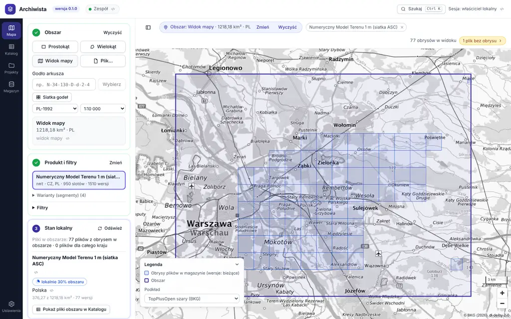

The panel "Wybór" (selection) leads through four steps:

1. **Area:** "Prostokąt" (rectangle: drag on the map), "Wielokąt" (polygon:
   click the vertices; finish by clicking the first point, with a double click
   or `Enter`; `Backspace` undoes, `Esc` cancels), "Widok mapy" (the current
   map view), a sheet code typed or clicked in the "Siatka godeł" (sheet grid:
   PL-1992, PL-2000, the chosen scale) and "Plik…" (file): GeoJSON,
   GeoPackage or a ZIP with one Shapefile; of a file with several layers you
   choose one.
2. **Product and filters:** a product from the list (with the number of slots
   and versions), variants (segments) and filters: store, country, data
   years, unit code, versions, file state, text. Active filters show above the
   map.
3. **Local state:** how much of the area the current versions of the product
   cover in the store, for example "lokalnie 30% obszaru" (30% of the area is
   local), with km² and the number of versions, separately for every country.
   "Odśwież" (refresh) reads the slots of the area from the store again;
   "Pokaż pliki obszaru w Katalogu" (show the files of the area in the
   Catalog) opens the list.
4. **At the source** ("U źródła"): a product whose
   availability a producer checks and the target store ("Magazyn docelowy").
   "Sprawdź u źródła" asks the source (a background job); a report younger
   than seven days is shown with its date, and "Sprawdź ponownie" asks again.
   A row is a year: its coverage label ("pełne", "częściowe · 58% · 1 ark.
   niepełny"), its best variant with the formats, the size (or "rozmiar
   nieznany") and the store badge ("niepobrane", "pobrane 5/12"); "+1 wariant"
   lists the other variants. "Pobierz…" opens the plan window ("Pobrać?"):
   the producer's plan of the chosen format with the positions by status
   ("aktualne", "nowsze u źródła", "brak w magazynie", "nie do sprawdzenia"),
   what will be downloaded and its size ("co najmniej …" when the producer
   tells only some sizes), the store and the producer's command line to copy.
   Nothing is written before "Pobierz N pozycji"; above 5 GB or 500 positions
   it asks for a confirmation. The window then shows the progress, the files
   by status and the units that failed. Without the permission "zapis do
   magazynu" the plan is shown and the download is disabled with the reason;
   offline mode keeps the last report and disables both actions; without a
   report it points to step 3, which shows how much of the area the store
   already covers.

   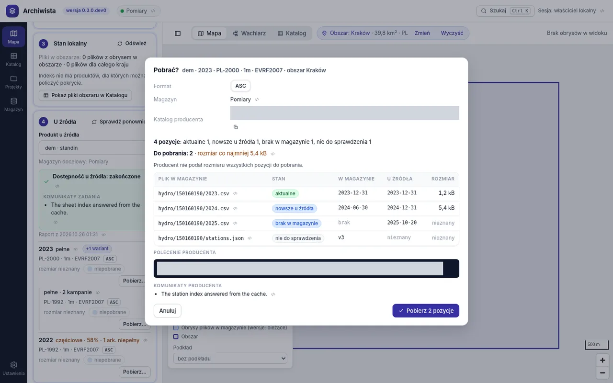

   A download runs in the background. Once it starts, the window no longer
   holds the page: it floats in a corner, "Zwiń" (minimise) hides it and
   "Zamknij" (close) or `Esc` closes it, and neither stops the download; the
   map and the other views stay usable. "Pobieranie 2/6 · 45%" in the top bar
   sums the downloads started together (those that ended of all, and how far
   their units got), also after a change of the view or a reload of the page
   and for a download of the session started elsewhere (a project's download
   or repin, another tab). It opens "Pobrania w tle" (downloads in the
   background): each download's progress, its files when done or why it
   failed, "Anuluj pobieranie" (the only way to stop one; what is already
   downloaded stays), "Pokaż okno planu" while its window is kept, and "Usuń
   z listy" once it ended. Each end shows a toast ("Pobrano: …", "Pobieranie
   nie powiodło się: …") with "Pokaż wynik", and the map and the step read the
   store again.

   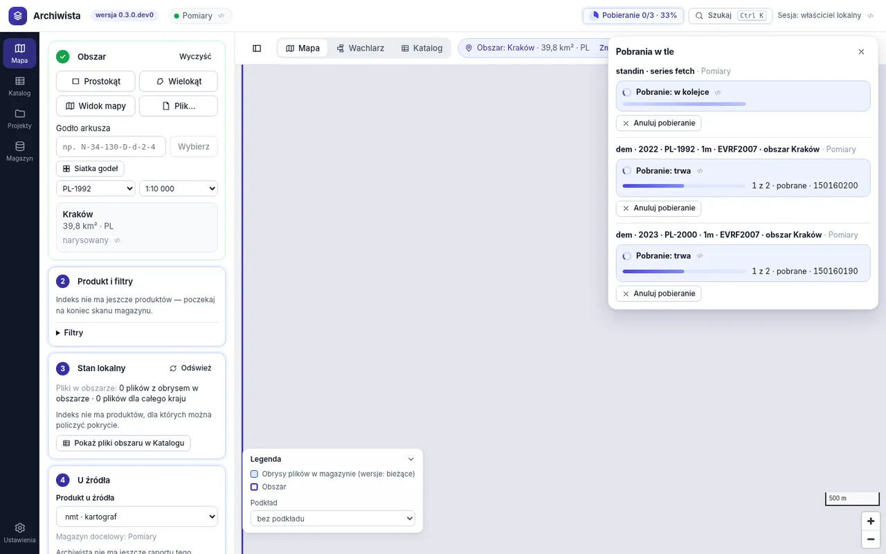

   "Wklej polecenie producenta" (paste a producer's command), with or without
   an area, takes a command line as the producer's command line interface
   reads it, e.g. `kartograf elevation download --product nmt … -o ./dane`:
   the producer reads and checks it without the network against the target
   store, and its text for a mistake shows at the field. "Zaplanuj…" opens the
   same plan window for that line, which writes to the target store instead of
   the line's `-o` or `--root`. In the plan window "Dodaj jako zadanie
   projektu" (add as a project task) adds the one command as a task of a
   project with a manifest of the producer in that store ("Projekt", "Nazwa
   zadania"); with
   something to download the button reads "Dodaj zadanie i pobierz N
   pozycji" and the project's download of the new task downloads and pins
   it. The option is disabled with the reason when the variant has several
   commands, when the store has no project of the producer, or when you may
   change none of them (the project's owner or an administrator may). Adding
   a task needs no network, so it works offline too.

   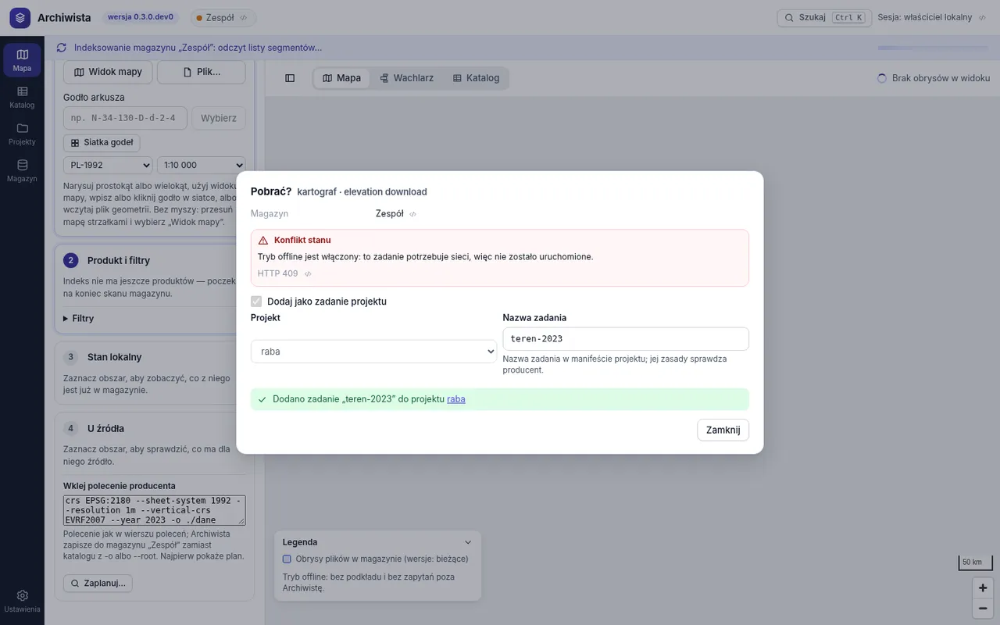

File footprints are visible at once; with more than 5,000 footprints in view
the map shows a density grid, and clicking a cell zooms in. Clicking a
footprint opens the file card (when several files lie in one place, their list
comes first). Files without a footprint do not reach the map: the counter
"… bez obrysu" (without footprint) leads to them in the Catalog. The legend
changes the basemap: by default the grey "OpenFreeMap szary" (vector tiles
from OpenStreetMap data, names in Polish also abroad: Praga, Drezno, Lwów), as
options "OSM GUGiK szary (tylko Polska)" (Poland only; outside Poland it is
empty) or "bez podkładu" (no basemap); the choice is the person's own and comes back
on every computer they sign in from (v0.4, their preferences). Settings saved before
v0.2 keep their list of basemaps; removing the `[[basemaps]]` tables from
`config.toml` gives the new built-in ones. Without a mouse the arrow keys pan the map,
plus and minus zoom.

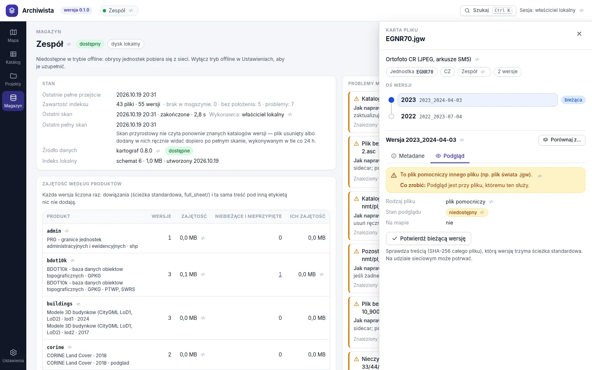

Sheet footprints are WGS84 polygons, not rectangular envelopes. The preview of
a file appears on the map after its tiles are prepared; larger rasters may
need the button "Zbuduj podgląd" (build the preview). Tiles, thumbnails and
the preview of a whole year are kept in the local content-addressed memory
(limit 20 GB, the least recently used go first). Every file has a preview or a
reason, in Polish, why it has none, with an instruction on what to do. A file
that "cannot be read" is remembered as such; "Sprawdź ponownie" (check again) in
its preview reads it again.

The first look at a file on an HDD or a share is slow; it can be prepared
ahead: `archiwista preview-warm` (filters `--store`,
`--product`, `--segment`, `--project`, `--area-id`; `--json`) or `POST
/api/v1/previews/warm` renders, in the background at the lowest priority,
the preview pane's thumbnail and the map's tiles at the smallest zoom of the
current versions, into the same memory. It never evicts a preview used in the
last week: when the room runs out it stops and says how many versions it
skipped. A project's own data is prepared only with `--project`, for those who
see the project. The administrator's setting `preview_warm_after_scan` (`PUT
/api/v1/settings` or `config.toml`; off by default) starts such a job for the
versions a scan has just indexed.

## Catalog

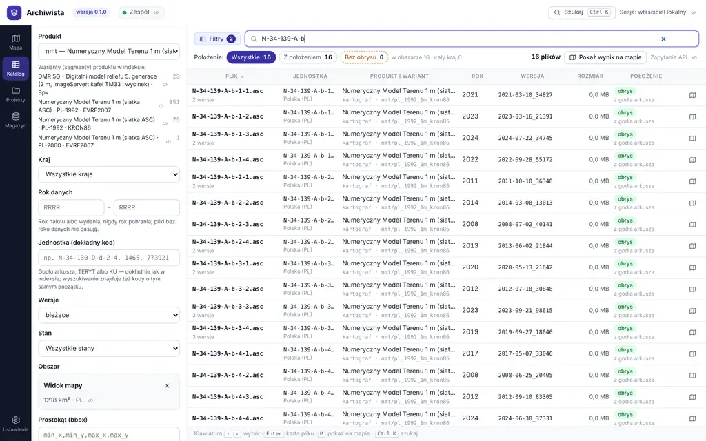

- **Search** (`Ctrl+K` or `/`): every word must match the beginning of a sheet
  code, TERYT, KU, file name, product, version label, request number or
  campaign, without Polish diacritics. 8 to 64 hexadecimal characters are the
  beginning of a SHA-256 sum.
- **Filters:** store, product with variants, country, data year (from to: the
  year of the flight or release, never the year of download), unit (exact
  code), versions (current, all, full sheets `full_sheet/`, pinned in
  projects, non-current and unpinned), state, and an area or a rectangle in
  the chosen coordinate system. `Ctrl+K` from the map carries its filters and
  area over.
- **Location:** "Wszystkie" (all), "Z położeniem" (with location), "Bez
  obrysu" (without footprint); the counters cover the whole result. Files
  without a footprint are only here; the reason is in the column
  "Położenie" (location).
- The list loads further pages while you scroll. Keyboard: `↑` `↓` choose,
  `Enter` opens the file card, `M` shows it on the map.
- "Pokaż wynik na mapie" (show the result on the map) opens the map with the
  same filters, and "Zapytanie API" (API query) gives the same query as an API
  address.

## File card

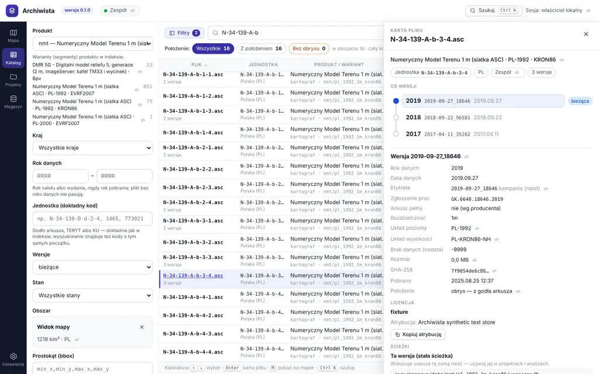

- **Version timeline:** the newest on top; "bieżąca" (current) is the one the
  standard path points to, "pełny arkusz" (full sheet) the `full_sheet/` link,
  "brak w magazynie od …" (missing from the store since …) a version whose
  file is gone.
- **Version:** year and date of the data, label (campaign, release or download
  date), request, full sheet, resolution, horizontal and vertical systems,
  nodata, size, SHA-256, download date and the location with the source of the
  footprint.
- **Licence** with the button "Kopiuj atrybucję" (copy the attribution).
- **Paths:** the version path always points to the same content, which is the
  one to use in projects and analyses; the standard path is a link to the
  current version and points to other content once a newer one is downloaded.
  "Na innym komputerze" (on another computer) gives the same path under another
  drive letter or mount (the store setting `path_aliases`). With the person's own
  paths ("Moje ścieżki…", v0.4) the path as their computer has it comes first and
  the copy button gives it; the server's path follows under "Na serwerze".
- **"Pobierz plik"** (download the file, v0.4) next to the version's title
  saves the version's file on this computer under its name; nothing opens in
  the browser, a PDF neither. It is disabled, with the reason, while the store
  is unavailable or when the version is gone from it. One person downloads at
  most two files at once: the browser reports a third as failed; download it
  again when one has ended.
- **"Przypięta w:"** (pinned in): the projects that pinned this version.
- **"Pliki tego samego zapytania"** (files of the same request): files
  downloaded by one producer request, for example both sides of the PL/CZ
  border.
- **Sidecar:** the producer's raw metadata, unchanged, ready to copy.
- **"Potwierdź bieżącą wersję"** (confirm the current version) checks by
  content (SHA-256 of the whole file) which version the standard path holds;
  on a share it can take a while. It is an administrator's, like a store's scan:
  others see it disabled with the reason.

`Esc` or "×" closes the card.

## Projects and own data

> **Changing (A-ADR-049, the author's decision of 2026-10-31):** projects become
> Archiwista's own file `archiwista-project.json`, with an area, the stores of its
> producers and groups of pinned versions; Kartograf and IMGWTools remove their project
> manifests, and a directory holding only one of them is no longer a project (nothing is
> migrated). This section still describes the current build, which reads the producers'
> manifests; it is rewritten with each phase of
> [`plans/2026-10-31-archiwista-projects.md`](plans/2026-10-31-archiwista-projects.md)
> as the new behaviour lands. Own data and snapshots stay as described below.

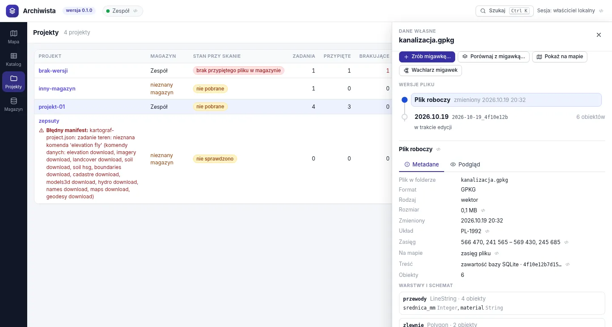

- **The list** of projects shows the producer ("Producent"), the store, the
  tasks, the pinned and missing versions and the own data. A project is its
  directory: it may hold the manifest of Kartograf, of IMGWTools or both, and a
  project of both shows each manifest's store, state at the scan and reading
  time on its own line, led by its producer. An invalid manifest shows the
  producer's message and hides nothing of the other. Hidden projects are
  not visible. "Nowy projekt…" takes a
  producer, a store with a directory of that producer and the project's
  directory in a project directory of the settings (made when missing); the
  producer writes the manifest, which names that store's directory, and the
  person who created the project owns it.
- **The project card** shows the producers' "Stan teraz" (state now), the
  tasks and the pins of each manifest (with their producer when there are two),
  and its actions,
  each run by the producer: "Weryfikuj" (verify: checksums of the pinned files
  in the store, no network), "Sprawdź aktualizacje" (check the pins against the
  source), "Pobierz" (download and pin the tasks not downloaded yet, restore
  missing pinned files) and, at a task, "Przepnij" (repin the task to the
  source's newer versions); the job shows its progress, then its tasks by
  outcome or its files by state. In a project of two manifests "Manifest
  producenta" chooses the manifest the card's actions and "+ Zadanie" act on;
  a task's actions act on its own manifest. A task name in both manifests is
  a problem of the project. "+ Zadanie" adds a pasted producer's command
  as a task (the producer checks it without the network; its text for a
  mistake shows at the field) and "Usuń" removes a task and its pins after a
  question; the files stay in the store. "Udostępnij…" (share) opens the
  project's sharing screen (see "Projects in a team" below). A project is
  changed and shared by its owner or an administrator, a download and a repin
  also need the permission "zapis do magazynu" and, like a check, the network:
  an action you may not do is disabled and the card says why. When a change
  stops at a lock of the manifest that an interrupted change left, the message
  names the lock directory to remove; Archiwista never removes it.

  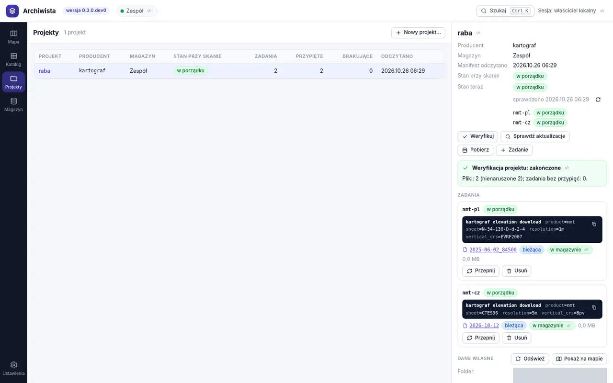

- **The data folder** is `<project folder>/dane/` by default; the project's owner
  or an administrator can point to another folder on the sharing screen ("Folder
  danych własnych"; an empty field brings back `dane/`). Its scan only reads
  files. A folder inside the project folder, `dane/` too, that a symbolic link
  leads out of the project is not read: the card names the problem. Own data is
  on the map and in the project card, outside the `/slots` catalog of the store.
- **Working file and snapshots:** the card gives metadata, a preview and the
  history; "Zmieniony od migawki" (changed since the snapshot) means the
  content differs from the last saved version. First look at the plan of the
  snapshot (estimated size and any obstacle), then "Zrób migawkę" (make a
  snapshot). The permission `project.write` belongs to the owner of the
  project or an administrator; viewing a project is not enough. A consistent
  GeoPackage snapshot holds the committed changes even when an editor is open.
  The same content twice does not duplicate a version. Snapshots lie in
  `<data folder>/.wersje/`, in the open format `archiwista-snapshot/1`;
  Archiwista does not delete them.
- **"Pobierz plik"** in the card of an own file saves the version chosen on
  its timeline, the working file or a snapshot, under its name; "Pliki
  zestawu" (the files of the set) in its metadata saves each file of a
  Shapefile or a MapInfo TAB by its name. Whoever sees the project may
  download its files; a file missing from the disk and a snapshot that is not
  valid cannot be downloaded, and the action says why.

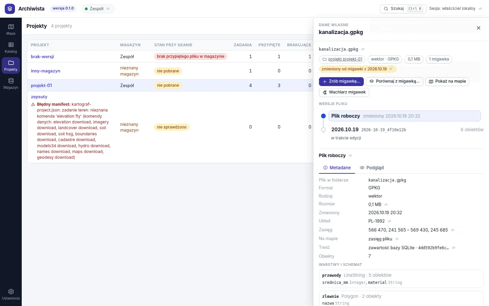
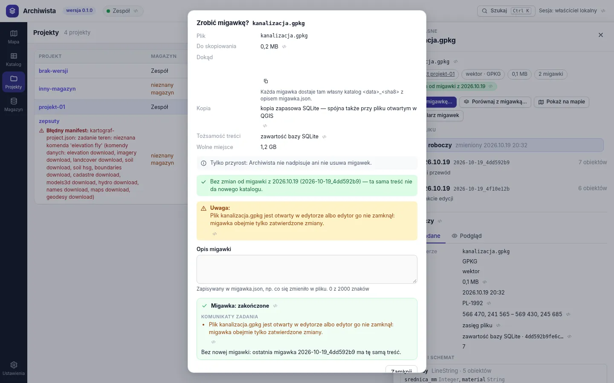

## Fan, Timeline and Comparison

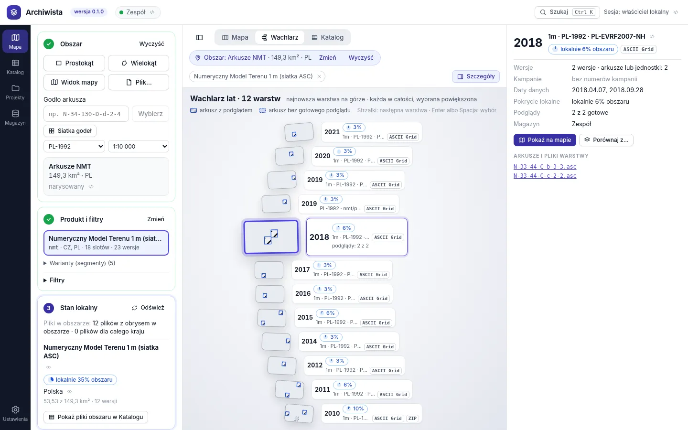

After you choose an area and a product, open the "Wachlarz" (Fan): the cards
of successive years or campaigns hold the preview of the local sheets, the
newest on top. The chosen layer shows in full and on the map. For own data the
Fan shows the working file and its snapshots. The "Oś czasu" (Timeline) shows
the years with data and their local coverage of the area; the choice of a year
is shared by the map, the Fan and the page address. A missing year does not
mean the producer has no such product, only that this layer is not local.

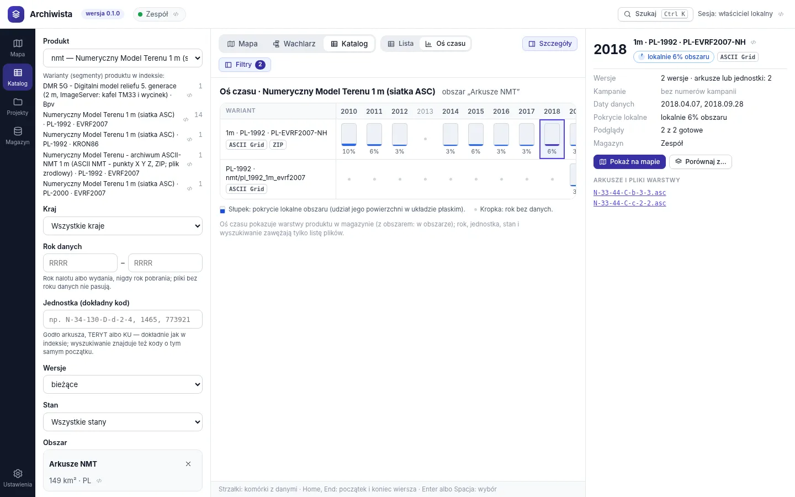

"Porównaj" (compare) sets the metadata of two versions, own files or
snapshots side by side (object differences are not computed). You can view two
previews with the curtain, by cross-fading or side by side; this is a visual
comparison and changes no data.

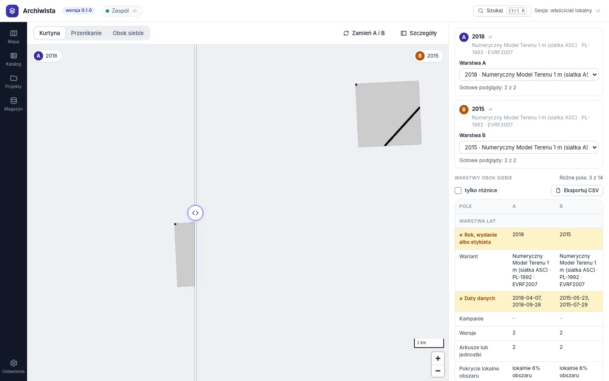

## Store


- **State:** available, unavailable (since when) or not yet scanned; local disk
  or share; the last full pass, the content of the index, the last scan with
  its executor, the last full scan, the Kartograf version and the local
  index.
- **Buttons:** "Odśwież" (refresh) is an incremental scan (changes only);
  "Pełny skan" (full scan) covers the whole store, also files removed or added
  by hand in known version folders; "Uzupełnij obrysy jednostek" (complete
  unit footprints) fetches TERYT and KU boundaries from the network
  (unavailable in offline mode). The progress of the job shows in this view
  and in the status bar. The three are an administrator's: others see them
  disabled with the reason, and the server scans by itself on its schedule.
- **Usage by product:** every version counted once, without links and repeated
  content.
- **Non-current and unpinned:** versions that are neither current, nor in
  `full_sheet/`, nor pinned in projects, and how much space removing them would
  free. Archiwista deletes nothing; the report serves a decision.
- **Store problems** with a repair description (and the file card when they
  concern a file), and the **projects** that use the store.

## Jobs

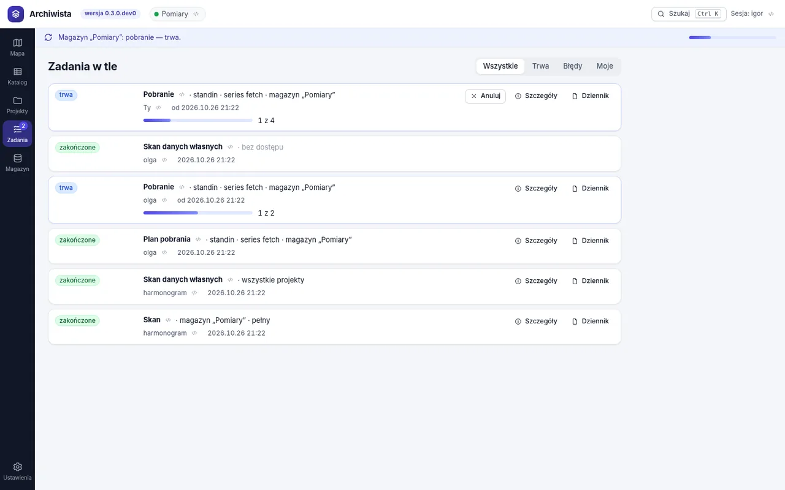

"Zadania" (jobs) lists the background jobs of the server, newest first: scans,
plans and downloads, the jobs of projects, previews. In a team it lists everyone's
jobs, and the number next to "Zadania" in the navigation counts the running ones.

- **Filters** "Wszystkie" (all), "Trwa" (waiting or running), "Błędy" (failed,
  partial or interrupted) and "Moje" (yours, also those of your agents); the
  address keeps the filter.
- **A row:** the state, the kind and what the job works on (the producer's
  command and the store, the project), who started it ("Ty" for you, a person's
  name, "… (agent)", "harmonogram" for the scheduler), the progress "3 z 7" while
  it waits or runs, else when it ended, why it failed, and the positions another
  download fetched for it ("2 pozycje pobiera olga (zadanie …)": none is
  downloaded twice).
- **"Anuluj"** (cancel) stops a waiting or running job; whoever started it and
  administrators have it. What is done stays.
- **"Ponów"** (retry) runs a job that did not succeed again, as a new job of your
  session with the same parameters, also one "przerwane" (interrupted) when the
  server stopped. Retrying a download, or a project's download or repin, needs
  "zapis do magazynu" (the role `store_writer`), and retrying a store's scan, its
  unit outlines, a link check or the scan of every project's data folder needs an
  administrator; without it the button is disabled with the reason. The scan of
  one project's data folder anyone who sees the project retries, within the
  limits of a person's scans.
- **"Szczegóły"** (details) follows the job: its progress, the notices of its
  producer (for example the positions another person's download fetches) and its
  summary or failure. **"Dziennik"** (log) shows the end of its log, the standard
  error of its worker (in English).
- **A job of a project you do not see** shows only its kind with "bez dostępu"
  (no access), who started it and its progress, and nothing opens.
- The list is read again every 2 seconds while a job waits or runs, else every 15
  seconds, and only while the page is visible. "Pokaż starsze" (show older)
  extends it to at most the 200 newest jobs; older ones are listed by
  `archiwista jobs list` and `GET /api/v1/jobs`.

## Action log

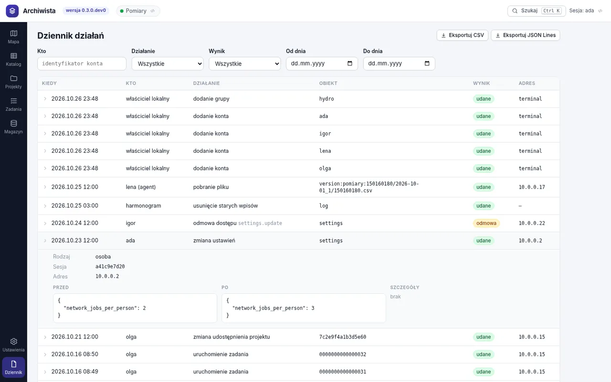

The action log (v0.4) records who did what, when and from where: changes of
accounts, groups, sharing and settings, the jobs people start, cancel or retry,
file downloads, refused requests, the deletion of entries older than
`action_log_retention_days` (365 days by default) and the exports of the log. Only
administrators read it, in "Dziennik" (action log) at the bottom of their
navigation; anyone else who opens it gets the refusal, which the log records.

Request-rule refusals appear as "odmowa żądania" (`request.refused`, filter
"Reguły żądań"); their details name the reason. Rejected tokens and proxy
sign-ins appear as failed sign-ins. Repeated refusals of the same reason
are recorded at most once per person (or unauthenticated client address) and
action per minute. A request with no session cookie is not itself an audit
event. Passwords, tokens, cookies and raw request addresses are not recorded.

- **The table** shows 50 entries a page, newest first: when, who (an account,
  "… (agent)", "harmonogram" for the scheduler, "niezalogowany" before a
  sign-in), the action, what it was about, the outcome and the client's address
  ("terminal" for the owner's commands). "Dalej" (next) and "Wstecz" (back) page
  through it; the line under the table counts the entries the filters select and
  says after how many days entries are deleted.
- **Filters** "Kto" (an account; Enter applies it), "Działanie" (a group of
  actions, such as "Odmowy" for the refusals), "Wynik" (outcome) and the days
  "Od dnia" and "Do dnia" (both included); the page address keeps them.
- **A row** opens the state before and after the change, its details, the
  session, the kind of actor and the address.
- **"Eksportuj CSV"** and **"Eksportuj JSON Lines"** save every entry the filters
  select as a file, as `log export` writes it.

At the terminal the owner of the installation reads and exports it:

```sh
archiwista log list --action permission. --since 2026-10-01T00:00:00+02:00
archiwista log export --format csv --actor marek.lis --output dziennik.csv
```

`log list` prints the newest entries (50, `--limit` up to 200; the next page is
`--cursor`) with how many the filters select. `log export` writes every entry the
filters select as JSON Lines or CSV for a spreadsheet, to standard output or to
`--output`, a file only you can read; a cell that a spreadsheet could take for a
formula begins with `'`. The filters: `--actor` (an account, `local` for the owner,
`-` before a sign-in), `--action` (a name such as `job.start`, or a group such as
`session.`), `--outcome` (`ok`, `denied`, `failed`), `--target`, and `--since`
and `--until` with a time zone. An export is itself an entry of the log.

## IMGW stations

A product of IMGWTools chosen on the map (hydro, meteo, or the station catalogs
themselves) shows its stations in place of outlines. The shape of a point is the
station type: a triangle for a water gauge, a square for a climatological or synoptic
station, a circle for a precipitation post. Its colour and fill are the coverage of
the variable chosen in "Kolor punktów" in the bar (green solid "ciągły", orange solid
"luki", orange half "częściowy", grey hollow "brak danych", grey dashed "nieznane");
the legend names each, and the tooltip of a point gives the label of every variable.
The panel chooses the dataset ("Zbiór danych"), the types of meteo stations and
whether the stations on an area's boundary count. Stations far apart at a low zoom
form a neutral cluster with their count, which zooms in on a click; stations at one
position spread around it until the next click or `Esc`. "N bez położenia" in the bar
opens the Catalog with the stations that have no position; a click on a point opens
the station card (below).

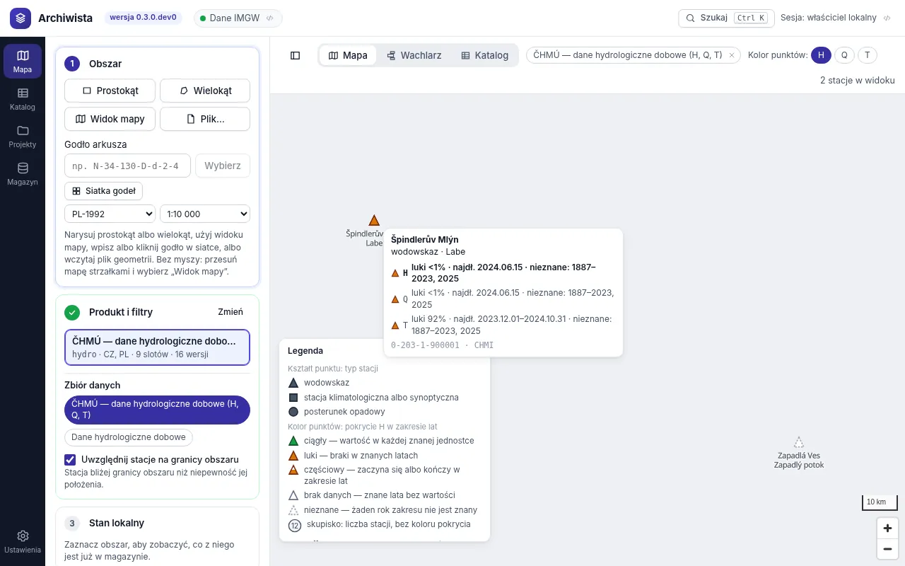

In the Catalog such a product lists its stations instead of files: a row per station
with a line per variable of its series (the symbol with the fill of its coverage, the
label and the full years), the code and provider, the river with its hydrographic code,
and the location: its source, or why the station has none. The stations with a
position come first; "Bez położenia" is the last group, folded when more than 50
stations have a position, open when the map's counter leads there, and its rows never
lead to the map. "Wzdłuż rzek" (the default) and "Nazwa" order the list, and the search
field finds a part of a name or river or the start of a code. The filter panel adds
the dataset, the station kind or meteo types, the river code with "z dopływami", active
or historical stations, a variable, the coverage chips of each variable with its least
full years, the range of the labels and "Lata: hydrologiczne / kalendarzowe": the
choice goes into the address and is remembered for hydro or meteo data in the
person's preferences. "Ukryte przez filtry pokrycia: N" above the list counts the
stations the coverage chips hide. Enter or a click opens a station's card; M or the
row's map button shows a station with a position on the map; the arrows, Home and End
move through the rows, and Enter on "Bez położenia" folds it.

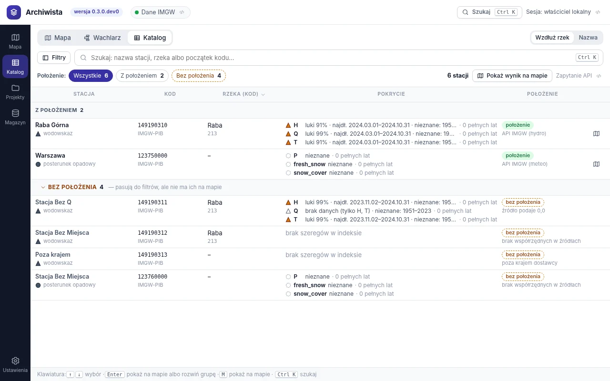

"Oś czasu" beside "Lista" shows the same stations, with the same filters, as years:
the stations of one dataset (the one chosen in the panel, else the product's first),
a row per station with the years of one variable ("Wiersz stacji", the same choice as
"Kolor punktów" on the map), which Enter, Space or a click beside its name expands into
a row per variable; a click on the name, or K, opens the station's card. A year is
green when every unit of it has a value, a lighter green the fewer units have one, a
grey hollow box when its known units have none and a grey dashed outline when not
every unit of it is known (not a gap); the legend names each. The column headers say
the numbering of the years ("r.h. 2024 (2023.11.01–2024.10.31)" or "2024
(kalendarzowy)", the switch "Lata" in the panel), and the tooltip of a year gives its
units, the known ones and those with a value, the variable's label and its longest
gap. The arrows move by year and row, Home and End to the ends of a row.

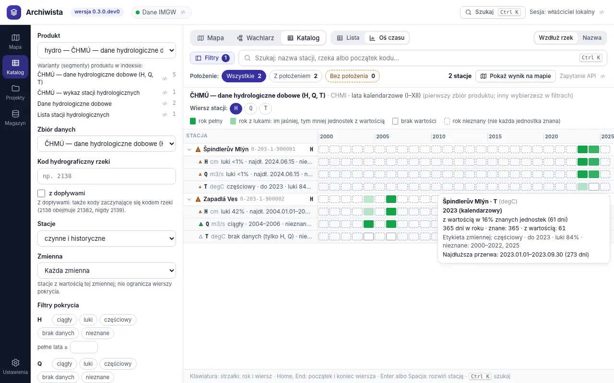

The station card opens over the view (`station=<store>/<provider>/<code>` in the
address; `Esc` closes it): the station's type, river with its hydrographic code and
code, its provider and state, the switch "Lata" (as in the Catalog's panel: it
renumbers the labels and goes into the address), the location with its source, the
catalog's date and the uncertainty, or why it has none, and for a water gauge of
IMGW-PIB "Strona stacji IMGW", a link to its page on hydro.imgw.pl. "Pokaż na mapie"
opens the map on a station with a position and "Kopiuj ścieżkę pliku" copies the path
of its series file (the person's own first, as on the file card). "Pokrycie" gives
each variable of each series with its label, full years and longest gap; the tabs
"Wykres" (the default), "Metadane" (the catalog's facts), "Pochodzenie" (each series
version with the station's file, its SHA-256 and the series index, and the catalog
version) and "Szczegóły techniczne" (the API's answer) follow, and last the licence
with the formula IMGW requires and "Kopiuj atrybucję".

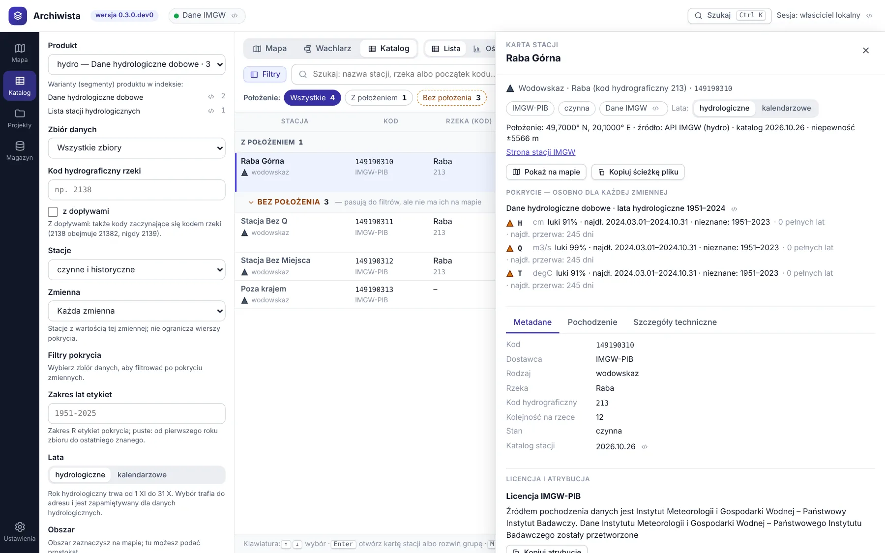

"Wykres" draws one variable of the station's series, or two with "Druga zmienna" (a
second unit gets the right axis). It opens on the whole period the variable's label
counts (its known days): one longer than the plot has pixels is simplified to the
least, mean and greatest value of each interval (a band under the mean line; the
note says "wykres uproszczony: min./śr./maks. z N dni"). Drag over the plot to
select days, turn the wheel over it, or focus it and
press `+` and `-` to zoom and the arrows to move: a range of no more days than the
plot has pixels shows each day's value, and the range goes into the address (`from`,
`to`); `Home` or "Cały okres" shows the whole period again. A gap breaks the line and
is a grey band: the bands are the gaps the label counts in the card's year type, so
"luki 92%" shows its 92%; a day without a value outside them (not known, or outside
the label's years) has no band.
Dots are the extremes the provider published and a diamond an accumulated sum, each
with its date in its tooltip; the pointer gives the values of its day.

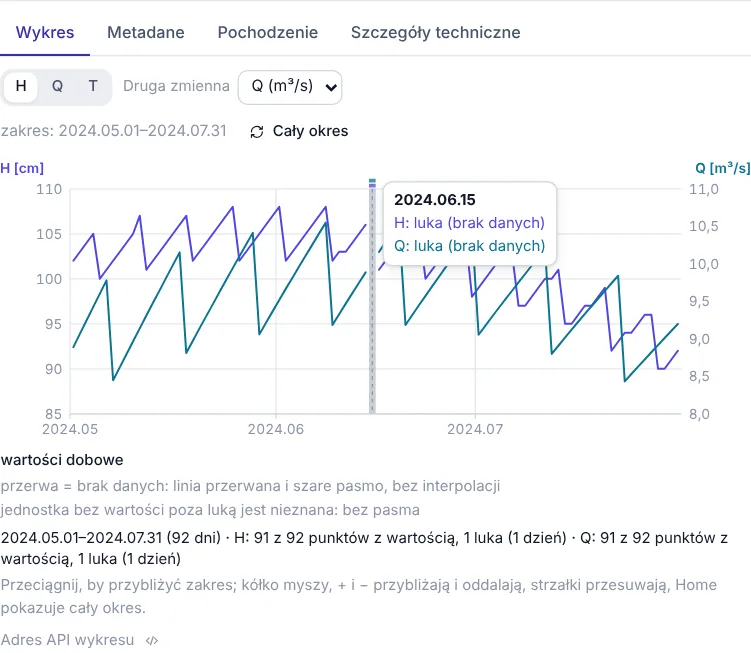

"Porównaj z…" in the chart's toolbar opens the comparison of stations with this station
and the chart's variable and range. In the Catalog's list of stations the button at the
end of a row, or `P` on a row, chooses up to five stations; "Porównaj" compares them.
Each station is a panel, one above another over one time axis, all with the same range
and interval: a selection, the wheel or the keys in any panel zoom them all, and `Home`
or "Cały okres" shows the whole period again. A station without the series or the
variable keeps its panel with "brak danych". "Zmienna" switches the variable, "Dodaj
stację" finds another station with a series of the dataset by name, river or code (five
at most), and the table below gives each station's facts as on its card, followed by
each provider's formula.

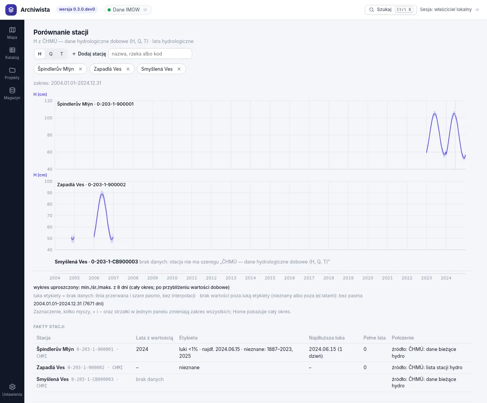

The command line and the API (`GET /api/v1/stations`) show the stations and the
coverage of their series from the index while IMGWTools is installed:

```sh
archiwista stations list --dataset pl.imgw.hydro_daily --coverage Q:continuous --min-complete-years Q:30
archiwista stations list --area-id OBSZAR --boundary false
archiwista stations list --location none
archiwista stations list --q raba --sort name
archiwista stations show 149190310 --years 1951-2025
archiwista stations timeline --dataset pl.imgw.hydro_daily --river-code 2138 --river-scope tributaries
archiwista stations series 149190310 --variable Q --from 1981-01-01 --to 1983-12-31
archiwista stations compare --station zespol/IMGW-PIB/149190310 --station zespol/IMGW-PIB/149200090 --dataset pl.imgw.hydro_daily --variable Q
archiwista stations datasets
```

`stations list` prints each station with the label of every variable of its series
("Q: luki 3% · najdł. 1981.06.02–1982.12.31"; a station has no single label) and the
counters of the whole result: with a location (and of them on the area's boundary,
closer to it than the uncertainty of their location), without one (counted after the
filters, never placed in an area) and hidden by a coverage filter. Its options are
the parameters of `GET /api/v1/stations` (`archiwista stations list --help`):
`--coverage` and `--min-complete-years` need `--dataset`, `--years` and `--year-type`
set the range and the numbering of the labels, and the next page is `--cursor`.
`stations show` is the card of a station: its facts, its location with the source and
the uncertainty, each series with its file and every variable labelled, and the
licence with the formula IMGW requires. A code that two stores or providers share
needs `--store` and `--provider`. `stations datasets` names the datasets with station
series: each with the producer's name, provider and family, the version of its series,
the years of its labels by default and its variables with their units (`--dataset`
and `--variable` take them). `--meteo-kind` (repeatable: `synoptic`, `climate`,
`precipitation`) keeps the meteo stations of those kinds. The list goes along rivers
(the river's hydrographic code, so a tributary follows its river, then the station's
place on the provider's list, then the name); `--sort name` orders it by name. `--q`
finds a station whose name or river contains the text, whatever the case of the
letters, or whose code begins with it. `stations timeline` is the Timeline of a page
of the stations of one dataset (`--dataset` is required, the other options are those
of `stations list`): under each station a line per variable with a character for
each year of the range (`█` a value in every unit, `▒` with gaps, `·` without a
value, `?` not known) and its label. `stations series` is the chart of one or two
variables of a station's series (`--variable`, once or twice; `--dataset` when more
than one series has them): the range with its days, each unit's value up to
`--max-points` units (2000 by default) or else the least, mean and greatest value
of intervals ("uproszczony, min./śr./maks. z 14 dni"), each variable's points with a
value, the gaps its label counts in `--year-type` and its markers (an accumulated
sum, an extreme IMGW published). `stations compare` compares one variable of 2 to 5
stations (`--station MAGAZYN/DOSTAWCA/KOD`, repeated) in one dataset over one range
(by default every known day of the variable at those stations): the range once, then
each station with the variable's label and full years and its chart as `stations
series` writes it, or "brak danych" for a station without it;
`--json` gives the points. Without IMGWTools each refuses with the repair command
`pip install "archiwista[imgw]"`.

## Session

In local mode (a team server: below) Archiwista works only on this computer
(`127.0.0.1`) and shows nothing without a session. The session expires after
24 hours without use and ends when the server stops; the screen "Wymagana
sesja" (session required) then appears. A new session is opened by the address
`archiwista serve` printed or a new address from `archiwista token`. Another
browser tab gets its session from an open Archiwista tab.

## Team server

Team mode (v0.4, ADR-046) lets the people of a local network use one Archiwista.
It is an explicit setting, the table `[team]` of `config.toml`, which the server
reads when it starts: edit it while the server is stopped ("Ustawienia" neither
shows nor changes it) and check it with `archiwista doctor`.

The three-computer SMB/TLS deployment and shared-queue acceptance procedure is
in [`reports/v0.4-lan-runbook.md`](reports/v0.4-lan-runbook.md). It has not
been performed on the deployment network; this section describes the built
interface, not a released or live-certified installation.

```toml
[team]
enabled = true
origin = "https://archiwista.firma.local"       # the address people open: https, host, port
tls_cert = "/etc/archiwista/tls/fullchain.pem"  # TLS in Archiwista: both files or neither
tls_key = "/etc/archiwista/tls/privkey.pem"
# trusted_proxies = ["127.0.0.1"]               # or behind a reverse proxy with TLS
```

Every request comes over TLS and every answer carries
`Strict-Transport-Security: max-age=31536000`; `Host` must be the host of
`origin`, the session cookie is `__Host-archiwista_session` (`Secure`), and
`/api/docs` is not served. `archiwista serve` prints `origin` and issues no
startup address. It refuses to start (exit 2) when team mode is off and `--host`
is not `127.0.0.1` (`host_refused`), without TLS files and trusted proxies
(`tls_required`), with files that do not load as a pair or an encrypted key
(`tls_unusable`), behind proxies on `0.0.0.0` or `::`
(`proxy_bind_wildcard`) or, when every proxy is on this computer, on an address
that is not a loopback one (`proxy_bind_not_loopback`), and without an enabled
administrator who can sign in (`team_no_admin`: one with a password that has not
expired, or any enabled one when `proxy_user_header` is set; see "The first
administrator and passwords" below). `archiwista doctor` names the administrators
who can sign in.

**TLS in Archiwista.** Give the certificate chain (PEM: of the company's
authority, or a public one for a name the computers resolve) and its private key
without a passphrase, readable by the server's account only (`chmod 600`), then
for example `archiwista serve --host 0.0.0.0 --port 8443` with `origin =
"https://archiwista.firma.local:8443"`. The server speaks TLS 1.2 or newer, and in
TLS 1.2 only ciphers with ECDHE and AEAD (AES-GCM, ChaCha20-Poly1305), which
every current browser offers.

**Behind a reverse proxy.** Caddy or nginx ends TLS and passes the requests to
Archiwista over plain HTTP. `trusted_proxies` names the proxy's addresses
(addresses, or networks of at most 256 addresses) and `--host` the address the
proxy connects to, `127.0.0.1` when it runs on the same computer. The proxy keeps
`Host` (Archiwista never reads `X-Forwarded-Host`) and sets `X-Forwarded-For`
and `X-Forwarded-Proto`; Archiwista believes them only from a trusted proxy,
takes the person's address from the right-most `X-Forwarded-For` address that is
no trusted proxy, and answers a request from any other address with `403
proxy_required`.

```
# Caddyfile: reverse_proxy keeps Host and sets X-Forwarded-For and -Proto itself.
archiwista.firma.local {
    tls /etc/caddy/tls/fullchain.pem /etc/caddy/tls/privkey.pem
    reverse_proxy 127.0.0.1:8090
}
```

```nginx
server {
    listen 443 ssl;
    server_name archiwista.firma.local;
    ssl_certificate     /etc/nginx/tls/fullchain.pem;
    ssl_certificate_key /etc/nginx/tls/privkey.pem;
    client_max_body_size 60m;                     # area files up to 50 MB
    location / {
        proxy_pass http://127.0.0.1:8090;
        proxy_set_header Host $http_host;          # keep Host as the browser sent it
        proxy_set_header X-Forwarded-For $remote_addr;
        proxy_set_header X-Forwarded-Proto $scheme;
        proxy_buffering off;                       # job events (Server-Sent Events)
    }
}
```

**The first administrator and passwords.** The first administrator is created at the
server's terminal, never on a page of the network: `archiwista users add anna.nowak --name
"Anna Nowak" --role admin`, then `archiwista users password anna.nowak` (typed twice
and not shown; `--stdin` reads one line, for a script). A password has 12 to 1,024
characters of any kind; it may not be the account's identifier or name, nor one of
the 3,000 most common passwords, and nothing forces a periodic change. An
administrator gives a person a temporary password: the server generates one, shows
it once and keeps only its hash (`POST /api/v1/users/{id}/password`), or `archiwista
users password ID --temporary` takes a typed one. It is valid 72 hours and is changed
at the first sign-in, to another password: a change never keeps the current one.
Setting a password ends every session of the account.
`archiwista users list` shows each account's password as `none`, `set`, `temporary`
(with its end) or `expired`. `archiwista users disable ID` switches an account off
(it acts nowhere and its sessions end) and `users enable ID` on again. The last
administrator who can sign in (enabled, with a password that has not expired, or
through the proxy of `proxy_user_header`) cannot be disabled, removed or lose the
role (`last_admin`): give another such account the role `admin` first.

**Accounts in the browser.** An administrator manages the accounts in "Konta"
(accounts), at the bottom of the navigation, which nobody else sees (its routes answer
`403`). The list shows each account's roles, groups, password (`brak`, `ustawione`,
`tymczasowe` with its end, or expired) and state. "Nowe konto" creates an account and
opens its card, where "Ustaw hasło tymczasowe" shows the generated password once, with
its end and the copy button; give it to the person, who changes it at the first
sign-in. The card also saves the roles (they count from the person's next request),
"Zakończ sesje" ends every session of the account and its agents, "Wyłącz" and "Włącz"
switch it off and on, and "Usuń…" removes it after a confirmation. A refusal, such as
that of the last administrator, shows at its control.

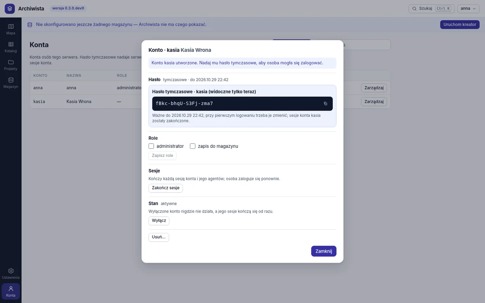

**Groups in the browser.** "Grupy" (groups), beside "Konta" and for administrators only,
lists each group with its name and members. "Nowa grupa" takes the group's identifier,
name and members; "Członkowie…" checks and unchecks the accounts of a group, which
count from each person's next request; "Usuń…" removes a group after saying that its
members stop seeing the projects shared only with it. A project is shared with a
group on its sharing screen.

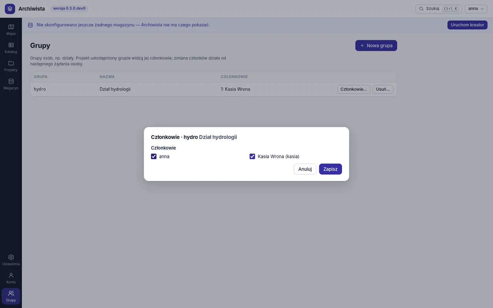

**Projects in a team.** Every person, or their agent, creates projects in the project
directories of the settings where no project is yet, and owns them; a new project
starts at the visibility of the setting `default_project_visibility`. A directory
that already holds a project — shared before, scanned or only just made by a
producer's program — is changed by its owner or an administrator only, so nobody takes
over a colleague's project. "Udostępnij…" on the project card opens "Udostępnianie"
(sharing) for the owner and administrators; others see it disabled with the reason. It
shows the owner, with "Przekaż…" to give the project to another account; who sees the
project: "wszyscy" (everyone), "wybrane osoby" (chosen people, added with "+ osoba"),
"wybrane grupy" (chosen groups, added with "+ grupa") or "tylko właściciel" (the owner
only), while administrators see every project; and the project's data folder.
"Zapisz" saves only what changed, and a refusal shows at its field. The owner may give
the project another data folder only inside the project's directory (a link pointing
out of it counts as outside); an administrator may choose one elsewhere, away from the
stores and the folders of other projects. Anyone who sees a project may scan its data
folder ("Odśwież"), one scan of theirs at a time and each folder once a minute,
otherwise the answer says when to ask again; scanning a store, outlining its units and
checking its links are an administrator's, and the server scans by itself on its
schedule.

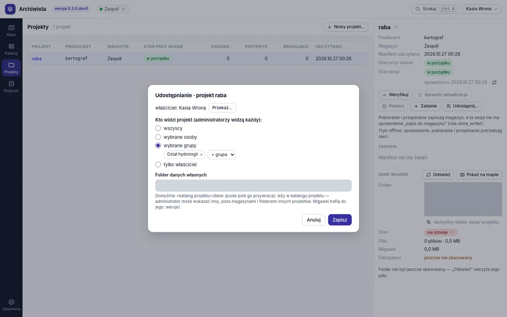

**The sign-in page.** In the browser a team server opens "Logowanie" (sign-in): the
account ("Konto") and its password ("Hasło"; "Pokaż" shows what was typed), which the
browser's password manager can fill. Every refused account gets the same message,
"Nieprawidłowe konto albo hasło.", and during the wait after failures the page counts
it down. When the company's proxy names the person, "Zaloguj kontem firmowym" signs in
without a password. A temporary password opens "Zmień hasło tymczasowe" before
anything else: the current password and the new one twice, or "Wyloguj". When a
session ends elsewhere (a password change, an administrator, a restart of the server),
the page's next request leads back to the sign-in.

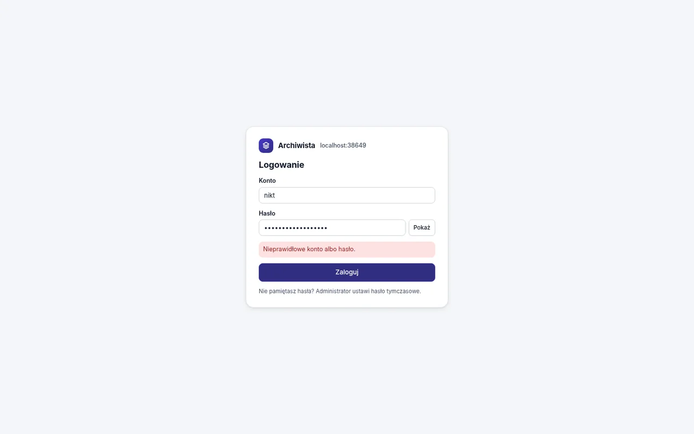

**The account menu.** On a team server the person's name at the right of the top bar
opens the account menu: the name and account, the roles and groups of now, "Zmień
hasło…" (not for a sign-in through the company's proxy, whose password is changed
there), "Sesje…" (every session of the account and its agents, with the browser, the
address and the start; "Zakończ" ends one at once, "Zakończ pozostałe sesje" all but
this one), "Token dla agenta…" ("Wystaw adres" shows the one-time address of an
agent's session once, with "Kopiuj"; it acts with the person's roles), "Moje
ścieżki…" and "Wyloguj".

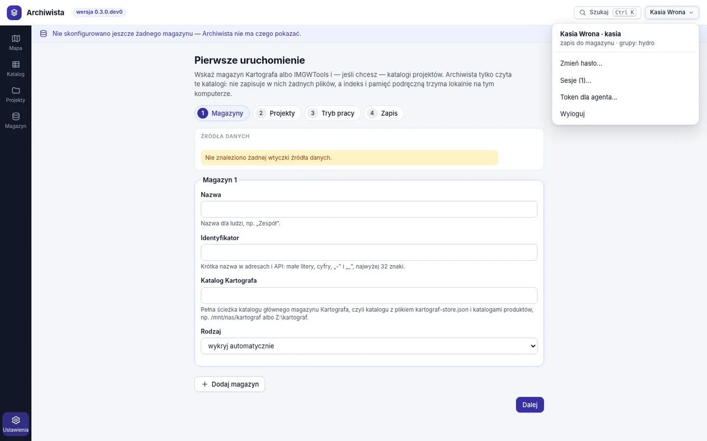

**Own paths and preferences.** "Moje ścieżki…" keeps the person's path aliases, at
most 20: a prefix on the server ("Na serwerze", absolute, e.g. `/mnt/nas/`) and the
same place on their computer ("U mnie", e.g. `Y:\`). They change only the paths shown
and copied: the file card, the station card, an own file with its snapshot plan and
a project's data folder show the path through the first alias that holds it, the copy
button gives it, and the server's path follows under "Na serwerze". The server reads
files by its own paths, and no field takes a path through an alias. The aliases, the
basemap and the remembered year types are each person's preferences (`GET` and `PUT
/api/v1/preferences`), the same in every browser the person signs in from; in local
mode they are the computer owner's. A card already open shows the new paths when it
is opened again.

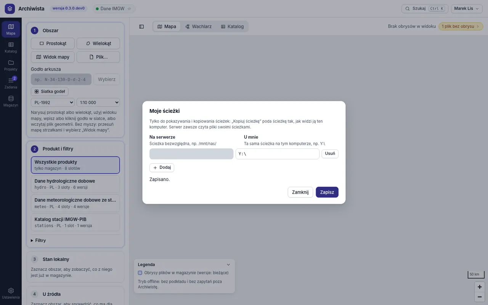

**Signing in and sessions.** A person signs in with the account's identifier and
password (`POST /api/v1/session/login`; for a script see AGENT_API). A temporary
password must be changed before anything else (`PUT /api/v1/session/password`), and
changing a password ends the account's other sessions and those of its agents. A
session ends after 8 hours without a request, 7 days after the sign-in at the
latest, at sign-out, when an administrator ends it and when the server restarts.
After five failed sign-ins of one account, or from one computer, each further
attempt waits 1 second, then 2, 4 and so on up to 15 minutes, for that account from
every computer and for that computer with every account; a success clears it.
Anyone can make an account wait this way, at most 15 minutes at a time, and the
action log names the address of every failure. A person lists their sessions and
ends any of them (`GET /api/v1/sessions`, `DELETE /api/v1/sessions/{label}`); an
administrator ends all of an account's, also on a running server, with `archiwista
users end-sessions ID`. An agent acts for one account with its roles: the person
issues its one-time address (`POST /api/v1/session/tokens`), or the administrator
does at the server's terminal with `archiwista token --user ID`, which team mode
requires; the address is one of `origin`.

**Signing in through the company's proxy.** A reverse proxy that already signs people
in (single sign-on, Active Directory through Kerberos or LDAP) can name the person in a
header: `proxy_user_header = "X-Remote-User"` next to `trusted_proxies`. A request
from a trusted proxy carrying it signs in as the enabled account of that id, without a
password and without the wait (`POST /api/v1/session/proxy`); with `proxy_autocreate =
true` a missing account is created without roles. Every later request of that session
must come from a trusted proxy naming the same person, or the session ends. Archiwista
ignores the header from any other address and logs it, once an hour per address. The
proxy must set the header itself on every request, replacing whatever the client sent:

```
# Caddyfile: inside route the directives run in this order.
archiwista.firma.local {
    tls /etc/caddy/tls/fullchain.pem /etc/caddy/tls/privkey.pem
    route {
        request_header -Remote-User                 # never the client's own value
        forward_auth 127.0.0.1:9091 {               # the company's sign-in service
            uri /api/authz/forward-auth
            copy_headers Remote-User
        }
        reverse_proxy 127.0.0.1:8090 {
            header_up X-Remote-User {http.request.header.Remote-User}
        }
    }
}
```

```nginx
# In the server block above: ask the sign-in service, pass on only its answer.
location / {
    auth_request /sign-in-check;
    auth_request_set $person $upstream_http_remote_user;
    proxy_set_header X-Remote-User $person;       # replaces the client's header
    proxy_pass http://127.0.0.1:8090;             # and the lines shown above
}
location = /sign-in-check {
    internal;
    proxy_pass http://127.0.0.1:9091/api/authz/auth-request;
    proxy_pass_request_body off;
    proxy_set_header Content-Length "";
    proxy_set_header X-Original-URL $scheme://$http_host$request_uri;
}
```

A proxy on the server's own computer (`trusted_proxies = ["127.0.0.1"]`) makes every
program and account of that computer able to name anyone: run Archiwista on a computer
of its own, or use TLS in Archiwista without `proxy_user_header`.

**Backup of accounts and the log.** `archiwista state export --output FILE` copies the
state database — accounts with their password hashes, groups, sharing, preferences
and the action log — as `archiwista-state/2`. The file gets mode `0600` and must stay
as secret as the passwords themselves. `archiwista state import FILE` restores such a
copy into an empty state database only; a copy made before v0.4
(`archiwista-state/1`) imports too. Make one before upgrading to v0.4: its first start
turns the permission log into the action log.

## When something does not work

- `archiwista doctor` checks the installation, the Kartograf plugin, the
  stores and the port, and gives a repair for every problem.
- **Store unavailable** (for example a disconnected share): the views show the
  state of the index, the status bar gives its time; after reconnecting, the
  next scan completes the changes without rebuilding the index.
- **Data source unavailable** (Kartograf missing or an unsupported version):
  the status bar gives the repair command, and `archiwista doctor` prints the
  same.

## What version 0.3 does not do

- It checks availability at the source and downloads only from the step "U
  źródła" of the map and from the project card, through Kartograf, and an area
  is not chosen by the name of an administrative unit.
- It does not build a local COG ahead: the warm-up prepares the thumbnail of
  such a file only, and its map preview is built at the first view.
- It indexes the files of an IMGWTools store (archives, series, station
  catalogs) and its projects, and shows its stations on the map, in the Catalog and
  in the station card and through `archiwista stations` and the API, but has no
  chart or comparison of stations in the interface and no IMGW actions yet (v0.5):
  an action on an IMGWTools manifest is refused as not supported.
- It does not show object differences between snapshots and has no sign-in or
  team work (v0.4).
