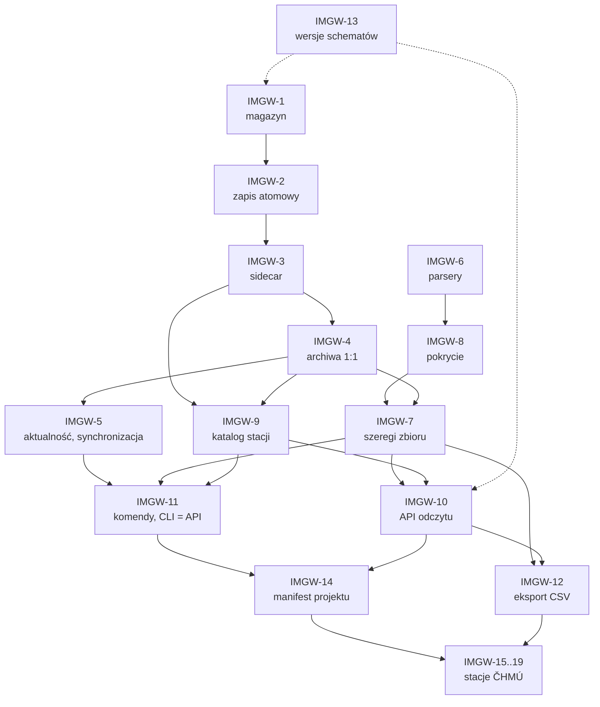

# Archiwista — wymagania wobec IMGWTools

**Data:** 2026-10-17
**Status:** propozycja do uzgodnienia z zespołem IMGWTools
**Źródło:** `docs/SPEC.md` 12.7–12.9 (wymagania IMGW-1..IMGW-19, kontrakt
formatu, czego nie wymagamy) oraz SPEC 4.6–4.8 (stacje ČHMÚ: 4.8.6), 5.6, 6.7, 11, 13 i 14;
decyzje `docs/DECISIONS.md`: A-ADR-019 (dwóch producentów), A-ADR-020
(format danych IMGW), A-ADR-021 (etykiety pokrycia szeregów), A-ADR-022
(dane bez położenia), A-ADR-023 (dane IMGW w projektach)
**Relacja do SPEC:** SPEC jest dokumentem nadrzędnym. Ten dokument to
wyciąg dla zespołu IMGWTools: te same wymagania, uzupełnione o cel,
kryteria akceptacji, priorytety, zależności i kolejność wdrożenia.
Przy rozbieżności rozstrzyga SPEC 12.7–12.8; zmiana wymagania trafia
najpierw do SPEC, potem tutaj.

Konwencje (jak w SPEC): „SPEC x.y” i „A-ADR-0xx” to dokumenty
Archiwisty; „ADR-0xx” bez dopisku to decyzje Kartografa; „P13”…„P19” to
pytania z SPEC 15 rozstrzygnięte przez użytkownika 2026-10-17 (w tym P16:
etykiety pokrycia osobno dla każdej wielkości). Odwołania `plik:linia` do innych repozytoriów zaczynają się od
ich nazwy (np. `IMGWTools/src/imgwtools/stations.py:349`). Nazwy funkcji,
komend, pól i schematów są propozycjami — ostateczne ustali ADR IMGWTools
(SPEC 12).

**Spis treści:** 1. Wstęp · 2. Stan obecny IMGWTools 2.1.1 · 3. Wspólne
reguły · 4. Wymagania IMGW-1..IMGW-19 (stacje ČHMÚ: 4.15–4.19) · 5. Proponowana
kolejność wdrożenia · 6. Pytania otwarte

## 1. Wstęp

### 1.1 Po co ten dokument

Archiwista ma pokazywać i przygotowywać dane pomiarowe IMGW-PIB, ale sam
ich nie pobiera ani nie przetwarza (SPEC 1.3). Robi to IMGWTools — jako
drugi, obok Kartografa, producent magazynu (A-ADR-019). IMGWTools 2.1.1
nie ma dziś magazynu, wersji ani metadanych pochodzenia (sekcja 2), więc
Archiwista potrzebuje od niego nowych funkcji. Ten dokument zbiera je
w jednym miejscu, w postaci, którą zespół IMGWTools może zaplanować,
wdrożyć i sprawdzić bez czytania całego specu Archiwisty.

### 1.2 Archiwista w skrócie

Archiwista to manager magazynu danych w przeglądarce: danych
przestrzennych Kartografa i danych pomiarowych IMGW-PIB zapisywanych przez
IMGWTools (SPEC 1.2). Pozwala widzieć (mapa, wersje, pochodzenie,
licencje, projekty; stacje IMGW z szeregami i ich pokryciem w czasie),
sprawdzać (dostępność lokalnie i u źródła, aktualność, integralność),
działać (pobieranie i przypinanie w projektach — zawsze przez publiczne
API producenta, w tle, z postępem i anulowaniem), przygotować dane do
łączenia (zestaw do QGIS) i zlecać to w języku naturalnym (asystent
z potwierdzeniem człowieka).

**Wersja v0.5 „Stacje IMGW”** (SPEC 13) wprowadza adapter IMGW: indeks
stacji, szeregów i archiwów; warstwę stacji na mapie i „Katalog” stacji
z grupą „bez położenia” i filtrem kodu hydrograficznego (SPEC 6.8);
„Zestawienie” stacji (Tabela, Oś czasu) z etykietami pokrycia szeregów
i przełącznikiem rodzaju lat dla hydro i meteo; „Kartę stacji”
z wykresem; porównanie stacji; sprawdzanie aktualności archiwów (`ETag`,
`Last-Modified`), synchronizację i budowę szeregów jako zadania w tle
IMGWTools z „Oknem planu” i poleceniem `imgw …`; zadania projektu IMGW
z przypięciami (`imgw-project.json`, IMGW-14, A-ADR-023). Zestaw
z warstwą stacji, szeregami w CSV i formułami IMGW korzysta z eksportu
IMGW-12 od v1.1; narzędzia asystenta IMGW wchodzą od v1.2.
SPEC 13 wymaga do v0.5 wydania IMGWTools z IMGW-1..IMGW-14.

**Wersja v0.6 „PL + CZ”** (SPEC 13; decyzja użytkownika 2026-10-18) wnosi
do MVP stacje ČHMÚ (Czechy, https://opendata.chmi.cz) w tych samych
widokach co stacje IMGW: mapa i „Katalog”, „Zestawienie” z pokryciem
każdej zmiennej, „Karta stacji” z wykresem, aktualność i synchronizacja
archiwów, zadania projektu IMGW (SPEC 4.8.6, UC-20). Archiwista czyta je
tym samym adapterem IMGW, więc ČHMÚ ma być w IMGWTools dostawcą w tych
samych kontraktach i API (IMGW-15..IMGW-19, sekcje 4.15–4.19). Punktem
wyjścia jest szkic warstwy dostawców `IMGWTools/docs/OBSERWATOR_SPEC.md`
(stan 2026-10-18: specyfikacja bez kodu; IMGWTools 3.0.0 ma magazyn
z `provider` stale `IMGW-PIB`).

**Zakres MVP v1.0** obejmuje dane IMGW (decyzja użytkownika 2026-10-17),
w tym — od decyzji P18 — dane IMGW jako zadania i przypięcia projektu,
zapisane w manifeście IMGWTools `imgw-project.json` obok manifestu
Kartografa (IMGW-14, A-ADR-023); Archiwista wprowadza je już w v0.5.
Zbiory IMGW od v0.5 (w MVP v1.0; SPEC 4.8): hydro dobowe (H, Q, T), hydro miesięczne, hydro
półroczne i roczne, meteo dobowe — klimat i opad. Poza zakresem MVP v1.0:
dane bieżące i ostrzeżenia, zjawiska lodowe, meteo terminowe
i miesięczne, synop, PMAXTP i siatki IMGW.
Od v0.6 (też w MVP) dochodzą stacje ČHMÚ: hydro dobowe (H, Q, T) i meteo
dobowe (opad, temperatura powietrza); dane bieżące, godzinowe
i ostrzeżenia ČHMÚ są poza zakresem (SPEC 4.8.6).

Granice Archiwisty, które dotyczą IMGWTools:

- Archiwista nie liczy statystyk hydrologicznych (przepływy
  charakterystyczne, analiza częstości); robią to Hydrolog i Retman,
  a asystent Archiwisty tylko przygotowuje dane (P17, SPEC 1.3).
- Nic nie jest pomijane po cichu: stacje z lukami i bez położenia są
  w danych i w interfejsie, z jawną etykietą (P13, P14, A-ADR-022).
- Rok hydrologiczny i kalendarzowy są dostępne dla danych hydro i meteo
  (P15); domyślnie hydro — hydrologiczny, meteo — kalendarzowy.
  Charakterystyki półroczne i roczne IMGW są tylko w latach
  hydrologicznych; przełącznik rodzaju lat ich nie dotyczy.

### 1.3 Zasada dwóch producentów (A-ADR-019)

1. **Własne katalogi i formaty.** Magazyn w Archiwiście to nazwany
   zestaw katalogów producentów: katalog Kartografa (układ `data/`)
   i katalog IMGW (`imgw-store/1`). Żaden nie leży wewnątrz drugiego.
   Każdy producent pisze tylko swój katalog i jest jedynym właścicielem
   jego formatu.
2. **Archiwista tylko czyta.** Nigdy nie pisze do magazynu; jej indeks
   jest lokalny i odbudowywalny, bez SQLite na udziale sieciowym
   (SPEC 4.6).
3. **Adapter przez publiczne API.** Adapter IMGW
   (`archiwista/adapter/imgw/`) jest jedynym miejscem importu IMGWTools
   w Archiwiście i nie parsuje plików — czyta przez API odczytu
   IMGWTools (IMGW-10), tak jak adapter Kartografa przez KA (SPEC 12.1).
4. **CLI = API.** Każde działanie na danych IMGW (synchronizacja,
   szeregi, eksport, projekt) wykonuje IMGWTools w procesie roboczym
   Archiwisty; Archiwista pokazuje plan i równoważne polecenie `imgw …`,
   a to polecenie wykonane w terminalu daje ten sam wynik (SPEC 1.2,
   5.6, 11).
5. **Żadnej zależności między Kartografem i IMGWTools** — w żadną
   stronę (SPEC 12.9). Wspólne są tylko nazwy i znaczenia pól koperty
   sidecara (SPEC 12.8, A-ADR-020).

### 1.4 Czego Archiwista nie wymaga (SPEC 12.9)

- Żadnych pól Archiwisty w sidecarach ani w manifeście i żadnych plików
  Archiwisty w katalogu IMGW (identyfikator magazynu, indeks, blokady).
- Żadnej logiki interfejsu w IMGWTools: etykiety pokrycia („ciągły”,
  „luki N%”, „częściowy”…) liczy Archiwista z list przerw (IMGW-8).
- Żadnej zależności od Kartografa (i odwrotnie).
- API mapy `hydro-back.imgw.pl` nie jest wymagane (SPEC 4.8.1).
- Żadnych zmian formatów Kartografa; manifest `kartograf-project/1`
  zostaje bez zmian (P18).

### 1.5 Skala priorytetów

Priorytet mówi, którą część Archiwisty wymaganie blokuje. SPEC 12.7
(kolumna „Wersja”) i SPEC 13 wpisują wszystkie wymagania do v0.5; skala
poniżej rozdziela je według tego, co da się wydać wcześniej:

| Priorytet | Znaczenie | Wymagania |
|---|---|---|
| **P1** | blokuje część tylko do odczytu v0.5: katalog IMGW w indeksie, stacje na mapie i w „Katalogu”, „Zestawienie”, karta stacji, wykres | IMGW-1..IMGW-10 |
| **P2** | blokuje pełne v0.5: działania z interfejsu („Okno planu”, polecenie `imgw …`, anulowanie), deklaracja obsługiwanych wersji kontraktu, zadania projektu IMGW; IMGW-12 jest wymagany od IMGWTools już do v0.5, lecz Archiwista używa eksportu CSV w zestawie od v1.1 | IMGW-11..IMGW-14 |
| **P3** | blokuje v0.6 „PL + CZ”, a więc MVP: stacje ČHMÚ w widokach v0.5 | IMGW-15..IMGW-19 |

Uzasadnienie:

- **P1:** SPEC 13 (v0.5): „Gdy IMGWTools wyda IMGW-1..IMGW-10 wcześniej,
  część tylko do odczytu (mapa, karta, wykres) może wejść wcześniej bez
  zmiany kolejności pozostałych wersji”. Do tej części należy też
  synchronizacja (IMGW-5), bo bez niej katalog IMGW jest pusty; na
  początek wystarczy ją wywołać z CLI.
- **P2:** zakres i kryteria akceptacji v0.5 (SPEC 13) obejmują zadania
  w tle z „Oknem planu” i poleceniem `imgw …` (IMGW-11), parytet z CLI i odmowę czytania nieznanych
  wersji kontraktu (IMGW-13) oraz zadania projektu IMGW z przypięciami
  i odtwarzaniem (IMGW-14; kryterium 9). Eksport CSV (IMGW-12) jest w wydaniu IMGWTools wymaganym do v0.5, lecz zestaw Archiwisty używa go od v1.1.

## 2. Stan obecny IMGWTools 2.1.1

Fakty z analizy z 2026-10-17 (wszystkie repozytoria tylko do odczytu;
pomiary serwerów IMGW tego samego dnia). Oznaczenie **[wniosek]** to
wynik wnioskowania z danych, nie z dokumentacji.

### 2.1 Co jest

- **Wersja i dojrzałość:** 2.1.1 z 2026-07-06, „Development Status ::
  4 - Beta” (`IMGWTools/pyproject.toml:7, 18`,
  `IMGWTools/docs/PROGRESS.md:5-22`).
- **Publiczne API** (`IMGWTools/src/imgwtools/__init__.py:111-175`,
  `__all__`):
  - wyjątki `IMGWError`, `IMGWConnectionError`, `IMGWDataError`,
    `IMGWValidationError`;
  - URL-e: `build_hydro_url`, `build_meteo_url`, `build_pmaxtp_url`,
    `build_api_url`, `get_available_years` i enumy; katalogi i nazwy
    plików hydro (`IMGWTools/src/imgwtools/core/url_builder.py:104-165`)
    i meteo (`:168-250`, nieistniejące kombinacje `:203-218`);
  - pobieranie: `download_hydro_data` i `download_meteo_data` (wersje
    synchroniczne i asynchroniczne) zwracają same `bytes` ZIP-a
    (`IMGWTools/src/imgwtools/fetch.py:453-513`), do tego `fetch_*`
    (dane bieżące, ostrzeżenia, PMAXTP);
  - stacje: `list_hydro_stations`, `list_meteo_stations`,
    `get_hydro_stations_with_coords`, `HydroStation`, `MeteoStation`
    (`IMGWTools/src/imgwtools/stations.py:23-31`);
  - parsery: `parse_zip_file`, `parse_daily_csv`, `parse_monthly_csv`,
    `parse_semi_annual_csv`, `parse_stations_csv` — tylko hydro
    (`IMGWTools/src/imgwtools/db/parsers.py:436-445`).
- **Wiedza o formacie IMGW:** parsery wykrywają separator, kodowanie
  i cudzysłowy per plik; sprawdzono roczniki 2019–2024
  (`IMGWTools/README.md:225-230`, `IMGWTools/docs/PROGRESS.md:28-52`).
  Kody braków: H `9999`, Q `99999.999`, T `99.9`
  (`IMGWTools/src/imgwtools/db/models.py:83-85`); przeliczenie roku
  hydrologicznego (`IMGWTools/src/imgwtools/db/models.py:102-140`); opisy
  formatów w `IMGWTools/data/desc/`.
- **Zależności rdzenia:** tylko `httpx` i `pydantic`
  (`IMGWTools/pyproject.toml:34-37`); dodatki `cli`, `api`, `db`,
  `spatial` (`:39-71`).
- **CLI `imgw`** (Typer, `IMGWTools/pyproject.toml:84`): `fetch
  hydro|meteo|current|pmaxtp|warnings`, `list
  stations|datasets|intervals`, `db
  init|status|cache|clear|vacuum|stations|query`, `admin …`, `server`
  (`IMGWTools/README.md:163-189`, `IMGWTools/docs/PRD.md:120-145`).
- **REST i GUI** (FastAPI, HTMX, Leaflet): linki, dane bieżące, mapa
  stacji (`IMGWTools/docs/ARCHITECTURE.md:100-104`,
  `IMGWTools/docs/PRD.md:34-48`).
- **Cache SQLite** (opcjonalny, `IMGW_DB_ENABLED`): tabele
  `hydro_stations`, `hydro_daily`, `hydro_monthly`, `hydro_semi_annual`,
  `cached_ranges`, `schema_version`
  (`IMGWTools/src/imgwtools/db/schema.py:16-98`); tryb WAL
  (`IMGWTools/src/imgwtools/db/connection.py:76-78`); tylko hydro, bez
  surowych ZIP-ów.
- **Pliki pomocnicze w `IMGWTools/data/`:** `hydro_stations_names.csv`
  (1301 stacji), `hydro_stations_locations.csv` (kolumny `id,X,Y`, 1288
  współrzędnych i 13 `NA`; kod go nie czyta, jest tylko właściwość
  `IMGWTools/src/imgwtools/config.py:59-62`), `meteo_stations_names.csv`
  (2152 stacje bez współrzędnych), `desc/`, `shp/polska.*` (kontur Polski
  w EPSG:2180).
- **Testy:** 5 plików testów jednostkowych, 104 funkcje `test_*`
  (dokumentacja podaje 109, `IMGWTools/README.md:371`); testów
  integracyjnych brak (`IMGWTools/README.md:357`); pokrycie wg README:
  `fetch.py` 45%, `stations.py` 59%, `db/parsers.py` 78%
  (`IMGWTools/README.md:362-369`).
- **Użytkownicy:** Hydrograf przypina `v2.1.0` i używa tylko
  `fetch_pmaxtp` (`Hydrograf/backend/requirements.txt:33`); Retman
  planuje operację „pobranie danych pomiarowych IMGW”
  (`Retman/README.md:30-44`).

### 2.2 Czego brakuje i co jest błędem

| Stan dziś | Odwołanie | Wymaganie |
|---|---|---|
| `imgw fetch hydro\|meteo` zapisuje ZIP-y płasko w `--output` (domyślnie `./data/downloaded`) | `IMGWTools/src/imgwtools/cli/fetch.py:92-96, 201-205` | IMGW-1, IMGW-4 |
| zapis wprost do pliku docelowego; przerwane pobranie zostawia niepełny plik, który następne uruchomienie uznaje za gotowy („już istnieje”) — **błąd** | `IMGWTools/src/imgwtools/cli/fetch.py:32-34, 50-53, 62-67` | IMGW-2 |
| dobowe i terminowe archiwa klimatu i opadu mają tę samą nazwę `<rok>_<mm>_<k\|o>.zip`; w płaskim `--output` drugi interwał jest po cichu pomijany — **błąd** | `IMGWTools/src/imgwtools/core/url_builder.py:230-241` | IMGW-4 |
| CLI pobiera własną funkcją `download_file`, a nie przez publiczne `download_*` — odwrotność „CLI = API” | `IMGWTools/src/imgwtools/cli/fetch.py:12-22, 28-67` | IMGW-11 |
| brak sidecarów, sum kontrolnych, `ETag`/`Last-Modified`, wersji, zapisu atomowego i manifestów (wyszukanie w `src/` znajduje tylko hash SRI w szablonie HTML) | analiza `src/` | IMGW-1, IMGW-2, IMGW-3, IMGW-14 |
| serwer IMGW podaje `ETag` i `Last-Modified` (pomiar), IMGWTools ich nie zapisuje; `download_*` zwracają same bajty | `IMGWTools/src/imgwtools/fetch.py:501-505`, `:453-513` | IMGW-5 |
| parsery tylko hydro; meteo — tylko URL i surowy ZIP | `IMGWTools/src/imgwtools/db/parsers.py:436-445` | IMGW-6 |
| wykrywanie formatu sprawdzone dla roczników 2019–2024 | `IMGWTools/README.md:225-230` | IMGW-6 |
| kod hydrograficzny jest wycinany z nazwy rzeki, czwarta kolumna listy (kolejność) pomijana | `IMGWTools/src/imgwtools/stations.py:284-292` | IMGW-9 |
| odczyt nieistniejącego pola `riverName` z API mapy — stacje z mapy mają `river = None` — **błąd** | `IMGWTools/src/imgwtools/stations.py:344-353` | IMGW-9 |
| `MeteoStation` ma tylko `station_id` i `name`; współrzędnych stacji meteo w IMGWTools nie ma | `IMGWTools/src/imgwtools/stations.py:66-76` | IMGW-9 |
| domyślna ścieżka cache `./data/imgw_hydro.db` względna wobec bieżącego katalogu | `IMGWTools/src/imgwtools/config.py:35-39` | IMGW-1 |
| cache: `INSERT OR IGNORE` — zostaje pierwsza wczytana wartość, poprawki IMGW nie trafiają do cache | `IMGWTools/src/imgwtools/db/repository.py:226, 328` | IMGW-1 (cache poza magazynem), IMGW-5 (poprawki jako nowe wersje) |
| eksport CSV i GeoJSON: „Not Implemented” | `IMGWTools/docs/PRD.md:48, 56-57` | IMGW-9, IMGW-12 |

Informacyjnie, poza wymaganiami Archiwisty (naprawa — decyzja zespołu
IMGWTools):

- `cache_year_range` połyka błędy pobrania (`except Exception:
  continue`, `IMGWTools/src/imgwtools/db/cache_manager.py:256-257,
  275-276`).
- REST przyjmuje lata najwyżej do 2024
  (`IMGWTools/src/imgwtools/api/routes/hydro.py:160, 225`), choć
  archiwum 2025 już jest (opublikowane 2026-08-31, pomiar).
- API mapy `hydro-back.imgw.pl` jest nieudokumentowane i bez nagłówka
  `User-Agent` odpowiada 403 (pomiar).
- Moduły legacy (m.in. `IMGWTools/src/imgwtools/core/imgw_spatial.py`)
  są wyłączone z pyright i mają martwe importy
  (`IMGWTools/pyproject.toml:117-126`).
- Deklarowana zasada projektu „dane NIE są przechowywane na serwerze
  (domyślnie)” (`IMGWTools/README.md:23`, `IMGWTools/CLAUDE.md:13`)
  dotyczy serwera REST; katalog IMGW (IMGW-1) jest zapisem po stronie
  użytkownika, wywoływanym jawnie **[wniosek]**.

## 3. Wspólne reguły

Obowiązują wszystkie nowe funkcje z sekcji 4 (SPEC 12.7; wzór — reguły
Kartografa z SPEC 12). Kryteria akceptacji w sekcji 4 zakładają je
domyślnie i ich nie powtarzają.

- **R1. Argumenty tylko nazwane** — poza argumentem wskazującym obiekt
  (np. `root`, `version`, `records`) wszystkie argumenty po `*`.
- **R2. Bliźniak `check_*`** dla każdej operacji zapisującej: ten sam
  plan bez zapisu i bez pobierania treści (`check_store` ↔ `sync_store`,
  `check_command` ↔ `run_command`, `check_project` ↔
  `download_project`); stan szeregów zbioru (`current`, `outdated`) daje
  `check_store`.
- **R3. `on_progress`** we wszystkich operacjach długich (sprawdzenie,
  synchronizacja, budowa szeregów, katalog stacji, eksport, projekt):
  bieżąca i łączna liczba jednostek (plików, stacji), jednostka, status,
  komunikat.
- **R4. `on_notice`** — komunikaty strukturalne (poziom, kod, tekst po
  polsku); Archiwista pokazuje tekst bez przeróbek, ten sam co w CLI
  (SPEC 1.2).
- **R5. `cancel: Callable[[], bool] | None`** — sprawdzany między plikami
  (wzór KC-1, SPEC 12.3); wynik to częściowy raport bez częściowych
  wersji (zapis przez `.incoming/`, IMGW-2).
- **R6. Wyjątki z hierarchii `IMGWError`** (istniejące:
  `IMGWConnectionError`, `IMGWDataError`, `IMGWValidationError`), teksty
  po polsku; żaden błąd pojedynczego pliku nie jest połykany — trafia do
  raportu.
- **R7. Eksport w `imgwtools.__all__`** wszystkich funkcji i typów
  z sekcji 4.
- **R8. CLI = API** — każda komenda CLI woła tę samą funkcję publiczną;
  testy zgodności CLI i API (ten sam katalog IMGW, te same `sha256`
  i sidecary przy zamrożonym zegarze; wzór: testy zgodności Kartografa,
  ADR-037 Z7, SPEC 11).
- **R9. Testy offline** na fixturach archiwów i nagranych odpowiedziach
  serwera IMGW; testy z siecią tylko świadome, oddzielone od bramki
  (SPEC 11).
- **R10. Lekki rdzeń** — `httpx`, `pydantic`; zapis i odczyt Parquet
  w dodatku (np. `imgwtools[store]` z pyarrow); GeoJSON bez GDAL
  (A-ADR-020). Import rdzenia nie wymaga dodatku; funkcja wymagająca
  dodatku bez niego zgłasza czytelny błąd z hierarchii `IMGWError`.
- **R11. Nic po cichu** — stacje z lukami, bez danych zmiennej i bez
  położenia, archiwa nieudane i pozostałości zapisu są w wynikach
  i raportach z powodem, nigdy pominięte (P13, P14, A-ADR-022).
- **R12. Granice z 1.4** — żadnych pól ani plików Archiwisty, żadnej
  zależności od Kartografa, żadnej logiki interfejsu.

## 4. Wymagania IMGW-1..IMGW-19

Podsumowanie (szczegóły w podsekcjach; „Fala” — sekcja 5):

| ID | Nazwa | Priorytet | Zależy od | Fala | Naprawia też błąd |
|---|---|---|---|---|---|
| IMGW-1 | Magazyn wersjonowany | P1 | IMGW-13 (polityka) | 1 | — |
| IMGW-2 | Zapis atomowy | P1 | IMGW-1 | 0 (płaskie `imgw fetch`), 1 | tak |
| IMGW-3 | Sidecar `imgw-meta/1` | P1 | IMGW-1, IMGW-2 | 1 | — |
| IMGW-4 | Archiwa 1:1 i rozdzielone nazwy | P1 | IMGW-1..IMGW-3 | 0 (`archive_files`, płaskie `imgw fetch`), 2 | tak |
| IMGW-5 | Aktualność i synchronizacja | P1 | IMGW-3, IMGW-4 (z szeregami: IMGW-7) | 0 (nagłówki w `download_*`), 2 | — |
| IMGW-6 | Parsery i normalizacja | P1 | — | 3 | — |
| IMGW-7 | Szeregi zbioru | P1 | IMGW-1..IMGW-6, IMGW-8 | 4 | — |
| IMGW-8 | Pokrycie szeregów | P1 | IMGW-6 | 4 | — |
| IMGW-9 | Katalog stacji | P1 | IMGW-1..IMGW-4 | 0 (`riverName`), 5 | (`riverName`) |
| IMGW-10 | API odczytu | P1 | IMGW-1, IMGW-3, IMGW-7..IMGW-9, IMGW-13 | 6 (przyrostowo od 1) | — |
| IMGW-11 | Katalog komend i CLI = API | P2 | IMGW-5, IMGW-7, IMGW-9 | 0 (CLI przez publiczne API), 7 | tak |
| IMGW-12 | Eksport szeregu | P2 | IMGW-7, IMGW-10 | 8 | — |
| IMGW-13 | Wersjonowanie schematów | P2 | — (dotyczy schematów z IMGW-1, -3, -7, -14) | 1 (polityka), 6 (testy kontraktu) | — |
| IMGW-14 | Manifest projektu IMGW | P2 | IMGW-5, IMGW-7, IMGW-9..IMGW-11, IMGW-13 | 9 | — |
| IMGW-15 | Dostawca w kontrakcie (ČHMÚ) | P3 | IMGW-1, IMGW-3, IMGW-10, IMGW-13 | 10 | — |
| IMGW-16 | Archiwa ČHMÚ, aktualność i synchronizacja | P3 | IMGW-15, IMGW-2, IMGW-5 | 10 | — |
| IMGW-17 | Katalog stacji ČHMÚ | P3 | IMGW-15, IMGW-9 | 10 | — |
| IMGW-18 | Szeregi i pokrycie ČHMÚ | P3 | IMGW-16, IMGW-7, IMGW-8 | 10 | — |
| IMGW-19 | Komendy, projekt i licencja ČHMÚ | P3 | IMGW-16..IMGW-18, IMGW-11, IMGW-12, IMGW-14 | 10 | — |

SPEC (12.7, 14) wskazuje IMGW-2, IMGW-4 i IMGW-11 jako wymagania, które
naprawiają też błędy niezależne od Archiwisty; ich część „naprawcza”
może wyjść od razu (fala 0). Ta sama fala obejmuje poprawkę `riverName`
z IMGW-9.

### 4.1 IMGW-1. Magazyn wersjonowany

**Cel.** Trwały, wersjonowany katalog danych IMGW, który wielu
użytkowników może czytać (także z udziału SMB, bez blokad), a Archiwista
— indeksować, przypinać i odtwarzać bez zgadywania.

**Opis.** Format `imgw-store/1` (SPEC 12.8):

- własny katalog ze znacznikiem `imgw-store.json`
  (`{"schema": "imgw-store/1", "created_by": "imgwtools …"}`), nigdy
  wewnątrz katalogu Kartografa (ani odwrotnie);
- niezmienne wersje `<etykieta>_<sha8>` (tożsamość = SHA-256 treści)
  archiwów, katalogu stacji i szeregów zbiorów, w układzie:

  ```text
  <katalog IMGW>/
    imgw-store.json
    archives/versions/<katalog na serwerze>/<plik bez rozszerzenia>/<etykieta>_<sha8>/<plik>
                                     + <plik>.meta.json
    stations/versions/<etykieta>_<sha8>/stations.geojson   + stations.geojson.meta.json
    series/versions/<zbiór>/<etykieta>_<sha8>/series.json  + series.json.meta.json
                                         stations/<kod>.parquet
    .incoming/<host>_<pid>_<token>/      katalogi robocze (sprzątane po 24 h)
  ```

- katalog tylko przyrostowy: bez nadpisywania, usuwania, dowiązań
  twardych i plików zmiennych (prostsza semantyka niż ADR-036 Kartografa
  — mniej miejsc na rozbieżność dwóch implementacji, SPEC 14);
- wersję bieżącą wylicza API (IMGW-10) z reguły SPEC 4.8.1: archiwum —
  najpóźniejsza publikacja; szeregi zbioru — najpóźniej zbudowane;
  katalog stacji — najnowszy;
- ścieżki niezależne od bieżącego katalogu (dziś domyślne ścieżki są
  względne, sekcja 2.2);
- cache SQLite tylko lokalnie, nigdy w katalogu IMGW (tryb WAL wyklucza
  udział sieciowy; SPEC 4.6 pkt 9); procesy robocze Archiwisty działają
  bez cache (SPEC 5.6).

**Kryteria akceptacji.**

1. Pierwszy zapis do pustego katalogu tworzy `imgw-store.json` ze
   schematem `imgw-store/1`; zapis do katalogu z innym schematem albo
   nieznaną wersją kończy się błędem `IMGWError` przed jakimkolwiek
   zapisem.
2. Wskazanie katalogu IMGW wewnątrz katalogu Kartografa albo katalogu
   Kartografa wewnątrz katalogu IMGW kończy się błędem przed zapisem
   (sposób rozpoznania — pytanie 6.1 Q3).
3. Ścieżka każdej wersji ma postać `<etykieta>_<sha8>`, gdzie `sha8` to
   8 pierwszych znaków szesnastkowych SHA-256 treści pliku (dla szeregów
   — treści `series.json`); test: ten sam plik zapisany dwa razy daje
   jedną wersję.
4. Test niezmienności: migawka katalogu (ścieżki, rozmiary, `sha256`,
   czasy modyfikacji) przed i po synchronizacji z nowymi wersjami
   archiwów i budowie szeregów — wszystkie dawne pliki identyczne,
   przybyły tylko nowe katalogi wersji; żaden plik nie ma licznika
   dowiązań większego niż 1.
5. Ten sam scenariusz uruchomiony z dwóch różnych katalogów bieżących
   z tym samym `root` daje ten sam katalog IMGW i nie tworzy niczego
   poza `root` (przy wyłączonym cache).
6. Przy włączonym cache SQLite wskazanie pliku bazy wewnątrz katalogu
   IMGW jest błędem; w katalogu IMGW nie powstają pliki SQLite.

**Priorytet.** P1.

**Zależności.** IMGW-13 (polityka nazw i wersji schematów od pierwszego
zapisu). Wymagają go: IMGW-2..IMGW-5, IMGW-7, IMGW-9, IMGW-10, IMGW-14.

**Odwołania.** SPEC 12.7 (IMGW-1), 12.8 (układ `imgw-store/1`), 4.6
pkt 9, 4.8.1 (wersje), 5.6 (cache), 14 (dwie implementacje semantyki
wersji); A-ADR-019, A-ADR-020.

### 4.2 IMGW-2. Zapis atomowy

**Cel.** Żadnych połowicznych plików ani wersji po przerwaniu,
anulowaniu albo awarii — w katalogu IMGW i w płaskim `imgw fetch`.

**Naprawia też błąd niezależny od Archiwisty:** dziś przerwane `imgw
fetch` zostawia niepełny plik, który następne uruchomienie uznaje za
gotowy (sekcja 2.2).

**Opis.**

- Katalog roboczy `.incoming/<host>_<pid>_<token>/` na tym samym
  systemie plików co katalog IMGW.
- Jeden odczyt treści: SHA-256 liczone w trakcie zapisu.
- `fsync` plików przed publikacją.
- Publikacja wyłączna, np. `os.rename` gotowego katalogu wersji — błąd,
  gdy cel istnieje (nigdy nadpisanie).
- Sprzątanie pozostałości `.incoming/` starszych niż 24 h.
- Pliki szeregów (Parquet) budowane lokalnie i kopiowane do katalogu
  roboczego jako gotowe bajty.
- Płaskie `imgw fetch`: zapis do `.part` i `os.replace`; niepełny plik
  nigdy nie jest „już istnieje”.

**Kryteria akceptacji.**

1. Błąd wstrzyknięty w trakcie zapisu (wyjątek, `KeyboardInterrupt`,
   `cancel` zwracający `True`) nie zostawia nowego katalogu ani pliku
   w `versions/`; pozostałość jest tylko w `.incoming/`.
2. Wyścig dwóch procesów publikujących tę samą wersję: dokładnie jeden
   publikuje, drugi dostaje błąd albo rozpoznaje istniejącą wersję; treść
   opublikowanego celu nie zmienia się.
3. `sha256` w sidecarze jest równe sumie opublikowanego pliku; test
   z licznikiem odczytów potwierdza jedno przejście przez treść.
4. Test z podmienionym `os.fsync` potwierdza wywołanie dla każdego pliku
   wersji przed publikacją.
5. Pozostałości `.incoming/` starsze niż 24 h są usuwane przy następnym
   zapisie; młodsze zostają (mogą należeć do działającego procesu).
6. W katalogu IMGW nie pojawiają się pliki tymczasowe biblioteki Parquet
   (zapis szeregów poza katalogiem IMGW i kopia gotowych bajtów).
7. Płaskie `imgw fetch` na nagranej odpowiedzi przerwanej w połowie
   zostawia tylko `<plik>.part`; następne uruchomienie pobiera plik
   ponownie i nie zgłasza „już istnieje”.

**Priorytet.** P1 (część dotycząca płaskiego `imgw fetch` — fala 0,
niezależnie od Archiwisty).

**Zależności.** IMGW-1 (układ katalogu i `.incoming/`). Wymagają go
wszystkie operacje zapisujące: IMGW-3..IMGW-5, IMGW-7, IMGW-9.

**Odwołania.** SPEC 12.7 (IMGW-2), 4.6 pkt 9, 5.6 (anulowanie), 10.3
(przerwanie w trakcie zapisu), 13 v0.5 kryterium 5; A-ADR-019.

### 4.3 IMGW-3. Sidecar `imgw-meta/1`

**Cel.** Jedna logika wersji, pochodzenia i licencji w indeksie
Archiwisty dla obu producentów — przez wspólną kopertę pól, bez
sprzęgania formatów.

**Opis.** `<plik>.meta.json` przy każdej wersji (archiwum, katalog
stacji, szeregi zbioru), pisany raz. Koperta wspólna z `kartograf-meta/1`
(te same nazwy i znaczenia, SPEC 12.8):

| Pole | Znaczenie w `imgw-meta/1` |
|---|---|
| `schema` | `imgw-meta/1` |
| `dataset`, `country`, `provider` | `pl.imgw.<zbiór>` (np. `pl.imgw.hydro_daily`), `PL`, `IMGW-PIB` |
| `request` | archiwum — ścieżka na serwerze i okres; szeregi zbioru — zbiór i okresy wejść; katalog stacji — źródła |
| `license` | `{id, attribution, url}` z formułami IMGW (SPEC 4.8.5) |
| `downloaded_at` | chwila zapisu wersji (UTC, ISO 8601) |
| `sha256`, `size_bytes` | treść pliku; dla szeregów zbioru — treść spisu `series.json` |
| `extra.version` | `label`, `label_source` (`last_modified`, `downloaded`, `inputs`) |
| `extra.http` | `url`, `etag`, `last_modified`, `content_length` odpowiedzi IMGW |
| `extra.derived`, `extra.source_files[]` | szeregi zbioru: `series`; wejścia (`name`, `file`, `sha256`, `label`) jak HSG (ADR-036 D33) |

Pola tylko IMGW: `producer` (`imgwtools`), `producer_version`,
`extra.period` (rok albo miesiąc archiwum i rodzaj roku),
`extra.series_schema` (`imgw-series/1`), `extra.catalog` (źródła
katalogu stacji: URL, czas, liczba stacji, `sha256` odpowiedzi; samych
odpowiedzi API się nie przechowuje). Nie `kartograf-meta/1`: myliłby
`read_sidecar` Kartografa, wtyczkę QGIS i Hydrografa, a pola przestrzenne
nic nie znaczą dla archiwów i szeregów (A-ADR-020).

**Kryteria akceptacji.**

1. Każdy plik wersji ma sidecar ze `schema: "imgw-meta/1"`; sidecar
   powstaje w tym samym katalogu roboczym i jest publikowany razem
   z plikiem — test: nie istnieje wersja bez sidecara, także po
   przerwaniu.
2. Sidecar archiwum zawiera `request` ze ścieżką na serwerze i okresem,
   `extra.http` z wartościami nagranej odpowiedzi, `extra.period`
   i `extra.version` (`label` = data `Last-Modified`,
   `label_source: "last_modified"`; bez nagłówka — data pobrania
   i `"downloaded"`).
3. Sidecar szeregów zbioru zawiera `extra.derived: "series"`,
   `extra.series_schema: "imgw-series/1"`, `extra.source_files[]` równe
   archiwom wejściowym i `extra.version` (`label` = najpóźniejszy
   `Last-Modified` wejść, `label_source: "inputs"`).
4. Sidecar katalogu stacji zawiera `extra.catalog` (URL, czas, liczba
   stacji, `sha256` odpowiedzi każdego źródła) i
   `label_source: "downloaded"`.
5. `license.attribution`: archiwa i katalog stacji — formuła §5 ust. 3;
   szeregi zbioru — §5 ust. 3 i 4 (dosłowny tekst z SPEC 4.8.5).
6. `sha256` i `size_bytes` zgodne z plikiem (dla szeregów — z
   `series.json`); `downloaded_at` w UTC, deterministyczne przy
   zamrożonym zegarze.
7. Sidecar nie zawiera pól Archiwisty ani pól przestrzennych
   `kartograf-meta/1`.

**Priorytet.** P1.

**Zależności.** IMGW-1, IMGW-2. Wymagają go: IMGW-4, IMGW-5, IMGW-7,
IMGW-9, IMGW-10.

**Odwołania.** SPEC 12.7 (IMGW-3), 12.8 (koperta, przykład sidecara),
4.8.1 (wersje i etykiety), 4.8.5 (formuły), 13 v0.5 kryterium 8 (bez zestawu; ten od v1.1);
A-ADR-020.

### 4.4 IMGW-4. Archiwa 1:1 i rozdzielone nazwy

**Cel.** Jedna lista plików IMGW dla CLI, API i Archiwisty; archiwa
zapisane bajt w bajt jak na serwerze, bez cichych pominięć.

**Naprawia też błąd niezależny od Archiwisty:** dziś dobowe i terminowe
archiwa klimatu i opadu zderzają się nazwami w płaskim `--output`
i drugi plik jest po cichu pomijany (sekcja 2.2).

**Opis.**

- Publiczny katalog plików `archive_files(dataset, *, years,
  months=None)`: dla każdego pliku ścieżka względna jak na serwerze
  (względem `…/dane_pomiarowo_obserwacyjne/`), URL i pola okresu (rok,
  miesiąc, rodzaj roku).
- Slot archiwum = ta ścieżka, więc
  `dane_meteorologiczne/dobowe/klimat/2001/2001_01_k.zip`
  i `…/terminowe/klimat/2001/2001_01_k.zip` się nie zderzają.
- Ten sam układ w płaskim `imgw fetch`.
- Listy stacji IMGW (`lista_stacji_hydro.csv`, `wykaz_stacji.csv`) też
  jako archiwa z wersjami.
- Zbiory IMGW od v0.5 (w MVP v1.0) i ich klucze (propozycja, SPEC 4.8): `hydro_daily`,
  `hydro_monthly`, `hydro_semiannual`, `meteo_climate_daily`,
  `meteo_precip_daily`; kolejne zbiory to nowe wpisy, bez zmiany modelu.

**Kryteria akceptacji.**

1. `archive_files` działa bez sieci; dla `hydro_daily` zwraca 12 plików
   `codz_<rok>_<mm>.zip` na rok do 2022 i jeden `codz_<rok>.zip` od 2023,
   ze ścieżką np. `dane_hydrologiczne/dobowe/2024/codz_2024.zip`.
2. Dla zbiorów meteo do 2000 zwraca pliki roczne w folderach
   pięcioletnich, od 2001 — miesięczne; nie zwraca kombinacji, których
   IMGW nie publikuje.
3. Test regresji kolizji: dobowe i terminowe `2001_01_k.zip` zapisane
   w katalogu IMGW i w płaskim `imgw fetch` jako dwa różne pliki; żaden
   nie jest pominięty.
4. Zapisane archiwum jest bajtowo równe odpowiedzi serwera (`sha256`
   pliku = `sha256` nagranej odpowiedzi).
5. Listy stacji hydro i meteo są zapisywane jako archiwa z sidecarem
   i wersjami, jak pliki ZIP.
6. `imgw fetch` dla zakresu lat pobiera dokładnie pliki z
   `archive_files` dla tego zakresu (test zgodności CLI i API).

**Priorytet.** P1 (`archive_files` i układ płaskiego `imgw fetch` —
fala 0, niezależnie od Archiwisty).

**Zależności.** IMGW-1, IMGW-2, IMGW-3 (zapis w magazynie). Wymagają go:
IMGW-5, IMGW-7, IMGW-9.

**Odwołania.** SPEC 12.7 (IMGW-4), 4.8 (zbiory i ścieżki), 4.8.1
(archiwum IMGW), 2 (słownik: „Archiwum IMGW”); A-ADR-019.

### 4.5 IMGW-5. Aktualność i synchronizacja

**Cel.** „Sprawdź aktualność” i „Pobierz nowsze” (UC-19): wykrycie
opóźnionych i ponownych publikacji IMGW bez pobierania treści, a potem
pobranie tylko tego, co się zmieniło — z nowymi wersjami zamiast
nadpisania.

**Opis.**

- `check_store(root, *, datasets, years) -> StorePlan` bez pobierania:
  `HEAD` archiwów (`ETag`, `Last-Modified`; `Content-Length` jako
  rozmiar w planie) i listing lat opublikowanych.
- Statusy archiwów jak w `kartograf-plan/1`: `current`, `newer`,
  `missing`, `unverifiable`, `check_failed`; stan szeregów zbiorów:
  `current`, `outdated`.
- Postać JSON `imgw-plan/1` dla `--plan`.
- `sync_store(root, *, plan=None, series=True, …)`: nowa wersja tylko
  przy innej treści; ta sama treść pod nowymi nagłówkami = `relabeled`
  (nowa etykieta, kopia treści — archiwa są małe); pozycje zmienione od
  planu zgłaszane jako nieaktualne.
- `download_*` zwracają też nagłówki odpowiedzi (dziś same bajty,
  sekcja 2.2).

Tło (pomiar 2026-10-17, SPEC 4.8.2): archiwa hydro pojawiają się albo są
odświeżane 10–19 miesięcy po końcu roku, np. `codz_2025.zip` —
`Last-Modified` 2026-08-31.

**Kryteria akceptacji.**

1. `check_store` na nagranych odpowiedziach wykonuje tylko `HEAD`
   i listing (zero żądań `GET` archiwów) i niczego nie zapisuje
   w `root`.
2. Statusy: niezmienione `ETag`/`Last-Modified` → `current`; zmienione
   → `newer`; rocznik u źródła bez wersji lokalnej → `missing`;
   odpowiedź bez obu nagłówków → `unverifiable`; błąd sieci albo HTTP
   → `check_failed` z tekstem błędu (nigdy pominięcie).
3. Pozycje planu mają rozmiar z `Content-Length`; plan zapisany jako
   `imgw-plan/1` i wczytany ponownie daje równoważny `StorePlan`.
4. Szeregi zbioru, których wejścia nie są bieżącymi wersjami archiwów,
   mają stan `outdated`.
5. `sync_store` z nagraniem nowej treści tworzy nową wersję archiwum,
   a stara zostaje nietknięta; nagranie tej samej treści z nowymi
   nagłówkami daje `relabeled` (nowy katalog wersji z nową etykietą,
   ta sama `sha256`).
6. `sync_store(plan=…)`, gdy nagłówki zmieniły się od planu, zgłasza
   pozycję jako nieaktualną i jej nie pobiera po cichu.
7. `series=True` po zmianie archiwów buduje nową wersję szeregów
   zbioru (IMGW-7); bez zmian wejść — `reused`.
8. `download_hydro_data` i `download_meteo_data` udostępniają `url`,
   `etag`, `last_modified` i `content_length` odpowiedzi (forma zgodna
   wstecz — pytanie 6.1 Q8).
9. Scenariusz UC-19 offline: nowe `ETag` i `Last-Modified` na nagraniu
   → `newer`; po synchronizacji nowa wersja archiwum i nowa wersja
   szeregów zbioru, stare wersje nietknięte (SPEC 13 v0.5 kryterium 4).
10. Test `live` (świadomy): `HEAD` archiwów hydro dobowych 2023–2025
    i synchronizacja jednego roku (SPEC 11, 13 v0.5 kryterium 10).

**Priorytet.** P1 (nagłówki w `download_*` — fala 0).

**Zależności.** IMGW-3 (`extra.http`), IMGW-4 (`archive_files`, sloty),
IMGW-2; przy `series=True` — IMGW-7. Wymagają go: IMGW-11, IMGW-14.

**Odwołania.** SPEC 12.7 (IMGW-5), 3 (UC-19), 4.8.1 (wersje, `relabeled`),
4.8.2 (publikacja z opóźnieniem), 5.6 (zadania `availability`, `check`,
`download`), 6.3, 13 v0.5 kryteria 4 i 10, 14; A-ADR-019.

### 4.6 IMGW-6. Parsery i normalizacja

**Cel.** Wartości i braki bez wiedzy o formacie IMGW poza IMGWTools:
Archiwista i Hydrolog dostają wartość albo brak z flagą, nigdy kody
IMGW.

**Opis.**

- Parsery dobowe meteo — klimat (`k_d`) i opad (`o_d`) — obok
  istniejących parserów hydro.
- Rekordy z flagą (SPEC 4.8.3): wartość; brak; brak zjawiska = 0; suma
  zbiorcza opadu.

  | Zbiór | Brak wartości | Wartość szczególna |
  |---|---|---|
  | hydro dobowe | H `9999`; Q `99999.999`; T `99.9`; dzień bez rekordu | — |
  | hydro miesięczne, półroczne i roczne | jak wyżej — przerwy uniemożliwiły obliczenie charakterystyki | — |
  | meteo klimat i opad | status „8”; miesiąc bez rekordów | status „9” = brak zjawiska = 0; opad: dzień bez rekordu w miesiącu z rekordami = brak zjawiska; suma poprzedzona dniami ze statusem „8” = suma zbiorcza (flaga) |

- Wykrywanie kodowania, separatora i cudzysłowów dla wszystkich
  roczników 1951–2025 (dziś sprawdzone 2019–2024).
- Wartości nigdy nie są uzupełniane ani interpolowane; brak Q nie
  oznacza braku H.

**Kryteria akceptacji.**

1. Parsery `k_d` i `o_d` czytają oba układy plików (do 2000 i od 2001)
   z fixtur; wynik: stacja, data, zmienna, wartość i flaga
   (`missing`, `no_phenomenon`, `accumulated`).
2. Żaden kod braku IMGW (`9999`, `99999.999`, `99.9`, statusy „8”
   i „9”) nie trafia do pola wartości — test na fixturach z każdym
   kodem.
3. Brak Q przy obecnym H daje H z wartością i Q z flagą braku.
4. Opad: status „9” → 0 z `no_phenomenon`; dzień bez rekordu w miesiącu
   z rekordami → brak zjawiska; miesiąc bez rekordów → brak; suma po
   dniach ze statusem „8” → `accumulated`, a te dni → brak.
5. Fixtury w CP1250, UTF-8 z BOM i z liniami w cudzysłowach parsują się
   do tych samych rekordów.
6. Uszkodzone albo nietypowe archiwum kończy się `IMGWDataError`
   z nazwą pliku i miejscem błędu (bez zawieszenia; SPEC 10.3).
7. Test `live` (świadomy): przegląd wszystkich roczników 1951–2025
   zbiorów IMGW od v0.5 (MVP v1.0) z raportem formatów (kodowanie, separator, cudzysłowy).

**Priorytet.** P1.

**Zależności.** Brak (funkcje czyste na treści archiwów). Wymagają go:
IMGW-7, IMGW-8.

**Odwołania.** SPEC 12.7 (IMGW-6), 4.8.3, 4.8.4 (wartość, suma
zbiorcza), 10.3, 11 (fixtury, przypadki graniczne); A-ADR-014,
A-ADR-019.

### 4.7 IMGW-7. Szeregi zbioru

**Cel.** Wykres, pokrycie, zestaw i Hydrolog bez parsowania archiwów:
gotowe szeregi stacji w typowanym formacie, z pochodzeniem.

**Opis.** `build_series(root, *, dataset) -> SeriesReport`:

- migawka wszystkich stacji zbioru z bieżących wersji archiwów, także
  stacji z lukami i bez położenia — nic nie jest pomijane z powodu
  braków (P14);
- plik Parquet `imgw-series/1` na stację i spis `series.json`
  (SPEC 12.8): ciągły kalendarz od pierwszego do ostatniego rekordu
  stacji; kolumny `date` (data kalendarzowa) i `hydro_year`, a dla każdej
  zmiennej wartość i flagi (`value`, `missing`, `no_phenomenon`,
  `accumulated`); jednostki w metadanych pliku;
- kolumna `hydro_year` we wszystkich zbiorach, także meteo — oba rodzaje
  lat dla obu rodzajów danych (P15);
- `source_files[]` = archiwa wejściowe;
- ten sam zestaw `sha256` wejść i ta sama wersja schematu = `reused`,
  bez zapisu (wzór HSG, ADR-036 D33) — chroni też przed wersjami różnymi
  tylko bajtami zapisu biblioteki Parquet;
- publikacja jak IMGW-2; zapis Parquet w dodatku `imgwtools[store]`.

**Kryteria akceptacji.**

1. Na katalogu z fixturami `build_series` tworzy jedną wersję
   `series/versions/<zbiór>/<etykieta>_<sha8>/` z `series.json`,
   plikami `stations/<kod>.parquet` i sidecarem (IMGW-3).
2. Spis i pliki obejmują każdą stację obecną w archiwach wejściowych —
   także stację z luką, stację bez wartości danej zmiennej i stację bez
   położenia w katalogu stacji (test na fixturze z każdym przypadkiem).
3. Plik stacji ma wiersz dla każdego dnia od pierwszego do ostatniego
   rekordu stacji (liczba wierszy = `rows` w spisie); dni bez danych
   mają `missing`, nigdy wartość wstawioną.
4. `hydro_year` jest poprawny na granicy 31 X / 1 XI i w roku
   przestępnym, w zbiorze hydro i meteo.
5. `source_files[]` w sidecarze to dokładnie bieżące wersje archiwów
   wejściowych (ścieżka wersji, `sha256`, etykieta).
6. Drugie wywołanie bez zmian wejść zwraca `reused` i nie zapisuje
   niczego (migawka katalogu bez zmian).
7. Parytet: ta sama budowa przez API i przez polecenie `imgw …` daje tę
   samą wersję i `sha256` przy zamrożonym zegarze (SPEC 13 v0.5
   kryterium 2).
8. Anulowanie w trakcie budowy nie zostawia wersji w `versions/`.
9. Bez dodatku `imgwtools[store]` `build_series` zgłasza czytelny błąd
   `IMGWError`, a import rdzenia działa.

**Priorytet.** P1.

**Zależności.** IMGW-1..IMGW-4 (bieżące wersje archiwów), IMGW-6
(rekordy), IMGW-8 (pokrycie w spisie). Wymagają go: IMGW-5 (`series=True`),
IMGW-10, IMGW-11, IMGW-12, IMGW-14.

**Odwołania.** SPEC 12.7 (IMGW-7), 12.8 (szeregi, przykład `series.json`),
4.8.1 (szeregi zbioru, wersje), 4.8.2, 5.6 (zadanie `series`), 14
(przyrost wersji szeregów); A-ADR-020; P14, P15.

### 4.8 IMGW-8. Pokrycie szeregów

**Cel.** Etykiety pokrycia (SPEC 4.8.4) dla dowolnego zakresu i rodzaju
lat bez czytania szeregów: Archiwista buduje indeks pokrycia jednym
odczytem spisu.

**Opis.** `summarize_coverage(records) -> list[StationCoverage]` — dla
stacji i zmiennej: pierwsza i ostatnia data z wartością, lista przerw
(od–do), liczba jednostek z wartością i liczba sum zbiorczych. Pokrycie
jest **osobne dla każdej zmiennej** (P16, decyzja użytkownika 2026-10-17):
hydro — H, Q, T; meteo — opad, temperatura powietrza (Tmax, Tmin, Tśr)
i inne zmienne zbioru; wynik jest per stacja × zmienna, bez agregatu
stacji, a brak jednej zmiennej nie zmienia pokrycia pozostałych. Zapis
w `series.json` razem z okresami wejść (`periods`), np.:

```json
"Q": {"unit": "m3/s", "first": "1950-11-01", "last": "2025-10-31",
      "with_value": 26804,
      "gaps": [["1981-06-02", "1982-12-31"], ["2003-01-14", "2003-01-25"]]}
```

Etykiet („ciągły”, „luki N%”, „częściowy”, „brak danych”, „nieznane”)
IMGWTools nie liczy — robi to Archiwista z tych list (SPEC 12.9,
A-ADR-021). „Ciągły” znaczy zero braków (P14), więc listy przerw muszą
być pełne, bez tolerancji.

**Kryteria akceptacji.**

1. `summarize_coverage` jest funkcją czystą (bez I/O), z testami
   jednostkowymi na rekordach z IMGW-6.
2. Dla każdej stacji i **każdej jej zmiennej osobno** (stacja z H bez Q
   ma wpisy dla H i brak wpisu albo pusty wpis dla Q, nigdy wspólny
   wpis): `first` i `last` to pierwsza i ostatnia
   jednostka z wartością; `gaps` to wszystkie maksymalne ciągi kolejnych
   jednostek bez wartości między nimi; `with_value` i liczba sum
   zbiorczych zgodne z ręcznym wyliczeniem.
3. Brak zjawiska (0) i suma zbiorcza są wartościami; dni przed sumą
   zbiorczą — brakami.
4. Jednostka czasu zależy od zbioru: doba, miesiąc albo półrocze; listy
   przerw dla zbiorów miesięcznych i półrocznych są w tych jednostkach.
5. Przypadki graniczne z SPEC 11: zero braków, jeden dzień braku, rok
   przestępny, granica roku hydrologicznego, stacja otwarta albo
   zamknięta w trakcie zakresu, brak Q przy H, opad „brak zjawiska”,
   suma zbiorcza — listy przerw zgodne z ręcznym wyliczeniem.
6. `series.json` zawiera `periods` i pokrycie każdej stacji w kształcie
   z SPEC 12.8; Archiwista wylicza z niego etykiety w obu rodzajach lat
   zgodnie z ręcznym wyliczeniem (SPEC 13 v0.5 kryterium 3).

**Priorytet.** P1.

**Zależności.** IMGW-6. Wymagają go: IMGW-7, IMGW-10.

**Odwołania.** SPEC 12.7 (IMGW-8), 12.8, 4.8.4, 6.7 (rodzaj lat,
Oś czasu), 11, 13 v0.5 kryterium 3; A-ADR-021; P14, P15, P16.

### 4.9 IMGW-9. Katalog stacji

**Cel.** Stacje na mapie, w „Katalogu” (także bez położenia) i w zlewni;
odtwarzalny wybór stacji, nawet gdy źródła IMGW się zmienią.

**Opis.**

- Wersjonowany `stations.geojson` (RFC 7946) z polami z SPEC 4.8.1 dla
  hydro i meteo: kod (9 cyfr jako tekst), rodzaj (`hydro`, `meteo`;
  meteo także klimatologiczna albo opadowa), nazwa, rzeka i jej kod
  hydrograficzny, kolejność z listy IMGW, położenie (lon, lat;
  EPSG:4326) albo brak, źródło i niepewność położenia, data katalogu,
  czynna albo historyczna, rok założenia, rzędna zera wodowskazu,
  kilometr biegu rzeki, wysokość stacji meteo.
- Źródła w kolejności (SPEC 4.8.1): publiczne API IMGW
  (`danepubliczne.imgw.pl/api/data/hydro` i `…/meteo`) → statyczny plik
  IMGWTools `data/hydro_stations_locations.csv` → plik współrzędnych
  użytkownika (kod, `lon`, `lat`, opis źródła;
  `location_source = "user"`).
- Walidacja: `0,0` i punkty poza krajem = brak położenia; położenia się
  nie zgaduje.
- Stacja bez położenia to pełnoprawny wpis: `geometry: null` i powód
  braku `none`, `zero` albo `outside_country` — nigdy pomijany (P13,
  A-ADR-022). Na mapie Archiwisty jej nie ma — mapa pokazuje licznik
  „N stacji bez położenia” prowadzący do „Katalogu”, który obejmuje
  wszystkie stacje.
- Niepewność położenia = większa z wartości: 150 m i połowa kroku
  zaokrąglenia współrzędnych źródła.
- Kod hydrograficzny jako tekst (filtr „rzeka z dopływami” przez
  porównanie prefiksów, P19, np. Raba `2138`, Mszanka `21382`)
  i kolejność z listy IMGW — dziś odrzucane (sekcja 2.2).
- Naprawa nieistniejącego pola `riverName` (sekcja 2.2).
- API mapy `hydro-back.imgw.pl` niewymagane.

**Kryteria akceptacji.**

1. `stations.geojson` przechodzi walidację RFC 7946; każdy wpis ma pola
   z SPEC 4.8.1 (puste, gdy źródło ich nie podaje), kod jako tekst.
2. Liczba wpisów = liczba różnych kodów ze wszystkich źródeł (listy IMGW,
   API, pliki współrzędnych); żaden kod nie znika z powodu braku
   położenia.
3. Na nagraniach: stacja z `0,0` → `geometry: null`, powód `zero`;
   punkt poza krajem → `outside_country`; stacja bez współrzędnych
   w żadnym źródle → `none`.
4. Pierwszeństwo źródeł: stacja obecna w API i w pliku statycznym ma
   położenie z API; plik użytkownika uzupełnia tylko brakujące
   i ustawia `location_source = "user"`.
5. Niepewność dla współrzędnych z dwoma miejscami po przecinku wynosi
   ok. 550 m, dla czterech — 150 m.
6. Kod hydrograficzny zachowany jako tekst (bez konwersji na liczbę);
   w fixturze prefiks `2138` wybiera stacje Raby i Mszanki (`21382`);
   kolejność z czwartej kolumny listy hydro jest w atrybutach.
7. Stacje z API mapy mają `river` wypełnione, gdy źródło podaje rzekę
   (test regresji `riverName` na nagraniu).
8. Budowa katalogu nie wysyła żadnego żądania do `hydro-back.imgw.pl`
   (test na nagraniach).
9. Sidecar ma `extra.catalog` dla każdego źródła; same odpowiedzi API
   nie są przechowywane; zapis GeoJSON bez GDAL.
10. Test `live` (świadomy): katalog stacji z publicznego API IMGW
    (SPEC 11).

**Priorytet.** P1 (poprawka `riverName` — fala 0).

**Zależności.** IMGW-1..IMGW-3 (wersja z sidecarem), IMGW-4 (listy
stacji jako archiwa). Wymagają go: IMGW-10, IMGW-11, IMGW-14.

**Odwołania.** SPEC 12.7 (IMGW-9), 4.3 („Położenie obiektów”), 4.8.1
(stacja, położenie, źródła), 6.7, 6.8 („Katalog”: dane bez położenia),
3 (UC-16, UC-17), 13 v0.5 kryterium 6, 14 (API mapy, położenie stacji
meteo, jakość współrzędnych); A-ADR-020, A-ADR-022; P13, P19.

### 4.10 IMGW-10. API odczytu

**Cel.** Adapter IMGW bez własnego parsera plików: Archiwista czyta
katalog IMGW wyłącznie przez publiczne funkcje IMGWTools (odpowiednik
pakietu KA Kartografa, SPEC 12.1).

**Opis.**

| Funkcja (propozycja) | Co zwraca |
|---|---|
| `store_info(root)` | rozpoznanie katalogu i wersje kontraktów (`imgw-store/1`…) |
| `iter_store(root, *, kind=None) -> Iterator[StoreEntry]` | wersje i problemy: `.incoming/` starsze niż 24 h, sidecar nieczytelny, nieznana wersja schematu, plik bez sidecara, katalog nieznany |
| `read_meta(path) -> Meta` | typowany, tolerancyjny odczyt `imgw-meta/1` |
| `current_version(slot)` | bieżąca wersja wg reguły SPEC 4.8.1 |
| `read_catalog(version)` | stacje z wersji katalogu stacji |
| `read_series_index(version)` | spis szeregów zbioru z pokryciem (IMGW-8) |
| `read_series(version, *, station, variables, start=None, end=None)` | wartości i flagi szeregu stacji w zakresie dat |

Adapter Archiwisty mapuje je na interfejs źródła: `probe` →
`store_info`, `iter_entries` → `iter_store` i `current_version`,
`read_meta` → `read_meta`, `stations` → `read_catalog`, `series_index`
→ `read_series_index` (SPEC 5.3).

**Kryteria akceptacji.**

1. Test kontraktu (SPEC 11): na katalogu IMGW testowym zbudowanym przez
   IMGWTools z fixtur (kilka stacji, oba układy plików dobowych hydro,
   CP1250, UTF-8 z BOM, cudzysłowy, kody braków, statusy „8” i „9”,
   suma zbiorcza, wersje archiwów także `relabeled`, bieżąca
   i nieaktualna wersja szeregów, katalog stacji ze stacją bez położenia,
   `0,0` i współrzędnymi z dwoma miejscami po przecinku, `.incoming/`,
   nieznana wersja kontraktu, sidecar nieczytelny, plik bez sidecara)
   `iter_store` zwraca oczekiwaną listę wersji i problemów.
2. Wszystkie funkcje działają na katalogu zamontowanym tylko do odczytu:
   zero zapisów, zero blokad, bez sieci (SPEC 13 v0.5 kryterium 1).
3. `store_info` na katalogu `imgw-store/2` (nieznanym) zwraca wersję
   i brak obsługi zamiast zgadywać; `iter_store` zgłasza katalog jako
   problem i go nie czyta.
4. `read_meta` czyta sidecary z dodatkowymi nieznanymi polami (zmiany
   addytywne, IMGW-13); sidecar nieczytelny daje problem z powodem.
5. `current_version` zgodne z regułą SPEC 4.8.1 dla archiwów (także po
   `relabeled`), szeregów zbioru i katalogu stacji.
6. `read_series` zwraca wartości i flagi bez utraty informacji
   (porównanie z rekordami IMGW-6 dla fixtury); zakres `start`–`end`
   zawęża wynik.
7. `read_series` bez dodatku `imgwtools[store]` zgłasza czytelny błąd;
   pozostałe funkcje działają w rdzeniu.

**Priorytet.** P1.

**Zależności.** IMGW-1, IMGW-3, IMGW-7, IMGW-8, IMGW-9, IMGW-13.
Funkcje mogą powstawać przyrostowo: `store_info`, `iter_store`,
`read_meta`, `current_version` po fali 2; `read_series_index`,
`read_series` po fali 4; `read_catalog` po fali 5. Wymagają go: IMGW-12,
IMGW-14.

**Odwołania.** SPEC 12.7 (IMGW-10), 4.1, 4.2, 4.4, 5.3, 5.6 (`scan`),
5.7 (podgląd szeregów), 11, 13 v0.5 kryterium 1; A-ADR-014, A-ADR-019.

### 4.11 IMGW-11. Katalog komend i CLI = API

**Cel.** Formularze, „Okno planu”, polecenie `imgw …` do skopiowania
i anulowanie bez zabijania procesu — bez kopii reguł IMGWTools
w Archiwiście (odpowiednik pakietu KB Kartografa, SPEC 12.2).

**Naprawia też błąd niezależny od Archiwisty:** dziś `imgw fetch`
pobiera własną funkcją `download_file` zamiast publicznego API, więc
CLI i biblioteka mogą się rozjechać (sekcja 2.2).

**Opis.**

- `data_commands()` — komendy, opcje (nazwa, rodzaj, dozwolone
  wartości, wymagalność, flaga CLI), opisy po polsku.
- `validate_command(command, options)` — bez sieci; błąd wskazuje
  opcję.
- `format_command(command, options)` → tekst `imgw …`.
- `run_command(…)` i `check_command(…)` z `on_progress`, `on_notice`
  (poziom, kod, tekst — także informacja o celu użycia danych IMGW,
  SPEC 4.8.5) i `cancel` sprawdzanym między plikami.
- CLI woła te same funkcje; wyjątki z hierarchii `IMGWError`.

Archiwista przekazuje opcje IMGWTools w postaci z jego katalogu komend
(SPEC 9.1) i zapisuje polecenia `imgw …` w `polecenia.sh` zestawu
(SPEC 8.4).

**Kryteria akceptacji.**

1. `data_commands()` opisuje każdą komendę danych CLI (co najmniej
   sprawdzenie i synchronizację archiwów, budowę szeregów, katalog
   stacji) z opcjami, dozwolonymi wartościami (zbiory, lata) i opisem
   po polsku równym `--help`.
2. `validate_command` bez sieci odrzuca nieznaną komendę, nieznaną
   opcję i wartość spoza dozwolonych — błąd `IMGWValidationError`
   z nazwą opcji.
3. Dla każdej komendy: `format_command` daje polecenie, które wykonane
   w CLI daje ten sam katalog IMGW (`sha256`, sidecary przy zamrożonym
   zegarze) co `run_command` z tymi samymi opcjami (SPEC 13 v0.5
   kryterium 2).
4. `check_command` daje plan bez zapisu (R2); `run_command` z planem
   wykonuje dokładnie ten plan.
5. `cancel` zwracający `True` w trakcie synchronizacji kończy pracę po
   bieżącym pliku: częściowy raport, brak częściowych wersji, skan bez
   błędów poza zgłoszonymi pozostałościami `.incoming/` (SPEC 13 v0.5
   kryterium 5).
6. Każde pobieranie emituje przez `on_notice` komunikat o warunkach
   regulaminu IMGW-PIB i celu użycia danych, bez blokowania.
7. Test importów albo przeglądu: komendy CLI nie pobierają poza
   publicznym API (brak prywatnej ścieżki pobierania).

**Priorytet.** P2 (przejście CLI na publiczne API — fala 0).

**Zależności.** IMGW-5, IMGW-7, IMGW-9 (operacje, które komendy
wywołują). Wymaga go: IMGW-14.

**Odwołania.** SPEC 12.7 (IMGW-11), 12.2 i 12.3 (wzór KB, KC), 1.2,
4.8.5, 5.3, 5.6, 7.3, 8.4, 9.1, 9.2, 13 v0.5 kryteria 2 i 5; A-ADR-019.

### 4.12 IMGW-12. Eksport szeregu

**Cel.** Szeregi w zestawie (SPEC 8.4) dla Excela, QGIS i Hydrologa —
CSV z eksportu IMGWTools, nie przeróbka Archiwisty.

**Opis.** `export_series(version, station, path, *, variables,
year_type=None, format="csv")`:

- UTF-8, separator `,`, kropka dziesiętna, daty ISO;
- nagłówek z jednostkami;
- kolumna roku w wybranej konwencji: `year_type` — `hydrological` albo
  `calendar`, dla hydro i meteo (P15); `None` = konwencja numeracji
  archiwów zbioru (`year_type` spisu `series.json`: hydro —
  hydrologiczna, meteo — kalendarzowa);
- pusta komórka = brak; kolumna flag;
- wszystkie dni ciągłego kalendarza stacji, także z brakami (P14).

Zestaw Archiwisty zapisuje wynik jako `szeregi/<kod>_<zbiór>.csv`; to
wejście m.in. dla Hydrologa (`daily_values`, `dates`).

**Kryteria akceptacji.**

1. Plik czytany standardowym czytnikiem CSV daje kolumny daty, roku,
   wartości zmiennych i flag; nagłówek zawiera jednostki.
2. Liczba wierszy danych = liczba dni ciągłego kalendarza stacji
   (`rows` w spisie); dni bez wartości mają pustą komórkę i flagę.
3. `year_type="hydrological"` i `"calendar"` dają poprawną kolumnę roku
   na granicy 31 X / 1 XI, dla zbioru hydro i meteo.
4. Brak zjawiska jest zapisany jako 0 z flagą, suma zbiorcza — jako
   wartość z flagą; wartości nie są uzupełniane.
5. Ta sama wersja, stacja i opcje dają bajtowo identyczny plik przez API
   i przez CLI.
6. Eksport niesie formuły IMGW §5 ust. 3 i 4 (SPEC 4.8.5; miejsce
   w pliku — pytanie 6.1 Q10).

**Priorytet.** P2.

**Zależności.** IMGW-7, IMGW-10 (`read_series`).

**Odwołania.** SPEC 12.7 (IMGW-12), 4.8.5, 5.6 (zadanie `export`), 8.4
(`szeregi/`), 8.6; A-ADR-020; P14, P15.

### 4.13 IMGW-13. Wersjonowanie schematów

**Cel.** Archiwista deklaruje obsługiwane wersje kontraktu i nie czyta
nieznanych zamiast zgadywać; IMGWTools może rozwijać format bez
łamania konsumentów.

**Opis.**

- Schematy: `imgw-store/1`, `imgw-meta/1`, `imgw-series/1`,
  `imgw-project/1` (oraz `imgw-plan/1` z IMGW-5).
- W obrębie `/1` tylko zmiany addytywne; zmiana niezgodna = `/2`
  i czytnik obu wersji w okresie przejściowym.
- Polityka wersji API odczytu (IMGW-10).
- Testy kontraktu offline na fixturach archiwów: CP1250, UTF-8 z BOM,
  cudzysłowy, oba układy plików dobowych hydro.

**Kryteria akceptacji.**

1. Każdy plik kontraktu niesie nazwę i wersję schematu (`imgw-store.json`,
   sidecar, `series.json`, manifest projektu, plan).
2. Czytniki IMGWTools przyjmują pliki `/1` z nieznanymi dodatkowymi
   polami (test na fixturze z polem spoza schematu).
3. Plik w nieznanej wersji głównej (np. `/2` dla czytnika `/1`) daje
   problem „nieznana wersja schematu”, nie wyjątek przy skanie i nie
   częściowy odczyt.
4. Polityka zmian schematów i wersji API odczytu jest opisana
   w dokumentacji IMGWTools (ADR), a każda zmiana schematu — w historii
   zmian.
5. Testy kontraktu z fixturami archiwów działają offline w bramce
   IMGWTools; katalog testowy z SPEC 11 da się zbudować publicznym API
   IMGWTools z tych fixtur, bez sieci.

**Priorytet.** P2 — polityka obowiązuje jednak od pierwszego zapisu
(fala 1), a testy kontraktu rosną z każdą falą.

**Zależności.** Brak; dotyczy schematów z IMGW-1, IMGW-3, IMGW-5,
IMGW-7 i IMGW-14. Wymagają go: IMGW-10, IMGW-14.

**Odwołania.** SPEC 12.7 (IMGW-13), 12.8 („Wersjonowanie schematów”),
4.1, 11, 13 v0.5 kryterium 1, 14; A-ADR-020.

### 4.14 IMGW-14. Manifest projektu IMGW

**Cel.** Dane IMGW jako zadania i przypięcia projektu: „Dodaj do
projektu” dla stacji, status, weryfikacja, odtwarzanie u kolegi, zestaw
z przypięć (P18 — w zakresie v1.0; Archiwista od v0.5, A-ADR-023).
Manifest Kartografa zostaje bez zmian.

**Opis.** `imgw-project/1`:

- plik `imgw-project.json` w katalogu projektu obok
  `kartograf-project.json` — każdy plik ma jednego właściciela; projekt
  może mieć jeden albo oba;
- pola: `schema`; `store_dir` (katalog IMGW; ścieżki względne
  i bezwzględne jak w manifeście Kartografa); `tasks[]`:
  - `name` (reguły nazw Kartografa);
  - `command` (komenda IMGW z IMGW-11, np. `series select`);
  - `options` — zbiór; stacje jako jawna lista kodów (wybór obszarem
    zapisany po rozstrzygnięciu, z `geometry` i `geometry_sha256` jak
    w Kartografie); zmienne; lata i `year_type`;
  - `pinned_at`, `imgwtools_version`;
  - `files[]` — `role` (`series`, `station_series`, `catalog`,
    `input`), `path` (ścieżka wersji względna do `store_dir`), `sha256`,
    `station` dla plików stacji;
- API = CLI (`imgw project init/add/remove/download/status/verify`):
  `init_project`, `open_project` (pełna walidacja, błędy po polsku),
  `add_project_task` (walidacja jak `validate_command`),
  `remove_project_task`, `download_project` (synchronizacja potrzebnych
  archiwów, szeregi z `reused`, przypięcie; odtwarzanie tylko przy
  identycznych `sha256`), bliźniak `check_project` (`imgw-plan/1`),
  `verify_project`, `get_project_status` (bez sieci);
- zapis atomowy (`os.replace`) pod blokadą `.imgw-project.lock` (`mkdir`,
  właściciel, bez przejmowania) i scalanie per zadanie.

Archiwista odkrywa projekty po obu manifestach, czyta je przez
`open_project` i nie zapisuje ich sama (SPEC 4.7, 1.4 tego dokumentu).

**Kryteria akceptacji.**

1. `init_project` tworzy `imgw-project.json` ze `schema:
   "imgw-project/1"` i nie dotyka `kartograf-project.json` (test na
   katalogu z oboma manifestami).
2. `open_project` odrzuca nieznany klucz, nieznaną komendę, niepoprawne
   opcje i ścieżkę `store_dir` bez katalogu IMGW — błąd po polsku
   z miejscem błędu.
3. `add_project_task` z wyborem obszarem zapisuje jawną listę kodów
   stacji oraz `geometry` i `geometry_sha256`; ponowne otwarcie daje
   te same stacje niezależnie od późniejszych wersji katalogu stacji.
4. `download_project` na nagranych odpowiedziach synchronizuje tylko
   potrzebne archiwa, buduje albo używa (`reused`) szeregów i zapisuje
   `files[]` (rola, ścieżka wersji względna do `store_dir`, `sha256`,
   stacja), `pinned_at` i `imgwtools_version`.
5. Odtwarzanie u innej osoby: `download_project` z tym samym manifestem
   na pustym katalogu IMGW odtwarza przypięte wersje z identycznymi
   `sha256`; gdy źródło daje inną treść — jawny błąd, nigdy ciche
   przepięcie (SPEC 13 v0.5 kryterium 9).
6. `check_project` daje plan `imgw-plan/1` bez zapisu; `verify_project`
   wykrywa zmieniony albo brakujący przypięty plik; `get_project_status`
   działa bez sieci.
7. Dwa procesy zmieniające różne zadania tego samego manifestu: obie
   zmiany zachowane (scalanie per zadanie); pozostawiona blokada
   `.imgw-project.lock` nie jest przejmowana — błąd z instrukcją.
8. Polecenia `imgw project …` dają ten sam manifest i katalog IMGW co
   wywołania API (test zgodności CLI i API).

**Priorytet.** P2.

**Zależności.** IMGW-5 (synchronizacja), IMGW-7 (szeregi, `reused`),
IMGW-9 (wybór stacji obszarem), IMGW-10 (ścieżki wersji), IMGW-11
(komendy, walidacja), IMGW-13 (schemat `imgw-project/1`).

**Odwołania.** SPEC 12.7 (IMGW-14), 2 (słownik: „Projekt”, „Zadanie
projektu”, „Przypięcie”), 3 (UC-16 krok 6, UC-18), 4.6 pkt 7, 4.7, 8.4,
12.6 (wzór KH), 13 v0.5 (zakres, kryterium 9); A-ADR-019, A-ADR-023;
P18.

### 4.15 IMGW-15. Dostawca w kontrakcie (ČHMÚ)

**Cel.** Stacje IMGW-PIB i ČHMÚ w jednym katalogu IMGW, jednym indeksie
Archiwisty i jednym adapterze, bez zderzeń kodów i bez wiedzy Archiwisty
o formacie ČHMÚ (SPEC 4.8.6, A-ADR-014, A-ADR-024).

**Opis.** Dostawca jest jawną częścią kontraktu: klucze zbiorów
`cz.chmi.<zbiór>` (np. `cz.chmi.hydro_daily`, `cz.chmi.meteo_daily`),
w kopercie sidecara `country` = `CZ`, `provider` = `ČHMÚ`; tożsamość
stacji = dostawca + identyfikator (WIGOS dla ČHMÚ) we wpisach katalogu,
szeregach, pokryciu i zadaniach projektu. `store_info` podaje obsługiwanych
dostawców z ich zbiorami, licencją i atrybucją; `iter_store`,
`read_catalog` i `data_commands` przyjmują filtr `provider`. Slot archiwum
ČHMÚ = ścieżka pliku na serwerze ČHMÚ (jak IMGW-4). Zmiany w `imgw-store/1`,
`imgw-meta/1`, `imgw-series/1`, `imgw-project/1` tylko addytywne; zmiana
niezgodna = `/2` z czytnikiem obu (IMGW-13).

**Kryteria akceptacji.**

1. Katalog z danymi obu dostawców przechodzi `iter_store` bez problemów;
   każdy wpis ma dostawcę, a stacje o tym samym kodzie u dwóch dostawców
   są dwoma wpisami.
2. Katalog zapisany przed dodaniem ČHMÚ czyta się bez zmian (wpisy IMGW
   z `provider` `IMGW-PIB`).
3. `store_info` wymienia dostawców ze zbiorami i licencjami; filtr
   `provider` zwraca tylko wpisy danego dostawcy.

**Priorytet.** P3.

**Zależności.** IMGW-1, IMGW-3, IMGW-10, IMGW-13. Wymagają go:
IMGW-16..IMGW-19.

**Odwołania.** SPEC 4.8.6, 12.7 (IMGW-15), 12.8, 13 v0.6 (kryterium 4);
A-ADR-019, A-ADR-020, A-ADR-024, A-ADR-025 errata 3.

### 4.16 IMGW-16. Archiwa ČHMÚ, aktualność i synchronizacja

**Cel.** „Sprawdź aktualność” i „Pobierz nowsze” dla stacji ČHMÚ w zlewni,
tak jak dla archiwów IMGW (UC-20).

**Opis.** Archiwa ČHMÚ (hydro dobowe: plik JSON na stację i rok, np.
`hydrology/historical/data/daily/H_<WIGOS>_DQ_<rok>.json`; meteo dobowe:
pliki na stację) zapisywane 1:1 jako wersje z sidecarem `imgw-meta/1`
(IMGW-1..IMGW-3), z `ETag` i `Last-Modified` w `request`. `check_store`
i `sync_store` dla zbiorów `cz.chmi.*` przyjmują `stations` (lista
identyfikatorów): ČHMÚ nie publikuje archiwum całego kraju, więc plan
obejmuje tylko wybrane stacje i podaje liczbę zapytań. Statusy jak IMGW-5;
brak pliku stacji za dany rok u źródła (`404`) to status `missing` w planie,
nie błąd zadania. Ta sama treść pod nowymi nagłówkami = `relabeled`.

**Kryteria akceptacji.**

1. Na nagranych odpowiedziach ČHMÚ `check_store` daje `current`, `newer`
   i `missing` zgodnie z nagłówkami i brakami plików; bez pobierania treści.
2. `sync_store` zapisuje nowe wersje tylko przy innej treści; anulowanie
   i przerwanie bez częściowych wersji (IMGW-2).
3. `imgw-plan/1` dla ČHMÚ podaje stacje, pliki, rozmiary i liczbę zapytań.

**Priorytet.** P3.

**Zależności.** IMGW-15, IMGW-2, IMGW-5. Wymagają go: IMGW-18, IMGW-19.

**Odwołania.** SPEC 4.8.6, 12.7 (IMGW-16), 13 v0.6 (kryterium 6), 14
(archiwa per stacja); UC-20.

### 4.17 IMGW-17. Katalog stacji ČHMÚ

**Cel.** Stacje ČHMÚ na mapie, w „Katalogu” (także bez położenia) i w zlewni.

**Opis.** Wersjonowany wpis katalogu stacji dla ČHMÚ (hydro z metadanych
`meta1.json`, meteo z listy stacji ČHMÚ) w tym samym `stations.geojson`
albo w osobnej wersji katalogu dostawcy — wybór IMGWTools, byle
`read_catalog` zwracał oba. Pola i walidacja jak IMGW-9: położenie WGS84
ze źródłem i niepewnością; `0,0` i punkty poza CZ = brak położenia
(`geometry: null` z powodem), wpis zostaje; nazwa, rodzaj, rzeka; kod
hierarchii zlewni (np. číslo hydrologického pořadí), jeśli źródło go
podaje, jako tekst; progi SPA jako atrybuty.

**Kryteria akceptacji.**

1. Każda stacja z metadanych ČHMÚ jest w katalogu, także bez położenia.
2. Współrzędne i kody zachowane bez zaokrągleń i konwersji na liczby.
3. Ta sama treść metadanych nie tworzy nowej wersji (jak IMGW-9, Q9).

**Priorytet.** P3.

**Zależności.** IMGW-15, IMGW-9. Wymagają go: IMGW-18, IMGW-19.

**Odwołania.** SPEC 4.8.1, 4.8.6, 6.7, 6.8, 12.7 (IMGW-17); A-ADR-022;
P13, P19.

### 4.18 IMGW-18. Szeregi i pokrycie ČHMÚ

**Cel.** Etykiety pokrycia, wykres, porównanie ze stacjami IMGW i eksport
dla stacji ČHMÚ bez osobnej logiki w Archiwiście.

**Opis.** `build_series` dla zbiorów `cz.chmi.*` daje `imgw-series/1`
z tymi samymi kolumnami co IMGW: rekordy z flagą (wartość, brak, brak
zjawiska, suma zbiorcza; `null` ČHMÚ → brak), kolumna `hydro_year` (XI–X)
dla hydro i meteo, `source_files[]` = archiwa wejściowe, `reused` przy tych
samych wejściach. `summarize_coverage` osobno dla każdej zmiennej (IMGW-8)
w `series.json`. `read_series`, `read_series_index` i `export_series` bez
zmian sygnatur; jednostki w spisie (H [cm], Q [m³/s], T [°C], opad [mm],
temperatura powietrza [°C]).

**Kryteria akceptacji.**

1. Na fixturach archiwów ČHMÚ szeregi i listy przerw zgodne z ręcznym
   wyliczeniem dla przypadków granicznych SPEC 11, w obu rodzajach lat.
2. Wszystkie stacje zbioru w szeregach, także z lukami (P14).
3. Ponowne `build_series` przy tych samych wejściach = `reused`.

**Priorytet.** P3.

**Zależności.** IMGW-16, IMGW-7, IMGW-8. Wymaga go: IMGW-19.

**Odwołania.** SPEC 4.8.3, 4.8.4, 4.8.6, 12.7 (IMGW-18), 12.8, 13 v0.6
(kryterium 5); A-ADR-021; P14, P15, P16.

### 4.19 IMGW-19. Komendy, projekt i licencja ČHMÚ

**Cel.** „Okno planu”, polecenie do skopiowania, zadania projektu
i atrybucje dla stacji ČHMÚ tak jak dla IMGW.

**Opis.** Komendy synchronizacji i szeregów ČHMÚ w `data_commands()`
(opisy po polsku, dozwolone wartości), `validate_command`, `format_command`
→ `imgw …`, `run_command`/`check_command` z `on_progress`, `on_notice`
i `cancel` (IMGW-11). Zadania `imgw-project/1` mogą zawierać stacje obu
dostawców (IMGW-14; zmiana addytywna). `license` ČHMÚ: CC BY 4.0
z atrybucją wymaganą przez ČHMÚ w `license.attribution` sidecarów archiwów,
katalogu i szeregów oraz w eksporcie CSV (IMGW-12); regulamin IMGW-PIB
i jego formuły nie dotyczą danych ČHMÚ.

**Kryteria akceptacji.**

1. Polecenie z `format_command` wykonane w terminalu daje te same wersje
   i `sha256` co wywołanie API (test zgodności CLI i API).
2. `download_project` odtwarza zadanie ze stacjami IMGW i ČHMÚ na pustym
   katalogu z identycznymi `sha256`.
3. Każdy sidecar i eksport danych ČHMÚ ma licencję CC BY 4.0 i atrybucję
   ČHMÚ.

**Priorytet.** P3.

**Zależności.** IMGW-16..IMGW-18, IMGW-11, IMGW-12, IMGW-14.

**Odwołania.** SPEC 4.8.6, 12.7 (IMGW-19), 13 v0.6 (kryteria 6–7); UC-20.

## 5. Proponowana kolejność wdrożenia

Kolejność wynika z zależności z sekcji 4. Strzałka A → B: B wymaga A.



| Fala | Wymagania | Wynik | Co odblokowuje |
|---|---|---|---|
| 0 | części naprawcze: płaskie `imgw fetch` przez `.part` i `os.replace` (IMGW-2); `archive_files` i układ jak na serwerze w płaskim `imgw fetch` (IMGW-4); nagłówki odpowiedzi w `download_*` (IMGW-5); CLI przez publiczne API (IMGW-11); `riverName` (IMGW-9) | poprawki niezależne od Archiwisty | brak cichych pominięć i połowicznych plików dla wszystkich użytkowników |
| 1 | IMGW-13 (polityka), IMGW-1, IMGW-2, IMGW-3 | katalog `imgw-store/1`, zapis wersji z sidecarem | fundament |
| 2 | IMGW-4, IMGW-5 (bez szeregów) | archiwa w magazynie, `check_store`, `sync_store` | pierwsze funkcje IMGW-10 (`store_info`, `iter_store`, `read_meta`, `current_version`) i testy kontraktu |
| 3 | IMGW-6 | parsery meteo, normalizacja, pełny przegląd roczników | szeregi |
| 4 | IMGW-8, IMGW-7 (i `series=True` w IMGW-5) | szeregi zbioru ze spisem pokrycia | etykiety pokrycia, wykres |
| 5 | IMGW-9 (może iść równolegle z falami 3–4) | katalog stacji | stacje na mapie i w „Katalogu” |
| 6 | IMGW-10 (komplet), testy kontraktu IMGW-13 | API odczytu, katalog testowy z SPEC 11 | **część tylko do odczytu v0.5** (komplet P1) |
| 7 | IMGW-11 | katalog komend, `run_command`, `check_command`, `cancel` | działania z interfejsu, „Okno planu”, polecenie `imgw …` |
| 8 | IMGW-12 | eksport CSV (wydanie IMGWTools wymagane do v0.5 Archiwisty) | zestaw z szeregami od v1.1 Archiwisty |
| 9 | IMGW-14 | manifest `imgw-project/1` | zadania projektu IMGW — **pełne v0.5** (komplet P2) |
| 10 | IMGW-15..IMGW-19 | dostawca ČHMÚ w tych samych kontraktach | stacje ČHMÚ — **v0.6 „PL + CZ”**, a więc MVP (komplet P3) |

Uwagi:

- Fala 0 nie zależy od reszty i może wyjść od razu.
- SPEC 13: gdy IMGWTools wyda IMGW-1..IMGW-10 wcześniej, część tylko do
  odczytu Archiwisty (mapa, karta stacji, wykres) może wejść wcześniej
  bez zmiany kolejności pozostałych wersji Archiwisty. Fale 1–6 są więc
  pierwszym sensownym wydaniem dla Archiwisty.
- IMGW-10 warto budować przyrostowo od fali 2: wczesne `iter_store`
  pozwala uruchomić test kontraktu po obu stronach (SPEC 11, 14) zanim
  powstaną szeregi.
- IMGW-13 (polityka) musi obowiązywać od pierwszego zapisanego pliku;
  późniejsza zmiana nazw schematów oznaczałaby `/2` już na starcie.

## 6. Pytania otwarte

### 6.1 Do zespołu IMGWTools

| # | Pytanie | Kontekst |
|---|---|---|
| Q1 | Ostateczne nazwy funkcji, typów, komend CLI (np. `series select`, `imgw project …`), kluczy zbiorów i schematów | SPEC 12: nazwy są propozycjami, ustali je ADR IMGWTools; A-ADR-020 ma status „Proponowana” do tego ADR |
| Q2 | Kształt `imgw-project/1`: czy pola z IMGW-14 wystarczają; czy potrzebny jest odpowiednik KH-1 Kartografa (zmiana `store_dir` z walidacją, gdy ten sam udział jest zamontowany pod różnymi ścieżkami) | SPEC 4.6 pkt 7, 12.6 (KH-1), IMGW-14 |
| Q3 | Jak rozpoznać katalog Kartografa, by spełnić „nigdy wewnątrz katalogu Kartografa (ani odwrotnie)” bez zależności od Kartografa | IMGW-1; SPEC 12.9 (żadnej zależności) |
| Q4 | Czy kody hydrograficzne są hierarchiczne (prefiks = rzeka z dopływami; Raba `2138`, Mszanka `21382`)? Potwierdzenie u IMGW-PIB albo w MPHP. Filtr po prefiksie jest decyzją P19; IMGW-9 zachowuje kod jako tekst niezależnie od odpowiedzi | SPEC 4.8.1, 15 (P19); hierarchia — wniosek z danych |
| Q5 | Czy czwarta kolumna listy hydro (kolejność) rośnie z biegiem rzeki, i czy cyfry 2–3 i 4–5 kodu stacji to stopnie kwadratu 1° (zgodne dla 905 z 910 stacji hydro z API mapy i 786 z 787 stacji API meteo)? | SPEC 4.8.1 — oba fakty to wnioski z danych |
| Q6 | Kto i kiedy wysyła do IMGW-PIB wniosek o wykaz stacji ze współrzędnymi (zwłaszcza meteo i zamkniętych; regulamin §8); format pliku współrzędnych użytkownika (kod, `lon`, `lat`, opis źródła) | SPEC 15 (P13), 14 (brak położenia stacji meteo) |
| Q7 | Dodatek Parquet: nazwa (`imgwtools[store]`), biblioteka (pyarrow wg A-ADR-020) i minimalne wersje; czy odczyt szeregów ma działać bez dodatku | A-ADR-020 (konsekwencje), R10 |
| Q8 | Nagłówki odpowiedzi w `download_*`: nowy typ wyniku (zmiana niezgodna dla obecnych wywołań zwracających `bytes`) czy osobna funkcja; Hydrograf używa dziś tylko `fetch_pmaxtp` | IMGW-5; sekcja 2.1 |
| Q9 | Katalog stacji: gdy pobranie w nowym dniu daje identyczną treść — nowa wersja z nową etykietą (jak `relabeled` archiwów) czy brak nowej wersji? | SPEC 4.8.1: etykieta = data pobrania, tożsamość = SHA-256 |
| Q10 | Gdzie w eksporcie CSV umieścić formuły IMGW (§5 ust. 3 i 4), by nie psuć odczytu przez Excel, QGIS i skrypty | SPEC 4.8.5 (eksport CSV niesie obie formuły), IMGW-12 |
| Q11 | ~~Domyślne `year_type` w `export_series` dla meteo~~ Rozstrzygnięte w SPEC 12.7 (2026-10-17): `year_type=None` oznacza konwencję numeracji archiwów zbioru (hydro — hydrologiczna, meteo — kalendarzowa); Archiwista i tak podaje wartość jawnie | SPEC 12.7 (IMGW-12), 6.7, P15 |
| Q12 | ~~Znaczenie pola `year_type` w `series.json`~~ Rozstrzygnięte w SPEC 12.8 (2026-10-17): to konwencja numeracji archiwów zbioru, nie rodzaj lat widoku (ten wybiera użytkownik, oba rodzaje dla hydro i meteo) | SPEC 12.8, IMGW-7, IMGW-8 |
| Q13 | Czy fixtury archiwów i budowa katalogu testowego (SPEC 11) będą dostępne konsumentom (np. jako dane testowe pakietu albo funkcja), by Archiwista uruchamiała test kontraktu na katalogu zbudowanym przez IMGWTools | SPEC 11, IMGW-13 |
| Q14 | Czy ponowne publikacje IMGW zmieniają treść archiwów (porównanie sum przy kolejnych synchronizacjach) — od tego zależy, jak często powstają nowe wersje zamiast `relabeled` | analiza 2026-10-17: nie wiadomo; SPEC 4.8.2, 14 |
| Q15 | Które archiwa IMGW są „danymi o wysokiej wartości” (rozporządzenie UE 2023/138) — od tego zależy treść komunikatu o celu użycia (IMGW-11) | SPEC 4.8.5; analiza 2026-10-17: do ustalenia |
| Q16 | Czy ČHMÚ będzie dostawcą w pakiecie `imgwtools` (jeden adapter Archiwisty), osobnym pakietem (osobna wtyczka) albo w pakiecie o nowej nazwie („Obserwator”) — i z jakim terminem wydania przed v0.6 Archiwisty | SPEC 4.8.6, 14; IMGW-15; `OBSERWATOR_SPEC.md` |
| Q17 | Rok hydrologiczny ČHMÚ (XI–X jak w PL?) i dokładna formuła atrybucji wymagana przez ČHMÚ dla CC BY 4.0 | IMGW-18, IMGW-19 |
| Q18 | Czy metadane ČHMÚ podają kod hierarchii zlewni (číslo hydrologického pořadí), który pozwoli na filtr „z dopływami” jak kod hydrograficzny IMGW (P19) | IMGW-17; SPEC 4.8.6 |

### 6.2 Otwarte po stronie Archiwisty

- ~~**P16 (Q i H osobno?)**~~ — **rozstrzygnięte 2026-10-17 (decyzja
  użytkownika, A-ADR-021 errata 2):** etykiety pokrycia osobno dla każdej
  wielkości (hydro: H, Q, T; meteo: opad, temperatura i inne zmienne), nie
  jedna na stację. Nie zmienia wymagań wobec IMGWTools: IMGW-8 podaje
  pokrycie osobno dla każdej zmiennej (pokrycie per zmienna jest wymaganiem,
  nie tylko wygodą interfejsu); pokazanie wszystkich zmiennych razem
  i filtry pojedynczej zmiennej to sprawa interfejsu Archiwisty.
- Wzorce widoków stacji (mapa, „Katalog”, karta stacji, wykres) czekają
  na mockup (SPEC 6.7, M11); nie wpływają na kontrakt formatu.
- **Adapter stacji ČHMÚ** — jeden adapter IMGW, dopóki ČHMÚ jest
  dostawcą w pakiecie IMGWTools; osobna wtyczka tylko przy osobnym
  pakiecie, a zmiana nazwy pakietu zmienia import i nazwę extra
  `archiwista[imgw]` (Q16; PRD „Otwarte decyzje”, SPEC 4.8.6).
